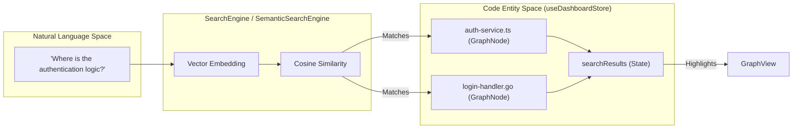
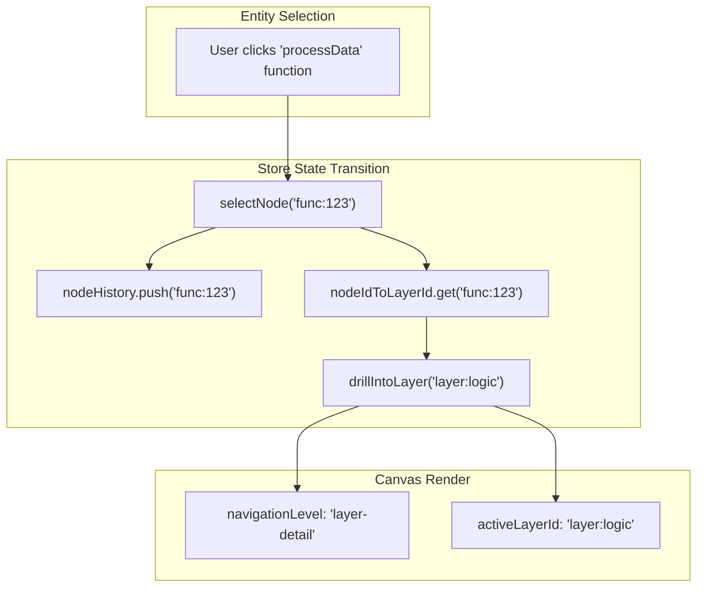

<!-- source: DeepWiki mcp.deepwiki.com · repo Egonex-AI/Understand-Anything · page 4.4 Dashboard State Management (Zustand Store) · fetched 2026-10-30 -->

# Dashboard State Management (Zustand Store)

<details>
<summary>Relevant source files</summary>

The following files were used as context for generating this wiki page:

- [understand-anything-plugin/packages/dashboard/src/App.tsx](understand-anything-plugin/packages/dashboard/src/App.tsx)
- [understand-anything-plugin/packages/dashboard/src/__tests__/allNodeTypes.test.ts](understand-anything-plugin/packages/dashboard/src/__tests__/allNodeTypes.test.ts)
- [understand-anything-plugin/packages/dashboard/src/__tests__/edgeCategories.test.ts](understand-anything-plugin/packages/dashboard/src/__tests__/edgeCategories.test.ts)
- [understand-anything-plugin/packages/dashboard/src/__tests__/store-navigation.test.ts](understand-anything-plugin/packages/dashboard/src/__tests__/store-navigation.test.ts)
- [understand-anything-plugin/packages/dashboard/src/components/CustomNode.tsx](understand-anything-plugin/packages/dashboard/src/components/CustomNode.tsx)
- [understand-anything-plugin/packages/dashboard/src/components/GraphView.tsx](understand-anything-plugin/packages/dashboard/src/components/GraphView.tsx)
- [understand-anything-plugin/packages/dashboard/src/components/NodeInfo.tsx](understand-anything-plugin/packages/dashboard/src/components/NodeInfo.tsx)
- [understand-anything-plugin/packages/dashboard/src/components/__tests__/structuralVisibleTypes.test.ts](understand-anything-plugin/packages/dashboard/src/components/__tests__/structuralVisibleTypes.test.ts)
- [understand-anything-plugin/packages/dashboard/src/store.ts](understand-anything-plugin/packages/dashboard/src/store.ts)
- [understand-anything-plugin/packages/dashboard/src/utils/layout.ts](understand-anything-plugin/packages/dashboard/src/utils/layout.ts)

</details>


This page documents the core state management implementation of the Understand Anything dashboard located in the `@understand-anything/dashboard` package. The dashboard leverages Zustand to define a centralized reactive store encapsulating the UI state, graph data, navigation logic, filtering preferences, and search functionality.

---

## 1. Purpose and Scope

The `useDashboardStore` Zustand store acts as the single source of truth for the dashboard's state. It manages the loaded knowledge graph data, indexes it for efficient lookups, tracks the current node selection and navigation context, controls UI panels and modes (e.g., focus mode, detail level), and manages filtering and search modes. It also integrates with the embedded search engines to provide both fuzzy and semantic search capabilities.

This page explains the key functions, state fields, and mechanisms by which the dashboard maintains and updates this state, supporting the interactive graph exploration and filtering features exposed in the UI.

---

## 2. Store Structure and Core Data

### 2.1 Graph Data and Indexing

The primary graph data is held in the `graph` field as a `KnowledgeGraph` instance. To optimize access patterns, three key index maps are rebuilt on every `setGraph` update [packages/dashboard/src/store.ts:75-96](). These include:

- `nodesById`: A `Map<string, GraphNode>` for quick node lookup by ID [packages/dashboard/src/store.ts:80-81]().
- `nodeIdToLayerId`: A `Map<string, string>`, mapping node IDs to their canonical (first matching) layer ID [packages/dashboard/src/store.ts:82-86]().
- `nodeIdToLayerIds`: A `Map<string, Set<string>>`, mapping node IDs to all layers they belong to [packages/dashboard/src/store.ts:83-94]().

The difference between `nodeIdToLayerId` and `nodeIdToLayerIds` is significant:
- `nodeIdToLayerId` implements first-match semantics used for navigation contexts where a unique parent layer is needed [packages/dashboard/src/store.ts:62-67]().
- `nodeIdToLayerIds` records every layer membership to enable filtering where any-layer membership is accepted [packages/dashboard/src/store.ts:69-73]().

### 2.2 Core State Fields

The Zustand store maintains a comprehensive set of state fields:

| Field | Type | Description |
| :--- | :--- | :--- |
| `graph` | `KnowledgeGraph \| null` | The active knowledge graph data [packages/dashboard/src/store.ts:102](). |
| `navigationLevel` | `NavigationLevel` | `"overview"` (layer view) or `"layer-detail"` (node view) [packages/dashboard/src/store.ts:117](). |
| `activeLayerId` | `string \| null` | The ID of the currently focused layer [packages/dashboard/src/store.ts:118](). |
| `persona` | `Persona` | `"non-technical"`, `"junior"`, or `"experienced"` [packages/dashboard/src/store.ts:128](). |
| `detailLevel` | `DetailLevel` | `"file"` (architecture) or `"class"` (code structure) [packages/dashboard/src/store.ts:153](). |
| `focusNodeId` | `string \| null` | Isolates a node's 1-hop neighborhood [packages/dashboard/src/store.ts:135](). |
| `diffMode` | `boolean` | Toggle for visualizing code changes [packages/dashboard/src/store.ts:130](). |
| `nodeHistory` | `string[]` | Stack of visited node IDs (max 50) [packages/dashboard/src/store.ts:138](). |

Sources: [packages/dashboard/src/store.ts:101-157](), [packages/dashboard/src/App.tsx:118-128]()

---

## 3. Key Actions and Functions

### 3.1 Loading Graph Data: `setGraph`

`setGraph(graph: KnowledgeGraph)` is the canonical method to load or replace the dashboard's graph. It performs the following:
- Rebuilds indexes via `buildGraphIndexes` [packages/dashboard/src/store.ts:75-96]().
- Resets search engines (`SearchEngine` and `SemanticSearchEngine`) [packages/dashboard/src/store.ts:112]().
- Clears selection, history, and active navigation levels [packages/dashboard/src/store.ts:158]().

### 3.2 Navigation and Layer Drill-down

- **`drillIntoLayer(layerId: string)`**: Sets `navigationLevel` to `"layer-detail"` and updates `activeLayerId` [packages/dashboard/src/store.ts:164]().
- **`navigateToNodeInLayer(nodeId: string)`**: Automatically identifies the correct layer for a node and drills into it, ensuring the node is visible in the structural canvas [packages/dashboard/src/store.ts:161]().
- **Container Management**: The store tracks `expandedContainers` (a `Set<string>`) to manage the ELK layout Stage 2 expansion [packages/dashboard/src/__tests__/store-navigation.test.ts:38-53](). Crossing layers via navigation triggers a cache reset of `containerLayoutCache` and `containerSizeMemory` [packages/dashboard/src/__tests__/store-navigation.test.ts:60-69]().

### 3.3 Persona and Detail Filtering

- **Persona**: The `persona` state [packages/dashboard/src/store.ts:128]() affects node visibility. `non-technical` personas may see a simplified graph compared to `experienced` users.
- **Detail Levels**: `detailLevel` toggles between `"file"` (showing only file-type nodes) and `"class"` (showing files and their internal classes) [packages/dashboard/src/store.ts:153-154]().
- **Node Categories**: Broad categories like `"code"`, `"infra"`, or `"docs"` are mapped from `NodeType` to allow batch filtering [packages/dashboard/src/components/GraphView.tsx:70-81]().

### 3.4 Search Integration

The store coordinates two search engines:
1. **Fuzzy Search**: Uses `SearchEngine` (Fuse.js) for string matching on node names and summaries [packages/dashboard/src/store.ts:2-3]().
2. **Semantic Search**: Uses `SemanticSearchEngine` for vector-based similarity [packages/dashboard/src/store.ts:113-114]().

When `searchQuery` changes, the store updates `searchResults`, which `CustomNode` components use to apply `searchScore` styling (e.g., `ring-accent-bright`) [packages/dashboard/src/components/CustomNode.tsx:116-124]().

---

## 4. Interaction Diagram

This diagram shows the flow from external data sources and user input into the Zustand store and out to the React components.

```mermaid
flowchart TB
  subgraph "Data API"
    KG["knowledge-graph.json"]
    DO["diff-overlay.json"]
  end

  subgraph "Zustand Store (useDashboardStore)"
    graph["graph (KnowledgeGraph)"]
    nodesById["nodesById (Index)"]
    selectedNodeId["selectedNodeId"]
    searchQuery["searchQuery"]
    searchResults["searchResults"]
    filters["FilterState"]
    
    setGraph["setGraph()"]
    selectNode["selectNode()"]
  end

  subgraph "UI Components"
    GV["GraphView (React Flow)"]
    SB["SearchBar"]
    NI["NodeInfo (Sidebar)"]
    FP["FilterPanel"]
  end

  KG -->|fetch| setGraph
  DO -->|fetch| setGraph
  setGraph --> graph
  graph --> nodesById
  
  SB -->|updates| searchQuery
  searchQuery -->|SearchEngine| searchResults
  
  GV -->|onNodeClick| selectNode
  selectNode --> selectedNodeId
  selectedNodeId --> NI
  
  FP -->|toggleNodeTypeFilter| filters
  filters --> GV
```

Sources: [packages/dashboard/src/store.ts:101-157](), [packages/dashboard/src/App.tsx:144-175](), [packages/dashboard/src/components/GraphView.tsx:26-52]()

---

## 5. Bridging NL Space to Code Entity Space

### 5.1 Semantic Search Mapping

This diagram illustrates how a Natural Language query is mapped to specific code entities within the `KnowledgeGraph` via the store's search orchestration.



Sources: [packages/dashboard/src/store.ts:110-115](), [packages/dashboard/src/components/CustomNode.tsx:116-124]()

### 5.2 Navigation and Layer Context

This diagram shows how selecting a code entity (e.g., a function) triggers state changes that shift the dashboard's structural context.



Sources: [packages/dashboard/src/store.ts:159-164](), [packages/dashboard/src/__tests__/store-navigation.test.ts:60-109]()

---

## 6. Edge and Node Categories

The store defines mapping logic to group fine-grained core types into dashboard filter categories.

### 6.1 Edge Category Mapping
Edges are grouped into 9 categories for the `FilterPanel` [packages/dashboard/src/store.ts:16](). The `EDGE_CATEGORY_MAP` [packages/dashboard/src/store.ts:31-41]() defines this mapping. A test `edgeCategories.test.ts` [packages/dashboard/src/__tests__/edgeCategories.test.ts:1-63]() ensures that every `CoreEdgeType` is mapped to exactly one category, preventing silent filtering issues.

| Category | Core Edge Types (`EdgeType`) |
| :--- | :--- |
| **structural** | `imports`, `exports`, `contains`, `inherits`, `implements` |
| **behavioral** | `calls`, `subscribes`, `publishes`, `middleware` |
| **data-flow** | `reads_from`, `writes_to`, `transforms`, `validates` |
| **dependencies** | `depends_on`, `tested_by`, `configures` |
| **semantic** | `related`, `similar_to` |
| **infrastructure** | `deploys`, `serves`, `provisions`, `triggers`, `migrates`, `documents`, `routes`, `defines_schema` |
| **domain** | `contains_flow`, `flow_step`, `cross_domain` |
| **knowledge** | `cites`, `contradicts`, `builds_on`, `exemplifies`, `categorized_under`, `authored_by` |
| **design** | `instance_of`, `variant_of`, `uses_token` |

Sources: [packages/dashboard/src/store.ts:31-41](), [packages/dashboard/src/__tests__/edgeCategories.test.ts:19-40]()

### 6.2 Node Category Mapping
Nodes are grouped into 7 categories for the `PersonaSelector` and `FilterPanel` [packages/dashboard/src/store.ts:53](). The `NODE_TYPE_TO_CATEGORY` map [packages/dashboard/src/components/GraphView.tsx:70-81]() defines this mapping. The `ALL_NODE_TYPES` array [packages/dashboard/src/store.ts:27]() and `structuralVisibleTypes.test.ts` [packages/dashboard/src/components/__tests__/structuralVisibleTypes.test.ts:1-92]() ensure that all core `NodeType`s are accounted for in filtering and display logic.

| Category | Core Node Types (`NodeType`) |
| :--- | :--- |
| **code** | `file`, `function`, `class`, `module`, `concept`, `page`, `screen`, `component`, `componentSet`, `instance`, `token` |
| **config** | `config` |
| **docs** | `document` |
| **infra** | `service`, `resource`, `pipeline` |
| **data** | `table`, `endpoint`, `schema` |
| **domain** | `domain`, `flow`, `step` |
| **knowledge** | `article`, `entity`, `topic`, `claim`, `source` |

Sources: [packages/dashboard/src/components/GraphView.tsx:70-81](), [packages/dashboard/src/components/CustomNode.tsx:8-36](), [packages/dashboard/src/store.ts:27](), [packages/dashboard/src/__tests__/allNodeTypes.test.ts:1-57](), [packages/dashboard/src/components/__tests__/structuralVisibleTypes.test.ts:1-92]()

---

Sources:
- [understand-anything-plugin/packages/dashboard/src/store.ts:1-797]()
- [understand-anything-plugin/packages/dashboard/src/App.tsx:1-159]()
- [understand-anything-plugin/packages/dashboard/src/components/GraphView.tsx:1-172]()
- [understand-anything-plugin/packages/dashboard/src/components/CustomNode.tsx:1-200]()
- [understand-anything-plugin/packages/dashboard/src/components/NodeInfo.tsx:1-144]()
- [understand-anything-plugin/packages/dashboard/src/utils/layout.ts:1-146]()
- [understand-anything-plugin/packages/dashboard/src/__tests__/edgeCategories.test.ts:1-62]()
- [understand-anything-plugin/packages/dashboard/src/__tests__/allNodeTypes.test.ts:1-56]()
- [understand-anything-plugin/packages/dashboard/src/__tests__/store-navigation.test.ts:1-109]()
- [understand-anything-plugin/packages/dashboard/src/components/__tests__/structuralVisibleTypes.test.ts:1-91]()

---

