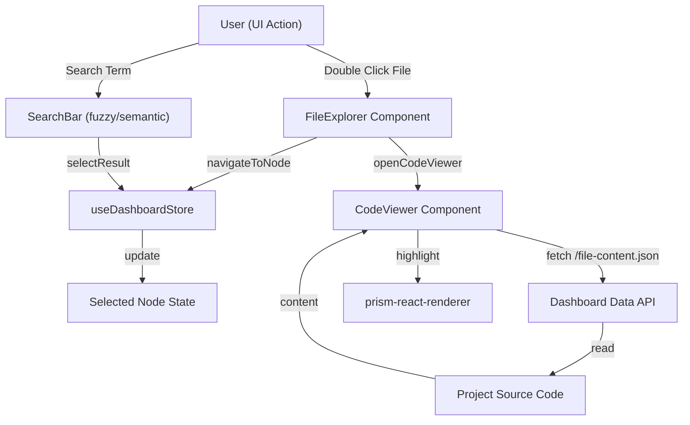
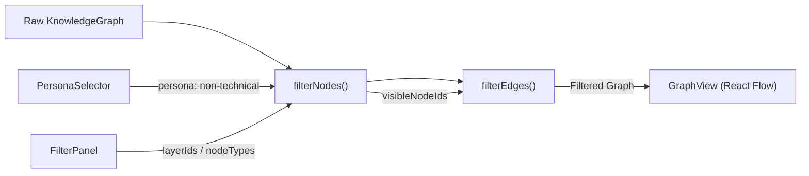

<!-- source: DeepWiki mcp.deepwiki.com · repo Egonex-AI/Understand-Anything · page 4.5 UI Components & Panels · fetched 2026-10-30 -->

# UI Components & Panels

Relevant source files

The following files were used as context for generating this wiki page:

- [tests/skill/understand/test_skill_graph_freshness.test.mjs](tests/skill/understand/test_skill_graph_freshness.test.mjs)
- [understand-anything-plugin/packages/dashboard/scripts/benchmark-aggregations.mjs](understand-anything-plugin/packages/dashboard/scripts/benchmark-aggregations.mjs)
- [understand-anything-plugin/packages/dashboard/src/__tests__/vite-staleness.test.ts](understand-anything-plugin/packages/dashboard/src/__tests__/vite-staleness.test.ts)
- [understand-anything-plugin/packages/dashboard/src/components/CodeViewer.tsx](understand-anything-plugin/packages/dashboard/src/components/CodeViewer.tsx)
- [understand-anything-plugin/packages/dashboard/src/components/ExportMenu.tsx](understand-anything-plugin/packages/dashboard/src/components/ExportMenu.tsx)
- [understand-anything-plugin/packages/dashboard/src/components/FileExplorer.tsx](understand-anything-plugin/packages/dashboard/src/components/FileExplorer.tsx)
- [understand-anything-plugin/packages/dashboard/src/components/FilterPanel.tsx](understand-anything-plugin/packages/dashboard/src/components/FilterPanel.tsx)
- [understand-anything-plugin/packages/dashboard/src/components/KeyboardShortcutsHelp.tsx](understand-anything-plugin/packages/dashboard/src/components/KeyboardShortcutsHelp.tsx)
- [understand-anything-plugin/packages/dashboard/src/components/LayerLegend.tsx](understand-anything-plugin/packages/dashboard/src/components/LayerLegend.tsx)
- [understand-anything-plugin/packages/dashboard/src/components/LearnPanel.tsx](understand-anything-plugin/packages/dashboard/src/components/LearnPanel.tsx)
- [understand-anything-plugin/packages/dashboard/src/components/MobileBottomNav.tsx](understand-anything-plugin/packages/dashboard/src/components/MobileBottomNav.tsx)
- [understand-anything-plugin/packages/dashboard/src/components/MobileDrawer.tsx](understand-anything-plugin/packages/dashboard/src/components/MobileDrawer.tsx)
- [understand-anything-plugin/packages/dashboard/src/components/MobileLayout.tsx](understand-anything-plugin/packages/dashboard/src/components/MobileLayout.tsx)
- [understand-anything-plugin/packages/dashboard/src/components/NodeTooltip.tsx](understand-anything-plugin/packages/dashboard/src/components/NodeTooltip.tsx)
- [understand-anything-plugin/packages/dashboard/src/components/OnboardingOverlay.tsx](understand-anything-plugin/packages/dashboard/src/components/OnboardingOverlay.tsx)
- [understand-anything-plugin/packages/dashboard/src/components/PathFinderModal.tsx](understand-anything-plugin/packages/dashboard/src/components/PathFinderModal.tsx)
- [understand-anything-plugin/packages/dashboard/src/components/PersonaSelector.tsx](understand-anything-plugin/packages/dashboard/src/components/PersonaSelector.tsx)
- [understand-anything-plugin/packages/dashboard/src/components/ProjectOverview.tsx](understand-anything-plugin/packages/dashboard/src/components/ProjectOverview.tsx)
- [understand-anything-plugin/packages/dashboard/src/components/SearchBar.tsx](understand-anything-plugin/packages/dashboard/src/components/SearchBar.tsx)
- [understand-anything-plugin/packages/dashboard/src/components/StalenessBanner.tsx](understand-anything-plugin/packages/dashboard/src/components/StalenessBanner.tsx)
- [understand-anything-plugin/packages/dashboard/src/components/__tests__/StalenessBanner.test.ts](understand-anything-plugin/packages/dashboard/src/components/__tests__/StalenessBanner.test.ts)
- [understand-anything-plugin/packages/dashboard/src/contexts/I18nContext.tsx](understand-anything-plugin/packages/dashboard/src/contexts/I18nContext.tsx)
- [understand-anything-plugin/packages/dashboard/src/hooks/useKeyboardShortcuts.ts](understand-anything-plugin/packages/dashboard/src/hooks/useKeyboardShortcuts.ts)
- [understand-anything-plugin/packages/dashboard/src/index.css](understand-anything-plugin/packages/dashboard/src/index.css)
- [understand-anything-plugin/packages/dashboard/src/themes/presets.ts](understand-anything-plugin/packages/dashboard/src/themes/presets.ts)
- [understand-anything-plugin/packages/dashboard/src/utils/__tests__/filters.test.ts](understand-anything-plugin/packages/dashboard/src/utils/__tests__/filters.test.ts)
- [understand-anything-plugin/packages/dashboard/src/utils/__tests__/layerStats.test.ts](understand-anything-plugin/packages/dashboard/src/utils/__tests__/layerStats.test.ts)
- [understand-anything-plugin/packages/dashboard/src/utils/filters.ts](understand-anything-plugin/packages/dashboard/src/utils/filters.ts)
- [understand-anything-plugin/packages/dashboard/src/utils/layerStats.ts](understand-anything-plugin/packages/dashboard/src/utils/layerStats.ts)

This section documents the major UI components and panels comprising the React-based interactive dashboard of Understand Anything. These components provide users the ability to navigate, filter, search, explore, and learn from the complex knowledge graph derived from a codebase.

---

## Overview & Scope

The dashboard is a React + TypeScript application employing Zustand for global state management (`useDashboardStore`). It integrates `@xyflow/react` (React Flow) for graph visualization and `prism-react-renderer` for syntax highlighting [understand-anything-plugin/packages/dashboard/package.json:15-30]().

Each UI component consumes and updates dashboard state via the Zustand store, coordinating loaded knowledge and domain graphs, selected nodes, filters, search modes, personas, and UI panel visibility. The system uses an internationalization context (`useI18n`) for localized text presentation [understand-anything-plugin/packages/dashboard/src/contexts/I18nContext.tsx:1-44]().

---

## 1. Graph Visualization Nodes: `CustomNode`

`CustomNode` renders individual nodes in the graph visualizations. It is used inside React Flow's node rendering pipeline.

### Implementation Highlights
- Draws a vertical colored bar on the left side representing the node's `NodeType`—colors are tied to CSS variables (e.g., `--color-node-file`) defined in the theme [understand-anything-plugin/packages/dashboard/src/index.css:27-46]().
- Displays node type badges, complexity indicators, and a truncated node name.
- Supports styling states for node selection, search highlight, tour highlight, and difference overlay indication.
- Employs `.node-glow` for selected nodes and `.diff-changed-glow` for modified entities [understand-anything-plugin/packages/dashboard/src/index.css:194-205]().

**Sources:** [understand-anything-plugin/packages/dashboard/src/index.css:27-205](), [understand-anything-plugin/packages/dashboard/package.json:17-30]()

---

## 2. Search Bar: `SearchBar`

`SearchBar` provides a single input box allowing users to search nodes by name, summary, or tags.

### Key Features
- **Fuzzy Mode**: Uses Fuse.js for approximate string matching [understand-anything-plugin/packages/dashboard/src/components/SearchBar.tsx:114-123]().
- **Semantic Mode**: Leverages embeddings and cosine similarity for concept-based search [understand-anything-plugin/packages/dashboard/src/components/SearchBar.tsx:124-133]().
- **Dropdown Results**: Shows a list of top matches with type badges (e.g., `function`, `class`) and relevance bars [understand-anything-plugin/packages/dashboard/src/components/SearchBar.tsx:144-175]().
- **Navigation**: Clicking a result invokes `navigateToNodeInLayer` to center the graph on the target [understand-anything-plugin/packages/dashboard/src/components/SearchBar.tsx:54-60]().

**Sources:** [understand-anything-plugin/packages/dashboard/src/components/SearchBar.tsx:1-180]()

---

## 3. Code Viewer: `CodeViewer`

`CodeViewer` displays the source code associated with a selected node, supporting syntax highlighting and line range focus.

### Implementation Details
- **Syntax Highlighting**: Uses `prism-react-renderer` with a custom dark theme [understand-anything-plugin/packages/dashboard/src/components/CodeViewer.tsx:2-6]().
- **Data Fetching**: Fetches file contents from the Vite middleware API `/file-content.json` using an `accessToken` [understand-anything-plugin/packages/dashboard/src/components/CodeViewer.tsx:28-31]().
- **Markdown Support**: Includes a specialized `MarkdownView` using `react-markdown` and `remark-gfm` for `.md` files [understand-anything-plugin/packages/dashboard/src/components/CodeViewer.tsx:62-119]().
- **Line Ranges**: Highlights specific code segments based on the node's `lineRange` property [understand-anything-plugin/packages/dashboard/src/components/CodeViewer.tsx:144-146]().

**Sources:** [understand-anything-plugin/packages/dashboard/src/components/CodeViewer.tsx:1-170]()

---

## 4. File Explorer: `FileExplorer`

The `FileExplorer` presents a hierarchical file tree derived from the `KnowledgeGraph` nodes.

### Implementation Highlights
- **Tree Construction**: `buildFileTree` recursively organizes `GraphNode` objects into a folder/file structure [understand-anything-plugin/packages/dashboard/src/components/FileExplorer.tsx:27-82]().
- **Interaction**: Single-click navigates the graph; double-click opens the `CodeViewer` [understand-anything-plugin/packages/dashboard/src/components/FileExplorer.tsx:152-155]().
- **Normalization**: Cleans file paths to ensure consistent tree nesting [understand-anything-plugin/packages/dashboard/src/components/FileExplorer.tsx:14-19]().

**Sources:** [understand-anything-plugin/packages/dashboard/src/components/FileExplorer.tsx:1-214]()

---

## 5. Project Overview: `ProjectOverview`

The `ProjectOverview` component provides a summary of the loaded graph, including statistics about nodes, edges, layers, and detected languages/frameworks.

### Implementation Details
- **Graph Statistics**: Calculates and displays counts for nodes, edges, layers, and unique node types [understand-anything-plugin/packages/dashboard/src/components/ProjectOverview.tsx:17-30]().
- **Type Breakdown**: Categorizes nodes into "Code", "Config", "Docs", "Infra", "Data", and "Domain" with visual indicators [understand-anything-plugin/packages/dashboard/src/components/ProjectOverview.tsx:47-54]().
- **Language/Framework Detection**: Lists detected programming languages and frameworks from the `project` metadata [understand-anything-plugin/packages/dashboard/src/components/ProjectOverview.tsx:103-128]().
- **Top Nodes**: Identifies and lists nodes with the most connections [understand-anything-plugin/packages/dashboard/src/components/ProjectOverview.tsx:32-43]().

**Sources:** [understand-anything-plugin/packages/dashboard/src/components/ProjectOverview.tsx:1-222]()

---

## 6. Persona Selector: `PersonaSelector`

The `PersonaSelector` allows users to switch between different viewing personas, which apply predefined filters to the graph.

### Implementation Details
- **Persona Definitions**: Personas (e.g., "Technical", "Non-Technical") are defined in the i18n context and control which node types and edge categories are visible.
- **Filter Application**: When a persona is selected, the `setPersona` action in `useDashboardStore` updates the active filters, triggering a re-render of the graph.

**Sources:** [understand-anything-plugin/packages/dashboard/src/components/PersonaSelector.tsx]()

---

## 7. Filter Panel: `FilterPanel`

The `FilterPanel` provides granular controls for filtering nodes and edges based on various criteria.

### Implementation Details
- **Node Type Filters**: Allows toggling visibility of different `NodeType`s (e.g., `file`, `function`, `class`).
- **Complexity Filters**: Filters nodes based on their `complexity` attribute (e.g., `simple`, `moderate`, `complex`).
- **Layer Filters**: Enables users to select which architectural layers are displayed.
- **Edge Category Filters**: Filters edges based on their semantic categories (e.g., "Calls", "Contains", "Depends On").
- **Filter Logic**: The `filterNodes` and `filterEdges` utility functions apply these filters to the graph data [understand-anything-plugin/packages/dashboard/src/utils/filters.ts:19-76]().

**Sources:** [understand-anything-plugin/packages/dashboard/src/components/FilterPanel.tsx](), [understand-anything-plugin/packages/dashboard/src/utils/filters.ts:1-97]()

---

## 8. Path Finder Modal: `PathFinderModal`

The `PathFinderModal` helps users discover paths between two selected nodes in the graph.

### Implementation Details
- **Node Selection**: Users can select a source and target node within the modal.
- **Pathfinding Algorithm**: Likely uses a graph traversal algorithm (e.g., BFS or DFS) to find paths.
- **Visualization**: Highlights the discovered path on the main graph view.

**Sources:** [understand-anything-plugin/packages/dashboard/src/components/PathFinderModal.tsx]()

---

## 9. Export Menu: `ExportMenu`

Provides functionality to export the current graph view for external documentation or sharing.

### Implementation Details
- **SVG Export**: Generates a clean XML string of visible nodes and edges, applying basic styling for lines and rectangles [understand-anything-plugin/packages/dashboard/src/components/ExportMenu.tsx:47-102]().
- **PNG Export**: Renders the generated SVG onto a HTML5 Canvas at 2x resolution for high-quality raster output [understand-anything-plugin/packages/dashboard/src/components/ExportMenu.tsx:104-154]().
- **JSON Export**: Filters the `KnowledgeGraph` based on the active persona and current UI filters before downloading [understand-anything-plugin/packages/dashboard/src/components/ExportMenu.tsx:189-196]().

**Sources:** [understand-anything-plugin/packages/dashboard/src/components/ExportMenu.tsx:1-188]()

---

## 10. Warning Banner: `WarningBanner`

A general-purpose banner component for displaying important messages or warnings to the user.

### Implementation Details
- **Styling**: Uses specific CSS variables for warning colors, e.g., `[data-theme="light"] .warning-banner` [understand-anything-plugin/packages/dashboard/src/index.css:257-261]().
- **Visibility**: Controlled by dashboard state, appearing for various conditions like graph staleness or errors.

**Sources:** [understand-anything-plugin/packages/dashboard/src/index.css:257-261]()

---

## 11. Onboarding Overlay: `OnboardingOverlay`

A modal displayed for first-time users to guide them through the dashboard's capabilities.

### Implementation Details
- **Step Management**: Uses a scripted sequence of steps defined in the i18n context [understand-anything-plugin/packages/dashboard/src/components/OnboardingOverlay.tsx:21-24]().
- **Persistence**: Supports a "Skip Forever" option which the parent component persists to `localStorage` [understand-anything-plugin/packages/dashboard/src/components/OnboardingOverlay.tsx:92-98]().
- **Visuals**: Uses glassmorphism (`.glass`) and custom keyframe animations (`ua-fade-in`) for a luxury feel [understand-anything-plugin/packages/dashboard/src/components/OnboardingOverlay.tsx:132-157]().

**Sources:** [understand-anything-plugin/packages/dashboard/src/components/OnboardingOverlay.tsx:1-238]()

---

## 12. Staleness Banner: `StalenessBanner`

Alerts the user when the visualized graph is out of sync with the local filesystem.

### Implementation Details
- **Middleware Logic**: The Vite server computes freshness by comparing the `gitCommitHash` and `analyzedAt` timestamps in `knowledge-graph.json` against the current project state [understand-anything-plugin/packages/dashboard/src/__tests__/vite-staleness.test.ts:181-186]().
- **Detection**: Uses `isDashboardFreshnessReport` to validate the structure of the freshness report received from the server [understand-anything-plugin/packages/dashboard/src/__tests__/vite-staleness.test.ts:179-180]().
- **UI Update**: The banner displays messages like "Graph is stale" or "Domain graph is stale" based on the report [understand-anything-plugin/packages/dashboard/src/components/StalenessBanner.tsx]().

**Sources:** [understand-anything-plugin/packages/dashboard/src/__tests__/vite-staleness.test.ts:1-208](), [understand-anything-plugin/packages/dashboard/src/components/StalenessBanner.tsx]()

---

## 13. Keyboard Shortcuts

The dashboard provides a set of keyboard shortcuts for efficient navigation and interaction.

### Implementation Details
- **`useKeyboardShortcuts` Hook**: A custom React hook `useKeyboardShortcuts` manages global keyboard event listeners [understand-anything-plugin/packages/dashboard/src/hooks/useKeyboardShortcuts.ts:14-50]().
- **Shortcut Definition**: Shortcuts are defined as an array of `KeyboardShortcut` objects, specifying the key, modifier keys (Ctrl, Shift, Alt, Meta), a description, and an action function [understand-anything-plugin/packages/dashboard/src/hooks/useKeyboardShortcuts.ts:3-12]().
- **Platform Awareness**: The `formatShortcutKey` utility adapts key displays for macOS (e.g., `⌘` for Meta) versus other platforms (e.g., `Ctrl`) [understand-anything-plugin/packages/dashboard/src/hooks/useKeyboardShortcuts.ts:52-71]().
- **Input Prevention**: Shortcuts are prevented from firing when the user is typing in input fields or text areas [understand-anything-plugin/packages/dashboard/src/hooks/useKeyboardShortcuts.ts:23-27]().

**Sources:** [understand-anything-plugin/packages/dashboard/src/hooks/useKeyboardShortcuts.ts:1-71](), [understand-anything-plugin/packages/dashboard/src/components/KeyboardShortcutsHelp.tsx]()

---

## 14. Mobile Layout

The dashboard includes responsive design elements to adapt to smaller screens.

### Implementation Details
- **Mobile Drawer**: A `MobileDrawer` component provides a slide-out panel for navigation and controls on mobile devices [understand-anything-plugin/packages/dashboard/src/components/MobileDrawer.tsx]().
- **Mobile Bottom Navigation**: `MobileBottomNav` offers primary navigation options at the bottom of the screen [understand-anything-plugin/packages/dashboard/src/components/MobileBottomNav.tsx]().
- **Conditional Rendering**: The `MobileLayout` component orchestrates the display of mobile-specific UI elements based on screen size [understand-anything-plugin/packages/dashboard/src/components/MobileLayout.tsx]().

**Sources:** [understand-anything-plugin/packages/dashboard/src/components/MobileLayout.tsx](), [understand-anything-plugin/packages/dashboard/src/components/MobileDrawer.tsx](), [understand-anything-plugin/packages/dashboard/src/components/MobileBottomNav.tsx]()

---

## Data Flow & Interaction Summary

### Diagram: UI Action to Code Entity Resolution
This diagram illustrates how a user action in the "Natural Language Space" (UI) resolves to specific code entities and data fetches.

**Sources:** [understand-anything-plugin/packages/dashboard/src/components/FileExplorer.tsx:152-155](), [understand-anything-plugin/packages/dashboard/src/components/CodeViewer.tsx:167-174](), [understand-anything-plugin/packages/dashboard/src/components/SearchBar.tsx:54-60]()

### Diagram: Filter & Persona Pipeline
This diagram shows how the dashboard state filters the raw KnowledgeGraph for display.

**Sources:** [understand-anything-plugin/packages/dashboard/src/utils/filters.ts:19-51](), [understand-anything-plugin/packages/dashboard/src/components/ExportMenu.tsx:189-196]()

---

## Component Summary Table

| Component | Purpose | Key File |
| :--- | :--- | :--- |
| `CustomNode` | Specialized React Flow node with type-based styling. | `index.css` |
| `NodeInfo` | Sidebar for metadata, relationships, and complexity. | `NodeInfo.tsx` |
| `SearchBar` | Fuzzy and semantic search engine integration. | `SearchBar.tsx` |
| `LearnPanel` | Provides contextual learning content. | `LearnPanel.tsx` |
| `LayerLegend` | Legend for architectural layers and color codes. | `LayerLegend.tsx` |
| `CodeViewer` | Source code and Markdown renderer with line highlighting. | `CodeViewer.tsx` |
| `FileExplorer` | Hierarchical project structure browser. | `FileExplorer.tsx` |
| `ProjectOverview` | Summary of graph statistics, languages, and frameworks. | `ProjectOverview.tsx` |
| `PersonaSelector` | Applies predefined filters based on user roles. | `PersonaSelector.tsx` |
| `FilterPanel` | Granular controls for node, edge, and layer filtering. | `FilterPanel.tsx` |
| `PathFinderModal` | Helps find paths between two nodes. | `PathFinderModal.tsx` |
| `ExportMenu` | SVG/PNG/JSON export utilities. | `ExportMenu.tsx` |
| `WarningBanner` | Displays general warning messages. | `WarningBanner.tsx` |
| `OnboardingOverlay` | Multi-step guide for new users. | `OnboardingOverlay.tsx` |
| `StalenessBanner` | Alerts user if the graph is out of sync with code. | `StalenessBanner.tsx` |
| `Keyboard Shortcuts` | Global keyboard event handling and display. | `useKeyboardShortcuts.ts` |
| `Mobile Layout` | Responsive design for smaller screens. | `MobileLayout.tsx` |

**Sources:** [understand-anything-plugin/packages/dashboard/src/components/SearchBar.tsx](), [understand-anything-plugin/packages/dashboard/src/components/CodeViewer.tsx](), [understand-anything-plugin/packages/dashboard/src/components/FileExplorer.tsx](), [understand-anything-plugin/packages/dashboard/src/components/ExportMenu.tsx](), [understand-anything-plugin/packages/dashboard/src/components/LearnPanel.tsx](), [understand-anything-plugin/packages/dashboard/src/components/LayerLegend.tsx](), [understand-anything-plugin/packages/dashboard/src/components/ProjectOverview.tsx](), [understand-anything-plugin/packages/dashboard/src/components/PersonaSelector.tsx](), [understand-anything-plugin/packages/dashboard/src/components/FilterPanel.tsx](), [understand-anything-plugin/packages/dashboard/src/components/PathFinderModal.tsx](), [understand-anything-plugin/packages/dashboard/src/components/WarningBanner.tsx](), [understand-anything-plugin/packages/dashboard/src/components/OnboardingOverlay.tsx](), [understand-anything-plugin/packages/dashboard/src/components/StalenessBanner.tsx](), [understand-anything-plugin/packages/dashboard/src/hooks/useKeyboardShortcuts.ts](), [understand-anything-plugin/packages/dashboard/src/components/MobileLayout.tsx]()

---

