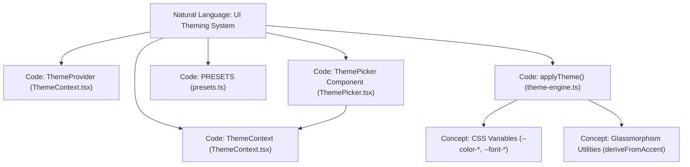
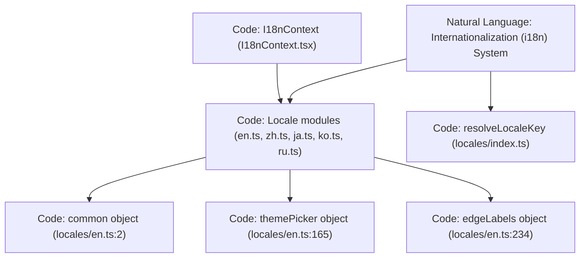

<!-- source: DeepWiki mcp.deepwiki.com · repo Egonex-AI/Understand-Anything · page 4.6 Theming & Internationalization · fetched 2026-10-30 -->

# Theming & Internationalization

<details>
<summary>Relevant source files</summary>

The following files were used as context for generating this wiki page:

- [understand-anything-plugin/packages/dashboard/src/components/ThemePicker.tsx](understand-anything-plugin/packages/dashboard/src/components/ThemePicker.tsx)
- [understand-anything-plugin/packages/dashboard/src/locales/en.ts](understand-anything-plugin/packages/dashboard/src/locales/en.ts)
- [understand-anything-plugin/packages/dashboard/src/locales/index.ts](understand-anything-plugin/packages/dashboard/src/locales/index.ts)
- [understand-anything-plugin/packages/dashboard/src/locales/ja.ts](understand-anything-plugin/packages/dashboard/src/locales/ja.ts)
- [understand-anything-plugin/packages/dashboard/src/locales/ko.ts](understand-anything-plugin/packages/dashboard/src/locales/ko.ts)
- [understand-anything-plugin/packages/dashboard/src/locales/ru.ts](understand-anything-plugin/packages/dashboard/src/locales/ru.ts)
- [understand-anything-plugin/packages/dashboard/src/locales/zh-TW.ts](understand-anything-plugin/packages/dashboard/src/locales/zh-TW.ts)
- [understand-anything-plugin/packages/dashboard/src/locales/zh.ts](understand-anything-plugin/packages/dashboard/src/locales/zh.ts)
- [understand-anything-plugin/packages/dashboard/src/themes/ThemeContext.tsx](understand-anything-plugin/packages/dashboard/src/themes/ThemeContext.tsx)
- [understand-anything-plugin/packages/dashboard/src/themes/index.ts](understand-anything-plugin/packages/dashboard/src/themes/index.ts)
- [understand-anything-plugin/packages/dashboard/src/themes/theme-engine.ts](understand-anything-plugin/packages/dashboard/src/themes/theme-engine.ts)
- [understand-anything-plugin/packages/dashboard/src/themes/types.ts](understand-anything-plugin/packages/dashboard/src/themes/types.ts)

</details>


This section documents the comprehensive theming and internationalization (i18n) systems implemented in the Understand Anything dashboard. It covers the design and implementation details of the theme context and engine, available theme presets, CSS variable architecture, utilities for glassmorphism, the interactive `ThemePicker` component, and the multilingual support infrastructure including locale management and translation resources for English, Chinese (Simplified/Traditional), Japanese, Korean, and Russian.

---

## 1. Theme System Overview

The theme system enables dynamic alteration of the dashboard's appearance, including colors, accents, and typography, ensuring a customizable UI experience. It is implemented using React context and hooks for state management, coupled with runtime CSS variable updates.

### Key Components:

- **ThemeContext & ThemeProvider**: React context that holds the current theme configuration and exposes setters to update theme preset, accent color, and heading font [packages/dashboard/src/themes/ThemeContext.tsx:17-25]().
- **ThemeEngine**: Updates CSS variables on the `<html>` root element based on the active theme config via `applyTheme` [packages/dashboard/src/themes/theme-engine.ts:33-65]().
- **Theme Presets**: Predefined color palettes including `dark-gold`, `dark-ocean`, `dark-forest`, `dark-rose`, and `light-minimal` [packages/dashboard/src/themes/types.ts:1-6]().
- **ThemePicker Component**: UI widget that presents selectable theme presets, accent color swatches, and heading font options [packages/dashboard/src/components/ThemePicker.tsx:6-180]().
- **CSS Variable Architecture**: Uses variables like `--color-root`, `--color-surface`, `--color-accent`, and `--font-heading` to define visual styles [packages/dashboard/src/themes/theme-engine.ts:38-64]().
- **Glassmorphism Utilities**: CSS color overlays and border styles for translucent "glass" effects derived from the accent color in `deriveFromAccent` [packages/dashboard/src/themes/theme-engine.ts:10-31]().

Sources:  
[packages/dashboard/src/themes/ThemeContext.tsx:1-107]()  
[packages/dashboard/src/themes/theme-engine.ts:1-66]()  
[packages/dashboard/src/components/ThemePicker.tsx:1-181]()  
[packages/dashboard/src/themes/types.ts:1-37]()

---

## 2. ThemeContext & ThemeProvider

The `ThemeContext` encapsulates theme-related state and actions, sharing them throughout the React component tree.

### Implementation details:

- Created with `createContext<ThemeContextValue | null>(null)` [packages/dashboard/src/themes/ThemeContext.tsx:25]().
- The context value exposes:
  - `config: ThemeConfig` — active theme config containing `presetId`, `accentId`, and optional `headingFont` [packages/dashboard/src/themes/ThemeContext.tsx:18]().
  - `preset: ThemePreset` — full preset details resolved from `presetId` [packages/dashboard/src/themes/ThemeContext.tsx:19]().
  - Setter functions: `setPreset(presetId)`, `setAccent(accentId)`, `setHeadingFont(font)` [packages/dashboard/src/themes/ThemeContext.tsx:20-22]().

### ThemeProvider Behavior:

- Maintains internal `config` state initialized by `resolveInitialTheme()` [packages/dashboard/src/themes/ThemeContext.tsx:59]():
  - Attempts to load from `localStorage` (key `"ua-theme"`) [packages/dashboard/src/themes/ThemeContext.tsx:27-39]().
  - Falls back to optional `metaTheme` prop or `DEFAULT_THEME_CONFIG` [packages/dashboard/src/themes/ThemeContext.tsx:49-51]().
- On every `config` update, calls `applyTheme(config)` which updates CSS variables [packages/dashboard/src/themes/ThemeContext.tsx:63-69]().
- After initial mount, persists user preference in `localStorage` via `saveToLocalStorage` [packages/dashboard/src/themes/ThemeContext.tsx:66]().

### Usage:

Access the context via `useTheme()` hook:

```tsx
const { config, preset, setPreset, setAccent, setHeadingFont } = useTheme();
```

Sources:  
[packages/dashboard/src/themes/ThemeContext.tsx:1-107]()

---

## 3. Theme Engine & CSS Variable Application

The **ThemeEngine** applies the active theme by updating CSS custom properties on the document root (`<html>`).

### Function: `applyTheme(config: ThemeConfig)`

- Resolves preset and finds active accent swatch via `getPreset` and `getAccent` [packages/dashboard/src/themes/theme-engine.ts:34-35]().
- Applies preset's base colors as CSS variables prefixed with `--color-` [packages/dashboard/src/themes/theme-engine.ts:38-41]().
- Applies accent colors explicitly: `--color-accent`, `--color-accent-dim`, `--color-accent-bright` [packages/dashboard/src/themes/theme-engine.ts:44-46]().
- Programmatically derives additional CSS variables from the accent base color using `deriveFromAccent` [packages/dashboard/src/themes/theme-engine.ts:49-52]():
  - Glassmorphism backgrounds: `--glass-bg`, `--glass-bg-heavy` [packages/dashboard/src/themes/theme-engine.ts:15-16]().
  - Borders: `--glass-border`, `--color-border-subtle` [packages/dashboard/src/themes/theme-engine.ts:13-18]().
  - Glow effects: `--glow-accent`, `--glow-accent-pulse` [packages/dashboard/src/themes/theme-engine.ts:21-23]().
  - Graph edges: `--color-edge`, `--color-edge-dim` [packages/dashboard/src/themes/theme-engine.ts:24-25]().
- Sets a `data-theme` attribute on `<html>` for `"dark"` or `"light"` [packages/dashboard/src/themes/theme-engine.ts:55]().
- Sets the heading font via `--font-heading`, mapping `headingFont` values (`serif`, `sans`, `mono`) to CSS font variables [packages/dashboard/src/themes/theme-engine.ts:58-64]().

### Utility:

- `hexToRgb(hex: string)` converts a hex color code to an RGB string for use in `rgba()` colors [packages/dashboard/src/themes/theme-engine.ts:4-8]().

Sources:  
[packages/dashboard/src/themes/theme-engine.ts:1-66]()  

---

## 4. Theme Presets & Accent Swatches

The dashboard includes several predefined **theme presets** implemented as `ThemePreset` objects.

### Presets supported:

| Preset ID | Description |
| :--- | :--- |
| `dark-gold` | Dark theme with warm gold/yellow hues (Default) |
| `dark-ocean` | Dark theme with cool blue/cyan hues |
| `dark-forest` | Dark theme with deep green hues |
| `dark-rose` | Dark theme with rose/pink hues |
| `light-minimal` | Light, minimalistic color palette |

### Accent Swatches:

Each preset contains `accentSwatches`, allowing users to choose specific highlight colors within that theme. Selecting a new preset resets the accent to the preset's `defaultAccentId` [packages/dashboard/src/themes/ThemeContext.tsx:78-83]().

Sources:  
[packages/dashboard/src/themes/ThemeContext.tsx:78-83]()  
[packages/dashboard/src/themes/types.ts:1-6]()  
[packages/dashboard/src/themes/presets.ts:1-2]()  

---

## 5. Glassmorphism Utilities

The theming system supports **glassmorphism** effects by dynamically calculating translucent background and border colors based on the active accent color.

### Derived CSS variables for glassmorphism:

- `--glass-bg`: `rgba(20, 20, 20, 0.8)` (dark) or `rgba(255, 255, 255, 0.8)` (light) [packages/dashboard/src/themes/theme-engine.ts:15]().
- `--glass-border`: Uses the accent RGB with low opacity (0.1 or 0.08) [packages/dashboard/src/themes/theme-engine.ts:17]().
- `--glass-bg-heavy`: Higher opacity background for overlays [packages/dashboard/src/themes/theme-engine.ts:16]().

These are computed in the `deriveFromAccent(accentHex, isDark)` function, ensuring that components using "glass" styling remain visually coherent with the selected accent and dark/light mode [packages/dashboard/src/themes/theme-engine.ts:10-31]().

Sources:  
[packages/dashboard/src/themes/theme-engine.ts:10-31]()

---

## 6. ThemePicker Component

The **ThemePicker** is a React UI component offering an interactive dropdown for users to manage theme settings.

### Key Features:

- Hooks into the theme system via the `useTheme()` hook [packages/dashboard/src/components/ThemePicker.tsx:7]().
- Uses the localization hook `useI18n()` for translated UI strings [packages/dashboard/src/components/ThemePicker.tsx:10]().
- **Preset Selection**: Displays a list of themes with color preview dots representing root, surface, and accent colors [packages/dashboard/src/components/ThemePicker.tsx:75-118]().
- **Accent Selection**: Renders clickable swatches for all accent colors available in the current preset [packages/dashboard/src/components/ThemePicker.tsx:122-141]().
- **Font Selection**: Provides buttons for `serif`, `sans`, and `mono` heading fonts [packages/dashboard/src/components/ThemePicker.tsx:144-175]().
- **Interactions**: Closes on outside click [packages/dashboard/src/components/ThemePicker.tsx:13-22]() or Escape key [packages/dashboard/src/components/ThemePicker.tsx:25-32]().

Sources:  
[packages/dashboard/src/components/ThemePicker.tsx:1-181]()  

---

## 7. Internationalization (i18n) System

The internationalization system supports multiple languages enabling localized UI experiences.

### Supported Locales

| Locale Key | Language | Source File |
| :--- | :--- | :--- |
| `en` | English | [packages/dashboard/src/locales/en.ts]() |
| `zh` | Chinese (Simplified) | [packages/dashboard/src/locales/zh.ts]() |
| `zh-TW` | Chinese (Traditional) | [packages/dashboard/src/locales/zh-TW.ts]() |
| `ja` | Japanese | [packages/dashboard/src/locales/ja.ts]() |
| `ko` | Korean | [packages/dashboard/src/locales/ko.ts]() |
| `ru` | Russian | [packages/dashboard/src/locales/ru.ts]() |

### Structure

Each locale file exports a nested object with categories such as `common`, `projectOverview`, `nodeInfo`, `themePicker`, and `keyboardShortcuts`. 

- **Locale Resolution**: The `resolveLocaleKey` function normalizes browser language strings (e.g., "zh-CN" to "zh") [packages/dashboard/src/locales/index.ts:24-33]().
- **Edge Labels**: The system provides localized labels for graph edges, supporting both forward and backward directions (e.g., "imports" vs "imported by") [packages/dashboard/src/locales/en.ts:234-237](), [packages/dashboard/src/locales/zh.ts:234-237](), [packages/dashboard/src/locales/zh-TW.ts:234-237](), [packages/dashboard/src/locales/ja.ts:234-237](), [packages/dashboard/src/locales/ko.ts:234-237](), [packages/dashboard/src/locales/ru.ts:234-237]().
- **Common Strings**: Basic UI elements like "Loading project..." [packages/dashboard/src/locales/en.ts:3]() or "Back" [packages/dashboard/src/locales/en.ts:8]().

Sources:  
[packages/dashboard/src/locales/index.ts:1-36]()  
[packages/dashboard/src/locales/en.ts:1-237]()  
[packages/dashboard/src/locales/zh.ts:1-262]()  
[packages/dashboard/src/locales/zh-TW.ts:1-262]()  
[packages/dashboard/src/locales/ja.ts:1-253]()  
[packages/dashboard/src/locales/ko.ts:1-257]()  
[packages/dashboard/src/locales/ru.ts:1-230]()  

---

## 8. Natural Language to Code Entity Space Association Diagrams

### Diagram 1: Theme System Natural Language to Code Entities



Sources:
[packages/dashboard/src/themes/ThemeContext.tsx:1-107]()
[packages/dashboard/src/themes/theme-engine.ts:1-66]()
[packages/dashboard/src/components/ThemePicker.tsx:1-181]()

### Diagram 2: Internationalization Natural Language to Code Entities



Sources:
[packages/dashboard/src/locales/index.ts:1-36]()
[packages/dashboard/src/locales/en.ts:1-237]()

---

## 9. Summary Table: Theme & Internationalization Key Files

| Feature | Primary File | Description |
| :--- | :--- | :--- |
| ThemeContext & Provider | [packages/dashboard/src/themes/ThemeContext.tsx]() | React context managing theme state & persistence |
| ThemeEngine | [packages/dashboard/src/themes/theme-engine.ts]() | Applies theme to CSS variables & glass effects |
| Theme Types | [packages/dashboard/src/themes/types.ts]() | Definitions for `ThemePreset`, `AccentSwatch`, and `ThemeConfig` |
| ThemePicker UI | [packages/dashboard/src/components/ThemePicker.tsx]() | Dropdown UI to select preset, accent, fonts |
| English Locales | [packages/dashboard/src/locales/en.ts]() | Base translation strings |
| Chinese (Simplified) Locales | [packages/dashboard/src/locales/zh.ts]() | Simplified Chinese translations |
| Chinese (Traditional) Locales | [packages/dashboard/src/locales/zh-TW.ts]() | Traditional Chinese translations |
| Japanese Locales | [packages/dashboard/src/locales/ja.ts]() | Japanese translations |
| Korean Locales | [packages/dashboard/src/locales/ko.ts]() | Korean translations |
| Russian Locales | [packages/dashboard/src/locales/ru.ts]() | Russian translations |

Sources:
- [packages/dashboard/src/themes/ThemeContext.tsx:1-107]()
- [packages/dashboard/src/themes/theme-engine.ts:1-66]()
- [packages/dashboard/src/themes/types.ts:1-37]()
- [packages/dashboard/src/components/ThemePicker.tsx:1-181]()
- [packages/dashboard/src/locales/en.ts:1-237]()
- [packages/dashboard/src/locales/zh.ts:1-262]()
- [packages/dashboard/src/locales/zh-TW.ts:1-262]()
- [packages/dashboard/src/locales/ja.ts:1-253]()
- [packages/dashboard/src/locales/ko.ts:1-257]()
- [packages/dashboard/src/locales/ru.ts:1-230]()

---

