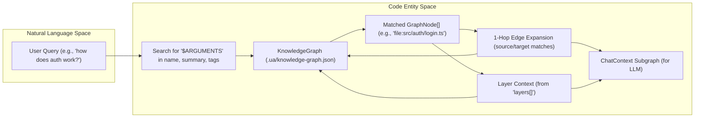
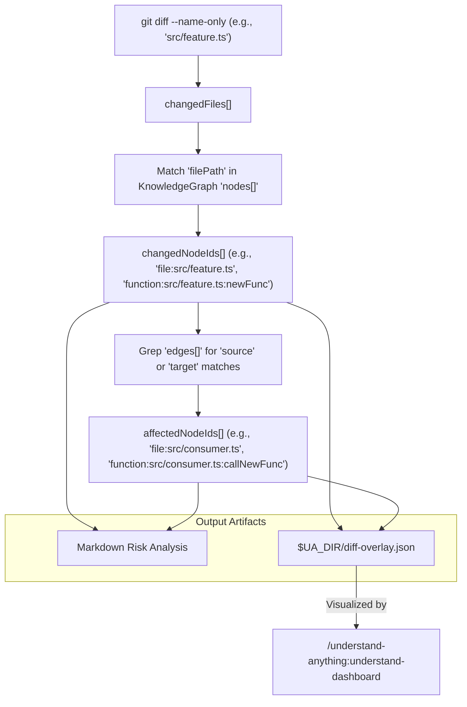
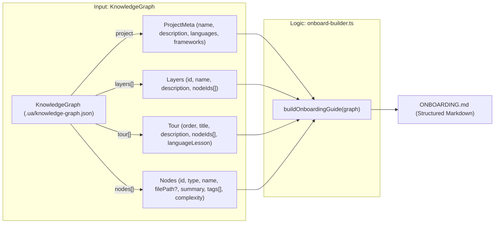

<!-- source: DeepWiki mcp.deepwiki.com · repo Egonex-AI/Understand-Anything · page 5 Skill Context Builders (src/) · fetched 2026-10-30 -->

# Skill Context Builders (src/)

Relevant source files

The following files were used as context for generating this wiki page:

- [understand-anything-plugin/packages/core/src/__tests__/staleness.test.ts](understand-anything-plugin/packages/core/src/__tests__/staleness.test.ts)
- [understand-anything-plugin/packages/core/src/staleness.ts](understand-anything-plugin/packages/core/src/staleness.ts)
- [understand-anything-plugin/skills/understand-chat/SKILL.md](understand-anything-plugin/skills/understand-chat/SKILL.md)
- [understand-anything-plugin/skills/understand-diff/SKILL.md](understand-anything-plugin/skills/understand-diff/SKILL.md)
- [understand-anything-plugin/skills/understand-explain/SKILL.md](understand-anything-plugin/skills/understand-explain/SKILL.md)
- [understand-anything-plugin/skills/understand-onboard/SKILL.md](understand-anything-plugin/skills/understand-onboard/SKILL.md)
- [understand-anything-plugin/src/onboard-builder.ts](understand-anything-plugin/src/onboard-builder.ts)

This page documents the TypeScript modules under the `understand-anything-plugin/src/` directory that implement the core context-building logic for major Understand Anything plugin skills. These modules power the non-`/understand` skills including context expansion for chat, diff analysis, explanation generation, and automated onboarding guide creation.

---

## 1. Overview

These skill context builders operate on a shared data model: the `KnowledgeGraph` structure [understand-anything-plugin/src/onboard-builder.ts:1-8](). They consume results generated by the multi-agent pipelines stored in `.ua/knowledge-graph.json` [understand-anything-plugin/skills/understand-chat/SKILL.md:9-10]().

The skills generally apply deterministic filtering and formatting to:
- Find relevant nodes and their 1-hop neighborhoods [understand-anything-plugin/skills/understand-chat/SKILL.md:59-62]().
- Aggregate nodes by architectural layer [understand-anything-plugin/skills/understand-onboard/SKILL.md:52-52]().
- Format context snippets and markdown guides for users or subsequent LLM prompts [understand-anything-plugin/src/onboard-builder.ts:7-9]().

Sources:
- [understand-anything-plugin/src/onboard-builder.ts:1-8]()
- [understand-anything-plugin/skills/understand-chat/SKILL.md:9-10]()
- [understand-anything-plugin/skills/understand-chat/SKILL.md:59-62]()
- [understand-anything-plugin/skills/understand-onboard/SKILL.md:52-52]()

---

## 2. Chat, Explain & Diff Contexts

This section provides a high-level overview of how `context-builder` (for chat), `explain-builder` (for explanations), and `diff-analyzer` (for diffs) leverage the `KnowledgeGraph` to generate relevant context for the `/understand-chat`, `/understand-explain`, and `/understand-diff` skills.

For details, see [Chat, Explain & Diff Contexts](#5.1).

### 2.1. Context Builder (`understand-chat`)

The logic behind `/understand-chat` provides the mechanism for constructing contextual subgraphs for chat interaction. It translates natural language queries into precise filtered segments of the knowledge graph [understand-anything-plugin/skills/understand-chat/SKILL.md:53-57]().

#### Key Components
- **Fuzzy + Semantic Search**: Matches query keywords against node names, summaries, and tags [understand-anything-plugin/skills/understand-chat/SKILL.md:53-57]().
- **1-Hop Expansion**: Once a node is matched, the builder fetches its immediate neighbors (callers, callees, imports) to provide structural context [understand-anything-plugin/skills/understand-chat/SKILL.md:59-62]().

#### Data Flow
**Diagram: /understand-chat Context Generation**

Sources:
- [understand-anything-plugin/skills/understand-chat/SKILL.md:53-62]()

### 2.2. Diff Analyzer (`understand-diff`)

The `/understand-diff` skill analyzes current code changes against the `KnowledgeGraph` to identify directly changed components and their "blast radius" (affected components) [understand-anything-plugin/skills/understand-diff/SKILL.md:60-64](). It also generates a `diff-overlay.json` for dashboard visualization [understand-anything-plugin/skills/understand-diff/SKILL.md:74-84]().

#### Impact Analysis Logic
1. **Identify Changed Nodes**: Matches git-changed file paths to `filePath` fields in the graph [understand-anything-plugin/skills/understand-diff/SKILL.md:55-58]().
2. **Find Affected Nodes**: Traverses 1-hop edges to find upstream callers and downstream dependencies [understand-anything-plugin/skills/understand-diff/SKILL.md:60-63]().
3. **Layer Attribution**: Determines which architectural layers are touched [understand-anything-plugin/skills/understand-diff/SKILL.md:65-66]().
4. **Dashboard Overlay**: Writes results to `.ua/diff-overlay.json` for visualization [understand-anything-plugin/skills/understand-diff/SKILL.md:74-84]().

#### Data Flow
**Diagram: /understand-diff Impact Analysis**

Sources:
- [understand-anything-plugin/skills/understand-diff/SKILL.md:55-84]()

### 2.3. Explain Builder (`understand-explain`)

The logic supporting `/understand-explain` prepares deep-dive explanations for specific code entities (files, functions, or modules) [understand-anything-plugin/skills/understand-explain/SKILL.md:3-9]().

#### Implementation Detail
- **Target Resolution**: Searches for specific node IDs or file paths based on the `$ARGUMENTS` [understand-anything-plugin/skills/understand-explain/SKILL.md:51-54]().
- **Relationship Mapping**: Identifies `contains` edges for internal structure and `calls`/`imports` for external connections [understand-anything-plugin/skills/understand-explain/SKILL.md:56-61]().
- **Source Integration**: Reads the actual source file content at the node's `filePath` to supplement graph metadata [understand-anything-plugin/skills/understand-explain/SKILL.md:65-65]().

Sources:
- [understand-anything-plugin/skills/understand-explain/SKILL.md:51-65]()

---

## 3. Onboarding Guide Generation

This section covers the `onboard-builder.ts` module, which is responsible for generating a comprehensive `ONBOARDING.md` guide from the `KnowledgeGraph` for the `/understand-onboard` skill. It also includes details on the staleness checks performed before guide generation.

For details, see [Onboarding Guide Generation](#5.2).

### 3.1. Onboard Builder (`onboard-builder.ts`)

`onboard-builder.ts` contains the `buildOnboardingGuide` function [understand-anything-plugin/src/onboard-builder.ts:7]() which generates a standalone Markdown onboarding guide (`ONBOARDING.md`) from the `KnowledgeGraph` [understand-anything-plugin/src/onboard-builder.ts:7-124]().

#### Guide Structure
The `buildOnboardingGuide` function [understand-anything-plugin/src/onboard-builder.ts:7]() assembles the following sections:
- **Project Overview**: Aggregates `project.languages` and `project.frameworks` [understand-anything-plugin/src/onboard-builder.ts:11-22]().
- **Architecture Layers**: Maps `layers` to their member nodes [understand-anything-plugin/src/onboard-builder.ts:25-44]().
- **Key Concepts**: Filters for nodes with `type: "concept"` [understand-anything-plugin/src/onboard-builder.ts:47-59]().
- **Guided Tour**: Iterates through the `tour` array, linking steps to specific `filePath` locations and including `languageLesson` tips [understand-anything-plugin/src/onboard-builder.ts:62-89]().
- **File Map**: Lists file-level nodes (`file`, `config`, `document`, etc.) with their `filePath`, `summary`, and `complexity` [understand-anything-plugin/src/onboard-builder.ts:91-102]().
- **Complexity Hotspots**: Identifies nodes where `complexity === "complex"` [understand-anything-plugin/src/onboard-builder.ts:105-115]().

#### Data Flow
**Diagram: /understand-onboard Guide Generation**

Sources:
- [understand-anything-plugin/src/onboard-builder.ts:7-124]()
- [understand-anything-plugin/skills/understand-onboard/SKILL.md:60-67]()

### 3.2. Graph Freshness & Staleness

A critical shared utility for all skills is the staleness check, implemented in `packages/core/src/staleness.ts` [understand-anything-plugin/packages/core/src/staleness.ts:4-7](). Before generating context or a guide, skills verify if the graph is out of sync with the current Git state.

#### Freshness Logic
- **Commit Comparison**: Compares `project.gitCommitHash` from the graph against `git rev-parse HEAD` [understand-anything-plugin/packages/core/src/staleness.ts:156-158]().
- **Project Pathspec Filtering**: Uses a specific `PROJECT_PATHSPEC` to ignore the `.ua` or `.understand-anything` directories themselves when checking for project-scoped drift [understand-anything-plugin/packages/core/src/staleness.ts:72-79](). This ensures that changes in sibling monorepo projects or generated artifacts do not falsely mark the graph as stale [understand-anything-plugin/skills/understand-onboard/SKILL.md:45-46]().
- **`GraphFreshnessResult`**: The `evaluateGraphFreshness` function returns a detailed status (`fresh`, `dirty`, `stale`, `unknown`) including `changedFiles`, `commitsBehind`, and `commitsAhead` [understand-anything-plugin/packages/core/src/staleness.ts:215-217]().
- **`mergeGraphUpdate`**: While not directly used by `onboard-builder`, `mergeGraphUpdate` allows for incremental updates by replacing nodes and edges only for changed files [understand-anything-plugin/packages/core/src/staleness.ts:117-177]().
- **Worktree Redirect**: All builders handle git worktrees by redirecting output to the main repository root to prevent data loss [understand-anything-plugin/skills/understand-onboard/SKILL.md:33-49]().

Sources:
- [understand-anything-plugin/packages/core/src/staleness.ts:4-177]()
- [understand-anything-plugin/packages/core/src/staleness.ts:215-217]()
- [understand-anything-plugin/packages/core/src/__tests__/staleness.test.ts:93-115]()
- [understand-anything-plugin/skills/understand-onboard/SKILL.md:33-49]()
- [understand-anything-plugin/skills/understand-onboard/SKILL.md:45-46]()

---

## 4. Structure Extraction Utilities

During analysis, the `extract-structure-result.mjs` utility provides `buildResult` to normalize data between the LLM analyzer and the final graph [understand-anything-plugin/src/__tests__/extract-structure.test.mjs:2-2]().

### Key Normalization Logic
- **Import Metric Fallback**: If the project scanner cannot resolve imports, `buildResult` falls back to counting parser-detected relative imports [understand-anything-plugin/src/__tests__/extract-structure.test.mjs:34-59]().
- **Line Count Normalization**: Matches `wc -l` semantics for trailing-newline files to ensure consistent complexity metrics [understand-anything-plugin/src/__tests__/extract-structure.test.mjs:92-102]().

Sources:
- [understand-anything-plugin/src/__tests__/extract-structure.test.mjs:2-102]()
- [understand-anything-plugin/skills/understand/extract-structure-result.mjs:1-100]()

---

