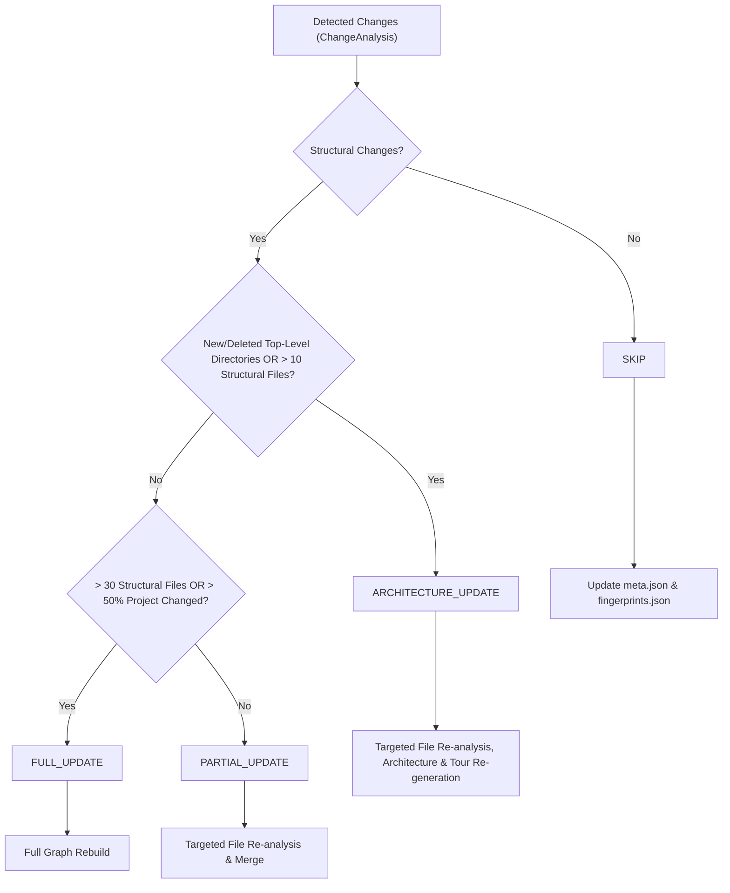

<!-- source: DeepWiki mcp.deepwiki.com · repo Egonex-AI/Understand-Anything · page 6 Incremental Updates & Auto-Update Hooks · fetched 2026-10-30 -->

# Incremental Updates & Auto-Update Hooks

<details>
<summary>Relevant source files</summary>

The following files were used as context for generating this wiki page:

- [tests/skill/understand/test_incremental_skill_contract.test.mjs](tests/skill/understand/test_incremental_skill_contract.test.mjs)
- [tests/skill/understand/test_incremental_symbols.test.mjs](tests/skill/understand/test_incremental_symbols.test.mjs)
- [tests/skill/understand/test_prepare_incremental.test.mjs](tests/skill/understand/test_prepare_incremental.test.mjs)
- [tests/skill/understand/test_skill_security_snippets.test.mjs](tests/skill/understand/test_skill_security_snippets.test.mjs)
- [understand-anything-plugin/hooks/auto-update-prompt.md](understand-anything-plugin/hooks/auto-update-prompt.md)
- [understand-anything-plugin/skills/understand-dashboard/SKILL.md](understand-anything-plugin/skills/understand-dashboard/SKILL.md)
- [understand-anything-plugin/skills/understand-knowledge/SKILL.md](understand-anything-plugin/skills/understand-knowledge/SKILL.md)
- [understand-anything-plugin/skills/understand/SKILL.md](understand-anything-plugin/skills/understand/SKILL.md)
- [understand-anything-plugin/skills/understand/finalize-incremental.mjs](understand-anything-plugin/skills/understand/finalize-incremental.mjs)
- [understand-anything-plugin/skills/understand/prepare-incremental.mjs](understand-anything-plugin/skills/understand/prepare-incremental.mjs)
- [understand-anything-plugin/skills/understand/prepare-symbol-retry.mjs](understand-anything-plugin/skills/understand/prepare-symbol-retry.mjs)
- [understand-anything-plugin/skills/understand/validate-incremental-symbols.mjs](understand-anything-plugin/skills/understand/validate-incremental-symbols.mjs)

</details>


This page provides a high-level overview of how the Understand Anything knowledge graph stays synchronized with the codebase. It covers the core mechanisms of fingerprint-based change detection, the decision matrix for determining the scope of updates (SKIP, PARTIAL, ARCHITECTURE, FULL), and the hooks that trigger these updates. Detailed explanations of each component are provided in linked child pages.

---

## 1. Incremental Update Overview

The incremental update system is designed to efficiently keep the knowledge graph (`knowledge-graph.json`) in sync with changes in the codebase. Instead of performing a full re-analysis on every change, it intelligently detects modifications and updates only the necessary parts of the graph, minimizing computational resources and LLM token usage. This process is orchestrated by a series of scripts and core library functions.

The primary entry point for incremental updates is the `/understand` skill, which can be invoked with various options, including `--full` for a complete rebuild or `--auto-update` to enable automatic updates [understand-anything-plugin/skills/understand/SKILL.md:13-14]().

Sources: [understand-anything-plugin/skills/understand/SKILL.md:1-21]()

---

## 2. Fingerprint-Based Change Detection

At the heart of the incremental update system is fingerprint-based change detection. This mechanism allows the system to precisely identify what has changed in a file at a structural level, distinguishing between cosmetic changes (e.g., whitespace, comments) and significant structural modifications (e.g., function signature changes, new classes).

### File Fingerprints

Each analyzed file is associated with a `FileFingerprint` that captures its structural essence. This includes:
- A `contentHash` for quick detection of any content change [understand-anything-plugin/packages/core/src/fingerprint.ts:70-72]().
- Structural elements like `functions`, `classes`, `imports`, and `exports`, each with their own detailed fingerprints [understand-anything-plugin/packages/core/src/fingerprint.ts:9-36]().

### Change Classification

When a file's content changes, its new fingerprint is compared against the previously stored one. This comparison results in a `ChangeLevel` [understand-anything-plugin/packages/core/src/fingerprint.ts:131-134]():
- **NONE**: The file's content and structural elements are identical to the previous version [understand-anything-plugin/packages/core/src/fingerprint.ts:138-140]().
- **COSMETIC**: The file's content has changed, but its structural elements (functions, classes, imports, exports) remain the same [understand-anything-plugin/packages/core/src/fingerprint.ts:128]().
- **STRUCTURAL**: There are significant changes to the file's structural elements, requiring re-analysis [understand-anything-plugin/packages/core/src/fingerprint.ts:129]().

For a deep dive into how fingerprints are generated and compared, see [Incremental Planning & Finalization Scripts](#6.1).

Sources: [understand-anything-plugin/packages/core/src/fingerprint.ts:1-231]()

---

## 3. Update Decision Matrix

Based on the detected `ChangeLevel` for all modified files, the system decides on the scope of the update. This decision is made by the `classifyUpdate` function [understand-anything-plugin/packages/core/src/change-classifier.ts:21-87]() and determines whether to skip the update, perform a partial update, trigger an architecture update, or force a full rebuild.

### Decision Matrix Summary

| Action | Condition | Impact |
| :--- | :--- | :--- |
| **SKIP** | No structural changes detected across any files [understand-anything-plugin/packages/core/src/change-classifier.ts:30](). | Only `meta.json` and `fingerprints.json` are updated to reflect the new commit hash. No re-analysis or LLM agents are dispatched. |
| **PARTIAL_UPDATE** | Structural changes in a limited number of files (e.g., $\le 10$ files) within existing directories [understand-anything-plugin/packages/core/src/change-classifier.ts:80-86](). | Only the structurally changed files are re-analyzed. The results are merged into the existing graph. Architecture and tour generation are skipped. |
| **ARCHITECTURE_UPDATE** | Significant structural changes (e.g., $> 10$ files) or changes to top-level directories (new/deleted) [understand-anything-plugin/packages/core/src/change-classifier.ts:67-78](). | Structurally changed files are re-analyzed, and the architecture and tour generation phases are re-run to reflect potential high-level structural changes. |
| **FULL_UPDATE** | Extensive changes (e.g., $> 30$ structural files or $> 50\%$ of the project changed) [understand-anything-plugin/packages/core/src/change-classifier.ts:46-62](). | A full rebuild of the knowledge graph is initiated, similar to running `/understand --full`. This ensures graph integrity when changes are too widespread for incremental patching. |

### Update Decision Flow

Title: Incremental Update Decision Logic


Sources: [understand-anything-plugin/packages/core/src/change-classifier.ts:1-143]()

---

## 4. Incremental Planning & Finalization

The incremental update process involves several key scripts that handle the planning, execution, and finalization of graph updates.

### `prepare-incremental.mjs`

This script is responsible for the initial phase of an incremental update. It performs the following actions:
- **Diff Inventory**: Uses `git diff` to identify changed files between the last analyzed commit and the current HEAD [understand-anything-plugin/skills/understand/prepare-incremental.mjs:150-178]().
- **Rename Handling**: Detects file renames and moves, ensuring that graph nodes are correctly updated or re-mapped [understand-anything-plugin/skills/understand/prepare-incremental.mjs:167-172]().
- **Fingerprint Comparison**: Compares file fingerprints to classify changes as `NONE`, `COSMETIC`, or `STRUCTURAL`.
- **`incremental-plan.json`**: Generates a plan detailing the required update action (SKIP, PARTIAL_UPDATE, ARCHITECTURE_UPDATE, FULL_UPDATE) and the list of files to re-analyze [understand-anything-plugin/skills/understand/prepare-incremental.mjs:10-11]().

### `finalize-incremental.mjs`

After the analysis and merging phases, this script finalizes the update:
- **Atomic Writes**: Atomically writes the new `knowledge-graph.json`, `fingerprints.json`, and `meta.json` to ensure data consistency [understand-anything-plugin/skills/understand/finalize-incremental.mjs:65-71]().
- **Dangling Reference Cleanup**: For `PARTIAL_UPDATE` and `ARCHITECTURE_UPDATE`, it cleans up any dangling references in the graph and performs local layer placement for new nodes [understand-anything-plugin/skills/understand/finalize-incremental.mjs:8-9]().

For a detailed explanation of these scripts and the incremental skill contract tests, see [Incremental Planning & Finalization Scripts](#6.1).

Sources: [understand-anything-plugin/skills/understand/prepare-incremental.mjs:1-752](), [understand-anything-plugin/skills/understand/finalize-incremental.mjs:1-512]()

---

## 5. Symbol Loss Validation & Retry

A critical aspect of incremental updates is ensuring that no symbols (functions, classes, etc.) are inadvertently lost or misidentified during the update process.

### `validate-incremental-symbols.mjs`

This script acts as a "symbol gate" during the merge phase. It compares the symbols from the previous graph with those in the newly analyzed files and the current source code [understand-anything-plugin/skills/understand/validate-incremental-symbols.mjs:1-497]().
- **`incremental-symbol-report.json`**: Generates a report classifying symbols as `still-present`, `deleted`, or `unknown` [understand-anything-plugin/hooks/auto-update-prompt.md:66]().
- **Blocking Publication**: If the report indicates `still-present` or `unknown` omissions, the update is blocked to prevent symbol loss [understand-anything-plugin/hooks/auto-update-prompt.md:67]().

### `prepare-symbol-retry.mjs`

If symbol validation fails, this script prepares a targeted reanalysis:
- **Targeted Reanalysis**: Identifies files with unresolved symbols and schedules them for re-analysis [understand-anything-plugin/skills/understand/prepare-symbol-retry.mjs:33-36]().
- **`incremental-symbol-retry.json`**: Stores the plan for the retry, including the specific batches and context needed for re-analysis [understand-anything-plugin/skills/understand/prepare-symbol-retry.mjs:37-38]().

For a detailed explanation of symbol validation, retry mechanisms, and design notes, see [Symbol Loss Validation & Retry](#6.2).

Sources: [understand-anything-plugin/skills/understand/validate-incremental-symbols.mjs:1-497](), [understand-anything-plugin/skills/understand/prepare-symbol-retry.mjs:1-137](), [understand-anything-plugin/hooks/auto-update-prompt.md:66-82]()

---

## 6. Hooks & Auto-Update Prompt

The entire incremental update process is often triggered automatically through a system of hooks.

### `hooks.json`

This configuration file defines the triggers for automatic updates:
- **`PostToolUse`**: Triggers after specific Git commands (e.g., `commit`, `merge`) [understand-anything-plugin/hooks/hooks.json:3-13]().
- **`SessionStart`**: Triggers at the beginning of a new session to check for graph staleness [understand-anything-plugin/hooks/hooks.json:14-23]().

### `post-tool-use-auto-update.mjs`

This script is executed by the `PostToolUse` hook. It checks conditions like `autoUpdate: true` in `config.json` and graph staleness before instructing the LLM to proceed with the auto-update workflow [understand-anything-plugin/hooks/post-tool-use-auto-update.mjs:1-57]().

### `auto-update-prompt.md`

This markdown file outlines the four-phase workflow for automatic incremental updates, guiding the LLM through the process from pre-flight checks to conditional architecture and tour generation [understand-anything-plugin/hooks/auto-update-prompt.md:1-117]().

For a detailed explanation of the hooks, the auto-update prompt, and the four-phase workflow, see [Hooks & Auto-Update Prompt](#6.3).

Sources: [understand-anything-plugin/hooks/hooks.json:1-25](), [understand-anything-plugin/hooks/post-tool-use-auto-update.mjs:1-57](), [understand-anything-plugin/hooks/auto-update-prompt.md:1-117]()

---

## 7. Incremental Update Data Flow

The following diagram illustrates the high-level data flow and interaction between the various components involved in the incremental update process.

Title: Incremental Update System Data Flow
```mermaid
graph TD
    subgraph "User Interaction / Environment"
        A[Git Commit/Merge] --> B(PostToolUse Hook);
        C[Session Start] --> D(SessionStart Hook);
    end

    subgraph "Incremental Update Core Logic"
        B --> E{Auto-Update Enabled?};
        D --> E;
        E -- Yes --> F{Graph Stale?};
        F -- Yes --> G[auto-update-prompt.md];
        G --> H[prepare-incremental.mjs];
        H --> I{Fingerprint Comparison & Change Classification};
        I --> J{Update Decision Matrix};
        J -- SKIP --> K[finalize-incremental.mjs (Metadata Only)];
        J -- PARTIAL_UPDATE --> L[Targeted File Analysis];
        J -- ARCHITECTURE_UPDATE --> L;
        J -- FULL_UPDATE --> M[Full /understand Rebuild];
        L --> N[merge-batch-graphs.py];
        N --> O{validate-incremental-symbols.mjs};
        O -- Symbols OK --> P[finalize-incremental.mjs (Graph Update)];
        O -- Symbol Loss Detected --> Q[prepare-symbol-retry.mjs];
        Q --> L;
        P --> R[Update meta.json & fingerprints.json];
        K --> R;
        M --> R;
    end

    subgraph "Persistent Data"
        S[config.json (autoUpdate)]
        T[knowledge-graph.json]
        U[meta.json (gitCommitHash)]
        V[fingerprints.json]
        W[incremental-plan.json]
        X[incremental-symbol-report.json]
        Y[incremental-symbol-retry.json]
        Z[intermediate/* (batches, scan-result, etc.)]
    end

    E -- Reads --> S;
    F -- Reads --> U;
    H -- Reads --> U;
    H -- Reads --> V;
    H -- Writes --> W;
    H -- Writes --> Z;
    I -- Reads --> V;
    I -- Writes --> V;
    L -- Reads --> W;
    L -- Reads --> Y;
    L -- Writes --> Z;
    N -- Reads --> Z;
    N -- Writes --> Z;
    O -- Reads --> Z;
    O -- Writes --> X;
    Q -- Reads --> X;
    Q -- Writes --> Y;
    P -- Reads --> Z;
    P -- Writes --> T;
    P -- Writes --> U;
    P -- Writes --> V;
    K -- Writes --> U;
    K -- Writes --> V;
```

Sources: [understand-anything-plugin/hooks/hooks.json:1-25](), [understand-anything-plugin/hooks/post-tool-use-auto-update.mjs:1-57](), [understand-anything/understand-anything-plugin/skills/understand/SKILL.md:1-21](), [understand-anything-plugin/skills/understand/prepare-incremental.mjs:1-752](), [understand-anything-plugin/skills/understand/finalize-incremental.mjs:1-512](), [understand-anything-plugin/skills/understand/validate-incremental-symbols.mjs:1-497](), [understand-anything-plugin/skills/understand/prepare-symbol-retry.mjs:1-137](), [understand-anything-plugin/hooks/auto-update-prompt.md:1-117]()

---

