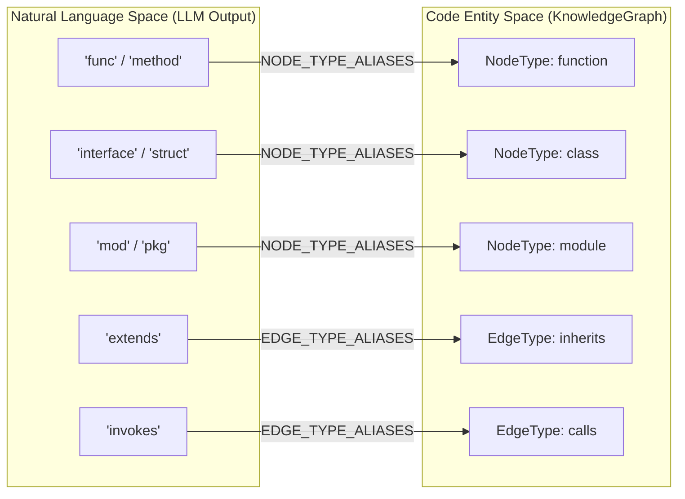
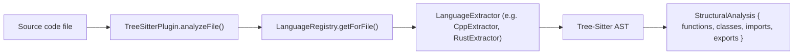
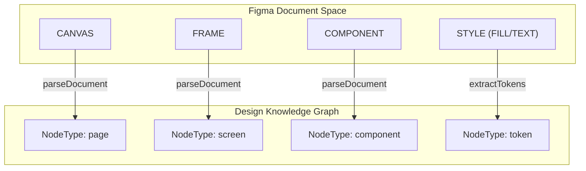

<!-- source: DeepWiki mcp.deepwiki.com · repo Egonex-AI/Understand-Anything · page 7.1 Core Package Tests · fetched 2026-10-30 -->

# Core Package Tests

Relevant source files

The following files were used as context for generating this wiki page:

- [understand-anything-plugin/packages/core/src/__tests__/domain-persistence.test.ts](understand-anything-plugin/packages/core/src/__tests__/domain-persistence.test.ts)
- [understand-anything-plugin/packages/core/src/__tests__/domain-types.test.ts](understand-anything-plugin/packages/core/src/__tests__/domain-types.test.ts)
- [understand-anything-plugin/packages/core/src/__tests__/ignore-filter.test.ts](understand-anything-plugin/packages/core/src/__tests__/ignore-filter.test.ts)
- [understand-anything-plugin/packages/core/src/__tests__/schema.test.ts](understand-anything-plugin/packages/core/src/__tests__/schema.test.ts)
- [understand-anything-plugin/packages/core/src/ignore-filter.ts](understand-anything-plugin/packages/core/src/ignore-filter.ts)
- [understand-anything-plugin/packages/core/src/persistence/index.ts](understand-anything-plugin/packages/core/src/persistence/index.ts)
- [understand-anything-plugin/packages/core/src/persistence/persistence.test.ts](understand-anything-plugin/packages/core/src/persistence/persistence.test.ts)
- [understand-anything-plugin/packages/core/src/plugins/extractors/__tests__/cpp-extractor.test.ts](understand-anything-plugin/packages/core/src/plugins/extractors/__tests__/cpp-extractor.test.ts)
- [understand-anything-plugin/packages/core/src/plugins/extractors/__tests__/go-extractor.test.ts](understand-anything-plugin/packages/core/src/plugins/extractors/__tests__/go-extractor.test.ts)
- [understand-anything-plugin/packages/core/src/plugins/extractors/__tests__/rust-extractor.test.ts](understand-anything-plugin/packages/core/src/plugins/extractors/__tests__/rust-extractor.test.ts)
- [understand-anything-plugin/packages/core/src/plugins/extractors/cpp-extractor.ts](understand-anything-plugin/packages/core/src/plugins/extractors/cpp-extractor.ts)
- [understand-anything-plugin/packages/core/src/plugins/extractors/go-extractor.ts](understand-anything-plugin/packages/core/src/plugins/extractors/go-extractor.ts)
- [understand-anything-plugin/packages/core/src/plugins/extractors/rust-extractor.ts](understand-anything-plugin/packages/core/src/plugins/extractors/rust-extractor.ts)
- [understand-anything-plugin/packages/core/src/schema.ts](understand-anything-plugin/packages/core/src/schema.ts)
- [understand-anything-plugin/packages/core/src/types.ts](understand-anything-plugin/packages/core/src/types.ts)
- [vitest.config.ts](vitest.config.ts)

The `@understand-anything/core` package leverages **Vitest** for comprehensive unit testing that validates core functionalities essential to the system’s correctness and robustness. The test suite covers schema validation, graph building, static code extraction via Tree-Sitter, plugin registry management, fingerprinting and change classification logic, ignore rules, and the Figma design subsystem.

---

## Schema Validation & Normalization Tests

The schema validation tests exercise the end-to-end verification of the `KnowledgeGraph` data contract using Zod schemas [understand-anything-plugin/packages/core/src/schema.ts:1-15](). The validator processes JSON objects and performs:

1.  **Sanitization**: Cleans null values, lowercases enums, and sets empty arrays for missing collections [understand-anything-plugin/packages/core/src/schema.ts:188-210]().
2.  **Auto-Fixing**: Auto-corrects missing fields and clamps numeric values to valid ranges (e.g., weights between 0 and 1) [understand-anything-plugin/packages/core/src/__tests__/schema.test.ts:100-120]().
3.  **Normalization (Alias Resolution)**: Converts loosely specified node and edge types produced by LLMs into canonical types [understand-anything-plugin/packages/core/src/schema.ts:18-75]().

### Alias Normalization Diagram

Sources: [understand-anything-plugin/packages/core/src/__tests__/schema.test.ts:1-219](), [understand-anything-plugin/packages/core/src/schema.ts:1-150]()

---

## Tree-Sitter Plugin & Language Extractors Tests

The Tree-Sitter plugin encapsulates deterministic structural extraction. Tests cover separate implementations for languages including TypeScript, Python, Go, Rust, Java, C++, C#, Ruby, PHP, Dart, Kotlin, Swift, and Scala.

### CppExtractor Case Study
The `CppExtractor` tests verify that the system correctly extracts structural information from C++ code, including distinguishing free functions from inline and out-of-class methods [understand-anything-plugin/packages/core/src/plugins/extractors/__tests__/cpp-extractor.test.ts:33-44]().

-   **Functions**: Validates extraction of top-level functions with parameters and return types [understand-anything-plugin/packages/core/src/plugins/extractors/__tests__/cpp-extractor.test.ts:54-130]().
-   **Classes**: Ensures properties and method declarations are correctly identified, respecting access specifiers (public/private) [understand-anything-plugin/packages/core/src/plugins/extractors/__tests__/cpp-extractor.test.ts:134-221]().
-   **Structs**: Verifies extraction of struct fields [understand-anything-plugin/packages/core/src/plugins/extractors/__tests__/cpp-extractor.test.ts:224-233]().

### RustExtractor Case Study
The `RustExtractor` tests ensure accurate extraction of Rust-specific constructs.

-   **Functions**: Covers extraction of functions, including those with `async` and `extern` modifiers, and their parameters and return types.
-   **Structs, Enums, Traits**: Validates the identification of these constructs and their associated methods and properties.
-   **Visibility**: Tests that `pub` (public) items are correctly identified as exports.
-   **Impl Blocks**: Verifies that methods defined within `impl` blocks are correctly associated with their respective types.

### Extraction Data Flow

Sources: [understand-anything-plugin/packages/core/src/plugins/extractors/__tests__/cpp-extractor.test.ts:1-233](), [understand-anything-plugin/packages/core/src/plugins/extractors/cpp-extractor.ts:1-503](), [understand-anything-plugin/packages/core/src/plugins/extractors/__tests__/rust-extractor.test.ts]() , [understand-anything-plugin/packages/core/src/plugins/extractors/rust-extractor.ts:1-513]()

---

## Figma Subsystem Tests

The Figma core tests validate the deterministic transformation of design files into a KnowledgeGraph.

### Token Extraction
Tests for `extractTokens` ensure that Figma Styles (FILL, TEXT, EFFECT, GRID) are mapped to `token` nodes with appropriate `tokenKind`. It verifies the bridging of file-local style IDs to global published keys.

### Document Parsing
The `parseDocument` tests verify the traversal of the Figma `DOCUMENT` hierarchy to identify `page`, `screen`, `component`, `componentSet`, and `instance` nodes.

### Design-to-Graph Mapping Diagram

Sources: [understand-anything-plugin/packages/core/src/types.ts:40-51]()

---

## Persistence & Ignore Filter Tests

### Persistence Layer
Tests for `saveGraph` and `loadGraph` ensure that the KnowledgeGraph is correctly serialized to the `.ua/` (or legacy `.understand-anything/`) directory [understand-anything-plugin/packages/core/src/persistence/index.ts:19-21](). A key test case ensures `sanitiseFilePaths` converts absolute paths to project-relative paths to prevent leaking developer directory layouts [understand-anything-plugin/packages/core/src/persistence/index.ts:53-82]().
The persistence layer also handles `AnalysisMeta`, `FingerprintStore`, and `ProjectConfig` objects, ensuring they are saved and loaded correctly [understand-anything-plugin/packages/core/src/persistence/persistence.test.ts:118-204]().
Separate tests exist for `saveDomainGraph` and `loadDomainGraph`, confirming that domain-specific graphs are stored in `domain-graph.json` and not conflated with the main `knowledge-graph.json` [understand-anything-plugin/packages/core/src/__tests__/domain-persistence.test.ts:56-63]().

### Ignore Filtering
The `IgnoreFilter` tests validate the merging of `DEFAULT_IGNORE_PATTERNS` (e.g., `node_modules/`, `dist/`, binary assets) with user-defined patterns in `.understandignore` [understand-anything-plugin/packages/core/src/ignore-filter.ts:10-71](). The tests confirm that patterns from `.understand-anything/.understandignore` and the project root `.understandignore` are correctly applied, and that CLI-provided patterns take the highest precedence [understand-anything-plugin/packages/core/src/__tests__/ignore-filter.test.ts:93-170]().

| Feature | Implementation | Test Coverage |
| :--- | :--- | :--- |
| **Path Sanitization** | `sanitiseFilePaths` [understand-anything-plugin/packages/core/src/persistence/index.ts:53-82]() | Absolute vs Relative vs Outside Project [understand-anything-plugin/packages/core/src/persistence/index.ts:61-79]() |
| **Directory Resolution** | `resolveUaDirName` [understand-anything-plugin/packages/core/src/persistence/index.ts:19-21]() | Fresh `.ua` vs Legacy `.understand-anything` [understand-anything-plugin/packages/core/src/persistence/persistence.test.ts:218-230]() |
| **Pattern Priority** | `createIgnoreFilter` [understand-anything-plugin/packages/core/src/ignore-filter.ts:89-113]() | Defaults < .ua/ignore < root/ignore < CLI [understand-anything-plugin/packages/core/src/__tests__/ignore-filter.test.ts:93-170]() |

Sources: [understand-anything-plugin/packages/core/src/persistence/persistence.test.ts:1-221](), [understand-anything-plugin/packages/core/src/persistence/index.ts:1-197](), [understand-anything-plugin/packages/core/src/ignore-filter.ts:1-120](), [understand-anything-plugin/packages/core/src/__tests__/ignore-filter.test.ts:1-176](), [understand-anything-plugin/packages/core/src/__tests__/domain-persistence.test.ts:1-64]()

---

## Fingerprint & Change Classifier Tests

The `FingerprintStore` tests verify that the system can detect structural changes in files by comparing hashes of functions, classes, and imports [understand-anything-plugin/packages/core/src/persistence/persistence.test.ts:141-157](). This allows the `change-classifier` to decide if a file needs a `PARTIAL_UPDATE` or if the entire architecture requires a `FULL_UPDATE`.

### Auto-Update Hook Tests
The system includes integration tests for the `post-tool-use-auto-update.mjs` hook, which triggers staleness detection after `git commit` or `merge` operations. These tests ensure the hook remains silent when `autoUpdate` is disabled or when non-git commands are executed.

Sources: [understand-anything-plugin/packages/core/src/persistence/persistence.test.ts:140-180](), [understand-anything-plugin/packages/core/src/types.ts:124-130]()

---

