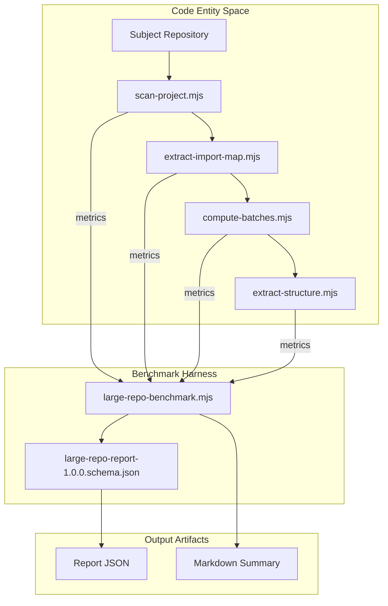

<!-- source: DeepWiki mcp.deepwiki.com · repo Egonex-AI/Understand-Anything · page 7.2 Skill & Hook Integration Tests · fetched 2026-10-30 -->

# Skill & Hook Integration Tests

<details>
<summary>Relevant source files</summary>

The following files were used as context for generating this wiki page:

- [tests/hooks/post-tool-use-auto-update.test.mjs](tests/hooks/post-tool-use-auto-update.test.mjs)
- [tests/install/platform-table-consistency.test.mjs](tests/install/platform-table-consistency.test.mjs)
- [tests/skill/understand/test_compute_batches.test.mjs](tests/skill/understand/test_compute_batches.test.mjs)
- [tests/skill/understand/test_merge_batch_graphs.py](tests/skill/understand/test_merge_batch_graphs.py)
- [tests/skill/understand/test_scan_project.test.mjs](tests/skill/understand/test_scan_project.test.mjs)
- [tests/skill/viewer/test_viewer.test.mjs](tests/skill/viewer/test_viewer.test.mjs)
- [understand-anything-plugin/hooks/hooks.json](understand-anything-plugin/hooks/hooks.json)
- [understand-anything-plugin/hooks/post-tool-use-auto-update.mjs](understand-anything-plugin/hooks/post-tool-use-auto-update.mjs)
- [understand-anything-plugin/packages/viewer/README.md](understand-anything-plugin/packages/viewer/README.md)
- [understand-anything-plugin/packages/viewer/bin/viewer.mjs](understand-anything-plugin/packages/viewer/bin/viewer.mjs)
- [understand-anything-plugin/packages/viewer/build.mjs](understand-anything-plugin/packages/viewer/build.mjs)
- [understand-anything-plugin/skills/understand/compute-batches.mjs](understand-anything-plugin/skills/understand/compute-batches.mjs)
- [understand-anything-plugin/skills/understand/merge-batch-graphs.py](understand-anything-plugin/skills/understand/merge-batch-graphs.py)
- [understand-anything-plugin/skills/understand/scan-project.mjs](understand-anything-plugin/skills/understand/scan-project.mjs)
- [understand-anything-plugin/src/__tests__/merge-recover-imports.test.mjs](understand-anything-plugin/src/__tests__/merge-recover-imports.test.mjs)

</details>


This page documents the integration test suite for the core skill scripts used in Phase 0 through Phase 2.5 of the analysis pipeline, as well as the benchmark suite for large-scale repositories and the auto-update hooks. These tests ensure that the deterministic components of the system—file discovery, semantic batching, import mapping, structural extraction, graph merging, and platform-specific installations—function correctly across various project topologies and languages.

## Overview of Integration Testing Strategy

The integration tests target the standalone scripts located in `skills/understand/` and `skills/understand-knowledge/`, and the hooks in `hooks/`. These scripts are typically invoked by the `/understand` or `/understand-knowledge` slash commands via the plugin host, or triggered by specific events for hooks.

| Test File | Target Script | Primary Responsibility |
| :--- | :--- | :--- |
| `test_scan_project.test.mjs` | `scan-project.mjs` | Validates file enumeration, language detection, and ignore filtering. |
| `test_compute_batches.test.mjs` | `compute-batches.mjs` | Validates Louvain community detection and non-code file grouping. |
| `test_extract_import_map.test.mjs` | `extract-import-map.mjs` | Validates cross-file dependency resolution using Tree-Sitter. |
| `test_extract_structure_outcomes.test.mjs` | `extract-structure.mjs` | Validates structural analysis validation and outcome reporting. |
| `test_merge_batch_graphs.py` | `merge-batch-graphs.py` | Validates ID canonicalization, import recovery, and deterministic `tested_by` linking. |
| `test_merge_subdomain_graphs.py` | `merge-subdomain-graphs.py` | Validates merging of subdomain-specific knowledge graphs. |
| `test_parse_knowledge_base.py` | `parse-knowledge-base.py` | Validates parsing of Karpathy-pattern LLM wikis. |
| `test_large_repo_benchmark.test.mjs` | `large-repo-benchmark.mjs` | Benchmarks deterministic stages on massive repositories. |
| `test_viewer.test.mjs` | `viewer.mjs` | Validates the standalone zero-dependency graph viewer. |
| `platform-table-consistency.test.mjs` | N/A | Ensures installation scripts and core platform logic are in sync. |
| `post-tool-use-auto-update.test.mjs` | `post-tool-use-auto-update.mjs` | Validates the auto-update prompt trigger for `PostToolUse` hook. |

Sources: [understand-anything-plugin/skills/understand/extract-structure.mjs:1-17](), [docs/benchmarks/large-monorepo.md:9-18](), [tests/skill/viewer/test_viewer.test.mjs:1-20](), [tests/hooks/post-tool-use-auto-update.test.mjs:1-21]()

---

## 1. Structural Extraction & Outcome Validation

The `extract-structure.mjs` script performs deterministic structural extraction using the `PluginRegistry` from `@understand-anything/core`. It replaces LLM-generated regex scripts with robust Tree-Sitter parsing [understand-anything-plugin/skills/understand/extract-structure.mjs:3-7]().

### Implementation and Data Flow
The script initializes a `TreeSitterPlugin` with all supported WASM grammars and registers all non-code parsers [understand-anything-plugin/skills/understand/extract-structure.mjs:74-82](). For each file in a batch, it invokes `analyzeFileWithOutcomes` to perform analysis and categorize the result as `succeeded`, `failed`, or `skipped` [understand-anything-plugin/skills/understand/extract-structure.mjs:110-119]().

### Validation Logic
`extract-structure-result.mjs` contains the `isValidStructuralAnalysis` and `isValidCallGraph` functions which enforce strict schema compliance for the extracted data [understand-anything-plugin/skills/understand/extract-structure-result.mjs:99-120](). It validates:
- **Functions:** Name, `lineRange` (integer pair), `params` (string array), and `returnType` [understand-anything-plugin/skills/understand/extract-structure-result.mjs:52-57]().
- **Classes:** Name, `lineRange`, `methods`, and `properties` [understand-anything-plugin/skills/understand/extract-structure-result.mjs:58-62]().
- **Imports/Exports:** `source`, `specifiers`, and `lineNumber` [understand-anything-plugin/skills/understand/extract-structure-result.mjs:63-70]().
- **Non-code Entities:** `services`, `endpoints`, `resources`, and `steps` [understand-anything-plugin/skills/understand/extract-structure-result.mjs:80-97]().

Sources: [understand-anything-plugin/skills/understand/extract-structure-result.mjs:3-16](), [understand-anything-plugin/skills/understand/extract-structure-result.mjs:132-180]()

---

## 2. Import Extraction Tests (`test_extract_import_map.test.mjs`)

The `extract-import-map.mjs` script handles Phase 1 dependency resolution. It uses Tree-Sitter to extract raw import paths and applies language-specific resolution rules (like `tsconfig.json` aliases) to map them to project-internal files [understand-anything-anything-plugin/skills/understand/extract-import-map.mjs:3-13]().

### Test Coverage
- **Relative Resolution:** Verifies that TypeScript relative imports with extension probes (e.g., `./utils` -> `utils.ts`) are correctly resolved [tests/skill/understand/test_extract_import_map.test.mjs:67-98]().
- **Alias Resolution:** Validates that `tsconfig.json` `paths` aliases (e.g., `@/*` -> `src/*`) are correctly applied [tests/skill/understand/test_extract_import_map.test.mjs:138-169]().
- **Determinism:** Ensures that Unicode import targets are ordered by locale-independent UTF-16 code units for stable output [tests/skill/understand/test_extract_import_map.test.mjs:100-136]().
- **External Packages:** Confirms that external package imports (e.g., `express`, `zod`) are dropped from the internal map [tests/skill/understand/test_extract_import_map.test.mjs:189-209]().

Sources: [understand-anything-plugin/skills/understand/extract-import-map.mjs:156-184](), [tests/skill/understand/test_extract_import_map.test.mjs:33-55]()

---

## 3. Batch Graph Merging (`merge-batch-graphs.py`)

The `merge-batch-graphs.py` script combines `batch-*.json` files into an `assembled-graph.json` during Phase 2 [understand-anything-plugin/skills/understand/merge-batch-graphs.py:3-17]().

### Tested By Linking
A critical feature tested in `test_merge_batch_graphs.py` is the deterministic `tested_by` linker. It identifies relationships between production code and test files using:
- **JS/TS Siblings:** Matches `foo.ts` to `foo.test.ts` or `foo.spec.ts` [understand-anything-plugin/skills/understand/merge-batch-graphs.py:99-102]().
- **Mirrored Roots:** Matches `src/logic.py` to `tests/test_logic.py` [understand-anything-plugin/skills/understand/merge-batch-graphs.py:105-106]().
- **Language Patterns:** Handles specific conventions for Go (`_test.go`), Java (`Test.java`), and others [understand-anything-plugin/skills/understand/merge-batch-graphs.py:113-123]().

### Import Recovery
The merge script also recovers `imports` edges that might have been dropped by batch processing, using the `importMap` from `scan-result.json` [understand-anything-plugin/skills/understand/merge-batch-graphs.py:220-250](). The `test_merge_batch_graphs.py` suite includes tests to ensure:
- **Missing Edges Recovered:** Edges present in `importMap` but missing from batch output are added [understand-anything-plugin/src/__tests__/merge-recover-imports.test.mjs:85-114]().
- **No Duplicates:** Edges already emitted by batches are not duplicated [understand-anything-plugin/src/__tests__/merge-recover-imports.test.mjs:116-135]().
- **Dangling Edge Prevention:** Imports from or to non-existent file nodes are skipped [understand-anything-plugin/src/__tests__/merge-recover-imports.test.mjs:137-176]().
- **Self-Imports Prevented:** Self-referential import edges are never created [understand-anything-plugin/src/__tests__/merge-recover-imports.test.mjs:194-203]().

### ID Normalization
The script normalizes node IDs to ensure consistency. For example, it strips redundant prefixes like `file:file:` and maps aliases like `func:` to `function:` [understand-anything-plugin/skills/understand/merge-batch-graphs.py:58-82](), [understand-anything-plugin/skills/understand/merge-batch-graphs.py:195-210]().

Sources: [understand-anything-plugin/skills/understand/merge-batch-graphs.py:220-250](), [tests/skill/understand/test_merge_batch_graphs.py:68-154](), [understand-anything-plugin/src/__tests__/merge-recover-imports.test.mjs:85-203]()

---

## 4. Subdomain Graph Merging (`merge-subdomain-graphs.py`)

This script merges multiple subdomain knowledge graphs into a single `knowledge-graph.json` [understand-anything-plugin/skills/understand/merge-subdomain-graphs.py:3-9]().

### Merging Heuristics
- **Node Deduplication:** Uses ID-based deduplication where the later occurrence wins [understand-anything-plugin/skills/understand/merge-subdomain-graphs.py:84-94]().
- **Edge Weighting:** Deduplicates edges by `(source, target, type)`, retaining the one with the higher weight [understand-anything-plugin/skills/understand/merge-subdomain-graphs.py:96-108]().
- **Referential Integrity:** Drops edges referencing missing nodes. "Structural" edges (e.g., `contains_flow`, `cross_domain`) trigger warnings and are flagged for retry [understand-anything-plugin/skills/understand/merge-subdomain-graphs.py:110-134]().
- **Layer & Tour Merging:** Unions `nodeIds` for matching layer IDs and merges tour steps with identical titles, keeping the longer description [understand-anything-plugin/skills/understand/merge-subdomain-graphs.py:136-175]().

Sources: [understand-anything-plugin/skills/understand/merge-subdomain-graphs.py:39-48](), [understand-anything-plugin/skills/understand/merge-subdomain-graphs.py:50-63]()

---

## 5. Skill Script Integration Tests

### Project Scanner (`scan-project.mjs`)
The `test_scan_project.test.mjs` suite validates the `scan-project.mjs` script, which is responsible for file enumeration, language detection, and ignore filtering.
- **Language Detection:** Tests cover correct language identification for various file extensions, including TypeScript/JavaScript, Python, Go, Rust, Java, Kotlin, C#, Swift, Scala, Ruby, PHP, C/C++, and others [tests/skill/understand/test_scan_project.test.mjs:99-178]().
- **File Categorization:** Verifies that files are correctly assigned to categories like `code`, `config`, `docs`, `test`, etc., based on their path and content [understand-anything-plugin/skills/understand/scan-project.mjs:200-300]().
- **Ignore Filtering:** Ensures that `.understandignore` and CLI exclusion patterns are correctly applied [understand-anything-plugin/skills/understand/scan-project.mjs:310-320]().
- **Determinism:** Confirms that the output is stable across runs, including content digests and file ordering [understand-anything-plugin/skills/understand/scan-project.mjs:55-58]().

Sources: [understand-anything-plugin/skills/understand/scan-project.mjs:1-58](), [tests/skill/understand/test_scan_project.test.mjs:1-178]()

### Batch Computation (`compute-batches.mjs`)
The `test_compute_batches.test.mjs` suite validates the `compute-batches.mjs` script, which performs Louvain community detection and non-code file grouping.
- **Louvain Community Detection:** Tests verify that the script correctly identifies communities (batches) in the import graph, producing the expected number and composition of batches for given graph structures (e.g., disjoint cliques) [tests/skill/understand/test_compute_batches.test.mjs:87-105]().
- **Determinism:** Ensures that batching results are deterministic across multiple runs, even with varying locale settings, which is crucial for stable graph generation [tests/skill/understand/test_compute_batches.test.mjs:107-123](), [tests/skill/understand/test_compute_batches.test.mjs:126-157]().
- **Non-Code Batching:** Validates the grouping of non-code files (e.g., Dockerfiles, CI/CD configurations, SQL migrations) into logical batches [understand-anything-plugin/skills/understand/compute-batches.mjs:144-169]().
- **Explicit Path Handling:** Confirms that the script can read input and write output to specified paths, supporting benchmark scenarios outside the standard `.ua` directory [tests/skill/understand/test_compute_batches.test.mjs:159-190]().

Sources: [understand-anything-plugin/skills/understand/compute-batches.mjs:1-21](), [tests/skill/understand/test_compute_batches.test.mjs:1-197]()

---

## 6. Hook Integration Tests

### PostToolUse Auto-Update Hook (`post-tool-use-auto-update.mjs`)
The `tests/hooks/post-tool-use-auto-update.test.mjs` suite validates the `post-tool-use-auto-update.mjs` script, which is triggered by the `PostToolUse` hook.
- **Hook Registration:** Verifies that the script is correctly registered as the Bash `PostToolUse` handler in `hooks.json` [tests/hooks/post-tool-use-auto-update.test.mjs:68-79]().
- **Commit Detection:** Confirms that the hook correctly identifies `git commit`, `merge`, `cherry-pick`, and `rebase` commands as graph-changing operations [tests/hooks/post-tool-use-auto-update.test.mjs:100-110]().
- **Additional Context Injection:** Ensures that upon detecting a graph-changing operation, the hook injects an `additionalContext` message prompting the user to update the knowledge graph by reading `auto-update-prompt.md` [tests/hooks/post-tool-use-auto-update.test.mjs:81-97]().
- **Configuration Respect:** Validates that the hook remains silent if `autoUpdate` is disabled in `config.json` or if the necessary graph files are missing [tests/hooks/post-tool-use-auto-update.test.mjs:138-156]().
- **Path Handling:** Tests confirm that Windows-style plugin paths are correctly handled and that the script supports both `.ua` and legacy `.understand-anything` data directories [tests/hooks/post-tool-use-auto-update.test.mjs:112-130]().

Sources: [understand-anything-plugin/hooks/hooks.json:3-10](), [understand-anything-plugin/hooks/post-tool-use-auto-update.mjs:1-57](), [tests/hooks/post-tool-use-auto-update.test.mjs:1-157]()

---

## 7. Viewer Integration Tests (`test_viewer.test.mjs`)

The `test_viewer.test.mjs` suite provides end-to-end validation for the standalone `viewer.mjs` application.
- **Server Startup:** Confirms that the viewer can be started and provides a URL with a security token [tests/skill/viewer/test_viewer.test.mjs:69-96]().
- **Security Model:** Verifies that data endpoints (e.g., `/knowledge-graph.json`, `/staleness.json`, `/file-content.json`) are protected by the token and reject unauthorized access [tests/skill/viewer/test_viewer.test.mjs:120-123](), [tests/skill/viewer/test_viewer.test.mjs:133-137]().
- **Graph Serving:** Ensures that the viewer correctly serves the knowledge graph from the `.ua/` directory [tests/skill/viewer/test_viewer.test.mjs:125-131]().
- **File Content Access:** Validates that file content is only served for files explicitly listed in the graph and that path traversal attempts are rejected [tests/skill/viewer/test_viewer.test.mjs:154-174]().
- **Legacy Data Directory Support:** Confirms compatibility with the older `.understand-anything/` data directory structure [tests/skill/viewer/test_viewer.test.mjs:181-194]().

Sources: [tests/skill/viewer/test_viewer.test.mjs:1-195]()

---

## 8. Install Platform Table Consistency (`platform-table-consistency.test.mjs`)

The `platform-table-consistency.test.mjs` suite ensures that the platform definitions across `install.sh`, `install.ps1`, and `README.md` are consistent.
- **Script Parity:** Verifies that `install.sh` and `install.ps1` define the same platform IDs in the same order, with identical link styles and target directories [tests/install/platform-table-consistency.test.mjs:84-107](). This is critical for consistent interactive menus and installation behavior across macOS/Linux and Windows.
- **README Synchronization:** Checks that the "Supported `<platform>` values" and "Platform Compatibility" sections in `README.md` accurately reflect the platforms defined in the installer scripts [tests/install/platform-table-consistency.test.mjs:109-124]().

Sources: [tests/install/platform-table-consistency.test.mjs:1-126]()

---

## 9. Large Monorepo Benchmark

The benchmark suite (`test_large_repo_benchmark.test.mjs`) provides performance and scale evidence without requiring LLM calls [docs/benchmarks/large-monorepo.md:3-6]().

### Metrics Collected
- **Resource Usage:** Wall-clock time, peak resident memory (RSS), and CPU time (user/system) [docs/benchmarks/large-monorepo.md:16-18]().
- **Scale:** Repository file count, line counts, batching statistics, and structural coverage [docs/benchmarks/large-monorepo.md:16-18]().
- **Integrity:** Deterministic SHA-256 digests of inputs and outputs to ensure reproducibility [docs/benchmarks/large-monorepo.md:16-18]().

### Diagram: Benchmark Data Flow



Sources: [docs/benchmarks/large-monorepo.md:9-29](), [docs/benchmarks/large-monorepo.md:41-49]()

---

## 10. Diagram: Skill and Hook Integration Data Flow

This diagram maps the interaction between deterministic scripts, hooks, and the testing infrastructure.

```mermaid
graph LR
    subgraph "Natural Language Space"
        UserRequest["User Request: /understand"]
        GitCommand["Git Command (e.g., git commit)"]
    end

    subgraph "Code Entity Space: Skill Scripts"
        S1["scan-project.mjs"]
        S2["extract-import-map.mjs"]
        S3["compute-batches.mjs"]
        S4["extract-structure.mjs"]
        S5["merge-batch-graphs.py"]
        S6["viewer.mjs"]
    end

    subgraph "Code Entity Space: Hooks"
        H1["post-tool-use-auto-update.mjs"]
    end

    subgraph "Test Infrastructure"
        T1["test_scan_project.test.mjs"]
        T2["test_extract_import_map.test.mjs"]
        T3["test_compute_batches.test.mjs"]
        T4["test_extract_structure_outcomes.test.mjs"]
        T5["test_merge_batch_graphs.py"]
        T6["test_viewer.test.mjs"]
        T7["platform-table-consistency.test.mjs"]
        T8["post-tool-use-auto-update.test.mjs"]
    end

    UserRequest --> S1
    S1 --> S2
    S2 --> S3
    S3 --> S4
    S4 --> S5
    S5 --> S6

    GitCommand -- "Triggers PostToolUse" --> H1

    T1 -- "Validates" --> S1
    T2 -- "Validates" --> S2
    T3 -- "Validates" --> S3
    T4 -- "Validates" --> S4
    T5 -- "Validates" --> S5
    T6 -- "Validates" --> S6
    T7 -- "Validates" --> "install.sh / install.ps1"
    T8 -- "Validates" --> H1
```

Sources: [understand-anything-plugin/skills/understand/extract-structure.mjs:1-17](), [understand-anything-plugin/skills/understand/merge-batch-graphs.py:3-18](), [understand-anything-plugin/hooks/post-tool-use-auto-update.mjs:1-57](), [tests/skill/viewer/test_viewer.test.mjs:1-195](), [tests/install/platform-table-consistency.test.mjs:1-126]()

---

## References

- `understand-anything-plugin/skills/understand/extract-structure.mjs` [1-171]()
- `understand-anything-plugin/skills/understand/extract-structure-result.mjs` [1-235]()
- `understand-anything-plugin/skills/understand/extract-import-map.mjs` [1-184]()
- `understand-anything-plugin/skills/understand/merge-batch-graphs.py` [1-1370]()
- `understand-anything-plugin/skills/understand/merge-subdomain-graphs.py` [1-175]()
- `understand-anything-plugin/skills/understand/scan-project.mjs` [1-919]()
- `understand-anything-plugin/skills/understand/compute-batches.mjs` [1-688]()
- `understand-anything-plugin/hooks/hooks.json` [1-26]()
- `understand-anything-plugin/hooks/post-tool-use-auto-update.mjs` [1-58]()
- `docs/benchmarks/large-monorepo.md` [1-146]()
- `tests/skill/understand/test_extract_import_map.test.mjs` [1-209]()
- `tests/skill/understand/test_merge_batch_graphs.py` [1-1618]()
- `tests/skill/understand/test_scan_project.test.mjs` [1-946]()
- `tests/skill/understand/test_compute_batches.test.mjs` [1-953]()
- `tests/hooks/post-tool-use-auto-update.test.mjs` [1-157]()
- `tests/skill/viewer/test_viewer.test.mjs` [1-196]()
- `tests/install/platform-table-consistency.test.mjs` [1-127]()
- `understand-anything-plugin/src/__tests__/merge-recover-imports.test.mjs` [1-345]()

---

