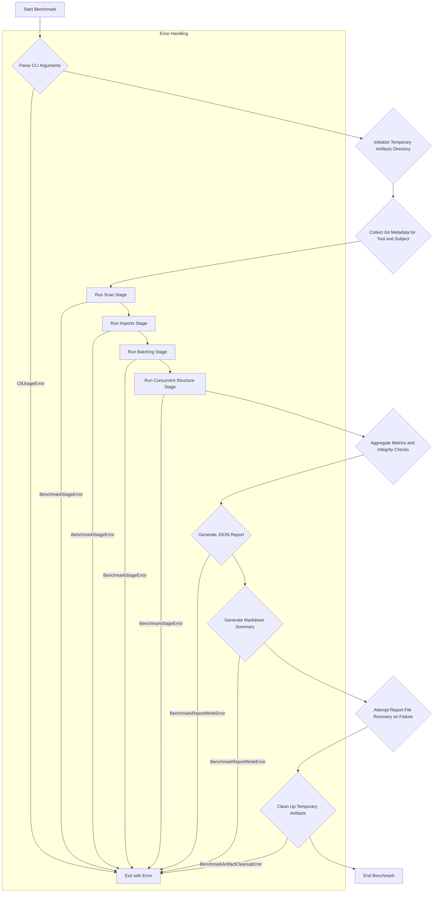

<!-- source: DeepWiki mcp.deepwiki.com · repo Egonex-AI/Understand-Anything · page 7.3 Large-Repo Benchmarks · fetched 2026-10-30 -->

# Large-Repo Benchmarks

<details>
<summary>Relevant source files</summary>

The following files were used as context for generating this wiki page:

- [docs/benchmarks/large-monorepo.md](docs/benchmarks/large-monorepo.md)
- [docs/benchmarks/large-repo-report-1.0.0.schema.json](docs/benchmarks/large-repo-report-1.0.0.schema.json)
- [docs/benchmarks/samples/understand-anything-pr587-full-sample.json](docs/benchmarks/samples/understand-anything-pr587-full-sample.json)
- [docs/benchmarks/samples/understand-anything-pr587-full-sample.md](docs/benchmarks/samples/understand-anything-pr587-full-sample.md)
- [docs/superpowers/plans/2026-07-17-benchmark-unsupported-outcomes.md](docs/superpowers/plans/2026-07-17-benchmark-unsupported-outcomes.md)
- [docs/superpowers/specs/2026-07-17-benchmark-unsupported-outcomes-design.md](docs/superpowers/specs/2026-07-17-benchmark-unsupported-outcomes-design.md)
- [eslint.config.mjs](eslint.config.mjs)
- [package.json](package.json)
- [scripts/benchmark-large-repo.mjs](scripts/benchmark-large-repo.mjs)
- [scripts/generate-large-graph.mjs](scripts/generate-large-graph.mjs)
- [scripts/lib/benchmark-stage-worker.mjs](scripts/lib/benchmark-stage-worker.mjs)
- [scripts/lib/large-repo-benchmark.mjs](scripts/lib/large-repo-benchmark.mjs)
- [tests/benchmark/test_large_repo_benchmark.test.mjs](tests/benchmark/test_large_repo_benchmark.test.mjs)
- [tests/benchmark/test_large_repo_report_schema.test.mjs](tests/benchmark/test_large_repo_report_schema.test.mjs)
- [tests/skill/understand/test_extract_structure_outcomes.test.mjs](tests/skill/understand/test_extract_structure_outcomes.test.mjs)
- [understand-anything-plugin/skills/understand-domain/extract-domain-context.py](understand-anything-plugin/skills/understand-domain/extract-domain-context.py)

</details>


This page details the tools and processes used for benchmarking the performance and scalability of the Understand Anything codebase on large repositories. The benchmarks focus on the deterministic static analysis phases of the `/understand` skill, excluding LLM inference and dashboard rendering.

## Purpose and Scope

The large-repo benchmark harness is designed to collect reproducible performance and scale evidence from substantial codebases. It specifically targets the core deterministic helpers that power the `/understand` skill:
1.  **File scanning, classification, and line counting**: Identifying and categorizing files within a repository.
2.  **Static import-map extraction**: Building a map of file dependencies.
3.  **Semantic batch planning**: Grouping files into batches for efficient processing.
4.  **Tree-sitter structural extraction**: Analyzing the syntax and structure of code files using Tree-sitter grammars.

The benchmark reports key metrics such as wall-clock time, CPU time (user and system), peak resident memory, output size, repository scale, batching statistics, structural coverage, and SHA-256 digests for determinism. It explicitly *does not* involve LLMs, API calls, token counting, cost estimation, knowledge graph generation, or dashboard rendering. This ensures that the results reflect the performance of the static analysis pipeline itself [docs/benchmarks/large-monorepo.md:8-30]().

Sources:
- [docs/benchmarks/large-monorepo.md:8-30]()

## Benchmark Harness Components

The large-repo benchmark system consists of several interconnected scripts and a defined report schema.

### `scripts/benchmark-large-repo.mjs`

This is the main entry point for running the large repository benchmark [package.json:33](). It orchestrates the execution of various stages of the static analysis pipeline, collects metrics, and generates a comprehensive report.

The script handles command-line argument parsing, temporary directory management, and the execution of child processes for each benchmark stage. It ensures that sensitive information like absolute paths is redacted from the final report [docs/benchmarks/large-monorepo.md:58-60]().

Key functionalities include:
*   **Argument Parsing**: Uses `parseArgs` to process command-line options such as repository path, label, output file, concurrency, and whether to keep artifacts [scripts/lib/large-repo-benchmark.mjs:182-231]().
*   **Temporary Artifact Management**: Creates a temporary directory for intermediate files and cleans it up after the run, unless `--keep-artifacts` is specified [scripts/lib/large-repo-benchmark.mjs:120-126]().
*   **Git Metadata Collection**: Gathers commit hashes and dirty status for both the benchmark tool and the subject repository to ensure reproducibility [scripts/lib/large-repo-benchmark.mjs:1000-1020]().
*   **Stage Execution**: Runs each static analysis stage (scan, imports, batching, structure) as a separate child process using `runNodeStage` or `runConcurrentStage` [scripts/lib/large-repo-benchmark.mjs:1080-1083]().
*   **Metric Collection**: Captures `durationMs`, `peakRssBytes`, `userCpuTimeMicros`, and `systemCpuTimeMicros` for each stage [scripts/lib/large-repo-benchmark.mjs:1080-1083]().
*   **Report Generation**: Compiles all collected data into a JSON report conforming to `large-repo-report-1.0.0.schema.json` and a human-readable Markdown summary [scripts/lib/large-repo-benchmark.mjs:1800-1801]().
*   **Error Handling and Redaction**: Catches errors, redacts sensitive paths from error messages, and attempts to restore previous report files in case of write failures [scripts/lib/large-repo-benchmark.mjs:96-132]().

Sources:
- [docs/benchmarks/large-monorepo.md:58-60]()
- [package.json:33]()
- [scripts/lib/large-repo-benchmark.mjs:96-132]()
- [scripts/lib/large-repo-benchmark.mjs:120-126]()
- [scripts/lib/large-repo-benchmark.mjs:182-231]()
- [scripts/lib/large-repo-benchmark.mjs:1000-1020]()
- [scripts/lib/large-repo-benchmark.mjs:1080-1083]()
- [scripts/lib/large-repo-benchmark.mjs:1800-1801]()

### `scripts/lib/large-repo-benchmark.mjs`

This library provides the core logic and utilities for the benchmark runner. It defines classes for CLI errors, benchmark stage errors, and report write errors [scripts/lib/large-repo-benchmark.mjs:81-117](). It also includes functions for path canonicalization, argument parsing, and managing child processes.

Key functions and classes:
*   `REPO_ROOT`: Constant pointing to the monorepo root [scripts/lib/large-repo-benchmark.mjs:38]().
*   `REPORT_SCHEMA_VERSION` and `REPORT_SCHEMA_URL`: Define the version and location of the benchmark report schema [scripts/lib/large-repo-benchmark.mjs:39-41]().
*   `CliUsageError`, `BenchmarkStageError`, `BenchmarkReportWriteError`, `BenchmarkArtifactCleanupError`: Custom error types for specific benchmark failures [scripts/lib/large-repo-benchmark.mjs:81-117]().
*   `cleanupBenchmarkArtifacts(artifactRoot, operations)`: Removes temporary benchmark artifacts [scripts/lib/large-repo-benchmark.mjs:119-126]().
*   `canonicalizePhysicalPath(pathValue)`: Resolves a path to its physical, canonical form, handling symlinks and Windows extended prefixes [scripts/lib/large-repo-benchmark.mjs:140-167]().
*   `isPathInsideOrEqual(rootPath, candidatePath)`: Checks if a `candidatePath` is within or equal to a `rootPath` [scripts/lib/large-repo-benchmark.mjs:169-180]().
*   `parseArgs(argv, cwd)`: Parses command-line arguments for the benchmark script [scripts/lib/large-repo-benchmark.mjs:182-231]().
*   `runNodeStage(name, script, args, options)`: Executes a single Node.js script as a benchmark stage, capturing its metrics [scripts/lib/large-repo-benchmark.mjs:1080-1083]().
*   `runConcurrentStage(name, script, args, options)`: Executes a Node.js script concurrently across multiple workers, aggregating metrics [scripts/lib/large-repo-benchmark.mjs:1300-1303]().
*   `getGitMetadata(directory)`: Retrieves Git commit hash and dirty status for a given directory [scripts/lib/large-repo-benchmark.mjs:960-998]().
*   `computeSha256Digest(path)`: Computes the SHA-256 digest of a file or directory for determinism checks [scripts/lib/large-repo-benchmark.mjs:1500-1503]().

Sources:
- [scripts/lib/large-repo-benchmark.mjs:38]()
- [scripts/lib/large-repo-benchmark.mjs:39-41]()
- [scripts/lib/large-repo-benchmark.mjs:81-117]()
- [scripts/lib/large-repo-benchmark.mjs:119-126]()
- [scripts/lib/large-repo-benchmark.mjs:140-167]()
- [scripts/lib/large-repo-benchmark.mjs:169-180]()
- [scripts/lib/large-repo-benchmark.mjs:182-231]()
- [scripts/lib/large-repo-benchmark.mjs:960-998]()
- [scripts/lib/large-repo-benchmark.mjs:1080-1083]()
- [scripts/lib/large-repo-benchmark.mjs:1300-1303]()
- [scripts/lib/large-repo-benchmark.mjs:1500-1503]()

### `scripts/lib/benchmark-stage-worker.mjs`

This script acts as a wrapper for executing individual benchmark stages. It imports the target script into the current process to accurately measure resource usage (CPU time, peak RSS) for that specific stage. It captures `performance.now()` timestamps and `process.resourceUsage()` metrics before and after the script's execution [scripts/lib/benchmark-stage-worker.mjs:16-18]().

The worker also intercepts `process.exit()` calls from the imported script to prevent premature termination of the benchmark runner, instead throwing an `ImportedHelperExitError` [scripts/lib/benchmark-stage-worker.mjs:21-27](). Metrics are then printed to `stderr` with a special prefix `__UA_BENCHMARK_METRICS__` for the parent process to parse [scripts/lib/benchmark-stage-worker.mjs:55]().

Sources:
- [scripts/lib/benchmark-stage-worker.mjs:16-18]()
- [scripts/lib/benchmark-stage-worker.mjs:21-27]()
- [scripts/lib/benchmark-stage-worker.mjs:55]()

### `scripts/generate-large-graph.mjs`

This utility script generates a large, fake KnowledgeGraph JSON file for testing purposes, particularly for dashboard performance and robustness. It can create a graph with a specified number of nodes and edges, and optionally inject "messy" data to simulate issues found in LLM-generated graphs [scripts/generate-large-graph.mjs:1-17]().

The script generates:
*   **Nodes**: With various types (`file`, `function`, `class`, `module`, `concept`), names, file paths, summaries, tags, and complexities [scripts/generate-large-graph.mjs:48-63]().
*   **Edges**: Connecting nodes with different types (`imports`, `calls`, `contains`, etc.) and weights. It avoids cycles to prevent issues with graph layout algorithms [scripts/generate-large-graph.mjs:65-90]().
*   **Layers**: Assigns nodes to predefined architectural layers [scripts/generate-large-graph.mjs:92-108]().
*   **Tour Steps**: Creates a basic tour through the generated graph [scripts/generate-large-graph.mjs:112-125]().

The `--messy` flag introduces various types of data quality issues:
*   **Tier 1 (Silent fixes)**: Null optional fields, mixed-case enum values [scripts/generate-large-graph.mjs:129-143]().
*   **Tier 2 (Auto-fixable)**: Missing fields, aliases for enum values, string representations for numeric fields [scripts/generate-large-graph.mjs:147-191]().
*   **Tier 3 (Unrecoverable)**: Missing IDs/names, dangling references, bad types, which would typically cause validation failures [scripts/generate-large-graph.mjs:194-201]().

The generated graph is written to the project's `.ua/knowledge-graph.json` (or `.understand-anything/knowledge-graph.json` for legacy compatibility) [scripts/generate-large-graph.mjs:14-17]().

Sources:
- [scripts/generate-large-graph.mjs:1-17]()
- [scripts/generate-large-graph.mjs:14-17]()
- [scripts/generate-large-graph.mjs:48-63]()
- [scripts/generate-large-graph.mjs:65-90]()
- [scripts/generate-large-graph.mjs:92-108]()
- [scripts/generate-large-graph.mjs:112-125]()
- [scripts/generate-large-graph.mjs:129-143]()
- [scripts/generate-large-graph.mjs:147-191]()
- [scripts/generate-large-graph.mjs:194-201]()

## Report JSON Schema (`docs/benchmarks/large-repo-report-1.0.0.schema.json`)

The benchmark results are structured according to a JSON Schema, ensuring consistency and enabling automated validation. The schema defines the expected fields and their types for a large repository benchmark report [docs/benchmarks/large-repo-report-1.0.0.schema.json:1-7]().

Key sections of the schema include:
*   `schemaUrl` and `schemaVersion`: Identifies the schema itself [docs/benchmarks/large-repo-report-1.0.0.schema.json:28-31]().
*   `pairId`: A UUID linking the JSON report to its Markdown summary [docs/benchmarks/large-repo-report-1.0.0.schema.json:33-35]().
*   `status`: Overall benchmark status (`ok`, `degraded`, `failed`) [docs/benchmarks/large-repo-report-1.0.0.schema.json:36]().
*   `run`: Details about the benchmark execution, including `startedAt`, `finishedAt`, and `durationMs` [docs/benchmarks/large-repo-report-1.0.0.schema.json:198-207]().
*   `tool`: Information about the Understand Anything tool itself (commit, dirty status, package version) [docs/benchmarks/large-repo-report-1.0.0.schema.json:208-216]().
*   `subject`: Details about the benchmarked repository (label, commit, dirty status) [docs/benchmarks/large-repo-report-1.0.0.schema.json:217-220]().
*   `environment`: System information where the benchmark ran (platform, OS release, architecture, Node.js version, CPU, memory) [docs/benchmarks/large-repo-report-1.0.0.schema.json:221-231]().
*   `configuration`: Benchmark parameters, such as `concurrency` and `stages` executed [docs/benchmarks/large-repo-report-1.0.0.schema.json:232-237]().
*   `scale`: Metrics describing the size of the subject repository (files, lines, bytes, categories, languages) [docs/benchmarks/large-repo-report-1.0.0.schema.json:238-247]().
*   `stages`: Detailed metrics for each static analysis stage (`scan`, `imports`, `batching`, `structure`), including duration, peak RSS, CPU times, and output size [docs/benchmarks/large-repo-report-1.0.0.schema.json:248-252](). The `structure` stage also reports `maxWorkerPeakRssBytes` and aggregated CPU times across workers [docs/benchmarks/large-monorepo.md:23-26]().
*   `integrity`: Checks for data consistency and completeness across stages (e.g., `allScannedFilesBatched`, `structureCoverage`, `filesSkipped`) [docs/benchmarks/large-repo-report-1.0.0.schema.json:253-266]().
*   `determinism`: SHA-256 digests of input and output to verify reproducibility [docs/benchmarks/large-repo-report-1.0.0.schema.json:267-271]().
*   `llm`: Confirms that LLM was not invoked [docs/benchmarks/large-repo-report-1.0.0.schema.json:272-277]().
*   `warnings` and `secondaryErrors`: Lists any warnings or errors encountered during the run [docs/benchmarks/large-repo-report-1.0.0.schema.json:278-285]().

The schema includes conditional validation (`allOf`, `if`/`then`) to enforce relationships between `status` and other fields, such as requiring `error` for a `failed` status or `warnings` for a `degraded` status [docs/benchmarks/large-repo-report-1.0.0.schema.json:74-181]().

Sources:
- [docs/benchmarks/large-monorepo.md:23-26]()
- [docs/benchmarks/large-repo-report-1.0.0.schema.json:1-7]()
- [docs/benchmarks/large-repo-report-1.0.0.schema.json:28-31]()
- [docs/benchmarks/large-repo-report-1.0.0.schema.json:33-35]()
- [docs/benchmarks/large-repo-report-1.0.0.schema.json:36]()
- [docs/benchmarks/large-repo-report-1.0.0.schema.json:74-181]()
- [docs/benchmarks/large-repo-report-1.0.0.schema.json:198-207]()
- [docs/benchmarks/large-repo-report-1.0.0.schema.json:208-216]()
- [docs/benchmarks/large-repo-report-1.0.0.schema.json:217-220]()
- [docs/benchmarks/large-repo-report-1.0.0.schema.json:221-231]()
- [docs/benchmarks/large-repo-report-1.0.0.schema.json:232-237]()
- [docs/benchmarks/large-repo-report-1.0.0.schema.json:238-247]()
- [docs/benchmarks/large-repo-report-1.0.0.schema.json:248-252]()
- [docs/benchmarks/large-repo-report-1.0.0.schema.json:253-266]()
- [docs/benchmarks/large-repo-report-1.0.0.schema.json:267-271]()
- [docs/benchmarks/large-repo-report-1.0.0.schema.json:272-277]()
- [docs/benchmarks/large-repo-report-1.0.0.schema.json:278-285]()

## Data Flow and Implementation

The benchmark process involves a series of sequential and concurrent steps, each executed as a distinct stage.

### Overall Benchmark Flow

The `benchmark-large-repo.mjs` script orchestrates the following high-level flow:


Sources:
- [scripts/benchmark-large-repo.mjs]()
- [scripts/lib/large-repo-benchmark.mjs]()

### Stage Worker Execution

Each benchmark stage (except for the main orchestration) is executed by `benchmark-stage-worker.mjs`. This worker ensures accurate resource usage measurement for the specific script being benchmarked.

```mermaid
graph TD
    A[benchmark-large-repo.mjs] --> B{Spawn benchmark-stage-worker.mjs};
    B -- "scriptPath, scriptArgs" --> C[benchmark-stage-worker.mjs];
    C --> D{Record startedAt, usageBefore};
    D --> E{Intercept process.exit};
    E --> F{Import and Execute Target Script};
    F -- "Error" --> G[Capture Failure];
    F -- "Success" --> H[Continue];
    G --> I{Log Error to stderr};
    H --> J{Record usageAfter};
    I --> J;
    J --> K{Calculate Metrics};
    K --> L{Print Metrics to stderr with Prefix};
    L --> M{Restore original process.exit};
    M --> N{Exit with code (1 on failure, 0 on success)};
    N --> O[benchmark-large-repo.mjs parses metrics from stderr];
```
Sources:
- [scripts/lib/benchmark-stage-worker.mjs]()

### Detailed Stage Breakdown

1.  **Scan Stage**:
    *   **Script**: `understand-anything-plugin/skills/understand/scan-project.mjs`
    *   **Purpose**: Discovers all files in the repository, applies `.understandignore` rules, and categorizes files by type and language.
    *   **Metrics**: `files`, `lines`, `bytes`, `filteredByUserIgnore`, `byCategory`, `byLanguage` [docs/benchmarks/large-repo-report-1.0.0.schema.json:300-307]().

2.  **Imports Stage**:
    *   **Script**: `understand-anything-plugin/skills/understand/extract-import-map.mjs`
    *   **Purpose**: Extracts import/export relationships between files to build an `importMap`.
    *   **Metrics**: `filesScanned`, `filesWithImports`, `edges` [docs/benchmarks/large-repo-report-1.0.0.schema.json:310-314]().

3.  **Batching Stage**:
    *   **Script**: `understand-anything-plugin/skills/understand/compute-batches.mjs`
    *   **Purpose**: Groups files into semantic batches for parallel processing by the `file-analyzer` subagents.
    *   **Metrics**: `algorithm`, `totalBatches`, `batchSizes` (min, p50, p95, max, mean), `estimatedAgentInputBytes` [docs/benchmarks/large-repo-report-1.0.0.schema.json:317-323]().

4.  **Structure Stage (Concurrent)**:
    *   **Script**: `understand-anything-plugin/skills/understand/extract-structure.mjs`
    *   **Purpose**: Analyzes each file (or batch of files) using Tree-sitter to extract structural information (functions, classes, imports, exports, call graphs, etc.). This stage runs concurrently across multiple workers.
    *   **Metrics**: `maxWorkerPeakRssBytes` (maximum peak RSS of any single worker), `userCpuTimeMicros` and `systemCpuTimeMicros` (summed across all workers), `batchesSucceeded`, `batchesFailed`, `filesAnalyzed`, `filesSkipped`, `structureSucceeded`, `structureFailed`, `callGraphSucceeded`, `callGraphFailed`, `callGraphSkipped`, `entities` (counts of various extracted entities), `batchDurationMs` [docs/benchmarks/large-repo-report-1.0.0.schema.json:326-350]().

Sources:
- [docs/benchmarks/large-repo-report-1.0.0.schema.json:300-307]()
- [docs/benchmarks/large-repo-report-1.0.0.schema.json:310-314]()
- [docs/benchmarks/large-repo-report-1.0.0.schema.json:317-323]()
- [docs/benchmarks/large-repo-report-1.0.0.schema.json:326-350]()
- [understand-anything-plugin/skills/understand/scan-project.mjs]()
- [understand-anything-plugin/skills/understand/extract-import-map.mjs]()
- [understand-anything-plugin/skills/understand/compute-batches.mjs]()
- [understand-anything-plugin/skills/understand/extract-structure.mjs]()

## Reproducibility Protocol

The `docs/benchmarks/large-monorepo.md` document outlines a strict protocol for ensuring reproducible benchmark results:
1.  **Immutable Commits**: Record the exact Git commit hashes for both the Understand Anything tool and the subject repository. The report captures these automatically if the directories are Git worktrees [docs/benchmarks/large-monorepo.md:89-92]().
2.  **Clean Worktrees**: Use clean Git worktrees to avoid `dirty: true` flags in the report, which indicate uncommitted changes [docs/benchmarks/large-monorepo.md:93-96]().
3.  **Consistent Environment**: Maintain constant operating system, Node.js version, machine hardware, concurrency settings, and `.understandignore` rules across compared runs [docs/benchmarks/large-monorepo.md:97-99]().
4.  **Multiple Runs**: Execute the benchmark at least three times and retain all reports, treating the first run as a potential cold-cache result [docs/benchmarks/large-monorepo.md:100-102]().
5.  **Machine-Specific Comparisons**: Compare timing and memory metrics only on the same machine. Cross-machine comparisons are useful for scale but not for performance regression analysis [docs/benchmarks/large-monorepo.md:103-105]().
6.  **Digest Verification**: Confirm matching `inputDigest` and `outputDigest` values before comparing performance for supposedly identical inputs [docs/benchmarks/large-monorepo.md:106-107]().
7.  **Share Both Reports**: Always share both the JSON and Markdown report files. Review them for sensitive information before publishing [docs/benchmarks/large-monorepo.md:108-112]().

Sources:
- [docs/benchmarks/large-monorepo.md:89-92]()
- [docs/benchmarks/large-monorepo.md:93-96]()
- [docs/benchmarks/large-monorepo.md:97-99]()
- [docs/benchmarks/large-monorepo.md:100-102]()
- [docs/benchmarks/large-monorepo.md:103-105]()
- [docs/benchmarks/large-monorepo.md:106-107]()
- [docs/benchmarks/large-monorepo.md:108-112]()

## Benchmark Samples

The `docs/benchmarks/samples/` directory contains example benchmark reports. For instance, `understand-anything-pr587-full-sample.md` provides a human-readable summary of a benchmark run, detailing the run status, scale metrics, stage-by-stage performance, integrity checks, environment information, and any warnings [docs/benchmarks/samples/understand-anything-pr587-full-sample.md:1-71](). The corresponding JSON file, `understand-anything-pr587-full-sample.json`, contains the machine-readable structured data.

Sources:
- [docs/benchmarks/samples/understand-anything-pr587-full-sample.md:1-71]()

---

