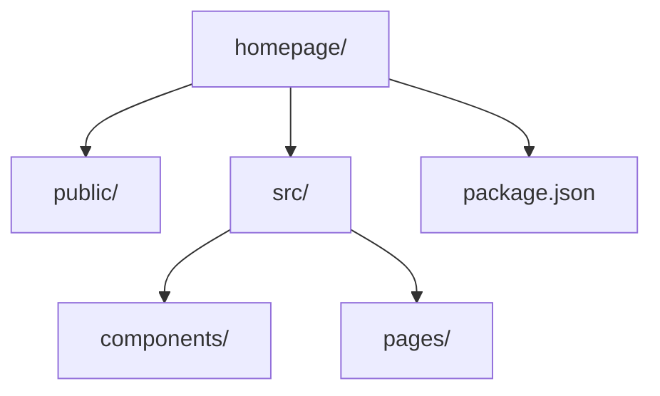
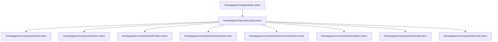

<!-- source: DeepWiki mcp.deepwiki.com · repo Egonex-AI/Understand-Anything · page 8 Homepage & Marketing Site · fetched 2026-10-30 -->

# Homepage & Marketing Site

<details>
<summary>Relevant source files</summary>

The following files were used as context for generating this wiki page:

- [homepage/.gitignore](homepage/.gitignore)
- [homepage/.vscode/extensions.json](homepage/.vscode/extensions.json)
- [homepage/.vscode/launch.json](homepage/.vscode/launch.json)
- [homepage/README.md](homepage/README.md)
- [homepage/package.json](homepage/package.json)
- [homepage/public/.gitkeep](homepage/public/.gitkeep)
- [homepage/src/pages/index.astro](homepage/src/pages/index.astro)

</details>


The **Understand Anything** marketing site and homepage are built using the **Astro** framework, located in the `homepage/` directory [homepage/README.md:1-13](). This static site serves as the primary interface for introducing the project, showcasing features, demonstrating a live interactive dashboard demo, providing installation instructions, and linking to community resources.

This is a PARENT page. For detailed information on specific aspects of the homepage, refer to the following child pages:
- [Homepage Components & Styling](#8.1) covers Astro components, styling, and assets.
- [Homepage Build & Deployment](#8.2) details the build process, deployment configuration, and GitHub Actions workflow.

---

## Project Overview

The `homepage/` directory contains the Astro project for the Understand Anything marketing site [homepage/README.md:1-3](). It is structured with `public/` for static assets, `src/` for components and pages, and `package.json` for dependencies and scripts [homepage/README.md:7-14](). The site is published as a static Astro site, with public messaging aligning with the Egonex organization identity [homepage/README.md:16-19]().

The main page, `index.astro`, orchestrates the display of various components to form the complete homepage [homepage/src/pages/index.astro:1-22]().

### Homepage Structure


Sources:
- [homepage/README.md:7-14]()

### Development and Build Commands

The `homepage/package.json` defines several scripts for development and building the site [homepage/package.json:8-12](). These commands are typically run from the repository root using `pnpm --filter homepage <command>` [homepage/README.md:20-28]().

| Command | Action |
| :-- | :-- |
| `pnpm --filter homepage dev` | Starts the local development server [homepage/package.json:9]() |
| `pnpm --filter homepage build` | Builds the static site for production [homepage/package.json:10]() |
| `pnpm --filter homepage preview` | Previews the built static site [homepage/package.json:11]()
| `pnpm --filter homepage astro` | Accesses the Astro CLI [homepage/package.json:12]()

Sources:
- [homepage/README.md:20-28]()
- [homepage/package.json:8-12]()

---

## Homepage Components and Styling

The homepage is constructed from a collection of Astro components, each responsible for a specific section of the page. These components are assembled in `homepage/src/pages/index.astro` within a `Layout.astro` wrapper [homepage/src/pages/index.astro:1-22](). Global styling is managed through `global.css`, which defines design tokens, fonts, and animations.

For a detailed breakdown of each component, their specific functionalities, and the global styling definitions, see [Homepage Components & Styling](#8.1).

### Page Composition

The `index.astro` page imports and renders several key components to form the complete homepage [homepage/src/pages/index.astro:1-22]().


Sources:
- [homepage/src/pages/index.astro:1-22]()

---

## Homepage Build and Deployment

The homepage is deployed as a static site. The build process involves using Astro's static site generation capabilities, and deployment is automated via GitHub Actions. This ensures that changes to the marketing site are automatically built and published.

For an in-depth explanation of the `astro.config.mjs` configuration, `package.json` scripts, CNAME setup, and the `deploy-homepage.yml` GitHub Actions workflow, refer to [Homepage Build & Deployment](#8.2).

### Deployment Workflow Overview

The deployment process leverages GitHub Actions to build and publish the static Astro site.

```mermaid
graph TD
    A[Code Push to Main] --> B{GitHub Actions Trigger}
    B --> C[Checkout Repository]
    C --> D[Install Dependencies (pnpm)]
    D --> E[Build Astro Homepage]
    E --> F[Deploy Static Site]
    F --> G[Homepage Live]
```
Sources:
- [homepage/package.json:10]()
- [homepage/README.md:27]()

---

