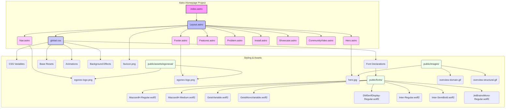

<!-- source: DeepWiki mcp.deepwiki.com · repo Egonex-AI/Understand-Anything · page 8.1 Homepage Components & Styling · fetched 2026-10-30 -->

# Homepage Components & Styling

Relevant source files

The following files were used as context for generating this wiki page:

- [homepage/public/assets/egonexai/egonex-logo.png](homepage/public/assets/egonexai/egonex-logo.png)
- [homepage/public/favicon.ico](homepage/public/favicon.ico)
- [homepage/public/favicon.png](homepage/public/favicon.png)
- [homepage/public/fonts/GeistMonoVariable.woff2](homepage/public/fonts/GeistMonoVariable.woff2)
- [homepage/public/fonts/GeistVariable.woff2](homepage/public/fonts/GeistVariable.woff2)
- [homepage/public/fonts/MazzardH-Medium.woff2](homepage/public/fonts/MazzardH-Medium.woff2)
- [homepage/public/fonts/MazzardH-Regular.woff2](homepage/public/fonts/MazzardH-Regular.woff2)
- [homepage/public/images/overview-domain.gif](homepage/public/images/overview-domain.gif)
- [homepage/public/images/overview-structural.gif](homepage/public/images/overview-structural.gif)
- [homepage/src/components/CommunityVideo.astro](homepage/src/components/CommunityVideo.astro)
- [homepage/src/components/Features.astro](homepage/src/components/Features.astro)
- [homepage/src/components/Footer.astro](homepage/src/components/Footer.astro)
- [homepage/src/components/Hero.astro](homepage/src/components/Hero.astro)
- [homepage/src/components/Install.astro](homepage/src/components/Install.astro)
- [homepage/src/components/Nav.astro](homepage/src/components/Nav.astro)
- [homepage/src/components/Problem.astro](homepage/src/components/Problem.astro)
- [homepage/src/components/Showcase.astro](homepage/src/components/Showcase.astro)
- [homepage/src/layouts/Layout.astro](homepage/src/layouts/Layout.astro)
- [homepage/src/styles/global.css](homepage/src/styles/global.css)

This page details the Astro components, styling, and asset management for the Understand Anything homepage. It covers the implementation of key sections like the Hero, Features, Problem, Install, Showcase, Community Video, Navigation, and Footer, along with global styling and font/image assets.

## Astro Components

The homepage is built using several Astro components, each responsible for a distinct section of the page. These components encapsulate their own HTML structure and styling.

### Hero Component

The `Hero.astro` component [homepage/src/components/Hero.astro:1-87]() serves as the main introductory section of the homepage. It features a title, tagline, key value propositions, calls to action, and a background image with various overlay effects.

**Implementation Details:**
- **Dynamic URLs:** It defines `githubUrl` and `egonexUrl` variables [homepage/src/components/Hero.astro:2-3]() for external links.
- **Content Structure:** The component uses a `<section class="hero">` [homepage/src/components/Hero.astro:6]() containing a background layer (`hero-bg`) and the main content (`hero-content`).
- **Visual Elements:**
    - A background image `/images/hero.jpg` [homepage/src/components/Hero.astro:8]() is used with CSS filters and blend modes for visual effect [homepage/src/components/Hero.astro:137-140]().
    - Radial and linear gradients are applied to the background and overlay for depth [homepage/src/components/Hero.astro:107-112](), [homepage/src/components/Hero.astro:145-148]().
- **Interactive Elements:**
    - "Get Started" and "Live Demo" call-to-action buttons [homepage/src/components/Hero.astro:41-42]().
    - A "Star on GitHub" link with an SVG icon [homepage/src/components/Hero.astro:43-46]().
    - A Trendshift badge for GitHub trending status [homepage/src/components/Hero.astro:49-84]().
- **Animations:** CSS classes like `anim anim-1` to `anim anim-6` are used to apply staggered fade-in animations to content elements.

**Styling:**
The component includes a `<style>` block [homepage/src/components/Hero.astro:89-547]() with scoped CSS for its elements, defining layout, typography, colors, and visual effects. Key styles include:
- `hero-bg`: Manages the background image and gradient overlays [homepage/src/components/Hero.astro:103-140]().
- `hero-title`: Styles the main heading with a gradient text effect [homepage/src/components/Hero.astro:178-198]().
- `hero-badge`, `hero-pillars`, `hero-actions`: Define the appearance and layout of various content blocks.

Sources:
- [homepage/src/components/Hero.astro:1-87]()
- [homepage/src/components/Hero.astro:89-547]()
- [homepage/public/images/hero.jpg]()

### Features Component

The `Features.astro` component [homepage/src/components/Features.astro:1-48]() displays a grid of key features of Understand Anything.

**Implementation Details:**
- **Feature Data:** An array `features` [homepage/src/components/Features.astro:2-33]() holds data for each feature, including an `icon`, `title`, and `description`.
- **Dynamic Rendering:** The component iterates over the `features` array using `features.map` [homepage/src/components/Features.astro:38-46]() to render each feature as a `feature-card`.
- **Animations:** Each `feature-card` applies a `reveal` class with a staggered `reveal-delay` [homepage/src/components/Features.astro:39]() for animated appearance.

**Styling:**
The component's `<style>` block [homepage/src/components/Features.astro:50-113]() defines styles for the grid layout and individual feature cards.
- `features-grid`: Uses CSS Grid for a responsive two-column layout [homepage/src/components/Features.astro:58-61]().
- `feature-card`: Styles individual feature cards with background, border, shadow, and hover effects [homepage/src/components/Features.astro:63-80]().
- `feature-icon`: Applies a gradient to the feature icons [homepage/src/components/Features.astro:82-86]().

Sources:
- [homepage/src/components/Features.astro:1-48]()
- [homepage/src/components/Features.astro:50-113]()

### Problem Component

The `Problem.astro` component [homepage/src/components/Problem.astro:1-70]() highlights the problem that Understand Anything solves by contrasting it with typical code analysis tools.

**Implementation Details:**
- **Problem Statement:** Presents a heading and a promise statement [homepage/src/components/Problem.astro:2-9]().
- **Comparison Visuals:** Uses two `problem-card` elements [homepage/src/components/Problem.astro:11-69]() to visually compare a "Typical code graph" (represented by a tangled SVG "hairball" [homepage/src/components/Problem.astro:15-39]()) with "Understand Anything" (represented by structured domain groups [homepage/src/components/Problem.astro:47-65]()).
- **SVG for "Hairball":** The "hairball" visual is an inline SVG with circles for nodes and lines for edges, demonstrating a complex, unreadable graph [homepage/src/components/Problem.astro:15-39]().
- **Domain Preview:** The "Understand Anything" visual uses `domain-group` and `domain-item` elements to show structured business logic [homepage/src/components/Problem.astro:47-65]().

**Styling:**
The component's `<style>` block [homepage/src/components/Problem.astro:73-232]() defines styles for the comparison layout and visual elements.
- `problem-compare`: Uses CSS Grid for a two-column comparison layout [homepage/src/components/Problem.astro:109-112]().
- `problem-card`: Styles the comparison cards with distinct backgrounds and shadows [homepage/src/components/Problem.astro:115-132]().
- `hairball`: Styles the SVG elements to create the "tangled" effect [homepage/src/components/Problem.astro:164-178]().
- `domain-preview`: Styles the structured domain representation [homepage/src/components/Problem.astro:181-197]().

Sources:
- [homepage/src/components/Problem.astro:1-70]()
- [homepage/src/components/Problem.astro:73-232]()

### Install Component

The `Install.astro` component [homepage/src/components/Install.astro:1-22]() provides instructions for getting started with Understand Anything, including a code snippet and a copy-to-clipboard functionality.

**Implementation Details:**
- **Code Snippet:** Displays a `pre` and `code` block [homepage/src/components/Install.astro:16-18]() containing installation commands.
- **Copy to Clipboard:** A JavaScript snippet [homepage/src/components/Install.astro:24-37]() handles copying the code snippet to the clipboard when the "Copy" button [homepage/src/components/Install.astro:7-14]() is clicked. It also provides visual feedback by changing the button text to "Copied!".

**Styling:**
The component's `<style>` block [homepage/src/components/Install.astro:40-148]() styles the installation section, including the code block and button.
- `install-code`: Styles the code block with a dark background, border, and shadow [homepage/src/components/Install.astro:59-69]().
- `install-copy`: Styles the copy button with an SVG icon and hover effects [homepage/src/components/Install.astro:93-111]().
- `cmd`: Styles the command text within the code snippet [homepage/src/components/Install.astro:126-128]().

Sources:
- [homepage/src/components/Install.astro:1-22]()
- [homepage/src/components/Install.astro:24-37]()
- [homepage/src/components/Install.astro:40-148]()

### Showcase Component

The `Showcase.astro` component [homepage/src/components/Showcase.astro:1-44]() features a live demo of the Understand Anything dashboard.

**Implementation Details:**
- **Demo URL:** The `demoUrl` variable [homepage/src/components/Showcase.astro:3]() constructs the path to the embedded demo, accounting for `BASE_URL`.
- **Iframe Embed:** An `<iframe>` [homepage/src/components/Showcase.astro:27-31]() is used to embed the live demo, pointing to the `demoUrl`. The `loading="lazy"` attribute is used for performance.
- **macOS-style Frame:** The demo iframe is wrapped in a `showcase-frame` [homepage/src/components/Showcase.astro:18-33]() with a `showcase-titlebar` [homepage/src/components/Showcase.astro:19-24]() to mimic a macOS window, including traffic light dots.
- **Feature Pills:** A set of `showcase-pill` elements [homepage/src/components/Showcase.astro:35-43]() highlight key features of the demo.

**Styling:**
The component's `<style>` block [homepage/src/components/Showcase.astro:46-214]() defines styles for the showcase section.
- `showcase-frame`: Styles the container for the embedded demo, including border-radius, background, and shadow [homepage/src/components/Showcase.astro:113-126]().
- `showcase-titlebar`: Styles the top bar of the frame with dots and text [homepage/src/components/Showcase.astro:128-143]().
- `showcase-iframe-wrap` and `showcase-iframe`: Manage the responsive embedding of the iframe [homepage/src/components/Showcase.astro:163-176]().
- `showcase-features` and `showcase-pill`: Style the feature tags displayed below the demo [homepage/src/components/Showcase.astro:179-203]().

Sources:
- [homepage/src/components/Showcase.astro:1-44]()
- [homepage/src/components/Showcase.astro:46-214]()

### CommunityVideo Component

The `CommunityVideo.astro` component [homepage/src/components/CommunityVideo.astro:1-37]() embeds a community-made video walkthrough.

**Implementation Details:**
- **YouTube Embed:** It uses a YouTube video ID (`youTubeId`) [homepage/src/components/CommunityVideo.astro:2]() to construct the `embedUrl` [homepage/src/components/CommunityVideo.astro:4]() for an `<iframe>` [homepage/src/components/CommunityVideo.astro:26-33]().
- **macOS-style Frame:** Similar to the `Showcase` component, it uses a `community-video-frame` [homepage/src/components/CommunityVideo.astro:18-36]() with a `community-video-titlebar` [homepage/src/components/CommunityVideo.astro:18-23]() to present the video in a styled frame.
- **Credit Link:** A link to the original YouTube video and the creator is provided [homepage/src/components/CommunityVideo.astro:14-15]().

**Styling:**
The component's `<style>` block [homepage/src/components/CommunityVideo.astro:39-147]() defines styles for the video section.
- `community-video-label`: Styles the section label [homepage/src/components/CommunityVideo.astro:47-60]().
- `community-video-frame`: Styles the video container with a border, shadow, and rounded corners [homepage/src/components/CommunityVideo.astro:91-99]().
- `community-video-iframe-wrap` and `community-video-iframe`: Manage the responsive embedding of the YouTube iframe [homepage/src/components/CommunityVideo.astro:130-142]().

Sources:
- [homepage/src/components/CommunityVideo.astro:1-37]()
- [homepage/src/components/CommunityVideo.astro:39-147]()

### Nav Component

The `Nav.astro` component [homepage/src/components/Nav.astro:1-130]() implements the main navigation bar for the homepage, including desktop and mobile layouts.

**Implementation Details:**
- **External Links:** Defines `githubUrl`, `egonexProductUrl`, and `motherHomeUrl` [homepage/src/components/Nav.astro:2-10]() for various external and internal links.
- **Navigation Links:** The `navigation` object [homepage/src/components/Nav.astro:12-18]() stores internal anchor links for easy management.
- **Desktop Navigation:** Includes a logo, product dropdown (`brand-products` [homepage/src/components/Nav.astro:40-57]()), and direct links to sections.
- **Mobile Navigation:** A hamburger menu button (`brand-menu-toggle` [homepage/src/components/Nav.astro:79-93]()) toggles a mobile panel (`brand-mobile-panel` [homepage/src/components/Nav.astro:95-128]()) with navigation links.
- **Scroll-based Header Styling:** A JavaScript snippet [homepage/src/components/Nav.astro:132-153]() uses `IntersectionObserver` to add an `is-compact` class to the header when the user scrolls past a certain point, allowing for dynamic styling changes.
- **Localhost Mother Site Link Adjustment:** During local development, the `data-mother-site-link` attribute is used to redirect links to a local mother site URL [homepage/src/components/Nav.astro:141-146]().

**Styling:**
The component's `<style>` block [homepage/src/components/Nav.astro:155-714]() defines styles for the navigation bar, including responsive adjustments.
- `brand-header`: Styles the main header, including its compact state [homepage/src/components/Nav.astro:155-170]().
- `brand-nav`: Styles the navigation container [homepage/src/components/Nav.astro:172-180]().
- `brand-home`: Styles the logo and site title [homepage/src/components/Nav.astro:182-200]().
- `brand-desktop-nav`: Styles the desktop navigation links and product dropdown [homepage/src/components/Nav.astro:202-260]().
- `brand-menu-toggle`: Styles the mobile menu button [homepage/src/components/Nav.astro:308-328]().
- `brand-mobile-panel`: Styles the mobile navigation overlay [homepage/src/components/Nav.astro:330-360]().

Sources:
- [homepage/src/components/Nav.astro:1-130]()
- [homepage/src/components/Nav.astro:132-153]()
- [homepage/src/components/Nav.astro:155-714]()
- [homepage/public/assets/egonexai/egonex-logo.png]()

### Footer Component

The `Footer.astro` component [homepage/src/components/Footer.astro:1-67]() provides copyright information, product links, legal links, and social media links.

**Implementation Details:**
- **Dynamic Year:** The `currentYear` variable [homepage/src/components/Footer.astro:14]() ensures the copyright year is always up-to-date.
- **Configurable Mother Site URL:** The `configuredMotherSiteUrl` and `motherHomeUrl` variables [homepage/src/components/Footer.astro:8-13]() allow the main EgonexAI site link to be configured via environment variables.
- **Link Groups:** Links are organized into product and legal/project groups using `<nav>` elements [homepage/src/components/Footer.astro:33-46]().
- **Social Links:** Includes links to X (Twitter) and GitHub with SVG icons [homepage/src/components/Footer.astro:49-59]().

**Styling:**
The component's `<style>` block [homepage/src/components/Footer.astro:70-250]() defines styles for the footer.
- `brand-footer`: Styles the overall footer with background gradients and padding [homepage/src/components/Footer.astro:70-78]().
- `brand-footer-row`: Uses CSS Grid for the main layout of the footer content [homepage/src/components/Footer.astro:93-99]().
- `brand-footer-logo`: Styles the EgonexAI logo and text [homepage/src/components/Footer.astro:101-127]().
- `brand-footer-links` and `brand-footer-link-group`: Style the navigation links [homepage/src/components/Footer.astro:129-160]().
- `brand-footer-social-links`: Styles the social media icons and their hover effects [homepage/src/components/Footer.astro:162-186]().

Sources:
- [homepage/src/components/Footer.astro:1-67]()
- [homepage/src/components/Footer.astro:70-250]()
- [homepage/public/assets/egonexai/egonex-logo.png]()

## Layout.astro

The `Layout.astro` file [homepage/src/layouts/Layout.astro:1-28]() serves as the base layout for all pages on the homepage.

**Implementation Details:**
- **Props:** It accepts a `title` prop [homepage/src/layouts/Layout.astro:2-3]() to set the page title.
- **HTML Structure:** Provides the basic HTML5 boilerplate, including `<!doctype html>`, `<html>`, `<head>`, and `<body>` tags [homepage/src/layouts/Layout.astro:9-24]().
- **Meta Tags:** Includes essential meta tags for character set, viewport, and description [homepage/src/layouts/Layout.astro:12-14]().
- **Preloading Assets:** Uses `<link rel="preload">` [homepage/src/layouts/Layout.astro:15-17]() to optimize loading of critical fonts and the EgonexAI logo.
- **Favicon:** Sets the favicon for the site [homepage/src/layouts/Layout.astro:18]().
- **Slot for Content:** The `<slot />` [homepage/src/layouts/Layout.astro:22]() element is where the content of individual Astro pages will be injected.
- **Global Styles:** Imports the `global.css` stylesheet using `@import '../styles/global.css';` [homepage/src/layouts/Layout.astro:27]() within a global style block.

Sources:
- [homepage/src/layouts/Layout.astro:1-28]()
- [homepage/public/favicon.png]()
- [homepage/public/assets/egonexai/egonex-logo.png]()

## Global Styling (`global.css`)

The `global.css` file [homepage/src/styles/global.css:1-213]() defines global styles, design tokens (CSS variables), font declarations, and base resets for the entire homepage.

**Key Sections:**
- **Font Declarations:** Uses `@font-face` rules [homepage/src/styles/global.css:1-64]() to self-host several fonts:
    - `Mazzard H` (Regular, Medium) [homepage/src/styles/global.css:2-16]()
    - `Geist Variable` [homepage/src/styles/global.css:19-24]()
    - `Geist Mono Variable` [homepage/src/styles/global.css:26-31]()
    - `DM Serif Display` [homepage/src/styles/global.css:34-39]()
    - `Inter` (Regular, SemiBold) [homepage/src/styles/global.css:42-56]()
    - `JetBrains Mono` [homepage/src/styles/global.css:59-64]()
    These fonts are preloaded in `Layout.astro` for performance.
- **Design Tokens (CSS Variables):** The `:root` selector [homepage/src/styles/global.css:67-107]() defines a comprehensive set of CSS variables for:
    - Colors (`--bg`, `--surface`, `--text`, `--accent`, etc.)
    - Gradients (`--egonex-gradient-primary`, `--gradient`)
    - Shadows (`--shadow-soft`, `--shadow-card`)
    - Font families (`--font-heading`, `--font-body`, `--font-code`, `--font-brand`)
- **Reset & Base Styles:** Includes a CSS reset [homepage/src/styles/global.css:110-114]() and base styles for `html`, `body`, and interactive elements [homepage/src/styles/global.css:116-144]().
- **Background Effects:** The `body` element has complex background gradients and a noise texture overlay [homepage/src/styles/global.css:135-156]() for visual richness.
- **Scroll-Reveal Animation:** Defines a `fadeSlideUp` keyframe animation [homepage/src/styles/global.css:159-167]() and associated classes (`.reveal`, `.reveal.visible`, `.reveal-delay-*` [homepage/src/styles/global.css:170-181]()) for animating elements into view as the user scrolls.
- **Gradient Text Utility:** The `.grad` class [homepage/src/styles/global.css:184-189]() applies a gradient fill to text, making it transparent to reveal the background gradient.
- **Accessibility (Reduced Motion):** Includes a media query for `prefers-reduced-motion` [homepage/src/styles/global.css:200-212]() to disable animations for users who prefer less motion.

Sources:
- [homepage/src/styles/global.css:1-213]()
- [homepage/public/fonts/MazzardH-Regular.woff2]()
- [homepage/public/fonts/MazzardH-Medium.woff2]()
- [homepage/public/fonts/GeistVariable.woff2]()
- [homepage/public/fonts/GeistMonoVariable.woff2]()

## Fonts and Image Assets

The homepage utilizes a variety of self-hosted fonts and image assets to achieve its visual design.

### Fonts

All fonts are self-hosted in the `homepage/public/fonts/` directory to avoid external CDN dependencies and improve performance.

**Font Files:**
- `MazzardH-Regular.woff2` [homepage/public/fonts/MazzardH-Regular.woff2]()
- `MazzardH-Medium.woff2` [homepage/public/fonts/MazzardH-Medium.woff2]()
- `GeistVariable.woff2` [homepage/public/fonts/GeistVariable.woff2]()
- `GeistMonoVariable.woff2` [homepage/public/fonts/GeistMonoVariable.woff2]()
- `DMSerifDisplay-Regular.woff2` (not shown in full, but declared in global.css)
- `Inter-Regular.woff2` (not shown in full, but declared in global.css)
- `Inter-SemiBold.woff2` (not shown in full, but declared in global.css)
- `JetBrainsMono-Regular.woff2` (not shown in full, but declared in global.css)

These fonts are declared using `@font-face` rules in `global.css` [homepage/src/styles/global.css:1-64]() and preloaded in `Layout.astro` [homepage/src/layouts/Layout.astro:15-16]() for optimal loading.

### Image Assets

Images are stored in the `homepage/public/` directory.

**Key Image Assets:**
- `homepage/public/images/hero.jpg`: Used as the background image for the `Hero` component [homepage/src/components/Hero.astro:8]().
- `homepage/public/assets/egonexai/egonex-logo.png`: The EgonexAI logo used in the `Nav` [homepage/src/components/Nav.astro:27]() and `Footer` [homepage/src/components/Footer.astro:23]() components.
- `homepage/public/favicon.png`: The site's favicon [homepage/src/layouts/Layout.astro:18]().
- `homepage/public/favicon.ico`: Another favicon format.
- `homepage/public/images/overview-domain.gif` (not shown in full)
- `homepage/public/images/overview-structural.gif` (not shown in full)

Sources:
- [homepage/src/styles/global.css:1-64]()
- [homepage/src/layouts/Layout.astro:15-18]()
- [homepage/src/components/Hero.astro:8]()
- [homepage/src/components/Nav.astro:27]()
- [homepage/src/components/Footer.astro:23]()
- [homepage/public/fonts/MazzardH-Regular.woff2]()
- [homepage/public/fonts/MazzardH-Medium.woff2]()
- [homepage/public/fonts/GeistVariable.woff2]()
- [homepage/public/fonts/GeistMonoVariable.woff2]()
- `homepage/public/fonts/DMSerifDisplay-Regular.woff2`
- `homepage/public/fonts/Inter-Regular.woff2`
- `homepage/public/fonts/Inter-SemiBold.woff2`
- `homepage/public/fonts/JetBrainsMono-Regular.woff2`
- `homepage/public/images/overview-domain.gif`
- `homepage/public/images/overview-structural.gif`

## Component and Styling Flow

The following diagram illustrates how the Astro components, global styles, and assets are integrated to form the homepage.

**Title: Homepage Component and Asset Integration**

Sources:
- [homepage/src/layouts/Layout.astro:1-28]()
- [homepage/src/styles/global.css:1-213]()
- [homepage/src/components/Nav.astro]()
- [homepage/src/components/Footer.astro]()
- [homepage/src/components/Hero.astro]()
- [homepage/src/components/Features.astro]()
- [homepage/src/components/Problem.astro]()
- [homepage/src/components/Install.astro]()
- [homepage/src/components/Showcase.astro]()
- [homepage/src/components/CommunityVideo.astro]()
- `homepage/public/fonts/`
- `homepage/public/images/`
- `homepage/public/assets/egonexai/`

## Data Flow for Dynamic Content

The homepage components often rely on data passed as props or defined internally. The following diagram illustrates the data flow for some of the dynamic content.

```mermaid
graph TD
    subgraph "Astro Components"
        A[Hero.astro] --> A1("githubUrl: 'https://github.com/Egonex-AI/Understand-Anything'")
        A --> A2("egonexUrl: 'https://egonex.ai'")
        A --> A3("hero.jpg (background image)")

        B[Features.astro] --> B1("features array: {icon, title, description}")

        C[Install.astro] --> C1("Code Snippet Text")
        C --> C2("JavaScript: copy-to-clipboard logic")

        D[Showcase.astro] --> D1("BASE_URL (env variable)")
        D --> D2("demoUrl (derived from BASE_URL)")
        D --> D3("iframe src={demoUrl}")

        E[CommunityVideo.astro] --> E1("youTubeId: 'VmIUXVlt7_I'")
        E --> E2("youTubeUrl (derived from youTubeId)")
        E --> E3("embedUrl (derived from youTubeId)")
        E --> E4("iframe src={embedUrl}")

        F[Nav.astro] --> F1("githubUrl")
        F --> F2("egonexProductUrl: 'https://www.egonex.ai/'")
        F --> F3("PUBLIC_MOTHER_SITE_URL (env variable)")
        F --> F4("motherHomeUrl (derived from PUBLIC_MOTHER_SITE_URL)")
        F --> F5("navigation object: {home, features, liveDemo, community, getStarted}")
        F --> F6("JavaScript: IntersectionObserver for header styling")

        G[Footer.astro] --> G1("repositoryUrl: 'https://github.com/Egonex-AI/Understand-Anything'")
        G --> G2("githubUrl: 'https://github.com/Egonex-AI'")
        G --> G3("xUrl: 'https://x.com/EgonexAI'")
        G --> G4("egonexProductUrl: 'https://www.egonex.ai/'")
        G --> G5("privacyUrl: 'https://legal.egonex.ai/en/privacy'")
        G --> G6("termsUrl: 'https://legal.egonex.ai/en/terms'")
        G --> G7("PUBLIC_MOTHER_SITE_URL (env variable)")
        G --> G8("motherHomeUrl (derived from PUBLIC_MOTHER_SITE_URL)")
        G --> G9("currentYear (new Date().getFullYear())")
    end

    subgraph "Astro Layout"
        L[Layout.astro] --> L1("title (prop)")
        L --> L2("global.css (imported)")
    end

    L1 --> B; L1 --> C; L1 --> D; L1 --> E; L1 --> F; L1 --> G; L1 --> A;
```

**Title: Homepage Dynamic Content Data Flow**

Sources:
- [homepage/src/components/Hero.astro:2-3]()
- [homepage/src/components/Features.astro:2-33]()
- [homepage/src/components/Install.astro:24-37]()
- [homepage/src/components/Showcase.astro:2-3]()
- [homepage/src/components/CommunityVideo.astro:2-4]()
- [homepage/src/components/Nav.astro:2-18]()
- [homepage/src/components/Nav.astro:132-153]()
- [homepage/src/components/Footer.astro:2-14]()
- [homepage/src/layouts/Layout.astro:2-3]()
- [homepage/src/layouts/Layout.astro:27]()

---

