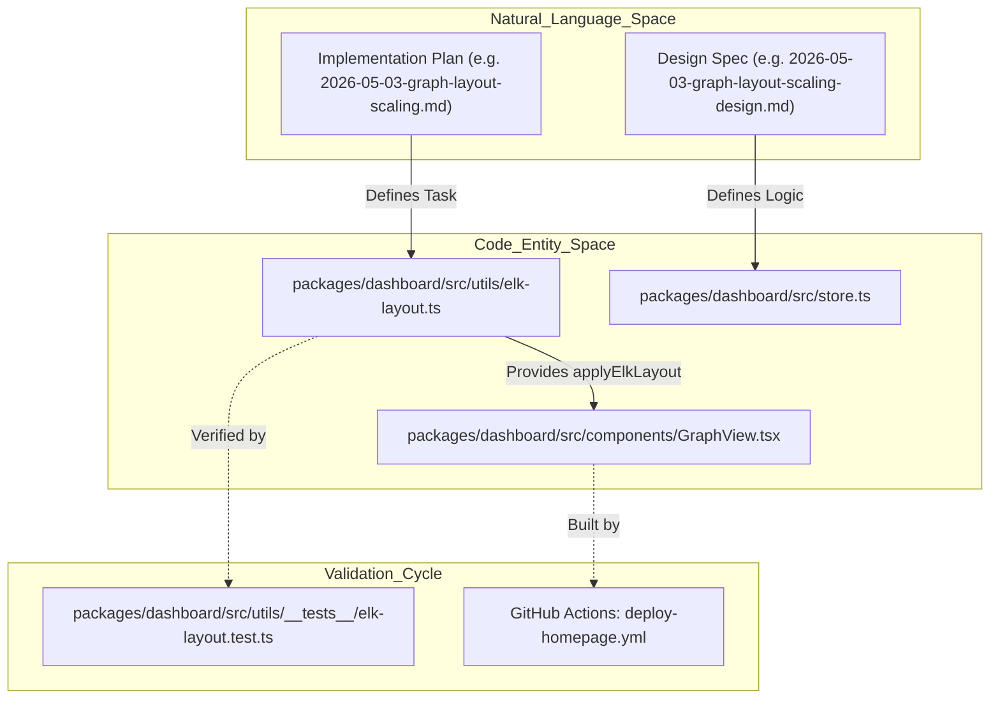
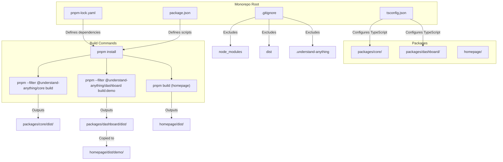

<!-- source: DeepWiki mcp.deepwiki.com · repo Egonex-AI/Understand-Anything · page 9.1 Contribution Workflow & Policies · fetched 2026-10-30 -->

# Contribution Workflow & Policies

<details>
<summary>Relevant source files</summary>

The following files were used as context for generating this wiki page:

- [.github/ISSUE_TEMPLATE/bug_report.yml](.github/ISSUE_TEMPLATE/bug_report.yml)
- [.github/ISSUE_TEMPLATE/config.yml](.github/ISSUE_TEMPLATE/config.yml)
- [.github/ISSUE_TEMPLATE/feature_request.yml](.github/ISSUE_TEMPLATE/feature_request.yml)
- [.github/ISSUE_TEMPLATE/question.yml](.github/ISSUE_TEMPLATE/question.yml)
- [.github/PULL_REQUEST_TEMPLATE.md](.github/PULL_REQUEST_TEMPLATE.md)
- [.github/workflows/deploy-homepage.yml](.github/workflows/deploy-homepage.yml)
- [.gitignore](.gitignore)
- [.npmrc](.npmrc)
- [CODE_OF_CONDUCT.md](CODE_OF_CONDUCT.md)
- [CONTRIBUTING.md](CONTRIBUTING.md)
- [LICENSE](LICENSE)
- [SECURITY.md](SECURITY.md)
- [tsconfig.json](tsconfig.json)

</details>


This page outlines the contribution workflow, community standards, issue templates, and historical design documentation for the Understand Anything project. It covers how contributors can effectively participate, report issues, and understand the rationale behind past architectural decisions documented in the `docs/superpowers` directory.

---

## Contribution Workflow

The Understand Anything project follows a structured GitHub-based contribution workflow combined with `pnpm` monorepo management for its multi-package repository. Contributors must comply with the project's coding style, testing, and PR requirements.

### Setup & Prerequisites

- **Node version:** >= 22 (developed on v24) [CONTRIBUTING.md:17-17]()
- **pnpm version:** >= 10 (pinned in root `package.json`) [CONTRIBUTING.md:18-18]()
- Clone the repository and install dependencies via:

```bash
pnpm install
```
[CONTRIBUTING.md:23-32]()

- Build the core analysis engine before running tests:

```bash
pnpm --filter @understand-anything/core build
pnpm test
```
[CONTRIBUTING.md:34-43]()

### Development Cycle

1.  **Branching:** Create descriptive branch names using prefixes like `feat/`, `fix/`, `docs/`, or `refactor/`. [CONTRIBUTING.md:52-59]()
2.  **Testing:** All new functionality must include Vitest test suites, located in `__tests__` directories or `*.test.ts` files. [CONTRIBUTING.md:121-123]()
3.  **Linting:** Ensure the code adheres to the project's strict TypeScript conventions (strict mode, explicit types, no `any`) and 2-space indentation. [CONTRIBUTING.md:160-171]()
4.  **Benchmarking:** For large-scale changes, use the monorepo benchmark suite to measure timing and memory impact. [CONTRIBUTING.md:113-118]()

### Pull Request Requirements

Contributors must follow the PR checklist, ensuring:
- All tests pass (`pnpm test`). [CONTRIBUTING.md:246-246]()
- Commit messages follow the convention (e.g., `feat:`, `fix:`, `chore:`). [CONTRIBUTING.md:90-97]()
- Documentation is updated. [CONTRIBUTING.md:248-248]()
- PR description clearly explains changes. [CONTRIBUTING.md:250-250]()

**Sources:** [CONTRIBUTING.md:1-250]()

---

## Issue Management & Community Standards

To facilitate effective collaboration and consistent communication, the project employs multiple GitHub issue templates and a clear Code of Conduct.

### GitHub Issue Templates

The project uses several issue templates to guide users in providing necessary information:
-   **Bug Report:** Used for reporting issues, requiring a description, reproduction steps, environment details (OS, Node, pnpm), and error messages. [bug_report.yml:1-86]()
-   **Feature Request:** For suggesting new ideas or improvements, focusing on the problem, proposed solution, and alternatives. [feature_request.yml:1-35]()
-   **Question / Usage Help:** Intended for general usage questions to keep the issue tracker focused on development. [question.yml:1-24]()
-   **Config:** Blank issues are disabled via `.github/ISSUE_TEMPLATE/config.yml` to encourage template usage. [config.yml:1-9]()

### Code of Conduct

The project maintains a welcoming community where contributors are expected to:
-   **Be respectful:** Treat others as you would like to be treated. [CODE_OF_CONDUCT.md:9-9]()
-   **Assume good intent:** Most disagreements stem from misunderstandings. [CODE_OF_CONDUCT.md:10-10]()
-   **Be constructive:** Critique ideas, not people, and suggest improvements. [CODE_OF_CONDUCT.md:11-11]()
-   **Keep it on-topic:** Discussions should relate to understanding codebases. [CODE_OF_CONDUCT.md:12-12]()

Reporting violations can be done privately via email to the maintainer or GitHub's private vulnerability/abuse reporting. [CODE_OF_CONDUCT.md:21-24]()

**Sources:** [CODE_OF_CONDUCT.md:1-39](), [bug_report.yml:1-86](), [feature_request.yml:1-35](), [question.yml:1-24](), [config.yml:1-9]()

### Security Policy

Understand Anything is a **local-only** static-analysis tool. It runs on a developer's machine and writes data to `.ua/` (or legacy `.understand-anything/`). [SECURITY.md:31-33]()

Key security focus areas:
-   Preventing code execution triggered by analyzing a hostile project (e.g., path traversal or untrusted JSON execution). [SECURITY.md:39-41]()
-   Ensuring the dashboard's file-content endpoint serves files only from an allowlist and is gated behind an `ACCESS_TOKEN`. [SECURITY.md:34-35]()
-   Preventing the `/understand` skill from running shell commands derived from untrusted paths or contents. [SECURITY.md:43-44]()

Security issues should be reported via GitHub's private vulnerability reporting feature. [SECURITY.md:7-9]()

**Sources:** [SECURITY.md:1-51]()

---

## Project Architecture & Design Docs Reference

The `docs/superpowers/` directory contains implementation plans and design specs that serve as a reference for architectural decisions.

### Key Design Documents

-   **Graph Layout Scaling:** The transition from `dagre` to `ELK` for improved performance and readability in large graphs. [docs/superpowers/plans/2026-05-03-graph-layout-scaling.md:5-9]()
-   **Dashboard Robustness:** Implementation of better error handling and `GraphIssue` models. [docs/superpowers/plans/2026-03-25-dashboard-robustness-impl.md:1-10]()
-   **Language Agnostic Analysis:** Strategies for extending the analysis pipeline beyond TypeScript. [docs/superpowers/plans/2026-03-21-language-agnostic-plan.md:1-15]()

### Natural Language to Code Entity Mapping: Implementation Flow

This diagram illustrates how a contribution moves from a conceptual design in `docs/superpowers` to validated code.



**Sources:** [docs/superpowers/plans/2026-05-03-graph-layout-scaling.md:1-40](), [docs/superpowers/specs/2026-05-03-graph-layout-scaling-design.md:1-60](), [.github/workflows/deploy-homepage.yml:1-50]()

### Code Entity Space: Monorepo Structure and Build Process

The project is structured as a `pnpm` monorepo, with distinct packages and a unified build process.



**Sources:** [CONTRIBUTING.md:29-41](), [tsconfig.json:1-15](), [.gitignore:1-21](), [.github/workflows/deploy-homepage.yml:37-55]()

---

## Deployment & Funding

### CI/CD Pipeline
The project uses GitHub Actions for deployment. The `deploy-homepage.yml` workflow automates:
1.  Building `@understand-anything/core`. [.github/workflows/deploy-homepage.yml:43-44]()
2.  Building the dashboard in demo mode using `VITE_GRAPH_URL`, `VITE_DOMAIN_GRAPH_URL`, and `VITE_META_URL` environment variables. [.github/workflows/deploy-homepage.yml:46-51]()
3.  Merging the built demo dashboard into the homepage output. [.github/workflows/deploy-homepage.yml:53-54]()
4.  Deploying the Astro-based homepage to GitHub Pages. [.github/workflows/deploy-homepage.yml:60-68]()

### Funding
The project accepts funding via GitHub Sponsors and Patreon, as defined in `.github/FUNDING.yml`.

**Sources:** [.github/workflows/deploy-homepage.yml:1-68](), [CONTRIBUTING.md:265-269]()

---

