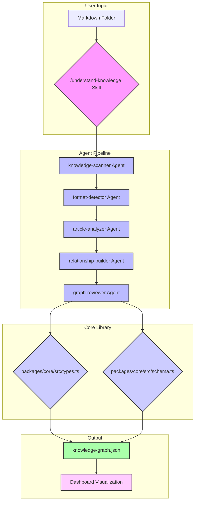

<!-- source: DeepWiki mcp.deepwiki.com · repo Egonex-AI/Understand-Anything · page 9.2 docs/superpowers Plans & Specs · fetched 2026-10-30 -->

# docs/superpowers Plans & Specs

<details>
<summary>Relevant source files</summary>

The following files were used as context for generating this wiki page:

- [docs/superpowers/plans/2026-04-09-understand-knowledge.md](docs/superpowers/plans/2026-04-09-understand-knowledge.md)
- [docs/superpowers/plans/2026-04-10-understandignore-impl.md](docs/superpowers/plans/2026-04-10-understandignore-impl.md)
- [docs/superpowers/plans/2026-04-15-language-extractors-impl.md](docs/superpowers/plans/2026-04-15-language-extractors-impl.md)
- [docs/superpowers/plans/2026-06-03-language-auto-detection.md](docs/superpowers/plans/2026-06-03-language-auto-detection.md)
- [docs/superpowers/specs/2026-04-09-understand-knowledge-design.md](docs/superpowers/specs/2026-04-09-understand-knowledge-design.md)
- [docs/superpowers/specs/2026-04-10-understandignore-design.md](docs/superpowers/specs/2026-04-10-understandignore-design.md)
- [docs/superpowers/specs/2026-06-03-language-auto-detection-design.md](docs/superpowers/specs/2026-06-03-language-auto-detection-design.md)
- [docs/superpowers/specs/2026-06-24-understand-figma-foundation-design.ko.md](docs/superpowers/specs/2026-06-24-understand-figma-foundation-design.ko.md)
- [docs/superpowers/specs/2026-06-24-understand-figma-foundation-design.md](docs/superpowers/specs/2026-06-24-understand-figma-foundation-design.md)

</details>


This page serves as a guide to the `docs/superpowers` corpus, which contains design documents and implementation plans for major features within the Understand Anything codebase. It outlines how these design documents are structured and provides an index of significant past decisions, including the knowledge skill, Figma foundation, `.understandignore` functionality, language extractors, graph layout scaling, and multi-platform installation. The goal is to provide a comprehensive reference for understanding the architectural evolution and detailed specifications of key components.

## Design Document Structure

The `docs/superpowers` directory contains two primary types of documents:
*   **Specs (`docs/superpowers/specs/`)**: These documents outline the high-level design, goals, non-goals, and architectural decisions for a new feature or significant change. They focus on *what* needs to be built and *why*.
*   **Plans (`docs/superpowers/plans/`)**: These documents detail the step-by-step implementation process for a feature described in a spec. They focus on *how* to build it, including file structure changes, specific code modifications, and testing procedures. Plans often use a checklist format for task tracking.

This separation ensures that design decisions are thoroughly considered before implementation details are fleshed out, and that the implementation process is guided by a clear, approved plan.

## Major Past Decisions Index

This section indexes major features and architectural decisions documented within the `docs/superpowers` corpus.

### Knowledge Skill (`/understand-knowledge`)

The `/understand-knowledge` skill allows the system to ingest markdown-based personal knowledge bases (PKBs) and transform them into interactive knowledge graphs. This feature significantly extends the tool's capability beyond code analysis to general knowledge management.

**Purpose**: To enable users to analyze and visualize their markdown notes (e.g., Obsidian, Logseq, Karpathy-style wikis) as a structured graph, discovering implicit relationships.
**Key Architectural Points**:
*   **Schema Extension**: Introduced 5 new `NodeType`s (`article`, `entity`, `topic`, `claim`, `source`) and 6 new `EdgeType`s (`cites`, `contradicts`, `builds_on`, `exemplifies`, `categorized_under`, `authored_by`). [docs/superpowers/plans/2026-04-09-understand-knowledge.md:56-84](), [docs/superpowers/specs/2026-04-09-understand-knowledge-design.md:28-70]()
*   **`KnowledgeMeta` Interface**: Added to `GraphNode` to store format, wikilinks, backlinks, frontmatter, source URL, and confidence for knowledge nodes. [docs/superpowers/plans/2026-04-09-understand-knowledge.md:90-99](), [docs/superpowers/specs/2026-04-09-understand-knowledge-design.md:73-82]()
*   **Graph-Level `kind` Flag**: A `kind: "knowledge"` field was added to `KnowledgeGraph` to inform the dashboard about the graph's type, enabling specific layouts and UI components. [docs/superpowers/plans/2026-04-09-understand-knowledge.md:121-126](), [docs/superpowers/specs/2026-04-09-understand-knowledge-design.md:95-108]()
*   **Multi-Agent Pipeline**: A 5-agent pipeline (`knowledge-scanner` → `format-detector` → `article-analyzer` → `relationship-builder` → `graph-reviewer`) was designed to process markdown files. [docs/superpowers/specs/2026-04-09-understand-knowledge-design.md:171-175]()
*   **Format Detection**: Logic to auto-detect various markdown formats (Obsidian, Logseq, Dendron, Foam, Karpathy, Zettelkasten, Plain) based on signature files/patterns. [docs/superpowers/specs/2026-04-09-understand-knowledge-design.md:112-127]()
*   **Format Guides**: Specific markdown files (`skills/understand-knowledge/formats/*.md`) provide instructions to LLM agents on how to parse each format. [docs/superpowers/specs/2026-04-09-understand-knowledge-design.md:133-154]()

#### Knowledge Skill Data Flow

Title: "Knowledge Skill Data Flow"
Sources:
- [docs/superpowers/plans/2026-04-09-understand-knowledge.md:5-10]()
- [docs/superpowers/specs/2026-04-09-understand-knowledge-design.md:171-175]()

### Figma Foundation (`/understand-figma`)

The `/understand-figma` skill provides foundational capabilities for ingesting Figma files and generating a design graph. This is a "foundation-first" approach, laying the groundwork for future features like user flows and design-to-code mapping.

**Purpose**: To ingest Figma files, extract structural information (pages, screens, components, instances, design tokens), and visualize them as a `kind: "design"` graph in the dashboard.
**Key Architectural Points**:
*   **Schema Extension**: Added 6 new `NodeType`s (`page`, `screen`, `component`, `componentSet`, `instance`, `token`) and 3 new `EdgeType`s (`instance_of`, `variant_of`, `uses_token`), reusing `contains`. [docs/superpowers/specs/2026-06-24-understand-figma-foundation-design.md:71-91]()
*   **`FigmaMeta` Interface**: Added to `GraphNode` to store Figma-specific metadata like `fileKey`, `nodeId`, `figmaType`, `thumbnailUrl`, `dimensions`, `tokenKind`, `tokenValue`, `prototypeTargets`, and `componentKey`. [docs/superpowers/specs/2026-06-24-understand-figma-foundation-design.md:98-110]()
*   **Graph-Level `kind` Flag**: A `kind: "design"` field was added to `KnowledgeGraph` to enable design-specific layouts and styling in the dashboard. [docs/superpowers/specs/2026-06-24-understand-figma-foundation-design.md:60-67]()
*   **Source Adapter (`FigmaSource`)**: An interface (`packages/core/src/figma/source/types.ts`) was defined to abstract Figma data ingestion, allowing for `FigmaApiSource` (v1) and future `LocalJsonSource`. [docs/superpowers/specs/2026-06-24-understand-figma-foundation-design.md:138-146]()
*   **Shallow Parsing**: The deterministic parser (`packages/core/src/figma/parse/`) focuses on top-level structural elements, avoiding deep layer parsing for performance. [docs/superpowers/specs/2026-06-24-understand-figma-foundation-design.md:161-164]()
*   **Hybrid Rendering**: Lightweight text nodes in the graph, with selected node thumbnails displayed in the sidebar on demand. [docs/superpowers/specs/2026-06-24-understand-figma-foundation-design.md:18-19]()

#### Figma Foundation Data Flow
```mermaid
graph TD
    subgraph "User Input"
        A[Figma File Key/URL] --> B{/understand-figma Skill}
    end

    subgraph "Core Figma Subsystem"
        B --> C[FigmaApiSource]
        C --> D[fetchDocument()]
        C --> E[fetchStyles()]
        D & E --> F[parseDocument()]
        F --> G[extractTokens()]
        G --> H[design-analyzer Agent]
    end

    subgraph "Agent Pipeline"
        H --> I[figma-merge.mjs]
    end

    subgraph "Output"
        I --> J[knowledge-graph.json (kind: "design")]
        J --> K[Dashboard Visualization (kind: "design")]
    end

    style B fill:#f9f,stroke:#333,stroke-width:2px
    style C fill:#ccf,stroke:#333,stroke-width:2px
    style D fill:#ccf,stroke:#333,stroke-width:2px
    style E fill:#ccf,stroke:#333,stroke-width:2px
    style F fill:#ccf,stroke:#333,stroke-width:2px
    style G fill:#ccf,stroke:#333,stroke-width:2px
    style H fill:#bbf,stroke:#333,stroke-width:2px
    style I fill:#bbf,stroke:#333,stroke-width:2px
    style J fill:#afa,stroke:#333,stroke-width:2px
    style K fill:#fcf,stroke:#333,stroke-width:2px
```
Title: "Figma Foundation Data Flow"
Sources:
- [docs/superpowers/specs/2026-06-24-understand-figma-foundation-design.md:13-20]()
- [docs/superpowers/specs/2026-06-24-understand-figma-foundation-design.ko.md:13-20]()

### `.understandignore`

This feature introduces user-configurable file exclusion using `.gitignore`-like syntax, improving analysis efficiency by skipping irrelevant files.

**Purpose**: To allow users to specify files and directories to be excluded from analysis, reducing processing time and cost.
**Key Architectural Points**:
*   **`IgnoreFilter` Module**: A new module (`packages/core/src/ignore-filter.ts`) was created, leveraging the `ignore` npm package for `.gitignore`-compatible pattern matching. [docs/superpowers/plans/2026-04-10-understandignore-impl.md:18-19](), [docs/superpowers/specs/2026-04-10-understandignore-design.md:26-28]()
*   **Pattern Loading Order**: Patterns are loaded from hardcoded defaults, then `.understand-anything/.understandignore`, and finally `.understandignore` at the project root, with later entries overriding earlier ones. [docs/superpowers/specs/2026-04-10-understandignore-design.md:42-47]()
*   **`IgnoreGenerator` Module**: A new module (`packages/core/src/ignore-generator.ts`) was added to deterministically generate a commented-out starter `.understandignore` file based on common project patterns. [docs/superpowers/plans/2026-04-10-understandignore-impl.md:19-20](), [docs/superpowers/specs/2026-04-10-understandignore-design.md:120-122]()
*   **Phase 0.5 in `SKILL.md`**: A new phase was inserted into the `/understand` skill to generate the starter ignore file (if not present) and pause for user review before analysis begins. [docs/superpowers/plans/2026-04-10-understandignore-impl.md:27-28](), [docs/superpowers/specs/2026-04-10-understandignore-design.md:187-198]()
*   **Two-Layer Filtering in `project-scanner`**: The `project-scanner` agent applies its existing hardcoded pattern filter (Layer 1) followed by the `IgnoreFilter` from core (Layer 2). [docs/superpowers/specs/2026-04-10-understandignore-design.md:200-207]()

### Language Extractors

This initiative aimed to generalize AST extraction logic beyond TypeScript/JavaScript, enabling structural analysis for a wider range of programming languages using Tree-sitter.

**Purpose**: To provide tree-sitter-powered structural analysis for 8 additional code languages (Python, Go, Rust, Java, Ruby, PHP, C/C++, C#) and replace LLM-generated regex scripts with deterministic, pre-built extractors.
**Key Architectural Points**:
*   **`LanguageExtractor` Interface**: A new interface (`packages/core/src/plugins/extractors/types.ts`) was defined, requiring `extractStructure` and `extractCallGraph` methods. [docs/superpowers/plans/2026-04-15-language-extractors-impl.md:55-74]()
*   **`base-extractor.ts`**: Shared utility functions like `traverse`, `getStringValue`, `findChild`, `findChildren`, and `hasChildOfType` were moved here from `tree-sitter-plugin.ts`. [docs/superpowers/plans/2026-04-15-language-extractors-impl.md:78-135]()
*   **Per-Language Extractors**: Dedicated extractor implementations (e.g., `typescript-extractor.ts`, `python-extractor.ts`) were created for each supported language. [docs/superpowers/plans/2026-04-15-language-extractors-impl.md:16-29]()
*   **Refactored `TreeSitterPlugin`**: The `TreeSitterPlugin` was refactored to delegate extraction tasks to the appropriate `LanguageExtractor` based on the file's language. [docs/superpowers/plans/2026-04-15-language-extractors-impl.md:160-168]()
*   **`extract-structure.mjs`**: A pre-built, deterministic Tree-sitter extraction script was introduced in `skills/understand/` to replace the LLM's ad-hoc regex generation. [docs/superpowers/plans/2026-04-15-language-extractors-impl.md:37-38]()

### Graph Layout Scaling

While not explicitly detailed in the provided `docs/superpowers` content, the mention of "graph layout scaling" in the prompt implies a focus on optimizing the visualization of large graphs. This typically involves strategies like:
*   **Hierarchical Layouts**: Using algorithms like ELK (mentioned in 4.2. Graph Visualization Engine) for structured, readable layouts.
*   **Community Detection**: Grouping related nodes (e.g., Louvain community grouping in 4.2) to reduce visual clutter and highlight subgraphs.
*   **Edge Aggregation/Inflation**: Simplifying the display of numerous edges between groups of nodes.
*   **Layered Navigation**: Allowing users to drill down into specific layers or subgraphs for detail, while maintaining an overview.
*   **Performance Optimization**: Using web workers for layout calculations to keep the UI responsive.

### Multi-Platform Install

The ability to install the tool across macOS, Linux, and Windows (mentioned in 1.1. Getting Started & Installation) is a fundamental design decision that impacts various parts of the codebase, particularly installation scripts and environment setup.

**Key Architectural Points**:
*   **Platform-Specific Installers**: `install.sh` for macOS/Linux and `install.ps1` for Windows.
*   **Cross-Platform Dependencies**: Ensuring that core dependencies (e.g., `pnpm`, `web-tree-sitter`) are compatible across all target operating systems.
*   **Environment Variables**: Consistent handling of environment variables like `UA_DIR` across different shell environments.

### Conversation-Language Auto-Detection

This feature enhances user experience by automatically detecting the user's conversation language and offering to generate output in that language, especially for non-English users.

**Purpose**: To infer the user's working language on the first analysis of a project and confirm it, without affecting English-speaking users or non-interactive invocations.
**Key Architectural Points**:
*   **`SKILL.md` Logic Change**: The core logic for language detection and confirmation was implemented as a pure prompt-logic change within `understand-anything-plugin/skills/understand/SKILL.md` (step 3.6). [docs/superpowers/plans/2026-06-03-language-auto-detection.md:24-27]()
*   **Resolution Chain**: A priority-based resolution chain was defined: `--language` flag > `config.json` `outputLanguage` > detected conversation language > default `en`. [docs/superpowers/specs/2026-06-03-language-auto-detection-design.md:70-85]()
*   **First-Run, Non-English-Only Confirmation**: A confirmation gate is presented only on the first run, and only if the detected language is not English. This ensures English users are unaffected. [docs/superpowers/specs/2026-06-03-language-auto-detection-design.md:86-102]()
*   **Persistence**: The resolved `outputLanguage` is persisted to `config.json` to prevent re-prompting for the same project. [docs/superpowers/specs/2026-06-03-language-auto-detection-design.md:86-102]()
*   **Graceful Degradation**: For non-interactive invocations or uncertain detection, the system falls back to the detected language or English without blocking. [docs/superpowers/specs/2026-06-03-language-auto-detection-design.md:110-113]()

#### Language Auto-Detection Logic Flow
```mermaid
graph TD
    A[User runs /understand command] --> B{Is --language flag specified?}
    B -- Yes --> C[Use flag language]
    B -- No --> D{Is outputLanguage in config.json?}
    D -- Yes --> E[Use config language]
    D -- No --> F{Is this the first run for project?}
    F -- Yes --> G[Detect conversation language ($DETECTED_LANG)]
    F -- No --> E
    G --> H{Is $DETECTED_LANG = 'en' or uncertain?}
    H -- Yes --> I[Set $OUTPUT_LANGUAGE = 'en', proceed silently]
    H -- No --> J[Prompt user: "Detected <language>, generate content in it?"]
    J -- User confirms / enters $DETECTED_LANG --> K[Set $OUTPUT_LANGUAGE = $DETECTED_LANG]
    J -- User overrides / enters other language --> L[Set $OUTPUT_LANGUAGE = override language]
    I & K & L --> M[Persist $OUTPUT_LANGUAGE to config.json]
    M --> N[Proceed with analysis using $OUTPUT_LANGUAGE]

    style A fill:#f9f,stroke:#333,stroke-width:2px
    style B fill:#ccf,stroke:#333,stroke-width:2px
    style C fill:#afa,stroke:#333,stroke-width:2px
    style D fill:#ccf,stroke:#333,stroke-width:2px
    style E fill:#afa,stroke:#333,stroke-width:2px
    style F fill:#ccf,stroke:#333,stroke-width:2px
    style G fill:#bbf,stroke:#333,stroke-width:2px
    style H fill:#ccf,stroke:#333,stroke-width:2px
    style I fill:#afa,stroke:#333,stroke-width:2px
    style J fill:#fcf,stroke:#333,stroke-width:2px
    style K fill:#afa,stroke:#333,stroke-width:2px
    style L fill:#afa,stroke:#333,stroke-width:2px
    style M fill:#afa,stroke:#333,stroke-width:2px
    style N fill:#afa,stroke:#333,stroke-width:2px
```
Title: "Conversation-Language Auto-Detection Logic Flow"
Sources:
- [docs/superpowers/specs/2026-06-03-language-auto-detection-design.md:70-102]()
- [docs/superpowers/plans/2026-06-03-language-auto-detection.md:56-61]()

---

