# Page: Overview

# Overview

<details>
<summary>Relevant source files</summary>

The following files were used as context for generating this wiki page:

- [.claude-plugin/marketplace.json](.claude-plugin/marketplace.json)
- [.claude-plugin/plugin.json](.claude-plugin/plugin.json)
- [.copilot-plugin/plugin.json](.copilot-plugin/plugin.json)
- [.cursor-plugin/plugin.json](.cursor-plugin/plugin.json)
- [README.md](README.md)
- [READMEs/README.es-ES.md](READMEs/README.es-ES.md)
- [READMEs/README.ja-JP.md](READMEs/README.ja-JP.md)
- [READMEs/README.ko-KR.md](READMEs/README.ko-KR.md)
- [READMEs/README.ru-RU.md](READMEs/README.ru-RU.md)
- [READMEs/README.tr-TR.md](READMEs/README.tr-TR.md)
- [READMEs/README.zh-CN.md](READMEs/README.zh-CN.md)
- [READMEs/README.zh-TW.md](READMEs/README.zh-TW.md)
- [install.ps1](install.ps1)
- [install.sh](install.sh)
- [understand-anything-plugin/.claude-plugin/plugin.json](understand-anything-plugin/.claude-plugin/plugin.json)
- [understand-anything-plugin/package.json](understand-anything-plugin/package.json)
- [understand-anything-plugin/packages/viewer/package.json](understand-anything-plugin/packages/viewer/package.json)

</details>


Understand Anything is an AI-powered plugin designed to transform any codebase, knowledge base, or documentation into an interactive knowledge graph [README.md:3-5](). The system employs a multi-agent pipeline to analyze projects, building a detailed knowledge graph of files, functions, classes, and dependencies [README.md:53-54](). The output is then presented through an interactive dashboard for visual exploration [README.md:64-67]().

This page provides a high-level introduction to Understand Anything, its end-to-end workflow, the monorepo layout, and links to its major subsystems. 

* For detailed instructions on installation, supported platforms (Claude, Cursor, Copilot, Gemini, Codex, etc.), and running the first `/understand` command, see **[Getting Started & Installation](#1.1)**.
* For the `pnpm` workspace layout (`packages/core`, `dashboard`, `viewer`, `src/`, `skills/`, `agents/`, `hooks/`, `tests/`), build commands, and configurations, see **[Repository Structure & Monorepo Layout](#1.2)**.
* For a complete reference of all slash commands (`/understand`, `-dashboard`, `-chat`, `-diff`, `-explain`, `-domain`, `-knowledge`, `-onboard`, `-figma`) with arguments and outputs, see **[Skills Reference](#1.3)**.

Sources: [README.md:3-5](), [README.md:53-54](), [README.md:64-67]()

## How it Works: End-to-End Flow

Understand Anything operates through a multi-agent pipeline that processes a project and generates a `KnowledgeGraph`. The process begins with the `/understand` command, which initiates the analysis. A multi-agent pipeline scans the project, extracts every file, function, class, and dependency, then builds a knowledge graph saved to `.ua/knowledge-graph.json` [README.md:125-128](). This graph can then be explored using the `/understand-dashboard` command, which launches an interactive web interface [README.md:138-142]().

### Diagram: Understand Anything End-to-End Flow

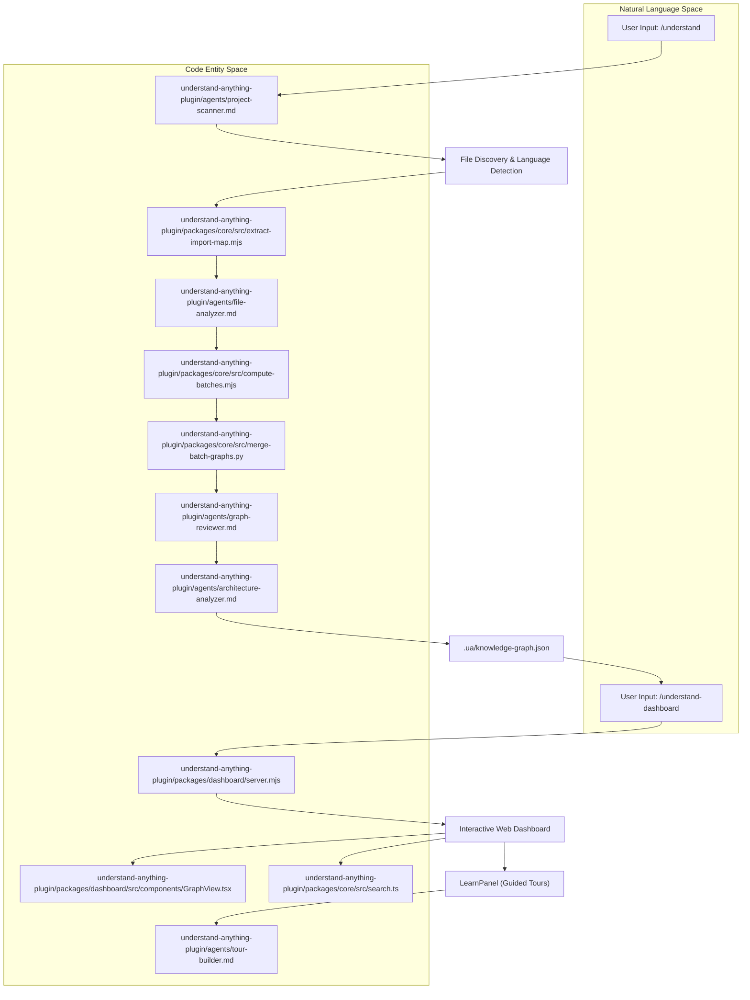
Sources: [README.md:53-54](), [README.md:125-128](), [understand-anything-plugin/agents/file-analyzer.md:2-7](), [understand-anything-plugin/agents/project-scanner.md:2-5]()

## Repository Structure & Monorepo Layout Summary

The project utilizes a `pnpm` workspace layout housing packages such as `@understand-anything/core`, `dashboard`, and `viewer`, alongside plugins, agents, hooks, and test directories [understand-anything-plugin/package.json:1-15]().

### Diagram: Monorepo Package Mapping

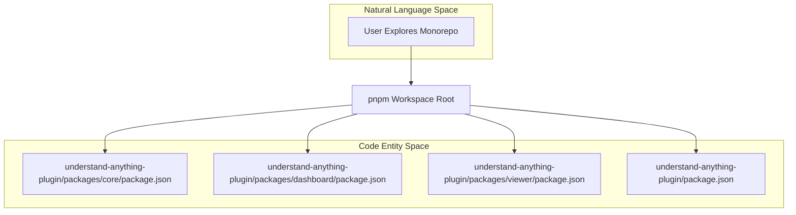
Sources: [understand-anything-plugin/package.json:1-15]()

For full details on build commands, `tsconfig`, and ESLint configurations, see **[Repository Structure & Monorepo Layout](#1.2)**.

Sources: [understand-anything-plugin/package.json:1-15]()

## Getting Started & Installation Summary

For detailed instructions on installing via `install.sh` or `install.ps1` on macOS, Linux, and Windows across platforms like Claude Code, Cursor, Copilot, Gemini, and Codex, as well as running your first `/understand` command, see **[Getting Started & Installation](#1.1)** [README.md:183-200](), [install.sh:1-46](), [install.ps1:1-45]().

Sources: [README.md:183-200](), [install.sh:1-46](), [install.ps1:1-45]()

## Skills Reference Summary

Understand Anything provides a robust set of slash commands including `/understand`, `/understand-dashboard`, `/understand-chat`, `/understand-diff`, `/understand-explain`, `/understand-domain`, `/understand-knowledge`, `/understand-onboard`, and `/understand-figma` [README.md:125-163](). For complete arguments, flags, and expected outputs, see **[Skills Reference](#1.3)**.

Sources: [README.md:125-163]()

---

# Page: Getting Started & Installation

# Getting Started & Installation

<details>
<summary>Relevant source files</summary>

The following files were used as context for generating this wiki page:

- [README.md](README.md)
- [READMEs/README.es-ES.md](READMEs/README.es-ES.md)
- [READMEs/README.ja-JP.md](READMEs/README.ja-JP.md)
- [READMEs/README.ko-KR.md](READMEs/README.ko-KR.md)
- [READMEs/README.ru-RU.md](READMEs/README.ru-RU.md)
- [READMEs/README.tr-TR.md](READMEs/README.tr-TR.md)
- [READMEs/README.zh-CN.md](READMEs/README.zh-CN.md)
- [READMEs/README.zh-TW.md](READMEs/README.zh-TW.md)
- [install.ps1](install.ps1)
- [install.sh](install.sh)
- [tests/install/platform-table-consistency.test.mjs](tests/install/platform-table-consistency.test.mjs)

</details>


This page covers the technical details of installing, updating, and configuring **Understand Anything** across macOS, Linux, and Windows. It details the installation script internals (`install.sh` and `install.ps1`), the platform compatibility matrix, plugin discovery mechanisms, and running the initial `/understand` command to trigger the analysis pipeline.

---

## 1. Introduction

**Understand Anything** is an AI-powered plugin designed to analyze any codebase, knowledge base, or documentation, and transform it into an interactive knowledge graph. It operates across multiple AI coding environments by integrating a multi-agent pipeline that extracts semantic structure from projects, builds a knowledge graph, and provides an interactive dashboard for exploration [README.md:51-57]().

Supported platforms include:
- **Claude Code**: Native plugin via marketplace [README.md:26](), [README.md:113-118]()
- **Cursor**: Automatic discovery via `.cursor-plugin/plugin.json` [READMEs/README.zh-CN.md:212]()
- **GitHub Copilot**: VS Code extension integration [.copilot-plugin/plugin.json:1-14]()
- **Gemini CLI, Codex, OpenCode, Vibe CLI, Trae, Nanobot, Kiro**: Supported via shell and PowerShell installation scripts [README.md:27-33](), [install.sh:31-44]()

---

## 2. Installation on macOS/Linux

### 2.1. One-line Installer (`install.sh`)

The shell script `install.sh` handles automated setup on POSIX systems. It defines a platform matrix via `platforms_table()` [install.sh:25-45]() and executes the following sequence:

1. **Clone or Update**: Clones the official repository (`UA_REPO_URL`) into `UA_DIR` (default: `$HOME/.understand-anything/repo`) or performs a fast-forward pull if `.git` exists [install.sh:21-22](), [install.sh:93-101]().
2. **Link Skills**: Creates symbolic links in the target directory for the chosen platform. Depending on the link style (`per-skill` or `folder`), it links individual skill folders or the entire root directory [install.sh:120-142]().
3. **Link Plugin Root**: Establishes a universal plugin root link at `$HOME/.understand-anything-plugin` [install.sh:23](), [install.sh:172-179]().
4. **Kiro Configuration**: If `--platform kiro` is selected, it dynamically scans `agents/*.md` and generates `~/.kiro/agents/understand.json` [install.sh:194-221]().

#### Usage Examples:

```bash
# Interactive platform selection
curl -fsSL https://raw.githubusercontent.com/Egonex-AI/Understand-Anything/main/install.sh | bash

# Non-interactive installation for a specific platform
curl -fsSL https://raw.githubusercontent.com/Egonex-AI/Understand-Anything/main/install.sh | bash -s codex
```

Sources: `install.sh:1-225`(), `README.md:189-209`()

---

## 3. Installation on Windows (PowerShell)

Windows environments use `install.ps1`, which implements parity with the POSIX script using PowerShell directory junctions and ordered hashtables [install.ps1:1-283]().

```powershell
iwr -useb https://raw.githubusercontent.com/Egonex-AI/Understand-Anything/main/install.ps1 | iex
```

### Key PowerShell Functions:
- `Clone-Or-Update`: Manages local Git checkout under `$HOME\.understand-anything\repo` [install.ps1:26](), [install.ps1:89-99]().
- `New-Junction`: Safely checks for existing reparse points before creating directory junctions (`New-Item -ItemType Junction`), refusing to overwrite real user directories [install.ps1:107-136]().
- `Link-Skills`: Maps skills based on the platform configuration (`per-skill` vs `folder`) [install.ps1:30-45](), [install.ps1:138-158]().

Sources: `install.ps1:1-200`(), `tests/install/platform-table-consistency.test.mjs:36-47`()

---

## 4. Platform Matrix & Plugin Configuration

Both installation scripts share a strict platform mapping verified by automated test suites (`tests/install/platform-table-consistency.test.mjs`) [tests/install/platform-table-consistency.test.mjs:75-126]().

| Platform ID | Target Directory | Link Style | Description |
| :--- | :--- | :--- | :--- |
| `gemini` | `$HOME/.agents/skills` | `per-skill` | Gemini CLI integration [install.sh:31]() |
| `codex` | `$HOME/.agents/skills` | `per-skill` | Codex CLI integration (uses `$` prefix) [install.sh:32]() |
| `opencode` | `$HOME/.agents/skills` | `per-skill` | OpenCode assistant [install.sh:33]() |
| `pi` | `$HOME/.agents/skills` | `per-skill` | Pi Agent [install.sh:34]() |
| `openclaw` | `$HOME/.openclaw/skills` | `folder` | OpenClaw workspace [install.sh:35]() |
| `antigravity` | `$HOME/.gemini/antigravity/skills` | `folder` | Antigravity platform [install.sh:36]() |
| `vibe` | `$HOME/.vibe/skills` | `per-skill` | Vibe CLI [install.sh:37]() |
| `vscode` | `$HOME/.copilot/skills` | `per-skill` | GitHub Copilot / VS Code [install.sh:38]() |
| `hermes` | `$HOME/.hermes/skills` | `folder` | Hermes agent [install.sh:39]() |
| `cline` | `$HOME/.cline/skills` | `folder` | Cline extension [install.sh:40]() |
| `kimi` | `$HOME/.kimi-code/skills` | `folder` | Kimi Code CLI [install.sh:41]() |
| `trae` | `$HOME/.trae/skills` | `per-skill` | Trae IDE [install.sh:42]() |
| `nanobot` | `$HOME/.nanobot/workspace/skills` | `per-skill` | Nanobot workspace [install.sh:43]() |
| `kiro` | `$HOME/.kiro/skills` | `per-skill` | Kiro agent framework [install.sh:44]() |

Sources: `install.sh:29-45`(), `install.ps1:30-45`(), `tests/install/platform-table-consistency.test.mjs:75-126`()

---

## 5. Running the First `/understand` Command

Once installed, navigate to any target codebase and execute the primary skill:

```bash
/understand
```
[README.md:123-125]()

### Execution Workflow:
1. **Project Scan**: The project-scanner agent traverses directories, evaluating `.understandignore` filters and building file maps [README.md:128]().
2. **Graph Construction**: Parallel file analyzers parse language constructs via Tree-Sitter, assembling a validated `KnowledgeGraph` [README.md:128]().
3. **Persistence**: The output is serialized and stored in `.ua/knowledge-graph.json` (or `.understand-anything/` for legacy compatibility) [README.md:128]().
4. **Localization & Config**: On first initialization, the runner checks for language settings or auto-detects conversation context, saving preferences to `.ua/config.json` [READMEs/README.ja-JP.md:141]().

Sources: `README.md:123-136`(), `READMEs/README.ja-JP.md:132-147`()

---

## 6. Implementation Flow & Data Movement

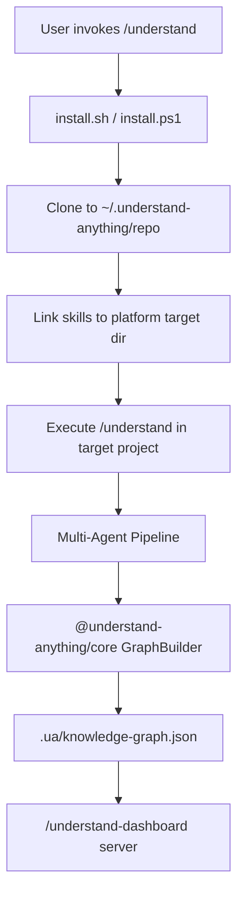
Sources: `install.sh:181-193`(), `install.ps1:89-158`(), `README.md:111-154`()

---

## 7. Platform-to-Code Entity Mapping

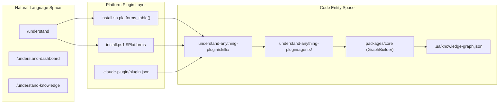
Sources: `install.sh:25-45`(), `install.ps1:30-45`(), `.claude-plugin/plugin.json:1-18`(), `README.md:111-178`()

---

## 8. Post-Installation & Maintenance

- **Incremental Execution**: Subsequent runs of `/understand` automatically detect file fingerprints, updating only modified nodes and relationships [README.md:130]().
- **Auto-Update Hooks**: Run `/understand --auto-update` to register a `post-commit` Git hook that refreshes the graph automatically [READMEs/README.ja-JP.md:181]().
- **Dashboard Launch**: Execute `/understand-dashboard` to fire up the Vite visualization server [README.md:151]().

Sources: `README.md:130-151`(), `READMEs/README.ja-JP.md:181`()

---

# Page: Repository Structure & Monorepo Layout

# Repository Structure & Monorepo Layout

<details>
<summary>Relevant source files</summary>

The following files were used as context for generating this wiki page:

- [.github/workflows/deploy-homepage.yml](.github/workflows/deploy-homepage.yml)
- [.gitignore](.gitignore)
- [.npmrc](.npmrc)
- [CONTRIBUTING.md](CONTRIBUTING.md)
- [eslint.config.mjs](eslint.config.mjs)
- [package.json](package.json)
- [scripts/benchmark-large-repo.mjs](scripts/benchmark-large-repo.mjs)
- [scripts/generate-large-graph.mjs](scripts/generate-large-graph.mjs)
- [tsconfig.json](tsconfig.json)
- [understand-anything-plugin/packages/core/package.json](understand-anything-plugin/packages/core/package.json)
- [understand-anything-plugin/packages/core/src/__tests__/language-registry.test.ts](understand-anything-plugin/packages/core/src/__tests__/language-registry.test.ts)
- [understand-anything-plugin/packages/core/src/__tests__/plugin-discovery.test.ts](understand-anything-plugin/packages/core/src/__tests__/plugin-discovery.test.ts)
- [understand-anything-plugin/packages/core/src/languages/configs/dart.ts](understand-anything-plugin/packages/core/src/languages/configs/dart.ts)
- [understand-anything-plugin/packages/core/src/languages/configs/index.ts](understand-anything-plugin/packages/core/src/languages/configs/index.ts)
- [understand-anything-plugin/packages/core/src/plugins/extractors/index.ts](understand-anything-plugin/packages/core/src/plugins/extractors/index.ts)
- [understand-anything-plugin/packages/core/tsconfig.json](understand-anything-plugin/packages/core/tsconfig.json)
- [understand-anything-plugin/pnpm-lock.yaml](understand-anything-plugin/pnpm-lock.yaml)
- [understand-anything-plugin/skills/understand-domain/extract-domain-context.py](understand-anything-plugin/skills/understand-domain/extract-domain-context.py)
- [understand-anything-plugin/tsconfig.json](understand-anything-plugin/tsconfig.json)

</details>


This page details the monorepo structure of the Understand Anything project, managed using `pnpm` workspaces. It outlines the organization of packages, core directories, build processes, TypeScript configurations, and ESLint setup.

## Monorepo Overview

The Understand Anything project is structured as a pnpm monorepo, enabling efficient management of multiple interdependent packages and applications. The workspace layout is defined by the root configuration and tracked via `pnpm-lock.yaml`, encompassing workspace members such as `@understand-anything/core`, `@understand-anything/dashboard`, the standalone viewer, skill execution scripts, and AI agent prompts [understand-anything-plugin/pnpm-lock.yaml:7-189]().

### Diagram: Monorepo Workspace Layout

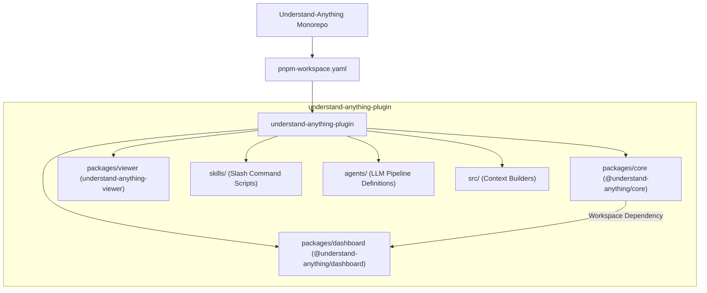
Sources: [understand-anything-plugin/pnpm-lock.yaml:7-189](), [package.json:28-36]()

## Core Packages & Directories

### 1. Core Library (`packages/core`)
The `@understand-anything/core` package serves as the primary analysis and parsing engine. It exposes explicit export subpaths for types, schemas, search engines, languages, and Figma integrations [understand-anything-plugin/packages/core/package.json:7-32]().
- **Dependencies**: Relies on `web-tree-sitter`, `zod`, `fuse.js`, and numerous language-specific grammars [understand-anything-plugin/packages/core/package.json:43-63]().
- **WASM Parsers**: Incorporates specialized WASM modules for languages like Dart and Swift [understand-anything-plugin/packages/core/package.json:45-46]().
- **Language Extractors**: Houses built-in extractors for over 15 programming languages through `builtinExtractors` [understand-anything-plugin/packages/core/src/plugins/extractors/index.ts:32-46]().

### 2. Dashboard (`packages/dashboard`)
The `@understand-anything/dashboard` package provides the React-based interactive visualization UI [understand-anything-plugin/pnpm-lock.yaml:104-185]().
- **Visualization Stack**: Utilizes `@xyflow/react` (React Flow) for graph rendering, `elkjs` and `dagre` for automated layouting, and `d3-force` for domain graph views [understand-anything-plugin/pnpm-lock.yaml:106-123]().
- **State Management**: Powered by `zustand` [understand-anything-plugin/pnpm-lock.yaml:151-153]().

### 3. Viewer (`packages/viewer`)
A lightweight, zero-dependency alternative containing a standalone binary (`bin/viewer.mjs`) for serving static graph data snapshots.

### 4. Skill Logic, Agents, and Context Builders (`src/`, `skills/`, `agents/`)
- **`src/`**: Houses TypeScript context builders (`ChatContext`, `ExplainContext`, `onboard-builder.ts`) that translate graph data into actionable LLM context.
- **`skills/`**: Contains execution scripts for slash commands (`/understand`, `/understand-figma`, `/understand-domain`, etc.).
- **`agents/`**: Contains Markdown-based system prompts and execution rules for autonomous agents (`project-scanner`, `file-analyzer`, etc.).

Sources: [understand-anything-plugin/packages/core/package.json:7-63](), [understand-anything-plugin/pnpm-lock.yaml:104-185](), [CONTRIBUTING.md:186-203]()

### Diagram: Code Entity Mapping (Pipeline to Code)
This diagram maps abstract agent roles to concrete implementation files and core classes in the codebase.

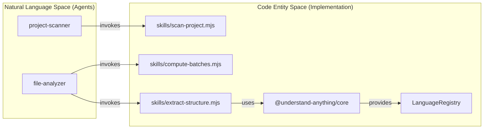
Sources: [understand-anything-plugin/packages/core/src/languages/language-registry.ts:1-10](), [CONTRIBUTING.md:186-203]()

## Build & Development Commands

Task orchestration is handled through `pnpm` across the workspace. The root and package-level `package.json` files define standard scripts for building, testing, and linting [package.json:29-36]().

| Command | Action | Implementation |
|:---|:---|:---|
| `pnpm build` | Recursively builds workspace packages | `pnpm -r build` [package.json:31]() |
| `prepare` | Pre-builds core dependency on install | `pnpm --filter @understand-anything/core build` [package.json:30]() |
| `pnpm test` | Runs test suites via Vitest | `vitest run` [package.json:32]() |
| `pnpm lint` | Executes ESLint code quality checks | `eslint .` [package.json:35]() |
| `pnpm dev:dashboard` | Starts dashboard Vite dev server | `pnpm --filter @understand-anything/dashboard dev` [package.json:34]() |

Sources: [package.json:29-36](), [understand-anything-plugin/packages/core/package.json:33-36]()

## TypeScript, Linting & Workspace Configuration

The monorepo enforces strict code standards through shared configuration files at the repository root.

- **TypeScript**: Shared configurations govern strict type checking across packages [understand-anything-plugin/packages/core/tsconfig.json:1-19]().
- **ESLint**: Configured via `eslint.config.mjs`, applying `typescript-eslint` recommended rules, ignoring build artifacts (`dist/`, `build/`, `.ua/`), and configuring browser globals for dashboard code [eslint.config.mjs:1-57]().
- **Native Dependency Compilation**: Because tree-sitter bindings require native compilation, the root `package.json` utilizes `onlyBuiltDependencies` to whitelist packages like `esbuild`, `sharp`, and language-specific tree-sitter parsers [package.json:46-63]().

Sources: [eslint.config.mjs:1-57](), [package.json:46-63]()

### Diagram: Build Data Flow
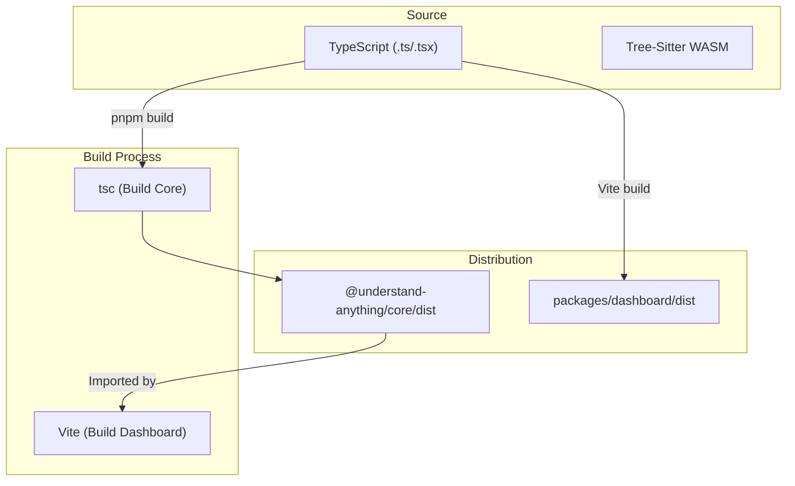
Sources: [package.json:29-36](), [understand-anything-plugin/packages/core/package.json:33-36](), [.github/workflows/deploy-homepage.yml:39-51]()

---

# Page: Skills Reference

# Skills Reference

<details>
<summary>Relevant source files</summary>

The following files were used as context for generating this wiki page:

- [tests/skill/understand/test_incremental_symbols.test.mjs](tests/skill/understand/test_incremental_symbols.test.mjs)
- [tests/skill/understand/test_prepare_incremental.test.mjs](tests/skill/understand/test_prepare_incremental.test.mjs)
- [understand-anything-plugin/packages/core/src/__tests__/staleness.test.ts](understand-anything-plugin/packages/core/src/__tests__/staleness.test.ts)
- [understand-anything-plugin/packages/core/src/staleness.ts](understand-anything-plugin/packages/core/src/staleness.ts)
- [understand-anything-plugin/skills/understand-chat/SKILL.md](understand-anything-plugin/skills/understand-chat/SKILL.md)
- [understand-anything-plugin/skills/understand-diff/SKILL.md](understand-anything-plugin/skills/understand-diff/SKILL.md)
- [understand-anything-plugin/skills/understand-explain/SKILL.md](understand-anything-plugin/skills/understand-explain/SKILL.md)
- [understand-anything-plugin/skills/understand-onboard/SKILL.md](understand-anything-plugin/skills/understand-onboard/SKILL.md)
- [understand-anything-plugin/skills/understand/SKILL.md](understand-anything-plugin/skills/understand/SKILL.md)
- [understand-anything-plugin/skills/understand/finalize-incremental.mjs](understand-anything-plugin/skills/understand/finalize-incremental.mjs)
- [understand-anything-plugin/skills/understand/locales/en.md](understand-anything-plugin/skills/understand/locales/en.md)
- [understand-anything-plugin/skills/understand/locales/ja.md](understand-anything-plugin/skills/understand/locales/ja.md)
- [understand-anything-plugin/skills/understand/locales/ko.md](understand-anything-plugin/skills/understand/locales/ko.md)
- [understand-anything-plugin/skills/understand/locales/zh-TW.md](understand-anything-plugin/skills/understand/locales/zh-TW.md)
- [understand-anything-plugin/skills/understand/locales/zh.md](understand-anything-plugin/skills/understand/locales/zh.md)
- [understand-anything-plugin/skills/understand/prepare-incremental.mjs](understand-anything-plugin/skills/understand/prepare-incremental.mjs)
- [understand-anything-plugin/skills/understand/prepare-symbol-retry.mjs](understand-anything-plugin/skills/understand/prepare-symbol-retry.mjs)
- [understand-anything-plugin/skills/understand/validate-incremental-symbols.mjs](understand-anything-plugin/skills/understand/validate-incremental-symbols.mjs)

</details>


This page provides a comprehensive technical reference for all user-facing slash commands (skills) available in the Understand Anything plugin ecosystem. It outlines arguments, execution flags, data flows, persistence outputs, and core implementation modules that bridge user intent to code entity space.

---

## `/understand`

Analyze the current codebase and produce an interactive knowledge graph (`knowledge-graph.json`) in the project's data directory (`.ua/`, or legacy `.understand-anything/`) [understand-anything-plugin/skills/understand/SKILL.md:7-10]().

### Arguments & Flags

*   `[path]` (optional): Target directory path to analyze instead of the working directory [understand-anything-plugin/skills/understand/SKILL.md:20-20]().
*   `--full`: Force a full graph rebuild, ignoring existing caches [understand-anything-plugin/skills/understand/SKILL.md:14-14]().
*   `--auto-update`: Enable automatic graph updates on commit by writing `autoUpdate: true` to `$UA_DIR/config.json` [understand-anything-plugin/skills/understand/SKILL.md:15-15]().
*   `--no-auto-update`: Disable automatic graph updates [understand-anything-plugin/skills/understand/SKILL.md:16-16]().
*   `--review`: Execute the full LLM graph-reviewer instead of inline deterministic validation [understand-anything-plugin/skills/understand/SKILL.md:17-17]().
*   `--language <lang>`: Generate textual metadata (summaries, descriptions, languageNotes, languageLesson) in the specified ISO 639-1 language code or friendly name [understand-anything-plugin/skills/understand/SKILL.md:18-18]().
*   `--exclude <patterns>`: Comma-separated glob patterns for additional file exclusions [understand-anything-plugin/skills/understand/SKILL.md:19-19]().

### Technical Implementation & Pre-flight

During Phase 0 pre-flight, the skill checks for git worktrees by comparing `git rev-parse --git-dir` against `git rev-parse --git-common-dir`. If they diverge, output is redirected to the main repository root to prevent ephemeral worktree data loss, unless `UNDERSTAND_NO_WORKTREE_REDIRECT=1` is specified [understand-anything-plugin/skills/understand/SKILL.md:53-73]().

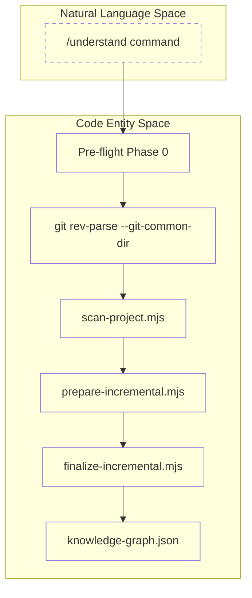
**Title: Natural Language Space to Code Entity Space: /understand**

**Sources:**
* [understand-anything-plugin/skills/understand/SKILL.md:1-110]()
* [understand-anything-plugin/skills/understand/prepare-incremental.mjs:1-752]()
* [understand-anything-plugin/skills/understand/finalize-incremental.mjs:1-512]()

---

## `/understand-dashboard`

Starts the interactive web dashboard to visualize project architecture, domains, and diff overlays.

### Execution Strategy

1.  **Fast Path**: Attempts to download and execute `understand-anything-viewer` from npm/GitHub releases via `npx` [understand-anything-plugin/skills/understand-dashboard/SKILL.md:103-110]().
2.  **Development Fallback**: Builds `@understand-anything/core` and launches the Vite development server located in `packages/dashboard` [understand-anything-plugin/skills/understand-dashboard/SKILL.md:115-132]().
3.  **Security Model**: Generates an `ACCESS_TOKEN` and outputs a secured dashboard URL containing the `?token=` parameter [understand-anything-plugin/skills/understand-dashboard/SKILL.md:135-148]().

**Sources:**
* [understand-anything-plugin/skills/understand-dashboard/SKILL.md:1-150]()

---

## Analytical Query Skills (`/understand-chat`, `/understand-explain`, `/understand-diff`, `/understand-onboard`)

These skills provide structured contextual reasoning over the compiled knowledge graph.

### Common Behavior: Staleness & Freshness Verification
Before executing graph queries, each skill checks graph staleness using core freshness evaluation utilities (`staleness.ts`) [understand-anything-plugin/packages/core/src/staleness.ts:4-56]() by comparing `project.gitCommitHash` against the current `HEAD` commit and filtering out generated paths like `.ua/` or `.understand-anything/` [understand-anything-plugin/packages/core/src/staleness.ts:72-80]().

| Skill | Primary Function | Output Artifact / Action | Key Reference |
| :--- | :--- | :--- | :--- |
| `/understand-chat` | Answers questions via 1-hop subgraph expansion | Console conversational response | [understand-anything-plugin/skills/understand-chat/SKILL.md:1-70]() |
| `/understand-explain` | Deep-dive analysis of specific files, classes, or functions | Detailed component markdown breakdown | [understand-anything-plugin/skills/understand-explain/SKILL.md:1-73]() |
| `/understand-diff` | Impact analysis of code changes against the graph | Writes `$UA_DIR/diff-overlay.json` | [understand-anything-plugin/skills/understand-diff/SKILL.md:1-85]() |
| `/understand-onboard` | Generates team onboarding documentation | Suggests saving to `docs/UA_ONBOARDING.md` | [understand-anything-plugin/skills/understand-onboard/SKILL.md:1-70]() |

**Sources:**
* [understand-anything-plugin/packages/core/src/staleness.ts:1-508]()
* [understand-anything-plugin/skills/understand-chat/SKILL.md:1-70]()
* [understand-anything-plugin/skills/understand-explain/SKILL.md:1-73]()
* [understand-anything-plugin/skills/understand-diff/SKILL.md:1-85]()
* [understand-anything-plugin/skills/understand-onboard/SKILL.md:1-70]()

---

## `/understand-domain` & `/understand-knowledge`

Domain and knowledge graph skills extract higher-level business logic and documentation corpora.

*   **`/understand-domain`**: Extracts business flows and process steps. If `knowledge-graph.json` exists, it derives domain components directly; otherwise, it executes a lightweight entry-point scan, producing `domain-graph.json` [understand-anything-plugin/skills/understand-domain/SKILL.md:13-130]().
*   **`/understand-knowledge`**: Parses Karpathy-pattern LLM wikis via `parse-knowledge-base.py`, runs `article-analyzer` agents for implicit claims, and invokes `merge-knowledge-graph.py` to produce a `kind: "knowledge"` graph [understand-anything-plugin/skills/understand-knowledge/SKILL.md:13-86]().

**Sources:**
* [understand-anything-plugin/skills/understand-domain/SKILL.md:1-135]()
* [understand-anything-plugin/skills/understand-knowledge/SKILL.md:1-90]()

---

## `/understand-figma`

Integrates Figma design files and token sets into the project graph model.

### Technical Implementation & Data Flow

1.  **Version Check**: `figma-scan.mjs` verifies remote Figma file versions against `meta.json` [understand-anything-plugin/skills/understand-figma/figma-scan.mjs:29-37]().
2.  **Extraction**: `parseDocument` builds hierarchy trees while `extractTokens` captures design variables [understand-anything-plugin/skills/understand-figma/figma-scan.mjs:41-44]().
3.  **Enrichment**: Design analyzer batches enrich screen metadata before `figma-merge.mjs` outputs a `kind:design` graph structure.

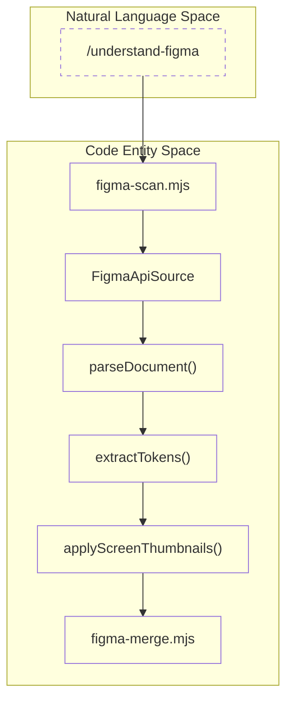
**Title: Natural Language Space to Code Entity Space: /understand-figma**

**Sources:**
* [understand-anything-plugin/skills/understand-figma/figma-scan.mjs:1-80]()
* [understand-anything-plugin/packages/core/src/figma/index.ts:1-6]()

---

# Page: Analysis Pipeline

# Analysis Pipeline

<details>
<summary>Relevant source files</summary>

The following files were used as context for generating this wiki page:

- [CLAUDE.md](CLAUDE.md)
- [tests/skill/understand/test_incremental_symbols.test.mjs](tests/skill/understand/test_incremental_symbols.test.mjs)
- [tests/skill/understand/test_prepare_incremental.test.mjs](tests/skill/understand/test_prepare_incremental.test.mjs)
- [understand-anything-plugin/agents/architecture-analyzer.md](understand-anything-plugin/agents/architecture-analyzer.md)
- [understand-anything-plugin/agents/article-analyzer.md](understand-anything-plugin/agents/article-analyzer.md)
- [understand-anything-plugin/agents/assemble-reviewer.md](understand-anything-plugin/agents/assemble-reviewer.md)
- [understand-anything-plugin/agents/domain-analyzer.md](understand-anything-plugin/agents/domain-analyzer.md)
- [understand-anything-plugin/agents/file-analyzer.md](understand-anything-plugin/agents/file-analyzer.md)
- [understand-anything-plugin/agents/graph-reviewer.md](understand-anything-plugin/agents/graph-reviewer.md)
- [understand-anything-plugin/agents/knowledge-graph-guide.md](understand-anything-plugin/agents/knowledge-graph-guide.md)
- [understand-anything-plugin/agents/project-scanner.md](understand-anything-plugin/agents/project-scanner.md)
- [understand-anything-plugin/agents/tour-builder.md](understand-anything-plugin/agents/tour-builder.md)
- [understand-anything-plugin/skills/understand/SKILL.md](understand-anything-plugin/skills/understand/SKILL.md)
- [understand-anything-plugin/skills/understand/finalize-incremental.mjs](understand-anything-plugin/skills/understand/finalize-incremental.mjs)
- [understand-anything-plugin/skills/understand/prepare-incremental.mjs](understand-anything-plugin/skills/understand/prepare-incremental.mjs)
- [understand-anything-plugin/skills/understand/prepare-symbol-retry.mjs](understand-anything-plugin/skills/understand/prepare-symbol-retry.mjs)
- [understand-anything-plugin/skills/understand/validate-incremental-symbols.mjs](understand-anything-plugin/skills/understand/validate-incremental-symbols.mjs)

</details>


The Understand Anything analysis pipeline transforms a codebase into a rich, interactive `KnowledgeGraph`. This process relies on a multi-agent system orchestrating seven distinct phases, combining deterministic static analysis with Large Language Model (LLM) semantic reasoning [understand-anything-plugin/skills/understand/SKILL.md:7-10]().

This parent page outlines the high-level workflow, the agent roles, and the strategic split between deterministic and LLM-driven components. For granular technical specifications, consult the child pages:
- Project Scanner & File Discovery: [Project Scanner & File Discovery](#2.1)
- File Analyzer & Batch Processing: [File Analyzer & Batch Processing](#2.2)
- Graph Assembly & Validation: [Graph Assembly & Validation](#2.3)
- Tour Builder & Architecture Analyzer: [Tour Builder & Architecture Analyzer](#2.4)
- Domain & Knowledge Graph Skills: [Domain & Knowledge Graph Skills](#2.5)
- Figma Design Graph Skill: [Figma Design Graph Skill](#2.6)

---

## Pipeline Architecture & Hybrid Split

The pipeline uses a hybrid execution model to maximize both precision and semantic depth:
- **Deterministic Processing:** Handled by dedicated Node.js and Python scripts (`scan-project.mjs`, `extract-import-map.mjs`, `merge-batch-graphs.py`) for file enumeration, language detection, Tree-sitter parsing, import resolution, and structural graph merging [understand-anything-plugin/agents/project-scanner.md:15-18]().
- **LLM-driven Processing:** Delegated to specialized agents (`file-analyzer`, `architecture-analyzer`, `tour-builder`, `graph-reviewer`) for summarization, tag generation, architectural reasoning, and pedagogical tour planning [understand-anything-plugin/agents/file-analyzer.md:1-6](), [understand-anything-plugin/agents/architecture-analyzer.md:1-6](), [understand-anything-plugin/agents/tour-builder.md:1-6]().

Diagram: Pipeline Phase Flow
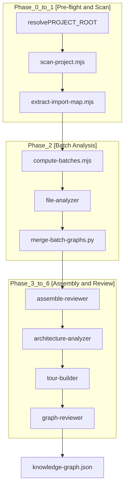
Sources: [understand-anything-plugin/skills/understand/SKILL.md:28-41](), [understand-anything-plugin/agents/project-scanner.md:25-28]()

---

## The Seven Phases Overview

1. **Phase 0 — Pre-flight:** Resolves `PROJECT_ROOT`, manages git worktree redirects, and ensures `@understand-anything/core` build artifacts are present [understand-anything-plugin/skills/understand/SKILL.md:43-120]().
2. **Phase 1 — Project Scan:** Inventories files, applies `.understandignore` rules, detects languages, and parses package manifests for narrative metadata. For details, see [Project Scanner & File Discovery](#2.1).
3. **Phase 2 — File Analysis:** Batches files and executes parallel `file-analyzer` subagents using Tree-sitter extraction (`extract-structure.mjs`). For details, see [File Analyzer & Batch Processing](#2.2).
4. **Phase 3 — Graph Assembly & Subdomain Merging:** Canonicalizes node IDs, merges batch graphs, and runs `assemble-reviewer` for semantic recovery. For details, see [Graph Assembly & Validation](#2.3).
5. **Phase 4 — Architecture & Layer Assignment:** Computes import densities and applies layer heuristics via `architecture-analyzer`. For details, see [Tour Builder & Architecture Analyzer](#2.4).
6. **Phase 5 — Tour Generation:** Builds a graph topology via BFS and fan-in ranking, generating guided learning steps with `tour-builder`. For details, see [Tour Builder & Architecture Analyzer](#2.4).
7. **Phase 6 — Validation:** Runs deterministic schema checks and referential integrity validations via `graph-reviewer`. For details, see [Graph Assembly & Validation](#2.3).

---

## Agent Roles

- `project-scanner`: Enumerates files, detects languages, and builds initial import maps [understand-anything-plugin/agents/project-scanner.md:1-6]().
- `file-analyzer`: Executes structural extraction scripts and builds semantic summaries, tags, and complexity ratings [understand-anything-plugin/agents/file-analyzer.md:1-6]().
- `assemble-reviewer`: Recovers dropped nodes and resolves cross-batch gaps [understand-anything-plugin/agents/assemble-reviewer.md:1-6]().
- `architecture-analyzer`: Identifies logical layers and assigns file nodes to layers [understand-anything-plugin/agents/architecture-analyzer.md:1-6]().
- `tour-builder`: Constructs ordered traversal paths through the codebase [understand-anything-plugin/agents/tour-builder.md:1-6]().
- `graph-reviewer`: Validates final graph structure against Zod schemas and referential integrity constraints [understand-anything-plugin/agents/graph-reviewer.md:1-6]().

---

## Bridging Natural Language to Code Entity Space

To provide meaningful explorations, the pipeline maps abstract textual concepts and high-level architecture directly to precise code symbols, file paths, and functions.

Diagram: Architecture Layer to Code Entity Mapping
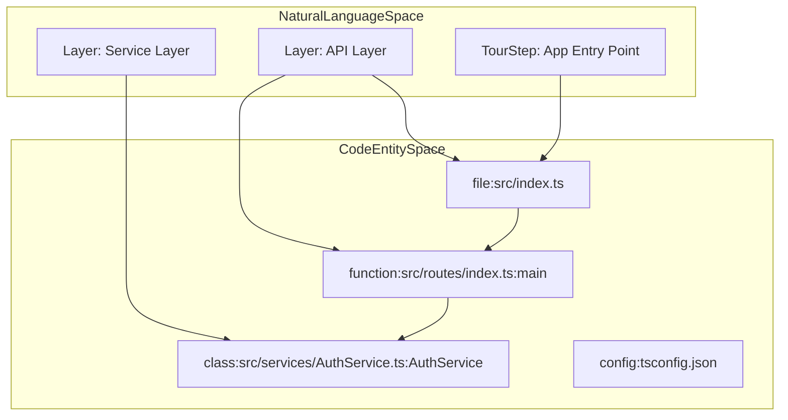
Sources: [understand-anything-plugin/agents/architecture-analyzer.md:30-47](), [understand-anything-plugin/agents/tour-builder.md:1-6]()

Diagram: Domain and Artifact Navigation Bridge
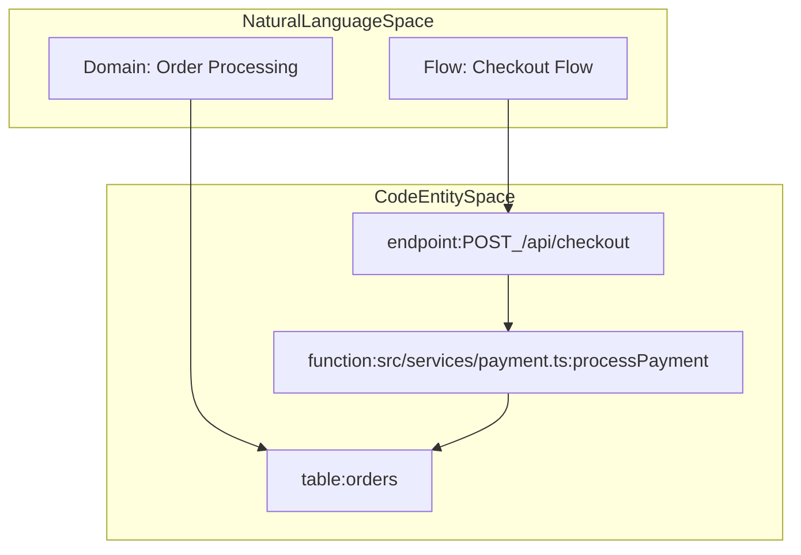
Sources: [understand-anything-plugin/agents/domain-analyzer.md:27-32](), [understand-anything-plugin/agents/graph-reviewer.md:44-48]()

---

## Specialized Graph Skills

- **Domain Graph Skill (`/understand-domain`):** Processes business domains, flows, and steps into `domain-graph.json`. For details, see [Domain & Knowledge Graph Skills](#2.5).
- **Knowledge Base Skill (`/understand-knowledge`):** Parses Karpathy-pattern wikis into a structured knowledge graph. For details, see [Domain & Knowledge Graph Skills](#2.5).
- **Figma Design Graph Skill (`/understand-figma`):** Fetches design metadata via `figma-scan.mjs` and links UI design tokens to code components. For details, see [Figma Design Graph Skill](#2.6).

---

# Page: Project Scanner & File Discovery

# Project Scanner & File Discovery

<details>
<summary>Relevant source files</summary>

The following files were used as context for generating this wiki page:

- [tests/skill/understand/test_compute_batches.test.mjs](tests/skill/understand/test_compute_batches.test.mjs)
- [tests/skill/understand/test_extract_import_map.test.mjs](tests/skill/understand/test_extract_import_map.test.mjs)
- [tests/skill/understand/test_scan_project.test.mjs](tests/skill/understand/test_scan_project.test.mjs)
- [understand-anything-plugin/packages/core/src/__tests__/change-classifier.test.ts](understand-anything-plugin/packages/core/src/__tests__/change-classifier.test.ts)
- [understand-anything-plugin/packages/core/src/__tests__/ignore-generator.test.ts](understand-anything-plugin/packages/core/src/__tests__/ignore-generator.test.ts)
- [understand-anything-plugin/packages/core/src/change-classifier.ts](understand-anything-plugin/packages/core/src/change-classifier.ts)
- [understand-anything-plugin/packages/core/src/ignore-generator.ts](understand-anything-plugin/packages/core/src/ignore-generator.ts)
- [understand-anything-plugin/skills/understand/compute-batches.mjs](understand-anything-plugin/skills/understand/compute-batches.mjs)
- [understand-anything-plugin/skills/understand/extract-import-map.mjs](understand-anything-plugin/skills/understand/extract-import-map.mjs)
- [understand-anything-plugin/skills/understand/generate-ignore.mjs](understand-anything-plugin/skills/understand/generate-ignore.mjs)
- [understand-anything-plugin/skills/understand/scan-project.mjs](understand-anything-plugin/skills/understand/scan-project.mjs)

</details>


## Purpose and Scope

The **Project Scanner & File Discovery** subsystem implements Phases 0 through 1.5 of the Understand Anything analysis pipeline. Its primary objective is to inventory a codebase, detect languages and file categories, apply ignore rules via `.understandignore`, and extract a deterministic import map and louvain-based processing batches. 

This phase separates concerns between deterministic Node.js scripts and guided LLM agent narratives:
- **`scan-project.mjs`**: Enumerates files using `git ls-files` or recursive directory traversal, applying ignore filters and language classification [understand-anything-plugin/skills/understand/scan-project.mjs:18-27]().
- **`extract-import-map.mjs`**: Resolves raw import paths using `@understand-anything/core` Tree-sitter parsers into a project-internal import map [understand-anything-plugin/skills/understand/extract-import-map.mjs:5-14]().
- **`compute-batches.mjs`**: Applies Louvain community detection on the import graph and extracts top-level exported symbols to build parallel analysis batches (`batches.json`) [understand-anything-plugin/skills/understand/compute-batches.mjs:3-16]().
- **`ignore-generator.ts`**: Generates starter `.understandignore` configurations tailored to detected project structures and test conventions [understand-anything-plugin/packages/core/src/ignore-generator.ts:1-13]().

Sources: [understand-anything-plugin/skills/understand/scan-project.mjs:1-58](), [understand-anything-plugin/skills/understand/extract-import-map.mjs:2-34](), [understand-anything-plugin/skills/understand/compute-batches.mjs:2-21](), [understand-anything-plugin/packages/core/src/ignore-generator.ts:1-13]()

---

## Scan Workflow & Pipeline Orchestration

The project scanning workflow coordinates user-facing skill prompts with deterministic script executions.

Title: Pipeline Orchestration from Natural Language to Code Execution

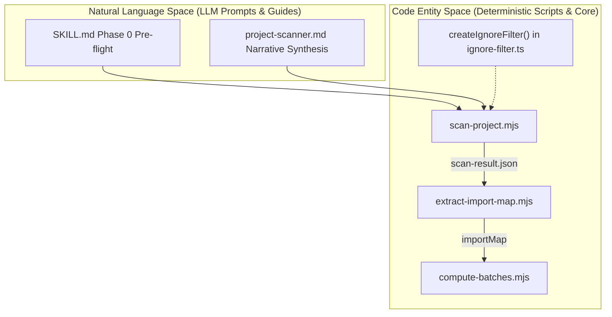

Sources: [understand-anything-plugin/skills/understand/SKILL.md:43-165](), [understand-anything-plugin/skills/understand/scan-project.mjs:1-58](), [understand-anything-plugin/skills/understand/extract-import-map.mjs:2-34]()

---

## Detailed Components

### 1. File Enumeration and Detection (`scan-project.mjs`)

The `scan-project.mjs` script performs file enumeration and rule-based classification:
- **Enumeration Strategy**: Executes `git ls-files -co --exclude-standard` when inside a git worktree, falling back to a recursive synchronous directory walk [understand-anything-plugin/skills/understand/scan-project.mjs:18-21]().
- **Ignore Filtering**: Delegates pattern matching to `createIgnoreFilter` from `@understand-anything/core`, reading `.understandignore` and built-in defaults [understand-anything-plugin/skills/understand/scan-project.mjs:18-21]().
- **Language Detection**: Uses `LANGUAGE_BY_EXT` and filename tables to assign canonical language identifiers across 40+ languages [understand-anything-plugin/skills/understand/scan-project.mjs:100-214]().
- **Categorization & Metrics**: Computes line counts (`sizeLines`), estimates project complexity (`small` to `very-large`), and assigns a `fileCategory` (`code`, `config`, `docs`, `infra`, `data`, `script`, `markup`) [understand-anything-plugin/skills/understand/scan-project.mjs:22-27]().

Sources: [understand-anything-plugin/skills/understand/scan-project.mjs:1-58](), [understand-anything-plugin/skills/understand/scan-project.mjs:116-214]()

### 2. Deterministic Import Mapping (`extract-import-map.mjs`)

To bypass slow and inconsistent LLM-based regex scraping, `extract-import-map.mjs` provides a deterministic syntax-aware resolver:
- **Parser Integration**: Leverages `TreeSitterPlugin` and language extractors from `@understand-anything/core` to parse code structure [understand-anything-plugin/skills/understand/extract-import-map.mjs:5-13]().
- **Resolution Engine**: Resolves relative imports, `tsconfig.json` path aliases, and package exports into project-relative POSIX file paths [understand-anything-plugin/skills/understand/extract-import-map.mjs:96-180]().
- **Concurrency**: Reads input files in bounded parallel chunks while preserving deterministic output order [understand-anything-plugin/skills/understand/extract-import-map.mjs:57-68]().

Sources: [understand-anything-plugin/skills/understand/extract-import-map.mjs:1-184](), [tests/skill/understand/test_extract_import_map.test.mjs:67-98]()

### 3. Community Batching & Export Extraction (`compute-batches.mjs`)

Phase 1.5 processes the import graph to generate execution batches:
- **Louvain Clustering**: Uses `graphology` and `graphology-communities-louvain` to group highly-interconnected files into communities, minimizing cross-batch edges [understand-anything-plugin/skills/understand/compute-batches.mjs:5-7]().
- **Symbol Extraction**: Extracts top-level exported symbols (functions, classes, constants) via `TreeSitterPlugin.analyzeFile()` to build a `neighborMap` [understand-anything-plugin/skills/understand/compute-batches.mjs:59-134]().
- **Non-Code Clustering**: Groups infra files, workflows, and migrations using directory-proximity heuristics (`buildNonCodeBatches`) [understand-anything-plugin/skills/understand/compute-batches.mjs:138-144]().

Sources: [understand-anything-plugin/skills/understand/compute-batches.mjs:1-144](), [tests/skill/understand/test_compute_batches.test.mjs:87-105]()

---

## Ignore Filtering & Starter Generator

The ignore subsystem prevents noise from polluting the Knowledge Graph:
- **`createIgnoreFilter`**: Combines default exclusions (`node_modules`, `.git`, lockfiles) with custom rules defined in `.understandignore` [understand-anything-plugin/packages/core/src/ignore-filter.ts:9-70]().
- **`generateStarterIgnoreFile`**: Inspects disk layout to detect test directories (`__tests__`, `tests`, `spec`, `benches`) and outputs commented-out starter suggestions [understand-anything-plugin/packages/core/src/ignore-generator.ts:1-59]().
- **`generate-ignore.mjs`**: CLI script invoking `generateStarterIgnoreFile` to write `.understandignore` into the project data directory (`.ua/` or legacy `.understand-anything/`) [understand-anything-plugin/skills/understand/generate-ignore.mjs:5-18]().

Sources: [understand-anything-plugin/packages/core/src/ignore-generator.ts:20-159](), [understand-anything-plugin/packages/core/src/__tests__/ignore-generator.test.ts:34-177](), [understand-anything-plugin/skills/understand/generate-ignore.mjs:1-69]()

---

## Data Flow: Code Space to Knowledge Space

Title: Data Flow Transformation from Code Entities to Graph Artifacts

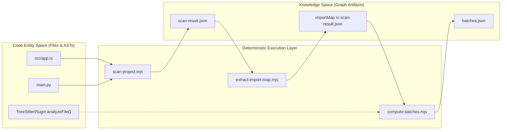

Sources: [understand-anything-plugin/skills/understand/scan-project.mjs:37-48](), [understand-anything-plugin/skills/understand/extract-import-map.mjs:24-29](), [understand-anything-plugin/skills/understand/compute-batches.mjs:5-16]()

---

## Technical Reference: Language & Category Mapping

| Extension | Language ID | Category |
| :--- | :--- | :--- |
| `.ts`, `.tsx` | `typescript` | `code` |
| `.py`, `.pyi` | `python` | `code` |
| `.go` | `go` | `code` |
| `.rb`, `.rake` | `ruby` | `code` |
| `.sql` | `sql` | `data` |
| `Dockerfile` | `dockerfile` | `infra` |
| `.yaml`, `.json` | `yaml`/`json` | `config` |
| `.md`, `.rst` | `markdown` | `docs` |

Sources: [understand-anything-plugin/skills/understand/scan-project.mjs:116-193]()

---

# Page: File Analyzer & Batch Processing

# File Analyzer & Batch Processing

<details>
<summary>Relevant source files</summary>

The following files were used as context for generating this wiki page:

- [CLAUDE.md](CLAUDE.md)
- [pnpm-workspace.yaml](pnpm-workspace.yaml)
- [tests/skill/understand/test_compute_batches.test.mjs](tests/skill/understand/test_compute_batches.test.mjs)
- [tests/skill/understand/test_extract_structure_cli.test.mjs](tests/skill/understand/test_extract_structure_cli.test.mjs)
- [tests/skill/understand/test_scan_project.test.mjs](tests/skill/understand/test_scan_project.test.mjs)
- [understand-anything-plugin/agents/architecture-analyzer.md](understand-anything-plugin/agents/architecture-analyzer.md)
- [understand-anything-plugin/agents/article-analyzer.md](understand-anything-plugin/agents/article-analyzer.md)
- [understand-anything-plugin/agents/assemble-reviewer.md](understand-anything-plugin/agents/assemble-reviewer.md)
- [understand-anything-plugin/agents/domain-analyzer.md](understand-anything-plugin/agents/domain-analyzer.md)
- [understand-anything-plugin/agents/file-analyzer.md](understand-anything-plugin/agents/file-analyzer.md)
- [understand-anything-plugin/agents/graph-reviewer.md](understand-anything-plugin/agents/graph-reviewer.md)
- [understand-anything-plugin/agents/knowledge-graph-guide.md](understand-anything-plugin/agents/knowledge-graph-guide.md)
- [understand-anything-plugin/agents/project-scanner.md](understand-anything-plugin/agents/project-scanner.md)
- [understand-anything-plugin/agents/tour-builder.md](understand-anything-plugin/agents/tour-builder.md)
- [understand-anything-plugin/pnpm-workspace.yaml](understand-anything-plugin/pnpm-workspace.yaml)
- [understand-anything-plugin/skills/understand/compute-batches.mjs](understand-anything-plugin/skills/understand/compute-batches.mjs)
- [understand-anything-plugin/skills/understand/extract-structure-result.mjs](understand-anything-plugin/skills/understand/extract-structure-result.mjs)
- [understand-anything-plugin/skills/understand/extract-structure.mjs](understand-anything-plugin/skills/understand/extract-structure.mjs)
- [understand-anything-plugin/skills/understand/scan-project.mjs](understand-anything-plugin/skills/understand/scan-project.mjs)
- [understand-anything-plugin/src/__tests__/extract-structure.test.mjs](understand-anything-plugin/src/__tests__/extract-structure.test.mjs)
- [understand-anything-plugin/src/__tests__/worktree-redirect.test.mjs](understand-anything-plugin/src/__tests__/worktree-redirect.test.mjs)

</details>


This page details Phase 2 of the Analysis Pipeline, focusing on how files are segmented into batches, processed by deterministic extraction scripts, and enriched by LLM-driven semantic analysis.

## Overview of Phase 2

Phase 2, "Analyzing files," transforms the project inventory into a preliminary set of `KnowledgeGraph` nodes and edges. It utilizes a hybrid approach: deterministic scripts for structural extraction (functions, classes, imports) and LLM subagents for semantic enrichment (summaries, tags, complexity).

The process follows this sequence:
1. **Batch Computation**: `compute-batches.mjs` segments files into groups based on import topology [understand-anything-plugin/skills/understand/compute-batches.mjs:5-16]().
2. **Parallel Dispatch**: `file-analyzer` subagents are invoked for each batch [understand-anything-plugin/agents/file-analyzer.md:4-6]().
3. **Structural Extraction**: `extract-structure.mjs` uses `tree-sitter` and specialized parsers to identify code entities [understand-anything-plugin/skills/understand/extract-structure.mjs:75-82]().
4. **Semantic Analysis**: LLMs synthesize summaries and identify higher-level relationships [understand-anything-plugin/agents/file-analyzer.md:17]().
5. **Multi-part Persistence**: Results are written to intermediate JSON files to handle token and context limits [understand-anything-plugin/agents/file-analyzer.md:145-146]().

Sources: [understand-anything-plugin/agents/file-analyzer.md:4-17](), [understand-anything-plugin/skills/understand/compute-batches.mjs:5-16](), [understand-anything-plugin/skills/understand/extract-structure.mjs:75-82]()

## Batch Computation with `compute-batches.mjs`

The `compute-batches.mjs` script organizes files into manageable batches. It prioritizes keeping semantically related files (those that import one another) in the same batch to provide the LLM with better context.

### Semantic Batching Algorithm
1. **Graph Construction**: The script builds a graph where nodes are files and edges represent imports from the `importMap` [understand-anything-plugin/skills/understand/compute-batches.mjs:58-62]().
2. **Louvain Community Detection**: It uses the Louvain algorithm to detect "communities" of files that are tightly coupled [understand-anything-plugin/skills/understand/compute-batches.mjs:55-56]().
3. **Non-Code Grouping**: Non-code files are grouped by heuristics, such as grouping `Dockerfile` clusters by directory or CI/CD workflows by platform [understand-anything-plugin/skills/understand/compute-batches.mjs:145-167]().
4. **Symbol Extraction**: For each code file, it extracts top-level exports using `TreeSitterPlugin` to populate a `neighborMap`. This map allows agents to resolve cross-batch edges with confidence [understand-anything-plugin/skills/understand/compute-batches.mjs:65-80](), [understand-anything-plugin/agents/file-analyzer.md:56-63]().

### Batch Processing Data Flow

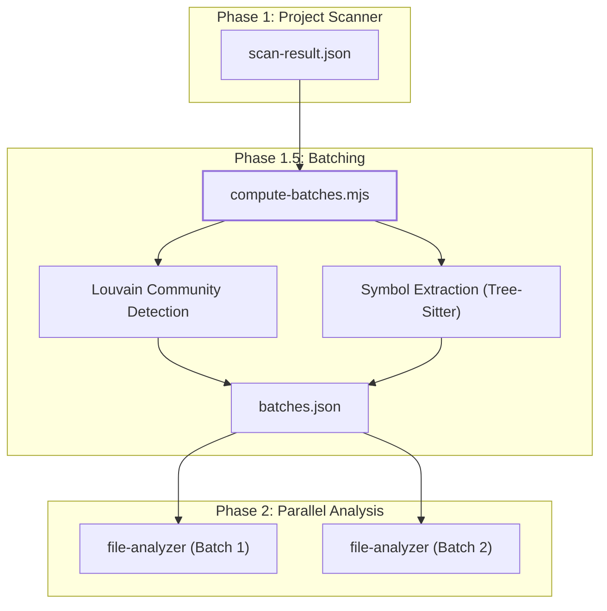
Title: "Batching Data Flow"
Sources: [understand-anything-plugin/skills/understand/compute-batches.mjs:5-16](), [understand-anything-plugin/skills/understand/compute-batches.mjs:55-62](), [understand-anything-plugin/skills/understand/compute-batches.mjs:65-80]()

## Structural Extraction via `extract-structure.mjs`

The `file-analyzer` agent begins its task by executing `extract-structure.mjs`. This script provides deterministic extraction without relying on LLM regex generation.

### Extraction Logic
* **Code Files**: Uses `TreeSitterPlugin` (via `@understand-anything/core`) to parse files into ASTs and extract functions, classes, and call graphs [understand-anything-plugin/skills/understand/extract-structure.mjs:75-77]().
* **Non-Code Files**: Uses specialized parsers to extract logical units like `services` (Docker), `endpoints` (OpenAPI), `resources` (Terraform), or `steps` (CI/CD) [understand-anything-plugin/agents/file-analyzer.md:121-130]().
* **Validation**: The `extract-structure-result.mjs` module validates the output against a strict schema to ensure `lineRange`, `params`, and `name` fields are correctly formatted [understand-anything-plugin/skills/understand/extract-structure-result.mjs:52-97]().

### From Code Space to Entity Space

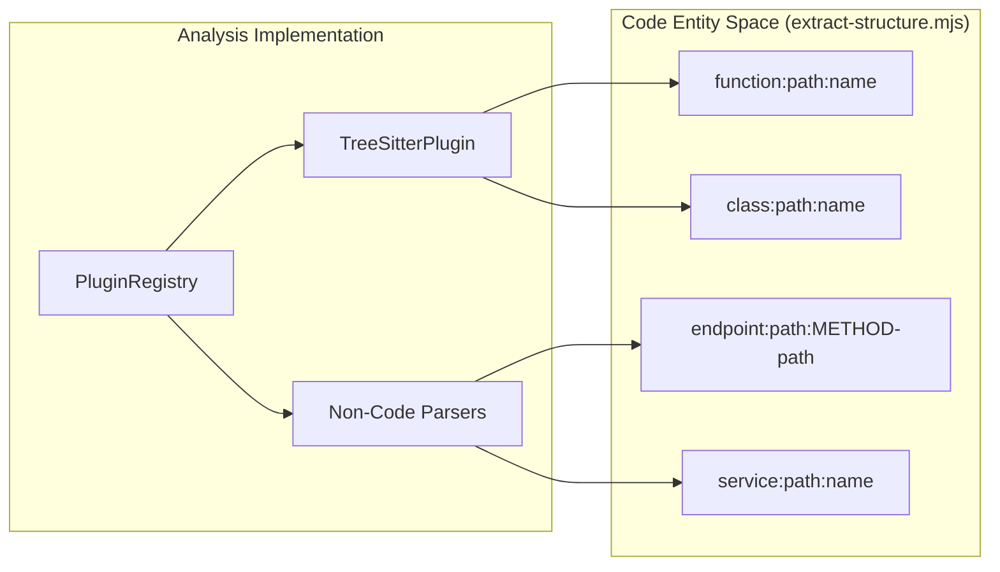
Title: "Structural Mapping"
Sources: [understand-anything-plugin/skills/understand/extract-structure.mjs:79-82](), [understand-anything-plugin/agents/file-analyzer.md:121-130](), [understand-anything-plugin/skills/understand/extract-structure-result.mjs:52-97]()

## LLM Semantic Enrichment

Once the structural results are loaded, the `file-analyzer` subagent performs semantic analysis.

1. **Summary Generation**: Writes a concise `summary` for each node based on the extracted structure and file content [understand-anything-plugin/agents/file-analyzer.md:17]().
2. **Tagging**: Assigns localized tags (e.g., "middleware", "api-handler") [understand-anything-plugin/agents/file-analyzer.md:23]().
3. **Complexity**: Assigns a rating of `simple`, `moderate`, or `complex` based on logic density [understand-anything-plugin/agents/file-analyzer.md:17]().
4. **Relationship Discovery**: Identifies edges that static analysis might miss, such as `related`, `publishes`, or `subscribes` [understand-anything-plugin/agents/file-analyzer.md:17]().
5. **Language Directives**: If specified, generates all textual content (summaries, tags) in a specific target language (e.g., Chinese) [understand-anything-plugin/agents/file-analyzer.md:21-25]().

Sources: [understand-anything-plugin/agents/file-analyzer.md:17](), [understand-anything-plugin/agents/file-analyzer.md:21-25]()

## Multi-Part Output Protocol

To stay within LLM token limits, the system supports splitting a single batch's results into multiple files.

* **Temporary Storage**: Agents write to `$UA_DIR/tmp/ua-file-analyzer-input-<batchIndex>.json` [understand-anything-plugin/agents/file-analyzer.md:35-45]().
* **Chunking**: If a batch analysis is too large, the agent is instructed to use a multi-part naming convention: `batch-<batchIndex>-<partIndex>.json` [understand-anything-plugin/agents/file-analyzer.md:145-146]().
* **Outcome Validation**: The system tracks `analysisOutcomes` (succeeded, failed, skipped) for both structural and call-graph analysis to ensure pipeline health [understand-anything-plugin/skills/understand/extract-structure.mjs:86-89]().

### File Analyzer Execution Loop

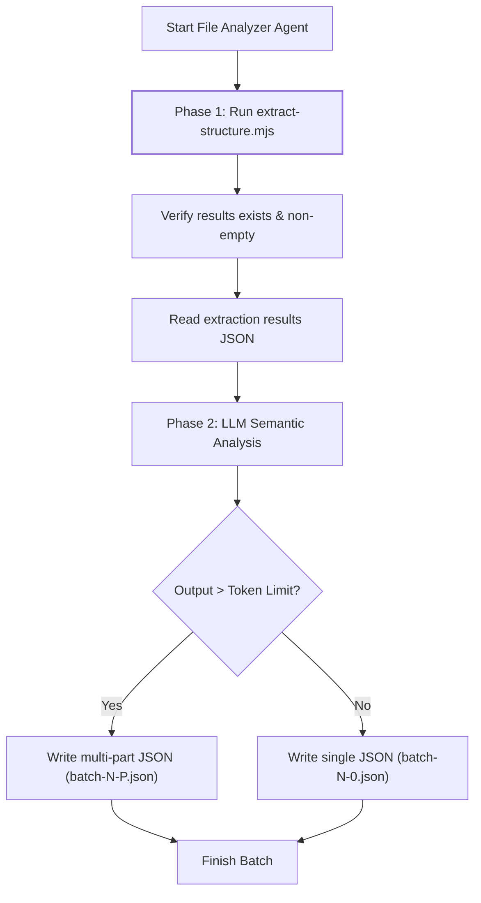
Title: "File Analyzer Execution Loop"
Sources: [understand-anything-plugin/agents/file-analyzer.md:17](), [understand-anything-plugin/agents/file-analyzer.md:68-76](), [understand-anything-plugin/agents/file-analyzer.md:145-146](), [understand-anything-plugin/skills/understand/extract-structure.mjs:86-89]()

Sources:
- [understand-anything-plugin/agents/file-analyzer.md]()
- [understand-anything-plugin/skills/understand/compute-batches.mjs]()
- [understand-anything-plugin/skills/understand/extract-structure.mjs]()
- [understand-anything-plugin/skills/understand/extract-structure-result.mjs]()
- [understand-anything-plugin/hooks/auto-update-prompt.md]()

---

# Page: Graph Assembly & Validation

# Graph Assembly & Validation

<details>
<summary>Relevant source files</summary>

The following files were used as context for generating this wiki page:

- [.github/workflows/ci.yml](.github/workflows/ci.yml)
- [CLAUDE.md](CLAUDE.md)
- [tests/skill/knowledge/test_parse_knowledge_base.py](tests/skill/knowledge/test_parse_knowledge_base.py)
- [tests/skill/understand/test_merge_batch_graphs.py](tests/skill/understand/test_merge_batch_graphs.py)
- [tests/skill/understand/test_merge_subdomain_graphs.py](tests/skill/understand/test_merge_subdomain_graphs.py)
- [understand-anything-plugin/agents/architecture-analyzer.md](understand-anything-plugin/agents/architecture-analyzer.md)
- [understand-anything-plugin/agents/article-analyzer.md](understand-anything-plugin/agents/article-analyzer.md)
- [understand-anything-plugin/agents/assemble-reviewer.md](understand-anything-plugin/agents/assemble-reviewer.md)
- [understand-anything-plugin/agents/domain-analyzer.md](understand-anything-plugin/agents/domain-analyzer.md)
- [understand-anything-plugin/agents/file-analyzer.md](understand-anything-plugin/agents/file-analyzer.md)
- [understand-anything-plugin/agents/graph-reviewer.md](understand-anything-plugin/agents/graph-reviewer.md)
- [understand-anything-plugin/agents/knowledge-graph-guide.md](understand-anything-plugin/agents/knowledge-graph-guide.md)
- [understand-anything-plugin/agents/project-scanner.md](understand-anything-plugin/agents/project-scanner.md)
- [understand-anything-plugin/agents/tour-builder.md](understand-anything-plugin/agents/tour-builder.md)
- [understand-anything-plugin/packages/dashboard/src/components/KnowledgeGraphView.tsx](understand-anything-plugin/packages/dashboard/src/components/KnowledgeGraphView.tsx)
- [understand-anything-plugin/skills/understand-knowledge/merge-knowledge-graph.py](understand-anything-plugin/skills/understand-knowledge/merge-knowledge-graph.py)
- [understand-anything-plugin/skills/understand-knowledge/parse-knowledge-base.py](understand-anything-plugin/skills/understand-knowledge/parse-knowledge-base.py)
- [understand-anything-plugin/skills/understand/merge-batch-graphs.py](understand-anything-plugin/skills/understand/merge-batch-graphs.py)
- [understand-anything-plugin/skills/understand/merge-subdomain-graphs.py](understand-anything-plugin/skills/understand/merge-subdomain-graphs.py)
- [understand-anything-plugin/src/__tests__/merge-recover-imports.test.mjs](understand-anything-plugin/src/__tests__/merge-recover-imports.test.mjs)

</details>


This page details Phases 3 and 4 of the Analysis Pipeline, focusing on how raw, batch-processed graph data is consolidated, canonicalized, validated, and structured into logical layers. This involves batch merging via `merge-batch-graphs.py`, ID canonicalization, `tested_by` linking, subdomain merging via `merge-subdomain-graphs.py`, semantic recovery by `assemble-reviewer`, referential integrity checks by `graph-reviewer`, and architectural layer assignment by `architecture-analyzer`.

Sources: [understand-anything-plugin/skills/understand/merge-batch-graphs.py:1-18](), [understand-anything-plugin/skills/understand/merge-subdomain-graphs.py:1-20](), [understand-anything-plugin/agents/graph-reviewer.md:1-20]()

---

## 1. Phase 3: Graph Assembly (`merge-batch-graphs.py`)

After individual files and batches have been analyzed by `file-analyzer` agents, their outputs (nodes and edges) are merged into a single, coherent graph. This phase uses Python scripts to perform consolidation, sorting, and normalization under the project's data directory (`.ua/` or legacy `.understand-anything/`) [understand-anything-plugin/skills/understand/merge-batch-graphs.py:11-18]().

### 1.1 Batch Sorting and Loading

The `merge-batch-graphs.py` script combines all `batch-*.json` files generated by `file-analyzer` agents into a single `assembled-graph.json` [understand-anything-plugin/skills/understand/merge-batch-graphs.py:5-18](). It uses `parse_batch_filename` and `batch_sort_key` to order numeric batches correctly, ensuring `batch-existing.json` (used during incremental updates) sorts before freshly analyzed numeric batches [understand-anything-plugin/skills/understand/merge-batch-graphs.py:163-185]().

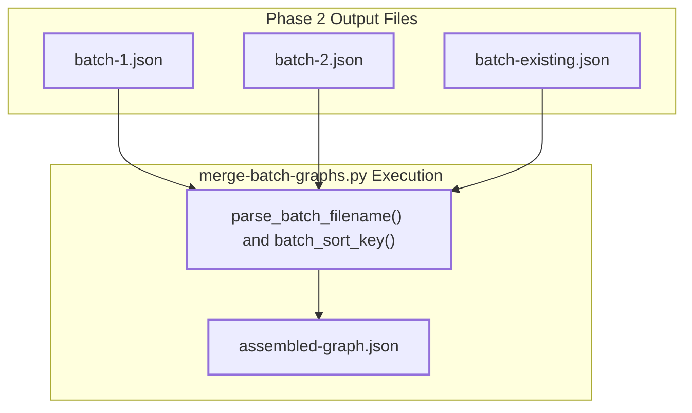
Title: "Data Flow for Batch Merging and Sorting"
Sources: [understand-anything-plugin/skills/understand/merge-batch-graphs.py:163-185]()

### 1.2 ID Canonicalization & Prefixes

A crucial step in merging is ensuring all node IDs adhere to a canonical format. The canonicalization process strips double prefixes (e.g., `file:file:src/foo.ts` $\rightarrow$ `file:src/foo.ts`), removes project-name prefixes, and applies correct prefixes based on node type [understand-anything-plugin/skills/understand/merge-batch-graphs.py:38-83]().

The `VALID_NODE_PREFIXES` set and `TYPE_TO_PREFIX` mapping enforce these constraints across structural types (`file`, `function`, `class`, `module`), configuration types (`config`, `service`, `table`, `endpoint`), and knowledge-base types (`article`, `entity`, `claim`) [understand-anything-plugin/skills/understand/merge-batch-graphs.py:38-83]().

### 1.3 Complexity & Direction Normalization

Node `complexity` values are normalized to a standard set (`simple`, `moderate`, `complex`) via `COMPLEXITY_MAP`, translating aliases like `easy` or `hard` [understand-anything-plugin/skills/understand/merge-batch-graphs.py:85-96](). Similarly, edge directions are canonicalized using `normalize_direction`, mapping aliases like `both` or `mutual` to `bidirectional` [understand-anything-plugin/skills/understand/merge-batch-graphs.py:142-152]().

### 1.4 Tested-By Linker Configuration

The script automatically infers `tested_by` relationships between code and test files by evaluating file paths against language-specific patterns (`_TEST_NAME_PATTERNS`, `_JS_TS_EXTS`, and `_MIRROR_PRODUCTION_ROOTS`) [understand-anything-plugin/skills/understand/merge-batch-graphs.py:100-138]().

Sources: [understand-anything-plugin/skills/understand/merge-batch-graphs.py:30-185]()

---

## 2. Subdomain Merging (`merge-subdomain-graphs.py`)

For multi-domain projects, `merge-subdomain-graphs.py` auto-discovers subdomain `knowledge-graph*.json` files in the project's data directory (excluding the base `knowledge-graph.json` to prevent self-merging loops) [understand-anything-plugin/skills/understand/merge-subdomain-graphs.py:5-16]().

- **Nodes**: Deduplicated by `id`, with later occurrences winning [understand-anything-plugin/skills/understand/merge-subdomain-graphs.py:83-95]().
- **Edges**: Deduplicated by the `(source, target, type)` triplet, retaining the edge with the highest `weight` [understand-anything-plugin/skills/understand/merge-subdomain-graphs.py:96-109]().
- **Structural Edges**: Edge types in `STRUCTURAL_EDGE_TYPES` (`contains_flow`, `flow_step`, `cross_domain`) carry domain hierarchy. If they are dropped due to missing endpoints, they generate prominent warnings and are scheduled for retry via `merge-report.json` [understand-anything-plugin/skills/understand/merge-subdomain-graphs.py:39-40, 127-131]().

Sources: [understand-anything-plugin/skills/understand/merge-subdomain-graphs.py:22-135]()

---

## 3. Semantic Recovery & Graph Validation (Phase 4)

Once graphs are merged, they undergo semantic review and rigorous validation before persistence.

### 3.1 Semantic Recovery by `assemble-reviewer`

After programmatic merging, the `assemble-reviewer` agent performs an LLM-driven semantic review. It catches issues scripts cannot identify, such as missing critical architectural nodes, orphaned control flows, or incorrect relationship semantics that are syntactically valid but logically flawed [understand-anything-plugin/agents/assemble-reviewer.md]().

### 3.2 Referential Integrity Checks by `graph-reviewer`

The `graph-reviewer` agent executes a validation script (Phase 1) that programmatically enforces structural correctness, schema compliance, and referential integrity before rendering an approval decision [understand-anything-plugin/agents/graph-reviewer.md:14-28]().

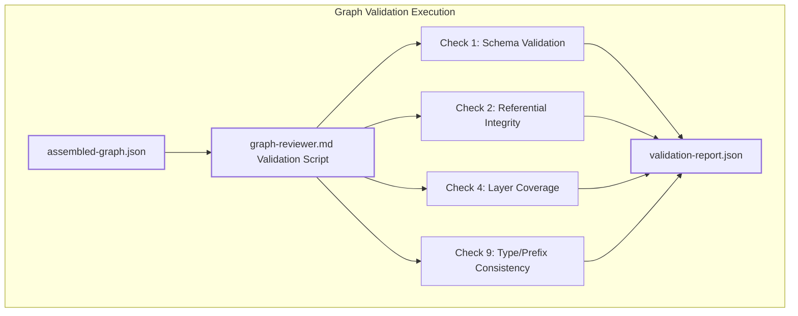
Title: "Graph Reviewer Validation Pipeline"
Sources: [understand-anything-plugin/agents/graph-reviewer.md:18-123]()

#### Core Validation Checks

| Check Name | Target | Constraint & Rule | Source |
|---|---|---|---|
| **Schema Validation** | Nodes & Edges | Every node must have valid `id`, `type`, `name`, `summary`, `tags`, `complexity`. Edges must have `source`, `target`, `type`, `direction`, `weight`. | [understand-anything-plugin/agents/graph-reviewer.md:31-62]() |
| **Referential Integrity** | Edges, Layers, Tours | Every edge `source`/`target`, layer `nodeIds`, and tour step `nodeIds` must point to an existing node `id`. | [understand-anything-plugin/agents/graph-reviewer.md:63-70]() |
| **Layer Coverage** | File-level Nodes | Every file-level node (`file`, `config`, `service`, etc.) must appear in exactly one layer's `nodeIds`. | [understand-anything-plugin/agents/graph-reviewer.md:80-86]() |
| **Uniqueness** | Node IDs | No duplicate node IDs are permitted across the graph. | [understand-anything-plugin/agents/graph-reviewer.md:87-89]() |
| **Type/Prefix Consistency** | Node IDs & Types | Verify node `type` matches its ID prefix (e.g., `type: "config"` $\rightarrow$ `config:` prefix). | [understand-anything-plugin/agents/graph-reviewer.md:116-123]() |

Sources: [understand-anything-plugin/agents/graph-reviewer.md:1-139](), [understand-anything-plugin/agents/assemble-reviewer.md]()

---

# Page: Tour Builder & Architecture Analyzer

# Tour Builder & Architecture Analyzer

<details>
<summary>Relevant source files</summary>

The following files were used as context for generating this wiki page:

- [CLAUDE.md](CLAUDE.md)
- [understand-anything-plugin/agents/architecture-analyzer.md](understand-anything-plugin/agents/architecture-analyzer.md)
- [understand-anything-plugin/agents/article-analyzer.md](understand-anything-plugin/agents/article-analyzer.md)
- [understand-anything-plugin/agents/assemble-reviewer.md](understand-anything-plugin/agents/assemble-reviewer.md)
- [understand-anything-plugin/agents/domain-analyzer.md](understand-anything-plugin/agents/domain-analyzer.md)
- [understand-anything-plugin/agents/file-analyzer.md](understand-anything-plugin/agents/file-analyzer.md)
- [understand-anything-plugin/agents/graph-reviewer.md](understand-anything-plugin/agents/graph-reviewer.md)
- [understand-anything-plugin/agents/knowledge-graph-guide.md](understand-anything-plugin/agents/knowledge-graph-guide.md)
- [understand-anything-plugin/agents/project-scanner.md](understand-anything-plugin/agents/project-scanner.md)
- [understand-anything-plugin/agents/tour-builder.md](understand-anything-plugin/agents/tour-builder.md)
- [understand-anything-plugin/packages/core/src/analyzer/layer-detector.ts](understand-anything-plugin/packages/core/src/analyzer/layer-detector.ts)
- [understand-anything-plugin/packages/core/src/analyzer/tour-generator.ts](understand-anything-plugin/packages/core/src/analyzer/tour-generator.ts)
- [understand-anything-plugin/packages/core/src/embedding-search.ts](understand-anything-plugin/packages/core/src/embedding-search.ts)

</details>


This page details Phases 4 and 5 of the Analysis Pipeline: Architecture Analysis and Tour Building. These phases transform a flat structural graph into a hierarchical, pedagogical model by assigning nodes to logical layers and generating a guided learning path.

## Architecture Analyzer (Phase 4)

The `architecture-analyzer` agent identifies logical architectural layers within a codebase and assigns every file to exactly one layer [understand-anything-plugin/agents/architecture-analyzer.md:9-10](). This process is split into two phases: a deterministic script for structural analysis and an LLM-driven phase for semantic interpretation. Additionally, the core library provides heuristic fallback detection via `detectLayers` in `layer-detector.ts` [understand-anything-plugin/packages/core/src/analyzer/layer-detector.ts:105-148]().

### Phase 1: Structural Analysis Script & Heuristics

The first phase involves a script (preferably Node.js, falling back to Python) that analyzes file paths and import edges to compute structural patterns [understand-anything-plugin/agents/architecture-analyzer.md:23-25](). In parallel, the core library implements `LAYER_PATTERNS` and `matchFileToLayer` to map directory segments (e.g., `routes`, `services`, `models`) to canonical layers (`API Layer`, `Service Layer`, `Data Layer`, etc.) [understand-anything-plugin/packages/core/src/analyzer/layer-detector.ts:16-97]().

This analysis performs several deterministic operations:
1.  **Directory Grouping**: Files are grouped by their top-level directory after a common path prefix is removed [understand-anything-plugin/agents/architecture-analyzer.md:54-63]().
2.  **Node Type Grouping**: File node IDs are grouped by their `type` (e.g., `file`, `config`, `document`, `service`) to reveal the distribution of code vs. non-code files [understand-anything-plugin/agents/architecture-analyzer.md:65-68]().
3.  **Import Adjacency Matrix**: An adjacency list is built to calculate fan-out and fan-in for each file [understand-anything-plugin/agents/architecture-analyzer.md:70-74]().
4.  **Cross-Category Dependency Analysis**: Identifies relationships between different node type groups [understand-anything-plugin/agents/architecture-analyzer.md:76-87]().
5.  **Inter-Group Import Frequency**: Generates a matrix of import edges between directory groups [understand-anything-plugin/agents/architecture-analyzer.md:89-96]().
6.  **Intra-Group Import Density**: Calculates the density of import edges within a group to evaluate cohesion [understand-anything-plugin/agents/architecture-analyzer.md:98-102]().
7.  **Directory Pattern Matching**: Matches directories against canonical architectural definitions [understand-anything-plugin/agents/architecture-analyzer.md:104-150](), mirrored programmatically in `LAYER_PATTERNS` [understand-anything-plugin/packages/core/src/analyzer/layer-detector.ts:16-67]().

Sources:
- [understand-anything-plugin/agents/architecture-analyzer.md:9-150]()
- [understand-anything-plugin/packages/core/src/analyzer/layer-detector.ts:16-148]()

### Phase 2: Semantic Layer Assignment (LLM)

In the second phase, the `architecture-analyzer` LLM agent uses structural insights to assign every file node to exactly one layer [understand-anything-plugin/agents/architecture-analyzer.md:10-11](). Layer names and descriptions are localized when language directives are present [understand-anything-plugin/agents/architecture-analyzer.md:16-19](). Programmatic fallback via `detectLayers()` utilizes `matchFileToLayer()` to assign unmatched files to a fallback `"Core"` layer [understand-anything-plugin/packages/core/src/analyzer/layer-detector.ts:80-148]().

#### Architecture Analyzer Data Flow

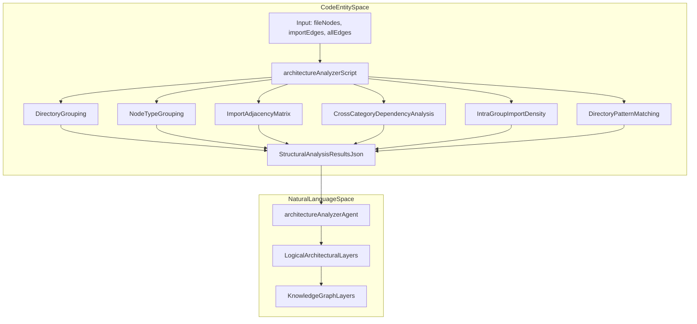
**Diagram: Architecture Analyzer Data Flow**

Sources:
- [understand-anything-plugin/agents/architecture-analyzer.md:9-169]()
- [understand-anything-plugin/packages/core/src/analyzer/layer-detector.ts:16-148]()

---

## Tour Builder (Phase 5)

The `tour-builder` agent designs guided learning tours through codebases, creating 5-15 pedagogical steps that teach project architecture and key concepts in a logical order [understand-anything-plugin/agents/tour-builder.md:10-11](). Alternatively, heuristic tours are generated deterministically via `generateHeuristicTour` in `tour-generator.ts` [understand-anything-plugin/packages/core/src/analyzer/tour-generator.ts:135-208]().

### Phase 1: Graph Topology Script & Heuristic Generation

The topology script and heuristic generator compute structural signals to inform tour construction:
1.  **Fan-In Ranking (Importance)**: Counts incoming edges to identify widely depended-upon modules [understand-anything-plugin/agents/tour-builder.md:55-57]().
2.  **Fan-Out Ranking (Scope)**: Counts outgoing edges to identify orchestrator files [understand-anything-plugin/agents/tour-builder.md:59-61]().
3.  **Entry Point Candidates**: Scores nodes based on filenames (`index.ts`, `main.py`), directory depth, and fan-out/fan-in metrics, prioritizing `README.md` [understand-anything-plugin/agents/tour-builder.md:63-74]().
4.  **Dependency Chains (BFS / Kahn's Algorithm)**: Performs Breadth-First Search or topological sorting (`generateHeuristicTour`) following `imports` and `calls` edges to establish reading order [understand-anything-plugin/agents/tour-builder.md:79-83](), [understand-anything-plugin/packages/core/src/analyzer/tour-generator.ts:135-195]().
5.  **Tightly Coupled Clusters**: Identifies groups with high mutual connectivity [understand-anything-plugin/agents/tour-builder.md:98-102]().

Sources:
- [understand-anything-plugin/agents/tour-builder.md:25-115]()
- [understand-anything-plugin/packages/core/src/analyzer/tour-generator.ts:135-208]()

### Phase 2: Pedagogical Tour Design (LLM)

The `tour-builder` LLM agent uses topological findings to construct 5-15 steps consisting of a `title`, `description`, `nodeIds`, and optional `languageLesson` [understand-anything-plugin/agents/tour-builder.md:16-20](). 

#### Tour Builder Data Flow

```mermaid
graph TD
    subgraph "CodeEntitySpace"
        A["Input: nodes, edges, layers"] --> B["tourBuilderScript"]
        B --> C1["FanInRanking"]
        B --> C2["FanOutRanking"]
        B --> C3["EntryPointCandidates"]
        B --> C4["BfsDependencyChains"]
        B --> C5["TightlyCoupledClusters"]
        C1 & C2 & C3 & C4 & C5 --> D["TopologicalAnalysisResultsJson"]
    end

    subgraph "NaturalLanguageSpace"
        D --> E["tourBuilderAgent"]
        E --> F["GuidedTourSteps"]
        F --> G["KnowledgeGraphTour"]
    end
```
**Diagram: Tour Builder Data Flow**

Sources:
- [understand-anything-plugin/agents/tour-builder.md:10-130]()
- [understand-anything-plugin/packages/core/src/analyzer/tour-generator.ts:1-200]()

---

# Page: Domain & Knowledge Graph Skills

# Domain & Knowledge Graph Skills

<details>
<summary>Relevant source files</summary>

The following files were used as context for generating this wiki page:

- [.github/workflows/ci.yml](.github/workflows/ci.yml)
- [docs/superpowers/plans/2026-04-09-understand-knowledge.md](docs/superpowers/plans/2026-04-09-understand-knowledge.md)
- [tests/skill/knowledge/test_parse_knowledge_base.py](tests/skill/knowledge/test_parse_knowledge_base.py)
- [tests/skill/understand/test_merge_subdomain_graphs.py](tests/skill/understand/test_merge_subdomain_graphs.py)
- [understand-anything-plugin/packages/core/src/__tests__/domain-normalize.test.ts](understand-anything-plugin/packages/core/src/__tests__/domain-normalize.test.ts)
- [understand-anything-plugin/packages/core/src/__tests__/normalize-graph.test.ts](understand-anything-plugin/packages/core/src/__tests__/normalize-graph.test.ts)
- [understand-anything-plugin/packages/core/src/analyzer/normalize-graph.ts](understand-anything-plugin/packages/core/src/analyzer/normalize-graph.ts)
- [understand-anything-plugin/packages/dashboard/src/components/DomainGraphView.tsx](understand-anything-plugin/packages/dashboard/src/components/DomainGraphView.tsx)
- [understand-anything-plugin/packages/dashboard/src/components/KnowledgeGraphView.tsx](understand-anything-plugin/packages/dashboard/src/components/KnowledgeGraphView.tsx)
- [understand-anything-plugin/packages/dashboard/src/components/WarningBanner.tsx](understand-anything-plugin/packages/dashboard/src/components/WarningBanner.tsx)
- [understand-anything-plugin/skills/understand-domain/SKILL.md](understand-anything-plugin/skills/understand-domain/SKILL.md)
- [understand-anything-plugin/skills/understand-knowledge/merge-knowledge-graph.py](understand-anything-plugin/skills/understand-knowledge/merge-knowledge-graph.py)
- [understand-anything-plugin/skills/understand-knowledge/parse-knowledge-base.py](understand-anything-plugin/skills/understand-knowledge/parse-knowledge-base.py)
- [understand-anything-plugin/skills/understand/merge-subdomain-graphs.py](understand-anything-plugin/skills/understand/merge-subdomain-graphs.py)

</details>


This page details the implementation of two specialized semantic skills in Understand Anything: `/understand-domain` and `/understand-knowledge`. The `/understand-domain` skill extracts business domain workflows, flows, and process steps from a codebase, leveraging `extract-domain-context.py` [understand-anything-plugin/skills/understand-domain/SKILL.md:1-15]() and normalizing IDs via `normalize-graph.ts` [understand-anything-plugin/packages/core/src/analyzer/normalize-graph.ts:64-111](). The `/understand-knowledge` skill processes Karpathy-pattern LLM wikis, utilizing `parse-knowledge-base.py` [understand-anything-plugin/skills/understand-knowledge/parse-knowledge-base.py:1-17]() and `merge-knowledge-graph.py` [understand-anything-plugin/skills/understand-knowledge/merge-knowledge-graph.py:1-19]() to transform markdown documentation and raw files into structured knowledge graphs.

---

## 2.5.1. /understand-domain: Business Domain Extraction & Normalization

The `/understand-domain` skill analyzes a codebase to construct a business-centric flow graph. It can operate standalone through a lightweight scan or derive domain knowledge from an existing knowledge graph (`.ua/knowledge-graph.json`) [understand-anything-plugin/skills/understand-domain/SKILL.md:11-15]().

### Workflow and Phases

1.  **Project Root and Worktree Resolution**: The skill resolves `PROJECT_ROOT` and inspects git worktrees by comparing `git rev-parse --git-common-dir` with `git rev-parse --git-dir`. If they diverge, output is redirected to the main repository root to prevent data loss when ephemeral worktrees are destroyed [understand-anything-plugin/skills/understand-domain/SKILL.md:23-40]().
2.  **Data Directory Resolution**: Resolves `$UA_DIR`, retaining legacy `.understand-anything/` if present or defaulting to `.ua/` [understand-anything-plugin/skills/understand-domain/SKILL.md:45-49]().
3.  **Freshness Check**: If a knowledge graph exists and `--full` is omitted, the skill verifies project commit parity via `git diff` against `project.gitCommitHash`, ignoring the `.ua/` artifact directory [understand-anything-plugin/skills/understand-domain/SKILL.md:97-111]().
4.  **Context Extraction**: If no valid knowledge graph exists, `extract-domain-context.py` scans entry points and file trees.
5.  **Graph Normalization**: Identifiers and metadata are normalized using `normalizeNodeId` and `normalizeComplexity` from `normalize-graph.ts` [understand-anything-plugin/packages/core/src/analyzer/normalize-graph.ts:64-152]().

### Node ID Normalization for Domains

The `normalizeNodeId` function handles domain, flow, and step identifiers, ensuring correct scoping and preventing collision across flows sharing identically named steps [understand-anything-plugin/packages/core/src/analyzer/normalize-graph.ts:64-111]().

*   `domain` nodes maintain the format `domain:domain-slug` [understand-anything-plugin/packages/core/__tests__/domain-normalize.test.ts:5-11]().
*   `flow` nodes maintain `flow:flow-slug` [understand-anything-plugin/packages/core/__tests__/domain-normalize.test.ts:13-19]().
*   `step` nodes incorporate file paths and parent flow slugs: `step:flowSlug:filePath:stepSlug` [understand-anything-plugin/packages/core/src/analyzer/normalize-graph.ts:78-85]().

### Diagram: Domain Extraction & Normalization Data Flow

```mermaid
graph TD
    subgraph "Natural Language Space"
        Input["UserCommand:/understand-domain"]
    end

    subgraph "Code Entity Space"
        Input --> Res["gitRevParseAndResolveUA"]
        Res --> CheckGraph{"GraphExists?"}
        CheckGraph -- "No / --full" --> ExtCtx["extract-domain-context.py"]
        CheckGraph -- "Yes" --> Derive["DeriveFromKnowledgeGraph"]
        ExtCtx --> Analyzer["domain-analyzer-agent"]
        Derive --> Analyzer
        Analyzer --> Merge["merge-subdomain-graphs.py"]
        Merge --> Norm["normalizeNodeId(id, node)"]
    end

    subgraph "Graph Output Space"
        Norm --> DomainGraph["domain-graph.json"]
    end

    style Input stroke-width:2px
    style DomainGraph stroke-width:4px
```
Sources:
- [understand-anything-plugin/skills/understand-domain/SKILL.md:19-113]()
- [understand-anything-plugin/packages/core/src/analyzer/normalize-graph.ts:64-111]()
- [understand-anything-plugin/packages/core/__tests__/domain-normalize.test.ts:5-46]()

---

## 2.5.2. /understand-knowledge: Karpathy-Pattern Wiki Parsing & Merging

The `/understand-knowledge` skill parses Karpathy-pattern LLM wikis, translating structured documentation directories into typed graph nodes (`article`, `entity`, `topic`, `claim`, `source`) [understand-anything-plugin/skills/understand-knowledge/parse-knowledge-base.py:67-100]().

### `parse-knowledge-base.py` Implementation

The deterministic parser executes initial structural extraction:
*   **Format Detection**: `detect_format(root)` checks for `index.md`, `log.md`, a `raw/` directory, and config files like `CLAUDE.md` or `AGENTS.md` [understand-anything-plugin/skills/understand-knowledge/parse-knowledge-base.py:67-100]().
*   **Case-Insensitive Resolution**: `find_markdown_case_insensitive` handles file system variations while prioritizing exact matches [understand-anything-plugin/skills/understand-knowledge/parse-knowledge-base.py:43-61]().
*   **Extraction Helpers**: Extracts YAML frontmatter (`extract_frontmatter`), wikilinks (`extract_wikilinks` using `WIKILINK_RE`), headings, code blocks, and introductory summaries (`extract_first_paragraph`) [understand-anything-plugin/skills/understand-knowledge/parse-knowledge-base.py:107-185]().

### `merge-knowledge-graph.py` Implementation

This script merges the deterministic scan manifest with analysis batches (`analysis-batch-*.json`) [understand-anything-plugin/skills/understand-knowledge/merge-knowledge-graph.py:120-141]().
*   **Entity Deduplication**: `normalize_entity_name` standardizes entity strings (lowercase, whitespace collapse) to map duplicate records to canonical node IDs [understand-anything-plugin/skills/understand-knowledge/merge-knowledge-graph.py:111-170]().
*   **Type Alias Resolution**: Normalizes node and edge aliases (e.g., mapping note/page to `article`, person to `entity`, and references to `cites`) [understand-anything-plugin/skills/understand-knowledge/merge-knowledge-graph.py:78-108]().

### Diagram: Karpathy Wiki to Knowledge Graph Pipeline

```mermaid
graph LR
    subgraph "Natural Language Space"
        IndexMD["index.md"]
        WikiMD["wiki/*.md"]
        RawDocs["raw/*.pdf"]
    end

    subgraph "Code Entity Space"
        IndexMD & WikiMD & RawDocs --> Parser["parse-knowledge-base.py"]
        Parser --> Manifest["scan-manifest.json"]
        Manifest --> Merger["merge-knowledge-graph.py"]
        Merger --> NormName["normalize_entity_name()"]
        NormName --> Alias["normalize_node_type()"]
    end

    subgraph "Knowledge Graph Nodes"
        Alias --> Art["NodeType: article"]
        Alias --> Ent["NodeType: entity"]
        Alias --> Claim["NodeType: claim"]
        Alias --> Src["NodeType: source"]
    end

    style IndexMD stroke-width:2px
    style Art stroke-width:4px
```
Sources:
- [understand-anything-plugin/skills/understand-knowledge/parse-knowledge-base.py:43-100]()
- [understand-anything-plugin/skills/understand-knowledge/parse-knowledge-base.py:107-185]()
- [understand-anything-plugin/skills/understand-knowledge/merge-knowledge-graph.py:78-170]()

---

## 2.5.3. Dashboard Visualization & Rendering Engines

The dashboard provides specialized views for domain and knowledge graphs using ReactFlow and layout engines.

### Domain Graph View (`DomainGraphView.tsx`)
*   **Overview vs Detail**: `buildDomainOverview` aggregates domain cluster nodes and cross-domain edges [understand-anything-plugin/packages/dashboard/src/components/DomainGraphView.tsx:41-88](). `buildDomainDetail` drills into specific flows and step sequences [understand-anything-plugin/packages/dashboard/src/components/DomainGraphView.tsx:90-165]().
*   **ELK Layout Integration**: Asynchronous layout execution via `applyElkLayout` arranges nodes in a left-to-right (`RIGHT`) direction [understand-anything-plugin/packages/dashboard/src/components/DomainGraphView.tsx:189-201]().

### Knowledge Graph View (`KnowledgeGraphView.tsx`)
*   **Worker-Based Force Layout**: Offloads `d3-force` simulation to `force-layout.worker.ts` via `startForceLayoutTask` to maintain UI responsiveness [understand-anything-plugin/packages/dashboard/src/components/KnowledgeGraphView.tsx:112-117]().
*   **Edge Styling**: Differentiates semantic relationships (e.g., dashed `cites`, red `contradicts`, solid `builds_on`) using `EDGE_STYLES` [understand-anything-plugin/packages/dashboard/src/components/KnowledgeGraphView.tsx:38-48]().

| Node Type | Origin / Source | Dashboard Role |
| :--- | :--- | :--- |
| `article` | Markdown Files (`.md`) | Primary wiki reading content [understand-anything-plugin/skills/understand-knowledge/merge-knowledge-graph.py:79]() |
| `entity` | LLM Analysis Batches | People, tools, and systems [understand-anything-plugin/skills/understand-knowledge/merge-knowledge-graph.py:80]() |
| `claim` | LLM Analysis Batches | Assertions and architectural decisions [understand-anything-plugin/skills/understand-knowledge/merge-knowledge-graph.py:82]() |
| `source` | Raw Files (`raw/`) | External citations and reference documents [understand-anything-plugin/skills/understand-knowledge/merge-knowledge-graph.py:83]() |
| `topic` | `index.md` Headings | Categorical grouping and taxonomy [understand-anything-plugin/skills/understand-knowledge/merge-knowledge-graph.py:81]() |

Sources:
- [understand-anything-plugin/packages/dashboard/src/components/DomainGraphView.tsx:41-201]()
- [understand-anything-plugin/packages/dashboard/src/components/KnowledgeGraphView.tsx:38-117]()
- [understand-anything-plugin/skills/understand-knowledge/merge-knowledge-graph.py:78-84]()

---

# Page: Figma Design Graph Skill

# Figma Design Graph Skill

<details>
<summary>Relevant source files</summary>

The following files were used as context for generating this wiki page:

- [docs/superpowers/plans/2026-06-24-understand-figma-foundation.md](docs/superpowers/plans/2026-06-24-understand-figma-foundation.md)
- [understand-anything-plugin/agents/design-analyzer.md](understand-anything-plugin/agents/design-analyzer.md)
- [understand-anything-plugin/packages/core/src/figma/__tests__/thumbnails.test.ts](understand-anything-plugin/packages/core/src/figma/__tests__/thumbnails.test.ts)
- [understand-anything-plugin/packages/core/src/figma/index.ts](understand-anything-plugin/packages/core/src/figma/index.ts)
- [understand-anything-plugin/packages/core/src/figma/thumbnails.ts](understand-anything-plugin/packages/core/src/figma/thumbnails.ts)
- [understand-anything-plugin/skills/understand-figma/SKILL.md](understand-anything-plugin/skills/understand-figma/SKILL.md)
- [understand-anything-plugin/skills/understand-figma/figma-merge.mjs](understand-anything-plugin/skills/understand-figma/figma-merge.mjs)
- [understand-anything-plugin/skills/understand-figma/figma-scan.mjs](understand-anything-plugin/skills/understand-figma/figma-scan.mjs)

</details>


The `/understand-figma` skill provides an end-to-end integration for analyzing Figma design files via the Figma REST API. It transforms raw design primitives into an interactive design knowledge graph (`kind:design`), allowing developers to query and visualize relationships between screens, components, instances, and design tokens alongside their codebase.

Sources: [understand-anything-plugin/skills/understand-figma/SKILL.md:1-5](), [docs/superpowers/plans/2026-06-24-understand-figma-foundation.md:1-18]()

---

## Overview and Data Flow

The skill operates through a four-phase pipeline, moving from deterministic API extraction to LLM-driven semantic enrichment, followed by canonical graph assembly.

### System Architecture & Code Entity Mapping

```mermaid
graph TD
  subgraph "NaturalLanguageSpace"
    NL_USER["User Slash Command /understand-figma"]
    NL_AGENT["Design Analyzer Persona"]
  end

  subgraph "CodeEntitySpace"
    SKILL["understand-figma/SKILL.md"] --> SCAN["figma-scan.mjs"]
    SCAN --> API["FigmaApiSource (api-source.ts)"]
    SCAN --> PARSE["parseDocument() & extractTokens()"]
    SCAN --> THUMBS["applyScreenThumbnails() (thumbnails.ts)"]
    SCAN --> MANIFEST["scan-manifest.json"]
    
    MANIFEST --> BATCH["Batching Worker (~15 nodes)"]
    BATCH --> AGENT["design-analyzer.md Agent"]
    AGENT --> BATCH_OUT["analysis-batch-N.json"]
    
    BATCH_OUT --> MERGE_SCRIPT["figma-merge.mjs"]
    MANIFEST --> MERGE_SCRIPT
    MERGE_SCRIPT --> MERGE_FUNC["mergeDesignGraph() (merge.ts)"]
    MERGE_FUNC --> KG["knowledge-graph.json (kind:design)"]
  end

  NL_USER --> SKILL
  NL_AGENT --> AGENT
```
Sources: [understand-anything-plugin/skills/understand-figma/SKILL.md:19-69](), [understand-anything-plugin/skills/understand-figma/figma-scan.mjs:1-80](), [understand-anything-plugin/skills/understand-figma/figma-merge.mjs:1-43]()

---

## Phase 0 & 1 — Pre-Flight and Deterministic Fetch

The ingestion begins with pre-flight checks ensuring the `FIGMA_TOKEN` environment variable is present and building the core library if necessary [understand-anything-plugin/skills/understand-figma/SKILL.md:11-28](). 

### Deterministic Extraction (`figma-scan.mjs`)
The `figma-scan.mjs` script executes the deterministic retrieval phase:
1. Instantiates `FigmaApiSource` using the provided file URL or key and fetches the remote Figma document tree [understand-anything-plugin/skills/understand-figma/figma-scan.mjs:16-18]().
2. Performs an incremental version check against `.ua/meta.json` (or legacy `.understand-anything/meta.json`). If the remote `figmaVersion` matches local storage and `UNDERSTAND_FIGMA_FORCE` is not set, it refreshes pre-signed screen thumbnails in place and exits early with `UP_TO_DATE` [understand-anything-plugin/skills/understand-figma/figma-scan.mjs:20-37]().
3. Parses structural nodes via `parseDocument` (`page`, `screen`, `component`, `componentSet`, `instance`) and design styles via `extractTokens` (`token`) [understand-anything-plugin/skills/understand-figma/figma-scan.mjs:41-44]().
4. Renders bounded screen thumbnail URLs via `source.renderImages()` and binds them using `applyScreenThumbnails` [understand-anything-plugin/skills/understand-figma/figma-scan.mjs:46-51]().
5. Writes the resulting payload to `$UA_DIR/intermediate/scan-manifest.json` [understand-anything-plugin/skills/understand-figma/figma-scan.mjs:56-73]().

Sources: [understand-anything-plugin/skills/understand-figma/figma-scan.mjs:1-80](), [understand-anything-plugin/packages/core/src/figma/thumbnails.ts:1-29]()

---

## Phase 2 — LLM Semantic Enrichment

While Phase 1 captures exact structural hierarchies, nodes lack contextual summaries and functional tags. Phase 2 assigns this task to the `design-analyzer` agent.

### Batch Processing and Execution
* **Batching**: Nodes from `scan-manifest.json` are split into batches of approximately 15 nodes, grouped by page context where possible [understand-anything-plugin/skills/understand-figma/SKILL.md:43-43]().
* **Concurrency**: Up to 5 batches are analyzed in parallel by subagents executing `agents/design-analyzer.md` [understand-anything-plugin/skills/understand-figma/SKILL.md:51-51](), [understand-anything-plugin/agents/design-analyzer.md:1-51]().
* **Enrichment Deliverable**: Each subagent outputs an `analysis-batch-<N>.json` file containing functional summaries, tags, and conservative `related` edges without mutating or re-declaring structural nodes [understand-anything-plugin/agents/design-analyzer.md:23-51]().

Sources: [understand-anything-plugin/skills/understand-figma/SKILL.md:41-52](), [understand-anything-plugin/agents/design-analyzer.md:1-51]()

---

## Phase 3 — Graph Assembly and Merging

The `figma-merge.mjs` script combines the deterministic manifest with all `analysis-batch-*.json` files.

```mermaid
sequenceDiagram
    participant CLI as "figma-merge.mjs"
    participant FS as "Node File System"
    participant CORE as "mergeDesignGraph() (merge.ts)"
    participant OUT as "knowledge-graph.json & meta.json"

    CLI->>FS: Read scan-manifest.json & analysis-batch-*.json
    FS-->>CLI: Raw JSON Data
    CLI->>CORE: mergeDesignGraph(manifest, analyses, projectMeta)
    CORE->>CORE: Validate Nodes, Edges & Zod Schema
    CORE->>CORE: Inject kind:"design" & Layers
    CORE-->>CLI: Result { success, data, issues }
    CLI->>OUT: Write knowledge-graph.json & meta.json
```
Sources: [understand-anything-plugin/skills/understand-figma/figma-merge.mjs:10-36](), [understand-anything-plugin/packages/core/src/figma/index.ts:1-6]()

---

## Incremental Updates and Thumbnail Maintenance

Figma REST API image URLs (`thumbnailUrl`) are pre-signed assets that expire after several hours. The system addresses this in two distinct paths:

1. **Standard Run**: Freshly fetched nodes have thumbnail URLs populated immediately before manifest generation [understand-anything-plugin/skills/understand-figma/figma-scan.mjs:46-51]().
2. **`UP_TO_DATE` Short-Circuit**: When the remote `figmaVersion` is unchanged, `refreshThumbnailsInPlace` re-renders active screen nodes and patches the existing `knowledge-graph.json` without re-running LLM analysis [understand-anything-plugin/skills/understand-figma/figma-scan.mjs:29-37](), [understand-anything-plugin/skills/understand-figma/figma-scan.mjs:89-105]().

| Function / Module | Target File | Role in Thumbnail Lifecycle |
| :--- | :--- | :--- |
| `applyScreenThumbnails` | `packages/core/src/figma/thumbnails.ts` | Pure utility matching node IDs to pre-signed image links [packages/core/src/figma/thumbnails.ts:13-29]() |
| `refreshThumbnailsInPlace` | `skills/understand-figma/figma-scan.mjs` | Disk-patching routine for fast-path incremental updates [understand-anything-plugin/skills/understand-figma/figma-scan.mjs:89-105]() |

Sources: [understand-anything-plugin/packages/core/src/figma/thumbnails.ts:1-29](), [understand-anything-plugin/skills/understand-figma/figma-scan.mjs:89-105]()

---

## Data Contract and `figmaMeta` Schema

Design nodes leverage the `figmaMeta` property to preserve upstream identifiers, physical dimensions, and prototype targets for the dashboard [docs/superpowers/plans/2026-06-24-understand-figma-foundation.md:81-96]().

```typescript
export interface FigmaMeta {
  fileKey?: string;
  nodeId?: string;             // Figma node identifier, e.g. "1:23"
  figmaType?: string;          // FRAME | COMPONENT | COMPONENT_SET | INSTANCE | TEXT
  thumbnailUrl?: string;       // Pre-signed image URL for dashboard previews
  dimensions?: { width: number; height: number };
  tokenKind?: "color" | "type" | "spacing" | "effect" | "grid";
  tokenValue?: string;         // e.g. "#0A84FF", "16px"
  prototypeTargets?: string[]; 
  componentKey?: string;       
}
```
Sources: [docs/superpowers/plans/2026-06-24-understand-figma-foundation.md:81-96]()

---

# Page: Core Library (@understand-anything/core)

# Core Library (@understand-anything/core)

<details>
<summary>Relevant source files</summary>

The following files were used as context for generating this wiki page:

- [understand-anything-plugin/packages/core/package.json](understand-anything-plugin/packages/core/package.json)
- [understand-anything-plugin/packages/core/src/__tests__/fingerprint.test.ts](understand-anything-plugin/packages/core/src/__tests__/fingerprint.test.ts)
- [understand-anything-plugin/packages/core/src/__tests__/language-registry.test.ts](understand-anything-plugin/packages/core/src/__tests__/language-registry.test.ts)
- [understand-anything-plugin/packages/core/src/__tests__/plugin-discovery.test.ts](understand-anything-plugin/packages/core/src/__tests__/plugin-discovery.test.ts)
- [understand-anything-plugin/packages/core/src/fingerprint.ts](understand-anything-plugin/packages/core/src/fingerprint.ts)
- [understand-anything-plugin/packages/core/src/index.ts](understand-anything-plugin/packages/core/src/index.ts)
- [understand-anything-plugin/packages/core/src/languages/configs/dart.ts](understand-anything-plugin/packages/core/src/languages/configs/dart.ts)
- [understand-anything-plugin/packages/core/src/languages/configs/index.ts](understand-anything-plugin/packages/core/src/languages/configs/index.ts)
- [understand-anything-plugin/packages/core/src/plugins/extractors/index.ts](understand-anything-plugin/packages/core/src/plugins/extractors/index.ts)
- [understand-anything-plugin/pnpm-lock.yaml](understand-anything-plugin/pnpm-lock.yaml)
- [understand-anything-plugin/skills/understand/build-fingerprints.mjs](understand-anything-plugin/skills/understand/build-fingerprints.mjs)

</details>


The `@understand-anything/core` package is the foundational TypeScript library that provides the core data structures, schema validation, graph construction logic, search capabilities, persistence mechanisms, and plugin architecture for the entire Understand Anything system [packages/core/package.json:1-6](), [packages/core/src/index.ts:1-90](). It defines the common language and contracts used across all components, from the analysis pipeline to the dashboard.

This page provides a high-level overview of the core library's responsibilities. For detailed information on each subsystem, please refer to the linked child pages.

## KnowledgeGraph Types & Schema

The core library defines the canonical data model for the `KnowledgeGraph`, which is the central artifact generated by the analysis pipeline. This includes a comprehensive set of `NodeType`s and `EdgeType`s to represent various code, non-code, domain, knowledge, and design entities and their relationships [packages/core/src/types.ts:1-115](). Key interfaces like `GraphNode`, `GraphEdge`, `Layer`, `TourStep`, `ProjectMeta`, `DomainMeta`, `KnowledgeMeta`, and `FigmaMeta` establish the structure of the graph [packages/core/src/types.ts:24-115]().

The library implements a robust Zod-based validation pipeline, which includes `sanitizeGraph`, `autoFixGraph`, and `validateGraph` functions [packages/core/src/index.ts:3-12](). This pipeline ensures data integrity by cleaning, normalizing, and validating graph data. Alias tables handle variations in input data generated by LLMs, while normalization functions ensure consistent `type:path` identifiers and complexity metrics [packages/core/src/index.ts:24-31]().

For details, see [KnowledgeGraph Types & Schema](#3.1).

Sources:
- [packages/core/src/types.ts:1-115]()
- [packages/core/src/index.ts:3-31]()

### KnowledgeGraph Structure
```mermaid
graph TD
    kg["KnowledgeGraph"] --> pm["ProjectMeta"]
    kg --> gn["GraphNode"]
    kg --> ge["GraphEdge"]
    kg --> layer["Layer"]
    kg --> ts["TourStep"]

    gn --> nt["NodeType"]
    gn --> dm["DomainMeta"]
    gn --> km["KnowledgeMeta"]
    gn --> fm["figmaMeta"]
    ge --> et["EdgeType"]

    subgraph "Node Types (NodeType)"
        CodeNodes["file, function, class, module, concept"]
        NonCodeNodes["config, document, service, table, endpoint, pipeline, schema, resource"]
        DomainNodes["domain, flow, step"]
        KnowledgeNodes["article, entity, topic, claim, source"]
        DesignNodes["page, screen, component, componentSet, instance, token"]
    end

    subgraph "Edge Types (EdgeType)"
        Structural["imports, exports, contains, inherits, implements"]
        Behavioral["calls, subscribes, publishes, middleware"]
        DataFlow["reads_from, writes_to, transforms, validates"]
        Dependencies["depends_on, tested_by, configures"]
        Semantic["related, similar_to"]
        InfraSchema["deploys, serves, provisions, triggers, migrates, documents, routes, defines_schema"]
        DomainEdges["contains_flow, flow_step, cross_domain"]
        KnowledgeEdges["cites, contradicts, builds_on, exemplifies, categorized_under, authored_by"]
        DesignEdges["instance_of, variant_of, uses_token"]
    end

    nt --> CodeNodes
    nt --> NonCodeNodes
    nt --> DomainNodes
    nt --> KnowledgeNodes
    nt --> DesignNodes

    et --> Structural
    et --> Behavioral
    et --> DataFlow
    et --> Dependencies
    et --> Semantic
    et --> InfraSchema
    et --> DomainEdges
    et --> KnowledgeEdges
    et --> DesignEdges
```
Sources:
- [packages/core/src/types.ts:1-115]()

## GraphBuilder & LLM Analyzer

The `GraphBuilder` class is central to constructing the `KnowledgeGraph` [packages/core/src/index.ts:16-16](). It provides methods to incrementally build the graph from various sources, leveraging LLM prompt builders such as `buildFileAnalysisPrompt` and `buildProjectSummaryPrompt` to extract semantic information from files [packages/core/src/index.ts:18-22]().

The `normalizeBatchOutput` function processes raw LLM outputs, fixing malformed IDs, normalizing numeric complexity to enum values, and rewriting edge references after ID correction [packages/core/src/index.ts:27-31](). This ensures that non-deterministic LLM output is coerced into the strict schema required by the core library.

For details, see [GraphBuilder & LLM Analyzer](#3.2).

Sources:
- [packages/core/src/index.ts:16-31]()

## Tree-Sitter Plugin & Language Extractors

The `TreeSitterPlugin` is the primary component for deterministic code analysis [packages/core/src/index.ts:13-13](). It utilizes Tree-Sitter grammars and WASM packages (such as `@understand-anything/tree-sitter-dart-wasm` and `@understand-anything/tree-sitter-swift-wasm`) to perform structural analysis, extract call graphs, and resolve imports [packages/core/package.json:43-63](). The plugin relies on the `LanguageExtractor` interface and is managed by `LanguageRegistry` and `FrameworkRegistry` [packages/core/src/index.ts:14-15](), [packages/core/src/index.ts:65-71]().

For details, see [Tree-Sitter Plugin & Language Extractors](#3.3).

Sources:
- [packages/core/src/index.ts:13-15]()
- [packages/core/src/index.ts:65-71]()
- [packages/core/package.json:43-63]()

### Symbol Evidence & Coverage Analysis

The symbol-evidence subsystem (`symbol-evidence.ts`, `symbol-scopes.ts`, `symbol-coverage.ts`, `symbol-ast.ts`) collects strict structural evidence during analysis [packages/core/src/index.ts:1-90](). This evidence tracks declared symbols and scopes to feed symbol-loss validation and ensure high fidelity during incremental re-analyses.

For details, see [Tree-Sitter Plugin & Language Extractors](#3.3).

Sources:
- [packages/core/src/index.ts:1-90]()

## Non-Code Parsers

The core library includes a dedicated parser subsystem for non-code file types [packages/core/src/index.ts:110-125](). These parsers extract structural data from configuration, markup, and environment files, mapping them to specialized node types like `service`, `table`, or `resource` [packages/core/src/index.ts:111-124]().

Supported parsers include `MarkdownParser`, `YAMLConfigParser`, `JSONConfigParser`, `TOMLParser`, `EnvParser`, `DockerfileParser`, `SQLParser`, `GraphQLParser`, `ProtobufParser`, `TerraformParser`, `MakefileParser`, and `ShellParser` [packages/core/src/index.ts:111-124]().

For details, see [Non-Code Parsers](#3.4).

Sources:
- [packages/core/src/index.ts:110-125]()

## Search, Persistence & Fingerprinting

The core library provides fuzzy search via `SearchEngine` (backed by Fuse.js) and semantic search via `SemanticSearchEngine` using cosine similarity on embeddings [packages/core/src/index.ts:32-32](), [packages/core/src/index.ts:86-89]().

The persistence layer handles reading and writing graphs while sanitizing file paths and resolving the `.ua/` data directory [packages/core/src/index.ts:2-2](). For change detection, the fingerprinting subsystem (`extractFileFingerprint`, `compareFingerprints`, `analyzeChanges`) captures function, class, and import signatures to compute change levels (`NONE`, `COSMETIC`, `STRUCTURAL`) [packages/core/src/index.ts:90-109]().

For details, see [Search, Persistence & Fingerprinting](#3.5).

Sources:
- [packages/core/src/index.ts:2-2]()
- [packages/core/src/index.ts:32-32]()
- [packages/core/src/index.ts:86-109]()
- [packages/core/src/fingerprint.ts:1-105]()

## Plugin Registry & Discovery

The `PluginRegistry` manages runtime plugin registration, while discovery utilities like `parsePluginConfig` and `DEFAULT_PLUGIN_CONFIG` parse user and default plugin configurations to enable or disable analyzers across languages [packages/core/src/index.ts:63-63](), [packages/core/src/index.ts:78-84]().

For details, see [Plugin Registry & Discovery](#3.6).

Sources:
- [packages/core/src/index.ts:63-63]()
- [packages/core/src/index.ts:78-84]()

## Figma Core Subsystem

The `figma/` module within the core library provides specialized types and logic for design-to-code mapping [packages/core/package.json:28-31](). It includes `FigmaApiSource` for fetching document data and tokens, and merge utilities for integrating design analysis into the main `KnowledgeGraph` with dedicated design node types (`screen`, `componentSet`, `token`) [packages/core/package.json:28-31]().

For details, see [Figma Core Subsystem](#3.7).

Sources:
- [packages/core/package.json:28-31]()

### Code to Design Space Mapping
```mermaid
graph LR
    fas["FigmaApiSource"] -- "fetches" --> fn["FigmaNode"]
    pd["parseDocument"] -- "maps to" --> gn["GraphNode"]

    subgraph "Natural Language Space"
        nlArtboard["ArtboardFrame"]
        nlComponent["MainComponent"]
        nlToken["StyleVariable"]
    end

    subgraph "Code Entity Space"
        nlArtboard --> screenNode["NodeType: screen"]
        nlComponent --> compNode["NodeType: component"]
        nlToken --> tokenNode["NodeType: token"]
    end
```
Sources:
- [packages/core/package.json:28-31]()

---

# Page: KnowledgeGraph Types & Schema

# KnowledgeGraph Types & Schema

<details>
<summary>Relevant source files</summary>

The following files were used as context for generating this wiki page:

- [understand-anything-plugin/packages/core/src/__tests__/config-schema.test.ts](understand-anything-plugin/packages/core/src/__tests__/config-schema.test.ts)
- [understand-anything-plugin/packages/core/src/__tests__/domain-types.test.ts](understand-anything-plugin/packages/core/src/__tests__/domain-types.test.ts)
- [understand-anything-plugin/packages/core/src/__tests__/schema.test.ts](understand-anything-plugin/packages/core/src/__tests__/schema.test.ts)
- [understand-anything-plugin/packages/core/src/schema.ts](understand-anything-plugin/packages/core/src/schema.ts)
- [understand-anything-plugin/packages/core/src/types.test.ts](understand-anything-plugin/packages/core/src/types.test.ts)
- [understand-anything-plugin/packages/core/src/types.ts](understand-anything-plugin/packages/core/src/types.ts)

</details>


This page documents the core KnowledgeGraph data contract employed in the Understand Anything system. It defines the canonical types for graph nodes (`NodeType`) and edges (`EdgeType`), key interfaces such as `GraphNode`, `GraphEdge`, `Layer`, `TourStep`, and project/domain/knowledge/design metadata types. The section also covers the robust schema validation pipeline based on Zod schemas, which performs sanitization, normalization (including alias resolution), auto-fixing, and final validation to guarantee integrity and consistency of the graph data at runtime.

---

## 1. KnowledgeGraph Data Model Overview

The KnowledgeGraph is a structured directed graph representing codebases, knowledge bases, or design documents. It is composed of:

- **Nodes (27 distinct types):** Representing code entities (`file`, `function`, `class`, `module`, `concept`); non-code entities (`config`, `document`, `service`, `table`, `endpoint`, `pipeline`, `schema`, `resource`); domain-specific abstractions (`domain`, `flow`, `step`); knowledge entities (`article`, `entity`, `topic`, `claim`, `source`); and design-specific entities (`page`, `screen`, `component`, `componentSet`, `instance`, `token`) [understand-anything-plugin/packages/core/src/types.ts:2-8]().

- **Edges (38 distinct types):** Expressing relationships across 9 categories: structural (`imports`, `inherits`), behavioral (`calls`, `publishes`), data flow (`reads_from`, `transforms`), dependencies (`depends_on`, `tested_by`), semantic (`related`, `similar_to`), infrastructure (`deploys`, `serves`), domain-specific (`contains_flow`, `flow_step`), knowledge relationships (`cites`, `contradicts`), and design relationships (`instance_of`, `variant_of`, `uses_token`) [understand-anything-plugin/packages/core/src/types.ts:11-21]().

- **Layers:** Logical groupings of nodes that correspond to architectural layers or other classifications [understand-anything-plugin/packages/core/src/types.ts:80-85]().

- **Tour Steps:** Ordered sequences for guided exploration or learning of the graph [understand-anything-plugin/packages/core/src/types.ts:88-94]().

- **Metadata:** Structured metadata describing the project context (`ProjectMeta`), domain details (`DomainMeta`), knowledge annotations (`KnowledgeMeta`), and Figma-specific design data (`FigmaMeta`) [understand-anything-plugin/packages/core/src/types.ts:24-51]().

### Core TypeScript Interfaces

```ts
// Root KnowledgeGraph
export interface KnowledgeGraph {
  version: string;
  kind?: "codebase" | "knowledge" | "design";
  project: ProjectMeta;
  nodes: GraphNode[];
  edges: GraphEdge[];
  layers: Layer[];
  tour: TourStep[];
}

// GraphNode with specialized metadata fields
export interface GraphNode {
  id: string;
  type: NodeType;
  name: string;
  filePath?: string;
  lineRange?: [number, number];
  summary: string;
  tags: string[];
  complexity: "simple" | "moderate" | "complex";
  languageNotes?: string;
  domainMeta?: DomainMeta;
  knowledgeMeta?: KnowledgeMeta;
  figmaMeta?: FigmaMeta;
}
```
These typings form the contract for the graph data consumed and output by all subsystems and persisted on disk [understand-anything-plugin/packages/core/src/types.ts:54-115]().

Sources:
- `understand-anything-plugin/packages/core/src/types.ts`

---

## 2. Type Aliases and Normalization

Human-generated or LLM-generated graphs often use synonyms. The system employs several alias tables to map these to canonical values.

### 2.1 Node Type Aliases
- **Code:** `func`, `fn`, `method` → `function`; `interface`, `struct` → `class`; `mod`, `pkg`, `package` → `module` [understand-anything-plugin/packages/core/src/schema.ts:18-26]().
- **Non-Code:** `container`, `deployment`, `pod` → `service`; `doc`, `readme`, `docs` → `document`; `db`, `database`, `view` → `table`; `api`, `query`, `mutation` → `endpoint` [understand-anything-plugin/packages/core/src/schema.ts:28-53]().
- **Domain:** `business_domain` → `domain`; `business_flow`, `business_process` → `flow`; `task`, `business_step` → `step` [understand-anything-plugin/packages/core/src/schema.ts:55-59]().
- **Design (Kind-Specific):** `frame`, `artboard` → `screen`; `canvas` → `page`; `main_component` → `component`; `component_set`, `variant_set`, `componentset` → `componentSet`; `design_token`, `style` → `token`. These are applied only when the graph's `kind` is `"design"` [understand-anything-plugin/packages/core/src/schema.ts:80-93]().
- **Knowledge Normalization:** In non-design graphs, `page` is normalized to `article` [understand-anything-plugin/packages/core/src/schema.ts:99-101]().

### 2.2 Edge Type Aliases
- **General:** `extends` → `inherits`; `invokes`, `invoke` → `calls`; `uses`, `requires` → `depends_on`; `relates_to`, `related_to` → `related` [understand-anything-plugin/packages/core/src/schema.ts:104-118]().
- **Design:** `instantiates` → `instance_of`; `variant` → `variant_of`; `styled_by`, `applies_token` → `uses_token` [understand-anything-plugin/packages/core/src/schema.ts:153-158]().
- **Knowledge Normalization:** In non-design graphs, `instance_of` is normalized to `exemplifies` [understand-anything-plugin/packages/core/src/schema.ts:163-165]().

### 2.3 Complexity and Direction Aliases
- **Complexity:** `low`, `easy` → `simple`; `medium`, `intermediate` → `moderate`; `high`, `hard`, `difficult` → `complex` [understand-anything-plugin/packages/core/src/schema.ts:168-176]().
- **Direction:** `to`, `outbound` → `forward`; `from`, `inbound` → `backward`; `both`, `mutual` → `bidirectional` [understand-anything-plugin/packages/core/src/schema.ts:179-186]().

Sources:
- `understand-anything-plugin/packages/core/src/schema.ts`

---

## 3. The Validation Pipeline

The pipeline ensures that raw JSON data is transformed into a strictly valid `KnowledgeGraph` object, handling sanitization, batch normalization, auto-fixing, and Zod schema validation [understand-anything-plugin/packages/core/src/__tests__/schema.test.ts:60-120]().

Title: "Validation Pipeline Flow"
```mermaid
graph TD
  Raw["Raw Input (JSON)"] --> Sanitize["sanitizeGraph()"]
  Sanitize --> BatchNorm["normalizeBatchOutput()"]
  BatchNorm --> AutoFix["autoFixGraph()"]
  AutoFix --> Validate["validateGraph() (Zod)"]
  Validate -->|Success| Final["Validated KnowledgeGraph"]
  Validate -->|Failure| Issues["Validation Issues"]
```

**Pipeline Stages:**

1.  **`sanitizeGraph`**: Handles basic structural hygiene. It converts `null` collections to empty arrays, lowercases enum-like strings (types, complexity), and removes null values from optional fields [understand-anything-plugin/packages/core/src/schema.ts:188-230]().
2.  **`normalizeBatchOutput`**: Critical for handling LLM batch outputs. It fixes malformed node IDs (stripping double prefixes or project-name prefixes), normalizes numeric complexity to the 3-tier enum, and rewrites edge references if node IDs were changed [understand-anything-plugin/packages/core/src/analyzer/normalize-graph.ts:202-230]().
3.  **`autoFixGraph`**: Applies the alias tables described in Section 2. It also clamps out-of-range edge weights (0.0 to 1.0) and provides defaults for missing required fields like `complexity` [understand-anything-plugin/packages/core/src/schema.ts:232-310]().
4.  **`validateGraph`**: The final gatekeeper using Zod. It performs strict type checking and ensures referential integrity (dropping edges that point to non-existent nodes, and handling fatal errors if all nodes are invalid) [understand-anything-plugin/packages/core/src/__tests__/schema.test.ts:69-98]().

Sources:
- `understand-anything-plugin/packages/core/src/schema.ts`
- `understand-anything-plugin/packages/core/src/__tests__/schema.test.ts`
- `understand-anything-plugin/packages/core/src/analyzer/normalize-graph.ts`

---

## 4. ID Normalization Logic

Node IDs are normalized to a canonical `prefix:path[:name]` format using `normalizeNodeId`.

- **Prefixes:** `file`, `func`, `class`, `module`, `domain`, `flow`, `step`, etc. [understand-anything-plugin/packages/core/src/analyzer/normalize-graph.ts:8-25]().
- **Double Prefixes:** `file:file:src/foo.ts` is corrected to `file:src/foo.ts` [understand-anything-plugin/packages/core/src/analyzer/normalize-graph.ts:28-57]().
- **Domain Steps:** Step nodes include a flow discriminator to prevent collisions: `step:flowSlug:filePath:stepSlug` [understand-anything-plugin/packages/core/src/analyzer/normalize-graph.ts:78-85]().
- **Bare Paths:** Bare paths are automatically prefixed based on the node's type (e.g., `src/utils.ts` with type `file` becomes `file:src/utils.ts`) [understand-anything-plugin/packages/core/src/analyzer/normalize-graph.ts:89-108]().

Sources:
- `understand-anything-plugin/packages/core/src/analyzer/normalize-graph.ts`

---

## 5. Bridging Natural Language to Code Entity Space

The following diagrams show how system-level names (aliases) map to the internal `NodeType` and `EdgeType` enums used in the code.

Title: "Node Type Mapping from Natural Language to Code Space"
```mermaid
graph LR
  NL_Func[""func", "fn", "method""]
  NL_Struct[""struct", "interface""]
  NL_Pkg[""pkg", "package", "mod""]
  NL_Style[""style", "design_token" (Design Kind)"]
  
  Canonical_Func[""NodeType: function""]
  Canonical_Class[""NodeType: class""]
  Canonical_Module[""NodeType: module""]
  Canonical_Token[""NodeType: token""]

  NL_Func -->|NODE_TYPE_ALIASES| Canonical_Func
  NL_Struct -->|NODE_TYPE_ALIASES| Canonical_Class
  NL_Pkg -->|NODE_TYPE_ALIASES| Canonical_Module
  NL_Style -->|DESIGN_NODE_TYPE_ALIASES| Canonical_Token
```

Title: "Edge Type Mapping from Natural Language to Code Space"
```mermaid
graph LR
  NL_Extends[""extends""]
  NL_Invokes[""invokes", "invoke""]
  NL_Uses[""uses", "requires""]
  NL_Variant[""variant" (Design Kind)"]

  Canonical_Inherits[""EdgeType: inherits""]
  Canonical_Calls[""EdgeType: calls""]
  Canonical_Depends[""EdgeType: depends_on""]
  Canonical_Variant[""EdgeType: variant_of""]

  NL_Extends -->|EDGE_TYPE_ALIASES| Canonical_Inherits
  NL_Invokes -->|EDGE_TYPE_ALIASES| Canonical_Calls
  NL_Uses -->|EDGE_TYPE_ALIASES| Canonical_Depends
  NL_Variant -->|DESIGN_EDGE_TYPE_ALIASES| Canonical_Variant
```

Sources:
- `understand-anything-plugin/packages/core/src/schema.ts`
- `understand-anything-plugin/packages/core/src/types.ts`

---

## 6. Metadata Sub-Schemas

The graph supports specialized metadata for different "kinds" of analysis.

### FigmaMeta (Design Graphs)
Used for nodes of type `page`, `screen`, `component`, `componentSet`, `instance`, `token`:
- `fileKey`: Figma file identifier [understand-anything-plugin/packages/core/src/types.ts:42]().
- `nodeId`: The specific Figma node ID (e.g., `"1:23"`) [understand-anything-plugin/packages/core/src/types.ts:43]().
- `figmaType`: FRAME, COMPONENT, COMPONENT_SET, INSTANCE, TEXT, etc. [understand-anything-plugin/packages/core/src/types.ts:44]().
- `thumbnailUrl`: Pre-signed URL for visual previews [understand-anything-plugin/packages/core/src/types.ts:45]().
- `dimensions`: Width and height of the design element [understand-anything-plugin/packages/core/src/types.ts:46]().
- `tokenKind`: Categorization for design tokens (`color`, `type`, `spacing`, `effect`, `grid`) [understand-anything-plugin/packages/core/src/types.ts:47]().
- `tokenValue`: Raw token value (e.g., `#0A84FF`, `16px`) [understand-anything-plugin/packages/core/src/types.ts:48]().

### DomainMeta (Domain Graphs)
Used for `domain`, `flow`, and `step` nodes:
- `entities`: Associated business entities [understand-anything-plugin/packages/core/src/types.ts:33]().
- `businessRules`: Applied business rules [understand-anything-plugin/packages/core/src/types.ts:34]().
- `crossDomainInteractions`: Interaction identifiers with other domains [understand-anything-plugin/packages/core/src/types.ts:35]().
- `entryPoint`: The entry URL, command, or event [understand-anything-plugin/packages/core/src/types.ts:36]().
- `entryType`: `http`, `cli`, `event`, `cron`, or `manual` [understand-anything-plugin/packages/core/src/types.ts:37]().

### KnowledgeMeta (Knowledge Graphs)
Used for Karpathy-pattern wiki articles (`article`, `entity`, `topic`, `claim`, `source`):
- `wikilinks`: Outbound links using `[[Page Name]]` syntax [understand-anything-plugin/packages/core/src/types.ts:25]().
- `backlinks`: Inbound links discovered during parsing [understand-anything-plugin/packages/core/src/types.ts:26]().
- `category`: Topic category [understand-anything-plugin/packages/core/src/types.ts:27]().
- `content`: Markdown text content [understand-anything-plugin/packages/core/src/types.ts:28]().

Sources:
- `understand-anything-plugin/packages/core/src/types.ts`

---

## 7. Key Validation Functions

| Function | File | Description |
| :--- | :--- | :--- |
| `validateGraph` | `schema.ts` | Entry point for Zod validation; returns `ValidationResult` with `issues` [understand-anything-plugin/packages/core/src/schema.ts:330-360](). |
| `sanitizeGraph` | `schema.ts` | Lowercases types, cleans nulls, ensures collection arrays exist [understand-anything-plugin/packages/core/src/schema.ts:188-230](). |
| `autoFixGraph` | `schema.ts` | Resolves aliases and clamps weights [understand-anything-plugin/packages/core/src/schema.ts:232-310](). |
| `normalizeBatchOutput` | `normalize-graph.ts` | Deduplicates nodes/edges and fixes IDs across batch boundaries [understand-anything-plugin/packages/core/src/analyzer/normalize-graph.ts:202-300](). |
| `normalizeNodeId` | `normalize-graph.ts` | Idempotent function to ensure IDs follow `type:path` format [understand-anything-plugin/packages/core/src/analyzer/normalize-graph.ts:64-111](). |
| `normalizeComplexity` | `normalize-graph.ts` | Maps strings or numeric values to the canonical 3-tier enum [understand-anything-plugin/packages/core/src/analyzer/normalize-graph.ts:134-152](). |

Sources:
- `understand-anything-plugin/packages/core/src/schema.ts`
- `understand-anything-plugin/packages/core/src/analyzer/normalize-graph.ts`

---

# Page: GraphBuilder & LLM Analyzer

# GraphBuilder & LLM Analyzer

<details>
<summary>Relevant source files</summary>

The following files were used as context for generating this wiki page:

- [understand-anything-plugin/packages/core/src/__tests__/language-lesson.test.ts](understand-anything-plugin/packages/core/src/__tests__/language-lesson.test.ts)
- [understand-anything-plugin/packages/core/src/analyzer/graph-builder.test.ts](understand-anything-plugin/packages/core/src/analyzer/graph-builder.test.ts)
- [understand-anything-plugin/packages/core/src/analyzer/graph-builder.ts](understand-anything-plugin/packages/core/src/analyzer/graph-builder.ts)
- [understand-anything-plugin/packages/core/src/analyzer/layer-detector.ts](understand-anything-plugin/packages/core/src/analyzer/layer-detector.ts)
- [understand-anything-plugin/packages/core/src/analyzer/tour-generator.ts](understand-anything-plugin/packages/core/src/analyzer/tour-generator.ts)
- [understand-anything-plugin/packages/core/src/embedding-search.ts](understand-anything-plugin/packages/core/src/embedding-search.ts)
- [understand-anything-plugin/packages/dashboard/public/knowledge-graph.json](understand-anything-plugin/packages/dashboard/public/knowledge-graph.json)
- [understand-anything-plugin/skills/understand/frameworks/django.md](understand-anything-plugin/skills/understand/frameworks/django.md)

</details>


This page details the core components responsible for constructing the `KnowledgeGraph` and leveraging Large Language Models (LLMs) for semantic analysis within `@understand-anything/core`. It covers the `GraphBuilder` class API, LLM prompt builders, language-lesson analyzers, layer detection heuristics, and tour generation routines.

## Purpose and Scope

The subsystem covered here bridges raw project files and structural analyses into a queryable, structured `KnowledgeGraph`. It provides programmatic graph construction via `GraphBuilder`, prompt generation and response parsing for LLM-assisted architecture discovery, and heuristic fallbacks for offline or deterministic execution.

Sources:
- [understand-anything-plugin/packages/core/src/analyzer/graph-builder.ts:60-337]()
- [understand-anything-plugin/packages/core/src/analyzer/layer-detector.ts:1-213]()
- [understand-anything-plugin/packages/core/src/analyzer/tour-generator.ts:1-220]()

## GraphBuilder API & Construction

The `GraphBuilder` class [understand-anything-plugin/packages/core/src/analyzer/graph-builder.ts:60-337]() is the primary programmatic interface for assembling nodes and edges into a `KnowledgeGraph`. It maintains internal deduplication sets for node IDs and edge keys, and queries a `LanguageRegistry` for file language identification.

### Initialization and State Management

`GraphBuilder` accepts a `projectName`, a `gitHash`, and an optional `LanguageRegistry` [understand-anything-plugin/packages/core/src/analyzer/graph-builder.ts:70-74](). It tracks detected languages dynamically as files are added.

```typescript
class GraphBuilder {
  private readonly nodes: GraphNode[] = [];
  private readonly edges: GraphEdge[] = [];
  private readonly languages = new Set<string>();
  private readonly nodeIds = new Set<string>();
  private readonly edgeKeys = new Set<string>();
  // ... constructor and methods
}
```
Sources:
- [understand-anything-plugin/packages/core/src/analyzer/graph-builder.ts:60-74]()

### Core Methods

*   `addFile(filePath: string, meta: FileMeta)`: Registers a generic file node after detecting its language [understand-anything-plugin/packages/core/src/analyzer/graph-builder.ts:84-103]().
*   `addFileWithAnalysis(filePath: string, analysis: StructuralAnalysis, meta: FileAnalysisMeta)`: Registers a file node along with its extracted `functions` and `classes` as child nodes, linking them with `"contains"` edges [understand-anything-plugin/packages/core/src/analyzer/graph-builder.ts:105-177]().
*   `addImportEdge(fromFile: string, toFile: string)`: Creates deduplicated `"imports"` edges between files [understand-anything-plugin/packages/core/src/analyzer/graph-builder.ts:179-190]().
*   `addCallEdge(callerFile: string, callerFunc: string, calleeFile: string, calleeFunc: string)`: Creates deduplicated `"calls"` edges between function nodes [understand-anything-plugin/packages/core/src/analyzer/graph-builder.ts:192-208]().
*   `addNonCodeFile(filePath: string, meta: NonCodeFileMeta)`: Adds non-code manifest or configuration files with mapped node types [understand-anything-plugin/packages/core/src/analyzer/graph-builder.ts:210-226]().
*   `addNonCodeFileWithAnalysis(filePath: string, meta: NonCodeFileAnalysisMeta)`: Adds non-code files with structured child definitions (tables, schemas, routes) mapped via `KIND_TO_NODE_TYPE` [understand-anything-plugin/packages/core/src/analyzer/graph-builder.ts:39-58, 228-240]().

Title: Graph Construction Lifecycle
```mermaid
graph TD
  A["GraphBuilder Constructor"] --> B["initializeState"]
  B --> C["addFile / addFileWithAnalysis"]
  B --> D["addNonCodeFile / addNonCodeFileWithAnalysis"]
  C --> E["addImportEdge / addCallEdge"]
  D --> E
  E --> F["build()"]
  F --> G["KnowledgeGraph"]
  G --> H["ProjectMeta"]
  G --> I["GraphNode Array"]
  G --> J["GraphEdge Array"]
```
Sources:
- [understand-anything-plugin/packages/core/src/analyzer/graph-builder.ts:60-337]()
- [understand-anything-plugin/packages/core/src/analyzer/graph-builder.test.ts:6-203]()

## LLM Analyzer & Prompt Builders

The package supplies prompt construction and response parsing utilities for LLM-backed enrichment tasks, operating alongside heuristic fallbacks.

### Layer Detection

The layer detection module (`layer-detector.ts`) classifies file nodes into architectural layers either deterministically or via LLM prompting [understand-anything-plugin/packages/core/src/analyzer/layer-detector.ts:1-213]().

*   `detectLayers(graph)`: Applies heuristic directory matching via `LAYER_PATTERNS` to group file nodes into layers like `"API Layer"`, `"Service Layer"`, and `"Data Layer"` [understand-anything-plugin/packages/core/src/analyzer/layer-detector.ts:16-148]().
*   `buildLayerDetectionPrompt(graph)`: Constructs a prompt instructing an LLM to analyze file paths and output 3–7 logical architectural layers as JSON [understand-anything-plugin/packages/core/src/analyzer/layer-detector.ts:154-174]().
*   `parseLayerDetectionResponse(response)`: Validates and sanitizes LLM JSON output containing layer definitions [understand-anything-plugin/packages/core/src/analyzer/layer-detector.ts:181-205]().

Sources:
- [understand-anything-plugin/packages/core/src/analyzer/layer-detector.ts:1-213]()

### Tour Generation

The tour generator (`tour-generator.ts`) builds guided walkthroughs for codebase newcomers [understand-anything-plugin/packages/core/src/analyzer/tour-generator.ts:1-220]().

*   `buildTourGenerationPrompt(graph)`: Assembles project metadata, node summaries, relationships, and layers into an LLM prompt for step-by-step tour creation [understand-anything-plugin/packages/core/src/analyzer/tour-generator.ts:7-62]().
*   `parseTourGenerationResponse(response)`: Parses LLM responses into structured `TourStep` objects [understand-anything-plugin/packages/core/src/analyzer/tour-generator.ts:70-120]().
*   `generateHeuristicTour(graph)`: Performs topological sorting via Kahn's algorithm over dependency edges to construct deterministic tour steps when no LLM is available [understand-anything-plugin/packages/core/src/analyzer/tour-generator.ts:125-220]().

Sources:
- [understand-anything-plugin/packages/core/src/analyzer/tour-generator.ts:1-220]()

### Language Lessons

The language lesson subsystem (`language-lesson.ts`) generates contextual explanations of language idioms and patterns for specific code entities [understand-anything-plugin/packages/core/src/__tests__/language-lesson.test.ts:1-157]().

*   `buildLanguageLessonPrompt`: Focuses prompt generation on a target `GraphNode` and its immediate `GraphEdge` neighborhood [understand-anything-plugin/packages/core/src/__tests__/language-lesson.test.ts:41-77]().
*   `detectLanguageConcepts`: Identifies recurring idioms (e.g., `async/await`, `middleware pattern`) from node tags and summaries [understand-anything-plugin/packages/core/src/__tests__/language-lesson.test.ts:123-156]().

Sources:
- [understand-anything-plugin/packages/core/src/__tests__/language-lesson.test.ts:1-157]()

Title: Layer Detection and Tour Generation Workflow
```mermaid
graph TD
  A["KnowledgeGraph"] --> B["buildLayerDetectionPrompt"]
  A --> C["detectLayers"]
  B --> D["LLM Analyzer"]
  D --> E["parseLayerDetectionResponse"]
  C --> F["Layer Array"]
  E --> F
  A --> G["buildTourGenerationPrompt"]
  A --> H["generateHeuristicTour"]
  G --> I["LLM Analyzer"]
  I --> J["parseTourGenerationResponse"]
  H --> K["TourStep Array"]
  J --> K
```
Sources:
- [understand-anything-plugin/packages/core/src/analyzer/layer-detector.ts:105-205]()
- [understand-anything-plugin/packages/core/src/analyzer/tour-generator.ts:7-220]()

## Bridging Natural Language Space to Code Entity Space

The analysis pipeline bridges human-readable concepts and architectural descriptions with concrete code structures in the `KnowledgeGraph`. Framework-specific rules (such as the Django addendum) instruct analyzers on mapping file roles (e.g., `views.py`) to semantic node categories (`api-handler`) [understand-anything-plugin/skills/understand/frameworks/django.md:1-67]().

Title: Semantic Mapping from Natural Language to Code Entities
```mermaid
graph TD
  subgraph "NaturalLanguageSpace"
    NL1["\"HTTP request handling and routing\""]
    NL2["\"Database persistence and schema definitions\""]
    NL3["\"Asynchronous token verification pattern\""]
  end

  subgraph "CodeEntitySpace"
    CE1["file:packages/core/src/schema.ts"]
    CE2["class:packages/core/src/search.ts:SearchEngine"]
    CE3["function:packages/core/src/schema.ts:validateGraph"]
    CE4["layer:api"]
  end

  NL1 --> CE4
  NL2 --> CE1
  NL3 --> CE2
  CE1 --> CE3
  CE3 --> CE2
```
Sources:
- [understand-anything-plugin/packages/core/src/analyzer/graph-builder.ts:105-177]()
- [understand-anything-plugin/packages/core/src/analyzer/layer-detector.ts:72-74]()
- [understand-anything-plugin/packages/dashboard/public/knowledge-graph.json:29-150]()

Title: Framework Integration Mapping for Django
```mermaid
graph LR
  subgraph "FrameworkFiles"
    F1["manage.py"]
    F2["settings.py"]
    F3["views.py"]
    F4["models.py"]
  end

  subgraph "ArchitecturalRoles"
    R1["config"]
    R2["api-handler"]
    R3["data-model"]
  end

  F1 --> R1
  F2 --> R1
  F3 --> R2
  F4 --> R3
```
Sources:
- [understand-anything-plugin/skills/understand/frameworks/django.md:12-33]()
- [understand-anything-plugin/packages/core/src/analyzer/graph-builder.ts:39-58]()

---

# Page: Tree-Sitter Plugin & Language Extractors

# Tree-Sitter Plugin & Language Extractors

<details>
<summary>Relevant source files</summary>

The following files were used as context for generating this wiki page:

- [understand-anything-plugin/packages/core/src/languages/configs/c.ts](understand-anything-plugin/packages/core/src/languages/configs/c.ts)
- [understand-anything-plugin/packages/core/src/languages/configs/cpp.ts](understand-anything-plugin/packages/core/src/languages/configs/cpp.ts)
- [understand-anything-plugin/packages/core/src/languages/configs/csharp.ts](understand-anything-plugin/packages/core/src/languages/configs/csharp.ts)
- [understand-anything-plugin/packages/core/src/languages/configs/go.ts](understand-anything-plugin/packages/core/src/languages/configs/go.ts)
- [understand-anything-plugin/packages/core/src/languages/configs/java.ts](understand-anything-plugin/packages/core/src/languages/configs/java.ts)
- [understand-anything-plugin/packages/core/src/languages/configs/kotlin.ts](understand-anything-plugin/packages/core/src/languages/configs/kotlin.ts)
- [understand-anything-plugin/packages/core/src/languages/configs/lua.ts](understand-anything-plugin/packages/core/src/languages/configs/lua.ts)
- [understand-anything-plugin/packages/core/src/languages/configs/php.ts](understand-anything-plugin/packages/core/src/languages/configs/php.ts)
- [understand-anything-plugin/packages/core/src/languages/configs/python.ts](understand-anything-plugin/packages/core/src/languages/configs/python.ts)
- [understand-anything-plugin/packages/core/src/languages/configs/ruby.ts](understand-anything-plugin/packages/core/src/languages/configs/ruby.ts)
- [understand-anything-plugin/packages/core/src/languages/configs/rust.ts](understand-anything-plugin/packages/core/src/languages/configs/rust.ts)
- [understand-anything-plugin/packages/core/src/languages/configs/swift.ts](understand-anything-plugin/packages/core/src/languages/configs/swift.ts)
- [understand-anything-plugin/packages/core/src/plugins/extractors/__tests__/cpp-extractor.test.ts](understand-anything-plugin/packages/core/src/plugins/extractors/__tests__/cpp-extractor.test.ts)
- [understand-anything-plugin/packages/core/src/plugins/extractors/__tests__/csharp-extractor.test.ts](understand-anything-plugin/packages/core/src/plugins/extractors/__tests__/csharp-extractor.test.ts)
- [understand-anything-plugin/packages/core/src/plugins/extractors/__tests__/dart-extractor.test.ts](understand-anything-plugin/packages/core/src/plugins/extractors/__tests__/dart-extractor.test.ts)
- [understand-anything-plugin/packages/core/src/plugins/extractors/__tests__/go-extractor.test.ts](understand-anything-plugin/packages/core/src/plugins/extractors/__tests__/go-extractor.test.ts)
- [understand-anything-plugin/packages/core/src/plugins/extractors/__tests__/java-extractor.test.ts](understand-anything-plugin/packages/core/src/plugins/extractors/__tests__/java-extractor.test.ts)
- [understand-anything-plugin/packages/core/src/plugins/extractors/__tests__/kotlin-extractor.test.ts](understand-anything-plugin/packages/core/src/plugins/extractors/__tests__/kotlin-extractor.test.ts)
- [understand-anything-plugin/packages/core/src/plugins/extractors/__tests__/php-extractor.test.ts](understand-anything-plugin/packages/core/src/plugins/extractors/__tests__/php-extractor.test.ts)
- [understand-anything-plugin/packages/core/src/plugins/extractors/__tests__/python-extractor.test.ts](understand-anything-plugin/packages/core/src/plugins/extractors/__tests__/python-extractor.test.ts)
- [understand-anything-plugin/packages/core/src/plugins/extractors/__tests__/ruby-extractor.test.ts](understand-anything-plugin/packages/core/src/plugins/extractors/__tests__/ruby-extractor.test.ts)
- [understand-anything-plugin/packages/core/src/plugins/extractors/__tests__/rust-extractor.test.ts](understand-anything-plugin/packages/core/src/plugins/extractors/__tests__/rust-extractor.test.ts)
- [understand-anything-plugin/packages/core/src/plugins/extractors/__tests__/swift-extractor.test.ts](understand-anything-plugin/packages/core/src/plugins/extractors/__tests__/swift-extractor.test.ts)
- [understand-anything-plugin/packages/core/src/plugins/extractors/__tests__/typescript-extractor.test.ts](understand-anything-plugin/packages/core/src/plugins/extractors/__tests__/typescript-extractor.test.ts)
- [understand-anything-plugin/packages/core/src/plugins/extractors/base-extractor.ts](understand-anything-plugin/packages/core/src/plugins/extractors/base-extractor.ts)
- [understand-anything-plugin/packages/core/src/plugins/extractors/cpp-extractor.ts](understand-anything-plugin/packages/core/src/plugins/extractors/cpp-extractor.ts)
- [understand-anything-plugin/packages/core/src/plugins/extractors/csharp-extractor.ts](understand-anything-plugin/packages/core/src/plugins/extractors/csharp-extractor.ts)
- [understand-anything-plugin/packages/core/src/plugins/extractors/dart-extractor.ts](understand-anything-plugin/packages/core/src/plugins/extractors/dart-extractor.ts)
- [understand-anything-plugin/packages/core/src/plugins/extractors/go-extractor.ts](understand-anything-plugin/packages/core/src/plugins/extractors/go-extractor.ts)
- [understand-anything-plugin/packages/core/src/plugins/extractors/java-extractor.ts](understand-anything-plugin/packages/core/src/plugins/extractors/java-extractor.ts)
- [understand-anything-plugin/packages/core/src/plugins/extractors/kotlin-extractor.ts](understand-anything-plugin/packages/core/src/plugins/extractors/kotlin-extractor.ts)
- [understand-anything-plugin/packages/core/src/plugins/extractors/php-extractor.ts](understand-anything-plugin/packages/core/src/plugins/extractors/php-extractor.ts)
- [understand-anything-plugin/packages/core/src/plugins/extractors/python-extractor.ts](understand-anything-plugin/packages/core/src/plugins/extractors/python-extractor.ts)
- [understand-anything-plugin/packages/core/src/plugins/extractors/ruby-extractor.ts](understand-anything-plugin/packages/core/src/plugins/extractors/ruby-extractor.ts)
- [understand-anything-plugin/packages/core/src/plugins/extractors/rust-extractor.ts](understand-anything-plugin/packages/core/src/plugins/extractors/rust-extractor.ts)
- [understand-anything-plugin/packages/core/src/plugins/extractors/swift-extractor.ts](understand-anything-plugin/packages/core/src/plugins/extractors/swift-extractor.ts)
- [understand-anything-plugin/packages/core/src/plugins/extractors/types.ts](understand-anything-plugin/packages/core/src/plugins/extractors/types.ts)
- [understand-anything-plugin/packages/core/src/plugins/extractors/typescript-extractor.ts](understand-anything-plugin/packages/core/src/plugins/extractors/typescript-extractor.ts)
- [understand-anything-plugin/packages/core/src/plugins/tree-sitter-plugin.test.ts](understand-anything-plugin/packages/core/src/plugins/tree-sitter-plugin.test.ts)
- [understand-anything-plugin/packages/core/src/plugins/tree-sitter-plugin.ts](understand-anything-plugin/packages/core/src/plugins/tree-sitter-plugin.ts)
- [understand-anything-plugin/packages/tree-sitter-dart-wasm/BUILD.md](understand-anything-plugin/packages/tree-sitter-dart-wasm/BUILD.md)
- [understand-anything-plugin/packages/tree-sitter-dart-wasm/package.json](understand-anything-plugin/packages/tree-sitter-dart-wasm/package.json)
- [understand-anything-plugin/packages/tree-sitter-dart-wasm/tree-sitter-dart.wasm](understand-anything-plugin/packages/tree-sitter-dart-wasm/tree-sitter-dart.wasm)
- [understand-anything-plugin/packages/tree-sitter-swift-wasm/.swift-grammar-pin](understand-anything-plugin/packages/tree-sitter-swift-wasm/.swift-grammar-pin)

</details>


This page provides a high-level overview of the `TreeSitterPlugin` and its supporting subsystems within `@understand-anything/core`. The Tree-Sitter subsystem is responsible for deterministic, syntax-driven structural code analysis, bridging raw source code files to the `KnowledgeGraph` representation. 

For deep technical details on symbol-evidence collection and symbol-loss validation, see [Symbol Evidence & Coverage Analysis](#3.3.1).

---

## 1. TreeSitterPlugin Lifecycle & Analysis Methods

The `TreeSitterPlugin` implements the `AnalyzerPlugin` interface, managing the loading of WebAssembly (WASM) parser modules and delegating parsing tasks to specialized language extractors [understand-anything-plugin/packages/core/src/plugins/tree-sitter-plugin.ts:32-53]().

### Lifecycle Phases
1. **Instantiation (`constructor`)**: Filters provided language configs for those with a `treeSitter` property, registers extensions, and attaches built-in extractors [understand-anything-plugin/packages/core/src/plugins/tree-sitter-plugin.ts:62-103]().
2. **Asynchronous Initialization (`init`)**: Loads the `web-tree-sitter` runtime module, initializes the parser class, and loads WASM grammar binaries for each configured language [understand-anything-plugin/packages/core/src/plugins/tree-sitter-plugin.ts:129-178]().
3. **Execution**: Exposes methods such as `analyzeFile`, `analyzeFileFull`, `analyzeFileStrict`, `resolveImports`, and `extractCallGraph` to query the syntax tree.

```mermaid
graph TD
    A["TreeSitterPlugin Constructor"] --> B["Register Language Extractor Map"]
    B --> C["Call init() (Async WASM Load)"]
    C --> D["Parser Ready State"]
    D --> E["analyzeFile() / analyzeFileFull()"]
    D --> F["extractCallGraph()"]
    D --> G["resolveImports()"]

    subgraph "Code Entity Space"
        E --> H["TypeScriptExtractor.extractStructure(rootNode)"]
        F --> I["TypeScriptExtractor.extractCallGraph(rootNode)"]
    end
```
**Diagram: TreeSitterPlugin Lifecycle and Execution Flow**  
Sources: [understand-anything-plugin/packages/core/src/plugins/tree-sitter-plugin.ts:32-178](), [understand-anything-plugin/packages/core/src/plugins/tree-sitter-plugin.ts:241-322]()

---

## 2. LanguageExtractor Interface & Implementations

The `LanguageExtractor` interface defines the contract that individual language modules must implement to extract structure, call graphs, and import resolution paths [understand-anything-plugin/packages/core/src/plugins/extractors/types.ts:1-10]().

| Language / Subsystem | Extractor Class | Key AST Nodes Handled | Source Reference |
| :--- | :--- | :--- | :--- |
| **TypeScript / JS** | `TypeScriptExtractor` | `function_declaration`, `class_declaration`, `call_expression` | [understand-anything-plugin/packages/core/src/plugins/extractors/typescript-extractor.ts:106-194]() |
| **Python** | `PythonExtractor` | `function_definition`, `class_definition`, `call` | [understand-anything-plugin/packages/core/src/plugins/extractors/python-extractor.ts]() |
| **Go** | `GoExtractor` | `function_declaration`, `method_declaration`, `type_declaration` | [understand-anything-plugin/packages/core/src/plugins/extractors/go-extractor.ts:84-177]() |
| **Rust** | `RustExtractor` | `function_item`, `struct_item`, `impl_item`, `call_expression` | [understand-anything-plugin/packages/core/src/plugins/extractors/rust-extractor.ts:92-189]() |
| **C / C++** | `CppExtractor` | `function_definition`, `class_specifier`, `call_expression` | [understand-anything-plugin/packages/core/src/plugins/extractors/cpp-extractor.ts:124-196]() |
| **Dart** | `DartExtractor` | `class_definition`, `function_signature`, `formal_parameter_list` | [understand-anything-plugin/packages/core/src/plugins/extractors/dart-extractor.ts:251-358]() |

```mermaid
graph TD
    subgraph "Natural Language Space"
        UserQuery["Analyze source/server.ts"] --> PluginReg["PluginRegistry.analyzeFileFull()"]
    end

    subgraph "Code Entity Space"
        PluginReg --> TSP["TreeSitterPlugin.analyzeFileFull()"]
        TSP --> Parser["web-tree-sitter Parser.parse()"]
        Parser --> RootNode["TreeSitterNode (Root)"]
        RootNode --> TSE["TypeScriptExtractor.extractStructure()"]
        RootNode --> TSC["TypeScriptExtractor.extractCallGraph()"]
        TSE --> StructRes["StructuralAnalysis (functions, classes, imports)"]
        TSC --> CallRes["CallGraphEntry[] (caller -> callee)"]
    end
```
**Diagram: From Natural File Input to Structural Code Entities**  
Sources: [understand-anything-plugin/packages/core/src/plugins/tree-sitter-plugin.ts:241-301](), [understand-anything-plugin/packages/core/src/plugins/registry.ts:56-86]()

---

## 3. LanguageRegistry, Language Configs & WASM Grammars

The `LanguageRegistry` coordinates language identification across file paths, extensions, and special filenames (such as `Dockerfile` or `Makefile`) [understand-anything-plugin/packages/core/src/languages/language-registry.ts:1-30](). Each language is backed by a `LanguageConfig` that maps metadata, file extensions, and the required WASM grammar package (`wasmPackage` and `wasmFile`) consumed by `TreeSitterPlugin`.

For details on symbol evidence collection during strict analysis phases, see [Symbol Evidence & Coverage Analysis](#3.3.1).

Sources:
- [understand-anything-plugin/packages/core/src/plugins/tree-sitter-plugin.ts:32-103]()
- [understand-anything-plugin/packages/core/src/plugins/extractors/types.ts:1-10]()
- [understand-anything-plugin/packages/core/src/languages/language-registry.ts:1-30]()

---

# Page: Symbol Evidence & Coverage Analysis

# Symbol Evidence & Coverage Analysis

<details>
<summary>Relevant source files</summary>

The following files were used as context for generating this wiki page:

- [docs/incremental/source-evidence-audit.md](docs/incremental/source-evidence-audit.md)
- [docs/incremental/symbol-loss-validation.md](docs/incremental/symbol-loss-validation.md)
- [tests/skill/understand/test_symbol_evidence_matrix.test.mjs](tests/skill/understand/test_symbol_evidence_matrix.test.mjs)
- [understand-anything-plugin/packages/core/src/plugins/symbol-ast.ts](understand-anything-plugin/packages/core/src/plugins/symbol-ast.ts)
- [understand-anything-plugin/packages/core/src/plugins/symbol-coverage.ts](understand-anything-plugin/packages/core/src/plugins/symbol-coverage.ts)
- [understand-anything-plugin/packages/core/src/plugins/symbol-evidence.ts](understand-anything-plugin/packages/core/src/plugins/symbol-evidence.ts)
- [understand-anything-plugin/packages/core/src/plugins/symbol-scopes.test.ts](understand-anything-plugin/packages/core/src/plugins/symbol-scopes.test.ts)
- [understand-anything-plugin/packages/core/src/plugins/symbol-scopes.ts](understand-anything-plugin/packages/core/src/plugins/symbol-scopes.ts)
- [understand-anything-plugin/packages/core/src/plugins/tree-sitter-plugin.test.ts](understand-anything-plugin/packages/core/src/plugins/tree-sitter-plugin.test.ts)
- [understand-anything-plugin/packages/core/src/plugins/tree-sitter-plugin.ts](understand-anything-plugin/packages/core/src/plugins/tree-sitter-plugin.ts)

</details>


This page covers the technical architecture and implementation details of the symbol-evidence subsystem within `@understand-anything/core`. The subsystem is responsible for collecting precise, scoped symbol declarations and runtime effects during strict code analysis, tracking lexical scopes and value regions, identifying declaration coverage gaps, and feeding the incremental symbol-loss validation gate (`docs/incremental/symbol-loss-validation.md`) to prevent silent deletion of existing code symbols.

Sources: [understand-anything-plugin/packages/core/src/plugins/symbol-evidence.ts:1-24](), [docs/incremental/symbol-loss-validation.md:1-51]()

---

## 1. Subsystem Architecture & Core Modules

The symbol evidence subsystem comprises four core TypeScript modules under `packages/core/src/plugins/`:
- `symbol-ast.ts`: Low-level AST node unwrapping, identifier extraction, literal parsing, and key resolution.
- `symbol-scopes.ts`: Lexical scope construction, block bindings, and value region tracking.
- `symbol-coverage.ts`: Declaration surface classification, identifying coverage gaps and opaque expansion constructs.
- `symbol-evidence.ts`: Main entry point (`collectSymbolEvidence`) uniting scopes, declarations, and runtime effects into a unified `SymbolEvidence` contract.

```mermaid
graph TD
  Root["RootNode"] --> Scopes["buildSymbolScopes() in symbol-scopes.ts"]
  Scopes --> Evidence["collectSymbolEvidence() in symbol-evidence.ts"]
  Evidence --> AstUtils["symbol-ast.ts helpers"]
  Evidence --> Coverage["declarationGap() in symbol-coverage.ts"]
  Evidence --> Output["SymbolEvidence Data Structure"]
  Output --> Validator["compareFileSymbols() in validate-incremental-symbols.mjs"]

  subgraph "Code Entity Space"
    Root
    Scopes
    Evidence
    AstUtils
    Coverage
  end

  subgraph "Natural Language & Validation Space"
    Output
    Validator
  end
```

Sources: [understand-anything-plugin/packages/core/src/plugins/symbol-evidence.ts:1-70](), [understand-anything-plugin/packages/core/src/plugins/symbol-scopes.ts:35-42](), [understand-anything-plugin/packages/core/src/plugins/symbol-coverage.ts:21-37](), [understand-anything-plugin/packages/core/src/plugins/symbol-ast.ts:1-39]()

---

## 2. Lexical Scope & Value Regions (`symbol-scopes.ts`)

To prevent false absences and false preservations caused by file-wide text matching or flawed ancestry walks, `symbol-scopes.ts` constructs a shared lexical scope tree during a single AST traversal.

### Key Data Structures & Scopes
- **`SymbolScope`**: A tagged union representing positive separation knowledge:
  - `{ kind: "file" }`
  - `{ kind: "class"; name: string }`
  - `{ kind: "local"; id: number }`
  - `{ kind: "unknown" }`
- **`Scope`**: Internal hierarchical node structure tracking parent links, scope kind (`root`, `class`, `function`, `block`, `namespace`), receivers, and local bindings.

Values and declarations are indexed before references and assignment targets are resolved. This ensures declaration order cannot incorrectly invent an outer class identity, and class-expression internal names bind strictly inside that scope.

```mermaid
graph TD
  NodeParse["ParserRoot"] --> ScopeBuild["buildSymbolScopes()"]
  ScopeBuild --> ScopeRec["ScopeTree & Bindings"]
  ScopeRec --> RefResolve["Reference Lookup & Assignment Targets"]
  RefResolve --> ScopedOutput["SymbolScope Tagged Value"]

  subgraph "Code Entity Space"
    NodeParse
    ScopeBuild
    ScopeRec
    RefResolve
    ScopedOutput
  end
```

Sources: [understand-anything-plugin/packages/core/src/plugins/symbol-scopes.ts:5-42](), [docs/incremental/source-evidence-audit.md:40-42]()

---

## 3. Symbol Evidence Collection & Effects (`symbol-evidence.ts`)

The function `collectSymbolEvidence` orchestrates scope analysis, structural verification, and runtime effect gathering. It emits a `SymbolEvidence` object containing versioning, explicit effects, discovered functions/classes, and declaration coverage gaps.

```typescript
export interface SymbolEvidenceEntry {
  kind: "callable" | "class" | null;
  scope: SymbolScope;
  name: string | null;
  nameSuffix?: string;
  lineRange: [number, number];
  reason: string;
}
export interface SymbolEvidence {
  version: 2;
  effects: SymbolEvidenceEntry[];
  functions: Array<{ name: string; scope: SymbolScope; lineRange: [number, number] }>;
  classes: Array<{ name: string; scope: SymbolScope; lineRange: [number, number] }>;
  coverage: { profile: "structural-declarations-v1"; gaps: SymbolEvidenceEntry[] };
}
```

Runtime effect detection covers JavaScript/TypeScript property installers (`Object.defineProperty`, `Reflect.defineProperty`), Ruby method installers (`attr_reader`, `define_method`), and Python attribute setters (`setattr`), scoping them correctly to their respective owner classes or objects.

```mermaid
graph TD
  TreeRoot["TreeSitterNode Root"] --> ScopeEngine["buildSymbolScopes()"]
  ScopeEngine --> VisitNodes["visit() AST Node Traversal"]
  VisitNodes --> DetectEffects["Detect Runtime Effects & Installers"]
  VisitNodes --> DetectGaps["Detect declarationGap()"]
  DetectEffects --> FinalEvidence["SymbolEvidence Structure"]
  DetectGaps --> FinalEvidence

  subgraph "Code Entity Space"
    TreeRoot
    ScopeEngine
    VisitNodes
    DetectEffects
    DetectGaps
    FinalEvidence
  end
```

Sources: [understand-anything-plugin/packages/core/src/plugins/symbol-evidence.ts:9-69](), [tests/skill/understand/test_symbol_evidence_matrix.test.mjs:20-56]()

---

## 4. Declaration Coverage & Gaps (`symbol-coverage.ts`)

Not all code constructs are handled by default structural extraction plugins. `symbol-coverage.ts` defines handled declaration surfaces and flags unhandled name-exposing nodes as explicit coverage gaps.

- **Handled Names**: Standard classes, functions, variable declarators, methods, and field definitions.
- **Non-Declaration Names**: Import/export specifiers, parameters, type annotations, and qualifiers which do not declare new symbols.
- **Opaque Declarations**: Macro invocations or preprocessor calls (`macro_invocation`, `preproc_call`) which yield uncertain expansion results.

An unextracted callable or class is recorded as a coverage gap (`declarationGap`). Missing or malformed coverage evidence causes validation to fail closed.

Sources: [understand-anything-plugin/packages/core/src/plugins/symbol-coverage.ts:1-37](), [docs/incremental/symbol-loss-validation.md:43-45]()

---

## 5. Symbol-Loss Validation & Incremental Safety

The symbol evidence subsystem directly feeds incremental symbol-loss validation (`validate-incremental-symbols.mjs` and `docs/incremental/symbol-loss-validation.md`). 

When an incremental update runs:
1. **Preservation Rule**: A surviving old symbol omitted by the analyzer must not be published as a deletion unless verified.
2. **Identity Verification**: Source identities are defined as `(path, kind, owner, name)`.
3. **Comparator Logic**: The comparator consumes `SymbolEvidence` version 2 records without walking AST nodes. It verifies whether an omitted symbol has a corresponding coverage gap or runtime effect before classifying it as `deleted`, `still-present`, or `unknown`.
4. **Failure Handling**: Any unresolved entry blocks publication, triggering a targeted repair attempt or aborting graph write operations.

Sources: [docs/incremental/symbol-loss-validation.md:1-51](), [tests/skill/understand/test_symbol_evidence_matrix.test.mjs:3-39]()

---

# Page: Non-Code Parsers

# Non-Code Parsers

<details>
<summary>Relevant source files</summary>

The following files were used as context for generating this wiki page:

- [understand-anything-plugin/packages/core/src/__tests__/parsers.test.ts](understand-anything-plugin/packages/core/src/__tests__/parsers.test.ts)
- [understand-anything-plugin/packages/core/src/languages/configs/json-schema.ts](understand-anything-plugin/packages/core/src/languages/configs/json-schema.ts)
- [understand-anything-plugin/packages/core/src/languages/configs/kubernetes.ts](understand-anything-plugin/packages/core/src/languages/configs/kubernetes.ts)
- [understand-anything-plugin/packages/core/src/languages/configs/openapi.ts](understand-anything-plugin/packages/core/src/languages/configs/openapi.ts)
- [understand-anything-plugin/packages/core/src/plugins/parsers/dockerfile-parser.ts](understand-anything-plugin/packages/core/src/plugins/parsers/dockerfile-parser.ts)
- [understand-anything-plugin/packages/core/src/plugins/parsers/env-parser.ts](understand-anything-plugin/packages/core/src/plugins/parsers/env-parser.ts)
- [understand-anything-plugin/packages/core/src/plugins/parsers/graphql-parser.ts](understand-anything-plugin/packages/core/src/plugins/parsers/graphql-parser.ts)
- [understand-anything-plugin/packages/core/src/plugins/parsers/json-parser.ts](understand-anything-plugin/packages/core/src/plugins/parsers/json-parser.ts)
- [understand-anything-plugin/packages/core/src/plugins/parsers/makefile-parser.ts](understand-anything-plugin/packages/core/src/plugins/parsers/makefile-parser.ts)
- [understand-anything-plugin/packages/core/src/plugins/parsers/markdown-parser.ts](understand-anything-plugin/packages/core/src/plugins/parsers/markdown-parser.ts)
- [understand-anything-plugin/packages/core/src/plugins/parsers/protobuf-parser.ts](understand-anything-plugin/packages/core/src/plugins/parsers/protobuf-parser.ts)
- [understand-anything-plugin/packages/core/src/plugins/parsers/shell-parser.ts](understand-anything-plugin/packages/core/src/plugins/parsers/shell-parser.ts)
- [understand-anything-plugin/packages/core/src/plugins/parsers/sql-parser.ts](understand-anything-plugin/packages/core/src/plugins/parsers/sql-parser.ts)
- [understand-anything-plugin/packages/core/src/plugins/parsers/terraform-parser.ts](understand-anything-plugin/packages/core/src/plugins/parsers/terraform-parser.ts)
- [understand-anything-plugin/packages/core/src/plugins/parsers/yaml-parser.ts](understand-anything-plugin/packages/core/src/plugins/parsers/yaml-parser.ts)
- [understand-anything-plugin/skills/understand/languages/css.md](understand-anything-plugin/skills/understand/languages/css.md)
- [understand-anything-plugin/skills/understand/languages/dockerfile.md](understand-anything-plugin/skills/understand/languages/dockerfile.md)
- [understand-anything-plugin/skills/understand/languages/graphql.md](understand-anything-plugin/skills/understand/languages/graphql.md)
- [understand-anything-plugin/skills/understand/languages/html.md](understand-anything-plugin/skills/understand/languages/html.md)
- [understand-anything-plugin/skills/understand/languages/json.md](understand-anything-plugin/skills/understand/languages/json.md)
- [understand-anything-plugin/skills/understand/languages/markdown.md](understand-anything-plugin/skills/understand/languages/markdown.md)
- [understand-anything-plugin/skills/understand/languages/protobuf.md](understand-anything-plugin/skills/understand/languages/protobuf.md)
- [understand-anything-plugin/skills/understand/languages/shell.md](understand-anything-plugin/skills/understand/languages/shell.md)
- [understand-anything-plugin/skills/understand/languages/sql.md](understand-anything-plugin/skills/understand/languages/sql.md)
- [understand-anything-plugin/skills/understand/languages/terraform.md](understand-anything-plugin/skills/understand/languages/terraform.md)
- [understand-anything-plugin/skills/understand/languages/yaml.md](understand-anything-plugin/skills/understand/languages/yaml.md)

</details>


This page details the parser subsystem within the `@understand-anything/core` package responsible for extracting structural information from various non-code file types. These parsers implement the `AnalyzerPlugin` interface and are designed to identify key entities like sections, services, resources, definitions, and steps within configuration files, documentation, and other domain-specific languages. This extracted information is then used to enrich the `KnowledgeGraph`.

Sources: [packages/core/src/plugins/parsers/graphql-parser.ts:8-10](), [packages/core/src/__tests__/parsers.test.ts:14-15]()

## Overview of Non-Code Parsers

The `understand-anything` plugin utilizes a set of specialized parsers for non-code files. These parsers are crucial for understanding the structure and relationships within files that don't conform to traditional programming language syntax but still contain valuable architectural or configuration data. Each parser is implemented as a class that adheres to the `AnalyzerPlugin` interface [packages/core/src/plugins/parsers/graphql-parser.ts:8-10](), providing `analyzeFile` and optionally `extractReferences` methods.

The `registerAllParsers` function registers all these parsers with the `PluginRegistry`, allowing the system to dynamically select the appropriate parser based on the file's language or extension [packages/core/src/__tests__/parsers.test.ts:14-15]().

Supported non-code file types include:
- **Markdown**: Headings and local references extraction.
- **YAML**: Top-level keys + array entries extraction, supporting various flavors.
- **JSON/JSONC**: Top-level keys extraction, `$ref` references support.
- **TOML**: Top-level keys extraction.
- **Dockerfile**: Multi-stage build stages, exposed ports, instruction steps.
- **SQL**: Table, view, and index definitions.
- **GraphQL**: Schema definitions and endpoint extraction.
- **Protobuf**: Message, enum, service, and RPC method extraction.
- **Terraform**: Resources, modules, variables, outputs extraction.
- **Makefile**: Build targets extraction.
- **Shell**: Function definitions and source references.
- **Env**: Environment variable assignments.

### Parser Architecture

Each parser class implements the `AnalyzerPlugin` interface, defining:
- `name`: Unique parser identifier.
- `languages`: Array of language strings handled.
- `analyzeFile(filePath: string, content: string)`: Returns a `StructuralAnalysis` object describing file structure.
- Optional `extractReferences(filePath: string, content: string)`: Returns `ReferenceResolution` objects for cross-file references.

Title: Non-Code Parser Data Flow
```mermaid
graph TD
    A["FileContent"] --> B{"LanguageDetection"}
    B -- "LanguageID" --> C["PluginRegistry"]
    C -- "AnalyzerPlugin" --> D["ParserInstance"]
    D -- "analyzeFile()" --> E["StructuralAnalysis"]
    D -- "extractReferences()" --> F["ReferenceResolution"]
    E & F --> G["GraphBuilder"]
    G --> H["KnowledgeGraph"]

    subgraph "Non-Code Parsers"
      D --> MP["MarkdownParser"]
      D --> YP["YAMLConfigParser"]
      D --> JP["JSONConfigParser"]
      D --> TP["TOMLParser"]
      D --> DP["DockerfileParser"]
      D --> SP["SQLParser"]
      D --> GP["GraphQLParser"]
      D --> PP["ProtobufParser"]
      D --> TF["TerraformParser"]
      D --> MPF["MakefileParser"]
      D --> SHP["ShellParser"]
      D --> EP["EnvParser"]
    end
```
Sources: [packages/core/src/plugins/parsers/graphql-parser.ts:1-23](), [packages/core/src/__tests__/parsers.test.ts:14-15]()

---

## Markdown Parser

The `MarkdownParser` handles Markdown (`.md`) files by extracting heading sections and local file/image references [packages/core/src/plugins/parsers/markdown-parser.ts:8-10]().

### Key Implementation Details
- Extracts ATX headings (`#` through `######`), capturing their text, heading level, and line ranges [packages/core/src/plugins/parsers/markdown-parser.ts:41-77]().
- Ignores headings inside fenced code blocks (` ``` ` or ` ~~~ `) to avoid false positives [packages/core/src/plugins/parsers/markdown-parser.ts:44-60]().
- Extracts local file references and image references by parsing Markdown links/images with `[alt](target)` syntax, skipping external URLs (starting with `http`) [packages/core/src/plugins/parsers/markdown-parser.ts:23-39]().

### Graph Node Mapping
- **Sections**: Represented as `Section` nodes correlating to document structure.
- **References**: Form `references` edges in the graph between files or between files and images.

Title: Markdown Parser Output Mapping
```mermaid
graph TD
  MDFile["README.md"] --> MarkdownParser["MarkdownParser"]
  MarkdownParser -- "analyzeFile()" --> StructuralAnalysisMD["StructuralAnalysis"]
  StructuralAnalysisMD -- "sections" --> H1["TitleSection"]
  StructuralAnalysisMD -- "sections" --> H2["SectionA"]
  StructuralAnalysisMD -- "sections" --> H3["Subsection"]

  MarkdownParser -- "extractReferences()" --> Ref1["GuideReference"]
  MarkdownParser -- "extractReferences()" --> Ref2["ImageReference"]

  MDFile --> Ref1
  MDFile --> Ref2
  Ref1 --> GuideFile["docs/guide.md"]
  Ref2 --> ImageFile["assets/logo.png"]
```
Sources: [packages/core/src/plugins/parsers/markdown-parser.ts:8-78](), [packages/core/src/__tests__/parsers.test.ts:17-86]()

---

## YAML Parser

The `YAMLConfigParser` analyzes YAML files and YAML-based domain formats such as `docker-compose`, `kubernetes`, `github-actions`, and `openapi` [packages/core/src/plugins/parsers/yaml-parser.ts:14-22]().

### Key Implementation Details
- Uses the `yaml` library to parse contents, extracting top-level document keys as `SectionInfo` [packages/core/src/plugins/parsers/yaml-parser.ts:35-60]().
- Handles array-root documents by creating one section per array entry, named by `name`, `id`, or `kind` keys if present [packages/core/src/plugins/parsers/yaml-parser.ts:61-80]().
- Falls back to a regex-based extraction method if YAML parsing fails, extracting keys heuristically [packages/core/src/plugins/parsers/yaml-parser.ts:81-99]().

### Graph Node Mapping
- **Top-Level Keys and Array Entries**: Become `Section` nodes.
  - For `docker-compose.yml`, keys represent services.
  - For GitHub Actions, keys represent triggers or jobs [packages/core/src/__tests__/parsers.test.ts:115-125]().

Sources: [packages/core/src/plugins/parsers/yaml-parser.ts:14-106](), [packages/core/src/__tests__/parsers.test.ts:88-126]()

---

## JSON / JSONC Parser

The `JSONConfigParser` supports JSON and JSONC files, including JSON Schema and OpenAPI specs [packages/core/src/plugins/parsers/json-parser.ts:69-74]().

### Key Implementation Details
- `stripJsoncSyntax` function preprocesses JSONC by removing line comments (`//`), block comments (`/* */`), and trailing commas while preserving string contents [packages/core/src/plugins/parsers/json-parser.ts:11-59]().
- Parses JSON after sanitization, extracting top-level keys as `SectionInfo` nodes [packages/core/src/plugins/parsers/json-parser.ts:106-130]().
- Extracts external `$ref` references, skipping internal refs starting with `#`, as `ReferenceResolution` with type `"schema"` [packages/core/src/plugins/parsers/json-parser.ts:87-104]().

Sources: [packages/core/src/plugins/parsers/json-parser.ts:69-136](), [packages/core/src/__tests__/parsers.test.ts:128-190]()

---

## Dockerfile Parser

The `DockerfileParser` extracts multi-stage build stages, exposed ports, and instruction steps from Dockerfiles.

### Key Implementation Details
- Identifies `FROM` directives, treating each as a build stage with base image and optional alias name.
- Collects all `EXPOSE` port declarations within each stage.
- Extracts Dockerfile instructions (`RUN`, `COPY`, etc.) as discrete steps.

### Graph Node Mapping
- **Services**: Represented as `Service` nodes linked to their image and exposed ports.
- **Steps**: Represented as `Step` nodes indicating build or setup actions.

Sources: [packages/core/src/plugins/parsers/dockerfile-parser.ts:1-86](), [packages/core/src/__tests__/parsers.test.ts:200-240]()

---

## SQL Parser

The `SQLParser` extracts table, view, and index definitions from SQL files [packages/core/src/plugins/parsers/sql-parser.ts:8-10]().

### Key Implementation Details
- Matches `CREATE TABLE` statements with optional `IF NOT EXISTS`, extracting table name and column fields [packages/core/src/plugins/parsers/sql-parser.ts:27-49]().
- Extracts columns by looking for column names in the parenthesized block, skipping constraints like `PRIMARY KEY` [packages/core/src/plugins/parsers/sql-parser.ts:78-101]().
- Matches `CREATE VIEW` and `CREATE INDEX` statements [packages/core/src/plugins/parsers/sql-parser.ts:51-73]().

Sources: [packages/core/src/plugins/parsers/sql-parser.ts:1-103](), [packages/core/src/__tests__/parsers.test.ts:8]()

---

## GraphQL Parser

The `GraphQLParser` parses GraphQL schema files to extract type definitions and endpoints [packages/core/src/plugins/parsers/graphql-parser.ts:8-10]().

### Key Implementation Details
- Extracts `type`, `input`, `enum`, `interface`, `union`, and `scalar` definitions using regex [packages/core/src/plugins/parsers/graphql-parser.ts:25-56]().
- Identifies `Query`, `Mutation`, and `Subscription` blocks and extracts their fields as `EndpointInfo` [packages/core/src/plugins/parsers/graphql-parser.ts:58-95]().
- Computes line ranges for definitions by finding the closing brace `}` [packages/core/src/plugins/parsers/graphql-parser.ts:40-45]().

Sources: [packages/core/src/plugins/parsers/graphql-parser.ts:1-122](), [packages/core/src/__tests__/parsers.test.ts:9]()

---

## Protobuf Parser

The `ProtobufParser` parses Protocol Buffer (`.proto`) files.

### Key Implementation Details
- Extracts `message` blocks with fields.
- Extracts `enum` blocks with values.
- Extracts `service` blocks and their RPC methods as `EndpointInfo`.
- Implements brace tracking to determine structural boundaries.

Sources: [packages/core/src/plugins/parsers/protobuf-parser.ts:1-141](), [packages/core/src/__tests__/parsers.test.ts:280-319]()

---

## Terraform Parser

The `TerraformParser` parses Terraform `.tf` files to extract infrastructure resources and variables.

### Key Implementation Details
- Extracts `resource` blocks with type and name combined as `kind.name`.
- Extracts `data` source blocks similarly.
- Extracts `module` blocks.
- Extracts `variable` and `output` blocks as definitions.

Sources: [packages/core/src/plugins/parsers/terraform-parser.ts:1-131](), [packages/core/src/__tests__/parsers.test.ts:321-360]()

---

## Makefile Parser

The `MakefileParser` extracts targets from Makefiles.

### Key Implementation Details
- Extracts target names from lines matching target definition patterns.
- Filters out special Make targets (starting with `.`) and variable assignments (`:=`, `?=`).
- Determines target range by looking for indented lines following the target definition.

Sources: [packages/core/src/plugins/parsers/makefile-parser.ts:1-51](), [packages/core/src/__tests__/parsers.test.ts:362-390]()

---

## Shell Parser

The `ShellParser` analyzes shell scripts (`.sh`, `.bash`) and Jenkinsfiles [packages/core/src/plugins/parsers/shell-parser.ts:8-12]().

### Key Implementation Details
- Extracts function definitions in both `name() {` and `function name {` styles [packages/core/src/plugins/parsers/shell-parser.ts:51-52]().
- Accurately matches opening/closing braces to determine function body range [packages/core/src/plugins/parsers/shell-parser.ts:65-76]().
- Extracts `source` or `.` commands referencing other shell files [packages/core/src/plugins/parsers/shell-parser.ts:24-40]().

Sources: [packages/core/src/plugins/parsers/shell-parser.ts:1-86](), [packages/core/src/__tests__/parsers.test.ts:392-431]()

---

## Env Parser

The `EnvParser` parses `.env` files.

### Key Implementation Details
- Parses lines matching variable assignment patterns, ignoring comments and empty lines.
- Extracted variables are returned as `DefinitionInfo` with kind `variable`.

Sources: [packages/core/src/plugins/parsers/env-parser.ts:1-41](), [packages/core/src/__tests__/parsers.test.ts:433-455]()

---

## Per-Language Skill Guidance Docs & Configurations

To assist LLM analyzers and agents during codebase scanning, the project maintains language configuration modules and skill guidance documents (such as `openapiConfig`, `jsonSchemaConfig`, `kubernetesConfig`, and markdown snippet files) [packages/core/src/languages/configs/openapi.ts:1-15](), [skills/understand/languages/shell.md:1-36](), [skills/understand/languages/css.md:1-38](). These guides define core concepts, notable file patterns, edge relationships, and summary styles for each language, enabling the architecture analyzer and prompt builders to construct domain-accurate graph summaries.

Sources: [packages/core/src/languages/configs/openapi.ts:1-15](), [packages/core/src/languages/configs/json-schema.ts:1-18](), [packages/core/src/languages/configs/kubernetes.ts:1-19](), [skills/understand/languages/shell.md:1-36](), [skills/understand/languages/css.md:1-38]()

---

## Bridging Natural Language Concepts to Code Entities

Context builders and skills trigger these parsers based on detected file types, bridging natural language queries and configurations directly to code entities inside the `KnowledgeGraph` via `GraphBuilder`.

Title: Natural Language Space to Code Entity Space
```mermaid
graph TD
  UserQuery["UserNaturalLanguageQuery"] --> Skill["UnderstandSkillTrigger"]
  Skill --> LanguageRegistry["LanguageRegistry"]
  LanguageRegistry -- "matches config" --> PluginRegistry["PluginRegistry"]
  PluginRegistry -- "selects plugin" --> ParserInstance["MarkdownParser/YAMLConfigParser/SQLParser"]
  ParserInstance -- "analyzeFile()" --> GraphBuilder["GraphBuilder"]
  GraphBuilder --> KnowledgeGraph["KnowledgeGraph"]

  subgraph "Parsed Entity Mappings"
    MarkdownParser --> SectionNodes["SectionNodes"]
    YAMLConfigParser --> ConfigSections["ConfigSectionNodes"]
    SQLParser --> TableNodes["TableNodes"]
    GraphQLParser --> EndpointNodes["EndpointNodes"]
  end
```
Sources: [packages/core/src/plugins/parsers/graphql-parser.ts:1-23](), [packages/core/src/plugins/parsers/sql-parser.ts:1-21](), [packages/core/src/plugins/parsers/markdown-parser.ts:8-22]()

---

# Page: Search, Persistence & Fingerprinting

# Search, Persistence & Incremental Updates

<details>
<summary>Relevant source files</summary>

The following files were used as context for generating this wiki page:

- [tests/skill/understand/test_extract_import_map.test.mjs](tests/skill/understand/test_extract_import_map.test.mjs)
- [understand-anything-plugin/packages/core/src/__tests__/change-classifier.test.ts](understand-anything-plugin/packages/core/src/__tests__/change-classifier.test.ts)
- [understand-anything-plugin/packages/core/src/__tests__/domain-persistence.test.ts](understand-anything-plugin/packages/core/src/__tests__/domain-persistence.test.ts)
- [understand-anything-plugin/packages/core/src/__tests__/fingerprint.test.ts](understand-anything-plugin/packages/core/src/__tests__/fingerprint.test.ts)
- [understand-anything-plugin/packages/core/src/__tests__/ignore-filter.test.ts](understand-anything-plugin/packages/core/src/__tests__/ignore-filter.test.ts)
- [understand-anything-plugin/packages/core/src/analyzer/layer-detector.ts](understand-anything-plugin/packages/core/src/analyzer/layer-detector.ts)
- [understand-anything-plugin/packages/core/src/analyzer/tour-generator.ts](understand-anything-plugin/packages/core/src/analyzer/tour-generator.ts)
- [understand-anything-plugin/packages/core/src/change-classifier.ts](understand-anything-plugin/packages/core/src/change-classifier.ts)
- [understand-anything-plugin/packages/core/src/embedding-search.ts](understand-anything-plugin/packages/core/src/embedding-search.ts)
- [understand-anything-plugin/packages/core/src/fingerprint.ts](understand-anything-plugin/packages/core/src/fingerprint.ts)
- [understand-anything-plugin/packages/core/src/ignore-filter.ts](understand-anything-plugin/packages/core/src/ignore-filter.ts)
- [understand-anything-plugin/packages/core/src/index.ts](understand-anything-plugin/packages/core/src/index.ts)
- [understand-anything-plugin/packages/core/src/persistence/index.ts](understand-anything-plugin/packages/core/src/persistence/index.ts)
- [understand-anything-plugin/packages/core/src/persistence/persistence.test.ts](understand-anything-plugin/packages/core/src/persistence/persistence.test.ts)
- [understand-anything-plugin/skills/understand/build-fingerprints.mjs](understand-anything-plugin/skills/understand/build-fingerprints.mjs)
- [understand-anything-plugin/skills/understand/extract-import-map.mjs](understand-anything-plugin/skills/understand/extract-import-map.mjs)

</details>


This page details the mechanisms for searching within the Knowledge Graph, persisting the graph and related metadata to disk, and performing incremental updates to minimize re-analysis costs. It covers the `SearchEngine` (fuzzy search), `SemanticSearchEngine` (embedding-based search), the persistence layer (`saveGraph`, `loadGraph`, `sanitiseFilePaths`), fingerprinting (`FileFingerprint`, `ChangeLevel`), the `change-classifier` (`SKIP`/`PARTIAL_UPDATE`/`ARCHITECTURE_UPDATE`/`FULL_UPDATE`), and staleness detection.

---

## Persistence Layer

The persistence layer is responsible for reliably reading and writing the `KnowledgeGraph` and associated metadata to disk, ensuring data hygiene and confidentiality concerning file paths.

### Directory Structure

All persistent data for a user project resides in a data directory at the project root. For fresh projects, this is `.ua/`, while legacy projects maintain their existing `.understand-anything/` directory. [understand-anything-plugin/packages/core/src/persistence/index.ts:14-21]()

```
.ua/ (or .understand-anything/)
├── knowledge-graph.json    // Serialized KnowledgeGraph
├── domain-graph.json       // Serialized Domain Graph
├── meta.json               // Analysis metadata (timestamp, commit hash)
├── fingerprints.json       // Structural fingerprints for incremental updates
├── config.json             // Project-specific configuration (e.g., auto-update)
└── .understandignore       // Local exclusion patterns
```

Sources:
- [understand-anything-plugin/packages/core/src/persistence/index.ts:7-12]()
- [understand-anything-plugin/packages/core/src/persistence/persistence.test.ts:78-84]()
- [understand-anything-plugin/packages/core/src/ignore-filter.ts:95-100]()

### Core Persistence Functions

The core persistence API is exposed via `packages/core/src/persistence/index.ts` and provides:

- **`resolveUaDirName(projectRoot: string): string`**  
  Determines whether to use `.ua` or `.understand-anything` based on existing directory presence. [understand-anything-plugin/packages/core/src/persistence/index.ts:19-21]()

- **`saveGraph(projectRoot: string, graph: KnowledgeGraph): void`**  
  Saves a sanitized (file paths adjusted) KnowledgeGraph as `knowledge-graph.json`. [understand-anything-plugin/packages/core/src/persistence/index.ts:84-98]()

- **`loadGraph(projectRoot: string, options?: { validate?: boolean }): KnowledgeGraph | null`**  
  Loads and validates the knowledge graph from disk using `validateGraph`. [understand-anything-plugin/packages/core/src/persistence/index.ts:100-120]()

- **`saveMeta(projectRoot: string, meta: AnalysisMeta): void`**  
  Saves analysis metadata including `gitCommitHash` and `analyzedAt`. [understand-anything-plugin/packages/core/src/persistence/index.ts:122-125]()

- **`saveFingerprints(projectRoot: string, store: FingerprintStore): void`**  
  Persists the structural fingerprints used for incremental updates. [understand-anything-plugin/packages/core/src/persistence/index.ts:133-136]()

- **`saveConfig(projectRoot: string, config: ProjectConfig): void`**  
  Saves project config (`autoUpdate`, `outputLanguage`). [understand-anything-plugin/packages/core/src/persistence/index.ts:150-153]()

- **`saveDomainGraph(projectRoot: string, graph: KnowledgeGraph): void`**  
  Saves a domain-specific knowledge graph to `domain-graph.json`. [understand-anything-plugin/packages/core/src/persistence/index.ts:167-175]()

Sources:
- [understand-anything-plugin/packages/core/src/persistence/index.ts:19-197]()
- [understand-anything-plugin/packages/core/src/persistence/persistence.test.ts:78-181]()

### File Path Sanitization

Paths in the persisted `KnowledgeGraph` often originate as absolute, risking leakage of user directory structure. The function `sanitiseFilePaths` converts these paths:

1.  **Inside Project Root:** Converts to relative paths. [understand-anything-plugin/packages/core/src/persistence/index.ts:71-74]()
2.  **Outside Project Root:** Reduces to the `basename` (filename) only to leak as little as possible. [understand-anything-plugin/packages/core/src/persistence/index.ts:76-78]()
3.  **Already Relative:** Left untouched. [understand-anything-plugin/packages/core/src/persistence/index.ts:66-69]()

Sources:
- [understand-anything-plugin/packages/core/src/persistence/index.ts:53-82]()

---

## Incremental Updates and Staleness Detection

To minimize re-analysis costs, the system employs incremental analysis driven by structural fingerprinting and update classification.

### Staleness Detection Hooks

The system monitors changes via `hooks/hooks.json` and `post-tool-use-auto-update.mjs`:

- **`PostToolUse` hook:** Listens for `git commit`, `merge`, `cherry-pick`, or `rebase`. [hooks/post-tool-use-auto-update.mjs:3-3]() If `autoUpdate` is enabled in `config.json`, it injects `additionalContext` prompting the agent to read `auto-update-prompt.md`. [hooks/post-tool-use-auto-update.mjs:41-45]()
- **`SessionStart` hook:** Compares the `gitCommitHash` in `meta.json` with the current `git rev-parse HEAD`. If they differ, it warns that the knowledge graph is stale and instructs the agent to execute the update prompt. [hooks/hooks.json:19-19]()

Sources:
- [hooks/hooks.json:1-25]()
- [hooks/post-tool-use-auto-update.mjs:1-55]()
- [tests/hooks/post-tool-use-auto-update.test.mjs:67-157]()

### Fingerprinting: Structural Fingerprints

The `fingerprint.ts` module defines the `FileFingerprint` structure, which includes:
- `contentHash`: SHA-256 of the file content. [understand-anything-plugin/packages/core/src/fingerprint.ts:31-31]()
- `functions`, `classes`, `imports`, `exports`: Structural elements extracted from the code. [understand-anything-plugin/packages/core/src/fingerprint.ts:32-35]()

The `compareFingerprints` function classifies changes as:
- **`NONE`**: Identical file. [understand-anything-plugin/packages/core/src/fingerprint.ts:154-154]()
- **`COSMETIC`**: Content changed, but structural elements (functions/classes) are identical. [understand-anything-plugin/packages/core/src/fingerprint.ts:162-162]()
- **`STRUCTURAL`**: Changes in functions, classes, imports, or exports. [understand-anything-plugin/packages/core/src/fingerprint.ts:166-166]()

Sources:
- [understand-anything-plugin/packages/core/src/fingerprint.ts:9-228]()
- [understand-anything-plugin/packages/core/src/persistence/index.ts:133-146]()

### Change Classification

The `change-classifier.ts` module determines the update scope via `classifyUpdate`:

| Action | Condition |
| :--- | :--- |
| **`SKIP`** | No structural changes detected. [understand-anything-plugin/packages/core/src/change-classifier.ts:38-41]() |
| **`PARTIAL_UPDATE`** | Structural changes in ≤ 10 files and no directory changes. [understand-anything-plugin/packages/core/src/change-classifier.ts:43-47]() |
| **`ARCHITECTURE_UPDATE`** | Changes in > 10 files or directory structure changes (new/deleted dirs). [understand-anything-plugin/packages/core/src/change-classifier.ts:49-55]() |
| **`FULL_UPDATE`** | Changes in > 30 files or > 50% of the graph. [understand-anything-plugin/packages/core/src/change-classifier.ts:57-61]() |

Sources:
- [understand-anything-plugin/packages/core/src/change-classifier.ts:4-87]()
- [understand-anything-plugin/packages/core/src/__tests__/change-classifier.test.ts:1-184]()

### Diagram: Incremental Update Decision Flow

```mermaid
graph TD
    "Start" --> "git diff --name-only"
    "git diff --name-only" --> "Filter via createIgnoreFilter"
    "Filter via createIgnoreFilter" --> "Compare FileFingerprint"
    "Compare FileFingerprint" --> "Check ChangeLevel"
    "Check ChangeLevel" --> "classifyUpdate()"
    "classifyUpdate()" --> "UpdateDecision"
    
    subgraph "UpdateDecision Actions"
    "UpdateDecision" --> "SKIP"["SKIP: Update meta.json only"]
    "UpdateDecision" --> "PARTIAL"["PARTIAL_UPDATE: Re-analyze changed files"]
    "UpdateDecision" --> "ARCH"["ARCHITECTURE_UPDATE: Re-analyze + rerun architecture-analyzer"]
    "UpdateDecision" --> "FULL"["FULL_UPDATE: Recommend /understand --full"]
    end
```

Sources:
- [understand-anything-plugin/packages/core/src/change-classifier.ts:21-36]()
- [understand-anything-plugin/packages/core/src/ignore-filter.ts:89-119]()
- [understand-anything-plugin/packages/core/src/fingerprint.ts:152-205]()

---

## Search Engines

### Fuzzy Search: `SearchEngine`
The `SearchEngine` class [understand-anything-plugin/packages/core/src/index.ts:32-32]() provides fuzzy search capabilities. While the dashboard typically uses Fuse.js for interactive fuzzy search, skills like `/understand-chat` and `/understand-explain` simulate this by using `grep` on the `knowledge-graph.json` file to find matches in `name`, `summary`, `filePath`, and `tags`. [skills/understand-chat/SKILL.md:53-57]() [skills/understand-explain/SKILL.md:51-54]()

### Semantic Search: `SemanticSearchEngine`
The `SemanticSearchEngine` (defined in `understand-anything-plugin/packages/core/src/embedding-search.ts:87-89]`) utilizes cosine similarity on vector embeddings to bridge the gap between natural language intent and code entities. It allows users to find code by describing functionality even if specific keywords are absent.

### Diagram: Bridging Natural Language to Code Entities

```mermaid
graph LR
    subgraph "Natural Language Space"
    "User Query"["'How is authentication handled?'"]
    end

    subgraph "Search Layer"
    "User Query" --> "SemanticSearchEngine"
    "User Query" --> "SearchEngine"
    end

    subgraph "Code Entity Space"
    "SemanticSearchEngine" --> "Node_file_src_auth_ts"["node:file:src/auth.ts (Summary: Handles user auth)"]
    "SearchEngine" --> "Node_function_src_auth_ts_login"["node:function:src/auth.ts:login()"]
    end
```

Sources:
- [skills/understand-explain/SKILL.md:51-54]()
- [skills/understand-chat/SKILL.md:53-57]()
- [understand-anything-plugin/packages/core/src/embedding-search.ts:87-89]()
- [understand-anything-plugin/packages/core/src/index.ts:32-32]()

---

## Ignore Filter

The `createIgnoreFilter` function [understand-anything-plugin/packages/core/src/ignore-filter.ts:90-120]() constructs an `IgnoreFilter` that determines which files should be excluded from analysis. This filter combines several sources of ignore patterns, with later sources overriding earlier ones:

1.  **`DEFAULT_IGNORE_PATTERNS`**: Hardcoded patterns for common build artifacts, dependency directories (`node_modules/`, `.git/`), lock files, binary/asset files, generated files, and IDE/editor configurations. [understand-anything-plugin/packages/core/src/ignore-filter.ts:10-72]()
2.  **`<ua-dir>/.understandignore`**: Patterns specified in a `.understandignore` file located within the project's data directory (`.ua/` or `.understand-anything/`). [understand-anything-plugin/packages/core/src/ignore-filter.ts:96-101]()
3.  **`<projectRoot>/.understandignore`**: Patterns from a `.understandignore` file at the project's root. [understand-anything-plugin/packages/core/src/ignore-filter.ts:104-108]()
4.  **CLI `--exclude` patterns**: Additional patterns provided via command-line arguments, which have the highest priority. [understand-anything-plugin/packages/core/src/ignore-filter.ts:111-113]()

The `IgnoreFilter` uses the `ignore` library to process these patterns, including support for negation (`!`) to re-include files that would otherwise be ignored. [understand-anything-plugin/packages/core/src/ignore-filter.ts:1-1]()

Sources:
- [understand-anything-plugin/packages/core/src/ignore-filter.ts:1-120]()
- [understand-anything-plugin/packages/core/src/__tests__/ignore-filter.test.ts:1-211]()

---

## Summary of Key Files

| File | Purpose |
| :--- | :--- |
| `understand-anything-plugin/packages/core/src/persistence/index.ts` | Core I/O for `.ua` directory and path sanitization. |
| `understand-anything-plugin/packages/core/src/fingerprint.ts` | Structural fingerprinting and change detection. |
| `understand-anything-plugin/packages/core/src/change-classifier.ts` | Logic for determining the scope of incremental updates. |
| `understand-anything-plugin/packages/core/src/ignore-filter.ts` | Merging `.understandignore` and default ignore patterns. |
| `understand-anything-plugin/packages/core/src/embedding-search.ts` | Defines `SemanticSearchEngine` for embedding-based search. |
| `understand-anything-plugin/packages/core/src/search.ts` | Defines `SearchEngine` for fuzzy search. |
| `hooks/hooks.json` | Automation triggers for staleness detection. |
| `hooks/post-tool-use-auto-update.mjs` | Hook logic for triggering auto-updates after git commands. |

Sources:
- [understand-anything-plugin/packages/core/src/persistence/index.ts:1-197]()
- [understand-anything-plugin/packages/core/src/fingerprint.ts:1-228]()
- [understand-anything-plugin/packages/core/src/change-classifier.ts:1-87]()
- [understand-anything-plugin/packages/core/src/ignore-filter.ts:1-120]()
- [understand-anything-plugin/packages/core/src/embedding-search.ts]()
- [understand-anything-plugin/packages/core/src/search.ts]()
- [hooks/post-tool-use-auto-update.mjs:1-55]()

---

# Page: Plugin Registry & Discovery

# Plugin Registry & Discovery

<details>
<summary>Relevant source files</summary>

The following files were used as context for generating this wiki page:

- [understand-anything-plugin/packages/core/package.json](understand-anything-plugin/packages/core/package.json)
- [understand-anything-plugin/packages/core/src/__tests__/language-registry.test.ts](understand-anything-plugin/packages/core/src/__tests__/language-registry.test.ts)
- [understand-anything-plugin/packages/core/src/__tests__/plugin-discovery.test.ts](understand-anything-plugin/packages/core/src/__tests__/plugin-discovery.test.ts)
- [understand-anything-plugin/packages/core/src/__tests__/plugin-registry.test.ts](understand-anything-plugin/packages/core/src/__tests__/plugin-registry.test.ts)
- [understand-anything-plugin/packages/core/src/analyzer/language-lesson.ts](understand-anything-plugin/packages/core/src/analyzer/language-lesson.ts)
- [understand-anything-plugin/packages/core/src/languages/configs/dart.ts](understand-anything-plugin/packages/core/src/languages/configs/dart.ts)
- [understand-anything-plugin/packages/core/src/languages/configs/index.ts](understand-anything-plugin/packages/core/src/languages/configs/index.ts)
- [understand-anything-plugin/packages/core/src/plugins/discovery.ts](understand-anything-plugin/packages/core/src/plugins/discovery.ts)
- [understand-anything-plugin/packages/core/src/plugins/extractors/index.ts](understand-anything-plugin/packages/core/src/plugins/extractors/index.ts)
- [understand-anything-plugin/packages/core/src/plugins/registry.ts](understand-anything-plugin/packages/core/src/plugins/registry.ts)
- [understand-anything-plugin/pnpm-lock.yaml](understand-anything-plugin/pnpm-lock.yaml)

</details>


This page details the plugin architecture within the `@understand-anything/core` package, focusing on how `AnalyzerPlugin` implementations are registered, discovered, and invoked. It covers the `PluginRegistry` class, the configuration mechanism for plugins (`parsePluginConfig`, `serializePluginConfig`), and the `DEFAULT_PLUGIN_CONFIG`.

## Purpose and Scope

The plugin subsystem decouples language-specific syntax analysis from the core graph construction engine (`GraphBuilder`). By utilizing the `PluginRegistry` and a modular `AnalyzerPlugin` contract, the core package can support dozens of programming and markup languages uniformly through plugins such as `TreeSitterPlugin`.

Sources:
*   [understand-anything-plugin/packages/core/src/plugins/registry.ts:11-18]()
*   [understand-anything-plugin/packages/core/src/plugins/discovery.ts:1-24]()

## AnalyzerPlugin Interface

The core of the plugin system is the `AnalyzerPlugin` interface, which specifies the methods that any plugin must implement to provide structural analysis capabilities.

```typescript
export interface AnalyzerPlugin {
  readonly name: string;
  readonly languages: string[]; // List of language IDs this plugin supports

  analyzeFile(filePath: string, content: string): StructuralAnalysis | null;
  analyzeFileFull?(
    filePath: string,
    content: string,
  ): { structure: StructuralAnalysis; callGraph: CallGraphEntry[] } | null;
  resolveImports?(filePath: string, content: string): ImportResolution[] | null;
  extractCallGraph?(filePath: string, content: string): CallGraphEntry[] | null;
}
```

The interface requires a `name` and a list of `languages` it supports. It defines primary methods:
*   `analyzeFile`: Performs deep structural analysis, extracting functions, classes, imports, and exports [understand-anything-plugin/packages/core/src/plugins/registry.ts:56-60]().
*   `analyzeFileFull`: An optional fast-path method returning both structural analysis and call graph data in a single pass [understand-anything-plugin/packages/core/src/plugins/registry.ts:79-86]().
*   `resolveImports`: Handles the resolution of import statements [understand-anything-plugin/packages/core/src/plugins/registry.ts:62-66]().
*   `extractCallGraph`: Extracts call graph information [understand-anything-plugin/packages/core/src/plugins/registry.ts:68-72]().

Sources:
*   [understand-anything-plugin/packages/core/src/plugins/registry.ts:56-86]()

## PluginRegistry

The `PluginRegistry` class acts as a central hub for managing and dispatching `AnalyzerPlugin` instances, mapping supported languages to their respective plugins using a `LanguageRegistry` instance [understand-anything-plugin/packages/core/src/plugins/registry.ts:11-18]().

### Plugin Management and Dispatch Methods

*   **`register(plugin: AnalyzerPlugin): void`**: Adds a plugin and updates internal language mappings [understand-anything-plugin/packages/core/src/plugins/registry.ts:20-25](). Later registrations take precedence for overlapping languages [understand-anything-plugin/packages/core/src/__tests__/plugin-registry.test.ts:85-92]().
*   **`unregister(name: string): void`**: Removes a plugin by name and rebuilds the language map [understand-anything-plugin/packages/core/src/plugins/registry.ts:27-37]().
*   **`getPluginForFile(filePath: string): AnalyzerPlugin | null`**: Looks up the file's language via `LanguageRegistry` and returns the matching plugin [understand-anything-plugin/packages/core/src/plugins/registry.ts:43-47]().
*   **`analyzeFile(filePath: string, content: string)`**: Delegates to the resolved plugin [understand-anything-plugin/packages/core/src/plugins/registry.ts:56-60]().

### Plugin Registry Data Flow

```mermaid
graph TD
    Client["ClientGraphBuilder"] -- "analyzeFile('main.ts', content)" --> PluginRegistry["PluginRegistry"]
    PluginRegistry -- "getForFile('main.ts')" --> LangReg["LanguageRegistry"]
    LangReg -- "returns langConfig" --> PluginRegistry
    PluginRegistry -- "getPluginForLanguage('typescript')" --> LangMap["languageMap"]
    LangMap -- "returns TreeSitterPlugin" --> PluginRegistry
    PluginRegistry -- "TreeSitterPlugin.analyzeFile(...)" --> TSPlugin["TreeSitterPlugin"]

    subgraph "NaturalLanguageSpace"
        UserIntent["'Analyze TypeScript Source File'"]
    end

    subgraph "CodeEntitySpace"
        PluginRegistry
        LangReg
        LangMap
        TSPlugin
    end

    UserIntent -.-> Client
```
**Diagram: Plugin Registry Data Flow**

Sources:
*   [understand-anything-plugin/packages/core/src/plugins/registry.ts:11-86]()
*   [understand-anything-plugin/packages/core/src/__tests__/plugin-registry.test.ts:22-106]()

## Plugin Discovery and Configuration

The system supports dynamic plugin configuration via JSON parsing and serialization utilities [understand-anything-plugin/packages/core/src/plugins/discovery.ts:30-68]().

### Configuration Schema

*   `PluginEntry`: Represents an individual plugin entry with `name`, `enabled`, `languages`, and optional `options` [understand-anything-plugin/packages/core/src/plugins/discovery.ts:3-8]().
*   `PluginConfig`: Wrapper container holding an array of `PluginEntry` objects [understand-anything-plugin/packages/core/src/plugins/discovery.ts:10-12]().
*   `DEFAULT_PLUGIN_CONFIG`: Enables the `tree-sitter` plugin by default for all languages possessing a valid `treeSitter` configuration [understand-anything-plugin/packages/core/src/plugins/discovery.ts:14-24]().

### Discovery Workflow

```mermaid
graph LR
    InputJson["parsePluginConfig(jsonString)"] --> TryJSON["JSON.parse()"]
    TryJSON --> ValidatePlugins["Filter valid PluginEntry objects"]
    ValidatePlugins -- "Valid" --> ReturnConfig["Return PluginConfig"]
    TryJSON -- "Malformed/Empty" --> FallbackDefault["Return DEFAULT_PLUGIN_CONFIG"]

    subgraph "NaturalLanguageSpace"
        ConfigDesc["'User custom plugin JSON override'"]
    end

    subgraph "CodeEntitySpace"
        InputJson
        TryJSON
        ValidatePlugins
        FallbackDefault
    end

    ConfigDesc -.-> InputJson
```
**Diagram: Plugin Configuration Discovery**

Sources:
*   [understand-anything-plugin/packages/core/src/plugins/discovery.ts:30-61]()
*   [understand-anything-plugin/packages/core/src/__tests__/plugin-discovery.test.ts:10-72]()

---

# Page: Figma Core Subsystem

# Figma Core Subsystem

<details>
<summary>Relevant source files</summary>

The following files were used as context for generating this wiki page:

- [understand-anything-plugin/packages/core/src/figma/__tests__/api-source.test.ts](understand-anything-plugin/packages/core/src/figma/__tests__/api-source.test.ts)
- [understand-anything-plugin/packages/core/src/figma/__tests__/merge.test.ts](understand-anything-plugin/packages/core/src/figma/__tests__/merge.test.ts)
- [understand-anything-plugin/packages/core/src/figma/__tests__/parse-document.test.ts](understand-anything-plugin/packages/core/src/figma/__tests__/parse-document.test.ts)
- [understand-anything-plugin/packages/core/src/figma/__tests__/thumbnails.test.ts](understand-anything-plugin/packages/core/src/figma/__tests__/thumbnails.test.ts)
- [understand-anything-plugin/packages/core/src/figma/__tests__/tokens.test.ts](understand-anything-plugin/packages/core/src/figma/__tests__/tokens.test.ts)
- [understand-anything-plugin/packages/core/src/figma/index.ts](understand-anything-plugin/packages/core/src/figma/index.ts)
- [understand-anything-plugin/packages/core/src/figma/merge.ts](understand-anything-plugin/packages/core/src/figma/merge.ts)
- [understand-anything-plugin/packages/core/src/figma/parse/parse-document.ts](understand-anything-plugin/packages/core/src/figma/parse/parse-document.ts)
- [understand-anything-plugin/packages/core/src/figma/parse/tokens.ts](understand-anything-plugin/packages/core/src/figma/parse/tokens.ts)
- [understand-anything-plugin/packages/core/src/figma/source/api-source.ts](understand-anything-plugin/packages/core/src/figma/source/api-source.ts)
- [understand-anything-plugin/packages/core/src/figma/source/types.ts](understand-anything-plugin/packages/core/src/figma/source/types.ts)
- [understand-anything-plugin/packages/core/src/figma/thumbnails.ts](understand-anything-plugin/packages/core/src/figma/thumbnails.ts)
- [understand-anything-plugin/skills/understand-figma/SKILL.md](understand-anything-plugin/skills/understand-figma/SKILL.md)
- [understand-anything-plugin/skills/understand-figma/figma-merge.mjs](understand-anything-plugin/skills/understand-figma/figma-merge.mjs)
- [understand-anything-plugin/skills/understand-figma/figma-scan.mjs](understand-anything-plugin/skills/understand-figma/figma-scan.mjs)

</details>


The Figma Core Subsystem is a specialized module within `@understand-anything/core` designed to bridge design assets with the system's unified `KnowledgeGraph`. It provides deterministic fetching and parsing of Figma documents, design token extraction, and a merging logic that integrates LLM-based design analysis into the graph.

## Architecture & Data Flow

The subsystem operates in three primary stages: **Fetch**, **Parse**, and **Enrich/Merge**. It utilizes the Figma REST API to retrieve document structures and styles, converting them into a set of nodes and edges categorized as `kind: "design"`.

### Design-to-Code Entity Mapping

The following diagram illustrates how Figma's internal document structure maps to the `KnowledgeGraph` entity space using code symbols and functions.

**Figma Entity Mapping**
```mermaid
graph TD
    subgraph "Figma API Space"
        F_CANVAS["CANVAS (Page)"]
        F_FRAME["FRAME (Top-level)"]
        F_COMP["COMPONENT"]
        F_SET["COMPONENT_SET"]
        F_INST["INSTANCE"]
        F_STYLE["STYLE (Fill/Text)"]
    end

    subgraph "Code Entity Space (KnowledgeGraph)"
        N_PAGE["page node"]
        N_SCREEN["screen node"]
        N_COMP["component node"]
        N_SET["componentSet node"]
        N_INST["instance node"]
        N_TOKEN["token node"]
    end

    F_CANVAS -- "parseDocument" --> N_PAGE
    F_FRAME -- "parseDocument" --> N_SCREEN
    F_COMP -- "parseDocument" --> N_COMP
    F_SET -- "parseDocument" --> N_SET
    F_INST -- "parseDocument" --> N_INST
    F_STYLE -- "extractTokens" --> N_TOKEN

    N_PAGE -- "contains" --> N_SCREEN
    N_SCREEN -- "contains" --> N_INST
    N_INST -- "instance_of" --> N_COMP
    N_COMP -- "variant_of" --> N_SET
    N_INST -- "uses_token" --> N_TOKEN
```
Sources: [understand-anything-plugin/packages/core/src/figma/parse/parse-document.ts:50-97](), [understand-anything-plugin/packages/core/src/figma/parse/tokens.ts:12-34]()

## Key Components

### FigmaApiSource
The `FigmaApiSource` class handles all communication with the Figma REST API. It requires a `FIGMA_TOKEN` environment variable [understand-anything-plugin/packages/core/src/figma/source/api-source.ts:15-23]().

*   **`parseFileKey(urlOrKey)`**: Extracts the file key from a Figma URL or validates a bare key string [understand-anything-plugin/packages/core/src/figma/source/api-source.ts:5-10]().
*   **`fetchDocument()`**: Retrieves the full JSON tree of the Figma file [understand-anything-plugin/packages/core/src/figma/source/api-source.ts:34-36]().
*   **`fetchStyles()`**: Retrieves published styles (colors, typography) from the file [understand-anything-plugin/packages/core/src/figma/source/api-source.ts:38-40]().
*   **`renderImages(nodeIds)`**: Generates pre-signed PNG URLs for specific nodes (primarily used for screen thumbnails) [understand-anything-plugin/packages/core/src/figma/source/api-source.ts:42-49]().

Sources: [understand-anything-plugin/packages/core/src/figma/source/api-source.ts:1-50]()

### Document Parsing (`parseDocument`)
The `parseDocument` function traverses the Figma document tree and generates structural nodes. It specifically targets `CANVAS` (pages), `FRAME` (screens), `COMPONENT`, `COMPONENT_SET`, and `INSTANCE` types [understand-anything-plugin/packages/core/src/figma/parse/parse-document.ts:21-97]().

*   **Containment**: Links pages to screens/components via `contains` edges [understand-anything-plugin/packages/core/src/figma/parse/parse-document.ts:60]().
*   **Instances**: Recursively finds `INSTANCE` nodes within screens and links them to their main component via `instance_of` edges [understand-anything-plugin/packages/core/src/figma/parse/parse-document.ts:31-48]().
*   **Variants**: Links components within a `COMPONENT_SET` via `variant_of` edges [understand-anything-plugin/packages/core/src/figma/parse/parse-document.ts:78]().

Sources: [understand-anything-plugin/packages/core/src/figma/parse/parse-document.ts:1-100]()

### Token Extraction (`extractTokens`)
`extractTokens` identifies design tokens from Figma styles. It bridges file-local style IDs to global published keys [understand-anything-plugin/packages/core/src/figma/parse/tokens.ts:12-72]().

*   **Attribute Attribution**: If a style is applied to a deep leaf layer (like a `TEXT` or `RECTANGLE` inside a `FRAME`), the `uses_token` edge is attributed to the nearest structural ancestor (e.g., the `screen` node) to ensure the relationship is visible in the graph [understand-anything-plugin/packages/core/src/figma/parse/tokens.ts:42-68]().
*   **Token Kinds**: Maps Figma style types to `tokenKind` values: `FILL` -> `color`, `TEXT` -> `type`, `EFFECT` -> `effect`, `GRID` -> `grid` [understand-anything-plugin/packages/core/src/figma/parse/tokens.ts:4-6]().

Sources: [understand-anything-plugin/packages/core/src/figma/parse/tokens.ts:1-72]()

## Incremental Updates & Thumbnails

The subsystem implements a version-check optimization to avoid redundant LLM analysis.

### UP_TO_DATE Logic
In `figma-scan.mjs`, the system compares the `figmaVersion` from the API with the version stored in `meta.json` [understand-anything-plugin/skills/understand-figma/figma-scan.mjs:20-37]().
*   If versions match, the system skips re-parsing and LLM enrichment.
*   Because Figma's thumbnail URLs are pre-signed and expire after a few hours, the system calls `refreshThumbnailsInPlace` to update the existing graph with fresh URLs [understand-anything-plugin/skills/understand-figma/figma-scan.mjs:89-105]().

Sources: [understand-anything-plugin/skills/understand-figma/figma-scan.mjs:1-105]()

### Thumbnail Application
`applyScreenThumbnails` mutates `screen` nodes to include a `thumbnailUrl` in their `figmaMeta` [understand-anything-plugin/packages/core/src/figma/thumbnails.ts:13-29](). This allows the dashboard to display visual previews of screens in the sidebar.

Sources: [understand-anything-plugin/packages/core/src/figma/thumbnails.ts:1-29]()

## Data Merging (`mergeDesignGraph`)

The final phase combines the deterministic scan results with LLM-generated analysis.

**Merge Process Flow**
```mermaid
sequenceDiagram
    participant S as "scan-manifest.json"
    participant A as "analysis-batch-*.json"
    participant M as "mergeDesignGraph"
    participant G as "knowledge-graph.json"

    S->>M: "Structural Nodes & Edges"
    A->>M: "DesignAnalysis (Summaries, Tags)"
    M->>M: "Validate Schema"
    M->>M: "Apply kind:design"
    M->>G: "Final KnowledgeGraph"
```
Sources: [understand-anything-plugin/skills/understand-figma/figma-merge.mjs:11-21](), [understand-anything-plugin/packages/core/src/figma/index.ts:1-6]()

The `mergeDesignGraph` function ensures that the resulting graph conforms to the `KnowledgeGraph` schema while preserving design-specific metadata and attaching the `kind: "design"` attribute to the project metadata.

Sources: [understand-anything-plugin/skills/understand-figma/figma-merge.mjs:1-43]()

## Figma Metadata (`figmaMeta`)

Nodes of `kind: "design"` carry a `figmaMeta` object containing:

| Field | Description |
| :--- | :--- |
| `fileKey` | The unique identifier of the Figma file [understand-anything-plugin/packages/core/src/figma/parse/parse-document.ts:54](). |
| `nodeId` | The internal Figma ID (e.g., `1:2`) [understand-anything-plugin/packages/core/src/figma/parse/parse-document.ts:54](). |
| `thumbnailUrl` | Pre-signed URL for screen previews [understand-anything-plugin/packages/core/src/figma/thumbnails.ts:24](). |
| `tokenKind` | For `token` nodes: `color`, `type`, `effect`, `grid` [understand-anything-plugin/packages/core/src/figma/parse/tokens.ts:31](). |
| `componentKey` | The global published key for components [understand-anything-plugin/packages/core/src/figma/parse/parse-document.ts:39](). |
| `prototypeTargets` | Array of node IDs targeted by prototype transitions [understand-anything-plugin/packages/core/src/figma/parse/parse-document.ts:40](). |
| `dimensions` | Width and height for `screen` nodes [understand-anything-plugin/packages/core/src/figma/parse/parse-document.ts:55-57](). |

Sources: [understand-anything-plugin/packages/core/src/figma/parse/parse-document.ts:34-80](), [understand-anything-plugin/packages/core/src/figma/parse/tokens.ts:31](), [understand-anything-plugin/packages/core/src/figma/thumbnails.ts:24]()

---

# Page: Dashboard (@understand-anything/dashboard)

# Dashboard (@understand-anything/dashboard)

<details>
<summary>Relevant source files</summary>

The following files were used as context for generating this wiki page:

- [pnpm-lock.yaml](pnpm-lock.yaml)
- [understand-anything-plugin/packages/dashboard/index.html](understand-anything-plugin/packages/dashboard/index.html)
- [understand-anything-plugin/packages/dashboard/package.json](understand-anything-plugin/packages/dashboard/package.json)
- [understand-anything-plugin/packages/dashboard/public/favicon.ico](understand-anything-plugin/packages/dashboard/public/favicon.ico)
- [understand-anything-plugin/packages/dashboard/public/favicon.svg](understand-anything-plugin/packages/dashboard/public/favicon.svg)
- [understand-anything-plugin/packages/dashboard/src/App.tsx](understand-anything-plugin/packages/dashboard/src/App.tsx)
- [understand-anything-plugin/packages/dashboard/src/components/CustomNode.tsx](understand-anything-plugin/packages/dashboard/src/components/CustomNode.tsx)
- [understand-anything-plugin/packages/dashboard/src/components/GraphView.tsx](understand-anything-plugin/packages/dashboard/src/components/GraphView.tsx)
- [understand-anything-plugin/packages/dashboard/src/components/NodeInfo.tsx](understand-anything-plugin/packages/dashboard/src/components/NodeInfo.tsx)
- [understand-anything-plugin/packages/dashboard/src/store.ts](understand-anything-plugin/packages/dashboard/src/store.ts)
- [understand-anything-plugin/packages/dashboard/src/utils/__tests__/smoke.test.ts](understand-anything-plugin/packages/dashboard/src/utils/__tests__/smoke.test.ts)
- [understand-anything-plugin/packages/dashboard/src/utils/layout.ts](understand-anything-plugin/packages/dashboard/src/utils/layout.ts)
- [understand-anything-plugin/packages/dashboard/vite.config.ts](understand-anything-plugin/packages/dashboard/vite.config.ts)

</details>


The `@understand-anything/dashboard` package implements a React-based interactive visualization dashboard for the Understand Anything system. It provides users with powerful tools to explore and understand their project's KnowledgeGraph through various graph visualizations, integrated search, code previews, and guided tours.

This page gives a high-level overview of the dashboard's architecture, its Vite-based development server paired with a secure data API middleware, the overall state management and UI component structure, as well as theming and internationalization support. Deeper technical details are available in dedicated child pages that cover the dashboard server, graph views, state management, UI components, and theming.

---

## Architecture Overview

The dashboard is a modern single-page React application built with Vite for fast development and optimized bundling [understand-anything-plugin/packages/dashboard/package.json:7-9](). Its architecture includes two main components:

- **Vite Dev Server with Data API Middleware:**  
  Serves static assets for the React app and exposes REST-like JSON endpoints providing the knowledge graph data (`knowledge-graph.json`), domain-specific graph data (`domain-graph.json`), diff overlays (`diff-overlay.json`), file content previews (`file-content.json`), configuration, and staleness information. The access to sensitive graph data requires an `ACCESS_TOKEN` query parameter to enforce security, handled in middleware [understand-anything-plugin/packages/dashboard/vite.config.ts:15-138](). It also implements path sanitization to restrict file access within the project directory.

- **React Frontend Application:**  
  The frontend fetches data from the above endpoints and presents an interactive visualization environment using the following technologies:
  - `@xyflow/react` (a React Flow fork) for rendering and interacting with graph nodes and edges [understand-anything-plugin/packages/dashboard/src/components/GraphView.tsx:3-13]().
  - `elkjs` for layered graph layouts with advanced options for edge routing and spacing [understand-anything-plugin/packages/dashboard/src/utils/layout.ts:75-84]().
  - `d3-force` for force-directed layouts, primarily used in the DomainGraph view for domain-centric graphs [understand-anything-plugin/packages/dashboard/package.json:18]().
  - `zustand` for lightweight centralized state management enabling complex interactivity, filtering, and navigation [understand-anything-plugin/packages/dashboard/src/store.ts:1-10]().

### System Architecture Diagram

```mermaid
graph TD
    User["User (Browser)"] -->|Access Dashboard URL with token| ViteDevServer["Vite Dev Server"]
    ViteDevServer -->|Serves React App Static Assets| ReactApp[("React Application")]
    ReactApp -->|Fetch /knowledge-graph.json| ViteDevServer
    ReactApp -->|Fetch /domain-graph.json| ViteDevServer
    ReactApp -->|Fetch /file-content.json| ViteDevServer

    subgraph ViteDevServer["Vite Dev Server & Middleware"]
        direction LR
        DataAPIMiddleware["Data API Middleware (ACCESS_TOKEN)"]
        GraphFiles["knowledge-graph.json, domain-graph.json, diff-overlay.json"]
        FileContentAPI["file-content.json"]
        ConfigAPI["config.json"]
        StalenessAPI["staleness.json"]
        DataAPIMiddleware --> GraphFiles
        DataAPIMiddleware --> FileContentAPI
        DataAPIMiddleware --> ConfigAPI
        DataAPIMiddleware --> StalenessAPI
    end

    subgraph ReactApp["React Application (SPA)"]
        direction LR
        ZustandStore["useDashboardStore (Zustand State)"]
        GraphVizEngine["GraphView (ReactFlow + elkjs)"]
        DomainGraphView["DomainGraphView (d3-force)"]
        KnowledgeGraphView["KnowledgeGraphView"]
        UIComponents["UI Components (NodeInfo, CodeViewer, etc.)"]
        ZustandStore --> GraphVizEngine
        ZustandStore --> DomainGraphView
        ZustandStore --> KnowledgeGraphView
        ZustandStore --> UIComponents
    end
```

Sources: [understand-anything-plugin/packages/dashboard/package.json:7-9](), [understand-anything-plugin/packages/dashboard/vite.config.ts:15-138](), [understand-anything-plugin/packages/dashboard/src/App.tsx:1-116](), [understand-anything-plugin/packages/dashboard/src/store.ts:1-10](), [understand-anything-plugin/packages/dashboard/src/components/GraphView.tsx:1-62]()

---

## Dashboard Server & Data API

The dashboard's server is powered by Vite which includes a middleware layer responsible for serving key data endpoints. The middleware restricts access to data files behind a generated or configured `ACCESS_TOKEN`. This token is required as a URL query parameter to fetch graph data and other sensitive JSON files ensuring that the dashboard is only accessible by authorized users [understand-anything-plugin/packages/dashboard/vite.config.ts:15-18,125-188]().

The middleware provides these main HTTP JSON endpoints:

- `/knowledge-graph.json` — the main serialized KnowledgeGraph data representing the entire analyzed project.
- `/domain-graph.json` — domain-specific subgraph data focusing on domain flow nodes.
- `/diff-overlay.json` — contains information about changed and affected nodes for visual diffing.
- `/file-content.json` — serves sanitized previews of source files on demand by the frontend's code viewer.
- `/config.json` — configuration data such as preferred output language.
- `/staleness.json` — freshness report to indicate how up-to-date data files are.

The middleware validates all file paths requested to ensure they do not escape the project root and verifies that requested files are part of the graph metadata for security. It also imposes limits on file size and rejects binary files for preview [understand-anything-plugin/packages/dashboard/vite.config.ts:125-188]().

A standalone viewer package exists to operate independently with read-only static data, also making use of the same server API model.

For full technical details and security model, see the child page: [Dashboard Server & Data API](#4.1).

Sources: [understand-anything-plugin/packages/dashboard/vite.config.ts:15-188](), [understand-anything-plugin/packages/dashboard/src/App.tsx:57-95]()

---

## Graph Visualization Engine

The core visualization logic is implemented with ReactFlow (`@xyflow/react`) with advanced, multi-stage layout managed primarily through ELK.js for layered graph positioning and D3 force-directed layouts for domain graphs [understand-anything-plugin/packages/dashboard/src/components/GraphView.tsx:3-45](), [understand-anything-plugin/packages/dashboard/src/utils/layout.ts:75-84]().

Key aspects:

- **Node Types and Categories:**  
  Nodes correspond to various `NodeType` values (e.g., `file`, `function`, `domain`, `article`) which are mapped to broader filterable `NodeCategory` buckets such as code, config, docs, infra and knowledge [understand-anything-plugin/packages/dashboard/src/components/GraphView.tsx:70-81]().

- **Two-Stage ELK Layout:**  
  The dashboard implements a two-step layout lifecycle:
  1. Initial global graph layout to position top-level nodes.
  2. Lazy expansion and layout of containers and portals to improve performance on large graphs.

- **Custom Nodes and Visual Styling:**  
  `CustomNode` React component encapsulates node rendering, displaying labels, complexity badges, highlight/focus states, and diff overlays. It uses CSS variables for color theming keyed by node type [understand-anything-plugin/packages/dashboard/src/components/CustomNode.tsx:8-36]().

- **Edge Aggregation and Portals:**  
  The engine groups and inflates edges for clarity and computes portals to show connections between different layers of abstraction.

The visualization engine integrates tightly with the central application state via the `useDashboardStore` Zustand store for reactive updates.

For full details on the lifecycle, layout workers, edge aggregation, and performance optimizations, see the child page: [Graph Visualization Engine](#4.2).

Sources: [understand-anything-plugin/packages/dashboard/src/components/GraphView.tsx:57-106](), [understand-anything-plugin/packages/dashboard/src/components/CustomNode.tsx:1-198](), [understand-anything-plugin/packages/dashboard/src/utils/layout.ts:75-110]()

---

## Domain Graph View & Force Layout

The DomainGraphView component specializes in visualizing the business domain aspect of the knowledge graph, particularly focusing on `domain`, `flow`, and `step` node types [understand-anything-plugin/packages/dashboard/src/components/DomainGraphView.tsx:1-9](). 

Features include:

- Specialized node types such as `DomainClusterNode`, `FlowNode`, and `StepNode` represent hierarchical domain structures and workflows visually.
- The use of D3's force-directed layout engine allows organic and interactive positioning of domain graph nodes, enhancing understanding of business process flows [understand-anything-plugin/packages/dashboard/package.json:18]().
- Includes modes for both overview of cross-domain connections and detailed step-level drill-down.
- Integrates with the central state and supports interactions like node selection and navigation.

For detailed implementation of domain-specific components, force layout, and their integration, refer to the child page: [Domain Graph View & Force Layout](#4.3).

Sources: [understand-anything-plugin/packages/dashboard/src/components/DomainGraphView.tsx:25-166]()

---

## Dashboard State Management (Zustand Store)

State management is centralized in the `useDashboardStore` hook built with `zustand` [understand-anything-plugin/packages/dashboard/src/store.ts:1-165](). This store manages:

- **Graph Data:**  
  Maintains the loaded KnowledgeGraph and domain graph. Provides quick lookup maps from node IDs to nodes and layers, supporting efficient state queries and UI updates.

- **Navigation & View Modes:**  
  Tracks current navigation level (overview or layer detail), active layers, node selections, diff overlay toggles, and persona filtering.

- **Search:**  
  Manages search queries and results using both fuzzy and semantic search engines integrated from the core package.

- **UI State:**  
  Controls sidebar panel visibility, code viewer state, onboarding overlays, and keyboard shortcut handlers.

- **History and Filters:**  
  Tracks navigation history with a capped stack and stores active filters on node types, edge categories, complexities, and layers.

The store exposes actions for updating these states reactively, enabling responsive graph updates and user interface interactions.

For a detailed breakdown of store slices, selectors, and search integration, see the child page: [Dashboard State Management (Zustand Store)](#4.4).

Sources: [understand-anything-plugin/packages/dashboard/src/store.ts:101-200]()

---

## UI Components & Panels

The dashboard includes a rich set of React UI components styled with Tailwind CSS, providing diverse functionality and a polished user experience [understand-anything-plugin/packages/dashboard/src/App.tsx:1-42]():

- **Panels:**  
  - `NodeInfo` to display metadata and detailed info for the selected node [understand-anything-plugin/packages/dashboard/src/components/NodeInfo.tsx:1-144]().
  - `SearchBar` for interactive graph search and navigation.
  - `LearnPanel` providing guided tours through graph layers.
  - `LayerLegend`, `FilterPanel`, `PersonaSelector` for user filtering and customization.
  - `ExportMenu` for exporting graph data and visualizations.
  - `WarningBanner` and `StalenessBanner` for notifications.

- **CodeViewer:**  
  Renders source code previews with syntax highlighting and Markdown rendering integrated via `prism-react-renderer`, allowing users to browse code referenced in nodes [understand-anything-plugin/packages/dashboard/src/components/CodeViewer.tsx:1-120]().

- **Design Integration:**  
  Components like `FigmaThumbnail` showcase design-related nodes sourced from Figma, providing visual design context within the knowledge graph visualization [understand-anything-plugin/packages/dashboard/src/components/NodeInfo.tsx:55-63]().

- **Modals and Overlays:**  
  `PathFinderModal`, `OnboardingOverlay`, `KeyboardShortcutsHelp` enable advanced UI workflows and onboarding.

For a complete list and details on individual UI components and their roles, consult the child page: [UI Components & Panels](#4.5).

Sources: [understand-anything-plugin/packages/dashboard/src/App.tsx:1-42](), [understand-anything-plugin/packages/dashboard/src/components/CodeViewer.tsx:1-120](), [understand-anything-plugin/packages/dashboard/src/components/NodeInfo.tsx:55-63]()

---

## Theming & Internationalization

The dashboard supports dynamic theming and i18n localization for global usage:

- **Themes:**  
  The `ThemeProvider` and `ThemePicker` components manage theme presets, such as `dark-gold` and `light-minimal`. Colors and UI styling rely on CSS variables scoped by theme, for example using `var(--color-node-file)` to style nodes by type [understand-anything-plugin/packages/dashboard/src/components/CustomNode.tsx:9]().

- **Internationalization:**  
  Uses `I18nProvider` to supply translations and localized strings supporting English, Chinese (simplified and traditional), Japanese, Korean, and Russian locales [understand-anything-plugin/packages/dashboard/src/App.tsx:27]().

This ensures the dashboard UI is adaptable in both appearance and language based on user preferences or project configurations.

For a full description of the theming system and supported locales, see the child page: [Theming & Internationalization](#4.6).

Sources: [understand-anything-plugin/packages/dashboard/src/App.tsx:24-27](), [understand-anything-plugin/packages/dashboard/src/components/CustomNode.tsx:8-36]()

---

## Summary Diagram: Bridging Natural Language to Code Entity Space

This diagram connects user interactions and natural language intents to specific code entities implementing dashboard features.

```mermaid
graph LR
  subgraph NaturalLanguageSpace["Natural Language Space"]
    USER["User interacts with Dashboard"]
    VIEW_CODE["'Show me the code for this function'"]
    SEARCH_NL["'Find the payment processing logic'"]
    TOUR_NL["'Take me on a tour of the architecture'"]
  end

  subgraph CodeEntitySpace["Code Entity Space"]
    APP["App.tsx (Entry Point)"]
    CV["CodeViewer.tsx (Source Display)"]
    STORE["store.ts (Zustand State)"]
    SE["SearchEngine (Fuzzy/Semantic Search)"]
    LP["LearnPanel (Tour UI)"]
    MW["Data API Middleware (vite.config.ts)"]
  end

  USER --> APP
  VIEW_CODE --> CV
  CV -->|Requests source file via| MW
  SEARCH_NL --> SE
  SE -->|Updates| STORE
  TOUR_NL --> LP
  LP -->|Updates| STORE
```

This highlights the flow from user queries and interactions through React components and state management to underlying data retrieval middleware fulfilling those requests.

Sources: [understand-anything-plugin/packages/dashboard/src/App.tsx:1-116](), [understand-anything-plugin/packages/dashboard/src/store.ts:1-165](), [understand-anything-plugin/packages/dashboard/src/components/CodeViewer.tsx:1-120](), [understand-anything-plugin/packages/dashboard/vite.config.ts:125-188]()

---

For a detailed technical deep dive into each aspect, consult the corresponding child pages:
- [Dashboard Server & Data API](#4.1)
- [Graph Visualization Engine](#4.2)
- [Domain Graph View & Force Layout](#4.3)
- [Dashboard State Management (Zustand Store)](#4.4)
- [UI Components & Panels](#4.5)
- [Theming & Internationalization](#4.6)

---

# Page: Dashboard Server & Data API

# Dashboard Server & Data API

<details>
<summary>Relevant source files</summary>

The following files were used as context for generating this wiki page:

- [homepage/astro.config.mjs](homepage/astro.config.mjs)
- [homepage/public/CNAME](homepage/public/CNAME)
- [pnpm-lock.yaml](pnpm-lock.yaml)
- [tests/skill/understand/test_skill_graph_freshness.test.mjs](tests/skill/understand/test_skill_graph_freshness.test.mjs)
- [tests/skill/viewer/test_viewer.test.mjs](tests/skill/viewer/test_viewer.test.mjs)
- [understand-anything-plugin/packages/dashboard/package.json](understand-anything-plugin/packages/dashboard/package.json)
- [understand-anything-plugin/packages/dashboard/src/__tests__/vite-staleness.test.ts](understand-anything-plugin/packages/dashboard/src/__tests__/vite-staleness.test.ts)
- [understand-anything-plugin/packages/dashboard/src/components/MobileBottomNav.tsx](understand-anything-plugin/packages/dashboard/src/components/MobileBottomNav.tsx)
- [understand-anything-plugin/packages/dashboard/src/components/MobileDrawer.tsx](understand-anything-plugin/packages/dashboard/src/components/MobileDrawer.tsx)
- [understand-anything-plugin/packages/dashboard/src/components/MobileLayout.tsx](understand-anything-plugin/packages/dashboard/src/components/MobileLayout.tsx)
- [understand-anything-plugin/packages/dashboard/src/components/StalenessBanner.tsx](understand-anything-plugin/packages/dashboard/src/components/StalenessBanner.tsx)
- [understand-anything-plugin/packages/dashboard/src/components/__tests__/StalenessBanner.test.ts](understand-anything-plugin/packages/dashboard/src/components/__tests__/StalenessBanner.test.ts)
- [understand-anything-plugin/packages/dashboard/src/utils/__tests__/smoke.test.ts](understand-anything-plugin/packages/dashboard/src/utils/__tests__/smoke.test.ts)
- [understand-anything-plugin/packages/dashboard/vite.config.demo.ts](understand-anything-plugin/packages/dashboard/vite.config.demo.ts)
- [understand-anything-plugin/packages/dashboard/vite.config.ts](understand-anything-plugin/packages/dashboard/vite.config.ts)
- [understand-anything-plugin/packages/viewer/README.md](understand-anything-plugin/packages/viewer/README.md)
- [understand-anything-plugin/packages/viewer/bin/viewer.mjs](understand-anything-plugin/packages/viewer/bin/viewer.mjs)
- [understand-anything-plugin/packages/viewer/build.mjs](understand-anything-plugin/packages/viewer/build.mjs)

</details>


This section documents the core middleware server functionality embedded into the Vite development server within the `@understand-anything/dashboard` package. It covers how the dashboard serves its data API endpoints used for visualizing the analyzed project knowledge graphs and source code contents. This includes the security and path sanitization models, the lifecycle and discovery process for the project graph directory, and the search strategy for loading the appropriate graph files. It also covers the standalone `understand-anything-viewer` as a zero-dependency alternative.

---

## 4.1.1 Purpose and Scope

The dashboard server is implemented as custom middleware atop the Vite dev server, providing a REST-like data API. This API exposes several critical JSON endpoints such as:

- `/knowledge-graph.json` — the full project knowledge graph [understand-anything-plugin/packages/dashboard/vite.config.ts:300-301]() (in the `createDashboardDataMiddleware` function).
- `/domain-graph.json` — business domain data graph [understand-anything-plugin/packages/dashboard/vite.config.ts:302-303]() (in the `createDashboardDataMiddleware` function).
- `/diff-overlay.json` — differential overlays highlighting changed nodes [understand-anything-plugin/packages/dashboard/vite.config.ts:304-305]() (in the `createDashboardDataMiddleware` function).
- `/file-content.json` — raw source file contents for preview [understand-anything-plugin/packages/dashboard/vite.config.ts:306-307]() (in the `createDashboardDataMiddleware` function).
- `/config.json` — runtime configuration [understand-anything-plugin/packages/dashboard/vite.config.ts:308-309]() (in the `createDashboardDataMiddleware` function).
- `/staleness.json` — graph freshness report [understand-anything-plugin/packages/dashboard/vite.config.ts:310-311]() (in the `createDashboardDataMiddleware` function).

The middleware imposes an **Access Token security model** to restrict access to sensitive graph data. It also implements path normalization and strict sanitization to prevent unauthorized file access. The middleware uses an optimized **graph file candidate search strategy** to locate the relevant `.ua/` or `.understand-anything/` data directories [understand-anything-plugin/packages/dashboard/vite.config.ts:21-35]().

---

## 4.1.2 ACCESS_TOKEN Security Model

To protect the sensitive knowledge graph data, the server requires an `ACCESS_TOKEN` query parameter on API requests. This token is a randomly generated 16-byte hex string created once per server process runtime at startup [understand-anything-plugin/packages/dashboard/vite.config.ts:15-18](). It is either:

- Provided via the environment variable `UNDERSTAND_ACCESS_TOKEN`.
- Or else randomly generated using Node's `crypto.randomBytes(16).toString("hex")` [understand-anything-plugin/packages/dashboard/vite.config.ts:18]().

The server then opens with a URL automatically including this token as a `?token=...` query parameter. Any API request to endpoints like `/knowledge-graph.json` or `/diff-overlay.json` requires this token or results in HTTP 403 Forbidden [understand-anything-plugin/packages/dashboard/vite.config.ts:316-319]() (in `createDashboardDataMiddleware`).

```mermaid
flowchart TD
  subgraph "Request Flow"
    User["User with URL containing ?token="] -->|Send API Request| ViteMiddleware["Vite Middleware / API"]
    UserNoToken["User without token"] --> |Send API Request| ViteMiddleware
    ViteMiddleware -->|Validate token| TokenCheck{"Valid Token?"}
    TokenCheck -- "Yes" --> ServeData["Serve requested JSON data"]
    TokenCheck -- "No" --> Deny403["Return 403 Forbidden"]
  end
```

**Sources:** [understand-anything-plugin/packages/dashboard/vite.config.ts:15-18](), [understand-anything-plugin/packages/dashboard/vite.config.ts:316-319](), [understand-anything-plugin/packages/dashboard/src/__tests__/vite-staleness.test.ts:155-163]()

---

## 4.1.3 GRAPH_DIR Lifecycle and Graph File Discovery

The knowledge graph resides within a data directory, preferring the legacy `.understand-anything/` if it exists, otherwise defaulting to `.ua/` [understand-anything-plugin/packages/dashboard/vite.config.ts:21-23](). The location of this project directory can be customized via the `GRAPH_DIR` environment variable [understand-anything-plugin/packages/dashboard/vite.config.ts:26]().

The middleware uses `graphFileCandidates()` to generate an ordered list of candidate absolute file paths [understand-anything-plugin/packages/dashboard/vite.config.ts:25-35]():

1. If `GRAPH_DIR` is set, look there first.
2. Look in the current working directory (`process.cwd()`).
3. Look three levels up from the current working directory (to handle nested monorepo structures) [understand-anything-plugin/packages/dashboard/vite.config.ts:30]().

The first existing candidate path is selected via `findGraphFile()` [understand-anything-plugin/packages/dashboard/vite.config.ts:37-39](). The project root is inferred as two directories above the graph file path [understand-anything-plugin/packages/dashboard/vite.config.ts:41-43]().

```mermaid
graph LR
  subgraph "Graph File Search"
    EnvGRAPH_DIR["Env: GRAPH_DIR"]
    CWDDir["Current Working Directory"]
    ThreeUpDir["Three levels up from CWD"]
    CandidatePaths["graphFileCandidates()"]
  end
  EnvGRAPH_DIR -->|If set| CandidatePaths
  CWDDir --> CandidatePaths
  ThreeUpDir --> CandidatePaths
  CandidatePaths --> FoundGraphFile["findGraphFile() Result"]
  FoundGraphFile --> ProjectRoot["projectRootFromGraphFile()"]
```

**Sources:** [understand-anything-plugin/packages/dashboard/vite.config.ts:21-43](), [understand-anything-plugin/packages/dashboard/src/__tests__/vite-staleness.test.ts:45-49]()

---

## 4.1.4 Path Sanitization and Validation Pipeline

When the UI requests source code via `/file-content.json?path=...`, the server executes a strict sanitization pipeline in `readSourceFile()` [understand-anything-plugin/packages/dashboard/vite.config.ts:125-188]():

1.  **Query extraction:** Reject missing paths or those containing null bytes [understand-anything-plugin/packages/dashboard/vite.config.ts:127-128]().
2.  **Absolute path check:** Absolute paths are strictly disallowed [understand-anything-plugin/packages/dashboard/vite.config.ts:129]().
3.  **Normalization:** Normalize with `path.normalize()`. Reject if it escapes the project root (e.g., starts with `..`) [understand-anything-plugin/packages/dashboard/vite.config.ts:131-139]().
4.  **Graph inclusion check:** The file path must be explicitly present in the `knowledge-graph.json` node list, verified by `graphFilePathSet()` [understand-anything-plugin/packages/dashboard/vite.config.ts:158-160]().
5.  **File constraints:** The file must exist, not exceed `MAX_SOURCE_FILE_BYTES` (1MB), and not be binary (no null bytes) [understand-anything-plugin/packages/dashboard/vite.config.ts:162-175]().
6.  **Metadata return:** Returns content, detected language (via `detectLanguage()`), line count, and byte length [understand-anything-plugin/packages/dashboard/vite.config.ts:178-187]().

```mermaid
flowchart TD
  RequestPath["Requested path from query"] --> NullByteCheck{"Contains null byte?"}
  NullByteCheck -- "Yes" --> Reject
  NullByteCheck -- "No" --> AbsPathCheck{"Is absolute path?"}
  AbsPathCheck -- "Yes" --> Reject
  AbsPathCheck -- "No" --> Normalize["normalizeGraphPath()"]
  Normalize --> ParentDirCheck{"Escapes project root (.. or absolute)?"}
  ParentDirCheck -- "Yes" --> Reject
  ParentDirCheck -- "No" --> GraphInclusion{"filePath in graphFilePathSet()?"}
  GraphInclusion -- "No" --> Reject
  GraphInclusion -- "Yes" --> Constraints{"Size < 1MB & Not Binary?"}
  Constraints -- "No" --> Reject
  Constraints -- "Yes" --> ReturnContent["Serve content + detectLanguage()"]
  Reject["Reject request (400/404/413/415)"]
```

**Sources:** [understand-anything-plugin/packages/dashboard/vite.config.ts:19-20](), [understand-anything-plugin/packages/dashboard/vite.config.ts:83-113](), [understand-anything-plugin/packages/dashboard/vite.config.ts:125-188]()

---

## 4.1.5 Standalone Viewer (`@understand-anything/viewer`)

The `@understand-anything/viewer` package (located in `packages/viewer/bin/viewer.mjs`) provides a zero-dependency, read-only alternative to the full dashboard dev server.

-   **Fast Path:** It is shipped as a self-contained tarball in GitHub releases [understand-anything-plugin/packages/viewer/README.md:10]().
-   **Zero Build:** It does not require `pnpm install` or `pnpm build` in the dashboard package [understand-anything-plugin/packages/viewer/README.md:14]().
-   **Usage:** Invoked via `npx --yes "$VIEWER_URL" "$PROJECT_DIR"` [understand-anything-plugin/packages/viewer/README.md:11]().
-   **Behavior:** It provides the same `🔑 Dashboard URL` output and token security as the Vite-based server [understand-anything-plugin/packages/viewer/README.md:17-20]().
-   **Demo Configuration:** The `vite.config.demo.ts` file [understand-anything-plugin/packages/dashboard/vite.config.demo.ts:1-49]() is used to build a demo version of the dashboard, which is likely what the standalone viewer package uses. This configuration sets a `base` path to `/demo/` [understand-anything-plugin/packages/dashboard/vite.config.demo.ts:7]() and defines `import.meta.env.VITE_DEMO_MODE` [understand-anything-plugin/packages/dashboard/vite.config.demo.ts:17-19](). It also optimizes chunking for various dependencies like React, `xyflow`, `dagrejs`, `d3-force`, and `react-markdown` [understand-anything-plugin/packages/dashboard/vite.config.demo.ts:21-46]().

**Sources:** [understand-anything-plugin/packages/viewer/bin/viewer.mjs](), [understand-anything-plugin/packages/viewer/README.md:1-26](), [understand-anything-plugin/packages/dashboard/vite.config.demo.ts:1-49]()

---

## 4.1.6 Key Functions and Data Flow

| Function | Role | Source |
| :--- | :--- | :--- |
| `graphFileCandidates()` | Generates search paths for graph artifacts | [understand-anything-plugin/packages/dashboard/vite.config.ts:25-35]() |
| `findGraphFile()` | Locates the first existing graph file among candidates | [understand-anything-plugin/packages/dashboard/vite.config.ts:37-39]() |
| `normalizeGraphPath()` | Restricts paths to be relative and within project root | [understand-anything-plugin/packages/dashboard/vite.config.ts:45-64]() |
| `graphFilePathSet()` | Builds a whitelist of files from the knowledge graph | [understand-anything-plugin/packages/dashboard/vite.config.ts:66-81]() |
| `detectLanguage()` | Maps file extensions to Prism/Highlight.js languages | [understand-anything-plugin/packages/dashboard/vite.config.ts:83-113]() |
| `readSourceFile()` | Orchestrates path sanitization and file reading | [understand-anything-plugin/packages/dashboard/vite.config.ts:125-188]() |
| `readGraphMetadata()` | Extracts commit hash and analysis timestamp from graph | [understand-anything-plugin/packages/dashboard/vite.config.ts:197-214]() |
| `createDashboardDataMiddleware()` | Main middleware function handling all API endpoints | [understand-anything-plugin/packages/dashboard/vite.config.ts:250-479]() |

---

## 4.1.7 Mapping Dashboard Concepts to Code Entities

The dashboard server bridges the user's request for visualization with the underlying file system and security logic.

```mermaid
flowchart LR
  subgraph "User Space"
    SlashCmd["/understand-dashboard"]
    UI["React Dashboard UI"]
  end

  subgraph "Code Entity Space (@understand-anything/dashboard)"
    ViteCfg["vite.config.ts"]
    createMiddleware["createDashboardDataMiddleware()"]
    GraphSearch["graphFileCandidates()"]
    FileSani["readSourceFile()"]
    TokenGen["ACCESS_TOKEN logic"]
    StalenessCheck["readGraphFreshness()"]
  end

  subgraph "Data Space"
    KG["knowledge-graph.json"]
    DG["domain-graph.json"]
    Src["Source Code (.ts, .py, etc.)"]
  end

  SlashCmd -->|Starts Vite Dev Server| ViteCfg
  ViteCfg --> createMiddleware
  UI -->|Requests /knowledge-graph.json| createMiddleware
  UI -->|Requests /domain-graph.json| createMiddleware
  UI -->|Requests /file-content.json| createMiddleware
  UI -->|Requests /staleness.json| createMiddleware

  createMiddleware -->|Auth| TokenGen
  createMiddleware -->|Locate Graph Files| GraphSearch
  GraphSearch --> KG
  GraphSearch --> DG
  createMiddleware -->|Sanitize & Read File| FileSani
  FileSani --> Src
  createMiddleware -->|Check Freshness| StalenessCheck
  StalenessCheck --> KG
  StalenessCheck --> DG
```

**Sources:** [understand-anything-plugin/packages/dashboard/vite.config.ts:15-479](), [understand-anything-plugin/packages/dashboard/src/components/MobileLayout.tsx:14](), [understand-anything-plugin/packages/dashboard/src/components/StalenessBanner.tsx:1-196]()

---

## 4.1.8 Freshness & Staleness API

The dashboard middleware provides a `readGraphFreshness()` function that integrates with the core staleness logic [understand-anything-plugin/packages/dashboard/vite.config.ts:216-247](). This function is called by `createDashboardDataMiddleware` when the `/staleness.json` endpoint is hit [understand-anything-plugin/packages/dashboard/vite.config.ts:310-311]().

-   It reads `gitCommitHash` and `analyzedAt` from the graph metadata via `readGraphMetadata()` [understand-anything-plugin/packages/dashboard/vite.config.ts:197-214]().
-   It invokes `getGraphFreshnessBatch()` from `@understand-anything/core` to determine if the graph is out of sync with the current Git HEAD [understand-anything-plugin/packages/dashboard/vite.config.ts:10-13, 237-241]().
-   The result is served to the dashboard to display a warning banner if the data is stale [understand-anything-plugin/packages/dashboard/src/components/StalenessBanner.tsx:164-167]().
-   The `buildFreshnessBanner` function [understand-anything-plugin/packages/dashboard/src/components/StalenessBanner.tsx:100-162]() processes the `DashboardFreshnessReport` to generate the content for the banner, prioritizing stale over dirty and unknown states [understand-anything-plugin/packages/dashboard/src/components/__tests__/StalenessBanner.test.ts:97-124]().
-   The staleness check is also performed by graph-consuming skills like `/understand-chat` and `/understand-domain` to warn users about outdated information [tests/skill/understand/test_skill_graph_freshness.test.mjs:33-49]().

**Sources:** [understand-anything-plugin/packages/dashboard/vite.config.ts:10-13](), [understand-anything-plugin/packages/dashboard/vite.config.ts:190-214](), [understand-anything-plugin/packages/dashboard/vite.config.ts:216-247](), [understand-anything-plugin/packages/dashboard/vite.config.ts:310-311](), [understand-anything-plugin/packages/dashboard/src/components/StalenessBanner.tsx:1-196](), [understand-anything-plugin/packages/dashboard/src/components/__tests__/StalenessBanner.test.ts:1-169](), [tests/skill/understand/test_skill_graph_freshness.test.mjs:1-71]()

---

# Page: Graph Visualization Engine

# Graph Visualization Engine

<details>
<summary>Relevant source files</summary>

The following files were used as context for generating this wiki page:

- [docs/superpowers/plans/2026-05-03-graph-layout-scaling.md](docs/superpowers/plans/2026-05-03-graph-layout-scaling.md)
- [docs/superpowers/specs/2026-05-03-graph-layout-scaling-design.md](docs/superpowers/specs/2026-05-03-graph-layout-scaling-design.md)
- [understand-anything-plugin/packages/dashboard/scripts/benchmark-layout.mjs](understand-anything-plugin/packages/dashboard/scripts/benchmark-layout.mjs)
- [understand-anything-plugin/packages/dashboard/src/App.tsx](understand-anything-plugin/packages/dashboard/src/App.tsx)
- [understand-anything-plugin/packages/dashboard/src/components/Breadcrumb.tsx](understand-anything-plugin/packages/dashboard/src/components/Breadcrumb.tsx)
- [understand-anything-plugin/packages/dashboard/src/components/ContainerNode.tsx](understand-anything-plugin/packages/dashboard/src/components/ContainerNode.tsx)
- [understand-anything-plugin/packages/dashboard/src/components/CustomNode.tsx](understand-anything-plugin/packages/dashboard/src/components/CustomNode.tsx)
- [understand-anything-plugin/packages/dashboard/src/components/DomainClusterNode.tsx](understand-anything-plugin/packages/dashboard/src/components/DomainClusterNode.tsx)
- [understand-anything-plugin/packages/dashboard/src/components/GraphView.tsx](understand-anything-plugin/packages/dashboard/src/components/GraphView.tsx)
- [understand-anything-plugin/packages/dashboard/src/components/LayerClusterNode.tsx](understand-anything-plugin/packages/dashboard/src/components/LayerClusterNode.tsx)
- [understand-anything-plugin/packages/dashboard/src/components/NodeInfo.tsx](understand-anything-plugin/packages/dashboard/src/components/NodeInfo.tsx)
- [understand-anything-plugin/packages/dashboard/src/components/PortalNode.tsx](understand-anything-plugin/packages/dashboard/src/components/PortalNode.tsx)
- [understand-anything-plugin/packages/dashboard/src/store.ts](understand-anything-plugin/packages/dashboard/src/store.ts)
- [understand-anything-plugin/packages/dashboard/src/utils/__tests__/containers.test.ts](understand-anything-plugin/packages/dashboard/src/utils/__tests__/containers.test.ts)
- [understand-anything-plugin/packages/dashboard/src/utils/__tests__/edgeAggregation.test.ts](understand-anything-plugin/packages/dashboard/src/utils/__tests__/edgeAggregation.test.ts)
- [understand-anything-plugin/packages/dashboard/src/utils/__tests__/elk-layout.test.ts](understand-anything-plugin/packages/dashboard/src/utils/__tests__/elk-layout.test.ts)
- [understand-anything-plugin/packages/dashboard/src/utils/containers.ts](understand-anything-plugin/packages/dashboard/src/utils/containers.ts)
- [understand-anything-plugin/packages/dashboard/src/utils/edgeAggregation.ts](understand-anything-plugin/packages/dashboard/src/utils/edgeAggregation.ts)
- [understand-anything-plugin/packages/dashboard/src/utils/elk-layout.ts](understand-anything-plugin/packages/dashboard/src/utils/elk-layout.ts)
- [understand-anything-plugin/packages/dashboard/src/utils/layout.ts](understand-anything-plugin/packages/dashboard/src/utils/layout.ts)
- [understand-anything-plugin/packages/dashboard/src/utils/layout.worker.ts](understand-anything-plugin/packages/dashboard/src/utils/layout.worker.ts)
- [understand-anything-plugin/packages/dashboard/src/utils/louvain.ts](understand-anything-plugin/packages/dashboard/src/utils/louvain.ts)

</details>


This section presents a deep technical dive into the **Graph Visualization Engine** of the Understand-Anything Dashboard. This engine is centered around the `GraphView` React component and its orchestration of a sophisticated two-stage layout lifecycle based on ELK (Eclipse Layout Kernel). We detail the topology derivation strategies, the Stage 1 global layout using ELK’s layered algorithm, and the Stage 2 incremental layout phase enabling lazy container expansion. The engine also incorporates viewport locking mechanisms, edge aggregation and inflation techniques to optimize visual clarity, and navigation paradigms supporting overview and layer-detail levels.

---

## 1. Architecture Overview

The **Graph Visualization Engine** renders complex knowledge graphs using ReactFlow (via `@xyflow/react`) integrated with ELK for hierarchical layouts. The core React component is `GraphView`, responsible for translating raw `KnowledgeGraph` data into interactive visualizations. It implements a multi-phase rendering lifecycle with performance tradeoffs between layout accuracy and interactivity.

### High-Level Flow

-   **Topology Derivation:** Input nodes and edges are processed, grouped into containers and layers, and transformed into ELK-compatible input.
-   **Stage 1 Layout (Global):** ELK computes a global layered layout with containers and clusters expanded minimally.
-   **Stage 2 Layout (Lazy Expansion):** Containers are incrementally expanded with updated ELK calls to lay out internal children.
-   **Viewport Locking & Fitting:** The viewport adjusts to navigation and tour nodes using polling and fit strategies.
-   **Edge Aggregation/Inflation:** Edges crossing containers and layers are aggregated to reduce visual clutter.
-   **Navigation Modes:** Two levels (`overview` and `layer-detail`) determine the granularity of the view.

```mermaid
flowchart TB
  A["KnowledgeGraph Data"] --> B["Topology Derivation"]
  B --> C["Stage 1 Global ELK Layout"]
  C --> D["Render ReactFlow Graph"]
  D -->|User expands container| E["Stage 2 Lazy ELK Layout"]
  E --> D
  D --> F["Viewport Locking & Fit"]
  D --> G["Edge Aggregation and Inflation"]
  D --> H["Navigation: Overview vs Layer Detail"]
```

Sources:
[understand-anything-plugin/packages/dashboard/src/components/GraphView.tsx:1-172]()
[understand-anything-plugin/packages/dashboard/src/utils/layout.ts:71-146]()
[understand-anything-plugin/packages/dashboard/src/utils/elk-layout.ts]()
[understand-anything-plugin/packages/dashboard/src/utils/edgeAggregation.ts:1-208]()

---

## 2. GraphView Component

Located at [understand-anything-plugin/packages/dashboard/src/components/GraphView.tsx](), the `GraphView` component is the visual spine of the Engine.

### Responsibilities

-   Subscribe to the graph via `useDashboardStore` [understand-anything-plugin/packages/dashboard/src/components/GraphView.tsx:26]().
-   Derive container groupings via `deriveContainers` [understand-anything-plugin/packages/dashboard/src/utils/containers.ts]().
-   Prepare `ElkInput` via `nodesToElkInput` [understand-anything-plugin/packages/dashboard/src/utils/layout.ts:86-109]().
-   Trigger **two-stage** ELK layout calls via `applyElkLayout` [understand-anything-plugin/packages/dashboard/src/utils/elk-layout.ts]() (specifically, the `applyElkLayout` function).
-   Manage viewport fitting with `TourFitView` [understand-anything-plugin/packages/dashboard/src/components/GraphView.tsx:123-181]().
-   Render different node types:
    -   `CustomNode` for code/config/data [understand-anything-plugin/packages/dashboard/src/components/CustomNode.tsx:96-202]().
    -   `LayerClusterNode` for architectural layers [understand-anything-plugin/packages/dashboard/src/components/LayerClusterNode.tsx]().
    -   `PortalNode` for cross-layer connections [understand-anything-plugin/packages/dashboard/src/components/PortalNode.tsx]().
    -   `ContainerNode` for grouped clusters [understand-anything-plugin/packages/dashboard/src/components/ContainerNode.tsx]().

---

### Key Data Flow and Classes

| Class/Function | Purpose |
| :------------- | :------ |
| `deriveContainers` | Groups nodes by folder or Louvain community fallback [understand-anything-plugin/packages/dashboard/src/utils/containers.ts]() |
| `nodesToElkInput` | Converts ReactFlow data into ELK input [understand-anything-plugin/packages/dashboard/src/utils/layout.ts:86-109]() |
| `applyElkLayout` | Asynchronous ELK call for coordinate computation [understand-anything-plugin/packages/dashboard/src/utils/elk-layout.ts]() |
| `aggregateContainerEdges` | Buckets edges into intra-container and aggregated inter-container edges [understand-anything-plugin/packages/dashboard/src/utils/edgeAggregation.ts:158-208]() |
| `useDashboardStore` | State management for selection, filters, and navigation [understand-anything-plugin/packages/dashboard/src/store.ts:101-165]() |
| `TourFitView` | Effect to pan/zoom to tour-highlighted nodes [understand-anything-plugin/packages/dashboard/src/components/GraphView.tsx:123-181]() |

---

### Two-Stage ELK Layout Lifecycle Explained

1.  **Topology Derivation:**
    Containers group nodes by folder structures or via Louvain community detection [understand-anything-plugin/packages/dashboard/src/utils/containers.ts]().
2.  **Stage 1 Global Layout:**
    Initial pass using `ELK_DEFAULT_LAYOUT_OPTIONS` (layered, direction DOWN) [understand-anything-plugin/packages/dashboard/src/utils/layout.ts:75-84]().
3.  **Stage 2 Lazy Container Expansion:**
    Triggered when a user drills into a container. ELK lays out the container internals asynchronously, and results are merged via `mergeElkPositions` [understand-anything-plugin/packages/dashboard/src/utils/layout.ts:111-146]().
4.  **Viewport Locking:**
    `TourFitView` polls ReactFlow's internal lookup via `getInternalNode` to ensure children have measured dimensions before fitting the view [understand-anything-plugin/packages/dashboard/src/components/GraphView.tsx:163-170]().
5.  **Edge Aggregation:**
    `aggregateContainerEdges` merges multiple same-direction inter-container edges into a single aggregated edge with counts and type summaries [understand-anything-plugin/packages/dashboard/src/utils/__tests__/edgeAggregation.test.ts:30-45]().

---

### Mermaid Diagram: Component and Data Flow in `GraphView`

```mermaid
graph LR
  KG["KnowledgeGraph"] -->|nodes, edges| Topology["Topology Derivation: deriveContainers()"]
  Topology --> ElkInput["ELK Input Construction: nodesToElkInput()"]
  ElkInput -->|Stage 1 Layout| Stage1["ELK Layout Stage 1: applyElkLayout()"]
  Stage1 --> ReactFlowGraph["Render ReactFlow Graph"]
  ReactFlowGraph -->|User expands container| RequestStage2["Trigger Stage 2 Expansion"]
  RequestStage2 --> ElkInputExpanded["ELK Input with Expanded Container Children"]
  ElkInputExpanded -->|Stage 2 Layout| Stage2["ELK Layout Stage 2: applyElkLayout()"]
  Stage2 --> ReactFlowGraph
  ReactFlowGraph --> Viewport["Viewport Control (TourFitView)"]
  ReactFlowGraph --> EdgeAgg["Edge Aggregation & Inflation"]
```

Sources:
[understand-anything-plugin/packages/dashboard/src/components/GraphView.tsx:41-53]()
[understand-anything-plugin/packages/dashboard/src/utils/layout.ts:86-146]()

---

## 3. Topology Derivation and Container Grouping

The utility `deriveContainers` at [understand-anything-plugin/packages/dashboard/src/utils/containers.ts]() performs grouping:

-   **Folder-based grouping:** Groups nodes by the first folder segment after removing the Longest Common Prefix (LCP) [understand-anything-plugin/packages/dashboard/src/utils/__tests__/containers.test.ts:18-33]().
-   **Community detection fallback:** If folder grouping is unbalanced (one folder > 70%), Louvain community detection is used via `detectCommunities` [understand-anything-plugin/packages/dashboard/src/utils/__tests__/containers.test.ts:117-131](). The `detectCommunities` function [understand-anything-plugin/packages/dashboard/src/utils/louvain.ts:17-55]() uses the `graphology-communities-louvain` library to assign a community ID to each node.

```mermaid
sequenceDiagram
  participant App as GraphView
  participant Utils as deriveContainers
  participant Louvain as detectCommunities
  App->>Utils: Pass nodes and edges
  Utils->>Louvain: detectCommunities(nodeIds, edges)
  Louvain-->>Utils: nodeId to communityId map
  Utils-->>App: Return containers and ungrouped nodes
  alt Folder strategy insufficient
    Note over Utils: Fallback to community grouping
  end
```

Sources:
[understand-anything-plugin/packages/dashboard/src/utils/containers.ts]()
[understand-anything-plugin/packages/dashboard/src/utils/louvain.ts:17-55]()
[understand-anything-plugin/packages/dashboard/src/utils/__tests__/containers.test.ts:18-33]()
[understand-anything-plugin/packages/dashboard/src/utils/__tests__/containers.test.ts:117-131]()

---

## 4. Edge Aggregation and Inflation

To reduce visual clutter, edges crossing container boundaries are aggregated:

-   **Intra-container edges:** Preserved as individual `GraphEdge` objects [understand-anything-plugin/packages/dashboard/src/utils/edgeAggregation.ts:178-179]().
-   **Inter-container edges:** Consolidated by `(sourceContainer, targetContainer)` pair. A length-prefix key `${sc.length}:${sc}\0${tc}` is used to prevent collisions [understand-anything-plugin/packages/dashboard/src/utils/edgeAggregation.ts:181-196]().
-   **Portal Nodes:** Represent external layer connections. `computePortals` calculates the `connectionCount` for each adjacent layer [understand-anything-plugin/packages/dashboard/src/utils/edgeAggregation.ts:77-105]().

```mermaid
graph TD
  E["All Graph Edges"] --> Agg["aggregateContainerEdges()"]
  Agg --> IntraEdges["Intra-Container Edges (drawn fully)"]
  Agg --> InterAggEdges["Aggregated Inter-Container Edges"]
  InterAggEdges --> PortalNodes["Portal Nodes"]
```

Sources:
[understand-anything-plugin/packages/dashboard/src/utils/edgeAggregation.ts:137-208]()
[understand-anything-plugin/packages/dashboard/src/utils/__tests__/edgeAggregation.test.ts:30-45]()

---

## 5. Mapping Natural Language Space to Code Entities

### Diagram 1: System Navigation to Code Components

```mermaid
graph TD
  User["User Interaction"] -->|Overview| GV["GraphView.tsx (navigationLevel: 'overview')"]
  User -->|Drill into Layer| GV_Detail["GraphView.tsx (navigationLevel: 'layer-detail')"]
  
  subgraph Dashboard Components
    GV --> RF["@xyflow/react (ReactFlow)"]
    GV_Detail --> RF
    RF --> CN["CustomNode.tsx"]
    RF --> CTN["ContainerNode.tsx"]
    RF --> PN["PortalNode.tsx"]
  end

  subgraph Logic & State
    GV --> Store["store.ts (useDashboardStore)"]
    GV --> Layout["utils/layout.ts (nodesToElkInput)"]
    Layout --> ELK_Util["utils/elk-layout.ts (applyElkLayout)"]
  end
```

Sources:
[understand-anything-plugin/packages/dashboard/src/components/GraphView.tsx:1-172]()
[understand-anything-plugin/packages/dashboard/src/components/CustomNode.tsx:1-200]()
[understand-anything-plugin/packages/dashboard/src/components/ContainerNode.tsx:1-95]()
[understand-anything-plugin/packages/dashboard/src/components/PortalNode.tsx]()
[understand-anything-plugin/packages/dashboard/src/store.ts:1-797]()
[understand-anything-plugin/packages/dashboard/src/utils/layout.ts:1-146]()
[understand-anything-plugin/packages/dashboard/src/utils/elk-layout.ts]()

### Diagram 2: Layout Lifecycle Sequence

```mermaid
sequenceDiagram
  participant KG as KnowledgeGraph
  participant DC as deriveContainers
  participant ELK as applyElkLayout
  participant RF as ReactFlow
  
  KG->>DC: Provide nodes/edges
  DC-->>KG: Return Container structure
  KG->>ELK: nodesToElkInput (Stage 1: Global)
  ELK-->>RF: Positioned Nodes (collapsed)
  Note over RF: User expands Container
  RF->>ELK: nodesToElkInput (Stage 2: Container Internals)
  ELK-->>RF: mergeElkPositions (expanded)
  RF->>RF: TourFitView (Poll for dimensions)
```

Sources:
[understand-anything-plugin/packages/dashboard/src/components/GraphView.tsx:123-181]()
[understand-anything-plugin/packages/dashboard/src/utils/layout.ts:111-146]()
[understand-anything-plugin/packages/dashboard/src/store.ts:116-119]()
[understand-anything-plugin/packages/dashboard/src/utils/containers.ts]()
[understand-anything-plugin/packages/dashboard/src/utils/elk-layout.ts]()

---

## 6. Navigation Levels

The engine supports toggling between levels via the store's `navigationLevel` state [understand-anything-plugin/packages/dashboard/src/store.ts:117]():

-   **Overview:** Displays architectural layers as `LayerClusterNode` and `PortalNode` [understand-anything-plugin/packages/dashboard/src/components/GraphView.tsx:59-60]().
-   **Layer Detail:** Renders code entities (`file`, `class`, `function`) within the active layer. The `STRUCTURAL_VISIBLE_TYPES` set [understand-anything-plugin/packages/dashboard/src/components/GraphView.tsx:97-106]() defines which node types are rendered in this view, explicitly excluding knowledge graph types.

Filter categories map `NodeType` to `NodeCategory` (code, config, docs, infra, data, domain, knowledge) to allow selective visibility [understand-anything-plugin/packages/dashboard/src/components/GraphView.tsx:70-81]().

Sources:
[understand-anything-plugin/packages/dashboard/src/components/GraphView.tsx:70-106]()
[understand-anything-plugin/packages/dashboard/src/store.ts:116-119]()

---

# Page: Domain Graph View & Force Layout

# Domain Graph View & Force Layout

<details>
<summary>Relevant source files</summary>

The following files were used as context for generating this wiki page:

- [understand-anything-plugin/packages/core/src/__tests__/domain-normalize.test.ts](understand-anything-plugin/packages/core/src/__tests__/domain-normalize.test.ts)
- [understand-anything-plugin/packages/core/src/__tests__/normalize-graph.test.ts](understand-anything-plugin/packages/core/src/__tests__/normalize-graph.test.ts)
- [understand-anything-plugin/packages/core/src/analyzer/normalize-graph.ts](understand-anything-plugin/packages/core/src/analyzer/normalize-graph.ts)
- [understand-anything-plugin/packages/dashboard/src/components/DomainGraphView.tsx](understand-anything-plugin/packages/dashboard/src/components/DomainGraphView.tsx)
- [understand-anything-plugin/packages/dashboard/src/components/FlowNode.tsx](understand-anything-plugin/packages/dashboard/src/components/FlowNode.tsx)
- [understand-anything-plugin/packages/dashboard/src/components/StepNode.tsx](understand-anything-plugin/packages/dashboard/src/components/StepNode.tsx)
- [understand-anything-plugin/packages/dashboard/src/components/WarningBanner.tsx](understand-anything-plugin/packages/dashboard/src/components/WarningBanner.tsx)
- [understand-anything-plugin/packages/dashboard/src/utils/__tests__/force-layout.test.ts](understand-anything-plugin/packages/dashboard/src/utils/__tests__/force-layout.test.ts)
- [understand-anything-plugin/packages/dashboard/src/utils/force-layout.ts](understand-anything-plugin/packages/dashboard/src/utils/force-layout.ts)
- [understand-anything-plugin/skills/understand-domain/SKILL.md](understand-anything-plugin/skills/understand-domain/SKILL.md)

</details>


This page documents the implementation details of the Domain Graph visualization in the dashboard subsystem of the Understand Anything project. It covers the `DomainGraphView` component, its primary construction functions `buildDomainOverview` and `buildDomainDetail`, specialized node components, the D3-based force-directed layout, and the ELK layout engine integration.

---

## 4.3.1 Purpose and Scope

The domain graph view visualizes business domain structures, their contained flows, and detailed flow steps. It is an interactive, layered graph representation supporting drill-down levels and navigation.

While structural code views use **ELK (Eclipse Layout Kernel)** by default for hierarchical layering, specialized views like the Knowledge Graph utilize a **D3-based force-directed layout** executed in a dedicated web worker to ensure UI responsiveness.

Sources: [understand-anything-plugin/packages/dashboard/src/components/DomainGraphView.tsx:1-12](), [understand-anything-plugin/packages/dashboard/src/utils/force-layout.ts:1-9]()

---

## 4.3.2 DomainGraphView: Overview & Detail Construction

### Components and Node Types

- **DomainGraphView** is the main React component orchestrating the domain graph visualization [understand-anything-plugin/packages/dashboard/src/components/DomainGraphView.tsx:167-171]().
- It registers three specialized node components with ReactFlow via the `nodeTypes` mapping [understand-anything-plugin/packages/dashboard/src/components/DomainGraphView.tsx:25-29]():
  - `DomainClusterNode`: Represents a high-level business domain [understand-anything-plugin/packages/dashboard/src/components/DomainClusterNode.tsx:1]().
  - `FlowNode`: Represents a business process flow [understand-anything-plugin/packages/dashboard/src/components/FlowNode.tsx:1]().
  - `StepNode`: Represents an individual step within a flow [understand-anything-plugin/packages/dashboard/src/components/StepNode.tsx:1]().

### Building the Domain Overview Graph (`buildDomainOverview`)

This function creates a high-level graph of business domains connected by cross-domain relationships [understand-anything-plugin/packages/dashboard/src/components/DomainGraphView.tsx:41-88]().

- **Filtering:** It selects nodes of type `"domain"` from the `KnowledgeGraph` [understand-anything-plugin/packages/dashboard/src/components/DomainGraphView.tsx:43]().
- **Flow Counting:** It counts flows per domain using edges typed `"contains_flow"` [understand-anything-plugin/packages/dashboard/src/components/DomainGraphView.tsx:46-51]().
- **Node Construction:** Creates `DomainClusterFlowNode` objects with metadata like `entities` and `businessRules` from `domainMeta` [understand-anything-plugin/packages/dashboard/src/components/DomainGraphView.tsx:53-70]().
- **Edge Construction:** Filters edges typed `"cross_domain"` to show inter-domain dependencies, styled with dashes and animation [understand-anything-plugin/packages/dashboard/src/components/DomainGraphView.tsx:72-85]().

### Building the Domain Detail Graph (`buildDomainDetail`)

This function produces a detailed view for a specific domain [understand-anything-plugin/packages/dashboard/src/components/DomainGraphView.tsx:90-165]().

- **Process Extraction:** Identifies flows via `"contains_flow"` and individual steps via `"flow_step"` edges [understand-anything-plugin/packages/dashboard/src/components/DomainGraphView.tsx:95-106]().
- **Ordering:** Uses the edge `weight` property to determine the `order` of steps within a flow [understand-anything-plugin/packages/dashboard/src/components/DomainGraphView.tsx:109-112]().
- **Node Construction:** Maps steps to `StepNode` components which include the `filePath` to the implementing code [understand-anything-plugin/packages/dashboard/src/components/DomainGraphView.tsx:139-153]().

### Domain Entity Mapping

Title: Mapping Business Logic to Code Entities
```mermaid
flowchart TB
  subgraph NaturalLanguageSpace ["Natural Language Space"]
    Domain["Business Domain<br/>(e.g. 'Checkout')"]
    Flow["Business Flow<br/>(e.g. 'Payment Process')"]
    Step["Process Step<br/>(e.g. 'Validate Card')"]
  end

  subgraph CodeEntitySpace ["Code Entity Space"]
    DomainNode["DomainClusterNode<br/>(type: 'domain')"]
    FlowNode["FlowNode<br/>(type: 'flow')"]
    StepNode["StepNode<br/>(type: 'step')"]
    CodeFile["Source Code<br/>(filePath: 'src/checkout.ts')"]
  end

  Domain --> DomainNode
  Flow --> FlowNode
  Step --> StepNode

  DomainNode -- "contains_flow" --> FlowNode
  FlowNode -- "flow_step" --> StepNode
  StepNode -- "References" --> CodeFile
```
Sources: [understand-anything-plugin/packages/dashboard/src/components/DomainGraphView.tsx:25-29](), [understand-anything-plugin/packages/dashboard/src/components/DomainGraphView.tsx:90-165](), [understand-anything-plugin/packages/dashboard/src/store.ts:38-39]()

---

## 4.3.3 Force-Directed Layout Implementation

For non-hierarchical graphs (Knowledge and Design views), the system uses a physics-based simulation.

### Simulation Logic (`computeForceLayout`)

The `computeForceLayout` function executes a DOM-free `d3-force` simulation [understand-anything-plugin/packages/dashboard/src/utils/force-layout.ts:60-134]().

- **Forces:**
  - `forceLink`: Maintains target distances between connected nodes [understand-anything-plugin/packages/dashboard/src/utils/force-layout.ts:93-101]().
  - `forceManyBody`: Repulsion between all nodes [understand-anything-plugin/packages/dashboard/src/utils/force-layout.ts:102]().
  - `forceCollide`: Prevents node overlaps using `width` and `height` [understand-anything-plugin/packages/dashboard/src/utils/force-layout.ts:104-109]().
  - **Community Clustering:** Nodes with the same `community` ID (detected via Louvain algorithm) are attracted to specific radial sectors [understand-anything-plugin/packages/dashboard/src/utils/force-layout.ts:111-124]().

### Worker Architecture

To keep the UI responsive, layouts are computed in the background.

1. **`force-layout.worker.ts`**: Entry point for the Web Worker.
2. **`startForceLayoutTask`**: Manages the lifecycle of a layout request, including worker termination.
3. **`createFallbackGrid`**: Deterministic grid fallback used if the simulation fails or is cancelled [understand-anything-plugin/packages/dashboard/src/utils/force-layout-client.ts:65-76]().

Sources: [understand-anything-plugin/packages/dashboard/src/utils/force-layout.ts:60-134](), [understand-anything-plugin/packages/dashboard/src/utils/__tests__/force-layout.test.ts:65-76]()

---

## 4.3.4 Visualization Components

### CustomNode Component
The `CustomNode` is the primary renderer for code entities.

- **Theming:** Colors are mapped from `NodeType` to CSS variables (e.g., `--color-node-file`).
- **States:** Supports selection, tour highlighting, search score rings, and diff overlay states (changed/affected).

### NodeInfo Sidebar
`NodeInfo` provides the detailed metadata panel.

- **Knowledge Details:** Displays wikilinks, backlinks, and category hierarchies for articles/entities.
- **Figma Integration:** Renders thumbnails for design nodes (screen, component) using `figmaMeta.thumbnailUrl`.

Sources: [understand-anything-plugin/packages/dashboard/src/components/WarningBanner.tsx:1-253]()

---

## 4.3.5 Layout Engine Comparison

| Feature | ELK (Default) | D3 Force (Knowledge/Design) | Dagre (Deprecated) |
| :--- | :--- | :--- | :--- |
| **Strategy** | Hierarchical / Layered | Physics Simulation | Layered Graph |
| **Thread** | Main (Async Worker) | Web Worker | Main (Sync) |
| **Determinism** | High | High (fixed ticks) | High |
| **Key Function** | `applyElkLayout` | `computeForceLayout` | `applyDagreLayout` |

Sources: [understand-anything-plugin/packages/dashboard/src/utils/layout.ts:20-69](), [understand-anything-plugin/packages/dashboard/src/utils/force-layout.ts:60-134](), [understand-anything-plugin/packages/dashboard/src/components/DomainGraphView.tsx:197-213]()

---

## 4.3.6 Knowledge Graph Rendering Pipeline

Title: Knowledge Graph Data Flow
```mermaid
flowchart TD
  subgraph DataLayer ["Data Layer"]
    KG["KnowledgeGraph<br/>(knowledge-graph.json)"]
    KBS["parse-knowledge-base.py"]
    MKG["merge-knowledge-graph.py"]
  end

  subgraph StateLayer ["State Layer"]
    Store["useDashboardStore<br/>(Zustand)"]
    PL["prepareLayout"]
  end

  subgraph RenderLayer ["Render Layer"]
    Worker["force-layout.worker.ts"]
    KGV["KnowledgeGraphView"]
    RF["ReactFlow Canvas"]
  end

  KBS -- "manifest" --> MKG
  MKG -- "graph" --> KG
  KG -- "setGraph" --> Store
  Store -- "filteredGraph" --> PL
  PL -- "Task" --> Worker
  Worker -- "positions" --> KGV
  KGV -- "nodes/edges" --> RF
```
Sources: [understand-anything-plugin/packages/dashboard/src/store.ts:158-164](), [understand-anything-plugin/packages/dashboard/src/components/DomainGraphView.tsx:167-182](), [understand-anything-plugin/packages/dashboard/src/components/DomainGraphView.tsx:189-204](), [understand-anything-plugin/skills/understand-domain/SKILL.md:1-112]()

---

# Page: Dashboard State Management (Zustand Store)

# Dashboard State Management (Zustand Store)

<details>
<summary>Relevant source files</summary>

The following files were used as context for generating this wiki page:

- [understand-anything-plugin/packages/dashboard/src/App.tsx](understand-anything-plugin/packages/dashboard/src/App.tsx)
- [understand-anything-plugin/packages/dashboard/src/__tests__/allNodeTypes.test.ts](understand-anything-plugin/packages/dashboard/src/__tests__/allNodeTypes.test.ts)
- [understand-anything-plugin/packages/dashboard/src/__tests__/edgeCategories.test.ts](understand-anything-plugin/packages/dashboard/src/__tests__/edgeCategories.test.ts)
- [understand-anything-plugin/packages/dashboard/src/__tests__/store-navigation.test.ts](understand-anything-plugin/packages/dashboard/src/__tests__/store-navigation.test.ts)
- [understand-anything-plugin/packages/dashboard/src/components/CustomNode.tsx](understand-anything-plugin/packages/dashboard/src/components/CustomNode.tsx)
- [understand-anything-plugin/packages/dashboard/src/components/GraphView.tsx](understand-anything-plugin/packages/dashboard/src/components/GraphView.tsx)
- [understand-anything-plugin/packages/dashboard/src/components/NodeInfo.tsx](understand-anything-plugin/packages/dashboard/src/components/NodeInfo.tsx)
- [understand-anything-plugin/packages/dashboard/src/components/__tests__/structuralVisibleTypes.test.ts](understand-anything-plugin/packages/dashboard/src/components/__tests__/structuralVisibleTypes.test.ts)
- [understand-anything-plugin/packages/dashboard/src/store.ts](understand-anything-plugin/packages/dashboard/src/store.ts)
- [understand-anything-plugin/packages/dashboard/src/utils/layout.ts](understand-anything-plugin/packages/dashboard/src/utils/layout.ts)

</details>


This page documents the core state management implementation of the Understand Anything dashboard located in the `@understand-anything/dashboard` package. The dashboard leverages Zustand to define a centralized reactive store encapsulating the UI state, graph data, navigation logic, filtering preferences, and search functionality.

---

## 1. Purpose and Scope

The `useDashboardStore` Zustand store acts as the single source of truth for the dashboard's state. It manages the loaded knowledge graph data, indexes it for efficient lookups, tracks the current node selection and navigation context, controls UI panels and modes (e.g., focus mode, detail level), and manages filtering and search modes. It also integrates with the embedded search engines to provide both fuzzy and semantic search capabilities.

This page explains the key functions, state fields, and mechanisms by which the dashboard maintains and updates this state, supporting the interactive graph exploration and filtering features exposed in the UI.

---

## 2. Store Structure and Core Data

### 2.1 Graph Data and Indexing

The primary graph data is held in the `graph` field as a `KnowledgeGraph` instance. To optimize access patterns, three key index maps are rebuilt on every `setGraph` update [packages/dashboard/src/store.ts:75-96](). These include:

- `nodesById`: A `Map<string, GraphNode>` for quick node lookup by ID [packages/dashboard/src/store.ts:80-81]().
- `nodeIdToLayerId`: A `Map<string, string>`, mapping node IDs to their canonical (first matching) layer ID [packages/dashboard/src/store.ts:82-86]().
- `nodeIdToLayerIds`: A `Map<string, Set<string>>`, mapping node IDs to all layers they belong to [packages/dashboard/src/store.ts:83-94]().

The difference between `nodeIdToLayerId` and `nodeIdToLayerIds` is significant:
- `nodeIdToLayerId` implements first-match semantics used for navigation contexts where a unique parent layer is needed [packages/dashboard/src/store.ts:62-67]().
- `nodeIdToLayerIds` records every layer membership to enable filtering where any-layer membership is accepted [packages/dashboard/src/store.ts:69-73]().

### 2.2 Core State Fields

The Zustand store maintains a comprehensive set of state fields:

| Field | Type | Description |
| :--- | :--- | :--- |
| `graph` | `KnowledgeGraph \| null` | The active knowledge graph data [packages/dashboard/src/store.ts:102](). |
| `navigationLevel` | `NavigationLevel` | `"overview"` (layer view) or `"layer-detail"` (node view) [packages/dashboard/src/store.ts:117](). |
| `activeLayerId` | `string \| null` | The ID of the currently focused layer [packages/dashboard/src/store.ts:118](). |
| `persona` | `Persona` | `"non-technical"`, `"junior"`, or `"experienced"` [packages/dashboard/src/store.ts:128](). |
| `detailLevel` | `DetailLevel` | `"file"` (architecture) or `"class"` (code structure) [packages/dashboard/src/store.ts:153](). |
| `focusNodeId` | `string \| null` | Isolates a node's 1-hop neighborhood [packages/dashboard/src/store.ts:135](). |
| `diffMode` | `boolean` | Toggle for visualizing code changes [packages/dashboard/src/store.ts:130](). |
| `nodeHistory` | `string[]` | Stack of visited node IDs (max 50) [packages/dashboard/src/store.ts:138](). |

Sources: [packages/dashboard/src/store.ts:101-157](), [packages/dashboard/src/App.tsx:118-128]()

---

## 3. Key Actions and Functions

### 3.1 Loading Graph Data: `setGraph`

`setGraph(graph: KnowledgeGraph)` is the canonical method to load or replace the dashboard's graph. It performs the following:
- Rebuilds indexes via `buildGraphIndexes` [packages/dashboard/src/store.ts:75-96]().
- Resets search engines (`SearchEngine` and `SemanticSearchEngine`) [packages/dashboard/src/store.ts:112]().
- Clears selection, history, and active navigation levels [packages/dashboard/src/store.ts:158]().

### 3.2 Navigation and Layer Drill-down

- **`drillIntoLayer(layerId: string)`**: Sets `navigationLevel` to `"layer-detail"` and updates `activeLayerId` [packages/dashboard/src/store.ts:164]().
- **`navigateToNodeInLayer(nodeId: string)`**: Automatically identifies the correct layer for a node and drills into it, ensuring the node is visible in the structural canvas [packages/dashboard/src/store.ts:161]().
- **Container Management**: The store tracks `expandedContainers` (a `Set<string>`) to manage the ELK layout Stage 2 expansion [packages/dashboard/src/__tests__/store-navigation.test.ts:38-53](). Crossing layers via navigation triggers a cache reset of `containerLayoutCache` and `containerSizeMemory` [packages/dashboard/src/__tests__/store-navigation.test.ts:60-69]().

### 3.3 Persona and Detail Filtering

- **Persona**: The `persona` state [packages/dashboard/src/store.ts:128]() affects node visibility. `non-technical` personas may see a simplified graph compared to `experienced` users.
- **Detail Levels**: `detailLevel` toggles between `"file"` (showing only file-type nodes) and `"class"` (showing files and their internal classes) [packages/dashboard/src/store.ts:153-154]().
- **Node Categories**: Broad categories like `"code"`, `"infra"`, or `"docs"` are mapped from `NodeType` to allow batch filtering [packages/dashboard/src/components/GraphView.tsx:70-81]().

### 3.4 Search Integration

The store coordinates two search engines:
1. **Fuzzy Search**: Uses `SearchEngine` (Fuse.js) for string matching on node names and summaries [packages/dashboard/src/store.ts:2-3]().
2. **Semantic Search**: Uses `SemanticSearchEngine` for vector-based similarity [packages/dashboard/src/store.ts:113-114]().

When `searchQuery` changes, the store updates `searchResults`, which `CustomNode` components use to apply `searchScore` styling (e.g., `ring-accent-bright`) [packages/dashboard/src/components/CustomNode.tsx:116-124]().

---

## 4. Interaction Diagram

This diagram shows the flow from external data sources and user input into the Zustand store and out to the React components.

```mermaid
flowchart TB
  subgraph "Data API"
    KG["knowledge-graph.json"]
    DO["diff-overlay.json"]
  end

  subgraph "Zustand Store (useDashboardStore)"
    graph["graph (KnowledgeGraph)"]
    nodesById["nodesById (Index)"]
    selectedNodeId["selectedNodeId"]
    searchQuery["searchQuery"]
    searchResults["searchResults"]
    filters["FilterState"]
    
    setGraph["setGraph()"]
    selectNode["selectNode()"]
  end

  subgraph "UI Components"
    GV["GraphView (React Flow)"]
    SB["SearchBar"]
    NI["NodeInfo (Sidebar)"]
    FP["FilterPanel"]
  end

  KG -->|fetch| setGraph
  DO -->|fetch| setGraph
  setGraph --> graph
  graph --> nodesById
  
  SB -->|updates| searchQuery
  searchQuery -->|SearchEngine| searchResults
  
  GV -->|onNodeClick| selectNode
  selectNode --> selectedNodeId
  selectedNodeId --> NI
  
  FP -->|toggleNodeTypeFilter| filters
  filters --> GV
```

Sources: [packages/dashboard/src/store.ts:101-157](), [packages/dashboard/src/App.tsx:144-175](), [packages/dashboard/src/components/GraphView.tsx:26-52]()

---

## 5. Bridging NL Space to Code Entity Space

### 5.1 Semantic Search Mapping

This diagram illustrates how a Natural Language query is mapped to specific code entities within the `KnowledgeGraph` via the store's search orchestration.

```mermaid
flowchart LR
  subgraph "Natural Language Space"
    Query["'Where is the authentication logic?'"]
  end

  subgraph "SearchEngine / SemanticSearchEngine"
    Embed["Vector Embedding"]
    Sim["Cosine Similarity"]
  end

  subgraph "Code Entity Space (useDashboardStore)"
    NodeA["auth-service.ts (GraphNode)"]
    NodeB["login-handler.go (GraphNode)"]
    Results["searchResults (State)"]
  end

  Query --> Embed
  Embed --> Sim
  Sim -->|Matches| NodeA
  Sim -->|Matches| NodeB
  NodeA --> Results
  NodeB --> Results
  Results -->|Highlights| GV["GraphView"]
```

Sources: [packages/dashboard/src/store.ts:110-115](), [packages/dashboard/src/components/CustomNode.tsx:116-124]()

### 5.2 Navigation and Layer Context

This diagram shows how selecting a code entity (e.g., a function) triggers state changes that shift the dashboard's structural context.

```mermaid
flowchart TD
  subgraph "Entity Selection"
    Click["User clicks 'processData' function"]
  end

  subgraph "Store State Transition"
    Sel["selectNode('func:123')"]
    Hist["nodeHistory.push('func:123')"]
    FindLayer["nodeIdToLayerId.get('func:123')"]
    Drill["drillIntoLayer('layer:logic')"]
  end

  subgraph "Canvas Render"
    Detail["navigationLevel: 'layer-detail'"]
    Active["activeLayerId: 'layer:logic'"]
  end

  Click --> Sel
  Sel --> Hist
  Sel --> FindLayer
  FindLayer --> Drill
  Drill --> Detail
  Drill --> Active
```

Sources: [packages/dashboard/src/store.ts:159-164](), [packages/dashboard/src/__tests__/store-navigation.test.ts:60-109]()

---

## 6. Edge and Node Categories

The store defines mapping logic to group fine-grained core types into dashboard filter categories.

### 6.1 Edge Category Mapping
Edges are grouped into 9 categories for the `FilterPanel` [packages/dashboard/src/store.ts:16](). The `EDGE_CATEGORY_MAP` [packages/dashboard/src/store.ts:31-41]() defines this mapping. A test `edgeCategories.test.ts` [packages/dashboard/src/__tests__/edgeCategories.test.ts:1-63]() ensures that every `CoreEdgeType` is mapped to exactly one category, preventing silent filtering issues.

| Category | Core Edge Types (`EdgeType`) |
| :--- | :--- |
| **structural** | `imports`, `exports`, `contains`, `inherits`, `implements` |
| **behavioral** | `calls`, `subscribes`, `publishes`, `middleware` |
| **data-flow** | `reads_from`, `writes_to`, `transforms`, `validates` |
| **dependencies** | `depends_on`, `tested_by`, `configures` |
| **semantic** | `related`, `similar_to` |
| **infrastructure** | `deploys`, `serves`, `provisions`, `triggers`, `migrates`, `documents`, `routes`, `defines_schema` |
| **domain** | `contains_flow`, `flow_step`, `cross_domain` |
| **knowledge** | `cites`, `contradicts`, `builds_on`, `exemplifies`, `categorized_under`, `authored_by` |
| **design** | `instance_of`, `variant_of`, `uses_token` |

Sources: [packages/dashboard/src/store.ts:31-41](), [packages/dashboard/src/__tests__/edgeCategories.test.ts:19-40]()

### 6.2 Node Category Mapping
Nodes are grouped into 7 categories for the `PersonaSelector` and `FilterPanel` [packages/dashboard/src/store.ts:53](). The `NODE_TYPE_TO_CATEGORY` map [packages/dashboard/src/components/GraphView.tsx:70-81]() defines this mapping. The `ALL_NODE_TYPES` array [packages/dashboard/src/store.ts:27]() and `structuralVisibleTypes.test.ts` [packages/dashboard/src/components/__tests__/structuralVisibleTypes.test.ts:1-92]() ensure that all core `NodeType`s are accounted for in filtering and display logic.

| Category | Core Node Types (`NodeType`) |
| :--- | :--- |
| **code** | `file`, `function`, `class`, `module`, `concept`, `page`, `screen`, `component`, `componentSet`, `instance`, `token` |
| **config** | `config` |
| **docs** | `document` |
| **infra** | `service`, `resource`, `pipeline` |
| **data** | `table`, `endpoint`, `schema` |
| **domain** | `domain`, `flow`, `step` |
| **knowledge** | `article`, `entity`, `topic`, `claim`, `source` |

Sources: [packages/dashboard/src/components/GraphView.tsx:70-81](), [packages/dashboard/src/components/CustomNode.tsx:8-36](), [packages/dashboard/src/store.ts:27](), [packages/dashboard/src/__tests__/allNodeTypes.test.ts:1-57](), [packages/dashboard/src/components/__tests__/structuralVisibleTypes.test.ts:1-92]()

---

Sources:
- [understand-anything-plugin/packages/dashboard/src/store.ts:1-797]()
- [understand-anything-plugin/packages/dashboard/src/App.tsx:1-159]()
- [understand-anything-plugin/packages/dashboard/src/components/GraphView.tsx:1-172]()
- [understand-anything-plugin/packages/dashboard/src/components/CustomNode.tsx:1-200]()
- [understand-anything-plugin/packages/dashboard/src/components/NodeInfo.tsx:1-144]()
- [understand-anything-plugin/packages/dashboard/src/utils/layout.ts:1-146]()
- [understand-anything-plugin/packages/dashboard/src/__tests__/edgeCategories.test.ts:1-62]()
- [understand-anything-plugin/packages/dashboard/src/__tests__/allNodeTypes.test.ts:1-56]()
- [understand-anything-plugin/packages/dashboard/src/__tests__/store-navigation.test.ts:1-109]()
- [understand-anything-plugin/packages/dashboard/src/components/__tests__/structuralVisibleTypes.test.ts:1-91]()

---

# Page: UI Components & Panels

# UI Components & Panels

<details>
<summary>Relevant source files</summary>

The following files were used as context for generating this wiki page:

- [tests/skill/understand/test_skill_graph_freshness.test.mjs](tests/skill/understand/test_skill_graph_freshness.test.mjs)
- [understand-anything-plugin/packages/dashboard/scripts/benchmark-aggregations.mjs](understand-anything-plugin/packages/dashboard/scripts/benchmark-aggregations.mjs)
- [understand-anything-plugin/packages/dashboard/src/__tests__/vite-staleness.test.ts](understand-anything-plugin/packages/dashboard/src/__tests__/vite-staleness.test.ts)
- [understand-anything-plugin/packages/dashboard/src/components/CodeViewer.tsx](understand-anything-plugin/packages/dashboard/src/components/CodeViewer.tsx)
- [understand-anything-plugin/packages/dashboard/src/components/ExportMenu.tsx](understand-anything-plugin/packages/dashboard/src/components/ExportMenu.tsx)
- [understand-anything-plugin/packages/dashboard/src/components/FileExplorer.tsx](understand-anything-plugin/packages/dashboard/src/components/FileExplorer.tsx)
- [understand-anything-plugin/packages/dashboard/src/components/FilterPanel.tsx](understand-anything-plugin/packages/dashboard/src/components/FilterPanel.tsx)
- [understand-anything-plugin/packages/dashboard/src/components/KeyboardShortcutsHelp.tsx](understand-anything-plugin/packages/dashboard/src/components/KeyboardShortcutsHelp.tsx)
- [understand-anything-plugin/packages/dashboard/src/components/LayerLegend.tsx](understand-anything-plugin/packages/dashboard/src/components/LayerLegend.tsx)
- [understand-anything-plugin/packages/dashboard/src/components/LearnPanel.tsx](understand-anything-plugin/packages/dashboard/src/components/LearnPanel.tsx)
- [understand-anything-plugin/packages/dashboard/src/components/MobileBottomNav.tsx](understand-anything-plugin/packages/dashboard/src/components/MobileBottomNav.tsx)
- [understand-anything-plugin/packages/dashboard/src/components/MobileDrawer.tsx](understand-anything-plugin/packages/dashboard/src/components/MobileDrawer.tsx)
- [understand-anything-plugin/packages/dashboard/src/components/MobileLayout.tsx](understand-anything-plugin/packages/dashboard/src/components/MobileLayout.tsx)
- [understand-anything-plugin/packages/dashboard/src/components/NodeTooltip.tsx](understand-anything-plugin/packages/dashboard/src/components/NodeTooltip.tsx)
- [understand-anything-plugin/packages/dashboard/src/components/OnboardingOverlay.tsx](understand-anything-plugin/packages/dashboard/src/components/OnboardingOverlay.tsx)
- [understand-anything-plugin/packages/dashboard/src/components/PathFinderModal.tsx](understand-anything-plugin/packages/dashboard/src/components/PathFinderModal.tsx)
- [understand-anything-plugin/packages/dashboard/src/components/PersonaSelector.tsx](understand-anything-plugin/packages/dashboard/src/components/PersonaSelector.tsx)
- [understand-anything-plugin/packages/dashboard/src/components/ProjectOverview.tsx](understand-anything-plugin/packages/dashboard/src/components/ProjectOverview.tsx)
- [understand-anything-plugin/packages/dashboard/src/components/SearchBar.tsx](understand-anything-plugin/packages/dashboard/src/components/SearchBar.tsx)
- [understand-anything-plugin/packages/dashboard/src/components/StalenessBanner.tsx](understand-anything-plugin/packages/dashboard/src/components/StalenessBanner.tsx)
- [understand-anything-plugin/packages/dashboard/src/components/__tests__/StalenessBanner.test.ts](understand-anything-plugin/packages/dashboard/src/components/__tests__/StalenessBanner.test.ts)
- [understand-anything-plugin/packages/dashboard/src/contexts/I18nContext.tsx](understand-anything-plugin/packages/dashboard/src/contexts/I18nContext.tsx)
- [understand-anything-plugin/packages/dashboard/src/hooks/useKeyboardShortcuts.ts](understand-anything-plugin/packages/dashboard/src/hooks/useKeyboardShortcuts.ts)
- [understand-anything-plugin/packages/dashboard/src/index.css](understand-anything-plugin/packages/dashboard/src/index.css)
- [understand-anything-plugin/packages/dashboard/src/themes/presets.ts](understand-anything-plugin/packages/dashboard/src/themes/presets.ts)
- [understand-anything-plugin/packages/dashboard/src/utils/__tests__/filters.test.ts](understand-anything-plugin/packages/dashboard/src/utils/__tests__/filters.test.ts)
- [understand-anything-plugin/packages/dashboard/src/utils/__tests__/layerStats.test.ts](understand-anything-plugin/packages/dashboard/src/utils/__tests__/layerStats.test.ts)
- [understand-anything-plugin/packages/dashboard/src/utils/filters.ts](understand-anything-plugin/packages/dashboard/src/utils/filters.ts)
- [understand-anything-plugin/packages/dashboard/src/utils/layerStats.ts](understand-anything-plugin/packages/dashboard/src/utils/layerStats.ts)

</details>


This section documents the major UI components and panels comprising the React-based interactive dashboard of Understand Anything. These components provide users the ability to navigate, filter, search, explore, and learn from the complex knowledge graph derived from a codebase.

---

## Overview & Scope

The dashboard is a React + TypeScript application employing Zustand for global state management (`useDashboardStore`). It integrates `@xyflow/react` (React Flow) for graph visualization and `prism-react-renderer` for syntax highlighting [understand-anything-plugin/packages/dashboard/package.json:15-30]().

Each UI component consumes and updates dashboard state via the Zustand store, coordinating loaded knowledge and domain graphs, selected nodes, filters, search modes, personas, and UI panel visibility. The system uses an internationalization context (`useI18n`) for localized text presentation [understand-anything-plugin/packages/dashboard/src/contexts/I18nContext.tsx:1-44]().

---

## 1. Graph Visualization Nodes: `CustomNode`

`CustomNode` renders individual nodes in the graph visualizations. It is used inside React Flow's node rendering pipeline.

### Implementation Highlights
- Draws a vertical colored bar on the left side representing the node's `NodeType`—colors are tied to CSS variables (e.g., `--color-node-file`) defined in the theme [understand-anything-plugin/packages/dashboard/src/index.css:27-46]().
- Displays node type badges, complexity indicators, and a truncated node name.
- Supports styling states for node selection, search highlight, tour highlight, and difference overlay indication.
- Employs `.node-glow` for selected nodes and `.diff-changed-glow` for modified entities [understand-anything-plugin/packages/dashboard/src/index.css:194-205]().

**Sources:** [understand-anything-plugin/packages/dashboard/src/index.css:27-205](), [understand-anything-plugin/packages/dashboard/package.json:17-30]()

---

## 2. Search Bar: `SearchBar`

`SearchBar` provides a single input box allowing users to search nodes by name, summary, or tags.

### Key Features
- **Fuzzy Mode**: Uses Fuse.js for approximate string matching [understand-anything-plugin/packages/dashboard/src/components/SearchBar.tsx:114-123]().
- **Semantic Mode**: Leverages embeddings and cosine similarity for concept-based search [understand-anything-plugin/packages/dashboard/src/components/SearchBar.tsx:124-133]().
- **Dropdown Results**: Shows a list of top matches with type badges (e.g., `function`, `class`) and relevance bars [understand-anything-plugin/packages/dashboard/src/components/SearchBar.tsx:144-175]().
- **Navigation**: Clicking a result invokes `navigateToNodeInLayer` to center the graph on the target [understand-anything-plugin/packages/dashboard/src/components/SearchBar.tsx:54-60]().

**Sources:** [understand-anything-plugin/packages/dashboard/src/components/SearchBar.tsx:1-180]()

---

## 3. Code Viewer: `CodeViewer`

`CodeViewer` displays the source code associated with a selected node, supporting syntax highlighting and line range focus.

### Implementation Details
- **Syntax Highlighting**: Uses `prism-react-renderer` with a custom dark theme [understand-anything-plugin/packages/dashboard/src/components/CodeViewer.tsx:2-6]().
- **Data Fetching**: Fetches file contents from the Vite middleware API `/file-content.json` using an `accessToken` [understand-anything-plugin/packages/dashboard/src/components/CodeViewer.tsx:28-31]().
- **Markdown Support**: Includes a specialized `MarkdownView` using `react-markdown` and `remark-gfm` for `.md` files [understand-anything-plugin/packages/dashboard/src/components/CodeViewer.tsx:62-119]().
- **Line Ranges**: Highlights specific code segments based on the node's `lineRange` property [understand-anything-plugin/packages/dashboard/src/components/CodeViewer.tsx:144-146]().

**Sources:** [understand-anything-plugin/packages/dashboard/src/components/CodeViewer.tsx:1-170]()

---

## 4. File Explorer: `FileExplorer`

The `FileExplorer` presents a hierarchical file tree derived from the `KnowledgeGraph` nodes.

### Implementation Highlights
- **Tree Construction**: `buildFileTree` recursively organizes `GraphNode` objects into a folder/file structure [understand-anything-plugin/packages/dashboard/src/components/FileExplorer.tsx:27-82]().
- **Interaction**: Single-click navigates the graph; double-click opens the `CodeViewer` [understand-anything-plugin/packages/dashboard/src/components/FileExplorer.tsx:152-155]().
- **Normalization**: Cleans file paths to ensure consistent tree nesting [understand-anything-plugin/packages/dashboard/src/components/FileExplorer.tsx:14-19]().

**Sources:** [understand-anything-plugin/packages/dashboard/src/components/FileExplorer.tsx:1-214]()

---

## 5. Project Overview: `ProjectOverview`

The `ProjectOverview` component provides a summary of the loaded graph, including statistics about nodes, edges, layers, and detected languages/frameworks.

### Implementation Details
- **Graph Statistics**: Calculates and displays counts for nodes, edges, layers, and unique node types [understand-anything-plugin/packages/dashboard/src/components/ProjectOverview.tsx:17-30]().
- **Type Breakdown**: Categorizes nodes into "Code", "Config", "Docs", "Infra", "Data", and "Domain" with visual indicators [understand-anything-plugin/packages/dashboard/src/components/ProjectOverview.tsx:47-54]().
- **Language/Framework Detection**: Lists detected programming languages and frameworks from the `project` metadata [understand-anything-plugin/packages/dashboard/src/components/ProjectOverview.tsx:103-128]().
- **Top Nodes**: Identifies and lists nodes with the most connections [understand-anything-plugin/packages/dashboard/src/components/ProjectOverview.tsx:32-43]().

**Sources:** [understand-anything-plugin/packages/dashboard/src/components/ProjectOverview.tsx:1-222]()

---

## 6. Persona Selector: `PersonaSelector`

The `PersonaSelector` allows users to switch between different viewing personas, which apply predefined filters to the graph.

### Implementation Details
- **Persona Definitions**: Personas (e.g., "Technical", "Non-Technical") are defined in the i18n context and control which node types and edge categories are visible.
- **Filter Application**: When a persona is selected, the `setPersona` action in `useDashboardStore` updates the active filters, triggering a re-render of the graph.

**Sources:** [understand-anything-plugin/packages/dashboard/src/components/PersonaSelector.tsx]()

---

## 7. Filter Panel: `FilterPanel`

The `FilterPanel` provides granular controls for filtering nodes and edges based on various criteria.

### Implementation Details
- **Node Type Filters**: Allows toggling visibility of different `NodeType`s (e.g., `file`, `function`, `class`).
- **Complexity Filters**: Filters nodes based on their `complexity` attribute (e.g., `simple`, `moderate`, `complex`).
- **Layer Filters**: Enables users to select which architectural layers are displayed.
- **Edge Category Filters**: Filters edges based on their semantic categories (e.g., "Calls", "Contains", "Depends On").
- **Filter Logic**: The `filterNodes` and `filterEdges` utility functions apply these filters to the graph data [understand-anything-plugin/packages/dashboard/src/utils/filters.ts:19-76]().

**Sources:** [understand-anything-plugin/packages/dashboard/src/components/FilterPanel.tsx](), [understand-anything-plugin/packages/dashboard/src/utils/filters.ts:1-97]()

---

## 8. Path Finder Modal: `PathFinderModal`

The `PathFinderModal` helps users discover paths between two selected nodes in the graph.

### Implementation Details
- **Node Selection**: Users can select a source and target node within the modal.
- **Pathfinding Algorithm**: Likely uses a graph traversal algorithm (e.g., BFS or DFS) to find paths.
- **Visualization**: Highlights the discovered path on the main graph view.

**Sources:** [understand-anything-plugin/packages/dashboard/src/components/PathFinderModal.tsx]()

---

## 9. Export Menu: `ExportMenu`

Provides functionality to export the current graph view for external documentation or sharing.

### Implementation Details
- **SVG Export**: Generates a clean XML string of visible nodes and edges, applying basic styling for lines and rectangles [understand-anything-plugin/packages/dashboard/src/components/ExportMenu.tsx:47-102]().
- **PNG Export**: Renders the generated SVG onto a HTML5 Canvas at 2x resolution for high-quality raster output [understand-anything-plugin/packages/dashboard/src/components/ExportMenu.tsx:104-154]().
- **JSON Export**: Filters the `KnowledgeGraph` based on the active persona and current UI filters before downloading [understand-anything-plugin/packages/dashboard/src/components/ExportMenu.tsx:189-196]().

**Sources:** [understand-anything-plugin/packages/dashboard/src/components/ExportMenu.tsx:1-188]()

---

## 10. Warning Banner: `WarningBanner`

A general-purpose banner component for displaying important messages or warnings to the user.

### Implementation Details
- **Styling**: Uses specific CSS variables for warning colors, e.g., `[data-theme="light"] .warning-banner` [understand-anything-plugin/packages/dashboard/src/index.css:257-261]().
- **Visibility**: Controlled by dashboard state, appearing for various conditions like graph staleness or errors.

**Sources:** [understand-anything-plugin/packages/dashboard/src/index.css:257-261]()

---

## 11. Onboarding Overlay: `OnboardingOverlay`

A modal displayed for first-time users to guide them through the dashboard's capabilities.

### Implementation Details
- **Step Management**: Uses a scripted sequence of steps defined in the i18n context [understand-anything-plugin/packages/dashboard/src/components/OnboardingOverlay.tsx:21-24]().
- **Persistence**: Supports a "Skip Forever" option which the parent component persists to `localStorage` [understand-anything-plugin/packages/dashboard/src/components/OnboardingOverlay.tsx:92-98]().
- **Visuals**: Uses glassmorphism (`.glass`) and custom keyframe animations (`ua-fade-in`) for a luxury feel [understand-anything-plugin/packages/dashboard/src/components/OnboardingOverlay.tsx:132-157]().

**Sources:** [understand-anything-plugin/packages/dashboard/src/components/OnboardingOverlay.tsx:1-238]()

---

## 12. Staleness Banner: `StalenessBanner`

Alerts the user when the visualized graph is out of sync with the local filesystem.

### Implementation Details
- **Middleware Logic**: The Vite server computes freshness by comparing the `gitCommitHash` and `analyzedAt` timestamps in `knowledge-graph.json` against the current project state [understand-anything-plugin/packages/dashboard/src/__tests__/vite-staleness.test.ts:181-186]().
- **Detection**: Uses `isDashboardFreshnessReport` to validate the structure of the freshness report received from the server [understand-anything-plugin/packages/dashboard/src/__tests__/vite-staleness.test.ts:179-180]().
- **UI Update**: The banner displays messages like "Graph is stale" or "Domain graph is stale" based on the report [understand-anything-plugin/packages/dashboard/src/components/StalenessBanner.tsx]().

**Sources:** [understand-anything-plugin/packages/dashboard/src/__tests__/vite-staleness.test.ts:1-208](), [understand-anything-plugin/packages/dashboard/src/components/StalenessBanner.tsx]()

---

## 13. Keyboard Shortcuts

The dashboard provides a set of keyboard shortcuts for efficient navigation and interaction.

### Implementation Details
- **`useKeyboardShortcuts` Hook**: A custom React hook `useKeyboardShortcuts` manages global keyboard event listeners [understand-anything-plugin/packages/dashboard/src/hooks/useKeyboardShortcuts.ts:14-50]().
- **Shortcut Definition**: Shortcuts are defined as an array of `KeyboardShortcut` objects, specifying the key, modifier keys (Ctrl, Shift, Alt, Meta), a description, and an action function [understand-anything-plugin/packages/dashboard/src/hooks/useKeyboardShortcuts.ts:3-12]().
- **Platform Awareness**: The `formatShortcutKey` utility adapts key displays for macOS (e.g., `⌘` for Meta) versus other platforms (e.g., `Ctrl`) [understand-anything-plugin/packages/dashboard/src/hooks/useKeyboardShortcuts.ts:52-71]().
- **Input Prevention**: Shortcuts are prevented from firing when the user is typing in input fields or text areas [understand-anything-plugin/packages/dashboard/src/hooks/useKeyboardShortcuts.ts:23-27]().

**Sources:** [understand-anything-plugin/packages/dashboard/src/hooks/useKeyboardShortcuts.ts:1-71](), [understand-anything-plugin/packages/dashboard/src/components/KeyboardShortcutsHelp.tsx]()

---

## 14. Mobile Layout

The dashboard includes responsive design elements to adapt to smaller screens.

### Implementation Details
- **Mobile Drawer**: A `MobileDrawer` component provides a slide-out panel for navigation and controls on mobile devices [understand-anything-plugin/packages/dashboard/src/components/MobileDrawer.tsx]().
- **Mobile Bottom Navigation**: `MobileBottomNav` offers primary navigation options at the bottom of the screen [understand-anything-plugin/packages/dashboard/src/components/MobileBottomNav.tsx]().
- **Conditional Rendering**: The `MobileLayout` component orchestrates the display of mobile-specific UI elements based on screen size [understand-anything-plugin/packages/dashboard/src/components/MobileLayout.tsx]().

**Sources:** [understand-anything-plugin/packages/dashboard/src/components/MobileLayout.tsx](), [understand-anything-plugin/packages/dashboard/src/components/MobileDrawer.tsx](), [understand-anything-plugin/packages/dashboard/src/components/MobileBottomNav.tsx]()

---

## Data Flow & Interaction Summary

### Diagram: UI Action to Code Entity Resolution
This diagram illustrates how a user action in the "Natural Language Space" (UI) resolves to specific code entities and data fetches.

```mermaid
flowchart TD
  User["User (UI Action)"] -->|Double Click File| FE["FileExplorer Component"]
  User -->|Search Term| SB["SearchBar (fuzzy/semantic)"]
  
  FE -->|navigateToNode| Store["useDashboardStore"]
  FE -->|openCodeViewer| CV["CodeViewer Component"]
  
  SB -->|selectResult| Store
  Store -->|update| SelectedNode["Selected Node State"]
  
  CV -->|fetch /file-content.json| API["Dashboard Data API"]
  API -->|read| Disk["Project Source Code"]
  Disk -->|content| CV
  
  CV -->|highlight| Prism["prism-react-renderer"]
```

**Sources:** [understand-anything-plugin/packages/dashboard/src/components/FileExplorer.tsx:152-155](), [understand-anything-plugin/packages/dashboard/src/components/CodeViewer.tsx:167-174](), [understand-anything-plugin/packages/dashboard/src/components/SearchBar.tsx:54-60]()

### Diagram: Filter & Persona Pipeline
This diagram shows how the dashboard state filters the raw KnowledgeGraph for display.

```mermaid
flowchart LR
  KG["Raw KnowledgeGraph"] --> FN["filterNodes()"]
  FN --> FE["filterEdges()"]
  
  Persona["PersonaSelector"] -->|persona: non-technical| FN
  Filters["FilterPanel"] -->|layerIds / nodeTypes| FN
  
  FN -->|visibleNodeIds| FE
  FE -->|Filtered Graph| GV["GraphView (React Flow)"]
```

**Sources:** [understand-anything-plugin/packages/dashboard/src/utils/filters.ts:19-51](), [understand-anything-plugin/packages/dashboard/src/components/ExportMenu.tsx:189-196]()

---

## Component Summary Table

| Component | Purpose | Key File |
| :--- | :--- | :--- |
| `CustomNode` | Specialized React Flow node with type-based styling. | `index.css` |
| `NodeInfo` | Sidebar for metadata, relationships, and complexity. | `NodeInfo.tsx` |
| `SearchBar` | Fuzzy and semantic search engine integration. | `SearchBar.tsx` |
| `LearnPanel` | Provides contextual learning content. | `LearnPanel.tsx` |
| `LayerLegend` | Legend for architectural layers and color codes. | `LayerLegend.tsx` |
| `CodeViewer` | Source code and Markdown renderer with line highlighting. | `CodeViewer.tsx` |
| `FileExplorer` | Hierarchical project structure browser. | `FileExplorer.tsx` |
| `ProjectOverview` | Summary of graph statistics, languages, and frameworks. | `ProjectOverview.tsx` |
| `PersonaSelector` | Applies predefined filters based on user roles. | `PersonaSelector.tsx` |
| `FilterPanel` | Granular controls for node, edge, and layer filtering. | `FilterPanel.tsx` |
| `PathFinderModal` | Helps find paths between two nodes. | `PathFinderModal.tsx` |
| `ExportMenu` | SVG/PNG/JSON export utilities. | `ExportMenu.tsx` |
| `WarningBanner` | Displays general warning messages. | `WarningBanner.tsx` |
| `OnboardingOverlay` | Multi-step guide for new users. | `OnboardingOverlay.tsx` |
| `StalenessBanner` | Alerts user if the graph is out of sync with code. | `StalenessBanner.tsx` |
| `Keyboard Shortcuts` | Global keyboard event handling and display. | `useKeyboardShortcuts.ts` |
| `Mobile Layout` | Responsive design for smaller screens. | `MobileLayout.tsx` |

**Sources:** [understand-anything-plugin/packages/dashboard/src/components/SearchBar.tsx](), [understand-anything-plugin/packages/dashboard/src/components/CodeViewer.tsx](), [understand-anything-plugin/packages/dashboard/src/components/FileExplorer.tsx](), [understand-anything-plugin/packages/dashboard/src/components/ExportMenu.tsx](), [understand-anything-plugin/packages/dashboard/src/components/LearnPanel.tsx](), [understand-anything-plugin/packages/dashboard/src/components/LayerLegend.tsx](), [understand-anything-plugin/packages/dashboard/src/components/ProjectOverview.tsx](), [understand-anything-plugin/packages/dashboard/src/components/PersonaSelector.tsx](), [understand-anything-plugin/packages/dashboard/src/components/FilterPanel.tsx](), [understand-anything-plugin/packages/dashboard/src/components/PathFinderModal.tsx](), [understand-anything-plugin/packages/dashboard/src/components/WarningBanner.tsx](), [understand-anything-plugin/packages/dashboard/src/components/OnboardingOverlay.tsx](), [understand-anything-plugin/packages/dashboard/src/components/StalenessBanner.tsx](), [understand-anything-plugin/packages/dashboard/src/hooks/useKeyboardShortcuts.ts](), [understand-anything-plugin/packages/dashboard/src/components/MobileLayout.tsx]()

---

# Page: Theming & Internationalization

# Theming & Internationalization

<details>
<summary>Relevant source files</summary>

The following files were used as context for generating this wiki page:

- [understand-anything-plugin/packages/dashboard/src/components/ThemePicker.tsx](understand-anything-plugin/packages/dashboard/src/components/ThemePicker.tsx)
- [understand-anything-plugin/packages/dashboard/src/locales/en.ts](understand-anything-plugin/packages/dashboard/src/locales/en.ts)
- [understand-anything-plugin/packages/dashboard/src/locales/index.ts](understand-anything-plugin/packages/dashboard/src/locales/index.ts)
- [understand-anything-plugin/packages/dashboard/src/locales/ja.ts](understand-anything-plugin/packages/dashboard/src/locales/ja.ts)
- [understand-anything-plugin/packages/dashboard/src/locales/ko.ts](understand-anything-plugin/packages/dashboard/src/locales/ko.ts)
- [understand-anything-plugin/packages/dashboard/src/locales/ru.ts](understand-anything-plugin/packages/dashboard/src/locales/ru.ts)
- [understand-anything-plugin/packages/dashboard/src/locales/zh-TW.ts](understand-anything-plugin/packages/dashboard/src/locales/zh-TW.ts)
- [understand-anything-plugin/packages/dashboard/src/locales/zh.ts](understand-anything-plugin/packages/dashboard/src/locales/zh.ts)
- [understand-anything-plugin/packages/dashboard/src/themes/ThemeContext.tsx](understand-anything-plugin/packages/dashboard/src/themes/ThemeContext.tsx)
- [understand-anything-plugin/packages/dashboard/src/themes/index.ts](understand-anything-plugin/packages/dashboard/src/themes/index.ts)
- [understand-anything-plugin/packages/dashboard/src/themes/theme-engine.ts](understand-anything-plugin/packages/dashboard/src/themes/theme-engine.ts)
- [understand-anything-plugin/packages/dashboard/src/themes/types.ts](understand-anything-plugin/packages/dashboard/src/themes/types.ts)

</details>


This section documents the comprehensive theming and internationalization (i18n) systems implemented in the Understand Anything dashboard. It covers the design and implementation details of the theme context and engine, available theme presets, CSS variable architecture, utilities for glassmorphism, the interactive `ThemePicker` component, and the multilingual support infrastructure including locale management and translation resources for English, Chinese (Simplified/Traditional), Japanese, Korean, and Russian.

---

## 1. Theme System Overview

The theme system enables dynamic alteration of the dashboard's appearance, including colors, accents, and typography, ensuring a customizable UI experience. It is implemented using React context and hooks for state management, coupled with runtime CSS variable updates.

### Key Components:

- **ThemeContext & ThemeProvider**: React context that holds the current theme configuration and exposes setters to update theme preset, accent color, and heading font [packages/dashboard/src/themes/ThemeContext.tsx:17-25]().
- **ThemeEngine**: Updates CSS variables on the `<html>` root element based on the active theme config via `applyTheme` [packages/dashboard/src/themes/theme-engine.ts:33-65]().
- **Theme Presets**: Predefined color palettes including `dark-gold`, `dark-ocean`, `dark-forest`, `dark-rose`, and `light-minimal` [packages/dashboard/src/themes/types.ts:1-6]().
- **ThemePicker Component**: UI widget that presents selectable theme presets, accent color swatches, and heading font options [packages/dashboard/src/components/ThemePicker.tsx:6-180]().
- **CSS Variable Architecture**: Uses variables like `--color-root`, `--color-surface`, `--color-accent`, and `--font-heading` to define visual styles [packages/dashboard/src/themes/theme-engine.ts:38-64]().
- **Glassmorphism Utilities**: CSS color overlays and border styles for translucent "glass" effects derived from the accent color in `deriveFromAccent` [packages/dashboard/src/themes/theme-engine.ts:10-31]().

Sources:  
[packages/dashboard/src/themes/ThemeContext.tsx:1-107]()  
[packages/dashboard/src/themes/theme-engine.ts:1-66]()  
[packages/dashboard/src/components/ThemePicker.tsx:1-181]()  
[packages/dashboard/src/themes/types.ts:1-37]()

---

## 2. ThemeContext & ThemeProvider

The `ThemeContext` encapsulates theme-related state and actions, sharing them throughout the React component tree.

### Implementation details:

- Created with `createContext<ThemeContextValue | null>(null)` [packages/dashboard/src/themes/ThemeContext.tsx:25]().
- The context value exposes:
  - `config: ThemeConfig` — active theme config containing `presetId`, `accentId`, and optional `headingFont` [packages/dashboard/src/themes/ThemeContext.tsx:18]().
  - `preset: ThemePreset` — full preset details resolved from `presetId` [packages/dashboard/src/themes/ThemeContext.tsx:19]().
  - Setter functions: `setPreset(presetId)`, `setAccent(accentId)`, `setHeadingFont(font)` [packages/dashboard/src/themes/ThemeContext.tsx:20-22]().

### ThemeProvider Behavior:

- Maintains internal `config` state initialized by `resolveInitialTheme()` [packages/dashboard/src/themes/ThemeContext.tsx:59]():
  - Attempts to load from `localStorage` (key `"ua-theme"`) [packages/dashboard/src/themes/ThemeContext.tsx:27-39]().
  - Falls back to optional `metaTheme` prop or `DEFAULT_THEME_CONFIG` [packages/dashboard/src/themes/ThemeContext.tsx:49-51]().
- On every `config` update, calls `applyTheme(config)` which updates CSS variables [packages/dashboard/src/themes/ThemeContext.tsx:63-69]().
- After initial mount, persists user preference in `localStorage` via `saveToLocalStorage` [packages/dashboard/src/themes/ThemeContext.tsx:66]().

### Usage:

Access the context via `useTheme()` hook:

```tsx
const { config, preset, setPreset, setAccent, setHeadingFont } = useTheme();
```

Sources:  
[packages/dashboard/src/themes/ThemeContext.tsx:1-107]()

---

## 3. Theme Engine & CSS Variable Application

The **ThemeEngine** applies the active theme by updating CSS custom properties on the document root (`<html>`).

### Function: `applyTheme(config: ThemeConfig)`

- Resolves preset and finds active accent swatch via `getPreset` and `getAccent` [packages/dashboard/src/themes/theme-engine.ts:34-35]().
- Applies preset's base colors as CSS variables prefixed with `--color-` [packages/dashboard/src/themes/theme-engine.ts:38-41]().
- Applies accent colors explicitly: `--color-accent`, `--color-accent-dim`, `--color-accent-bright` [packages/dashboard/src/themes/theme-engine.ts:44-46]().
- Programmatically derives additional CSS variables from the accent base color using `deriveFromAccent` [packages/dashboard/src/themes/theme-engine.ts:49-52]():
  - Glassmorphism backgrounds: `--glass-bg`, `--glass-bg-heavy` [packages/dashboard/src/themes/theme-engine.ts:15-16]().
  - Borders: `--glass-border`, `--color-border-subtle` [packages/dashboard/src/themes/theme-engine.ts:13-18]().
  - Glow effects: `--glow-accent`, `--glow-accent-pulse` [packages/dashboard/src/themes/theme-engine.ts:21-23]().
  - Graph edges: `--color-edge`, `--color-edge-dim` [packages/dashboard/src/themes/theme-engine.ts:24-25]().
- Sets a `data-theme` attribute on `<html>` for `"dark"` or `"light"` [packages/dashboard/src/themes/theme-engine.ts:55]().
- Sets the heading font via `--font-heading`, mapping `headingFont` values (`serif`, `sans`, `mono`) to CSS font variables [packages/dashboard/src/themes/theme-engine.ts:58-64]().

### Utility:

- `hexToRgb(hex: string)` converts a hex color code to an RGB string for use in `rgba()` colors [packages/dashboard/src/themes/theme-engine.ts:4-8]().

Sources:  
[packages/dashboard/src/themes/theme-engine.ts:1-66]()  

---

## 4. Theme Presets & Accent Swatches

The dashboard includes several predefined **theme presets** implemented as `ThemePreset` objects.

### Presets supported:

| Preset ID | Description |
| :--- | :--- |
| `dark-gold` | Dark theme with warm gold/yellow hues (Default) |
| `dark-ocean` | Dark theme with cool blue/cyan hues |
| `dark-forest` | Dark theme with deep green hues |
| `dark-rose` | Dark theme with rose/pink hues |
| `light-minimal` | Light, minimalistic color palette |

### Accent Swatches:

Each preset contains `accentSwatches`, allowing users to choose specific highlight colors within that theme. Selecting a new preset resets the accent to the preset's `defaultAccentId` [packages/dashboard/src/themes/ThemeContext.tsx:78-83]().

Sources:  
[packages/dashboard/src/themes/ThemeContext.tsx:78-83]()  
[packages/dashboard/src/themes/types.ts:1-6]()  
[packages/dashboard/src/themes/presets.ts:1-2]()  

---

## 5. Glassmorphism Utilities

The theming system supports **glassmorphism** effects by dynamically calculating translucent background and border colors based on the active accent color.

### Derived CSS variables for glassmorphism:

- `--glass-bg`: `rgba(20, 20, 20, 0.8)` (dark) or `rgba(255, 255, 255, 0.8)` (light) [packages/dashboard/src/themes/theme-engine.ts:15]().
- `--glass-border`: Uses the accent RGB with low opacity (0.1 or 0.08) [packages/dashboard/src/themes/theme-engine.ts:17]().
- `--glass-bg-heavy`: Higher opacity background for overlays [packages/dashboard/src/themes/theme-engine.ts:16]().

These are computed in the `deriveFromAccent(accentHex, isDark)` function, ensuring that components using "glass" styling remain visually coherent with the selected accent and dark/light mode [packages/dashboard/src/themes/theme-engine.ts:10-31]().

Sources:  
[packages/dashboard/src/themes/theme-engine.ts:10-31]()

---

## 6. ThemePicker Component

The **ThemePicker** is a React UI component offering an interactive dropdown for users to manage theme settings.

### Key Features:

- Hooks into the theme system via the `useTheme()` hook [packages/dashboard/src/components/ThemePicker.tsx:7]().
- Uses the localization hook `useI18n()` for translated UI strings [packages/dashboard/src/components/ThemePicker.tsx:10]().
- **Preset Selection**: Displays a list of themes with color preview dots representing root, surface, and accent colors [packages/dashboard/src/components/ThemePicker.tsx:75-118]().
- **Accent Selection**: Renders clickable swatches for all accent colors available in the current preset [packages/dashboard/src/components/ThemePicker.tsx:122-141]().
- **Font Selection**: Provides buttons for `serif`, `sans`, and `mono` heading fonts [packages/dashboard/src/components/ThemePicker.tsx:144-175]().
- **Interactions**: Closes on outside click [packages/dashboard/src/components/ThemePicker.tsx:13-22]() or Escape key [packages/dashboard/src/components/ThemePicker.tsx:25-32]().

Sources:  
[packages/dashboard/src/components/ThemePicker.tsx:1-181]()  

---

## 7. Internationalization (i18n) System

The internationalization system supports multiple languages enabling localized UI experiences.

### Supported Locales

| Locale Key | Language | Source File |
| :--- | :--- | :--- |
| `en` | English | [packages/dashboard/src/locales/en.ts]() |
| `zh` | Chinese (Simplified) | [packages/dashboard/src/locales/zh.ts]() |
| `zh-TW` | Chinese (Traditional) | [packages/dashboard/src/locales/zh-TW.ts]() |
| `ja` | Japanese | [packages/dashboard/src/locales/ja.ts]() |
| `ko` | Korean | [packages/dashboard/src/locales/ko.ts]() |
| `ru` | Russian | [packages/dashboard/src/locales/ru.ts]() |

### Structure

Each locale file exports a nested object with categories such as `common`, `projectOverview`, `nodeInfo`, `themePicker`, and `keyboardShortcuts`. 

- **Locale Resolution**: The `resolveLocaleKey` function normalizes browser language strings (e.g., "zh-CN" to "zh") [packages/dashboard/src/locales/index.ts:24-33]().
- **Edge Labels**: The system provides localized labels for graph edges, supporting both forward and backward directions (e.g., "imports" vs "imported by") [packages/dashboard/src/locales/en.ts:234-237](), [packages/dashboard/src/locales/zh.ts:234-237](), [packages/dashboard/src/locales/zh-TW.ts:234-237](), [packages/dashboard/src/locales/ja.ts:234-237](), [packages/dashboard/src/locales/ko.ts:234-237](), [packages/dashboard/src/locales/ru.ts:234-237]().
- **Common Strings**: Basic UI elements like "Loading project..." [packages/dashboard/src/locales/en.ts:3]() or "Back" [packages/dashboard/src/locales/en.ts:8]().

Sources:  
[packages/dashboard/src/locales/index.ts:1-36]()  
[packages/dashboard/src/locales/en.ts:1-237]()  
[packages/dashboard/src/locales/zh.ts:1-262]()  
[packages/dashboard/src/locales/zh-TW.ts:1-262]()  
[packages/dashboard/src/locales/ja.ts:1-253]()  
[packages/dashboard/src/locales/ko.ts:1-257]()  
[packages/dashboard/src/locales/ru.ts:1-230]()  

---

## 8. Natural Language to Code Entity Space Association Diagrams

### Diagram 1: Theme System Natural Language to Code Entities

```mermaid
flowchart TD
  UI_Theming["Natural Language: UI Theming System"]
  ThemeContext["Code: ThemeContext (ThemeContext.tsx)"]
  ThemeProvider["Code: ThemeProvider (ThemeContext.tsx)"]
  ThemeEngine["Code: applyTheme() (theme-engine.ts)"]
  Presets["Code: PRESETS (presets.ts)"]
  ThemePicker["Code: ThemePicker Component (ThemePicker.tsx)"]
  CSS_Vars["Concept: CSS Variables (--color-*, --font-*)"]
  Glassmorphism["Concept: Glassmorphism Utilities (deriveFromAccent)"]

  UI_Theming --> ThemeContext
  UI_Theming --> ThemeProvider
  UI_Theming --> ThemeEngine
  UI_Theming --> Presets
  UI_Theming --> ThemePicker
  ThemeEngine --> CSS_Vars
  ThemeEngine --> Glassmorphism
  ThemePicker --> ThemeContext
```

Sources:
[packages/dashboard/src/themes/ThemeContext.tsx:1-107]()
[packages/dashboard/src/themes/theme-engine.ts:1-66]()
[packages/dashboard/src/components/ThemePicker.tsx:1-181]()

### Diagram 2: Internationalization Natural Language to Code Entities

```mermaid
flowchart TD
  NL_i18n["Natural Language: Internationalization (i18n) System"]
  Locales["Code: Locale modules (en.ts, zh.ts, ja.ts, ko.ts, ru.ts)"]
  I18nContext["Code: I18nContext (I18nContext.tsx)"]
  LocaleResolver["Code: resolveLocaleKey (locales/index.ts)"]
  CommonStrings["Code: common object (locales/en.ts:2)"]
  ThemeStrings["Code: themePicker object (locales/en.ts:165)"]
  EdgeLabels["Code: edgeLabels object (locales/en.ts:234)"]

  NL_i18n --> Locales
  NL_i18n --> LocaleResolver
  Locales --> CommonStrings
  Locales --> ThemeStrings
  Locales --> EdgeLabels
  I18nContext --> Locales
```

Sources:
[packages/dashboard/src/locales/index.ts:1-36]()
[packages/dashboard/src/locales/en.ts:1-237]()

---

## 9. Summary Table: Theme & Internationalization Key Files

| Feature | Primary File | Description |
| :--- | :--- | :--- |
| ThemeContext & Provider | [packages/dashboard/src/themes/ThemeContext.tsx]() | React context managing theme state & persistence |
| ThemeEngine | [packages/dashboard/src/themes/theme-engine.ts]() | Applies theme to CSS variables & glass effects |
| Theme Types | [packages/dashboard/src/themes/types.ts]() | Definitions for `ThemePreset`, `AccentSwatch`, and `ThemeConfig` |
| ThemePicker UI | [packages/dashboard/src/components/ThemePicker.tsx]() | Dropdown UI to select preset, accent, fonts |
| English Locales | [packages/dashboard/src/locales/en.ts]() | Base translation strings |
| Chinese (Simplified) Locales | [packages/dashboard/src/locales/zh.ts]() | Simplified Chinese translations |
| Chinese (Traditional) Locales | [packages/dashboard/src/locales/zh-TW.ts]() | Traditional Chinese translations |
| Japanese Locales | [packages/dashboard/src/locales/ja.ts]() | Japanese translations |
| Korean Locales | [packages/dashboard/src/locales/ko.ts]() | Korean translations |
| Russian Locales | [packages/dashboard/src/locales/ru.ts]() | Russian translations |

Sources:
- [packages/dashboard/src/themes/ThemeContext.tsx:1-107]()
- [packages/dashboard/src/themes/theme-engine.ts:1-66]()
- [packages/dashboard/src/themes/types.ts:1-37]()
- [packages/dashboard/src/components/ThemePicker.tsx:1-181]()
- [packages/dashboard/src/locales/en.ts:1-237]()
- [packages/dashboard/src/locales/zh.ts:1-262]()
- [packages/dashboard/src/locales/zh-TW.ts:1-262]()
- [packages/dashboard/src/locales/ja.ts:1-253]()
- [packages/dashboard/src/locales/ko.ts:1-257]()
- [packages/dashboard/src/locales/ru.ts:1-230]()

---

# Page: Skill Context Builders (src/)

# Skill Context Builders (src/)

<details>
<summary>Relevant source files</summary>

The following files were used as context for generating this wiki page:

- [understand-anything-plugin/packages/core/src/__tests__/staleness.test.ts](understand-anything-plugin/packages/core/src/__tests__/staleness.test.ts)
- [understand-anything-plugin/packages/core/src/staleness.ts](understand-anything-plugin/packages/core/src/staleness.ts)
- [understand-anything-plugin/skills/understand-chat/SKILL.md](understand-anything-plugin/skills/understand-chat/SKILL.md)
- [understand-anything-plugin/skills/understand-diff/SKILL.md](understand-anything-plugin/skills/understand-diff/SKILL.md)
- [understand-anything-plugin/skills/understand-explain/SKILL.md](understand-anything-plugin/skills/understand-explain/SKILL.md)
- [understand-anything-plugin/skills/understand-onboard/SKILL.md](understand-anything-plugin/skills/understand-onboard/SKILL.md)
- [understand-anything-plugin/src/onboard-builder.ts](understand-anything-plugin/src/onboard-builder.ts)

</details>


This page documents the TypeScript modules under the `understand-anything-plugin/src/` directory that implement the core context-building logic for major Understand Anything plugin skills. These modules power the non-`/understand` skills including context expansion for chat, diff analysis, explanation generation, and automated onboarding guide creation.

---

## 1. Overview

These skill context builders operate on a shared data model: the `KnowledgeGraph` structure [understand-anything-plugin/src/onboard-builder.ts:1-8](). They consume results generated by the multi-agent pipelines stored in `.ua/knowledge-graph.json` [understand-anything-plugin/skills/understand-chat/SKILL.md:9-10]().

The skills generally apply deterministic filtering and formatting to:
- Find relevant nodes and their 1-hop neighborhoods [understand-anything-plugin/skills/understand-chat/SKILL.md:59-62]().
- Aggregate nodes by architectural layer [understand-anything-plugin/skills/understand-onboard/SKILL.md:52-52]().
- Format context snippets and markdown guides for users or subsequent LLM prompts [understand-anything-plugin/src/onboard-builder.ts:7-9]().

Sources:
- [understand-anything-plugin/src/onboard-builder.ts:1-8]()
- [understand-anything-plugin/skills/understand-chat/SKILL.md:9-10]()
- [understand-anything-plugin/skills/understand-chat/SKILL.md:59-62]()
- [understand-anything-plugin/skills/understand-onboard/SKILL.md:52-52]()

---

## 2. Chat, Explain & Diff Contexts

This section provides a high-level overview of how `context-builder` (for chat), `explain-builder` (for explanations), and `diff-analyzer` (for diffs) leverage the `KnowledgeGraph` to generate relevant context for the `/understand-chat`, `/understand-explain`, and `/understand-diff` skills.

For details, see [Chat, Explain & Diff Contexts](#5.1).

### 2.1. Context Builder (`understand-chat`)

The logic behind `/understand-chat` provides the mechanism for constructing contextual subgraphs for chat interaction. It translates natural language queries into precise filtered segments of the knowledge graph [understand-anything-plugin/skills/understand-chat/SKILL.md:53-57]().

#### Key Components
- **Fuzzy + Semantic Search**: Matches query keywords against node names, summaries, and tags [understand-anything-plugin/skills/understand-chat/SKILL.md:53-57]().
- **1-Hop Expansion**: Once a node is matched, the builder fetches its immediate neighbors (callers, callees, imports) to provide structural context [understand-anything-plugin/skills/understand-chat/SKILL.md:59-62]().

#### Data Flow
**Diagram: /understand-chat Context Generation**
```mermaid
graph LR
  subgraph "Natural Language Space"
    Query["User Query (e.g., 'how does auth work?')"]
  end

  subgraph "Code Entity Space"
    KG["KnowledgeGraph (.ua/knowledge-graph.json)"]
    Search["Search for '$ARGUMENTS' in name, summary, tags"]
    MatchedNodes["Matched GraphNode[] (e.g., 'file:src/auth/login.ts')"]
    Expansion["1-Hop Edge Expansion (source/target matches)"]
    LayerContext["Layer Context (from 'layers[]')"]
    FinalContext["ChatContext Subgraph (for LLM)"]
  end

  Query --> Search
  Search --> KG
  KG --> MatchedNodes
  MatchedNodes --> Expansion
  Expansion --> KG
  MatchedNodes --> LayerContext
  LayerContext --> KG
  Expansion & LayerContext --> FinalContext
```
Sources:
- [understand-anything-plugin/skills/understand-chat/SKILL.md:53-62]()

### 2.2. Diff Analyzer (`understand-diff`)

The `/understand-diff` skill analyzes current code changes against the `KnowledgeGraph` to identify directly changed components and their "blast radius" (affected components) [understand-anything-plugin/skills/understand-diff/SKILL.md:60-64](). It also generates a `diff-overlay.json` for dashboard visualization [understand-anything-plugin/skills/understand-diff/SKILL.md:74-84]().

#### Impact Analysis Logic
1. **Identify Changed Nodes**: Matches git-changed file paths to `filePath` fields in the graph [understand-anything-plugin/skills/understand-diff/SKILL.md:55-58]().
2. **Find Affected Nodes**: Traverses 1-hop edges to find upstream callers and downstream dependencies [understand-anything-plugin/skills/understand-diff/SKILL.md:60-63]().
3. **Layer Attribution**: Determines which architectural layers are touched [understand-anything-plugin/skills/understand-diff/SKILL.md:65-66]().
4. **Dashboard Overlay**: Writes results to `.ua/diff-overlay.json` for visualization [understand-anything-plugin/skills/understand-diff/SKILL.md:74-84]().

#### Data Flow
**Diagram: /understand-diff Impact Analysis**
```mermaid
graph TD
  GitDiff["git diff --name-only (e.g., 'src/feature.ts')"] --> ChangedFiles["changedFiles[]"]
  ChangedFiles --> MatchNodes["Match 'filePath' in KnowledgeGraph 'nodes[]'"]
  MatchNodes --> ChangedNodeIds["changedNodeIds[] (e.g., 'file:src/feature.ts', 'function:src/feature.ts:newFunc')"]
  ChangedNodeIds --> EdgeTraverse["Grep 'edges[]' for 'source' or 'target' matches"]
  EdgeTraverse --> AffectedNodeIds["affectedNodeIds[] (e.g., 'file:src/consumer.ts', 'function:src/consumer.ts:callNewFunc')"]
  
  subgraph "Output Artifacts"
    Report["Markdown Risk Analysis"]
    Overlay["$UA_DIR/diff-overlay.json"]
  end

  ChangedNodeIds & AffectedNodeIds --> Report
  ChangedNodeIds & AffectedNodeIds --> Overlay
  Overlay -- "Visualized by" --> Dashboard["/understand-anything:understand-dashboard"]
```
Sources:
- [understand-anything-plugin/skills/understand-diff/SKILL.md:55-84]()

### 2.3. Explain Builder (`understand-explain`)

The logic supporting `/understand-explain` prepares deep-dive explanations for specific code entities (files, functions, or modules) [understand-anything-plugin/skills/understand-explain/SKILL.md:3-9]().

#### Implementation Detail
- **Target Resolution**: Searches for specific node IDs or file paths based on the `$ARGUMENTS` [understand-anything-plugin/skills/understand-explain/SKILL.md:51-54]().
- **Relationship Mapping**: Identifies `contains` edges for internal structure and `calls`/`imports` for external connections [understand-anything-plugin/skills/understand-explain/SKILL.md:56-61]().
- **Source Integration**: Reads the actual source file content at the node's `filePath` to supplement graph metadata [understand-anything-plugin/skills/understand-explain/SKILL.md:65-65]().

Sources:
- [understand-anything-plugin/skills/understand-explain/SKILL.md:51-65]()

---

## 3. Onboarding Guide Generation

This section covers the `onboard-builder.ts` module, which is responsible for generating a comprehensive `ONBOARDING.md` guide from the `KnowledgeGraph` for the `/understand-onboard` skill. It also includes details on the staleness checks performed before guide generation.

For details, see [Onboarding Guide Generation](#5.2).

### 3.1. Onboard Builder (`onboard-builder.ts`)

`onboard-builder.ts` contains the `buildOnboardingGuide` function [understand-anything-plugin/src/onboard-builder.ts:7]() which generates a standalone Markdown onboarding guide (`ONBOARDING.md`) from the `KnowledgeGraph` [understand-anything-plugin/src/onboard-builder.ts:7-124]().

#### Guide Structure
The `buildOnboardingGuide` function [understand-anything-plugin/src/onboard-builder.ts:7]() assembles the following sections:
- **Project Overview**: Aggregates `project.languages` and `project.frameworks` [understand-anything-plugin/src/onboard-builder.ts:11-22]().
- **Architecture Layers**: Maps `layers` to their member nodes [understand-anything-plugin/src/onboard-builder.ts:25-44]().
- **Key Concepts**: Filters for nodes with `type: "concept"` [understand-anything-plugin/src/onboard-builder.ts:47-59]().
- **Guided Tour**: Iterates through the `tour` array, linking steps to specific `filePath` locations and including `languageLesson` tips [understand-anything-plugin/src/onboard-builder.ts:62-89]().
- **File Map**: Lists file-level nodes (`file`, `config`, `document`, etc.) with their `filePath`, `summary`, and `complexity` [understand-anything-plugin/src/onboard-builder.ts:91-102]().
- **Complexity Hotspots**: Identifies nodes where `complexity === "complex"` [understand-anything-plugin/src/onboard-builder.ts:105-115]().

#### Data Flow
**Diagram: /understand-onboard Guide Generation**
```mermaid
graph LR
  subgraph "Input: KnowledgeGraph"
    KG["KnowledgeGraph (.ua/knowledge-graph.json)"]
    KG -- "project" --> PM["ProjectMeta (name, description, languages, frameworks)"]
    KG -- "layers[]" --> L["Layers (id, name, description, nodeIds[])"]
    KG -- "tour[]" --> T["Tour (order, title, description, nodeIds[], languageLesson)"]
    KG -- "nodes[]" --> N["Nodes (id, type, name, filePath?, summary, tags[], complexity)"]
  end

  subgraph "Logic: onboard-builder.ts"
    BG["buildOnboardingGuide(graph)"]
  end

  PM --> BG
  L --> BG
  T --> BG
  N --> BG

  BG --> MD["ONBOARDING.md (Structured Markdown)"]
```
Sources:
- [understand-anything-plugin/src/onboard-builder.ts:7-124]()
- [understand-anything-plugin/skills/understand-onboard/SKILL.md:60-67]()

### 3.2. Graph Freshness & Staleness

A critical shared utility for all skills is the staleness check, implemented in `packages/core/src/staleness.ts` [understand-anything-plugin/packages/core/src/staleness.ts:4-7](). Before generating context or a guide, skills verify if the graph is out of sync with the current Git state.

#### Freshness Logic
- **Commit Comparison**: Compares `project.gitCommitHash` from the graph against `git rev-parse HEAD` [understand-anything-plugin/packages/core/src/staleness.ts:156-158]().
- **Project Pathspec Filtering**: Uses a specific `PROJECT_PATHSPEC` to ignore the `.ua` or `.understand-anything` directories themselves when checking for project-scoped drift [understand-anything-plugin/packages/core/src/staleness.ts:72-79](). This ensures that changes in sibling monorepo projects or generated artifacts do not falsely mark the graph as stale [understand-anything-plugin/skills/understand-onboard/SKILL.md:45-46]().
- **`GraphFreshnessResult`**: The `evaluateGraphFreshness` function returns a detailed status (`fresh`, `dirty`, `stale`, `unknown`) including `changedFiles`, `commitsBehind`, and `commitsAhead` [understand-anything-plugin/packages/core/src/staleness.ts:215-217]().
- **`mergeGraphUpdate`**: While not directly used by `onboard-builder`, `mergeGraphUpdate` allows for incremental updates by replacing nodes and edges only for changed files [understand-anything-plugin/packages/core/src/staleness.ts:117-177]().
- **Worktree Redirect**: All builders handle git worktrees by redirecting output to the main repository root to prevent data loss [understand-anything-plugin/skills/understand-onboard/SKILL.md:33-49]().

Sources:
- [understand-anything-plugin/packages/core/src/staleness.ts:4-177]()
- [understand-anything-plugin/packages/core/src/staleness.ts:215-217]()
- [understand-anything-plugin/packages/core/src/__tests__/staleness.test.ts:93-115]()
- [understand-anything-plugin/skills/understand-onboard/SKILL.md:33-49]()
- [understand-anything-plugin/skills/understand-onboard/SKILL.md:45-46]()

---

## 4. Structure Extraction Utilities

During analysis, the `extract-structure-result.mjs` utility provides `buildResult` to normalize data between the LLM analyzer and the final graph [understand-anything-plugin/src/__tests__/extract-structure.test.mjs:2-2]().

### Key Normalization Logic
- **Import Metric Fallback**: If the project scanner cannot resolve imports, `buildResult` falls back to counting parser-detected relative imports [understand-anything-plugin/src/__tests__/extract-structure.test.mjs:34-59]().
- **Line Count Normalization**: Matches `wc -l` semantics for trailing-newline files to ensure consistent complexity metrics [understand-anything-plugin/src/__tests__/extract-structure.test.mjs:92-102]().

Sources:
- [understand-anything-plugin/src/__tests__/extract-structure.test.mjs:2-102]()
- [understand-anything-plugin/skills/understand/extract-structure-result.mjs:1-100]()

---

# Page: Chat, Explain & Diff Contexts

# Chat, Explain & Diff Contexts

<details>
<summary>Relevant source files</summary>

The following files were used as context for generating this wiki page:

- [understand-anything-plugin/packages/core/src/__tests__/staleness.test.ts](understand-anything-plugin/packages/core/src/__tests__/staleness.test.ts)
- [understand-anything-plugin/packages/core/src/staleness.ts](understand-anything-plugin/packages/core/src/staleness.ts)
- [understand-anything-plugin/skills/understand-chat/SKILL.md](understand-anything-plugin/skills/understand-chat/SKILL.md)
- [understand-anything-plugin/skills/understand-diff/SKILL.md](understand-anything-plugin/skills/understand-diff/SKILL.md)
- [understand-anything-plugin/skills/understand-explain/SKILL.md](understand-anything-plugin/skills/understand-explain/SKILL.md)
- [understand-anything-plugin/skills/understand-onboard/SKILL.md](understand-anything-plugin/skills/understand-onboard/SKILL.md)

</details>


This page details the context-building mechanisms that power the `/understand-chat`, `/understand-explain`, and `/understand-diff` skills. These skills leverage the KnowledgeGraph to provide intelligent responses by extracting relevant nodes, edges, and architectural information. The core components discussed are `ChatContext`, `ExplainContext`, and the `diff-analyzer` which identifies `changedNodeIds` and `affectedNodeIds`.

## Context Building for `/understand-chat`

The `/understand-chat` skill is designed to answer general questions about the codebase. It constructs a `ChatContext` by performing a 1-hop expansion around nodes relevant to the user's query. This ensures that the LLM receives not just the direct matches, but also their immediate neighbors in the graph, providing a richer understanding of their relationships.

The process involves:
1.  **Resolving the data directory**: Determines the location of the KnowledgeGraph JSON file (`.ua/knowledge-graph.json` or `.understand-anything/knowledge-graph.json`). [understand-chat/SKILL.md:34-34]()
2.  **Checking graph freshness**: Compares the `gitCommitHash` in the graph metadata with the current `HEAD` and checks for any uncommitted or unstaged changes. If the graph is stale, a warning is issued. [understand-chat/SKILL.md:36-49]() This check is performed by comparing `GRAPH_COMMIT_RAW` with `git rev-parse HEAD` and inspecting `git diff --name-only` outputs. [understand-chat/SKILL.md:38-45]()
3.  **Reading project metadata**: Extracts the `project` section (name, description, languages, frameworks) from the graph for high-level context. [understand-chat/SKILL.md:51-51]()
4.  **Searching for relevant nodes**: Uses `grep` to find nodes whose `name`, `summary`, or `tags` match the user's query keywords. [understand-chat/SKILL.md:53-57]()
5.  **Finding connected edges (1-hop)**: For each matched node, it identifies incoming and outgoing edges to determine upstream callers and downstream dependencies. This forms the "1-hop subgraph". [understand-chat/SKILL.md:59-62]()
6.  **Reading layer context**: Identifies which architectural layers the matched nodes belong to. [understand-chat/SKILL.md:64-64]()
7.  **Answering the query**: The LLM uses this extracted subgraph and layer information to answer the user's question, referencing specific files, functions, and relationships. [understand-chat/SKILL.md:66-71]()

### Chat Context Data Flow
```mermaid
graph TD
    A[User Query] --> B{Resolve UA_DIR & Check Graph Freshness}
    B -- "Graph is fresh" --> C[Read Project Metadata]
    B -- "Graph is stale" --> D[Warn User & Continue]
    C --> E[Search KnowledgeGraph for Query Keywords]
    D --> E
    E -- "Matching Node IDs" --> F[Find 1-Hop Connected Edges]
    F -- "Connected Node IDs" --> G[Read Layer Context for Matched Nodes]
    G --> H[Construct ChatContext]
    H --> I[/understand-chat Skill (LLM)]
    I --> J[Answer User Query]

    subgraph KnowledgeGraph
        E
        F
        G
    end
    style KnowledgeGraph fill:#fff,stroke:#333,stroke-width:2px
```
**Figure 1: Data Flow for `/understand-chat` Context Building**

Sources:
- [understand-chat/SKILL.md:1-71]()

## Context Building for `/understand-explain`

The `/understand-explain` skill provides a deep-dive explanation of a specific code component (file, function, or module). It builds an `ExplainContext` by focusing on the target component, its immediate neighbors, and its architectural layer.

The steps involved are:
1.  **Resolving the data directory**: Similar to `/understand-chat`, it locates the KnowledgeGraph. [understand-explain/SKILL.md:34-34]()
2.  **Checking graph freshness**: Performs the same freshness check as `/understand-chat`. [understand-explain/SKILL.md:36-49]()
3.  **Finding the target node**: Uses `grep` to locate the specific node (file, function, etc.) identified by the user's argument. It extracts the node's `id`, `type`, `summary`, `tags`, and `complexity`. [understand-explain/SKILL.md:51-55]()
4.  **Finding all connected edges**: Identifies both incoming (`target` matches) and outgoing (`source` matches) edges for the target node to understand its dependencies and dependents. [understand-explain/SKILL.md:57-59]()
5.  **Reading connected nodes**: For each connected node ID found in the previous step, it retrieves their `name`, `summary`, and `type` to build the component's "neighborhood". [understand-explain/SKILL.md:61-61]()
6.  **Identifying the layer**: Determines which architectural layer the target node belongs to and retrieves its description. [understand-explain/SKILL.md:63-63]()
7.  **Reading the actual source file**: The content of the source file associated with the target node is read for detailed analysis. [understand-explain/SKILL.md:65-65]()
8.  **Explaining the component**: The LLM synthesizes this information to explain the component's role, internal structure, external connections, and data flow, highlighting patterns and complexity. [understand-explain/SKILL.md:67-74]()

### Explain Context Data Flow
```mermaid
graph TD
    A[User Request: /understand-explain [component]] --> B{Resolve UA_DIR & Check Graph Freshness}
    B -- "Graph is fresh" --> C[Find Target Node in KnowledgeGraph]
    B -- "Graph is stale" --> D[Warn User & Continue]
    C -- "Target Node ID" --> E[Find All Connected Edges (Incoming/Outgoing)]
    D --> E
    E -- "Connected Node IDs" --> F[Read Connected Nodes' Details]
    F --> G[Identify Architectural Layer of Target Node]
    G --> H[Read Source File Content]
    H --> I[Construct ExplainContext]
    I --> J[/understand-explain Skill (LLM)]
    J --> K[Provide Detailed Explanation]

    subgraph KnowledgeGraph
        C
        E
        F
        G
    end
    style KnowledgeGraph fill:#fff,stroke:#333,stroke-width:2px
```
**Figure 2: Data Flow for `/understand-explain` Context Building**

Sources:
- [understand-explain/SKILL.md:1-74]()

## Diff Analysis for `/understand-diff`

The `/understand-diff` skill analyzes code changes (e.g., a Git diff or pull request) and provides an impact assessment. It identifies `changedNodeIds` (nodes directly modified) and `affectedNodeIds` (nodes indirectly impacted) and writes this information to `$UA_DIR/diff-overlay.json` for dashboard visualization.

The process includes:
1.  **Resolving the data directory**: Locates the KnowledgeGraph. [understand-diff/SKILL.md:32-32]()
2.  **Getting the changed files list**: Determines the list of changed files using Git commands (e.g., `git diff --name-only`, `git diff main...HEAD --name-only`). [understand-diff/SKILL.md:35-38]()
3.  **Reading project metadata and checking graph freshness**: Extracts project metadata and performs a freshness check, similar to the other skills. [understand-diff/SKILL.md:40-53]() The `staleness.ts` module provides functions like `createProjectGitSnapshot` [staleness.ts:150-194]() and `evaluateGraphFreshness` [staleness.ts:215-219]() to determine the freshness status.
4.  **Finding nodes for changed files (`changedNodeIds`)**: For each changed file path, it uses `grep` to find all associated nodes in the KnowledgeGraph (file-level, function, class, etc.). These are the `changedNodeIds`. [understand-diff/SKILL.md:55-59]()
5.  **Finding connected edges (1-hop) (`affectedNodeIds`)**: For each `changedNodeId`, it identifies its 1-hop neighbors (what it imports/depends on, and what imports/calls it). These neighbors, excluding the `changedNodeIds` themselves, constitute the `affectedNodeIds`. [understand-diff/SKILL.md:61-64]()
6.  **Identifying affected layers**: Determines which architectural layers are touched by the `changedNodeIds` and `affectedNodeIds`. [understand-diff/SKILL.md:66-66]()
7.  **Providing structured analysis**: The LLM generates an analysis covering changed components, affected components, affected layers, and a risk assessment based on complexity and blast radius. [understand-diff/SKILL.md:68-72]()
8.  **Writing diff overlay for dashboard**: The `changedNodeIds` and `affectedNodeIds` are written to `$UA_DIR/diff-overlay.json` along with other metadata, enabling visual representation in the dashboard. [understand-diff/SKILL.md:74-85]()

The `staleness.ts` module [staleness.ts:1-509]() is crucial for determining graph freshness. It defines types like `GraphFreshnessResult` [staleness.ts:18-56]() and functions like `runGit` [staleness.ts:90-116]() to execute Git commands, `parseNulDelimitedPaths` [staleness.ts:123-129]() to parse Git output, and `createProjectGitSnapshot` [staleness.ts:150-194]() to capture the current Git state.

### Diff Analysis Data Flow
```mermaid
graph TD
    A[User Request: /understand-diff] --> B{Resolve UA_DIR}
    B --> C[Get Changed Files List (Git Diff)]
    C --> D{Read Project Metadata & Check Graph Freshness}
    D -- "Graph is fresh" --> E[Find Nodes for Changed Files (changedNodeIds)]
    D -- "Graph is stale" --> F[Warn User & Continue]
    E --> G[Find 1-Hop Connected Edges (affectedNodeIds)]
    F --> G
    G --> H[Identify Affected Layers]
    H --> I[Construct Diff Analysis Context]
    I --> J[/understand-diff Skill (LLM)]
    J --> K[Provide Structured Analysis]
    K --> L[Write diff-overlay.json]
    L --> M[Suggest /understand-dashboard]

    subgraph Git Operations
        C
        D
    end
    subgraph KnowledgeGraph
        E
        G
        H
    end
    style KnowledgeGraph fill:#fff,stroke:#333,stroke-width:2px
```
**Figure 3: Data Flow for `/understand-diff` Context Building**

Sources:
- [understand-diff/SKILL.md:1-86]()
- [staleness.ts:1-509]()
- [staleness.ts:18-56]()
- [staleness.ts:90-116]()
- [staleness.ts:123-129]()
- [staleness.ts:150-194]()
- [staleness.ts:215-219]()

## Common Graph Structure Reference

All three skills (`/understand-chat`, `/understand-explain`, `/understand-diff`) rely on a consistent KnowledgeGraph JSON structure. This structure is explicitly provided to the LLM in their respective `SKILL.md` files to guide its understanding and interaction with the graph data.

The key components of the KnowledgeGraph are:
*   `project`: Contains metadata like `name`, `description`, `languages`, `frameworks`, `analyzedAt`, and `gitCommitHash`. [understand-chat/SKILL.md:13-13]()
*   `nodes[]`: An array of graph nodes, each with `id`, `type`, `name`, `filePath?`, `summary`, `tags[]`, `complexity`, and `languageNotes?`. Node types include `file`, `function`, `class`, `module`, `concept`, `config`, `document`, `service`, `table`, `endpoint`, `pipeline`, `schema`, `resource`, `domain`, `flow`, `step`, `article`, `entity`, `topic`, `claim`, `source`. IDs are prefixed by their type (e.g., `file:path`). [understand-chat/SKILL.md:14-19]()
*   `edges[]`: An array of graph edges, each with `source`, `target`, `type`, `direction`, and `weight`. Common edge types are `imports`, `contains`, `calls`, `depends_on`, `configures`, `documents`, `deploys`, `triggers`, `contains_flow`, `flow_step`, `related`, `cites`. [understand-chat/SKILL.md:20-21]()
*   `layers[]`: Defines architectural layers, each with `id`, `name`, `description`, and `nodeIds[]`. [understand-chat/SKILL.md:22-22]()
*   `tour[]`: Represents a guided walkthrough, with `order`, `title`, `description`, and `nodeIds[]`. [understand-chat/SKILL.md:23-23]()

The `SKILL.md` files also provide "How to Read Efficiently" guidelines, emphasizing the use of `grep` for targeted information retrieval, focusing on `name` and `summary` fields, and following `edges` for dependency chains. [understand-chat/SKILL.md:26-30]()

Sources:
- [understand-chat/SKILL.md:13-23]()
- [understand-chat/SKILL.md:26-30]()
- [understand-explain/SKILL.md:13-23]()
- [understand-diff/SKILL.md:13-23]()
- [understand-onboard/SKILL.md:13-23]()

---

# Page: Onboarding Guide Generation

# Onboarding Guide Generation

<details>
<summary>Relevant source files</summary>

The following files were used as context for generating this wiki page:

- [understand-anything-plugin/packages/core/src/__tests__/staleness.test.ts](understand-anything-plugin/packages/core/src/__tests__/staleness.test.ts)
- [understand-anything-plugin/packages/core/src/staleness.ts](understand-anything-plugin/packages/core/src/staleness.ts)
- [understand-anything-plugin/skills/understand-chat/SKILL.md](understand-anything-plugin/skills/understand-chat/SKILL.md)
- [understand-anything-plugin/skills/understand-diff/SKILL.md](understand-anything-plugin/skills/understand-diff/SKILL.md)
- [understand-anything-plugin/skills/understand-explain/SKILL.md](understand-anything-plugin/skills/understand-explain/SKILL.md)
- [understand-anything-plugin/skills/understand-onboard/SKILL.md](understand-anything-plugin/skills/understand-onboard/SKILL.md)
- [understand-anything-plugin/src/onboard-builder.ts](understand-anything-plugin/src/onboard-builder.ts)

</details>


This page details the implementation of the `/understand-onboard` skill, which generates a comprehensive `ONBOARDING.md` guide for a project. It covers how the guide is constructed from the project's KnowledgeGraph, including project metadata, architectural layers, guided tours, and file-level details. The page also explains the staleness checks performed to ensure the generated guide reflects the current state of the codebase.

Sources:
- [understand-anything-plugin/skills/understand-onboard/SKILL.md:1-70]()
- [understand-anything-plugin/src/onboard-builder.ts:1-124]()

## The `/understand-onboard` Skill

The `/understand-onboard` skill is designed to assist new team members by providing an automatically generated onboarding guide. This guide is derived directly from the project's KnowledgeGraph, ensuring it is always up-to-date with the codebase's structure and key components.

The skill's primary function is to:
1. Resolve the data directory (`$UA_DIR`) and verify the existence of `knowledge-graph.json` [understand-anything-plugin/skills/understand-onboard/SKILL.md:33-34]().
2. Perform freshness checks on the KnowledgeGraph against the current Git HEAD [understand-anything-plugin/skills/understand-onboard/SKILL.md:36-48]().
3. Extract relevant information from the KnowledgeGraph, such as project metadata, layers, tour steps, and file-level nodes [understand-anything-plugin/skills/understand-onboard/SKILL.md:50-57]().
4. Identify complexity hotspots within the codebase [understand-anything-plugin/skills/understand-onboard/SKILL.md:59-60]().
5. Generate a structured Markdown guide with sections like Project Overview, Architecture Layers, Key Concepts, Guided Tour, File Map, and Complexity Hotspots [understand-anything-plugin/skills/understand-onboard/SKILL.md:62-67]().
6. Offer to save the guide to `docs/UA_ONBOARDING.md` and suggest committing it to the repository [understand-anything-plugin/skills/understand-onboard/SKILL.md:69-70]().

Sources:
- [understand-anything-plugin/skills/understand-onboard/SKILL.md:33-70]()

### KnowledgeGraph Structure for Onboarding

The onboarding guide generation heavily relies on specific parts of the `KnowledgeGraph` structure. The key components used are:
- `project`: Contains metadata like `name`, `description`, `languages`, `frameworks`, `analyzedAt`, and `gitCommitHash` [understand-anything-plugin/skills/understand-onboard/SKILL.md:13]().
- `nodes[]`: Represents various code and non-code entities. For onboarding, file-level nodes (`file`, `config`, `document`, `service`, `pipeline`, `table`, `schema`, `resource`, `endpoint`) are prioritized, along with `concept` nodes [understand-anything-plugin/skills/understand-onboard/SKILL.md:14-18, 56](). Each node provides `id`, `type`, `name`, `filePath?`, `summary`, `tags[]`, and `complexity` [understand-anything-plugin/skills/understand-onboard/SKILL.md:14]().
- `layers[]`: Defines architectural layers, each with an `id`, `name`, `description`, and `nodeIds[]` [understand-anything-plugin/skills/understand-onboard/SKILL.md:21](). These are crucial for structuring the architecture section of the guide.
- `tour[]`: Provides a guided walkthrough, with each step having an `order`, `title`, `description`, and `nodeIds[]` [understand-anything-plugin/skills/understand-onboard/SKILL.md:22](). This forms the "Getting Started" section.

Sources:
- [understand-anything-plugin/skills/understand-onboard/SKILL.md:13-22]()
- [understand-anything-plugin/skills/understand-onboard/SKILL.md:56]()

## Staleness Checks

Before generating the onboarding guide, the `/understand-onboard` skill performs crucial staleness checks to ensure the KnowledgeGraph is up-to-date with the current codebase. This prevents the generation of an outdated guide.

The process involves:
1. **Retrieving `gitCommitHash`**: The `project.gitCommitHash` from the KnowledgeGraph metadata is read as `GRAPH_COMMIT_RAW` [understand-anything-plugin/skills/understand-onboard/SKILL.md:37]().
2. **Resolving `GRAPH_COMMIT`**: `GRAPH_COMMIT_RAW` is resolved to a full commit hash using `git rev-parse --verify --end-of-options "${GRAPH_COMMIT_RAW}^{commit}"` [understand-anything-plugin/skills/understand-onboard/SKILL.md:38]().
3. **Comparing with HEAD**: The resolved `GRAPH_COMMIT` is compared with `git rev-parse HEAD` [understand-anything-plugin/skills/understand-onboard/SKILL.md:39]().
4. **Inspecting Project-Scoped Changes**: Several `git diff` commands are executed to identify committed and working-tree changes within the project scope:
    - `git diff --name-only "$GRAPH_COMMIT" HEAD -- .` (committed changes since graph generation) [understand-anything-plugin/skills/understand-onboard/SKILL.md:40]()
    - `git diff --cached --name-only -- .` (staged changes) [understand-anything-plugin/skills/understand-onboard/SKILL.md:41]()
    - `git diff --name-only -- .` (unstaged changes) [understand-anything-plugin/skills/understand-onboard/SKILL.md:42]()
    - `git ls-files --others --exclude-standard -- .` (untracked files) [understand-anything-plugin/skills/understand-onboard/SKILL.md:43]()
5. **Ignoring Generated Artifacts**: The `.ua/` or `.understand-anything/` directories are explicitly ignored in the diff outputs to prevent false positives from generated graph artifacts [understand-anything-plugin/skills/understand-onboard/SKILL.md:46]().
6. **Warning for Stale Graphs**: If any project files are reported by the diff commands, a warning is issued, suggesting the user run `/understand` to refresh the graph [understand-anything-plugin/skills/understand-onboard/SKILL.md:47]().
7. **Handling Missing Git Metadata**: If the graph commit or Git metadata is missing or invalid, a best-effort warning is given, and the process continues without blocking [understand-anything-plugin/skills/understand-onboard/SKILL.md:48]().

This staleness check logic is shared across multiple skills, including `/understand-chat` and `/understand-explain`, ensuring consistency in graph freshness validation.

Sources:
- [understand-anything-plugin/skills/understand-onboard/SKILL.md:36-48]()
- [understand-anything-plugin/skills/understand-chat/SKILL.md:36-49]()
- [understand-anything-plugin/skills/understand-explain/SKILL.md:37-49]()
- [understand-anything-plugin/packages/core/src/staleness.ts:1-508]()

### Staleness Check Data Flow

The `staleness.ts` module in `@understand-anything/core` provides the core logic for checking graph freshness.

```mermaid
graph TD
    subgraph "Skill Execution Context"
        A[User runs /understand-onboard] --> B{Check $UA_DIR/knowledge-graph.json exists?}
        B -- No --> C[Tell user to run /understand]
        B -- Yes --> D[Read project.gitCommitHash as GRAPH_COMMIT_RAW]
    end

    subgraph "Git Operations (staleness.ts)"
        D --> E[Call runGit("git rev-parse --verify --end-of-options ${GRAPH_COMMIT_RAW}^{commit}")]
        E -- Success --> F[GRAPH_COMMIT resolved]
        E -- Failure --> G[Status: "unknown", Reason: "graph-commit-unavailable"]

        F --> H[Call runGit("git rev-parse HEAD")]
        H --> I[HEAD_COMMIT_HASH]

        F & I --> J[Call runGit("git diff --name-only $GRAPH_COMMIT HEAD -- .")]
        J --> K[Committed Changes]

        L[Call runGit("git diff --cached --name-only -- .")]
        L --> M[Staged Changes]

        N[Call runGit("git diff --name-only -- .")]
        N --> O[Unstaged Changes]

        P[Call runGit("git ls-files --others --exclude-standard -- .")]
        P --> Q[Untracked Files]

        K & M & O & Q --> R{Are there any project-scoped changes?}
        R -- Yes --> S[Status: "dirty" or "stale"]
        R -- No --> T[Status: "fresh"]
    end

    subgraph "Skill Output"
        S --> U[Warn user about potential staleness, suggest /understand]
        T --> V[Proceed with guide generation]
        G --> W[Brief warning, proceed with guide generation]
    end

    style A fill:#ace,stroke:#333,stroke-width:2px
    style C fill:#fcc,stroke:#333,stroke-width:2px
    style G fill:#fcc,stroke:#333,stroke-width:2px
    style S fill:#fcc,stroke:#333,stroke-width:2px
    style U fill:#fcc,stroke:#333,stroke-width:2px
    style V fill:#afa,stroke:#333,stroke-width:2px
    style W fill:#afa,stroke:#333,stroke-width:2px
```
**Diagram: Staleness Check Data Flow**

The `staleness.ts` module defines several types for freshness results, including `GraphFreshnessResult` which can be `"fresh"`, `"dirty"`, `"stale"`, or `"unknown"` [understand-anything-plugin/packages/core/src/staleness.ts:18-56](). The `createProjectGitSnapshot` function gathers the current Git state, including the HEAD commit hash and dirty files (staged, unstaged, untracked) [understand-anything-plugin/packages/core/src/staleness.ts:150-194](). The `evaluateGraphFreshness` function then compares the graph's commit hash with the current HEAD and calculates committed changes to determine the overall freshness status [understand-anything-plugin/packages/core/src/staleness.ts:215-256]().

Sources:
- [understand-anything-plugin/packages/core/src/staleness.ts:18-56]()
- [understand-anything-plugin/packages/core/src/staleness.ts:150-194]()
- [understand-anything-plugin/packages/core/src/staleness.ts:215-256]()

## Onboarding Guide Generation Logic (`onboard-builder.ts`)

The core logic for constructing the Markdown onboarding guide resides in the `buildOnboardingGuide` function within `onboard-builder.ts` [understand-anything-plugin/src/onboard-builder.ts:7-124](). This function takes a `KnowledgeGraph` object as input and returns a formatted Markdown string.

The guide is built section by section:

1.  **Project Overview**:
    -   Uses `graph.project.name`, `description`, `languages`, `frameworks`, `nodes.length`, `edges.length`, and `analyzedAt` to create a header and a summary table [understand-anything-plugin/src/onboard-builder.ts:12-22]().

2.  **Architecture Layers**:
    -   Iterates through `graph.layers` [understand-anything-plugin/src/onboard-builder.ts:25-44]().
    -   For each layer, it includes the `name` and `description` [understand-anything-plugin/src/onboard-builder.ts:35-37]().
    -   It identifies "Key components" by mapping `layer.nodeIds` back to `nodes` to get their `name` [understand-anything-plugin/src/onboard-builder.ts:31-33, 39-42]().

3.  **Key Concepts**:
    -   Filters `nodes` to find those with `type === "concept"` [understand-anything-plugin/src/onboard-builder.ts:47]().
    -   For each concept node, it includes its `name` and `summary` [understand-anything-plugin/src/onboard-builder.ts:53-56]().

4.  **Getting Started (Tour)**:
    -   Iterates through `graph.tour` [understand-anything-plugin/src/onboard-builder.ts:61-89]().
    -   Each tour step's `order`, `title`, and `description` are included [understand-anything-plugin/src/onboard-builder.ts:71-74]().
    -   It lists "Files to look at" by resolving `step.nodeIds` to actual nodes and displaying their `filePath` and `summary` [understand-anything-plugin/src/onboard-builder.ts:68-70, 76-81]().
    -   If a `languageLesson` is present in a tour step, it's included as a "Language Tip" [understand-anything-plugin/src/onboard-builder.ts:84-87]().

5.  **File Map**:
    -   Filters `nodes` to find file-level nodes (`type === "file"`) that have a `filePath` [understand-anything-plugin/src/onboard-builder.ts:92]().
    -   Generates a Markdown table with `File`, `Purpose` (summary), and `Complexity` for each file node [understand-anything-plugin/src/onboard-builder.ts:96-99]().

6.  **Complexity Hotspots**:
    -   Filters `nodes` to find those with `complexity === "complex"` [understand-anything-plugin/src/onboard-builder.ts:105]().
    -   Lists these nodes, including their `name`, `type`, and `summary` [understand-anything-plugin/src/onboard-builder.ts:111-112]().

7.  **Footer**:
    -   Adds a standard footer indicating the guide was generated by Understand Anything, including the graph version [understand-anything-plugin/src/onboard-builder.ts:118-120]().

Sources:
- [understand-anything-plugin/src/onboard-builder.ts:7-124]()

### `buildOnboardingGuide` Data Flow

```mermaid
graph TD
    A[KnowledgeGraph Object] --> B{buildOnboardingGuide(graph)}

    subgraph "Project Overview Section"
        B --> B1[Extract project.name, description, languages, frameworks, analyzedAt]
        B1 --> B2[Count total nodes and edges]
        B2 --> B3[Format as Markdown header and table]
    end

    subgraph "Architecture Layers Section"
        B --> C1[Iterate graph.layers]
        C1 --> C2[For each layer: extract name, description]
        C2 --> C3[Map layer.nodeIds to node.name for "Key components"]
        C3 --> C4[Format as Markdown subheadings and lists]
    end

    subgraph "Key Concepts Section"
        B --> D1[Filter nodes where type === "concept"]
        D1 --> D2[For each concept: extract name, summary]
        D2 --> D3[Format as Markdown subheadings and paragraphs]
    end

    subgraph "Getting Started (Tour) Section"
        B --> E1[Iterate graph.tour]
        E1 --> E2[For each step: extract order, title, description]
        E2 --> E3[Map step.nodeIds to node.filePath, summary for "Files to look at"]
        E3 --> E4[Include step.languageLesson as "Language Tip"]
        E4 --> E5[Format as Markdown subheadings and lists]
    end

    subgraph "File Map Section"
        B --> F1[Filter nodes where type === "file" and filePath exists]
        F1 --> F2[For each file node: extract filePath, summary, complexity]
        F2 --> F3[Format as Markdown table]
    end

    subgraph "Complexity Hotspots Section"
        B --> G1[Filter nodes where complexity === "complex"]
        G1 --> G2[For each complex node: extract name, type, summary]
        G2 --> G3[Format as Markdown list]
    end

    B3 & C4 & D3 & E5 & F3 & G3 --> H[Concatenate all sections into final Markdown string]
    H --> I[Return ONBOARDING.md content]

    style A fill:#ace,stroke:#333,stroke-width:2px
    style I fill:#afa,stroke:#333,stroke-width:2px
```
**Diagram: `buildOnboardingGuide` Function Data Flow**

This diagram illustrates how the `buildOnboardingGuide` function processes different parts of the `KnowledgeGraph` to assemble the final Markdown output. Each subgraph represents a distinct section of the generated onboarding guide, highlighting the specific graph properties used.

Sources:
- [understand-anything-plugin/src/onboard-builder.ts:7-124]()

---

# Page: Incremental Updates & Auto-Update Hooks

# Incremental Updates & Auto-Update Hooks

<details>
<summary>Relevant source files</summary>

The following files were used as context for generating this wiki page:

- [tests/skill/understand/test_incremental_skill_contract.test.mjs](tests/skill/understand/test_incremental_skill_contract.test.mjs)
- [tests/skill/understand/test_incremental_symbols.test.mjs](tests/skill/understand/test_incremental_symbols.test.mjs)
- [tests/skill/understand/test_prepare_incremental.test.mjs](tests/skill/understand/test_prepare_incremental.test.mjs)
- [tests/skill/understand/test_skill_security_snippets.test.mjs](tests/skill/understand/test_skill_security_snippets.test.mjs)
- [understand-anything-plugin/hooks/auto-update-prompt.md](understand-anything-plugin/hooks/auto-update-prompt.md)
- [understand-anything-plugin/skills/understand-dashboard/SKILL.md](understand-anything-plugin/skills/understand-dashboard/SKILL.md)
- [understand-anything-plugin/skills/understand-knowledge/SKILL.md](understand-anything-plugin/skills/understand-knowledge/SKILL.md)
- [understand-anything-plugin/skills/understand/SKILL.md](understand-anything-plugin/skills/understand/SKILL.md)
- [understand-anything-plugin/skills/understand/finalize-incremental.mjs](understand-anything-plugin/skills/understand/finalize-incremental.mjs)
- [understand-anything-plugin/skills/understand/prepare-incremental.mjs](understand-anything-plugin/skills/understand/prepare-incremental.mjs)
- [understand-anything-plugin/skills/understand/prepare-symbol-retry.mjs](understand-anything-plugin/skills/understand/prepare-symbol-retry.mjs)
- [understand-anything-plugin/skills/understand/validate-incremental-symbols.mjs](understand-anything-plugin/skills/understand/validate-incremental-symbols.mjs)

</details>


This page provides a high-level overview of how the Understand Anything knowledge graph stays synchronized with the codebase. It covers the core mechanisms of fingerprint-based change detection, the decision matrix for determining the scope of updates (SKIP, PARTIAL, ARCHITECTURE, FULL), and the hooks that trigger these updates. Detailed explanations of each component are provided in linked child pages.

---

## 1. Incremental Update Overview

The incremental update system is designed to efficiently keep the knowledge graph (`knowledge-graph.json`) in sync with changes in the codebase. Instead of performing a full re-analysis on every change, it intelligently detects modifications and updates only the necessary parts of the graph, minimizing computational resources and LLM token usage. This process is orchestrated by a series of scripts and core library functions.

The primary entry point for incremental updates is the `/understand` skill, which can be invoked with various options, including `--full` for a complete rebuild or `--auto-update` to enable automatic updates [understand-anything-plugin/skills/understand/SKILL.md:13-14]().

Sources: [understand-anything-plugin/skills/understand/SKILL.md:1-21]()

---

## 2. Fingerprint-Based Change Detection

At the heart of the incremental update system is fingerprint-based change detection. This mechanism allows the system to precisely identify what has changed in a file at a structural level, distinguishing between cosmetic changes (e.g., whitespace, comments) and significant structural modifications (e.g., function signature changes, new classes).

### File Fingerprints

Each analyzed file is associated with a `FileFingerprint` that captures its structural essence. This includes:
- A `contentHash` for quick detection of any content change [understand-anything-plugin/packages/core/src/fingerprint.ts:70-72]().
- Structural elements like `functions`, `classes`, `imports`, and `exports`, each with their own detailed fingerprints [understand-anything-plugin/packages/core/src/fingerprint.ts:9-36]().

### Change Classification

When a file's content changes, its new fingerprint is compared against the previously stored one. This comparison results in a `ChangeLevel` [understand-anything-plugin/packages/core/src/fingerprint.ts:131-134]():
- **NONE**: The file's content and structural elements are identical to the previous version [understand-anything-plugin/packages/core/src/fingerprint.ts:138-140]().
- **COSMETIC**: The file's content has changed, but its structural elements (functions, classes, imports, exports) remain the same [understand-anything-plugin/packages/core/src/fingerprint.ts:128]().
- **STRUCTURAL**: There are significant changes to the file's structural elements, requiring re-analysis [understand-anything-plugin/packages/core/src/fingerprint.ts:129]().

For a deep dive into how fingerprints are generated and compared, see [Incremental Planning & Finalization Scripts](#6.1).

Sources: [understand-anything-plugin/packages/core/src/fingerprint.ts:1-231]()

---

## 3. Update Decision Matrix

Based on the detected `ChangeLevel` for all modified files, the system decides on the scope of the update. This decision is made by the `classifyUpdate` function [understand-anything-plugin/packages/core/src/change-classifier.ts:21-87]() and determines whether to skip the update, perform a partial update, trigger an architecture update, or force a full rebuild.

### Decision Matrix Summary

| Action | Condition | Impact |
| :--- | :--- | :--- |
| **SKIP** | No structural changes detected across any files [understand-anything-plugin/packages/core/src/change-classifier.ts:30](). | Only `meta.json` and `fingerprints.json` are updated to reflect the new commit hash. No re-analysis or LLM agents are dispatched. |
| **PARTIAL_UPDATE** | Structural changes in a limited number of files (e.g., $\le 10$ files) within existing directories [understand-anything-plugin/packages/core/src/change-classifier.ts:80-86](). | Only the structurally changed files are re-analyzed. The results are merged into the existing graph. Architecture and tour generation are skipped. |
| **ARCHITECTURE_UPDATE** | Significant structural changes (e.g., $> 10$ files) or changes to top-level directories (new/deleted) [understand-anything-plugin/packages/core/src/change-classifier.ts:67-78](). | Structurally changed files are re-analyzed, and the architecture and tour generation phases are re-run to reflect potential high-level structural changes. |
| **FULL_UPDATE** | Extensive changes (e.g., $> 30$ structural files or $> 50\%$ of the project changed) [understand-anything-plugin/packages/core/src/change-classifier.ts:46-62](). | A full rebuild of the knowledge graph is initiated, similar to running `/understand --full`. This ensures graph integrity when changes are too widespread for incremental patching. |

### Update Decision Flow

Title: Incremental Update Decision Logic
```mermaid
flowchart TD
    A["Detected Changes (ChangeAnalysis)"] --> B{Structural Changes?};
    B -- No --> C["SKIP"];
    B -- Yes --> D{New/Deleted Top-Level Directories OR > 10 Structural Files?};
    D -- Yes --> E["ARCHITECTURE_UPDATE"];
    D -- No --> F{> 30 Structural Files OR > 50% Project Changed?};
    F -- Yes --> G["FULL_UPDATE"];
    F -- No --> H["PARTIAL_UPDATE"];

    C --> I[Update meta.json & fingerprints.json];
    H --> J[Targeted File Re-analysis & Merge];
    E --> K[Targeted File Re-analysis, Architecture & Tour Re-generation];
    G --> L[Full Graph Rebuild];
```

Sources: [understand-anything-plugin/packages/core/src/change-classifier.ts:1-143]()

---

## 4. Incremental Planning & Finalization

The incremental update process involves several key scripts that handle the planning, execution, and finalization of graph updates.

### `prepare-incremental.mjs`

This script is responsible for the initial phase of an incremental update. It performs the following actions:
- **Diff Inventory**: Uses `git diff` to identify changed files between the last analyzed commit and the current HEAD [understand-anything-plugin/skills/understand/prepare-incremental.mjs:150-178]().
- **Rename Handling**: Detects file renames and moves, ensuring that graph nodes are correctly updated or re-mapped [understand-anything-plugin/skills/understand/prepare-incremental.mjs:167-172]().
- **Fingerprint Comparison**: Compares file fingerprints to classify changes as `NONE`, `COSMETIC`, or `STRUCTURAL`.
- **`incremental-plan.json`**: Generates a plan detailing the required update action (SKIP, PARTIAL_UPDATE, ARCHITECTURE_UPDATE, FULL_UPDATE) and the list of files to re-analyze [understand-anything-plugin/skills/understand/prepare-incremental.mjs:10-11]().

### `finalize-incremental.mjs`

After the analysis and merging phases, this script finalizes the update:
- **Atomic Writes**: Atomically writes the new `knowledge-graph.json`, `fingerprints.json`, and `meta.json` to ensure data consistency [understand-anything-plugin/skills/understand/finalize-incremental.mjs:65-71]().
- **Dangling Reference Cleanup**: For `PARTIAL_UPDATE` and `ARCHITECTURE_UPDATE`, it cleans up any dangling references in the graph and performs local layer placement for new nodes [understand-anything-plugin/skills/understand/finalize-incremental.mjs:8-9]().

For a detailed explanation of these scripts and the incremental skill contract tests, see [Incremental Planning & Finalization Scripts](#6.1).

Sources: [understand-anything-plugin/skills/understand/prepare-incremental.mjs:1-752](), [understand-anything-plugin/skills/understand/finalize-incremental.mjs:1-512]()

---

## 5. Symbol Loss Validation & Retry

A critical aspect of incremental updates is ensuring that no symbols (functions, classes, etc.) are inadvertently lost or misidentified during the update process.

### `validate-incremental-symbols.mjs`

This script acts as a "symbol gate" during the merge phase. It compares the symbols from the previous graph with those in the newly analyzed files and the current source code [understand-anything-plugin/skills/understand/validate-incremental-symbols.mjs:1-497]().
- **`incremental-symbol-report.json`**: Generates a report classifying symbols as `still-present`, `deleted`, or `unknown` [understand-anything-plugin/hooks/auto-update-prompt.md:66]().
- **Blocking Publication**: If the report indicates `still-present` or `unknown` omissions, the update is blocked to prevent symbol loss [understand-anything-plugin/hooks/auto-update-prompt.md:67]().

### `prepare-symbol-retry.mjs`

If symbol validation fails, this script prepares a targeted reanalysis:
- **Targeted Reanalysis**: Identifies files with unresolved symbols and schedules them for re-analysis [understand-anything-plugin/skills/understand/prepare-symbol-retry.mjs:33-36]().
- **`incremental-symbol-retry.json`**: Stores the plan for the retry, including the specific batches and context needed for re-analysis [understand-anything-plugin/skills/understand/prepare-symbol-retry.mjs:37-38]().

For a detailed explanation of symbol validation, retry mechanisms, and design notes, see [Symbol Loss Validation & Retry](#6.2).

Sources: [understand-anything-plugin/skills/understand/validate-incremental-symbols.mjs:1-497](), [understand-anything-plugin/skills/understand/prepare-symbol-retry.mjs:1-137](), [understand-anything-plugin/hooks/auto-update-prompt.md:66-82]()

---

## 6. Hooks & Auto-Update Prompt

The entire incremental update process is often triggered automatically through a system of hooks.

### `hooks.json`

This configuration file defines the triggers for automatic updates:
- **`PostToolUse`**: Triggers after specific Git commands (e.g., `commit`, `merge`) [understand-anything-plugin/hooks/hooks.json:3-13]().
- **`SessionStart`**: Triggers at the beginning of a new session to check for graph staleness [understand-anything-plugin/hooks/hooks.json:14-23]().

### `post-tool-use-auto-update.mjs`

This script is executed by the `PostToolUse` hook. It checks conditions like `autoUpdate: true` in `config.json` and graph staleness before instructing the LLM to proceed with the auto-update workflow [understand-anything-plugin/hooks/post-tool-use-auto-update.mjs:1-57]().

### `auto-update-prompt.md`

This markdown file outlines the four-phase workflow for automatic incremental updates, guiding the LLM through the process from pre-flight checks to conditional architecture and tour generation [understand-anything-plugin/hooks/auto-update-prompt.md:1-117]().

For a detailed explanation of the hooks, the auto-update prompt, and the four-phase workflow, see [Hooks & Auto-Update Prompt](#6.3).

Sources: [understand-anything-plugin/hooks/hooks.json:1-25](), [understand-anything-plugin/hooks/post-tool-use-auto-update.mjs:1-57](), [understand-anything-plugin/hooks/auto-update-prompt.md:1-117]()

---

## 7. Incremental Update Data Flow

The following diagram illustrates the high-level data flow and interaction between the various components involved in the incremental update process.

Title: Incremental Update System Data Flow
```mermaid
graph TD
    subgraph "User Interaction / Environment"
        A[Git Commit/Merge] --> B(PostToolUse Hook);
        C[Session Start] --> D(SessionStart Hook);
    end

    subgraph "Incremental Update Core Logic"
        B --> E{Auto-Update Enabled?};
        D --> E;
        E -- Yes --> F{Graph Stale?};
        F -- Yes --> G[auto-update-prompt.md];
        G --> H[prepare-incremental.mjs];
        H --> I{Fingerprint Comparison & Change Classification};
        I --> J{Update Decision Matrix};
        J -- SKIP --> K[finalize-incremental.mjs (Metadata Only)];
        J -- PARTIAL_UPDATE --> L[Targeted File Analysis];
        J -- ARCHITECTURE_UPDATE --> L;
        J -- FULL_UPDATE --> M[Full /understand Rebuild];
        L --> N[merge-batch-graphs.py];
        N --> O{validate-incremental-symbols.mjs};
        O -- Symbols OK --> P[finalize-incremental.mjs (Graph Update)];
        O -- Symbol Loss Detected --> Q[prepare-symbol-retry.mjs];
        Q --> L;
        P --> R[Update meta.json & fingerprints.json];
        K --> R;
        M --> R;
    end

    subgraph "Persistent Data"
        S[config.json (autoUpdate)]
        T[knowledge-graph.json]
        U[meta.json (gitCommitHash)]
        V[fingerprints.json]
        W[incremental-plan.json]
        X[incremental-symbol-report.json]
        Y[incremental-symbol-retry.json]
        Z[intermediate/* (batches, scan-result, etc.)]
    end

    E -- Reads --> S;
    F -- Reads --> U;
    H -- Reads --> U;
    H -- Reads --> V;
    H -- Writes --> W;
    H -- Writes --> Z;
    I -- Reads --> V;
    I -- Writes --> V;
    L -- Reads --> W;
    L -- Reads --> Y;
    L -- Writes --> Z;
    N -- Reads --> Z;
    N -- Writes --> Z;
    O -- Reads --> Z;
    O -- Writes --> X;
    Q -- Reads --> X;
    Q -- Writes --> Y;
    P -- Reads --> Z;
    P -- Writes --> T;
    P -- Writes --> U;
    P -- Writes --> V;
    K -- Writes --> U;
    K -- Writes --> V;
```

Sources: [understand-anything-plugin/hooks/hooks.json:1-25](), [understand-anything-plugin/hooks/post-tool-use-auto-update.mjs:1-57](), [understand-anything/understand-anything-plugin/skills/understand/SKILL.md:1-21](), [understand-anything-plugin/skills/understand/prepare-incremental.mjs:1-752](), [understand-anything-plugin/skills/understand/finalize-incremental.mjs:1-512](), [understand-anything-plugin/skills/understand/validate-incremental-symbols.mjs:1-497](), [understand-anything-plugin/skills/understand/prepare-symbol-retry.mjs:1-137](), [understand-anything-plugin/hooks/auto-update-prompt.md:1-117]()

---

# Page: Incremental Planning & Finalization Scripts

# Incremental Planning & Finalization Scripts

<details>
<summary>Relevant source files</summary>

The following files were used as context for generating this wiki page:

- [tests/skill/understand/test_extract_import_map.test.mjs](tests/skill/understand/test_extract_import_map.test.mjs)
- [tests/skill/understand/test_incremental_symbols.test.mjs](tests/skill/understand/test_incremental_symbols.test.mjs)
- [tests/skill/understand/test_prepare_incremental.test.mjs](tests/skill/understand/test_prepare_incremental.test.mjs)
- [understand-anything-plugin/packages/core/src/__tests__/change-classifier.test.ts](understand-anything-plugin/packages/core/src/__tests__/change-classifier.test.ts)
- [understand-anything-plugin/packages/core/src/__tests__/fingerprint.test.ts](understand-anything-plugin/packages/core/src/__tests__/fingerprint.test.ts)
- [understand-anything-plugin/packages/core/src/change-classifier.ts](understand-anything-plugin/packages/core/src/change-classifier.ts)
- [understand-anything-plugin/packages/core/src/fingerprint.ts](understand-anything-plugin/packages/core/src/fingerprint.ts)
- [understand-anything-plugin/packages/core/src/index.ts](understand-anything-plugin/packages/core/src/index.ts)
- [understand-anything-plugin/skills/understand/SKILL.md](understand-anything-plugin/skills/understand/SKILL.md)
- [understand-anything-plugin/skills/understand/build-fingerprints.mjs](understand-anything-plugin/skills/understand/build-fingerprints.mjs)
- [understand-anything-plugin/skills/understand/extract-import-map.mjs](understand-anything-plugin/skills/understand/extract-import-map.mjs)
- [understand-anything-plugin/skills/understand/finalize-incremental.mjs](understand-anything-plugin/skills/understand/finalize-incremental.mjs)
- [understand-anything-plugin/skills/understand/prepare-incremental.mjs](understand-anything-plugin/skills/understand/prepare-incremental.mjs)
- [understand-anything-plugin/skills/understand/prepare-symbol-retry.mjs](understand-anything-plugin/skills/understand/prepare-symbol-retry.mjs)
- [understand-anything-plugin/skills/understand/validate-incremental-symbols.mjs](understand-anything-plugin/skills/understand/validate-incremental-symbols.mjs)

</details>


This page provides a deep dive into the scripts responsible for managing incremental updates to the Knowledge Graph: `prepare-incremental.mjs` and `finalize-incremental.mjs`. It also covers the associated incremental skill contract tests, focusing on how changes are detected, planned, and applied to maintain an up-to-date graph efficiently.

## Incremental Update Workflow Overview

The `/understand` skill, when not forced into a full rebuild, leverages an incremental update mechanism to quickly reflect changes in the codebase. This process involves several steps:

1.  **Pre-flight**: Determine if a full analysis or an incremental update is needed [understand-anything-plugin/skills/understand/SKILL.md:43-46]().
2.  **Change Detection**: Identify modified, added, deleted, and renamed files using Git and file fingerprinting.
3.  **Planning**: Generate an `incremental-plan.json` that outlines the necessary actions (SKIP, PARTIAL\_UPDATE, ARCHITECTURE\_UPDATE, FULL\_UPDATE) based on the detected changes.
4.  **Execution (if not SKIP)**: Perform analysis for changed files, merge new data with existing graph data.
5.  **Finalization**: Atomically update the `knowledge-graph.json`, `fingerprints.json`, and `meta.json` files.
6.  **Symbol Validation (and potential retry)**: Ensure no critical symbols are lost during incremental updates.

This page focuses on steps 2, 3, 5, and 6.

## `prepare-incremental.mjs`: Planning the Update

The `prepare-incremental.mjs` script is responsible for analyzing the codebase changes since the last successful analysis and generating a plan for the incremental update. It determines the `ChangeLevel` for each file and decides the overall `UpdateDecision` for the project.

### Invocation and Arguments

The script is invoked with the project root and the base Git commit hash from the previous analysis:
`node prepare-incremental.mjs <projectRoot> <baseCommit> [--exclude <comma-separated-patterns>]` [understand-anything-plugin/skills/understand/prepare-incremental.mjs:3-7]()

### Output Artifacts

The script writes several files to the `<UA_DIR>/intermediate` directory [understand-anything-plugin/skills/understand/prepare-incremental.mjs:9-15]():
*   `incremental-plan.json`: The core plan detailing the `UpdateDecision` and affected files.
*   `changed-files.json`: A list of all files identified as changed.
*   `fingerprint-patch.json`: Fingerprints for newly added or modified files.
*   `incremental-baseline.json`: A retry-safe copy of the pre-update scan.
*   `incremental-symbol-baseline.json`: Old nodes for reanalyzed files, used for symbol validation.
*   `batch-existing.json`: (For `PARTIAL_UPDATE`/`ARCHITECTURE_UPDATE` only) Existing graph data for files that will be re-batched.

### Core Logic and Data Flow

The script's main steps are:

1.  **Initialization**: Resolve paths, load `@understand-anything/core` utilities, and define constants [understand-anything-plugin/skills/understand/prepare-incremental.mjs:39-73]().
2.  **Git Diff and Worktree Changes**:
    *   It uses `git diff` and `git ls-files` to identify changes in the working tree and staged area [understand-anything-plugin/skills/understand/prepare-incremental.mjs:198-215]().
    *   `parseNameStatusZ` [understand-anything-plugin/skills/understand/prepare-incremental.mjs:158-178]() and `parseNulPaths` [understand-anything-plugin/skills/understand/prepare-incremental.mjs:191-196]() handle Git's NUL-delimited output for robust path parsing, including renames.
    *   `relevantWorktreeChanges` [understand-anything-plugin/skills/understand/prepare-incremental.mjs:198-219]() filters out generated artifacts and applies `.understandignore` rules.
3.  **Load Existing Data**:
    *   Reads the previous `scan-result.json`, `fingerprints.json`, and `meta.json` from the `.ua` directory [understand-anything-plugin/skills/understand/prepare-incremental.mjs:221-230]().
    *   If no previous data exists or a `--full` flag is passed, it forces a `FULL_UPDATE` [understand-anything-plugin/skills/understand/prepare-incremental.mjs:232-236]().
4.  **File Fingerprinting and Comparison**:
    *   `buildFingerprintStore` [understand-anything-plugin/packages/core/src/fingerprint.ts:390-420]() is used to generate fingerprints for the current state of the project.
    *   `compareFingerprints` [understand-anything-plugin/packages/core/src/fingerprint.ts:142-212]() determines the `ChangeLevel` (`NONE`, `COSMETIC`, `STRUCTURAL`) for each file by comparing old and new fingerprints.
        *   `NONE`: Content hash is identical [understand-anything-plugin/packages/core/src/fingerprint.ts:149-151]().
        *   `COSMETIC`: Content differs, but structural signatures (functions, classes, imports, exports) match [understand-anything-plugin/packages/core/src/fingerprint.ts:137-138]().
        *   `STRUCTURAL`: Signature-level changes detected [understand-anything-plugin/packages/core/src/fingerprint.ts:139]().
        *   Special handling for unresolved function ownership or lack of structural analysis leads to conservative `STRUCTURAL` classification [understand-anything-plugin/packages/core/src/fingerprint.ts:155-171]().
5.  **Rename Detection**:
    *   `git diff --name-status -z --find-renames` is used to detect renamed files [understand-anything-plugin/skills/understand/prepare-incremental.mjs:300-304]().
    *   The script maps old paths to new paths for renamed files, ensuring their history is preserved [understand-anything-plugin/skills/understand/prepare-incremental.mjs:306-314]().
6.  **Update Classification**:
    *   `classifyUpdate` [understand-anything-plugin/packages/core/src/change-classifier.ts:10-100]() (from `@understand-anything/core`) takes the file changes and determines the overall `UpdateDecision`:
        *   `SKIP`: No relevant changes.
        *   `PARTIAL_UPDATE`: Only a subset of files changed structurally, allowing for targeted re-analysis.
        *   `ARCHITECTURE_UPDATE`: Changes affect architectural elements (e.g., import resolver configs), requiring re-evaluation of layers/tours.
        *   `FULL_UPDATE`: Extensive changes or unresolvable issues, requiring a complete rebuild.
    *   This decision is written to `incremental-plan.json` [understand-anything-plugin/skills/understand/prepare-incremental.mjs:690-693]().
7.  **Prepare for Analysis**:
    *   For `PARTIAL_UPDATE` and `ARCHITECTURE_UPDATE`, it prepares `batch-existing.json` with the relevant existing graph nodes for re-analysis [understand-anything-plugin/skills/understand/prepare-incremental.mjs:600-619]().
    *   It also saves the `incremental-symbol-baseline.json` for later symbol validation [understand-anything-plugin/skills/understand/prepare-incremental.mjs:621-624]().

### Diagram: Incremental Planning Data Flow

```mermaid
graph TD
    subgraph "Input"
        A[Project Root]
        B[Base Commit Hash]
        C[Previous scan-result.json]
        D[Previous fingerprints.json]
        E[Previous meta.json]
        F[Current Working Tree]
        G[Staged Changes]
        H[--full flag]
        I[--exclude patterns]
    end

    subgraph "prepare-incremental.mjs"
        J{Load Core Utilities}
        K[Read Previous State]
        L[Detect Git Changes (diff, ls-files)]
        M[Filter Generated Artifacts & Ignores]
        N[Generate Current Fingerprints]
        O[Compare Fingerprints]
        P[Detect Renames]
        Q{Classify Update Decision (classifyUpdate)}
        R[Write incremental-plan.json]
        S[Write changed-files.json]
        T[Write fingerprint-patch.json]
        U[Write incremental-baseline.json]
        V[Write incremental-symbol-baseline.json]
        W[Write batch-existing.json (if PARTIAL/ARCH)]
    end

    subgraph "Output"
        X[incremental-plan.json]
        Y[changed-files.json]
        Z[fingerprint-patch.json]
        AA[incremental-baseline.json]
        BB[incremental-symbol-baseline.json]
        CC[batch-existing.json]
    end

    A --> J
    B --> J
    C --> K
    D --> K
    E --> K
    F --> L
    G --> L
    H --> Q
    I --> M

    J --> K
    J --> M
    J --> N
    J --> O
    J --> Q

    K --> O
    K --> Q
    L --> M
    L --> P
    M --> N
    M --> O
    M --> P
    N --> O
    O --> Q
    P --> Q

    Q -- "UpdateDecision (SKIP, PARTIAL, ARCH, FULL)" --> R
    Q -- "Changed Files" --> S
    Q -- "New/Modified Fingerprints" --> T
    Q -- "Previous Scan Data" --> U
    Q -- "Old Nodes for Reanalyzed Files" --> V
    Q -- "Existing Graph Data for Re-batching" --> W

    R --> X
    S --> Y
    T --> Z
    U --> AA
    V --> BB
    W --> CC
```
Sources:
*   [understand-anything-plugin/skills/understand/SKILL.md:43-46]()
*   [understand-anything-plugin/skills/understand/prepare-incremental.mjs:3-7]()
*   [understand-anything-plugin/skills/understand/prepare-incremental.mjs:9-15]()
*   [understand-anything-plugin/skills/understand/prepare-incremental.mjs:39-73]()
*   [understand-anything-plugin/skills/understand/prepare-incremental.mjs:198-215]()
*   [understand-anything-plugin/skills/understand/prepare-incremental.mjs:158-178]()
*   [understand-anything-plugin/skills/understand/prepare-incremental.mjs:191-196]()
*   [understand-anything-plugin/skills/understand/prepare-incremental.mjs:198-219]()
*   [understand-anything-plugin/skills/understand/prepare-incremental.mjs:221-230]()
*   [understand-anything-plugin/skills/understand/prepare-incremental.mjs:232-236]()
*   [understand-anything-plugin/packages/core/src/fingerprint.ts:390-420]()
*   [understand-anything-plugin/packages/core/src/fingerprint.ts:142-212]()
*   [understand-anything-plugin/packages/core/src/fingerprint.ts:149-151]()
*   [understand-anything-plugin/packages/core/src/fingerprint.ts:137-138]()
*   [understand-anything-plugin/packages/core/src/fingerprint.ts:139]()
*   [understand-anything-plugin/packages/core/src/fingerprint.ts:155-171]()
*   [understand-anything-plugin/skills/understand/prepare-incremental.mjs:300-304]()
*   [understand-anything-plugin/skills/understand/prepare-incremental.mjs:306-314]()
*   [understand-anything-plugin/packages/core/src/change-classifier.ts:10-100]()
*   [understand-anything-plugin/skills/understand/prepare-incremental.mjs:690-693]()
*   [understand-anything-plugin/skills/understand/prepare-incremental.mjs:600-619]()
*   [understand-anything-plugin/skills/understand/prepare-incremental.mjs:621-624]()

## `finalize-incremental.mjs`: Applying the Update

The `finalize-incremental.mjs` script is responsible for atomically applying the changes planned by `prepare-incremental.mjs` to the Knowledge Graph, fingerprints, and metadata. It ensures data consistency and handles various update scenarios.

### Invocation and Arguments

The script is invoked with the project root:
`node finalize-incremental.mjs <projectRoot>` [understand-anything-plugin/skills/understand/finalize-incremental.mjs:5]()

### Core Logic and Data Flow

The script's main steps are:

1.  **Initialization**: Resolve paths and load `@understand-anything/core` utilities [understand-anything-plugin/skills/understand/finalize-incremental.mjs:27-38]().
2.  **Load Intermediate Data**: Reads `incremental-plan.json`, `fingerprint-patch.json`, `assembled-graph.json`, `layers.json`, `tour.json`, and `meta.json` from the intermediate directory [understand-anything-plugin/skills/understand/finalize-incremental.mjs:230-240]().
3.  **Symbol Validation**:
    *   Calls `validateIncrementalSymbols` [understand-anything-plugin/skills/understand/finalize-incremental.mjs:25]() to check for symbol loss in reanalyzed files.
    *   If critical symbols are missing, it writes an `incremental-symbol-report.json` and exits with an error, preventing the update [understand-anything-plugin/skills/understand/finalize-incremental.mjs:242-250](). This triggers a retry mechanism.
4.  **Graph Finalization (for PARTIAL/ARCHITECTURE updates)**:
    *   If the plan is `PARTIAL_UPDATE` or `ARCHITECTURE_UPDATE`, it processes the `assembled-graph.json` (which contains the merged graph from the analysis phase).
    *   **Layer Assignment**: `assignLayers` [understand-anything-plugin/skills/understand/finalize-incremental.mjs:166-203]() re-evaluates and assigns nodes to layers, handling dangling references and ensuring all layerable nodes are covered. It prioritizes existing layer definitions and falls back to directory-based heuristics for unassigned nodes.
    *   **Tour Generation**: `generateTour` [understand-anything-plugin/skills/understand/finalize-incremental.mjs:300-301]() generates or updates the project tour.
    *   **Atomic Write**: The finalized `knowledge-graph.json` is written atomically using `atomicWriteJson` [understand-anything-plugin/skills/understand/finalize-incremental.mjs:65-71]() to prevent data corruption during partial writes.
5.  **Fingerprint and Meta Update**:
    *   **Fingerprint Patch**: The `fingerprint-patch.json` (containing new/updated file fingerprints) is merged into the main `fingerprints.json` [understand-anything-plugin/skills/understand/finalize-incremental.mjs:340-346]().
    *   **Meta Update**: The `meta.json` file is updated with the new `gitCommitHash` and `analyzedFiles` count [understand-anything-plugin/skills/understand/finalize-incremental.mjs:348-354]().
    *   Both `fingerprints.json` and `meta.json` are written atomically.
6.  **Cleanup**: Clears intermediate scratch files [understand-anything-plugin/skills/understand/prepare-incremental.mjs:119-133]().

### Diagram: Incremental Finalization Data Flow

```mermaid
graph TD
    subgraph "Input"
        A[Project Root]
        B[incremental-plan.json]
        C[fingerprint-patch.json]
        D[assembled-graph.json]
        E[layers.json (if ARCHITECTURE)]
        F[tour.json (if ARCHITECTURE)]
        G[Previous knowledge-graph.json]
        H[Previous fingerprints.json]
        I[Previous meta.json]
        J[incremental-symbol-baseline.json]
    end

    subgraph "finalize-incremental.mjs"
        K{Load Core Utilities}
        L[Read Intermediate Data]
        M{Validate Incremental Symbols}
        N{Update Decision (from plan)}
        O{Graph Finalization (PARTIAL/ARCH)}
        P[Assign Layers]
        Q[Generate Tour]
        R[Atomic Write knowledge-graph.json]
        S[Merge Fingerprint Patch]
        T[Update meta.json]
        U[Atomic Write fingerprints.json]
        V[Atomic Write meta.json]
        W[Clear Intermediate Scratch]
    end

    subgraph "Output"
        X[knowledge-graph.json]
        Y[fingerprints.json]
        Z[meta.json]
        AA[incremental-symbol-report.json (on failure)]
    end

    A --> K
    B --> L
    C --> L
    D --> L
    E --> L
    F --> L
    G --> L
    H --> L
    I --> L
    J --> M

    K --> L
    K --> M
    K --> P
    K --> Q
    K --> R
    K --> S
    K --> T

    L --> M
    L --> N
    L --> O
    L --> S
    L --> T

    M -- "Symbol Loss Detected" --> AA
    M -- "No Symbol Loss" --> N

    N -- "SKIP" --> S
    N -- "PARTIAL_UPDATE / ARCHITECTURE_UPDATE" --> O
    N -- "FULL_UPDATE" --> S

    O --> P
    O --> Q
    P --> R
    Q --> R

    R --> X
    S --> U
    T --> V
    U --> Y
    V --> Z
    W --> _
```
Sources:
*   [understand-anything-plugin/skills/understand/finalize-incremental.mjs:5]()
*   [understand-anything-plugin/skills/understand/finalize-incremental.mjs:27-38]()
*   [understand-anything-plugin/skills/understand/finalize-incremental.mjs:230-240]()
*   [understand-anything-plugin/skills/understand/finalize-incremental.mjs:25]()
*   [understand-anything-plugin/skills/understand/finalize-incremental.mjs:242-250]()
*   [understand-anything-plugin/skills/understand/finalize-incremental.mjs:166-203]()
*   [understand-anything-plugin/skills/understand/finalize-incremental.mjs:300-301]()
*   [understand-anything-plugin/skills/understand/finalize-incremental.mjs:65-71]()
*   [understand-anything-plugin/skills/understand/finalize-incremental.mjs:340-346]()
*   [understand-anything-plugin/skills/understand/finalize-incremental.mjs:348-354]()
*   [understand-anything-plugin/skills/understand/prepare-incremental.mjs:119-133]()

## Incremental Skill Contract Tests

The incremental update mechanism is thoroughly tested to ensure its reliability and correctness. The primary test suite for `prepare-incremental.mjs` is `tests/skill/understand/test_prepare_incremental.test.mjs`.

### Test Setup

The tests use a `setupRepository` helper [tests/skill/understand/test_prepare_incremental.test.mjs:65-78]() to create temporary Git repositories with predefined file structures and commit histories. This allows for controlled scenarios of file additions, modifications, deletions, and renames.

A `buildBaseline` function [tests/skill/understand/test_prepare_incremental.test.mjs:81-178]() simulates an initial full analysis, generating `scan-result.json`, `fingerprints.json`, `knowledge-graph.json`, and `meta.json` for a given commit. This baseline is crucial for subsequent incremental comparisons.

### Key Test Scenarios

The tests cover various change types and their expected `ChangeLevel` and `UpdateDecision`:

*   **No Changes**: Verifies `NONE` change level and `SKIP` update decision when no files are modified.
*   **Content-Only Changes (COSMETIC)**:
    *   Tests changes that alter file content but not structural elements (e.g., comments, whitespace, function body changes without signature changes).
    *   Expects `COSMETIC` change level and `PARTIAL_UPDATE` (or `SKIP` if only generated artifacts change).
    *   Example: `compareFingerprints` [understand-anything-plugin/packages/core/src/fingerprint.ts:142-212]() is tested to correctly identify cosmetic changes.
*   **Structural Changes (STRUCTURAL)**:
    *   Tests changes to function signatures, class definitions, imports, or exports.
    *   Expects `STRUCTURAL` change level and `PARTIAL_UPDATE` or `ARCHITECTURE_UPDATE`.
    *   Example: Adding/removing functions, changing parameters, modifying export status [understand-anything-plugin/packages/core/src/__tests__/fingerprint.test.ts:111-126]().
    *   Special attention is paid to receiver changes in languages like Go/Rust/C++ [understand-anything-plugin/packages/core/src/__tests__/fingerprint.test.ts:84-95]() and unresolved receivers [understand-anything-plugin/packages/core/src/__tests__/fingerprint.test.ts:70-82]().
*   **File Additions/Deletions**:
    *   Tests adding new files or deleting existing ones.
    *   Expects appropriate `ChangeLevel` for new/deleted files and `PARTIAL_UPDATE`.
*   **File Renames**:
    *   Verifies that `prepare-incremental.mjs` correctly identifies renamed files using Git's rename detection [tests/skill/understand/test_prepare_incremental.test.mjs:300-304]() and maps old paths to new paths.
    *   This is critical for preserving graph history and avoiding unnecessary re-analysis.
*   **`--exclude` patterns**: Ensures that excluded files are correctly ignored during change detection.
*   **`--full` flag**: Confirms that the `--full` flag correctly forces a `FULL_UPDATE` regardless of changes.
*   **Import Resolver Configuration Changes**: Tests changes to files like `tsconfig.json` or `go.mod` which should trigger an `ARCHITECTURE_UPDATE` because they affect import resolution across the project [understand-anything-plugin/skills/understand/prepare-incremental.mjs:97-102]().

### Symbol Loss Validation Tests

The `tests/skill/understand/test_incremental_symbols.test.mjs` suite specifically focuses on the `validateIncrementalSymbols.mjs` script, which is a critical gate in the incremental process.

*   **Purpose**: This validation step ensures that no symbols (functions, classes) that were present in the previous graph are "lost" or incorrectly identified as deleted due to subtle changes in the code or limitations of the structural analysis.
*   **`compareFileSymbols`**: The core function `compareFileSymbols` [understand-anything-plugin/skills/understand/validate-incremental-symbols.mjs:3]() compares the symbols extracted from the old and new versions of a file, along with their Tree-Sitter `SymbolEvidence`.
*   **Scenarios**:
    *   **Actual Deletions**: Confirms that genuinely deleted symbols are correctly identified as `deleted`.
    *   **Runtime-Installed Symbols**: Tests cases where symbols might appear to be missing from static analysis but are actually installed at runtime (e.g., Ruby `define_method`, Python `setattr`). These should be classified as `unknown` status to prevent false positives and trigger a retry [tests/skill/understand/test_incremental_symbols.test.mjs:41-60]().
    *   **Computed Assignments**: Similar to runtime-installed, computed assignments (e.g., `A.prototype["r" + "un"] = ...`) should also result in `unknown` status [tests/skill/understand/test_incremental_symbols.test.mjs:62-73]().
    *   **Receiver Methods**: Ensures that methods with different receivers (e.g., `func (x A) Run()` vs `func (x B) Run()` in Go) are treated as distinct symbols, even if they have the same name [tests/skill/understand/test_incremental_symbols.test.mjs:75-98]().
    *   **Ambiguous Ownership**: Handles cases where symbol ownership cannot be definitively determined, leading to conservative `unknown` classifications [tests/skill/understand/test_incremental_symbols.test.mjs:100-109]().

This rigorous testing ensures that the incremental update process is robust, minimizes unnecessary full rebuilds, and maintains the integrity of the Knowledge Graph.

### Diagram: Incremental Symbol Validation

```mermaid
graph TD
    subgraph "Natural Language Space"
        A[Codebase Changes]
        B[Symbol Loss Prevention]
        C[Accurate Graph Updates]
    end

    subgraph "Code Entity Space"
        D[prepare-incremental.mjs]
        E[validate-incremental-symbols.mjs]
        F[compareFileSymbols()]
        G[TreeSitterPlugin.analyzeFileStrict()]
        H[FileFingerprint]
        I[StructuralAnalysis]
        J[SymbolEvidence]
        K[incremental-symbol-report.json]
        L[prepare-symbol-retry.mjs]
    end

    A --> D
    D --> E
    E --> F
    F -- "Old Graph Nodes" --> G
    F -- "New Graph Nodes" --> G
    F -- "Old Source Code" --> G
    F -- "New Source Code" --> G
    G -- "StructuralAnalysis + SymbolEvidence" --> I
    G -- "StructuralAnalysis + SymbolEvidence" --> J
    I --> F
    J --> F
    F -- "Missing/Unresolved Symbols" --> K
    K -- "Symbol Loss Detected" --> B
    K -- "No Symbol Loss" --> C
    B --> L
    L --> D -- "Retry Analysis" --> E
```
Sources:
*   [tests/skill/understand/test_prepare_incremental.test.mjs:65-78]()
*   [tests/skill/understand/test_prepare_incremental.test.mjs:81-178]()
*   [understand-anything-plugin/packages/core/src/fingerprint.ts:142-212]()
*   [understand-anything-plugin/packages/core/src/__tests__/fingerprint.test.ts:111-126]()
*   [understand-anything-plugin/packages/core/src/__tests__/fingerprint.test.ts:84-95]()
*   [understand-anything-plugin/packages/core/src/__tests__/fingerprint.test.ts:70-82]()
*   [tests/skill/understand/test_prepare_incremental.test.mjs:300-304]()
*   [understand-anything-plugin/skills/understand/prepare-incremental.mjs:97-102]()
*   [tests/skill/understand/test_incremental_symbols.test.mjs]()
*   [understand-anything-plugin/skills/understand/validate-incremental-symbols.mjs:3]()
*   [tests/skill/understand/test_incremental_symbols.test.mjs:41-60]()
*   [tests/skill/understand/test_incremental_symbols.test.mjs:62-73]()
*   [tests/skill/understand/test_incremental_symbols.test.mjs:75-98]()
*   [tests/skill/understand/test_incremental_symbols.test.mjs:100-109]()

---

# Page: Symbol Loss Validation & Retry

# 6.2. Symbol Loss Validation & Retry

<details>
<summary>Relevant source files</summary>

The following files were used as context for generating this wiki page:

- [docs/incremental/source-evidence-audit.md](docs/incremental/source-evidence-audit.md)
- [docs/incremental/symbol-loss-validation.md](docs/incremental/symbol-loss-validation.md)
- [tests/skill/understand/test_incremental_symbols.test.mjs](tests/skill/understand/test_incremental_symbols.test.mjs)
- [tests/skill/understand/test_prepare_incremental.test.mjs](tests/skill/understand/test_prepare_incremental.test.mjs)
- [tests/skill/understand/test_symbol_evidence_matrix.test.mjs](tests/skill/understand/test_symbol_evidence_matrix.test.mjs)
- [understand-anything-plugin/packages/core/src/plugins/symbol-ast.ts](understand-anything-plugin/packages/core/src/plugins/symbol-ast.ts)
- [understand-anything-plugin/packages/core/src/plugins/symbol-coverage.ts](understand-anything-plugin/packages/core/src/plugins/symbol-coverage.ts)
- [understand-anything-plugin/packages/core/src/plugins/symbol-evidence.ts](understand-anything-plugin/packages/core/src/plugins/symbol-evidence.ts)
- [understand-anything-plugin/packages/core/src/plugins/symbol-scopes.test.ts](understand-anything-plugin/packages/core/src/plugins/symbol-scopes.test.ts)
- [understand-anything-plugin/packages/core/src/plugins/symbol-scopes.ts](understand-anything-plugin/packages/core/src/plugins/symbol-scopes.ts)
- [understand-anything-plugin/skills/understand/SKILL.md](understand-anything-plugin/skills/understand/SKILL.md)
- [understand-anything-plugin/skills/understand/finalize-incremental.mjs](understand-anything-plugin/skills/understand/finalize-incremental.mjs)
- [understand-anything-plugin/skills/understand/prepare-incremental.mjs](understand-anything-plugin/skills/understand/prepare-incremental.mjs)
- [understand-anything-plugin/skills/understand/prepare-symbol-retry.mjs](understand-anything-plugin/skills/understand/prepare-symbol-retry.mjs)
- [understand-anything-plugin/skills/understand/validate-incremental-symbols.mjs](understand-anything-plugin/skills/understand/validate-incremental-symbols.mjs)

</details>


This page details the mechanisms for validating symbol preservation during incremental updates and the retry process initiated when symbol loss is detected. The core purpose is to prevent the accidental deletion of existing graph nodes (representing functions, classes, methods) due to changes in the codebase or limitations of the analysis pipeline. This system ensures that only verified deletions are propagated to the KnowledgeGraph.

## Purpose and Scope

The symbol loss validation system acts as a critical gate in the incremental update pipeline. It ensures that symbols previously identified and stored in the KnowledgeGraph are not silently removed if they still exist in the source code, even if their representation or location has changed. This is crucial for maintaining the integrity and stability of the KnowledgeGraph. When potential symbol loss is detected, a targeted reanalysis (retry) is triggered for the affected files, aiming to recover the missing symbols. This process is designed to be conservative, prioritizing the preservation of existing graph data over aggressive pruning.

The system is primarily implemented in `validate-incremental-symbols.mjs` [understand-anything-plugin/skills/understand/validate-incremental-symbols.mjs](), `prepare-symbol-retry.mjs` [understand-anything-plugin/skills/understand/prepare-symbol-retry.mjs](), and relies on the `symbol-evidence` subsystem within `@understand-anything/core` [understand-anything-plugin/packages/core/src/plugins/symbol-evidence.ts](). Design notes for this system are extensively documented in `docs/incremental/symbol-loss-validation.md` [docs/incremental/symbol-loss-validation.md]() and `docs/incremental/source-evidence-audit.md` [docs/incremental/source-evidence-audit.md]().

## Symbol Loss Validation (`validate-incremental-symbols.mjs`)

The `validate-incremental-symbols.mjs` script is a shared merge/finalize gate that reports evidence of symbol changes but never restores old graph data [understand-anything-plugin/skills/understand/validate-incremental-symbols.mjs:1-1](). It is invoked during the `finalize-incremental.mjs` step [understand-anything-plugin/skills/understand/finalize-incremental.mjs:25-26]() to ensure that no existing symbols are inadvertently removed from the graph.

### Core Logic

The primary function `compareFileSymbols` [understand-anything-plugin/skills/understand/validate-incremental-symbols.mjs:16-18]() is responsible for comparing the symbols extracted from a file in its previous state (baseline) with those extracted from its current state. This comparison is based on "source identities" which are defined as `(path, kind, owner, name)` [docs/incremental/symbol-loss-validation.md:14-14]().

The validation process involves several key steps:

1.  **Loading Context**: It loads the `incremental-plan.json` and `incremental-symbol-baseline.json` files from the intermediate directory [understand-anything-plugin/skills/understand/validate-incremental-symbols.mjs:150-150](). The baseline contains the `StructuralAnalysis` and `SymbolEvidence` for files that were analyzed in the previous successful run.
2.  **Symbol Extraction**: For each file, it extracts symbols from both the old and new versions of the file using the `TreeSitterPlugin` [understand-anything-plugin/skills/understand/validate-incremental-symbols.mjs:155-156](). The `analyzeFileStrict` method is used to get detailed `StructuralAnalysis` and `SymbolEvidence` [understand-anything-plugin/skills/understand/validate-incremental-symbols.mjs:156-156]().
3.  **Symbol Matching**: The `compareFileSymbols` function [understand-anything-plugin/skills/understand/validate-incremental-symbols.mjs:16-18]() iterates through the symbols present in the *old* graph for a given file. For each old symbol, it attempts to find a corresponding symbol in the *new* source code.
    *   **Identity**: Symbols are matched based on their `kind` (callable, class), `owner`, and `name` [understand-anything-plugin/skills/understand/validate-incremental-symbols.mjs:14-14](). Line ranges are used for disambiguation within a revision but not for cross-revision identity [docs/incremental/symbol-loss-validation.md:14-14]().
    *   **Evidence**: The `SymbolEvidence` [understand-anything-plugin/packages/core/src/plugins/symbol-evidence.ts:17-23]() collected during strict analysis plays a crucial role. It includes `effects` (runtime possibilities) and `coverage.gaps` (unhandled named declaration surfaces) [understand-anything-anything-plugin/packages/core/src/plugins/symbol-evidence.ts:19-22]().
    *   **Compatibility**: When an old symbol is not found in the new structural analysis, the system checks if any `SymbolEvidence` entry in the new file is "compatible" with the missing symbol [understand-anything-plugin/skills/understand/validate-incremental-symbols.mjs:84-96](). Compatibility considers the `kind`, `owner`, and `name` (including suffixes) of the symbol.
    *   **Decision Rules**:
        *   If a unique current declaration and a unique current graph binding exist, the old symbol is preserved [docs/incremental/symbol-loss-validation.md:15-15]().
        *   If a declaration exists without a matching graph node, it's reported as `still-present` [docs/incremental/symbol-loss-validation.md:15-15]().
        *   If an old symbol is missing and no compatible evidence or runtime effect remains, it's classified as `deleted` [docs/incremental/symbol-loss-validation.md:33-33]().
        *   If parsing fails, evidence is invalid, or ownership cannot be verified, the status becomes `unknown` [docs/incremental/symbol-loss-validation.md:16-16]().
4.  **Reporting**: The script generates an `incremental-symbol-report.json` [understand-anything-plugin/skills/understand/validate-incremental-symbols.mjs:200-200]() which classifies each missing symbol as `deleted`, `still-present`, or `unknown` [understand-anything-plugin/skills/understand/validate-incremental-symbols.mjs:200-200](). It also tracks `unresolvedFiles` [understand-anything-plugin/skills/understand/validate-incremental-symbols.mjs:200-200]() which are files where symbol loss could not be definitively confirmed or denied.

### `incremental-symbol-report.json` Classifications

The `incremental-symbol-report.json` file contains a detailed breakdown of the symbol validation results for each file. Each entry in the `files` array represents a file that was part of the incremental update and includes:

*   `filePath`: The path to the file.
*   `missing`: An array of symbols that were present in the old graph but could not be definitively found in the new analysis. Each missing symbol has a `status` field:
    *   `deleted`: The symbol was present in the old graph, is no longer found in the new source, and no compatible `SymbolEvidence` suggests its continued existence. This is a confirmed deletion.
    *   `still-present`: The symbol is still present in the source code according to the `SymbolEvidence`, but the graph extractor failed to produce a corresponding node. This indicates a potential issue with the extractor or a change in how the symbol is represented.
    *   `unknown`: The system could not definitively determine if the symbol was deleted or still exists. This can happen due to parsing errors, invalid `SymbolEvidence`, or ambiguous ownership.
*   `replacements`: An array of objects indicating old symbol IDs that have been replaced by new symbol IDs (e.g., due to renames or refactorings that the analyzer could track).

Any `unknown` status for a missing symbol or any `unresolvedFiles` will block the publication of the incremental update, triggering a retry.

### Diagram: Symbol Loss Validation Data Flow

```mermaid
graph TD
    subgraph "Incremental Update Pipeline"
        A[prepare-incremental.mjs] --> B{Changes Detected};
        B --> C[File Analyzer (new source)];
        C --> D[Graph Assembly (new graph)];
        D --> E[finalize-incremental.mjs];
    end

    subgraph "Symbol Loss Validation (validate-incremental-symbols.mjs)"
        E --> F[Load incremental-symbol-baseline.json];
        E --> G[Load incremental-plan.json];
        F -- Old StructuralAnalysis & SymbolEvidence --> H{Compare Symbols};
        C -- New StructuralAnalysis & SymbolEvidence --> H;
        H -- Missing Symbols --> I[Classify Missing Symbols];
        I -- Status: deleted, still-present, unknown --> J[Generate incremental-symbol-report.json];
        J --> K{All Symbols OK?};
    end

    K -- Yes --> L[Publish Incremental Update];
    K -- No (unknown/unresolved) --> M[Trigger prepare-symbol-retry.mjs];

    style A fill:#ace,stroke:#333,stroke-width:2px
    style B fill:#ace,stroke:#333,stroke-width:2px
    style C fill:#ace,stroke:#333,stroke-width:2px
    style D fill:#ace,stroke:#333,stroke-width:2px
    style E fill:#ace,stroke:#333,stroke-width:2px
    style F fill:#f9f,stroke:#333,stroke-width:2px
    style G fill:#f9f,stroke:#333,stroke-width:2px
    style H fill:#f9f,stroke:#333,stroke-width:2px
    style I fill:#f9f,stroke:#333,stroke-width:2px
    style J fill:#f9f,stroke:#333,stroke-width:2px
    style K fill:#f9f,stroke:#333,stroke-width:2px
    style L fill:#afa,stroke:#333,stroke-width:2px
    style M fill:#faa,stroke:#333,stroke-width:2px
```
Sources:
* [understand-anything-plugin/skills/understand/validate-incremental-symbols.mjs]()
* [understand-anything-plugin/skills/understand/finalize-incremental.mjs:25-26]()
* [docs/incremental/symbol-loss-validation.md:14-14]()
* [docs/incremental/symbol-loss-validation.md:15-15]()
* [docs/incremental/symbol-loss-validation.md:16-16]()
* [docs/incremental/symbol-loss-validation.md:33-33]()
* [understand-anything-plugin/packages/core/src/plugins/symbol-evidence.ts:17-23]()
* [understand-anything-plugin/packages/core/src/plugins/symbol-evidence.ts:19-22]()

## Targeted Reanalysis (`prepare-symbol-retry.mjs`)

If `validateIncrementalSymbols` [understand-anything-plugin/skills/understand/validate-incremental-symbols.mjs]() reports `unknown` symbols or `unresolvedFiles`, the incremental update is blocked. Instead, `prepare-symbol-retry.mjs` [understand-anything-plugin/skills/understand/prepare-symbol-retry.mjs]() is invoked to prepare a targeted reanalysis. This script is designed to trigger exactly one retry attempt for the files that caused the symbol loss validation to fail [understand-anything-plugin/skills/understand/prepare-symbol-retry.mjs:2-2]().

### Retry Mechanism

1.  **Identify Unresolved Files**: The script first re-runs `validateIncrementalSymbols` [understand-anything-plugin/skills/understand/prepare-symbol-retry.mjs:33-33]() to get the latest `incremental-symbol-report.json` [understand-anything-plugin/skills/understand/validate-incremental-symbols.mjs:200-200]() and identifies all `unresolvedFiles` [understand-anything-plugin/skills/understand/prepare-symbol-retry.mjs:34-34]().
2.  **Generate Retry Batches**: It then uses `compute-batches.mjs` to create new analysis batches specifically for these unresolved files [understand-anything-anything-plugin/skills/understand/prepare-symbol-retry.mjs:42-47](). This ensures that only the problematic files are re-analyzed, minimizing computational overhead.
3.  **Preserve Baseline**: The `prepare-symbol-retry.mjs` script ensures that the original `incremental-symbol-baseline.json` and `incremental-plan.json` are preserved. If a retry has already been attempted for the current commits, it will stop without advancing the baseline [understand-anything-plugin/skills/understand/prepare-symbol-retry.mjs:26-30]().
4.  **Augment Batches**: The generated batches are augmented with `previousSymbols` (from the baseline) and `missingSymbols` (from the report) [understand-anything-plugin/skills/understand/prepare-symbol-retry.mjs:56-69](). This context is crucial for the re-analysis phase to understand what symbols it needs to recover.
5.  **Atomic Write**: The retry plan, including the augmented batches and inbound edge candidates, is atomically written to `incremental-symbol-retry.json` [understand-anything-plugin/skills/understand/prepare-symbol-retry.mjs:104-116]().
6.  **Clear Scratch Space**: All existing numeric batch files in the intermediate directory are removed, and a single `batch-0.json` is created containing the retained (non-problematic) graph nodes and edges [understand-anything-plugin/skills/understand/prepare-symbol-retry.mjs:118-123](). This effectively isolates the re-analysis to only the problematic files.
7.  **Re-merge and Re-analyze**: The system then proceeds to re-merge the graph and regenerate any architecture/tour based on the new, targeted batches [understand-anything-plugin/skills/understand/prepare-symbol-retry.mjs:124-125]().

This process allows the system to re-evaluate the problematic files with the explicit goal of resolving the `unknown` symbol statuses, potentially by re-running the LLM-based analysis for those specific files.

### Diagram: Symbol Loss Retry Process

```mermaid
graph TD
    A[Symbol Loss Detected (validate-incremental-symbols.mjs)] --> B{Unresolved Files?};
    B -- Yes --> C[prepare-symbol-retry.mjs];

    subgraph "prepare-symbol-retry.mjs"
        C --> D[Load incremental-plan.json & incremental-symbol-baseline.json];
        D --> E[Re-run validateIncrementalSymbols to get unresolved files];
        E --> F[Generate targeted batches for unresolved files (compute-batches.mjs)];
        F --> G[Augment batches with previousSymbols & missingSymbols];
        G --> H[Write incremental-symbol-retry.json];
        H --> I[Clear old batch files];
        I --> J[Write batch-0.json (retained graph)];
    end

    J --> K[Trigger Re-merge & Re-analysis];
    K --> L[Re-validate Symbols];
    L -- Success --> M[Publish Incremental Update];
    L -- Failure --> N[Report Persistent Symbol Loss];

    style A fill:#faa,stroke:#333,stroke-width:2px
    style B fill:#faa,stroke:#333,stroke-width:2px
    style C fill:#ace,stroke:#333,stroke-width:2px
    style D fill:#f9f,stroke:#333,stroke-width:2px
    style E fill:#f9f,stroke:#333,stroke-width:2px
    style F fill:#f9f,stroke:#333,stroke-width:2px
    style G fill:#f9f,stroke:#333,stroke-width:2px
    style H fill:#f9f,stroke:#333,stroke-width:2px
    style I fill:#f9f,stroke:#333,stroke-width:2px
    style J fill:#f9f,stroke:#333,stroke-width:2px
    style K fill:#ace,stroke:#333,stroke-width:2px
    style L fill:#ace,stroke:#333,stroke-width:2px
    style M fill:#afa,stroke:#333,stroke-width:2px
    style N fill:#f00,stroke:#333,stroke-width:2px
```
Sources:
* [understand-anything-plugin/skills/understand/prepare-symbol-retry.mjs]()
* [understand-anything-plugin/skills/understand/prepare-symbol-retry.mjs:2-2]()
* [understand-anything-plugin/skills/understand/prepare-symbol-retry.mjs:33-33]()
* [understand-anything-plugin/skills/understand/prepare-symbol-retry.mjs:34-34]()
* [understand-anything-plugin/skills/understand/prepare-symbol-retry.mjs:42-47]()
* [understand-anything-plugin/skills/understand/prepare-symbol-retry.mjs:26-30]()
* [understand-anything-plugin/skills/understand/prepare-symbol-retry.mjs:56-69]()
* [understand-anything-plugin/skills/understand/prepare-symbol-retry.mjs:104-116]()
* [understand-anything-plugin/skills/understand/prepare-symbol-retry.mjs:118-123]()
* [understand-anything-plugin/skills/understand/prepare-symbol-retry.mjs:124-125]()

## `docs/incremental/` Design Notes

The design and implementation of the symbol loss validation and retry system are thoroughly documented in `docs/incremental/symbol-loss-validation.md` [docs/incremental/symbol-loss-validation.md]() and `docs/incremental/source-evidence-audit.md` [docs/incremental/source-evidence-audit.md](). These documents outline the rationale, decision rules, and verification matrix for the system.

### Key Principles from Design Notes

*   **Safety over Progress**: The system prioritizes preventing false deletions. It will block an update if it cannot definitively confirm a symbol's deletion [docs/incremental/source-evidence-audit.md:9-10]().
*   **Source Identity**: Symbol identity is strictly defined by `(path, kind, owner, name)`. Ownership is derived from AST scope or extractor metadata, never guessed by line-range containment [docs/incremental/symbol-loss-validation.md:14-14]().
*   **Evidence, Not Completeness**: The presence of `SymbolEvidence` does not automatically imply a complete declaration inventory. Missing or malformed coverage is rejected, and unknown coverage blocks deletion [docs/incremental/source-evidence-audit.md:34-38]().
*   **Lexical Scope Tree**: A single lexical scope tree is built from the AST, and all declaration ownership, class references, and value exposure are derived from this tree [docs/incremental/source-evidence-audit.md:49-51](). This avoids inconsistencies from multiple ancestry algorithms.
*   **Explicit Targets**: Scope targets are explicitly represented as `file`, `named class binding`, `independent local scope`, or `unresolved external target`. No sentinel symbol names are used [docs/incremental/source-evidence-audit.md:52-53]().
*   **Separation of Concerns**: Declaration identity, declaration coverage, and potential installer effects are kept separate. The comparator consumes source evidence without knowing AST grammar node types or installer API spelling [docs/incremental/source-evidence-audit.md:58-60]().
*   **Verification Matrix**: A comprehensive verification matrix [docs/incremental/symbol-loss-validation.md:27-36]() guides testing, covering various scenarios for result, identity, supplemental names, scope, syntax, negative evidence, invalid evidence, and publication.

These design notes are critical for understanding the nuanced behavior and constraints of the symbol loss validation and retry system, ensuring its robustness and reliability in maintaining the KnowledgeGraph.

Sources:
* [docs/incremental/symbol-loss-validation.md]()
* [docs/incremental/source-evidence-audit.md]()
* [docs/incremental/source-evidence-audit.md:9-10]()
* [docs/incremental/symbol-loss-validation.md:14-14]()
* [docs/incremental/source-evidence-audit.md:34-38]()
* [docs/incremental/source-evidence-audit.md:49-51]()
* [docs/incremental/source-evidence-audit.md:52-53]()
* [docs/incremental/source-evidence-audit.md:58-60]()
* [docs/incremental/symbol-loss-validation.md:27-36]()

---

# Page: Hooks & Auto-Update Prompt

# Hooks & Auto-Update Prompt

<details>
<summary>Relevant source files</summary>

The following files were used as context for generating this wiki page:

- [tests/hooks/post-tool-use-auto-update.test.mjs](tests/hooks/post-tool-use-auto-update.test.mjs)
- [tests/skill/understand/test_incremental_skill_contract.test.mjs](tests/skill/understand/test_incremental_skill_contract.test.mjs)
- [tests/skill/understand/test_skill_security_snippets.test.mjs](tests/skill/understand/test_skill_security_snippets.test.mjs)
- [understand-anything-plugin/hooks/auto-update-prompt.md](understand-anything-plugin/hooks/auto-update-prompt.md)
- [understand-anything-plugin/hooks/hooks.json](understand-anything-plugin/hooks/hooks.json)
- [understand-anything-plugin/hooks/post-tool-use-auto-update.mjs](understand-anything-plugin/hooks/post-tool-use-auto-update.mjs)
- [understand-anything-plugin/skills/understand-dashboard/SKILL.md](understand-anything-plugin/skills/understand-dashboard/SKILL.md)
- [understand-anything-plugin/skills/understand-knowledge/SKILL.md](understand-anything-plugin/skills/understand-knowledge/SKILL.md)

</details>


This page documents the hooks system and the incremental update workflow in Understand Anything. It covers the configuration of `hooks.json`, the internal `auto-update-prompt.md` workflow, deterministic fingerprint-based change detection, and the decision matrix used to optimize knowledge graph updates.

---

## 1. Hooks System Overview

Understand Anything uses a hooks system to automate triggers after tool usage and at session start. These hooks are declared in `hooks.json` and are designed to keep the knowledge graph in sync with the repository's Git state.

### Hook Types and Triggers

- **PostToolUse**: Specifically matches the `Bash` tool. It triggers when commands matching the regex `/git\s+(commit|merge|cherry-pick|rebase)/` are executed [understand-anything-plugin/hooks/hooks.json:3-13](), [understand-anything-plugin/hooks/post-tool-use-auto-update.mjs:3-34]().
- **SessionStart**: Runs whenever a new environment session begins. It performs a shell-level check comparing the `gitCommitHash` in `meta.json` against `git rev-parse HEAD` [understand-anything-plugin/hooks/hooks.json:14-23]().

### Trigger Logic

The hooks execute the following verification steps before injecting instructions:
1. **Data Directory Resolution**: Resolves `$UA_DIR` by checking for the legacy `.understand-anything/` directory, falling back to the new `.ua/` directory [understand-anything-plugin/hooks/post-tool-use-auto-update.mjs:5-7](), [understand-anything-plugin/hooks/hooks.json:19]().
2. **Configuration Check**: Verifies that `autoUpdate` is set to `true` in `$UA_DIR/config.json` [understand-anything-plugin/hooks/post-tool-use-auto-update.mjs:9-16]().
3. **Staleness Detection**: Confirms that `$UA_DIR/knowledge-graph.json` exists and that the current Git HEAD does not match the last analyzed commit [understand-anything-plugin/hooks/post-tool-use-auto-update.mjs:37-38](), [understand-anything-plugin/hooks/hooks.json:19]().

When these conditions are met, the hook script `post-tool-use-auto-update.mjs` outputs a `hookSpecificOutput` JSON containing `additionalContext`. This context instructs the LLM to read `hooks/auto-update-prompt.md` and execute its instructions immediately [understand-anything-plugin/hooks/post-tool-use-auto-update.mjs:41-54]().

Sources: [understand-anything-plugin/hooks/hooks.json:1-25](), [understand-anything-plugin/hooks/post-tool-use-auto-update.mjs:1-57]()

---

## 2. Auto-Update Incremental Workflow

The incremental update workflow minimizes LLM token usage by only re-analyzing files that have undergone structural changes. This workflow is defined in `auto-update-prompt.md` and consists of four phases.

### Workflow Phases

#### Phase 0 — Pre-flight and deterministic preparation
This phase sets up the environment and determines the update plan without involving LLM agents.
1.  **`PROJECT_ROOT` and `UA_DIR` Resolution**: The current working directory is set as `PROJECT_ROOT`. The data directory `UA_DIR` is resolved, preferring `.understand-anything` over `.ua` [understand-anything-plugin/hooks/auto-update-prompt.md:9-13]().
2.  **Baseline Check**: It requires `$UA_DIR/knowledge-graph.json` and `$UA_DIR/meta.json`. If either is missing, the process stops, indicating that `/understand` must be run first [understand-anything-plugin/hooks/auto-update-prompt.md:14-15]().
3.  **Staleness Check**: `gitCommitHash` from `meta.json` is compared with `git rev-parse HEAD`. If they match, the graph is current, and the process stops [understand-anything-plugin/hooks/auto-update-prompt.md:16-17]().
4.  **Plugin Root Resolution**: `$PLUGIN_ROOT` is resolved, validating the presence of `skills/understand/prepare-incremental.mjs` [understand-anything-plugin/hooks/auto-update-prompt.md:18-19]().
5.  **Incremental Preparation**: The `prepare-incremental.mjs` helper is executed to perform `git diff`, handle renames, apply scan/ignore rules, and generate structural fingerprints [understand-anything-plugin/hooks/auto-update-prompt.md:20-27]().
6.  **Plan Reading**: The `$UA_DIR/intermediate/incremental-plan.json` is read to determine the `Action` (SKIP, PARTIAL_UPDATE, ARCHITECTURE_UPDATE, FULL_UPDATE) [understand-anything-plugin/hooks/auto-update-prompt.md:28-34]().
    -   `SKIP`: The `finalize-incremental.mjs` script is run to advance metadata for cosmetic or irrelevant changes, then the process stops [understand-anything-plugin/hooks/auto-update-prompt.md:35-40]().
    -   `FULL_UPDATE`: Immediately invokes `/understand --full` and stops [understand-anything-plugin/hooks/auto-update-prompt.md:34]().

#### Phase 1 — Targeted file analysis
This phase focuses on re-analyzing only the files that have undergone structural changes.
1.  **`filesToReanalyze`**: The `incremental-plan.json` provides a list of files that need reanalysis. This list excludes deleted, ignored, cosmetic, or generated-artifact paths [understand-anything-plugin/hooks/auto-update-prompt.md:44]().
2.  **Batch Computation**: If `filesToReanalyze` is not empty, `compute-batches.mjs` is run with `--changed-files` to create batches for analysis [understand-anything-plugin/hooks/auto-update-prompt.md:49-52]().
3.  **File Analyzer Dispatch**: `file-analyzer` subagents are dispatched for these batches, including `previousSymbols` from `incremental-symbol-baseline.json` to preserve existing symbols [understand-anything-plugin/hooks/auto-update-prompt.md:53-55](). Failed dispatches are retried once [understand-anything-plugin/hooks/auto-update-prompt.md:55]().

#### Phase 2 — Merge
This phase combines the existing graph with new analysis results and performs symbol validation.
1.  **Batch Graph Merge**: `merge-batch-graphs.py` combines `batch-existing.json` with fresh batches and recovers imports from `scan-result.json` [understand-anything-plugin/hooks/auto-update-prompt.md:60-62]().
2.  **Symbol Validation**: `validate-incremental-symbols.mjs` compares old symbols with the candidate graph. Missing symbols (unless confirmed deleted) block publication [understand-anything-plugin/hooks/auto-update-prompt.md:65-66]().
3.  **Dangling Edge Candidates**: Normalized dangling edge candidates from fresh batches are preserved in `incremental-edge-candidates.json` [understand-anything-plugin/hooks/auto-update-prompt.md:68]().
4.  **Symbol Retry**: If `incremental-symbol-report.json` indicates `unresolvedFiles`, `prepare-symbol-retry.mjs` is run to prepare a targeted symbol retry [understand-anything-plugin/hooks/auto-update-prompt.md:72-74](). This involves reanalyzing specific batches and rerunning the merge [understand-anything-plugin/hooks/auto-update-prompt.md:75-78]().
5.  **Failure Handling**: If any helper, retry dispatch, or second merge fails, the process stops, leaving `knowledge-graph.json`, `fingerprints.json`, and `meta.json` unchanged [understand-anything-plugin/hooks/auto-update-prompt.md:80-81]().
6.  **Reviewer Skip**: `assemble-reviewer` or `graph-reviewer` are not dispatched for automatic updates [understand-anything-plugin/hooks/auto-update-prompt.md:84]().

#### Phase 3 — Conditional architecture and tour
This phase conditionally updates the architecture and tour based on the update plan.
1.  **`PARTIAL_UPDATE`**: Neither `architecture-analyzer` nor `tour-builder` agents are dispatched. The finalizer preserves existing layer assignments and tour prose, assigning new nodes deterministically [understand-anything-plugin/hooks/auto-update-prompt.md:87-88]().
2.  **`ARCHITECTURE_UPDATE`**: `architecture-analyzer` and `tour-builder` agents are dispatched. The finalizer then updates the graph with new layer assignments and tour steps [understand-anything-plugin/hooks/auto-update-prompt.md:90-92]().
3.  **Finalization**: `finalize-incremental.mjs` is run to atomically write the new graph, fingerprints, and metadata [understand-anything-plugin/hooks/auto-update-prompt.md:94-95]().

Sources: [understand-anything-plugin/hooks/auto-update-prompt.md:1-117](), [tests/skill/understand/test_incremental_skill_contract.test.mjs:45-54]()

---

## 3. Fingerprint-Based Change Detection

The system uses structural fingerprints to track changes that impact the Knowledge Graph. This logic is primarily handled by `prepare-incremental.mjs` and `finalize-incremental.mjs` which leverage core functionalities.

### Key Concepts

-   **`prepare-incremental.mjs`**: This script is authoritative for `git diff --name-status -z`, handling renames, POSIX normalization, current scan/ignore rules, structural fingerprints, generated artifacts, and selective import-map refresh [understand-anything-plugin/hooks/auto-update-prompt.md:26-27](). It generates `incremental-plan.json` [understand-anything-plugin/hooks/auto-update-prompt.md:28]().
-   **`finalize-incremental.mjs`**: This script is responsible for atomically writing the new graph, fingerprints, and metadata after an update [understand-anything-plugin/hooks/auto-update-prompt.md:94-95](). It also advances scan/fingerprint/meta for safe cosmetic or irrelevant changes [understand-anything-plugin/hooks/auto-update-prompt.md:35-36]().

### Change Classification

The `incremental-plan.json` categorizes the required update action:
-   **`SKIP`**: No structural changes, or only deletion-only, ignored-only, generated-artifact-only, or cosmetic-only updates. No LLM agent is dispatched [understand-anything-plugin/hooks/auto-update-prompt.md:5](). The finalizer advances scan/fingerprint/meta without dispatching agents [understand-anything-plugin/hooks/auto-update-prompt.md:35-36]().
-   **`PARTIAL_UPDATE`**: Targeted analysis for structural changes [understand-anything-plugin/hooks/auto-update-prompt.md:32]().
-   **`ARCHITECTURE_UPDATE`**: Targeted analysis followed by rerunning architecture and tour agents [understand-anything-plugin/hooks/auto-update-prompt.md:33]().
-   **`FULL_UPDATE`**: Immediately invokes `/understand --full` [understand-anything-plugin/hooks/auto-update-prompt.md:34]().

Sources: [understand-anything-plugin/hooks/auto-update-prompt.md:5-40](), [tests/skill/understand/test_incremental_skill_contract.test.mjs:20-26]()

---

## 4. Update Decision Matrix

The `incremental-plan.json` dictates the update action based on the nature of changes. This decision is made deterministically by `prepare-incremental.mjs`.

### Decision Matrix Summary

| Action | Condition | LLM Agent Dispatch | Metadata Update |
| :--- | :--- | :--- | :--- |
| **SKIP** | Deletion-only, ignored-only, generated-artifact-only, or cosmetic-only updates [understand-anything-plugin/hooks/auto-update-prompt.md:5](). | No LLM agent dispatched [understand-anything-plugin/hooks/auto-update-prompt.md:5](). | `finalize-incremental.mjs` advances scan/fingerprint/meta [understand-anything-plugin/hooks/auto-update-prompt.md:35-36](). |
| **PARTIAL_UPDATE** | Local structural updates [understand-anything-plugin/hooks/auto-update-prompt.md:5](). | `file-analyzer` for changed files [understand-anything-plugin/hooks/auto-update-prompt.md:5](). | `finalize-incremental.mjs` updates graph, fingerprints, meta [understand-anything-plugin/hooks/auto-update-prompt.md:94-95](). |
| **ARCHITECTURE_UPDATE** | Plan requests architecture/tour rerun [understand-anything-plugin/hooks/auto-update-prompt.md:5](). | `file-analyzer`, then `architecture-analyzer` and `tour-builder` [understand-anything-plugin/hooks/auto-update-prompt.md:5](), [understand-anything-plugin/hooks/auto-update-prompt.md:90-91](). | `finalize-incremental.mjs` updates graph, fingerprints, meta [understand-anything-plugin/hooks/auto-update-prompt.md:94-95](). |
| **FULL_UPDATE** | Plan requests full update [understand-anything-plugin/hooks/auto-update-prompt.md:34](). | `/understand --full` invoked [understand-anything-plugin/hooks/auto-update-prompt.md:34](). | Full rebuild, new graph, fingerprints, meta. |

### Symbol Loss Validation and Retry

A critical part of the incremental update is ensuring symbol integrity.
-   `validate-incremental-symbols.mjs` compares preserved old symbols with the candidate graph and base/current source [understand-anything-plugin/hooks/auto-update-prompt.md:65]().
-   `incremental-symbol-report.json` provides details on missing IDs/names and classifications (still-present/deleted/unknown) [understand-anything-plugin/hooks/auto-update-prompt.md:65]().
-   If `unresolvedFiles` are found, `prepare-symbol-retry.mjs` is used to prepare a targeted reanalysis of those files [understand-anything-plugin/hooks/auto-update-prompt.md:72-74](). This involves dispatching `file-analyzer` for specific batches and rerunning the merge [understand-anything-plugin/hooks/auto-update-prompt.md:75-78]().

Sources: [understand-anything-plugin/hooks/auto-update-prompt.md:5-95](), [tests/skill/understand/test_incremental_skill_contract.test.mjs:45-54]()

---

## 5. Implementation Architecture

The following diagram bridges the high-level hook triggers to the specific code entities responsible for the update logic.

Title: Auto-Update Data Flow and Code Entities
```mermaid
flowchart LR
    subgraph "Natural Language Space (Triggers)"
        H[hooks.json]
        AUP[auto-update-prompt.md]
    end

    subgraph "Code Entity Space (Scripts & Helpers)"
        PIM[prepare-incremental.mjs]
        CB[compute-batches.mjs]
        FA[file-analyzer.md]
        MBG[merge-batch-graphs.py]
        VIS[validate-incremental-symbols.mjs]
        PSR[prepare-symbol-retry.mjs]
        FIM[finalize-incremental.mjs]
    end

    subgraph "Data Persistence"
        META[meta.json]
        KG_JSON[knowledge-graph.json]
        FP_JSON[fingerprints.json]
        IP_JSON[incremental-plan.json]
        ISR_JSON[incremental-symbol-report.json]
        ISR_RETRY_JSON[incremental-symbol-retry.json]
        BATCH_EXISTING[batch-existing.json]
        SCAN_RESULT[scan-result.json]
        ASSEMBLED_GRAPH[assembled-graph.json]
        CONFIG_JSON[config.json]
    end

    H -- "PostToolUse/SessionStart" --> AUP
    AUP -- "Phase 0: Pre-flight" --> PIM
    PIM -- "Reads" --> META
    PIM -- "Reads" --> FP_JSON
    PIM -- "Writes" --> IP_JSON
    IP_JSON -- "Action: SKIP" --> FIM
    IP_JSON -- "Action: PARTIAL_UPDATE" --> CB
    IP_JSON -- "Action: ARCHITECTURE_UPDATE" --> CB
    IP_JSON -- "Action: FULL_UPDATE" --> "Invoke /understand --full"

    CB -- "Dispatches" --> FA
    FA -- "Outputs" --> "Fresh Batches"
    "Fresh Batches" -- "Input" --> MBG
    BATCH_EXISTING -- "Input" --> MBG
    SCAN_RESULT -- "Input" --> MBG
    MBG -- "Outputs" --> ASSEMBLED_GRAPH
    MBG -- "Triggers" --> VIS
    VIS -- "Outputs" --> ISR_JSON
    ISR_JSON -- "Unresolved Files" --> PSR
    PSR -- "Outputs" --> ISR_RETRY_JSON
    ISR_RETRY_JSON -- "Dispatches" --> FA
    FA -- "Outputs" --> "Retry Batches"
    "Retry Batches" -- "Input" --> MBG

    ASSEMBLED_GRAPH -- "Input" --> FIM
    FIM -- "Writes" --> KG_JSON
    FIM -- "Writes" --> FP_JSON
    FIM -- "Updates" --> META

    H -- "Checks" --> CONFIG_JSON
    H -- "Checks" --> META
    H -- "Checks" --> KG_JSON
```

Sources: [understand-anything-plugin/hooks/hooks.json:1-25](), [understand-anything-plugin/hooks/auto-update-prompt.md:1-117](), [understand-anything-plugin/hooks/post-tool-use-auto-update.mjs:1-57]()

---

# Page: Testing, Benchmarks & CI

# Testing, Benchmarks & CI

<details>
<summary>Relevant source files</summary>

The following files were used as context for generating this wiki page:

- [.github/workflows/ci.yml](.github/workflows/ci.yml)
- [tests/skill/knowledge/test_parse_knowledge_base.py](tests/skill/knowledge/test_parse_knowledge_base.py)
- [tests/skill/understand/test_merge_subdomain_graphs.py](tests/skill/understand/test_merge_subdomain_graphs.py)
- [understand-anything-plugin/packages/dashboard/src/components/KnowledgeGraphView.tsx](understand-anything-plugin/packages/dashboard/src/components/KnowledgeGraphView.tsx)
- [understand-anything-plugin/skills/understand-knowledge/merge-knowledge-graph.py](understand-anything-plugin/skills/understand-knowledge/merge-knowledge-graph.py)
- [understand-anything-plugin/skills/understand-knowledge/parse-knowledge-base.py](understand-anything-plugin/skills/understand-knowledge/parse-knowledge-base.py)
- [understand-anything-plugin/skills/understand/merge-subdomain-graphs.py](understand-anything-plugin/skills/understand/merge-subdomain-graphs.py)
- [vitest.config.ts](vitest.config.ts)

</details>


This section provides a high-level overview of the testing, benchmarking, and continuous integration (CI) strategy employed in the Understand Anything codebase. It describes the different test suites used across the project, their purposes, and how they integrate with the GitHub Actions CI pipeline.

---

## Testing Strategy Overview

The Understand Anything project adopts a layered testing strategy to ensure robustness across its multi-language components:

-   **Core Unit Tests**: Implemented in TypeScript with [Vitest](https://vitest.dev/), covering the `@understand-anything/core` package. These focus on schema validation, graph building, and language extractors [vitest.config.ts:9-11]().
-   **Skill Integration Tests**: Target the analysis pipeline phases. These include JavaScript-based tests for scripts like `scan-project.mjs` and `compute-batches.mjs`, as well as Python-based tests for graph merging and knowledge parsing [vitest.config.ts:14-18]().
-   **Python Unit Tests**: Dedicated tests for deterministic logic in `merge-batch-graphs.py`, `merge-subdomain-graphs.py`, and `parse-knowledge-base.py` using Python's `unittest` framework [.github/workflows/ci.yml:63-64]().
-   **CI Pipeline**: A GitHub Actions workflow that automates linting, building, and testing on `ubuntu-latest` and `windows-latest` runners [.github/workflows/ci.yml:21-26]().

---

## Core Unit Tests with Vitest

The core package `@understand-anything/core` is the foundation of the system. Its tests are isolated from the rest of the monorepo to avoid double-counting and ensure clean dependency boundaries [vitest.config.ts:9-11]().

Key areas covered by core tests include:
-   **Schema Validation**: Ensuring `KnowledgeGraph` nodes and edges adhere to the Zod-based data contract.
-   **Language Extractors**: Verifying tree-sitter based extraction for TypeScript, Python, Go, Rust, and others.
-   **Figma Subsystem**: Testing `FigmaApiSource` for document fetching and `extractTokens` for design token mapping.
-   **Change Detection**: Validating `FileFingerprint` and the `change-classifier` logic used for incremental updates.

For details on core test suites and specific implementation tests, see [Core Package Tests](#7.1).

---

## Skill Integration Tests

Skill scripts implement the heavy lifting of the analysis pipeline. Integration tests execute these scripts on curated fixture projects to verify output consistency.

-   **Pipeline Validation**: Tests like `test_scan_project.test.mjs` and `test_compute_batches.test.mjs` ensure the file discovery and batching logic works as expected [vitest.config.ts:15]().
-   **Knowledge Base Parsing**: `test_parse_knowledge_base.py` validates the Karpathy-pattern wiki parser, specifically checking for case-insensitive infra file detection (e.g., `Index.md` vs `index.md`) and wikilink resolution [tests/skill/knowledge/test_parse_knowledge_base.py:53-65]().
-   **Graph Merging**: `test_merge_subdomain_graphs.py` verifies the merging of subdomain graphs, including structural edge drop reporting and cross-run recovery [tests/skill/understand/test_merge_subdomain_graphs.py:73-84]().
-   **Viewer Consistency**: `test_viewer.test.mjs` ensures the standalone `understand-anything-viewer` correctly serves graph data and source content while enforcing the `ACCESS_TOKEN` security model.

For detailed coverage of these integration tests and benchmarks, see [Skill & Hook Integration Tests](#7.2).

---

## Continuous Integration (CI) Pipeline

The CI pipeline in `.github/workflows/ci.yml` is triggered on every pull request and push to the `main` branch [.github/workflows/ci.yml:3-10](). It utilizes a matrix strategy to ensure cross-platform compatibility [.github/workflows/ci.yml:22-26]().

### CI Workflow Steps
| Step | Command | Description |
| :--- | :--- | :--- |
| **Lint** | `pnpm lint` | Enforces code quality and formatting [.github/workflows/ci.yml:45-46](). |
| **Build Core** | `pnpm --filter @understand-anything/core build` | Compiles the core library [.github/workflows/ci.yml:48-49](). |
| **Test Core** | `pnpm --filter @understand-anything/core test` | Runs Vitest for core unit tests [.github/workflows/ci.yml:57-58](). |
| **Test Skill** | `pnpm test` | Runs JS/TS integration tests for skill scripts [.github/workflows/ci.yml:60-61](). |
| **Test Python** | `python -m unittest ...` | Validates Python merge and parse helpers [.github/workflows/ci.yml:63-64]().

---

## Testing & CI Architecture

The following diagram illustrates how the CI pipeline bridges the developer's local environment to the validated codebase.

```mermaid
flowchart TD
  subgraph "Natural Language Space"
    Dev["Developer / Contributor"]
    PR["Pull Request / Push"]
  end

  subgraph "Code Entity Space"
    CI["CI Pipeline (.github/workflows/ci.yml)"]
    Lint["pnpm lint"]
    BuildCore["pnpm --filter @understand-anything/core build"]
    BuildSkill["pnpm --filter @understand-anything/skill build"]
    BuildViewer["pnpm --filter understand-anything-viewer build"]
    TestCore["pnpm --filter @understand-anything/core test"]
    TestSkill["pnpm test"]
    TestPython["python -m unittest tests.skill..."]
  end

  Dev -->|Commits| PR
  PR --> CI
  CI --> Lint
  CI --> BuildCore
  CI --> BuildSkill
  CI --> BuildViewer
  CI --> TestCore
  CI --> TestSkill
  CI --> TestPython

  TestCore -->|Validates| CorePkg["@understand-anything/core"]
  TestSkill -->|Validates| JSSkillScripts["scan-project.mjs, compute-batches.mjs"]
  TestPython -->|Validates| PythonSkillScripts["merge-batch-graphs.py, parse-knowledge-base.py"]
```
Sources: [.github/workflows/ci.yml:21-64](), [vitest.config.ts:1-25]()

---

## Code Entity Mapping: Python Test Suites

This diagram bridges system names to the specific Python test files that validate the deterministic analysis logic.

```mermaid
graph LR
  subgraph "Natural Language Space"
    Merging["Graph Merging"]
    WikiParsing["Wiki Parsing"]
  end

  subgraph "Code Entity Space"
    TMBG["tests.skill.understand.test_merge_batch_graphs"]
    TMSG["tests.skill.understand.test_merge_subdomain_graphs"]
    TPKB["tests.skill.knowledge.test_parse_knowledge_base"]
    
    MBG["understand-anything-plugin/skills/understand/merge-batch-graphs.py"]
    MSG["understand-anything-plugin/skills/understand/merge-subdomain-graphs.py"]
    PKB["understand-anything-plugin/skills/understand-knowledge/parse-knowledge-base.py"]
  end

  Merging --> TMBG
  Merging --> TMSG
  WikiParsing --> TPKB

  TMBG -- "tests" --> MBG
  TMSG -- "tests" --> MSG
  TPKB -- "tests" --> PKB
```
Sources: [.github/workflows/ci.yml:63-64](), [tests/skill/knowledge/test_parse_knowledge_base.py:40-41](), [tests/skill/understand/test_merge_subdomain_graphs.py:24-33]()

---

## Summary

-   **Core Package**: Verified with Vitest unit tests for schema, builder, and extractors.
-   **Skill Scripts**: Validated with a mix of Vitest (JS/TS) and Python `unittest` for deterministic graph processing.
-   **CI Pipeline**: Automates the entire suite on GitHub runners for Linux and Windows.
-   **Benchmarks**: Large-repo benchmarks are used to measure performance and scalability.

For deeper technical details, consult the child pages:
-   [Core Package Tests](#7.1)
-   [Skill & Hook Integration Tests](#7.2)
-   [Large-Repo Benchmarks](#7.3)

---

## Sources
-   `.github/workflows/ci.yml` (lines 1-65)
-   `vitest.config.ts` (lines 1-25)
-   `tests/skill/knowledge/test_parse_knowledge_base.py` (lines 1-170)
-   `tests/skill/understand/test_merge_subdomain_graphs.py` (lines 1-148)
-   `understand-anything-plugin/skills/understand-knowledge/parse-knowledge-base.py` (lines 1-188)
-   `understand-anything-plugin/skills/understand/merge-subdomain-graphs.py` (lines 1-168)

---

# Page: Core Package Tests

# Core Package Tests

<details>
<summary>Relevant source files</summary>

The following files were used as context for generating this wiki page:

- [understand-anything-plugin/packages/core/src/__tests__/domain-persistence.test.ts](understand-anything-plugin/packages/core/src/__tests__/domain-persistence.test.ts)
- [understand-anything-plugin/packages/core/src/__tests__/domain-types.test.ts](understand-anything-plugin/packages/core/src/__tests__/domain-types.test.ts)
- [understand-anything-plugin/packages/core/src/__tests__/ignore-filter.test.ts](understand-anything-plugin/packages/core/src/__tests__/ignore-filter.test.ts)
- [understand-anything-plugin/packages/core/src/__tests__/schema.test.ts](understand-anything-plugin/packages/core/src/__tests__/schema.test.ts)
- [understand-anything-plugin/packages/core/src/ignore-filter.ts](understand-anything-plugin/packages/core/src/ignore-filter.ts)
- [understand-anything-plugin/packages/core/src/persistence/index.ts](understand-anything-plugin/packages/core/src/persistence/index.ts)
- [understand-anything-plugin/packages/core/src/persistence/persistence.test.ts](understand-anything-plugin/packages/core/src/persistence/persistence.test.ts)
- [understand-anything-plugin/packages/core/src/plugins/extractors/__tests__/cpp-extractor.test.ts](understand-anything-plugin/packages/core/src/plugins/extractors/__tests__/cpp-extractor.test.ts)
- [understand-anything-plugin/packages/core/src/plugins/extractors/__tests__/go-extractor.test.ts](understand-anything-plugin/packages/core/src/plugins/extractors/__tests__/go-extractor.test.ts)
- [understand-anything-plugin/packages/core/src/plugins/extractors/__tests__/rust-extractor.test.ts](understand-anything-plugin/packages/core/src/plugins/extractors/__tests__/rust-extractor.test.ts)
- [understand-anything-plugin/packages/core/src/plugins/extractors/cpp-extractor.ts](understand-anything-plugin/packages/core/src/plugins/extractors/cpp-extractor.ts)
- [understand-anything-plugin/packages/core/src/plugins/extractors/go-extractor.ts](understand-anything-plugin/packages/core/src/plugins/extractors/go-extractor.ts)
- [understand-anything-plugin/packages/core/src/plugins/extractors/rust-extractor.ts](understand-anything-plugin/packages/core/src/plugins/extractors/rust-extractor.ts)
- [understand-anything-plugin/packages/core/src/schema.ts](understand-anything-plugin/packages/core/src/schema.ts)
- [understand-anything-plugin/packages/core/src/types.ts](understand-anything-plugin/packages/core/src/types.ts)
- [vitest.config.ts](vitest.config.ts)

</details>


The `@understand-anything/core` package leverages **Vitest** for comprehensive unit testing that validates core functionalities essential to the system’s correctness and robustness. The test suite covers schema validation, graph building, static code extraction via Tree-Sitter, plugin registry management, fingerprinting and change classification logic, ignore rules, and the Figma design subsystem.

---

## Schema Validation & Normalization Tests

The schema validation tests exercise the end-to-end verification of the `KnowledgeGraph` data contract using Zod schemas [understand-anything-plugin/packages/core/src/schema.ts:1-15](). The validator processes JSON objects and performs:

1.  **Sanitization**: Cleans null values, lowercases enums, and sets empty arrays for missing collections [understand-anything-plugin/packages/core/src/schema.ts:188-210]().
2.  **Auto-Fixing**: Auto-corrects missing fields and clamps numeric values to valid ranges (e.g., weights between 0 and 1) [understand-anything-plugin/packages/core/src/__tests__/schema.test.ts:100-120]().
3.  **Normalization (Alias Resolution)**: Converts loosely specified node and edge types produced by LLMs into canonical types [understand-anything-plugin/packages/core/src/schema.ts:18-75]().

### Alias Normalization Diagram

```mermaid
graph LR
    subgraph "Natural Language Space (LLM Output)"
        Func["'func' / 'method'"]
        Interface["'interface' / 'struct'"]
        Mod["'mod' / 'pkg'"]
        Extends["'extends'"]
        Invokes["'invokes'"]
    end

    subgraph "Code Entity Space (KnowledgeGraph)"
        FunctionNode["NodeType: function"]
        ClassNode["NodeType: class"]
        ModuleNode["NodeType: module"]
        InheritsEdge["EdgeType: inherits"]
        CallsEdge["EdgeType: calls"]
    end

    Func -->|NODE_TYPE_ALIASES| FunctionNode
    Interface -->|NODE_TYPE_ALIASES| ClassNode
    Mod -->|NODE_TYPE_ALIASES| ModuleNode
    Extends -->|EDGE_TYPE_ALIASES| InheritsEdge
    Invokes -->|EDGE_TYPE_ALIASES| CallsEdge
```

Sources: [understand-anything-plugin/packages/core/src/__tests__/schema.test.ts:1-219](), [understand-anything-plugin/packages/core/src/schema.ts:1-150]()

---

## Tree-Sitter Plugin & Language Extractors Tests

The Tree-Sitter plugin encapsulates deterministic structural extraction. Tests cover separate implementations for languages including TypeScript, Python, Go, Rust, Java, C++, C#, Ruby, PHP, Dart, Kotlin, Swift, and Scala.

### CppExtractor Case Study
The `CppExtractor` tests verify that the system correctly extracts structural information from C++ code, including distinguishing free functions from inline and out-of-class methods [understand-anything-plugin/packages/core/src/plugins/extractors/__tests__/cpp-extractor.test.ts:33-44]().

-   **Functions**: Validates extraction of top-level functions with parameters and return types [understand-anything-plugin/packages/core/src/plugins/extractors/__tests__/cpp-extractor.test.ts:54-130]().
-   **Classes**: Ensures properties and method declarations are correctly identified, respecting access specifiers (public/private) [understand-anything-plugin/packages/core/src/plugins/extractors/__tests__/cpp-extractor.test.ts:134-221]().
-   **Structs**: Verifies extraction of struct fields [understand-anything-plugin/packages/core/src/plugins/extractors/__tests__/cpp-extractor.test.ts:224-233]().

### RustExtractor Case Study
The `RustExtractor` tests ensure accurate extraction of Rust-specific constructs.

-   **Functions**: Covers extraction of functions, including those with `async` and `extern` modifiers, and their parameters and return types.
-   **Structs, Enums, Traits**: Validates the identification of these constructs and their associated methods and properties.
-   **Visibility**: Tests that `pub` (public) items are correctly identified as exports.
-   **Impl Blocks**: Verifies that methods defined within `impl` blocks are correctly associated with their respective types.

### Extraction Data Flow

```mermaid
flowchart LR
    CodeFile["Source code file"] --> TreeSitterPlugin["TreeSitterPlugin.analyzeFile()"]
    TreeSitterPlugin --> LanguageRegistry["LanguageRegistry.getForFile()"]
    LanguageRegistry --> Extractor["LanguageExtractor (e.g. CppExtractor, RustExtractor)"]
    Extractor --> AST["Tree-Sitter AST"]
    AST --> StructuralData["StructuralAnalysis { functions, classes, imports, exports }"]
```

Sources: [understand-anything-plugin/packages/core/src/plugins/extractors/__tests__/cpp-extractor.test.ts:1-233](), [understand-anything-plugin/packages/core/src/plugins/extractors/cpp-extractor.ts:1-503](), [understand-anything-plugin/packages/core/src/plugins/extractors/__tests__/rust-extractor.test.ts]() , [understand-anything-plugin/packages/core/src/plugins/extractors/rust-extractor.ts:1-513]()

---

## Figma Subsystem Tests

The Figma core tests validate the deterministic transformation of design files into a KnowledgeGraph.

### Token Extraction
Tests for `extractTokens` ensure that Figma Styles (FILL, TEXT, EFFECT, GRID) are mapped to `token` nodes with appropriate `tokenKind`. It verifies the bridging of file-local style IDs to global published keys.

### Document Parsing
The `parseDocument` tests verify the traversal of the Figma `DOCUMENT` hierarchy to identify `page`, `screen`, `component`, `componentSet`, and `instance` nodes.

### Design-to-Graph Mapping Diagram

```mermaid
graph TD
    subgraph "Figma Document Space"
        F_Canvas["CANVAS"]
        F_Frame["FRAME"]
        F_Comp["COMPONENT"]
        F_Style["STYLE (FILL/TEXT)"]
    end

    subgraph "Design Knowledge Graph"
        G_Page["NodeType: page"]
        G_Screen["NodeType: screen"]
        G_Comp["NodeType: component"]
        G_Token["NodeType: token"]
    end

    F_Canvas -->|parseDocument| G_Page
    F_Frame -->|parseDocument| G_Screen
    F_Comp -->|parseDocument| G_Comp
    F_Style -->|extractTokens| G_Token
```

Sources: [understand-anything-plugin/packages/core/src/types.ts:40-51]()

---

## Persistence & Ignore Filter Tests

### Persistence Layer
Tests for `saveGraph` and `loadGraph` ensure that the KnowledgeGraph is correctly serialized to the `.ua/` (or legacy `.understand-anything/`) directory [understand-anything-plugin/packages/core/src/persistence/index.ts:19-21](). A key test case ensures `sanitiseFilePaths` converts absolute paths to project-relative paths to prevent leaking developer directory layouts [understand-anything-plugin/packages/core/src/persistence/index.ts:53-82]().
The persistence layer also handles `AnalysisMeta`, `FingerprintStore`, and `ProjectConfig` objects, ensuring they are saved and loaded correctly [understand-anything-plugin/packages/core/src/persistence/persistence.test.ts:118-204]().
Separate tests exist for `saveDomainGraph` and `loadDomainGraph`, confirming that domain-specific graphs are stored in `domain-graph.json` and not conflated with the main `knowledge-graph.json` [understand-anything-plugin/packages/core/src/__tests__/domain-persistence.test.ts:56-63]().

### Ignore Filtering
The `IgnoreFilter` tests validate the merging of `DEFAULT_IGNORE_PATTERNS` (e.g., `node_modules/`, `dist/`, binary assets) with user-defined patterns in `.understandignore` [understand-anything-plugin/packages/core/src/ignore-filter.ts:10-71](). The tests confirm that patterns from `.understand-anything/.understandignore` and the project root `.understandignore` are correctly applied, and that CLI-provided patterns take the highest precedence [understand-anything-plugin/packages/core/src/__tests__/ignore-filter.test.ts:93-170]().

| Feature | Implementation | Test Coverage |
| :--- | :--- | :--- |
| **Path Sanitization** | `sanitiseFilePaths` [understand-anything-plugin/packages/core/src/persistence/index.ts:53-82]() | Absolute vs Relative vs Outside Project [understand-anything-plugin/packages/core/src/persistence/index.ts:61-79]() |
| **Directory Resolution** | `resolveUaDirName` [understand-anything-plugin/packages/core/src/persistence/index.ts:19-21]() | Fresh `.ua` vs Legacy `.understand-anything` [understand-anything-plugin/packages/core/src/persistence/persistence.test.ts:218-230]() |
| **Pattern Priority** | `createIgnoreFilter` [understand-anything-plugin/packages/core/src/ignore-filter.ts:89-113]() | Defaults < .ua/ignore < root/ignore < CLI [understand-anything-plugin/packages/core/src/__tests__/ignore-filter.test.ts:93-170]() |

Sources: [understand-anything-plugin/packages/core/src/persistence/persistence.test.ts:1-221](), [understand-anything-plugin/packages/core/src/persistence/index.ts:1-197](), [understand-anything-plugin/packages/core/src/ignore-filter.ts:1-120](), [understand-anything-plugin/packages/core/src/__tests__/ignore-filter.test.ts:1-176](), [understand-anything-plugin/packages/core/src/__tests__/domain-persistence.test.ts:1-64]()

---

## Fingerprint & Change Classifier Tests

The `FingerprintStore` tests verify that the system can detect structural changes in files by comparing hashes of functions, classes, and imports [understand-anything-plugin/packages/core/src/persistence/persistence.test.ts:141-157](). This allows the `change-classifier` to decide if a file needs a `PARTIAL_UPDATE` or if the entire architecture requires a `FULL_UPDATE`.

### Auto-Update Hook Tests
The system includes integration tests for the `post-tool-use-auto-update.mjs` hook, which triggers staleness detection after `git commit` or `merge` operations. These tests ensure the hook remains silent when `autoUpdate` is disabled or when non-git commands are executed.

Sources: [understand-anything-plugin/packages/core/src/persistence/persistence.test.ts:140-180](), [understand-anything-plugin/packages/core/src/types.ts:124-130]()

---

# Page: Skill & Hook Integration Tests

# Skill & Hook Integration Tests

<details>
<summary>Relevant source files</summary>

The following files were used as context for generating this wiki page:

- [tests/hooks/post-tool-use-auto-update.test.mjs](tests/hooks/post-tool-use-auto-update.test.mjs)
- [tests/install/platform-table-consistency.test.mjs](tests/install/platform-table-consistency.test.mjs)
- [tests/skill/understand/test_compute_batches.test.mjs](tests/skill/understand/test_compute_batches.test.mjs)
- [tests/skill/understand/test_merge_batch_graphs.py](tests/skill/understand/test_merge_batch_graphs.py)
- [tests/skill/understand/test_scan_project.test.mjs](tests/skill/understand/test_scan_project.test.mjs)
- [tests/skill/viewer/test_viewer.test.mjs](tests/skill/viewer/test_viewer.test.mjs)
- [understand-anything-plugin/hooks/hooks.json](understand-anything-plugin/hooks/hooks.json)
- [understand-anything-plugin/hooks/post-tool-use-auto-update.mjs](understand-anything-plugin/hooks/post-tool-use-auto-update.mjs)
- [understand-anything-plugin/packages/viewer/README.md](understand-anything-plugin/packages/viewer/README.md)
- [understand-anything-plugin/packages/viewer/bin/viewer.mjs](understand-anything-plugin/packages/viewer/bin/viewer.mjs)
- [understand-anything-plugin/packages/viewer/build.mjs](understand-anything-plugin/packages/viewer/build.mjs)
- [understand-anything-plugin/skills/understand/compute-batches.mjs](understand-anything-plugin/skills/understand/compute-batches.mjs)
- [understand-anything-plugin/skills/understand/merge-batch-graphs.py](understand-anything-plugin/skills/understand/merge-batch-graphs.py)
- [understand-anything-plugin/skills/understand/scan-project.mjs](understand-anything-plugin/skills/understand/scan-project.mjs)
- [understand-anything-plugin/src/__tests__/merge-recover-imports.test.mjs](understand-anything-plugin/src/__tests__/merge-recover-imports.test.mjs)

</details>


This page documents the integration test suite for the core skill scripts used in Phase 0 through Phase 2.5 of the analysis pipeline, as well as the benchmark suite for large-scale repositories and the auto-update hooks. These tests ensure that the deterministic components of the system—file discovery, semantic batching, import mapping, structural extraction, graph merging, and platform-specific installations—function correctly across various project topologies and languages.

## Overview of Integration Testing Strategy

The integration tests target the standalone scripts located in `skills/understand/` and `skills/understand-knowledge/`, and the hooks in `hooks/`. These scripts are typically invoked by the `/understand` or `/understand-knowledge` slash commands via the plugin host, or triggered by specific events for hooks.

| Test File | Target Script | Primary Responsibility |
| :--- | :--- | :--- |
| `test_scan_project.test.mjs` | `scan-project.mjs` | Validates file enumeration, language detection, and ignore filtering. |
| `test_compute_batches.test.mjs` | `compute-batches.mjs` | Validates Louvain community detection and non-code file grouping. |
| `test_extract_import_map.test.mjs` | `extract-import-map.mjs` | Validates cross-file dependency resolution using Tree-Sitter. |
| `test_extract_structure_outcomes.test.mjs` | `extract-structure.mjs` | Validates structural analysis validation and outcome reporting. |
| `test_merge_batch_graphs.py` | `merge-batch-graphs.py` | Validates ID canonicalization, import recovery, and deterministic `tested_by` linking. |
| `test_merge_subdomain_graphs.py` | `merge-subdomain-graphs.py` | Validates merging of subdomain-specific knowledge graphs. |
| `test_parse_knowledge_base.py` | `parse-knowledge-base.py` | Validates parsing of Karpathy-pattern LLM wikis. |
| `test_large_repo_benchmark.test.mjs` | `large-repo-benchmark.mjs` | Benchmarks deterministic stages on massive repositories. |
| `test_viewer.test.mjs` | `viewer.mjs` | Validates the standalone zero-dependency graph viewer. |
| `platform-table-consistency.test.mjs` | N/A | Ensures installation scripts and core platform logic are in sync. |
| `post-tool-use-auto-update.test.mjs` | `post-tool-use-auto-update.mjs` | Validates the auto-update prompt trigger for `PostToolUse` hook. |

Sources: [understand-anything-plugin/skills/understand/extract-structure.mjs:1-17](), [docs/benchmarks/large-monorepo.md:9-18](), [tests/skill/viewer/test_viewer.test.mjs:1-20](), [tests/hooks/post-tool-use-auto-update.test.mjs:1-21]()

---

## 1. Structural Extraction & Outcome Validation

The `extract-structure.mjs` script performs deterministic structural extraction using the `PluginRegistry` from `@understand-anything/core`. It replaces LLM-generated regex scripts with robust Tree-Sitter parsing [understand-anything-plugin/skills/understand/extract-structure.mjs:3-7]().

### Implementation and Data Flow
The script initializes a `TreeSitterPlugin` with all supported WASM grammars and registers all non-code parsers [understand-anything-plugin/skills/understand/extract-structure.mjs:74-82](). For each file in a batch, it invokes `analyzeFileWithOutcomes` to perform analysis and categorize the result as `succeeded`, `failed`, or `skipped` [understand-anything-plugin/skills/understand/extract-structure.mjs:110-119]().

### Validation Logic
`extract-structure-result.mjs` contains the `isValidStructuralAnalysis` and `isValidCallGraph` functions which enforce strict schema compliance for the extracted data [understand-anything-plugin/skills/understand/extract-structure-result.mjs:99-120](). It validates:
- **Functions:** Name, `lineRange` (integer pair), `params` (string array), and `returnType` [understand-anything-plugin/skills/understand/extract-structure-result.mjs:52-57]().
- **Classes:** Name, `lineRange`, `methods`, and `properties` [understand-anything-plugin/skills/understand/extract-structure-result.mjs:58-62]().
- **Imports/Exports:** `source`, `specifiers`, and `lineNumber` [understand-anything-plugin/skills/understand/extract-structure-result.mjs:63-70]().
- **Non-code Entities:** `services`, `endpoints`, `resources`, and `steps` [understand-anything-plugin/skills/understand/extract-structure-result.mjs:80-97]().

Sources: [understand-anything-plugin/skills/understand/extract-structure-result.mjs:3-16](), [understand-anything-plugin/skills/understand/extract-structure-result.mjs:132-180]()

---

## 2. Import Extraction Tests (`test_extract_import_map.test.mjs`)

The `extract-import-map.mjs` script handles Phase 1 dependency resolution. It uses Tree-Sitter to extract raw import paths and applies language-specific resolution rules (like `tsconfig.json` aliases) to map them to project-internal files [understand-anything-anything-plugin/skills/understand/extract-import-map.mjs:3-13]().

### Test Coverage
- **Relative Resolution:** Verifies that TypeScript relative imports with extension probes (e.g., `./utils` -> `utils.ts`) are correctly resolved [tests/skill/understand/test_extract_import_map.test.mjs:67-98]().
- **Alias Resolution:** Validates that `tsconfig.json` `paths` aliases (e.g., `@/*` -> `src/*`) are correctly applied [tests/skill/understand/test_extract_import_map.test.mjs:138-169]().
- **Determinism:** Ensures that Unicode import targets are ordered by locale-independent UTF-16 code units for stable output [tests/skill/understand/test_extract_import_map.test.mjs:100-136]().
- **External Packages:** Confirms that external package imports (e.g., `express`, `zod`) are dropped from the internal map [tests/skill/understand/test_extract_import_map.test.mjs:189-209]().

Sources: [understand-anything-plugin/skills/understand/extract-import-map.mjs:156-184](), [tests/skill/understand/test_extract_import_map.test.mjs:33-55]()

---

## 3. Batch Graph Merging (`merge-batch-graphs.py`)

The `merge-batch-graphs.py` script combines `batch-*.json` files into an `assembled-graph.json` during Phase 2 [understand-anything-plugin/skills/understand/merge-batch-graphs.py:3-17]().

### Tested By Linking
A critical feature tested in `test_merge_batch_graphs.py` is the deterministic `tested_by` linker. It identifies relationships between production code and test files using:
- **JS/TS Siblings:** Matches `foo.ts` to `foo.test.ts` or `foo.spec.ts` [understand-anything-plugin/skills/understand/merge-batch-graphs.py:99-102]().
- **Mirrored Roots:** Matches `src/logic.py` to `tests/test_logic.py` [understand-anything-plugin/skills/understand/merge-batch-graphs.py:105-106]().
- **Language Patterns:** Handles specific conventions for Go (`_test.go`), Java (`Test.java`), and others [understand-anything-plugin/skills/understand/merge-batch-graphs.py:113-123]().

### Import Recovery
The merge script also recovers `imports` edges that might have been dropped by batch processing, using the `importMap` from `scan-result.json` [understand-anything-plugin/skills/understand/merge-batch-graphs.py:220-250](). The `test_merge_batch_graphs.py` suite includes tests to ensure:
- **Missing Edges Recovered:** Edges present in `importMap` but missing from batch output are added [understand-anything-plugin/src/__tests__/merge-recover-imports.test.mjs:85-114]().
- **No Duplicates:** Edges already emitted by batches are not duplicated [understand-anything-plugin/src/__tests__/merge-recover-imports.test.mjs:116-135]().
- **Dangling Edge Prevention:** Imports from or to non-existent file nodes are skipped [understand-anything-plugin/src/__tests__/merge-recover-imports.test.mjs:137-176]().
- **Self-Imports Prevented:** Self-referential import edges are never created [understand-anything-plugin/src/__tests__/merge-recover-imports.test.mjs:194-203]().

### ID Normalization
The script normalizes node IDs to ensure consistency. For example, it strips redundant prefixes like `file:file:` and maps aliases like `func:` to `function:` [understand-anything-plugin/skills/understand/merge-batch-graphs.py:58-82](), [understand-anything-plugin/skills/understand/merge-batch-graphs.py:195-210]().

Sources: [understand-anything-plugin/skills/understand/merge-batch-graphs.py:220-250](), [tests/skill/understand/test_merge_batch_graphs.py:68-154](), [understand-anything-plugin/src/__tests__/merge-recover-imports.test.mjs:85-203]()

---

## 4. Subdomain Graph Merging (`merge-subdomain-graphs.py`)

This script merges multiple subdomain knowledge graphs into a single `knowledge-graph.json` [understand-anything-plugin/skills/understand/merge-subdomain-graphs.py:3-9]().

### Merging Heuristics
- **Node Deduplication:** Uses ID-based deduplication where the later occurrence wins [understand-anything-plugin/skills/understand/merge-subdomain-graphs.py:84-94]().
- **Edge Weighting:** Deduplicates edges by `(source, target, type)`, retaining the one with the higher weight [understand-anything-plugin/skills/understand/merge-subdomain-graphs.py:96-108]().
- **Referential Integrity:** Drops edges referencing missing nodes. "Structural" edges (e.g., `contains_flow`, `cross_domain`) trigger warnings and are flagged for retry [understand-anything-plugin/skills/understand/merge-subdomain-graphs.py:110-134]().
- **Layer & Tour Merging:** Unions `nodeIds` for matching layer IDs and merges tour steps with identical titles, keeping the longer description [understand-anything-plugin/skills/understand/merge-subdomain-graphs.py:136-175]().

Sources: [understand-anything-plugin/skills/understand/merge-subdomain-graphs.py:39-48](), [understand-anything-plugin/skills/understand/merge-subdomain-graphs.py:50-63]()

---

## 5. Skill Script Integration Tests

### Project Scanner (`scan-project.mjs`)
The `test_scan_project.test.mjs` suite validates the `scan-project.mjs` script, which is responsible for file enumeration, language detection, and ignore filtering.
- **Language Detection:** Tests cover correct language identification for various file extensions, including TypeScript/JavaScript, Python, Go, Rust, Java, Kotlin, C#, Swift, Scala, Ruby, PHP, C/C++, and others [tests/skill/understand/test_scan_project.test.mjs:99-178]().
- **File Categorization:** Verifies that files are correctly assigned to categories like `code`, `config`, `docs`, `test`, etc., based on their path and content [understand-anything-plugin/skills/understand/scan-project.mjs:200-300]().
- **Ignore Filtering:** Ensures that `.understandignore` and CLI exclusion patterns are correctly applied [understand-anything-plugin/skills/understand/scan-project.mjs:310-320]().
- **Determinism:** Confirms that the output is stable across runs, including content digests and file ordering [understand-anything-plugin/skills/understand/scan-project.mjs:55-58]().

Sources: [understand-anything-plugin/skills/understand/scan-project.mjs:1-58](), [tests/skill/understand/test_scan_project.test.mjs:1-178]()

### Batch Computation (`compute-batches.mjs`)
The `test_compute_batches.test.mjs` suite validates the `compute-batches.mjs` script, which performs Louvain community detection and non-code file grouping.
- **Louvain Community Detection:** Tests verify that the script correctly identifies communities (batches) in the import graph, producing the expected number and composition of batches for given graph structures (e.g., disjoint cliques) [tests/skill/understand/test_compute_batches.test.mjs:87-105]().
- **Determinism:** Ensures that batching results are deterministic across multiple runs, even with varying locale settings, which is crucial for stable graph generation [tests/skill/understand/test_compute_batches.test.mjs:107-123](), [tests/skill/understand/test_compute_batches.test.mjs:126-157]().
- **Non-Code Batching:** Validates the grouping of non-code files (e.g., Dockerfiles, CI/CD configurations, SQL migrations) into logical batches [understand-anything-plugin/skills/understand/compute-batches.mjs:144-169]().
- **Explicit Path Handling:** Confirms that the script can read input and write output to specified paths, supporting benchmark scenarios outside the standard `.ua` directory [tests/skill/understand/test_compute_batches.test.mjs:159-190]().

Sources: [understand-anything-plugin/skills/understand/compute-batches.mjs:1-21](), [tests/skill/understand/test_compute_batches.test.mjs:1-197]()

---

## 6. Hook Integration Tests

### PostToolUse Auto-Update Hook (`post-tool-use-auto-update.mjs`)
The `tests/hooks/post-tool-use-auto-update.test.mjs` suite validates the `post-tool-use-auto-update.mjs` script, which is triggered by the `PostToolUse` hook.
- **Hook Registration:** Verifies that the script is correctly registered as the Bash `PostToolUse` handler in `hooks.json` [tests/hooks/post-tool-use-auto-update.test.mjs:68-79]().
- **Commit Detection:** Confirms that the hook correctly identifies `git commit`, `merge`, `cherry-pick`, and `rebase` commands as graph-changing operations [tests/hooks/post-tool-use-auto-update.test.mjs:100-110]().
- **Additional Context Injection:** Ensures that upon detecting a graph-changing operation, the hook injects an `additionalContext` message prompting the user to update the knowledge graph by reading `auto-update-prompt.md` [tests/hooks/post-tool-use-auto-update.test.mjs:81-97]().
- **Configuration Respect:** Validates that the hook remains silent if `autoUpdate` is disabled in `config.json` or if the necessary graph files are missing [tests/hooks/post-tool-use-auto-update.test.mjs:138-156]().
- **Path Handling:** Tests confirm that Windows-style plugin paths are correctly handled and that the script supports both `.ua` and legacy `.understand-anything` data directories [tests/hooks/post-tool-use-auto-update.test.mjs:112-130]().

Sources: [understand-anything-plugin/hooks/hooks.json:3-10](), [understand-anything-plugin/hooks/post-tool-use-auto-update.mjs:1-57](), [tests/hooks/post-tool-use-auto-update.test.mjs:1-157]()

---

## 7. Viewer Integration Tests (`test_viewer.test.mjs`)

The `test_viewer.test.mjs` suite provides end-to-end validation for the standalone `viewer.mjs` application.
- **Server Startup:** Confirms that the viewer can be started and provides a URL with a security token [tests/skill/viewer/test_viewer.test.mjs:69-96]().
- **Security Model:** Verifies that data endpoints (e.g., `/knowledge-graph.json`, `/staleness.json`, `/file-content.json`) are protected by the token and reject unauthorized access [tests/skill/viewer/test_viewer.test.mjs:120-123](), [tests/skill/viewer/test_viewer.test.mjs:133-137]().
- **Graph Serving:** Ensures that the viewer correctly serves the knowledge graph from the `.ua/` directory [tests/skill/viewer/test_viewer.test.mjs:125-131]().
- **File Content Access:** Validates that file content is only served for files explicitly listed in the graph and that path traversal attempts are rejected [tests/skill/viewer/test_viewer.test.mjs:154-174]().
- **Legacy Data Directory Support:** Confirms compatibility with the older `.understand-anything/` data directory structure [tests/skill/viewer/test_viewer.test.mjs:181-194]().

Sources: [tests/skill/viewer/test_viewer.test.mjs:1-195]()

---

## 8. Install Platform Table Consistency (`platform-table-consistency.test.mjs`)

The `platform-table-consistency.test.mjs` suite ensures that the platform definitions across `install.sh`, `install.ps1`, and `README.md` are consistent.
- **Script Parity:** Verifies that `install.sh` and `install.ps1` define the same platform IDs in the same order, with identical link styles and target directories [tests/install/platform-table-consistency.test.mjs:84-107](). This is critical for consistent interactive menus and installation behavior across macOS/Linux and Windows.
- **README Synchronization:** Checks that the "Supported `<platform>` values" and "Platform Compatibility" sections in `README.md` accurately reflect the platforms defined in the installer scripts [tests/install/platform-table-consistency.test.mjs:109-124]().

Sources: [tests/install/platform-table-consistency.test.mjs:1-126]()

---

## 9. Large Monorepo Benchmark

The benchmark suite (`test_large_repo_benchmark.test.mjs`) provides performance and scale evidence without requiring LLM calls [docs/benchmarks/large-monorepo.md:3-6]().

### Metrics Collected
- **Resource Usage:** Wall-clock time, peak resident memory (RSS), and CPU time (user/system) [docs/benchmarks/large-monorepo.md:16-18]().
- **Scale:** Repository file count, line counts, batching statistics, and structural coverage [docs/benchmarks/large-monorepo.md:16-18]().
- **Integrity:** Deterministic SHA-256 digests of inputs and outputs to ensure reproducibility [docs/benchmarks/large-monorepo.md:16-18]().

### Diagram: Benchmark Data Flow

```mermaid
graph TD
    subgraph "Code Entity Space"
        Repo["Subject Repository"]
        Scanner["scan-project.mjs"]
        Imports["extract-import-map.mjs"]
        Batcher["compute-batches.mjs"]
        Extractor["extract-structure.mjs"]
    end

    subgraph "Benchmark Harness"
        Runner["large-repo-benchmark.mjs"]
        Schema["large-repo-report-1.0.0.schema.json"]
    end

    subgraph "Output Artifacts"
        JSON["Report JSON"]
        MD["Markdown Summary"]
    end

    Repo --> Scanner
    Scanner --> Imports
    Imports --> Batcher
    Batcher --> Extractor
    
    Scanner -- "metrics" --> Runner
    Imports -- "metrics" --> Runner
    Batcher -- "metrics" --> Runner
    Extractor -- "metrics" --> Runner
    
    Runner --> Schema
    Schema --> JSON
    Runner --> MD
```

Sources: [docs/benchmarks/large-monorepo.md:9-29](), [docs/benchmarks/large-monorepo.md:41-49]()

---

## 10. Diagram: Skill and Hook Integration Data Flow

This diagram maps the interaction between deterministic scripts, hooks, and the testing infrastructure.

```mermaid
graph LR
    subgraph "Natural Language Space"
        UserRequest["User Request: /understand"]
        GitCommand["Git Command (e.g., git commit)"]
    end

    subgraph "Code Entity Space: Skill Scripts"
        S1["scan-project.mjs"]
        S2["extract-import-map.mjs"]
        S3["compute-batches.mjs"]
        S4["extract-structure.mjs"]
        S5["merge-batch-graphs.py"]
        S6["viewer.mjs"]
    end

    subgraph "Code Entity Space: Hooks"
        H1["post-tool-use-auto-update.mjs"]
    end

    subgraph "Test Infrastructure"
        T1["test_scan_project.test.mjs"]
        T2["test_extract_import_map.test.mjs"]
        T3["test_compute_batches.test.mjs"]
        T4["test_extract_structure_outcomes.test.mjs"]
        T5["test_merge_batch_graphs.py"]
        T6["test_viewer.test.mjs"]
        T7["platform-table-consistency.test.mjs"]
        T8["post-tool-use-auto-update.test.mjs"]
    end

    UserRequest --> S1
    S1 --> S2
    S2 --> S3
    S3 --> S4
    S4 --> S5
    S5 --> S6

    GitCommand -- "Triggers PostToolUse" --> H1

    T1 -- "Validates" --> S1
    T2 -- "Validates" --> S2
    T3 -- "Validates" --> S3
    T4 -- "Validates" --> S4
    T5 -- "Validates" --> S5
    T6 -- "Validates" --> S6
    T7 -- "Validates" --> "install.sh / install.ps1"
    T8 -- "Validates" --> H1
```

Sources: [understand-anything-plugin/skills/understand/extract-structure.mjs:1-17](), [understand-anything-plugin/skills/understand/merge-batch-graphs.py:3-18](), [understand-anything-plugin/hooks/post-tool-use-auto-update.mjs:1-57](), [tests/skill/viewer/test_viewer.test.mjs:1-195](), [tests/install/platform-table-consistency.test.mjs:1-126]()

---

## References

- `understand-anything-plugin/skills/understand/extract-structure.mjs` [1-171]()
- `understand-anything-plugin/skills/understand/extract-structure-result.mjs` [1-235]()
- `understand-anything-plugin/skills/understand/extract-import-map.mjs` [1-184]()
- `understand-anything-plugin/skills/understand/merge-batch-graphs.py` [1-1370]()
- `understand-anything-plugin/skills/understand/merge-subdomain-graphs.py` [1-175]()
- `understand-anything-plugin/skills/understand/scan-project.mjs` [1-919]()
- `understand-anything-plugin/skills/understand/compute-batches.mjs` [1-688]()
- `understand-anything-plugin/hooks/hooks.json` [1-26]()
- `understand-anything-plugin/hooks/post-tool-use-auto-update.mjs` [1-58]()
- `docs/benchmarks/large-monorepo.md` [1-146]()
- `tests/skill/understand/test_extract_import_map.test.mjs` [1-209]()
- `tests/skill/understand/test_merge_batch_graphs.py` [1-1618]()
- `tests/skill/understand/test_scan_project.test.mjs` [1-946]()
- `tests/skill/understand/test_compute_batches.test.mjs` [1-953]()
- `tests/hooks/post-tool-use-auto-update.test.mjs` [1-157]()
- `tests/skill/viewer/test_viewer.test.mjs` [1-196]()
- `tests/install/platform-table-consistency.test.mjs` [1-127]()
- `understand-anything-plugin/src/__tests__/merge-recover-imports.test.mjs` [1-345]()

---

# Page: Large-Repo Benchmarks

# Large-Repo Benchmarks

<details>
<summary>Relevant source files</summary>

The following files were used as context for generating this wiki page:

- [docs/benchmarks/large-monorepo.md](docs/benchmarks/large-monorepo.md)
- [docs/benchmarks/large-repo-report-1.0.0.schema.json](docs/benchmarks/large-repo-report-1.0.0.schema.json)
- [docs/benchmarks/samples/understand-anything-pr587-full-sample.json](docs/benchmarks/samples/understand-anything-pr587-full-sample.json)
- [docs/benchmarks/samples/understand-anything-pr587-full-sample.md](docs/benchmarks/samples/understand-anything-pr587-full-sample.md)
- [docs/superpowers/plans/2026-07-17-benchmark-unsupported-outcomes.md](docs/superpowers/plans/2026-07-17-benchmark-unsupported-outcomes.md)
- [docs/superpowers/specs/2026-07-17-benchmark-unsupported-outcomes-design.md](docs/superpowers/specs/2026-07-17-benchmark-unsupported-outcomes-design.md)
- [eslint.config.mjs](eslint.config.mjs)
- [package.json](package.json)
- [scripts/benchmark-large-repo.mjs](scripts/benchmark-large-repo.mjs)
- [scripts/generate-large-graph.mjs](scripts/generate-large-graph.mjs)
- [scripts/lib/benchmark-stage-worker.mjs](scripts/lib/benchmark-stage-worker.mjs)
- [scripts/lib/large-repo-benchmark.mjs](scripts/lib/large-repo-benchmark.mjs)
- [tests/benchmark/test_large_repo_benchmark.test.mjs](tests/benchmark/test_large_repo_benchmark.test.mjs)
- [tests/benchmark/test_large_repo_report_schema.test.mjs](tests/benchmark/test_large_repo_report_schema.test.mjs)
- [tests/skill/understand/test_extract_structure_outcomes.test.mjs](tests/skill/understand/test_extract_structure_outcomes.test.mjs)
- [understand-anything-plugin/skills/understand-domain/extract-domain-context.py](understand-anything-plugin/skills/understand-domain/extract-domain-context.py)

</details>


This page details the tools and processes used for benchmarking the performance and scalability of the Understand Anything codebase on large repositories. The benchmarks focus on the deterministic static analysis phases of the `/understand` skill, excluding LLM inference and dashboard rendering.

## Purpose and Scope

The large-repo benchmark harness is designed to collect reproducible performance and scale evidence from substantial codebases. It specifically targets the core deterministic helpers that power the `/understand` skill:
1.  **File scanning, classification, and line counting**: Identifying and categorizing files within a repository.
2.  **Static import-map extraction**: Building a map of file dependencies.
3.  **Semantic batch planning**: Grouping files into batches for efficient processing.
4.  **Tree-sitter structural extraction**: Analyzing the syntax and structure of code files using Tree-sitter grammars.

The benchmark reports key metrics such as wall-clock time, CPU time (user and system), peak resident memory, output size, repository scale, batching statistics, structural coverage, and SHA-256 digests for determinism. It explicitly *does not* involve LLMs, API calls, token counting, cost estimation, knowledge graph generation, or dashboard rendering. This ensures that the results reflect the performance of the static analysis pipeline itself [docs/benchmarks/large-monorepo.md:8-30]().

Sources:
- [docs/benchmarks/large-monorepo.md:8-30]()

## Benchmark Harness Components

The large-repo benchmark system consists of several interconnected scripts and a defined report schema.

### `scripts/benchmark-large-repo.mjs`

This is the main entry point for running the large repository benchmark [package.json:33](). It orchestrates the execution of various stages of the static analysis pipeline, collects metrics, and generates a comprehensive report.

The script handles command-line argument parsing, temporary directory management, and the execution of child processes for each benchmark stage. It ensures that sensitive information like absolute paths is redacted from the final report [docs/benchmarks/large-monorepo.md:58-60]().

Key functionalities include:
*   **Argument Parsing**: Uses `parseArgs` to process command-line options such as repository path, label, output file, concurrency, and whether to keep artifacts [scripts/lib/large-repo-benchmark.mjs:182-231]().
*   **Temporary Artifact Management**: Creates a temporary directory for intermediate files and cleans it up after the run, unless `--keep-artifacts` is specified [scripts/lib/large-repo-benchmark.mjs:120-126]().
*   **Git Metadata Collection**: Gathers commit hashes and dirty status for both the benchmark tool and the subject repository to ensure reproducibility [scripts/lib/large-repo-benchmark.mjs:1000-1020]().
*   **Stage Execution**: Runs each static analysis stage (scan, imports, batching, structure) as a separate child process using `runNodeStage` or `runConcurrentStage` [scripts/lib/large-repo-benchmark.mjs:1080-1083]().
*   **Metric Collection**: Captures `durationMs`, `peakRssBytes`, `userCpuTimeMicros`, and `systemCpuTimeMicros` for each stage [scripts/lib/large-repo-benchmark.mjs:1080-1083]().
*   **Report Generation**: Compiles all collected data into a JSON report conforming to `large-repo-report-1.0.0.schema.json` and a human-readable Markdown summary [scripts/lib/large-repo-benchmark.mjs:1800-1801]().
*   **Error Handling and Redaction**: Catches errors, redacts sensitive paths from error messages, and attempts to restore previous report files in case of write failures [scripts/lib/large-repo-benchmark.mjs:96-132]().

Sources:
- [docs/benchmarks/large-monorepo.md:58-60]()
- [package.json:33]()
- [scripts/lib/large-repo-benchmark.mjs:96-132]()
- [scripts/lib/large-repo-benchmark.mjs:120-126]()
- [scripts/lib/large-repo-benchmark.mjs:182-231]()
- [scripts/lib/large-repo-benchmark.mjs:1000-1020]()
- [scripts/lib/large-repo-benchmark.mjs:1080-1083]()
- [scripts/lib/large-repo-benchmark.mjs:1800-1801]()

### `scripts/lib/large-repo-benchmark.mjs`

This library provides the core logic and utilities for the benchmark runner. It defines classes for CLI errors, benchmark stage errors, and report write errors [scripts/lib/large-repo-benchmark.mjs:81-117](). It also includes functions for path canonicalization, argument parsing, and managing child processes.

Key functions and classes:
*   `REPO_ROOT`: Constant pointing to the monorepo root [scripts/lib/large-repo-benchmark.mjs:38]().
*   `REPORT_SCHEMA_VERSION` and `REPORT_SCHEMA_URL`: Define the version and location of the benchmark report schema [scripts/lib/large-repo-benchmark.mjs:39-41]().
*   `CliUsageError`, `BenchmarkStageError`, `BenchmarkReportWriteError`, `BenchmarkArtifactCleanupError`: Custom error types for specific benchmark failures [scripts/lib/large-repo-benchmark.mjs:81-117]().
*   `cleanupBenchmarkArtifacts(artifactRoot, operations)`: Removes temporary benchmark artifacts [scripts/lib/large-repo-benchmark.mjs:119-126]().
*   `canonicalizePhysicalPath(pathValue)`: Resolves a path to its physical, canonical form, handling symlinks and Windows extended prefixes [scripts/lib/large-repo-benchmark.mjs:140-167]().
*   `isPathInsideOrEqual(rootPath, candidatePath)`: Checks if a `candidatePath` is within or equal to a `rootPath` [scripts/lib/large-repo-benchmark.mjs:169-180]().
*   `parseArgs(argv, cwd)`: Parses command-line arguments for the benchmark script [scripts/lib/large-repo-benchmark.mjs:182-231]().
*   `runNodeStage(name, script, args, options)`: Executes a single Node.js script as a benchmark stage, capturing its metrics [scripts/lib/large-repo-benchmark.mjs:1080-1083]().
*   `runConcurrentStage(name, script, args, options)`: Executes a Node.js script concurrently across multiple workers, aggregating metrics [scripts/lib/large-repo-benchmark.mjs:1300-1303]().
*   `getGitMetadata(directory)`: Retrieves Git commit hash and dirty status for a given directory [scripts/lib/large-repo-benchmark.mjs:960-998]().
*   `computeSha256Digest(path)`: Computes the SHA-256 digest of a file or directory for determinism checks [scripts/lib/large-repo-benchmark.mjs:1500-1503]().

Sources:
- [scripts/lib/large-repo-benchmark.mjs:38]()
- [scripts/lib/large-repo-benchmark.mjs:39-41]()
- [scripts/lib/large-repo-benchmark.mjs:81-117]()
- [scripts/lib/large-repo-benchmark.mjs:119-126]()
- [scripts/lib/large-repo-benchmark.mjs:140-167]()
- [scripts/lib/large-repo-benchmark.mjs:169-180]()
- [scripts/lib/large-repo-benchmark.mjs:182-231]()
- [scripts/lib/large-repo-benchmark.mjs:960-998]()
- [scripts/lib/large-repo-benchmark.mjs:1080-1083]()
- [scripts/lib/large-repo-benchmark.mjs:1300-1303]()
- [scripts/lib/large-repo-benchmark.mjs:1500-1503]()

### `scripts/lib/benchmark-stage-worker.mjs`

This script acts as a wrapper for executing individual benchmark stages. It imports the target script into the current process to accurately measure resource usage (CPU time, peak RSS) for that specific stage. It captures `performance.now()` timestamps and `process.resourceUsage()` metrics before and after the script's execution [scripts/lib/benchmark-stage-worker.mjs:16-18]().

The worker also intercepts `process.exit()` calls from the imported script to prevent premature termination of the benchmark runner, instead throwing an `ImportedHelperExitError` [scripts/lib/benchmark-stage-worker.mjs:21-27](). Metrics are then printed to `stderr` with a special prefix `__UA_BENCHMARK_METRICS__` for the parent process to parse [scripts/lib/benchmark-stage-worker.mjs:55]().

Sources:
- [scripts/lib/benchmark-stage-worker.mjs:16-18]()
- [scripts/lib/benchmark-stage-worker.mjs:21-27]()
- [scripts/lib/benchmark-stage-worker.mjs:55]()

### `scripts/generate-large-graph.mjs`

This utility script generates a large, fake KnowledgeGraph JSON file for testing purposes, particularly for dashboard performance and robustness. It can create a graph with a specified number of nodes and edges, and optionally inject "messy" data to simulate issues found in LLM-generated graphs [scripts/generate-large-graph.mjs:1-17]().

The script generates:
*   **Nodes**: With various types (`file`, `function`, `class`, `module`, `concept`), names, file paths, summaries, tags, and complexities [scripts/generate-large-graph.mjs:48-63]().
*   **Edges**: Connecting nodes with different types (`imports`, `calls`, `contains`, etc.) and weights. It avoids cycles to prevent issues with graph layout algorithms [scripts/generate-large-graph.mjs:65-90]().
*   **Layers**: Assigns nodes to predefined architectural layers [scripts/generate-large-graph.mjs:92-108]().
*   **Tour Steps**: Creates a basic tour through the generated graph [scripts/generate-large-graph.mjs:112-125]().

The `--messy` flag introduces various types of data quality issues:
*   **Tier 1 (Silent fixes)**: Null optional fields, mixed-case enum values [scripts/generate-large-graph.mjs:129-143]().
*   **Tier 2 (Auto-fixable)**: Missing fields, aliases for enum values, string representations for numeric fields [scripts/generate-large-graph.mjs:147-191]().
*   **Tier 3 (Unrecoverable)**: Missing IDs/names, dangling references, bad types, which would typically cause validation failures [scripts/generate-large-graph.mjs:194-201]().

The generated graph is written to the project's `.ua/knowledge-graph.json` (or `.understand-anything/knowledge-graph.json` for legacy compatibility) [scripts/generate-large-graph.mjs:14-17]().

Sources:
- [scripts/generate-large-graph.mjs:1-17]()
- [scripts/generate-large-graph.mjs:14-17]()
- [scripts/generate-large-graph.mjs:48-63]()
- [scripts/generate-large-graph.mjs:65-90]()
- [scripts/generate-large-graph.mjs:92-108]()
- [scripts/generate-large-graph.mjs:112-125]()
- [scripts/generate-large-graph.mjs:129-143]()
- [scripts/generate-large-graph.mjs:147-191]()
- [scripts/generate-large-graph.mjs:194-201]()

## Report JSON Schema (`docs/benchmarks/large-repo-report-1.0.0.schema.json`)

The benchmark results are structured according to a JSON Schema, ensuring consistency and enabling automated validation. The schema defines the expected fields and their types for a large repository benchmark report [docs/benchmarks/large-repo-report-1.0.0.schema.json:1-7]().

Key sections of the schema include:
*   `schemaUrl` and `schemaVersion`: Identifies the schema itself [docs/benchmarks/large-repo-report-1.0.0.schema.json:28-31]().
*   `pairId`: A UUID linking the JSON report to its Markdown summary [docs/benchmarks/large-repo-report-1.0.0.schema.json:33-35]().
*   `status`: Overall benchmark status (`ok`, `degraded`, `failed`) [docs/benchmarks/large-repo-report-1.0.0.schema.json:36]().
*   `run`: Details about the benchmark execution, including `startedAt`, `finishedAt`, and `durationMs` [docs/benchmarks/large-repo-report-1.0.0.schema.json:198-207]().
*   `tool`: Information about the Understand Anything tool itself (commit, dirty status, package version) [docs/benchmarks/large-repo-report-1.0.0.schema.json:208-216]().
*   `subject`: Details about the benchmarked repository (label, commit, dirty status) [docs/benchmarks/large-repo-report-1.0.0.schema.json:217-220]().
*   `environment`: System information where the benchmark ran (platform, OS release, architecture, Node.js version, CPU, memory) [docs/benchmarks/large-repo-report-1.0.0.schema.json:221-231]().
*   `configuration`: Benchmark parameters, such as `concurrency` and `stages` executed [docs/benchmarks/large-repo-report-1.0.0.schema.json:232-237]().
*   `scale`: Metrics describing the size of the subject repository (files, lines, bytes, categories, languages) [docs/benchmarks/large-repo-report-1.0.0.schema.json:238-247]().
*   `stages`: Detailed metrics for each static analysis stage (`scan`, `imports`, `batching`, `structure`), including duration, peak RSS, CPU times, and output size [docs/benchmarks/large-repo-report-1.0.0.schema.json:248-252](). The `structure` stage also reports `maxWorkerPeakRssBytes` and aggregated CPU times across workers [docs/benchmarks/large-monorepo.md:23-26]().
*   `integrity`: Checks for data consistency and completeness across stages (e.g., `allScannedFilesBatched`, `structureCoverage`, `filesSkipped`) [docs/benchmarks/large-repo-report-1.0.0.schema.json:253-266]().
*   `determinism`: SHA-256 digests of input and output to verify reproducibility [docs/benchmarks/large-repo-report-1.0.0.schema.json:267-271]().
*   `llm`: Confirms that LLM was not invoked [docs/benchmarks/large-repo-report-1.0.0.schema.json:272-277]().
*   `warnings` and `secondaryErrors`: Lists any warnings or errors encountered during the run [docs/benchmarks/large-repo-report-1.0.0.schema.json:278-285]().

The schema includes conditional validation (`allOf`, `if`/`then`) to enforce relationships between `status` and other fields, such as requiring `error` for a `failed` status or `warnings` for a `degraded` status [docs/benchmarks/large-repo-report-1.0.0.schema.json:74-181]().

Sources:
- [docs/benchmarks/large-monorepo.md:23-26]()
- [docs/benchmarks/large-repo-report-1.0.0.schema.json:1-7]()
- [docs/benchmarks/large-repo-report-1.0.0.schema.json:28-31]()
- [docs/benchmarks/large-repo-report-1.0.0.schema.json:33-35]()
- [docs/benchmarks/large-repo-report-1.0.0.schema.json:36]()
- [docs/benchmarks/large-repo-report-1.0.0.schema.json:74-181]()
- [docs/benchmarks/large-repo-report-1.0.0.schema.json:198-207]()
- [docs/benchmarks/large-repo-report-1.0.0.schema.json:208-216]()
- [docs/benchmarks/large-repo-report-1.0.0.schema.json:217-220]()
- [docs/benchmarks/large-repo-report-1.0.0.schema.json:221-231]()
- [docs/benchmarks/large-repo-report-1.0.0.schema.json:232-237]()
- [docs/benchmarks/large-repo-report-1.0.0.schema.json:238-247]()
- [docs/benchmarks/large-repo-report-1.0.0.schema.json:248-252]()
- [docs/benchmarks/large-repo-report-1.0.0.schema.json:253-266]()
- [docs/benchmarks/large-repo-report-1.0.0.schema.json:267-271]()
- [docs/benchmarks/large-repo-report-1.0.0.schema.json:272-277]()
- [docs/benchmarks/large-repo-report-1.0.0.schema.json:278-285]()

## Data Flow and Implementation

The benchmark process involves a series of sequential and concurrent steps, each executed as a distinct stage.

### Overall Benchmark Flow

The `benchmark-large-repo.mjs` script orchestrates the following high-level flow:

```mermaid
graph TD
    A[Start Benchmark] --> B{Parse CLI Arguments};
    B --> C{Initialize Temporary Artifacts Directory};
    C --> D{Collect Git Metadata for Tool and Subject};
    D --> E[Run Scan Stage];
    E --> F[Run Imports Stage];
    F --> G[Run Batching Stage];
    G --> H[Run Concurrent Structure Stage];
    H --> I{Aggregate Metrics and Integrity Checks};
    I --> J{Generate JSON Report};
    J --> K{Generate Markdown Summary};
    K --> L{Attempt Report File Recovery on Failure};
    L --> M{Clean Up Temporary Artifacts};
    M --> N[End Benchmark];

    subgraph "Error Handling"
        B -- "CliUsageError" --> P[Exit with Error];
        E -- "BenchmarkStageError" --> P;
        F -- "BenchmarkStageError" --> P;
        G -- "BenchmarkStageError" --> P;
        H -- "BenchmarkStageError" --> P;
        J -- "BenchmarkReportWriteError" --> P;
        K -- "BenchmarkReportWriteError" --> P;
        M -- "BenchmarkArtifactCleanupError" --> P;
    end
```
Sources:
- [scripts/benchmark-large-repo.mjs]()
- [scripts/lib/large-repo-benchmark.mjs]()

### Stage Worker Execution

Each benchmark stage (except for the main orchestration) is executed by `benchmark-stage-worker.mjs`. This worker ensures accurate resource usage measurement for the specific script being benchmarked.

```mermaid
graph TD
    A[benchmark-large-repo.mjs] --> B{Spawn benchmark-stage-worker.mjs};
    B -- "scriptPath, scriptArgs" --> C[benchmark-stage-worker.mjs];
    C --> D{Record startedAt, usageBefore};
    D --> E{Intercept process.exit};
    E --> F{Import and Execute Target Script};
    F -- "Error" --> G[Capture Failure];
    F -- "Success" --> H[Continue];
    G --> I{Log Error to stderr};
    H --> J{Record usageAfter};
    I --> J;
    J --> K{Calculate Metrics};
    K --> L{Print Metrics to stderr with Prefix};
    L --> M{Restore original process.exit};
    M --> N{Exit with code (1 on failure, 0 on success)};
    N --> O[benchmark-large-repo.mjs parses metrics from stderr];
```
Sources:
- [scripts/lib/benchmark-stage-worker.mjs]()

### Detailed Stage Breakdown

1.  **Scan Stage**:
    *   **Script**: `understand-anything-plugin/skills/understand/scan-project.mjs`
    *   **Purpose**: Discovers all files in the repository, applies `.understandignore` rules, and categorizes files by type and language.
    *   **Metrics**: `files`, `lines`, `bytes`, `filteredByUserIgnore`, `byCategory`, `byLanguage` [docs/benchmarks/large-repo-report-1.0.0.schema.json:300-307]().

2.  **Imports Stage**:
    *   **Script**: `understand-anything-plugin/skills/understand/extract-import-map.mjs`
    *   **Purpose**: Extracts import/export relationships between files to build an `importMap`.
    *   **Metrics**: `filesScanned`, `filesWithImports`, `edges` [docs/benchmarks/large-repo-report-1.0.0.schema.json:310-314]().

3.  **Batching Stage**:
    *   **Script**: `understand-anything-plugin/skills/understand/compute-batches.mjs`
    *   **Purpose**: Groups files into semantic batches for parallel processing by the `file-analyzer` subagents.
    *   **Metrics**: `algorithm`, `totalBatches`, `batchSizes` (min, p50, p95, max, mean), `estimatedAgentInputBytes` [docs/benchmarks/large-repo-report-1.0.0.schema.json:317-323]().

4.  **Structure Stage (Concurrent)**:
    *   **Script**: `understand-anything-plugin/skills/understand/extract-structure.mjs`
    *   **Purpose**: Analyzes each file (or batch of files) using Tree-sitter to extract structural information (functions, classes, imports, exports, call graphs, etc.). This stage runs concurrently across multiple workers.
    *   **Metrics**: `maxWorkerPeakRssBytes` (maximum peak RSS of any single worker), `userCpuTimeMicros` and `systemCpuTimeMicros` (summed across all workers), `batchesSucceeded`, `batchesFailed`, `filesAnalyzed`, `filesSkipped`, `structureSucceeded`, `structureFailed`, `callGraphSucceeded`, `callGraphFailed`, `callGraphSkipped`, `entities` (counts of various extracted entities), `batchDurationMs` [docs/benchmarks/large-repo-report-1.0.0.schema.json:326-350]().

Sources:
- [docs/benchmarks/large-repo-report-1.0.0.schema.json:300-307]()
- [docs/benchmarks/large-repo-report-1.0.0.schema.json:310-314]()
- [docs/benchmarks/large-repo-report-1.0.0.schema.json:317-323]()
- [docs/benchmarks/large-repo-report-1.0.0.schema.json:326-350]()
- [understand-anything-plugin/skills/understand/scan-project.mjs]()
- [understand-anything-plugin/skills/understand/extract-import-map.mjs]()
- [understand-anything-plugin/skills/understand/compute-batches.mjs]()
- [understand-anything-plugin/skills/understand/extract-structure.mjs]()

## Reproducibility Protocol

The `docs/benchmarks/large-monorepo.md` document outlines a strict protocol for ensuring reproducible benchmark results:
1.  **Immutable Commits**: Record the exact Git commit hashes for both the Understand Anything tool and the subject repository. The report captures these automatically if the directories are Git worktrees [docs/benchmarks/large-monorepo.md:89-92]().
2.  **Clean Worktrees**: Use clean Git worktrees to avoid `dirty: true` flags in the report, which indicate uncommitted changes [docs/benchmarks/large-monorepo.md:93-96]().
3.  **Consistent Environment**: Maintain constant operating system, Node.js version, machine hardware, concurrency settings, and `.understandignore` rules across compared runs [docs/benchmarks/large-monorepo.md:97-99]().
4.  **Multiple Runs**: Execute the benchmark at least three times and retain all reports, treating the first run as a potential cold-cache result [docs/benchmarks/large-monorepo.md:100-102]().
5.  **Machine-Specific Comparisons**: Compare timing and memory metrics only on the same machine. Cross-machine comparisons are useful for scale but not for performance regression analysis [docs/benchmarks/large-monorepo.md:103-105]().
6.  **Digest Verification**: Confirm matching `inputDigest` and `outputDigest` values before comparing performance for supposedly identical inputs [docs/benchmarks/large-monorepo.md:106-107]().
7.  **Share Both Reports**: Always share both the JSON and Markdown report files. Review them for sensitive information before publishing [docs/benchmarks/large-monorepo.md:108-112]().

Sources:
- [docs/benchmarks/large-monorepo.md:89-92]()
- [docs/benchmarks/large-monorepo.md:93-96]()
- [docs/benchmarks/large-monorepo.md:97-99]()
- [docs/benchmarks/large-monorepo.md:100-102]()
- [docs/benchmarks/large-monorepo.md:103-105]()
- [docs/benchmarks/large-monorepo.md:106-107]()
- [docs/benchmarks/large-monorepo.md:108-112]()

## Benchmark Samples

The `docs/benchmarks/samples/` directory contains example benchmark reports. For instance, `understand-anything-pr587-full-sample.md` provides a human-readable summary of a benchmark run, detailing the run status, scale metrics, stage-by-stage performance, integrity checks, environment information, and any warnings [docs/benchmarks/samples/understand-anything-pr587-full-sample.md:1-71](). The corresponding JSON file, `understand-anything-pr587-full-sample.json`, contains the machine-readable structured data.

Sources:
- [docs/benchmarks/samples/understand-anything-pr587-full-sample.md:1-71]()

---

# Page: Homepage & Marketing Site

# Homepage & Marketing Site

<details>
<summary>Relevant source files</summary>

The following files were used as context for generating this wiki page:

- [homepage/.gitignore](homepage/.gitignore)
- [homepage/.vscode/extensions.json](homepage/.vscode/extensions.json)
- [homepage/.vscode/launch.json](homepage/.vscode/launch.json)
- [homepage/README.md](homepage/README.md)
- [homepage/package.json](homepage/package.json)
- [homepage/public/.gitkeep](homepage/public/.gitkeep)
- [homepage/src/pages/index.astro](homepage/src/pages/index.astro)

</details>


The **Understand Anything** marketing site and homepage are built using the **Astro** framework, located in the `homepage/` directory [homepage/README.md:1-13](). This static site serves as the primary interface for introducing the project, showcasing features, demonstrating a live interactive dashboard demo, providing installation instructions, and linking to community resources.

This is a PARENT page. For detailed information on specific aspects of the homepage, refer to the following child pages:
- [Homepage Components & Styling](#8.1) covers Astro components, styling, and assets.
- [Homepage Build & Deployment](#8.2) details the build process, deployment configuration, and GitHub Actions workflow.

---

## Project Overview

The `homepage/` directory contains the Astro project for the Understand Anything marketing site [homepage/README.md:1-3](). It is structured with `public/` for static assets, `src/` for components and pages, and `package.json` for dependencies and scripts [homepage/README.md:7-14](). The site is published as a static Astro site, with public messaging aligning with the Egonex organization identity [homepage/README.md:16-19]().

The main page, `index.astro`, orchestrates the display of various components to form the complete homepage [homepage/src/pages/index.astro:1-22]().

### Homepage Structure

```mermaid
graph TD
    A[homepage/] --> B[public/]
    A --> C[src/]
    C --> D[components/]
    C --> E[pages/]
    A --> F[package.json]
```
Sources:
- [homepage/README.md:7-14]()

### Development and Build Commands

The `homepage/package.json` defines several scripts for development and building the site [homepage/package.json:8-12](). These commands are typically run from the repository root using `pnpm --filter homepage <command>` [homepage/README.md:20-28]().

| Command | Action |
| :-- | :-- |
| `pnpm --filter homepage dev` | Starts the local development server [homepage/package.json:9]() |
| `pnpm --filter homepage build` | Builds the static site for production [homepage/package.json:10]() |
| `pnpm --filter homepage preview` | Previews the built static site [homepage/package.json:11]()
| `pnpm --filter homepage astro` | Accesses the Astro CLI [homepage/package.json:12]()

Sources:
- [homepage/README.md:20-28]()
- [homepage/package.json:8-12]()

---

## Homepage Components and Styling

The homepage is constructed from a collection of Astro components, each responsible for a specific section of the page. These components are assembled in `homepage/src/pages/index.astro` within a `Layout.astro` wrapper [homepage/src/pages/index.astro:1-22](). Global styling is managed through `global.css`, which defines design tokens, fonts, and animations.

For a detailed breakdown of each component, their specific functionalities, and the global styling definitions, see [Homepage Components & Styling](#8.1).

### Page Composition

The `index.astro` page imports and renders several key components to form the complete homepage [homepage/src/pages/index.astro:1-22]().

```mermaid
graph TD
    IndexPage["homepage/src/pages/index.astro"]
    Layout["homepage/src/layouts/Layout.astro"]
    Nav["homepage/src/components/Nav.astro"]
    Hero["homepage/src/components/Hero.astro"]
    Problem["homepage/src/components/Problem.astro"]
    Showcase["homepage/src/components/Showcase.astro"]
    CommunityVideo["homepage/src/components/CommunityVideo.astro"]
    Features["homepage/src/components/Features.astro"]
    Install["homepage/src/components/Install.astro"]
    Footer["homepage/src/components/Footer.astro"]

    IndexPage --> Layout
    Layout --> Nav
    Layout --> Hero
    Layout --> Problem
    Layout --> Showcase
    Layout --> CommunityVideo
    Layout --> Features
    Layout --> Install
    Layout --> Footer
```
Sources:
- [homepage/src/pages/index.astro:1-22]()

---

## Homepage Build and Deployment

The homepage is deployed as a static site. The build process involves using Astro's static site generation capabilities, and deployment is automated via GitHub Actions. This ensures that changes to the marketing site are automatically built and published.

For an in-depth explanation of the `astro.config.mjs` configuration, `package.json` scripts, CNAME setup, and the `deploy-homepage.yml` GitHub Actions workflow, refer to [Homepage Build & Deployment](#8.2).

### Deployment Workflow Overview

The deployment process leverages GitHub Actions to build and publish the static Astro site.

```mermaid
graph TD
    A[Code Push to Main] --> B{GitHub Actions Trigger}
    B --> C[Checkout Repository]
    C --> D[Install Dependencies (pnpm)]
    D --> E[Build Astro Homepage]
    E --> F[Deploy Static Site]
    F --> G[Homepage Live]
```
Sources:
- [homepage/package.json:10]()
- [homepage/README.md:27]()

---

# Page: Homepage Components & Styling

# Homepage Components & Styling

<details>
<summary>Relevant source files</summary>

The following files were used as context for generating this wiki page:

- [homepage/public/assets/egonexai/egonex-logo.png](homepage/public/assets/egonexai/egonex-logo.png)
- [homepage/public/favicon.ico](homepage/public/favicon.ico)
- [homepage/public/favicon.png](homepage/public/favicon.png)
- [homepage/public/fonts/GeistMonoVariable.woff2](homepage/public/fonts/GeistMonoVariable.woff2)
- [homepage/public/fonts/GeistVariable.woff2](homepage/public/fonts/GeistVariable.woff2)
- [homepage/public/fonts/MazzardH-Medium.woff2](homepage/public/fonts/MazzardH-Medium.woff2)
- [homepage/public/fonts/MazzardH-Regular.woff2](homepage/public/fonts/MazzardH-Regular.woff2)
- [homepage/public/images/overview-domain.gif](homepage/public/images/overview-domain.gif)
- [homepage/public/images/overview-structural.gif](homepage/public/images/overview-structural.gif)
- [homepage/src/components/CommunityVideo.astro](homepage/src/components/CommunityVideo.astro)
- [homepage/src/components/Features.astro](homepage/src/components/Features.astro)
- [homepage/src/components/Footer.astro](homepage/src/components/Footer.astro)
- [homepage/src/components/Hero.astro](homepage/src/components/Hero.astro)
- [homepage/src/components/Install.astro](homepage/src/components/Install.astro)
- [homepage/src/components/Nav.astro](homepage/src/components/Nav.astro)
- [homepage/src/components/Problem.astro](homepage/src/components/Problem.astro)
- [homepage/src/components/Showcase.astro](homepage/src/components/Showcase.astro)
- [homepage/src/layouts/Layout.astro](homepage/src/layouts/Layout.astro)
- [homepage/src/styles/global.css](homepage/src/styles/global.css)

</details>


This page details the Astro components, styling, and asset management for the Understand Anything homepage. It covers the implementation of key sections like the Hero, Features, Problem, Install, Showcase, Community Video, Navigation, and Footer, along with global styling and font/image assets.

## Astro Components

The homepage is built using several Astro components, each responsible for a distinct section of the page. These components encapsulate their own HTML structure and styling.

### Hero Component

The `Hero.astro` component [homepage/src/components/Hero.astro:1-87]() serves as the main introductory section of the homepage. It features a title, tagline, key value propositions, calls to action, and a background image with various overlay effects.

**Implementation Details:**
- **Dynamic URLs:** It defines `githubUrl` and `egonexUrl` variables [homepage/src/components/Hero.astro:2-3]() for external links.
- **Content Structure:** The component uses a `<section class="hero">` [homepage/src/components/Hero.astro:6]() containing a background layer (`hero-bg`) and the main content (`hero-content`).
- **Visual Elements:**
    - A background image `/images/hero.jpg` [homepage/src/components/Hero.astro:8]() is used with CSS filters and blend modes for visual effect [homepage/src/components/Hero.astro:137-140]().
    - Radial and linear gradients are applied to the background and overlay for depth [homepage/src/components/Hero.astro:107-112](), [homepage/src/components/Hero.astro:145-148]().
- **Interactive Elements:**
    - "Get Started" and "Live Demo" call-to-action buttons [homepage/src/components/Hero.astro:41-42]().
    - A "Star on GitHub" link with an SVG icon [homepage/src/components/Hero.astro:43-46]().
    - A Trendshift badge for GitHub trending status [homepage/src/components/Hero.astro:49-84]().
- **Animations:** CSS classes like `anim anim-1` to `anim anim-6` are used to apply staggered fade-in animations to content elements.

**Styling:**
The component includes a `<style>` block [homepage/src/components/Hero.astro:89-547]() with scoped CSS for its elements, defining layout, typography, colors, and visual effects. Key styles include:
- `hero-bg`: Manages the background image and gradient overlays [homepage/src/components/Hero.astro:103-140]().
- `hero-title`: Styles the main heading with a gradient text effect [homepage/src/components/Hero.astro:178-198]().
- `hero-badge`, `hero-pillars`, `hero-actions`: Define the appearance and layout of various content blocks.

Sources:
- [homepage/src/components/Hero.astro:1-87]()
- [homepage/src/components/Hero.astro:89-547]()
- [homepage/public/images/hero.jpg]()

### Features Component

The `Features.astro` component [homepage/src/components/Features.astro:1-48]() displays a grid of key features of Understand Anything.

**Implementation Details:**
- **Feature Data:** An array `features` [homepage/src/components/Features.astro:2-33]() holds data for each feature, including an `icon`, `title`, and `description`.
- **Dynamic Rendering:** The component iterates over the `features` array using `features.map` [homepage/src/components/Features.astro:38-46]() to render each feature as a `feature-card`.
- **Animations:** Each `feature-card` applies a `reveal` class with a staggered `reveal-delay` [homepage/src/components/Features.astro:39]() for animated appearance.

**Styling:**
The component's `<style>` block [homepage/src/components/Features.astro:50-113]() defines styles for the grid layout and individual feature cards.
- `features-grid`: Uses CSS Grid for a responsive two-column layout [homepage/src/components/Features.astro:58-61]().
- `feature-card`: Styles individual feature cards with background, border, shadow, and hover effects [homepage/src/components/Features.astro:63-80]().
- `feature-icon`: Applies a gradient to the feature icons [homepage/src/components/Features.astro:82-86]().

Sources:
- [homepage/src/components/Features.astro:1-48]()
- [homepage/src/components/Features.astro:50-113]()

### Problem Component

The `Problem.astro` component [homepage/src/components/Problem.astro:1-70]() highlights the problem that Understand Anything solves by contrasting it with typical code analysis tools.

**Implementation Details:**
- **Problem Statement:** Presents a heading and a promise statement [homepage/src/components/Problem.astro:2-9]().
- **Comparison Visuals:** Uses two `problem-card` elements [homepage/src/components/Problem.astro:11-69]() to visually compare a "Typical code graph" (represented by a tangled SVG "hairball" [homepage/src/components/Problem.astro:15-39]()) with "Understand Anything" (represented by structured domain groups [homepage/src/components/Problem.astro:47-65]()).
- **SVG for "Hairball":** The "hairball" visual is an inline SVG with circles for nodes and lines for edges, demonstrating a complex, unreadable graph [homepage/src/components/Problem.astro:15-39]().
- **Domain Preview:** The "Understand Anything" visual uses `domain-group` and `domain-item` elements to show structured business logic [homepage/src/components/Problem.astro:47-65]().

**Styling:**
The component's `<style>` block [homepage/src/components/Problem.astro:73-232]() defines styles for the comparison layout and visual elements.
- `problem-compare`: Uses CSS Grid for a two-column comparison layout [homepage/src/components/Problem.astro:109-112]().
- `problem-card`: Styles the comparison cards with distinct backgrounds and shadows [homepage/src/components/Problem.astro:115-132]().
- `hairball`: Styles the SVG elements to create the "tangled" effect [homepage/src/components/Problem.astro:164-178]().
- `domain-preview`: Styles the structured domain representation [homepage/src/components/Problem.astro:181-197]().

Sources:
- [homepage/src/components/Problem.astro:1-70]()
- [homepage/src/components/Problem.astro:73-232]()

### Install Component

The `Install.astro` component [homepage/src/components/Install.astro:1-22]() provides instructions for getting started with Understand Anything, including a code snippet and a copy-to-clipboard functionality.

**Implementation Details:**
- **Code Snippet:** Displays a `pre` and `code` block [homepage/src/components/Install.astro:16-18]() containing installation commands.
- **Copy to Clipboard:** A JavaScript snippet [homepage/src/components/Install.astro:24-37]() handles copying the code snippet to the clipboard when the "Copy" button [homepage/src/components/Install.astro:7-14]() is clicked. It also provides visual feedback by changing the button text to "Copied!".

**Styling:**
The component's `<style>` block [homepage/src/components/Install.astro:40-148]() styles the installation section, including the code block and button.
- `install-code`: Styles the code block with a dark background, border, and shadow [homepage/src/components/Install.astro:59-69]().
- `install-copy`: Styles the copy button with an SVG icon and hover effects [homepage/src/components/Install.astro:93-111]().
- `cmd`: Styles the command text within the code snippet [homepage/src/components/Install.astro:126-128]().

Sources:
- [homepage/src/components/Install.astro:1-22]()
- [homepage/src/components/Install.astro:24-37]()
- [homepage/src/components/Install.astro:40-148]()

### Showcase Component

The `Showcase.astro` component [homepage/src/components/Showcase.astro:1-44]() features a live demo of the Understand Anything dashboard.

**Implementation Details:**
- **Demo URL:** The `demoUrl` variable [homepage/src/components/Showcase.astro:3]() constructs the path to the embedded demo, accounting for `BASE_URL`.
- **Iframe Embed:** An `<iframe>` [homepage/src/components/Showcase.astro:27-31]() is used to embed the live demo, pointing to the `demoUrl`. The `loading="lazy"` attribute is used for performance.
- **macOS-style Frame:** The demo iframe is wrapped in a `showcase-frame` [homepage/src/components/Showcase.astro:18-33]() with a `showcase-titlebar` [homepage/src/components/Showcase.astro:19-24]() to mimic a macOS window, including traffic light dots.
- **Feature Pills:** A set of `showcase-pill` elements [homepage/src/components/Showcase.astro:35-43]() highlight key features of the demo.

**Styling:**
The component's `<style>` block [homepage/src/components/Showcase.astro:46-214]() defines styles for the showcase section.
- `showcase-frame`: Styles the container for the embedded demo, including border-radius, background, and shadow [homepage/src/components/Showcase.astro:113-126]().
- `showcase-titlebar`: Styles the top bar of the frame with dots and text [homepage/src/components/Showcase.astro:128-143]().
- `showcase-iframe-wrap` and `showcase-iframe`: Manage the responsive embedding of the iframe [homepage/src/components/Showcase.astro:163-176]().
- `showcase-features` and `showcase-pill`: Style the feature tags displayed below the demo [homepage/src/components/Showcase.astro:179-203]().

Sources:
- [homepage/src/components/Showcase.astro:1-44]()
- [homepage/src/components/Showcase.astro:46-214]()

### CommunityVideo Component

The `CommunityVideo.astro` component [homepage/src/components/CommunityVideo.astro:1-37]() embeds a community-made video walkthrough.

**Implementation Details:**
- **YouTube Embed:** It uses a YouTube video ID (`youTubeId`) [homepage/src/components/CommunityVideo.astro:2]() to construct the `embedUrl` [homepage/src/components/CommunityVideo.astro:4]() for an `<iframe>` [homepage/src/components/CommunityVideo.astro:26-33]().
- **macOS-style Frame:** Similar to the `Showcase` component, it uses a `community-video-frame` [homepage/src/components/CommunityVideo.astro:18-36]() with a `community-video-titlebar` [homepage/src/components/CommunityVideo.astro:18-23]() to present the video in a styled frame.
- **Credit Link:** A link to the original YouTube video and the creator is provided [homepage/src/components/CommunityVideo.astro:14-15]().

**Styling:**
The component's `<style>` block [homepage/src/components/CommunityVideo.astro:39-147]() defines styles for the video section.
- `community-video-label`: Styles the section label [homepage/src/components/CommunityVideo.astro:47-60]().
- `community-video-frame`: Styles the video container with a border, shadow, and rounded corners [homepage/src/components/CommunityVideo.astro:91-99]().
- `community-video-iframe-wrap` and `community-video-iframe`: Manage the responsive embedding of the YouTube iframe [homepage/src/components/CommunityVideo.astro:130-142]().

Sources:
- [homepage/src/components/CommunityVideo.astro:1-37]()
- [homepage/src/components/CommunityVideo.astro:39-147]()

### Nav Component

The `Nav.astro` component [homepage/src/components/Nav.astro:1-130]() implements the main navigation bar for the homepage, including desktop and mobile layouts.

**Implementation Details:**
- **External Links:** Defines `githubUrl`, `egonexProductUrl`, and `motherHomeUrl` [homepage/src/components/Nav.astro:2-10]() for various external and internal links.
- **Navigation Links:** The `navigation` object [homepage/src/components/Nav.astro:12-18]() stores internal anchor links for easy management.
- **Desktop Navigation:** Includes a logo, product dropdown (`brand-products` [homepage/src/components/Nav.astro:40-57]()), and direct links to sections.
- **Mobile Navigation:** A hamburger menu button (`brand-menu-toggle` [homepage/src/components/Nav.astro:79-93]()) toggles a mobile panel (`brand-mobile-panel` [homepage/src/components/Nav.astro:95-128]()) with navigation links.
- **Scroll-based Header Styling:** A JavaScript snippet [homepage/src/components/Nav.astro:132-153]() uses `IntersectionObserver` to add an `is-compact` class to the header when the user scrolls past a certain point, allowing for dynamic styling changes.
- **Localhost Mother Site Link Adjustment:** During local development, the `data-mother-site-link` attribute is used to redirect links to a local mother site URL [homepage/src/components/Nav.astro:141-146]().

**Styling:**
The component's `<style>` block [homepage/src/components/Nav.astro:155-714]() defines styles for the navigation bar, including responsive adjustments.
- `brand-header`: Styles the main header, including its compact state [homepage/src/components/Nav.astro:155-170]().
- `brand-nav`: Styles the navigation container [homepage/src/components/Nav.astro:172-180]().
- `brand-home`: Styles the logo and site title [homepage/src/components/Nav.astro:182-200]().
- `brand-desktop-nav`: Styles the desktop navigation links and product dropdown [homepage/src/components/Nav.astro:202-260]().
- `brand-menu-toggle`: Styles the mobile menu button [homepage/src/components/Nav.astro:308-328]().
- `brand-mobile-panel`: Styles the mobile navigation overlay [homepage/src/components/Nav.astro:330-360]().

Sources:
- [homepage/src/components/Nav.astro:1-130]()
- [homepage/src/components/Nav.astro:132-153]()
- [homepage/src/components/Nav.astro:155-714]()
- [homepage/public/assets/egonexai/egonex-logo.png]()

### Footer Component

The `Footer.astro` component [homepage/src/components/Footer.astro:1-67]() provides copyright information, product links, legal links, and social media links.

**Implementation Details:**
- **Dynamic Year:** The `currentYear` variable [homepage/src/components/Footer.astro:14]() ensures the copyright year is always up-to-date.
- **Configurable Mother Site URL:** The `configuredMotherSiteUrl` and `motherHomeUrl` variables [homepage/src/components/Footer.astro:8-13]() allow the main EgonexAI site link to be configured via environment variables.
- **Link Groups:** Links are organized into product and legal/project groups using `<nav>` elements [homepage/src/components/Footer.astro:33-46]().
- **Social Links:** Includes links to X (Twitter) and GitHub with SVG icons [homepage/src/components/Footer.astro:49-59]().

**Styling:**
The component's `<style>` block [homepage/src/components/Footer.astro:70-250]() defines styles for the footer.
- `brand-footer`: Styles the overall footer with background gradients and padding [homepage/src/components/Footer.astro:70-78]().
- `brand-footer-row`: Uses CSS Grid for the main layout of the footer content [homepage/src/components/Footer.astro:93-99]().
- `brand-footer-logo`: Styles the EgonexAI logo and text [homepage/src/components/Footer.astro:101-127]().
- `brand-footer-links` and `brand-footer-link-group`: Style the navigation links [homepage/src/components/Footer.astro:129-160]().
- `brand-footer-social-links`: Styles the social media icons and their hover effects [homepage/src/components/Footer.astro:162-186]().

Sources:
- [homepage/src/components/Footer.astro:1-67]()
- [homepage/src/components/Footer.astro:70-250]()
- [homepage/public/assets/egonexai/egonex-logo.png]()

## Layout.astro

The `Layout.astro` file [homepage/src/layouts/Layout.astro:1-28]() serves as the base layout for all pages on the homepage.

**Implementation Details:**
- **Props:** It accepts a `title` prop [homepage/src/layouts/Layout.astro:2-3]() to set the page title.
- **HTML Structure:** Provides the basic HTML5 boilerplate, including `<!doctype html>`, `<html>`, `<head>`, and `<body>` tags [homepage/src/layouts/Layout.astro:9-24]().
- **Meta Tags:** Includes essential meta tags for character set, viewport, and description [homepage/src/layouts/Layout.astro:12-14]().
- **Preloading Assets:** Uses `<link rel="preload">` [homepage/src/layouts/Layout.astro:15-17]() to optimize loading of critical fonts and the EgonexAI logo.
- **Favicon:** Sets the favicon for the site [homepage/src/layouts/Layout.astro:18]().
- **Slot for Content:** The `<slot />` [homepage/src/layouts/Layout.astro:22]() element is where the content of individual Astro pages will be injected.
- **Global Styles:** Imports the `global.css` stylesheet using `@import '../styles/global.css';` [homepage/src/layouts/Layout.astro:27]() within a global style block.

Sources:
- [homepage/src/layouts/Layout.astro:1-28]()
- [homepage/public/favicon.png]()
- [homepage/public/assets/egonexai/egonex-logo.png]()

## Global Styling (`global.css`)

The `global.css` file [homepage/src/styles/global.css:1-213]() defines global styles, design tokens (CSS variables), font declarations, and base resets for the entire homepage.

**Key Sections:**
- **Font Declarations:** Uses `@font-face` rules [homepage/src/styles/global.css:1-64]() to self-host several fonts:
    - `Mazzard H` (Regular, Medium) [homepage/src/styles/global.css:2-16]()
    - `Geist Variable` [homepage/src/styles/global.css:19-24]()
    - `Geist Mono Variable` [homepage/src/styles/global.css:26-31]()
    - `DM Serif Display` [homepage/src/styles/global.css:34-39]()
    - `Inter` (Regular, SemiBold) [homepage/src/styles/global.css:42-56]()
    - `JetBrains Mono` [homepage/src/styles/global.css:59-64]()
    These fonts are preloaded in `Layout.astro` for performance.
- **Design Tokens (CSS Variables):** The `:root` selector [homepage/src/styles/global.css:67-107]() defines a comprehensive set of CSS variables for:
    - Colors (`--bg`, `--surface`, `--text`, `--accent`, etc.)
    - Gradients (`--egonex-gradient-primary`, `--gradient`)
    - Shadows (`--shadow-soft`, `--shadow-card`)
    - Font families (`--font-heading`, `--font-body`, `--font-code`, `--font-brand`)
- **Reset & Base Styles:** Includes a CSS reset [homepage/src/styles/global.css:110-114]() and base styles for `html`, `body`, and interactive elements [homepage/src/styles/global.css:116-144]().
- **Background Effects:** The `body` element has complex background gradients and a noise texture overlay [homepage/src/styles/global.css:135-156]() for visual richness.
- **Scroll-Reveal Animation:** Defines a `fadeSlideUp` keyframe animation [homepage/src/styles/global.css:159-167]() and associated classes (`.reveal`, `.reveal.visible`, `.reveal-delay-*` [homepage/src/styles/global.css:170-181]()) for animating elements into view as the user scrolls.
- **Gradient Text Utility:** The `.grad` class [homepage/src/styles/global.css:184-189]() applies a gradient fill to text, making it transparent to reveal the background gradient.
- **Accessibility (Reduced Motion):** Includes a media query for `prefers-reduced-motion` [homepage/src/styles/global.css:200-212]() to disable animations for users who prefer less motion.

Sources:
- [homepage/src/styles/global.css:1-213]()
- [homepage/public/fonts/MazzardH-Regular.woff2]()
- [homepage/public/fonts/MazzardH-Medium.woff2]()
- [homepage/public/fonts/GeistVariable.woff2]()
- [homepage/public/fonts/GeistMonoVariable.woff2]()

## Fonts and Image Assets

The homepage utilizes a variety of self-hosted fonts and image assets to achieve its visual design.

### Fonts

All fonts are self-hosted in the `homepage/public/fonts/` directory to avoid external CDN dependencies and improve performance.

**Font Files:**
- `MazzardH-Regular.woff2` [homepage/public/fonts/MazzardH-Regular.woff2]()
- `MazzardH-Medium.woff2` [homepage/public/fonts/MazzardH-Medium.woff2]()
- `GeistVariable.woff2` [homepage/public/fonts/GeistVariable.woff2]()
- `GeistMonoVariable.woff2` [homepage/public/fonts/GeistMonoVariable.woff2]()
- `DMSerifDisplay-Regular.woff2` (not shown in full, but declared in global.css)
- `Inter-Regular.woff2` (not shown in full, but declared in global.css)
- `Inter-SemiBold.woff2` (not shown in full, but declared in global.css)
- `JetBrainsMono-Regular.woff2` (not shown in full, but declared in global.css)

These fonts are declared using `@font-face` rules in `global.css` [homepage/src/styles/global.css:1-64]() and preloaded in `Layout.astro` [homepage/src/layouts/Layout.astro:15-16]() for optimal loading.

### Image Assets

Images are stored in the `homepage/public/` directory.

**Key Image Assets:**
- `homepage/public/images/hero.jpg`: Used as the background image for the `Hero` component [homepage/src/components/Hero.astro:8]().
- `homepage/public/assets/egonexai/egonex-logo.png`: The EgonexAI logo used in the `Nav` [homepage/src/components/Nav.astro:27]() and `Footer` [homepage/src/components/Footer.astro:23]() components.
- `homepage/public/favicon.png`: The site's favicon [homepage/src/layouts/Layout.astro:18]().
- `homepage/public/favicon.ico`: Another favicon format.
- `homepage/public/images/overview-domain.gif` (not shown in full)
- `homepage/public/images/overview-structural.gif` (not shown in full)

Sources:
- [homepage/src/styles/global.css:1-64]()
- [homepage/src/layouts/Layout.astro:15-18]()
- [homepage/src/components/Hero.astro:8]()
- [homepage/src/components/Nav.astro:27]()
- [homepage/src/components/Footer.astro:23]()
- [homepage/public/fonts/MazzardH-Regular.woff2]()
- [homepage/public/fonts/MazzardH-Medium.woff2]()
- [homepage/public/fonts/GeistVariable.woff2]()
- [homepage/public/fonts/GeistMonoVariable.woff2]()
- `homepage/public/fonts/DMSerifDisplay-Regular.woff2`
- `homepage/public/fonts/Inter-Regular.woff2`
- `homepage/public/fonts/Inter-SemiBold.woff2`
- `homepage/public/fonts/JetBrainsMono-Regular.woff2`
- `homepage/public/images/overview-domain.gif`
- `homepage/public/images/overview-structural.gif`

## Component and Styling Flow

The following diagram illustrates how the Astro components, global styles, and assets are integrated to form the homepage.

```mermaid
graph TD
    subgraph "Astro Homepage Project"
        A[index.astro] --> B(Layout.astro)
        B --> C(global.css)
        B --> D(Nav.astro)
        B --> E(Footer.astro)
        B --> F(Hero.astro)
        B --> G(Features.astro)
        B --> H(Problem.astro)
        B --> I(Install.astro)
        B --> J(Showcase.astro)
        B --> K(CommunityVideo.astro)
    end

    subgraph "Styling & Assets"
        C --> C1(CSS Variables)
        C --> C2(Font Declarations)
        C --> C3(Base Resets)
        C --> C4(Animations)
        C --> C5(Background Effects)

        D --> D1(egonex-logo.png)
        E --> E1(egonex-logo.png)
        F --> F1(hero.jpg)
        B --> F2(favicon.png)

        C2 --> FONT_DIR(public/fonts/)
        FONT_DIR --> FONT1(MazzardH-Regular.woff2)
        FONT_DIR --> FONT2(MazzardH-Medium.woff2)
        FONT_DIR --> FONT3(GeistVariable.woff2)
        FONT_DIR --> FONT4(GeistMonoVariable.woff2)
        FONT_DIR --> FONT5(DMSerifDisplay-Regular.woff2)
        FONT_DIR --> FONT6(Inter-Regular.woff2)
        FONT_DIR --> FONT7(Inter-SemiBold.woff2)
        FONT_DIR --> FONT8(JetBrainsMono-Regular.woff2)

        IMG_DIR(public/images/) --> F1
        IMG_DIR --> IMG2(overview-domain.gif)
        IMG_DIR --> IMG3(overview-structural.gif)

        ASSET_DIR(public/assets/egonexai/) --> D1
        ASSET_DIR --> E1
    end

    style A fill:#f9f,stroke:#333,stroke-width:2px
    style B fill:#bbf,stroke:#333,stroke-width:2px
    style C fill:#ccf,stroke:#333,stroke-width:2px
    style D fill:#fcf,stroke:#333,stroke-width:1px
    style E fill:#fcf,stroke:#333,stroke-width:1px
    style F fill:#fcf,stroke:#333,stroke-width:1px
    style G fill:#fcf,stroke:#333,stroke-width:1px
    style H fill:#fcf,stroke:#333,stroke-width:1px
    style I fill:#fcf,stroke:#333,stroke-width:1px
    style J fill:#fcf,stroke:#333,stroke-width:1px
    style K fill:#fcf,stroke:#333,stroke-width:1px
    style FONT_DIR fill:#efe,stroke:#333,stroke-width:1px
    style IMG_DIR fill:#efe,stroke:#333,stroke-width:1px
    style ASSET_DIR fill:#efe,stroke:#333,stroke-width:1px
```
**Title: Homepage Component and Asset Integration**

Sources:
- [homepage/src/layouts/Layout.astro:1-28]()
- [homepage/src/styles/global.css:1-213]()
- [homepage/src/components/Nav.astro]()
- [homepage/src/components/Footer.astro]()
- [homepage/src/components/Hero.astro]()
- [homepage/src/components/Features.astro]()
- [homepage/src/components/Problem.astro]()
- [homepage/src/components/Install.astro]()
- [homepage/src/components/Showcase.astro]()
- [homepage/src/components/CommunityVideo.astro]()
- `homepage/public/fonts/`
- `homepage/public/images/`
- `homepage/public/assets/egonexai/`

## Data Flow for Dynamic Content

The homepage components often rely on data passed as props or defined internally. The following diagram illustrates the data flow for some of the dynamic content.

```mermaid
graph TD
    subgraph "Astro Components"
        A[Hero.astro] --> A1("githubUrl: 'https://github.com/Egonex-AI/Understand-Anything'")
        A --> A2("egonexUrl: 'https://egonex.ai'")
        A --> A3("hero.jpg (background image)")

        B[Features.astro] --> B1("features array: {icon, title, description}")

        C[Install.astro] --> C1("Code Snippet Text")
        C --> C2("JavaScript: copy-to-clipboard logic")

        D[Showcase.astro] --> D1("BASE_URL (env variable)")
        D --> D2("demoUrl (derived from BASE_URL)")
        D --> D3("iframe src={demoUrl}")

        E[CommunityVideo.astro] --> E1("youTubeId: 'VmIUXVlt7_I'")
        E --> E2("youTubeUrl (derived from youTubeId)")
        E --> E3("embedUrl (derived from youTubeId)")
        E --> E4("iframe src={embedUrl}")

        F[Nav.astro] --> F1("githubUrl")
        F --> F2("egonexProductUrl: 'https://www.egonex.ai/'")
        F --> F3("PUBLIC_MOTHER_SITE_URL (env variable)")
        F --> F4("motherHomeUrl (derived from PUBLIC_MOTHER_SITE_URL)")
        F --> F5("navigation object: {home, features, liveDemo, community, getStarted}")
        F --> F6("JavaScript: IntersectionObserver for header styling")

        G[Footer.astro] --> G1("repositoryUrl: 'https://github.com/Egonex-AI/Understand-Anything'")
        G --> G2("githubUrl: 'https://github.com/Egonex-AI'")
        G --> G3("xUrl: 'https://x.com/EgonexAI'")
        G --> G4("egonexProductUrl: 'https://www.egonex.ai/'")
        G --> G5("privacyUrl: 'https://legal.egonex.ai/en/privacy'")
        G --> G6("termsUrl: 'https://legal.egonex.ai/en/terms'")
        G --> G7("PUBLIC_MOTHER_SITE_URL (env variable)")
        G --> G8("motherHomeUrl (derived from PUBLIC_MOTHER_SITE_URL)")
        G --> G9("currentYear (new Date().getFullYear())")
    end

    subgraph "Astro Layout"
        L[Layout.astro] --> L1("title (prop)")
        L --> L2("global.css (imported)")
    end

    L1 --> B; L1 --> C; L1 --> D; L1 --> E; L1 --> F; L1 --> G; L1 --> A;
```
**Title: Homepage Dynamic Content Data Flow**

Sources:
- [homepage/src/components/Hero.astro:2-3]()
- [homepage/src/components/Features.astro:2-33]()
- [homepage/src/components/Install.astro:24-37]()
- [homepage/src/components/Showcase.astro:2-3]()
- [homepage/src/components/CommunityVideo.astro:2-4]()
- [homepage/src/components/Nav.astro:2-18]()
- [homepage/src/components/Nav.astro:132-153]()
- [homepage/src/components/Footer.astro:2-14]()
- [homepage/src/layouts/Layout.astro:2-3]()
- [homepage/src/layouts/Layout.astro:27]()

---

# Page: Homepage Build & Deployment

# Homepage Build & Deployment

<details>
<summary>Relevant source files</summary>

The following files were used as context for generating this wiki page:

- [.github/workflows/deploy-homepage.yml](.github/workflows/deploy-homepage.yml)
- [.gitignore](.gitignore)
- [.npmrc](.npmrc)
- [CONTRIBUTING.md](CONTRIBUTING.md)
- [docs/superpowers/plans/2026-03-15-homepage-implementation.md](docs/superpowers/plans/2026-03-15-homepage-implementation.md)
- [docs/superpowers/plans/2026-03-18-multi-platform-simple-implementation.md](docs/superpowers/plans/2026-03-18-multi-platform-simple-implementation.md)
- [docs/superpowers/specs/2026-03-15-homepage-design.md](docs/superpowers/specs/2026-03-15-homepage-design.md)
- [docs/superpowers/specs/2026-03-18-multi-platform-simple-design.md](docs/superpowers/specs/2026-03-18-multi-platform-simple-design.md)
- [docs/superpowers/specs/2026-04-01-business-domain-knowledge-design.md](docs/superpowers/specs/2026-04-01-business-domain-knowledge-design.md)
- [homepage/astro.config.mjs](homepage/astro.config.mjs)
- [homepage/public/CNAME](homepage/public/CNAME)
- [tsconfig.json](tsconfig.json)
- [understand-anything-plugin/packages/dashboard/vite.config.demo.ts](understand-anything-plugin/packages/dashboard/vite.config.demo.ts)

</details>


This page details the build and deployment process for the Understand Anything project homepage. It covers the Astro configuration, relevant `package.json` scripts, the custom domain setup via `CNAME`, and the GitHub Actions workflow responsible for continuous deployment to GitHub Pages.

## Astro Configuration

The homepage is built using Astro, a static site generator. The core configuration for the Astro project is defined in `homepage/astro.config.mjs` [homepage/astro.config.mjs:1-7](). This file specifies the `site` property, which is crucial for correct asset paths and URL generation when deploying to a custom domain.

```javascript
// @ts-check
import { defineConfig } from 'astro/config';

// https://astro.build/config
export default defineConfig({
  site: 'https://understand-anything.com',
});
```

The `site` property is set to `https://understand-anything.com` [homepage/astro.config.mjs:6](), indicating the base URL for the deployed site. This ensures that all relative paths within the Astro build output are correctly resolved.

Sources:
- [homepage/astro.config.mjs:1-7]()
- [docs/superpowers/plans/2026-03-15-homepage-implementation.md:43-46]()

## Package Scripts

The `package.json` files within the monorepo define various scripts used for building and deploying different parts of the project. For the homepage and its integrated demo dashboard, several `pnpm` commands are utilized.

The main build command for the homepage is executed from its `homepage` directory: `pnpm build` [docs/superpowers/plans/2026-03-15-homepage-implementation.md:53](). This command triggers Astro's build process, generating the static assets in the `homepage/dist` directory.

Additionally, the deployment process involves building the `@understand-anything/core` package and a special demo version of the `@understand-anything/dashboard`.
- `pnpm --filter @understand-anything/core build`: Builds the core library [CONTRIBUTING.md:36]().
- `pnpm --filter @understand-anything/dashboard build:demo`: Builds the dashboard specifically for the demo, using a custom Vite configuration [understand-anything-plugin/packages/dashboard/vite.config.demo.ts:1-49](). This `build:demo` script is configured to output to a `dist` folder within the dashboard package, and crucially, sets the `base` path to `/demo/` [understand-anything-plugin/packages/dashboard/vite.config.demo.ts:7](). It also defines `import.meta.env.VITE_DEMO_MODE` to `true` [understand-anything-plugin/packages/dashboard/vite.config.demo.ts:17-19]() and uses environment variables `VITE_GRAPH_URL`, `VITE_DOMAIN_GRAPH_URL`, and `VITE_META_URL` for fetching demo data [github/workflows/deploy-homepage.yml:49-51]().

### Homepage Build Process
```mermaid
graph TD
    A[Start Build] --> B{pnpm build (homepage)};
    B --> C[Astro Build];
    C --> D[homepage/dist/ (Static Assets)];
    D --> E{pnpm --filter @understand-anything/core build};
    E --> F[understand-anything-plugin/packages/core/dist/];
    F --> G{pnpm --filter @understand-anything/dashboard build:demo};
    G --> H[understand-anything-plugin/packages/dashboard/dist/];
    H --> I[Merge demo into homepage output];
    I --> J[homepage/dist/demo/ (Demo Dashboard)];
    J --> K[Upload homepage/dist as artifact];
    K --> L[Deploy to GitHub Pages];

    style A fill:#f9f,stroke:#333,stroke-width:2px
    style L fill:#f9f,stroke:#333,stroke-width:2px
```
Sources:
- [CONTRIBUTING.md:36]()
- [github/workflows/deploy-homepage.yml:41]()
- [github/workflows/deploy-homepage.yml:44]()
- [github/workflows/deploy-homepage.yml:47]()
- [github/workflows/deploy-homepage.yml:49-51]()
- [github/workflows/deploy-homepage.yml:54]()
- [understand-anything-plugin/packages/dashboard/vite.config.demo.ts:1-49]()
- [understand-anything-plugin/packages/dashboard/vite.config.demo.ts:7]()
- [understand-anything-plugin/packages/dashboard/vite.config.demo.ts:17-19]()
- [docs/superpowers/plans/2026-03-15-homepage-implementation.md:53]()

## CNAME File

For custom domain support with GitHub Pages, a `CNAME` file is placed in the `homepage/public/` directory [homepage/public/CNAME:1](). This file simply contains the desired domain name: `understand-anything.com` [homepage/public/CNAME:1](). When GitHub Pages deploys the site, it reads this file and configures the domain accordingly.

Sources:
- [homepage/public/CNAME:1]()

## `deploy-homepage.yml` GitHub Actions Workflow

The `deploy-homepage.yml` workflow [github/workflows/deploy-homepage.yml:1-69]() is responsible for building and deploying the homepage to GitHub Pages. It is triggered on pushes to the `main` branch that affect the `homepage/` directory, the core and dashboard packages, or the workflow file itself [github/workflows/deploy-homepage.yml:4-10](). It can also be manually triggered via `workflow_dispatch` [github/workflows/deploy-homepage.yml:11]().

### Workflow Permissions and Concurrency

The workflow requires specific permissions:
- `contents: read`: To read the repository content [github/workflows/deploy-homepage.yml:14]().
- `pages: write`: To publish to GitHub Pages [github/workflows/deploy-homepage.yml:15]().
- `id-token: write`: For OIDC authentication, typically used by `actions/deploy-pages` [github/workflows/deploy-homepage.yml:16]().

Concurrency is configured to ensure only one deployment runs at a time for the `pages` group, canceling any in-progress runs [github/workflows/deploy-homepage.yml:18-20]().

### Build Job

The `build` job runs on `ubuntu-latest` [github/workflows/deploy-homepage.yml:24]().

1.  **Checkout Code**: Uses `actions/checkout@v7` to get the repository content [github/workflows/deploy-homepage.yml:26]().
2.  **Setup pnpm**: Uses `pnpm/action-setup@v6` to install pnpm [github/workflows/deploy-homepage.yml:28]().
3.  **Setup Node.js**: Uses `actions/setup-node@v6` with Node.js version 22 and pnpm caching [github/workflows/deploy-homepage.yml:30-34]().
4.  **Install Dependencies**: Runs `pnpm install` to install all project dependencies [github/workflows/deploy-homepage.yml:36-37]().
5.  **Build Homepage**: Navigates to the `homepage` directory and runs `pnpm build` to build the Astro site [github/workflows/deploy-homepage.yml:39-41]().
6.  **Build Core**: Runs `pnpm --filter @understand-anything/core build` to build the `@understand-anything/core` package [github/workflows/deploy-homepage.yml:43-44]().
7.  **Build Demo Dashboard**: Runs `pnpm --filter @understand-anything/dashboard build:demo` to build the demo version of the dashboard. This step passes environment variables (`VITE_GRAPH_URL`, `VITE_DOMAIN_GRAPH_URL`, `VITE_META_URL`) which are GitHub Actions variables (`vars.DEMO_GRAPH_URL`, etc.) [github/workflows/deploy-homepage.yml:46-52](). These variables are used by `vite.config.demo.ts` [understand-anything-plugin/packages/dashboard/vite.config.demo.ts:17-19]() to configure the demo dashboard's data sources.
8.  **Merge Demo into Homepage Output**: Copies the built demo dashboard (`understand-anything-plugin/packages/dashboard/dist`) into the homepage's build output (`homepage/dist/demo`) [github/workflows/deploy-homepage.yml:54-55](). This makes the demo dashboard accessible under the `/demo` path of the homepage.
9.  **Upload Pages Artifact**: Uses `actions/upload-pages-artifact@v5` to upload the `homepage/dist` directory as a deployment artifact. This artifact will be used by the `deploy` job [github/workflows/deploy-homepage.yml:57-59]().

### Deploy Job

The `deploy` job depends on the `build` job [github/workflows/deploy-homepage.yml:61](). It also runs on `ubuntu-latest` [github/workflows/deploy-homepage.yml:62]() and is configured for the `github-pages` environment [github/workflows/deploy-homepage.yml:63-64]().

1.  **Deploy Pages**: Uses `actions/deploy-pages@v5` to deploy the previously uploaded artifact to GitHub Pages [github/workflows/deploy-homepage.yml:66-68](). The `page_url` output from this step is used to set the environment URL [github/workflows/deploy-homepage.yml:64]().

### Deployment Data Flow
```mermaid
graph TD
    A[Push to main branch] --> B{Trigger deploy-homepage.yml};
    B --> C[Build Job];

    C --> C1[Checkout Code];
    C1 --> C2[Setup pnpm & Node.js];
    C2 --> C3[Install Dependencies];
    C3 --> C4[Build Homepage (Astro)];
    C4 --> C5[Build Core Package];
    C5 --> C6[Build Demo Dashboard];
    C6 --> C7[Merge Demo into Homepage Output];
    C7 --> C8[Upload homepage/dist as Artifact];

    C8 --> D[Deploy Job];
    D --> D1[Deploy Artifact to GitHub Pages];
    D1 --> E[understand-anything.com (Live Homepage)];

    subgraph Build Steps
        C1
        C2
        C3
        C4
        C5
        C6
        C7
        C8
    end

    subgraph Deploy Steps
        D1
    end

    style A fill:#f9f,stroke:#333,stroke-width:2px
    style E fill:#f9f,stroke:#333,stroke-width:2px
```
Sources:
- [github/workflows/deploy-homepage.yml:1-69]()
- [github/workflows/deploy-homepage.yml:4-10]()
- [github/workflows/deploy-homepage.yml:11]()
- [github/workflows/deploy-homepage.yml:14]()
- [github/workflows/deploy-homepage.yml:15]()
- [github/workflows/deploy-homepage.yml:16]()
- [github/workflows/deploy-homepage.yml:18-20]()
- [github/workflows/deploy-homepage.yml:24]()
- [github/workflows/deploy-homepage.yml:26]()
- [github/workflows/deploy-homepage.yml:28]()
- [github/workflows/deploy-homepage.yml:30-34]()
- [github/workflows/deploy-homepage.yml:36-37]()
- [github/workflows/deploy-homepage.yml:39-41]()
- [github/workflows/deploy-homepage.yml:43-44]()
- [github/workflows/deploy-homepage.yml:46-52]()
- [github/workflows/deploy-homepage.yml:54-55]()
- [github/workflows/deploy-homepage.yml:57-59]()
- [github/workflows/deploy-homepage.yml:61]()
- [github/workflows/deploy-homepage.yml:62]()
- [github/workflows/deploy-homepage.yml:63-64]()
- [github/workflows/deploy-homepage.yml:66-68]()
- [understand-anything-plugin/packages/dashboard/vite.config.demo.ts:17-19]()

---

# Page: Contributing, Design Docs & Community

# Contributing, Design Docs & Community

<details>
<summary>Relevant source files</summary>

The following files were used as context for generating this wiki page:

- [.github/ISSUE_TEMPLATE/bug_report.yml](.github/ISSUE_TEMPLATE/bug_report.yml)
- [.github/ISSUE_TEMPLATE/config.yml](.github/ISSUE_TEMPLATE/config.yml)
- [.github/ISSUE_TEMPLATE/feature_request.yml](.github/ISSUE_TEMPLATE/feature_request.yml)
- [.github/ISSUE_TEMPLATE/question.yml](.github/ISSUE_TEMPLATE/question.yml)
- [.github/PULL_REQUEST_TEMPLATE.md](.github/PULL_REQUEST_TEMPLATE.md)
- [.github/workflows/deploy-homepage.yml](.github/workflows/deploy-homepage.yml)
- [.gitignore](.gitignore)
- [.npmrc](.npmrc)
- [CODE_OF_CONDUCT.md](CODE_OF_CONDUCT.md)
- [CONTRIBUTING.md](CONTRIBUTING.md)
- [LICENSE](LICENSE)
- [SECURITY.md](SECURITY.md)
- [tsconfig.json](tsconfig.json)

</details>


This page provides an overview of the project's governance, contribution guidelines, community standards, and the role of design documentation within the codebase. It serves as a high-level guide, linking to child pages for detailed information on each topic.

---

## Contribution Workflow & Policies

The Understand Anything project welcomes contributions and follows a structured workflow to ensure code quality and maintainability. This section outlines the general process, prerequisites, and policies for contributing.

### Overview of Contribution Process

Contributors are encouraged to engage through bug reports, feature requests, documentation improvements, code contributions, and testing. The process typically involves:
1.  **Setup:** Forking the repository, cloning it, and installing dependencies using `pnpm install` [CONTRIBUTING.md:23-32]().
2.  **Development:** Creating a descriptive branch (e.g., `feat/my-feature`, `fix/bug-description`) [CONTRIBUTING.md:52-59](), making changes, and writing tests.
3.  **Testing & Linting:** Running `pnpm test` for relevant packages (e.g., `pnpm --filter @understand-anything/core test`) [CONTRIBUTING.md:41-42]() and `pnpm lint` to ensure code style compliance [CONTRIBUTING.md:76-76]().
4.  **Pull Request:** Submitting a Pull Request with a clear title, detailed description, and adherence to the project's checklist [CONTRIBUTING.md:105-110]().

### Key Policies and Guidelines

*   **Code of Conduct:** All contributors are expected to adhere to the project's Code of Conduct, which emphasizes respect, constructive feedback, and a welcoming environment [CODE_OF_CONDUCT.md:1-39]().
*   **Security Policy:** The project has a defined security policy for reporting vulnerabilities, emphasizing its local-only nature and specific areas of concern [SECURITY.md:1-51]().
*   **Licensing:** The project is licensed under the MIT License [LICENSE:1-22]().
*   **Issue and PR Templates:** Standardized templates are provided for bug reports [bug_report.yml:1-86](), feature requests [feature_request.yml:1-35](), questions [question.yml:1-24](), and pull requests [PULL_REQUEST_TEMPLATE.md:1-27]() to streamline communication and ensure necessary information is captured.

For detailed instructions on setting up your development environment, coding standards, testing guidelines, and the full pull request checklist, see [Contribution Workflow & Policies](#9.1).

Sources: [CONTRIBUTING.md:1-281](), [CODE_OF_CONDUCT.md:1-39](), [SECURITY.md:1-51](), [LICENSE:1-22](), [bug_report.yml:1-86](), [feature_request.yml:1-35](), [question.yml:1-24](), [PULL_REQUEST_TEMPLATE.md:1-27]()

---

## `docs/superpowers` Plans & Specs

The `docs/superpowers` directory serves as the repository for design documents, implementation plans, and specifications that guide the development of major features and architectural changes. These documents capture the rationale behind decisions and provide a historical record of the project's evolution.

### Purpose and Structure

The `docs/superpowers` corpus is crucial for:
*   **Decision Making:** Documenting the thought process and alternatives considered for significant features.
*   **Knowledge Transfer:** Providing context for new contributors or team members on why certain architectural choices were made.
*   **Alignment:** Ensuring that development efforts align with the overall project vision and technical strategy.

Each design document typically includes a problem statement, proposed solutions, technical specifications, and often a record of discussions and outcomes.

### Index of Major Decisions

The `docs/superpowers` directory contains various plans and specifications covering different aspects of the project. Examples include:
*   **Knowledge Skill:** Design for integrating knowledge bases into the graph.
*   **Figma Foundation:** Specifications for the Figma design graph extraction and integration.
*   **`.understandignore`:** Details on how the `.understandignore` file functions for file filtering.
*   **Language Extractors:** Plans for extending language support beyond TypeScript.
*   **Graph Layout Scaling:** Strategies for optimizing graph visualization performance for large codebases.
*   **Multi-platform Install:** Documentation on supporting various operating systems and environments.

For a comprehensive guide to the `docs/superpowers` corpus, including how design documents are structured and an index of major past decisions, see [docs/superpowers Plans & Specs](#9.2).

Sources: [CONTRIBUTING.md:113-118]()

---

## Community Engagement

The project fosters community engagement through various channels and encourages open discussion and feedback.

### GitHub Discussions and Issues

*   **Discussions:** For open-ended discussions, design proposals, or sharing how users interact with the tool, GitHub Discussions are the primary forum [config.yml:7-8]().
*   **Issues:** For specific bug reports or feature requests, the structured issue templates guide contributors to provide necessary information [config.yml:3-4]().

### Project Governance

The project is maintained by Yuxiang Lin and Infinite Universe, Inc. [LICENSE:3-4](). Contributions are managed through Pull Requests, which are reviewed by maintainers. The `deploy-homepage.yml` GitHub Actions workflow [deploy-homepage.yml:1-69]() demonstrates the automated deployment process for the project's homepage, which includes building core components and the dashboard.

### Project Structure Overview

The project is organized as a `pnpm` monorepo, with key directories including:
*   `packages/core/`: The core analysis engine [CONTRIBUTING.md:191-194]().
*   `packages/dashboard/`: The React-based visualization dashboard [CONTRIBUTING.md:195-199]().
*   `src/`: Plugin skills implementation [CONTRIBUTING.md:200-200]().
*   `agents/`: AI agent prompts [CONTRIBUTING.md:201-201]().
*   `skills/`: Skill definitions [CONTRIBUTING.md:202-202]().

This structure facilitates modular development and clear separation of concerns.

Sources: [config.yml:3-8](), [LICENSE:3-4](), [deploy-homepage.yml:1-69](), [CONTRIBUTING.md:189-203]()

### Natural Language to Code Entity Mapping: Contribution Flow

This diagram illustrates the journey of a contribution from an idea or bug report to integrated code, highlighting the interaction between natural language descriptions and code entities.

```mermaid
graph TD
    subgraph "Natural_Language_Space"
        A[("Idea / Bug Report")] --> B{{"GitHub Issue / Discussion"}}
        B --> C[("Design Doc / Plan (docs/superpowers)")]
    end

    subgraph "Code_Entity_Space"
        D["Code Implementation (packages/, src/, agents/, skills/)"]
        E["Tests (__tests__/, *.test.ts)"]
        F["Linting (ESLint, tsconfig.json)"]
        G["CI/CD (GitHub Actions)"]
    end

    C -->|Guides| D
    D -->|Verified by| E
    D -->|Checked by| F
    E & F -->|Enforced by| G
    G -->|Deploys| H[("Deployed Project")]

    style A fill:#fff,stroke:#333,stroke-width:2px
    style B fill:#fff,stroke:#333,stroke-width:2px
    style C fill:#fff,stroke:#333,stroke-width:2px
    style D fill:#fff,stroke:#333,stroke-width:2px
    style E fill:#fff,stroke:#333,stroke-width:2px
    style F fill:#fff,stroke:#333,stroke-width:2px
    style G fill:#fff,stroke:#333,stroke-width:2px
    style H fill:#fff,stroke:#333,stroke-width:2px
```
Sources: [config.yml:3-8](), [CONTRIBUTING.md:189-203](), [CONTRIBUTING.md:121-123](), [CONTRIBUTING.md:170-171](), [tsconfig.json:1-16](), [deploy-homepage.yml:1-69]()

### Code Entity Space: Core Development Environment

This diagram outlines the core components and tools involved in the development environment, emphasizing the monorepo structure and build process.

```mermaid
graph TD
    A[("understand-anything-plugin/")] --> B[("packages/core/")]
    A --> C[("packages/dashboard/")]
    A --> D[("src/")]
    A --> E[("agents/")]
    A --> F[("skills/")]

    B --> G[("pnpm --filter @understand-anything/core build")]
    C --> H[("pnpm dev:dashboard")]

    G --> I[("pnpm --filter @understand-anything/core test")]
    H --> J[("Dashboard UI")]

    K[("pnpm install")] --> A
    L[("pnpm lint")] --> A

    style A fill:#fff,stroke:#333,stroke-width:2px
    style B fill:#fff,stroke:#333,stroke-width:2px
    style C fill:#fff,stroke:#333,stroke-width:2px
    style D fill:#fff,stroke:#333,stroke-width:2px
    style E fill:#fff,stroke:#333,stroke-width:2px
    style F fill:#fff,stroke:#333,stroke-width:2px
    style G fill:#fff,stroke:#333,stroke-width:2px
    style H fill:#fff,stroke:#333,stroke-width:2px
    style I fill:#fff,stroke:#333,stroke-width:2px
    style J fill:#fff,stroke:#333,stroke-width:2px
    style K fill:#fff,stroke:#333,stroke-width:2px
    style L fill:#fff,stroke:#333,stroke-width:2px
```
Sources: [CONTRIBUTING.md:189-203](), [CONTRIBUTING.md:30-30](), [CONTRIBUTING.md:36-36](), [CONTRIBUTING.md:47-47](), [CONTRIBUTING.md:76-76]()

---

# Page: Contribution Workflow & Policies

# Contribution Workflow & Policies

<details>
<summary>Relevant source files</summary>

The following files were used as context for generating this wiki page:

- [.github/ISSUE_TEMPLATE/bug_report.yml](.github/ISSUE_TEMPLATE/bug_report.yml)
- [.github/ISSUE_TEMPLATE/config.yml](.github/ISSUE_TEMPLATE/config.yml)
- [.github/ISSUE_TEMPLATE/feature_request.yml](.github/ISSUE_TEMPLATE/feature_request.yml)
- [.github/ISSUE_TEMPLATE/question.yml](.github/ISSUE_TEMPLATE/question.yml)
- [.github/PULL_REQUEST_TEMPLATE.md](.github/PULL_REQUEST_TEMPLATE.md)
- [.github/workflows/deploy-homepage.yml](.github/workflows/deploy-homepage.yml)
- [.gitignore](.gitignore)
- [.npmrc](.npmrc)
- [CODE_OF_CONDUCT.md](CODE_OF_CONDUCT.md)
- [CONTRIBUTING.md](CONTRIBUTING.md)
- [LICENSE](LICENSE)
- [SECURITY.md](SECURITY.md)
- [tsconfig.json](tsconfig.json)

</details>


This page outlines the contribution workflow, community standards, issue templates, and historical design documentation for the Understand Anything project. It covers how contributors can effectively participate, report issues, and understand the rationale behind past architectural decisions documented in the `docs/superpowers` directory.

---

## Contribution Workflow

The Understand Anything project follows a structured GitHub-based contribution workflow combined with `pnpm` monorepo management for its multi-package repository. Contributors must comply with the project's coding style, testing, and PR requirements.

### Setup & Prerequisites

- **Node version:** >= 22 (developed on v24) [CONTRIBUTING.md:17-17]()
- **pnpm version:** >= 10 (pinned in root `package.json`) [CONTRIBUTING.md:18-18]()
- Clone the repository and install dependencies via:

```bash
pnpm install
```
[CONTRIBUTING.md:23-32]()

- Build the core analysis engine before running tests:

```bash
pnpm --filter @understand-anything/core build
pnpm test
```
[CONTRIBUTING.md:34-43]()

### Development Cycle

1.  **Branching:** Create descriptive branch names using prefixes like `feat/`, `fix/`, `docs/`, or `refactor/`. [CONTRIBUTING.md:52-59]()
2.  **Testing:** All new functionality must include Vitest test suites, located in `__tests__` directories or `*.test.ts` files. [CONTRIBUTING.md:121-123]()
3.  **Linting:** Ensure the code adheres to the project's strict TypeScript conventions (strict mode, explicit types, no `any`) and 2-space indentation. [CONTRIBUTING.md:160-171]()
4.  **Benchmarking:** For large-scale changes, use the monorepo benchmark suite to measure timing and memory impact. [CONTRIBUTING.md:113-118]()

### Pull Request Requirements

Contributors must follow the PR checklist, ensuring:
- All tests pass (`pnpm test`). [CONTRIBUTING.md:246-246]()
- Commit messages follow the convention (e.g., `feat:`, `fix:`, `chore:`). [CONTRIBUTING.md:90-97]()
- Documentation is updated. [CONTRIBUTING.md:248-248]()
- PR description clearly explains changes. [CONTRIBUTING.md:250-250]()

**Sources:** [CONTRIBUTING.md:1-250]()

---

## Issue Management & Community Standards

To facilitate effective collaboration and consistent communication, the project employs multiple GitHub issue templates and a clear Code of Conduct.

### GitHub Issue Templates

The project uses several issue templates to guide users in providing necessary information:
-   **Bug Report:** Used for reporting issues, requiring a description, reproduction steps, environment details (OS, Node, pnpm), and error messages. [bug_report.yml:1-86]()
-   **Feature Request:** For suggesting new ideas or improvements, focusing on the problem, proposed solution, and alternatives. [feature_request.yml:1-35]()
-   **Question / Usage Help:** Intended for general usage questions to keep the issue tracker focused on development. [question.yml:1-24]()
-   **Config:** Blank issues are disabled via `.github/ISSUE_TEMPLATE/config.yml` to encourage template usage. [config.yml:1-9]()

### Code of Conduct

The project maintains a welcoming community where contributors are expected to:
-   **Be respectful:** Treat others as you would like to be treated. [CODE_OF_CONDUCT.md:9-9]()
-   **Assume good intent:** Most disagreements stem from misunderstandings. [CODE_OF_CONDUCT.md:10-10]()
-   **Be constructive:** Critique ideas, not people, and suggest improvements. [CODE_OF_CONDUCT.md:11-11]()
-   **Keep it on-topic:** Discussions should relate to understanding codebases. [CODE_OF_CONDUCT.md:12-12]()

Reporting violations can be done privately via email to the maintainer or GitHub's private vulnerability/abuse reporting. [CODE_OF_CONDUCT.md:21-24]()

**Sources:** [CODE_OF_CONDUCT.md:1-39](), [bug_report.yml:1-86](), [feature_request.yml:1-35](), [question.yml:1-24](), [config.yml:1-9]()

### Security Policy

Understand Anything is a **local-only** static-analysis tool. It runs on a developer's machine and writes data to `.ua/` (or legacy `.understand-anything/`). [SECURITY.md:31-33]()

Key security focus areas:
-   Preventing code execution triggered by analyzing a hostile project (e.g., path traversal or untrusted JSON execution). [SECURITY.md:39-41]()
-   Ensuring the dashboard's file-content endpoint serves files only from an allowlist and is gated behind an `ACCESS_TOKEN`. [SECURITY.md:34-35]()
-   Preventing the `/understand` skill from running shell commands derived from untrusted paths or contents. [SECURITY.md:43-44]()

Security issues should be reported via GitHub's private vulnerability reporting feature. [SECURITY.md:7-9]()

**Sources:** [SECURITY.md:1-51]()

---

## Project Architecture & Design Docs Reference

The `docs/superpowers/` directory contains implementation plans and design specs that serve as a reference for architectural decisions.

### Key Design Documents

-   **Graph Layout Scaling:** The transition from `dagre` to `ELK` for improved performance and readability in large graphs. [docs/superpowers/plans/2026-05-03-graph-layout-scaling.md:5-9]()
-   **Dashboard Robustness:** Implementation of better error handling and `GraphIssue` models. [docs/superpowers/plans/2026-03-25-dashboard-robustness-impl.md:1-10]()
-   **Language Agnostic Analysis:** Strategies for extending the analysis pipeline beyond TypeScript. [docs/superpowers/plans/2026-03-21-language-agnostic-plan.md:1-15]()

### Natural Language to Code Entity Mapping: Implementation Flow

This diagram illustrates how a contribution moves from a conceptual design in `docs/superpowers` to validated code.

```mermaid
graph TD
    subgraph "Natural_Language_Space"
        Plan["Implementation Plan (e.g. 2026-05-03-graph-layout-scaling.md)"]
        Spec["Design Spec (e.g. 2026-05-03-graph-layout-scaling-design.md)"]
    end

    subgraph "Code_Entity_Space"
        Util["packages/dashboard/src/utils/elk-layout.ts"]
        Store["packages/dashboard/src/store.ts"]
        Comp["packages/dashboard/src/components/GraphView.tsx"]
    end

    Plan -->|Defines Task| Util
    Spec -->|Defines Logic| Store
    Util -->|Provides applyElkLayout| Comp
    
    subgraph "Validation_Cycle"
        Test["packages/dashboard/src/utils/__tests__/elk-layout.test.ts"]
        CI["GitHub Actions: deploy-homepage.yml"]
    end

    Util -.->|Verified by| Test
    Comp -.->|Built by| CI
```

**Sources:** [docs/superpowers/plans/2026-05-03-graph-layout-scaling.md:1-40](), [docs/superpowers/specs/2026-05-03-graph-layout-scaling-design.md:1-60](), [.github/workflows/deploy-homepage.yml:1-50]()

### Code Entity Space: Monorepo Structure and Build Process

The project is structured as a `pnpm` monorepo, with distinct packages and a unified build process.

```mermaid
graph TD
    subgraph "Monorepo Root"
        PnpmLock["pnpm-lock.yaml"]
        PackageJson["package.json"]
        TsConfig["tsconfig.json"]
        GitIgnore[".gitignore"]
    end

    subgraph "Packages"
        Core["packages/core/"]
        Dashboard["packages/dashboard/"]
        Homepage["homepage/"]
    end

    subgraph "Build Commands"
        Install["pnpm install"]
        BuildCore["pnpm --filter @understand-anything/core build"]
        BuildDashboardDemo["pnpm --filter @understand-anything/dashboard build:demo"]
        BuildHomepage["pnpm build (homepage)"]
    end

    PnpmLock -->|Defines dependencies| Install
    PackageJson -->|Defines scripts| Install
    TsConfig -->|Configures TypeScript| Core
    TsConfig -->|Configures TypeScript| Dashboard
    GitIgnore -->|Excludes| node_modules[node_modules]
    GitIgnore -->|Excludes| dist[dist]
    GitIgnore -->|Excludes| UnderstandAnythingDir[".understand-anything"]

    Install --> BuildCore
    Install --> BuildDashboardDemo
    Install --> BuildHomepage

    BuildCore -->|Outputs| CoreDist["packages/core/dist/"]
    BuildDashboardDemo -->|Outputs| DashboardDist["packages/dashboard/dist/"]
    BuildHomepage -->|Outputs| HomepageDist["homepage/dist/"]

    DashboardDist -->|Copied to| HomepageDemoDist["homepage/dist/demo/"]
```

**Sources:** [CONTRIBUTING.md:29-41](), [tsconfig.json:1-15](), [.gitignore:1-21](), [.github/workflows/deploy-homepage.yml:37-55]()

---

## Deployment & Funding

### CI/CD Pipeline
The project uses GitHub Actions for deployment. The `deploy-homepage.yml` workflow automates:
1.  Building `@understand-anything/core`. [.github/workflows/deploy-homepage.yml:43-44]()
2.  Building the dashboard in demo mode using `VITE_GRAPH_URL`, `VITE_DOMAIN_GRAPH_URL`, and `VITE_META_URL` environment variables. [.github/workflows/deploy-homepage.yml:46-51]()
3.  Merging the built demo dashboard into the homepage output. [.github/workflows/deploy-homepage.yml:53-54]()
4.  Deploying the Astro-based homepage to GitHub Pages. [.github/workflows/deploy-homepage.yml:60-68]()

### Funding
The project accepts funding via GitHub Sponsors and Patreon, as defined in `.github/FUNDING.yml`.

**Sources:** [.github/workflows/deploy-homepage.yml:1-68](), [CONTRIBUTING.md:265-269]()

---

# Page: docs/superpowers Plans & Specs

# docs/superpowers Plans & Specs

<details>
<summary>Relevant source files</summary>

The following files were used as context for generating this wiki page:

- [docs/superpowers/plans/2026-04-09-understand-knowledge.md](docs/superpowers/plans/2026-04-09-understand-knowledge.md)
- [docs/superpowers/plans/2026-04-10-understandignore-impl.md](docs/superpowers/plans/2026-04-10-understandignore-impl.md)
- [docs/superpowers/plans/2026-04-15-language-extractors-impl.md](docs/superpowers/plans/2026-04-15-language-extractors-impl.md)
- [docs/superpowers/plans/2026-06-03-language-auto-detection.md](docs/superpowers/plans/2026-06-03-language-auto-detection.md)
- [docs/superpowers/specs/2026-04-09-understand-knowledge-design.md](docs/superpowers/specs/2026-04-09-understand-knowledge-design.md)
- [docs/superpowers/specs/2026-04-10-understandignore-design.md](docs/superpowers/specs/2026-04-10-understandignore-design.md)
- [docs/superpowers/specs/2026-06-03-language-auto-detection-design.md](docs/superpowers/specs/2026-06-03-language-auto-detection-design.md)
- [docs/superpowers/specs/2026-06-24-understand-figma-foundation-design.ko.md](docs/superpowers/specs/2026-06-24-understand-figma-foundation-design.ko.md)
- [docs/superpowers/specs/2026-06-24-understand-figma-foundation-design.md](docs/superpowers/specs/2026-06-24-understand-figma-foundation-design.md)

</details>


This page serves as a guide to the `docs/superpowers` corpus, which contains design documents and implementation plans for major features within the Understand Anything codebase. It outlines how these design documents are structured and provides an index of significant past decisions, including the knowledge skill, Figma foundation, `.understandignore` functionality, language extractors, graph layout scaling, and multi-platform installation. The goal is to provide a comprehensive reference for understanding the architectural evolution and detailed specifications of key components.

## Design Document Structure

The `docs/superpowers` directory contains two primary types of documents:
*   **Specs (`docs/superpowers/specs/`)**: These documents outline the high-level design, goals, non-goals, and architectural decisions for a new feature or significant change. They focus on *what* needs to be built and *why*.
*   **Plans (`docs/superpowers/plans/`)**: These documents detail the step-by-step implementation process for a feature described in a spec. They focus on *how* to build it, including file structure changes, specific code modifications, and testing procedures. Plans often use a checklist format for task tracking.

This separation ensures that design decisions are thoroughly considered before implementation details are fleshed out, and that the implementation process is guided by a clear, approved plan.

## Major Past Decisions Index

This section indexes major features and architectural decisions documented within the `docs/superpowers` corpus.

### Knowledge Skill (`/understand-knowledge`)

The `/understand-knowledge` skill allows the system to ingest markdown-based personal knowledge bases (PKBs) and transform them into interactive knowledge graphs. This feature significantly extends the tool's capability beyond code analysis to general knowledge management.

**Purpose**: To enable users to analyze and visualize their markdown notes (e.g., Obsidian, Logseq, Karpathy-style wikis) as a structured graph, discovering implicit relationships.
**Key Architectural Points**:
*   **Schema Extension**: Introduced 5 new `NodeType`s (`article`, `entity`, `topic`, `claim`, `source`) and 6 new `EdgeType`s (`cites`, `contradicts`, `builds_on`, `exemplifies`, `categorized_under`, `authored_by`). [docs/superpowers/plans/2026-04-09-understand-knowledge.md:56-84](), [docs/superpowers/specs/2026-04-09-understand-knowledge-design.md:28-70]()
*   **`KnowledgeMeta` Interface**: Added to `GraphNode` to store format, wikilinks, backlinks, frontmatter, source URL, and confidence for knowledge nodes. [docs/superpowers/plans/2026-04-09-understand-knowledge.md:90-99](), [docs/superpowers/specs/2026-04-09-understand-knowledge-design.md:73-82]()
*   **Graph-Level `kind` Flag**: A `kind: "knowledge"` field was added to `KnowledgeGraph` to inform the dashboard about the graph's type, enabling specific layouts and UI components. [docs/superpowers/plans/2026-04-09-understand-knowledge.md:121-126](), [docs/superpowers/specs/2026-04-09-understand-knowledge-design.md:95-108]()
*   **Multi-Agent Pipeline**: A 5-agent pipeline (`knowledge-scanner` → `format-detector` → `article-analyzer` → `relationship-builder` → `graph-reviewer`) was designed to process markdown files. [docs/superpowers/specs/2026-04-09-understand-knowledge-design.md:171-175]()
*   **Format Detection**: Logic to auto-detect various markdown formats (Obsidian, Logseq, Dendron, Foam, Karpathy, Zettelkasten, Plain) based on signature files/patterns. [docs/superpowers/specs/2026-04-09-understand-knowledge-design.md:112-127]()
*   **Format Guides**: Specific markdown files (`skills/understand-knowledge/formats/*.md`) provide instructions to LLM agents on how to parse each format. [docs/superpowers/specs/2026-04-09-understand-knowledge-design.md:133-154]()

#### Knowledge Skill Data Flow
```mermaid
graph TD
    subgraph "User Input"
        A[Markdown Folder] --> B{/understand-knowledge Skill}
    end

    subgraph "Agent Pipeline"
        B --> C[knowledge-scanner Agent]
        C --> D[format-detector Agent]
        D --> E[article-analyzer Agent]
        E --> F[relationship-builder Agent]
        F --> G[graph-reviewer Agent]
    end

    subgraph "Core Library"
        G --> H{packages/core/src/types.ts}
        G --> I{packages/core/src/schema.ts}
    end

    subgraph "Output"
        H & I --> J[knowledge-graph.json]
        J --> K[Dashboard Visualization]
    end

    style B fill:#f9f,stroke:#333,stroke-width:2px
    style C fill:#bbf,stroke:#333,stroke-width:2px
    style D fill:#bbf,stroke:#333,stroke-width:2px
    style E fill:#bbf,stroke:#333,stroke-width:2px
    style F fill:#bbf,stroke:#333,stroke-width:2px
    style G fill:#bbf,stroke:#333,stroke-width:2px
    style H fill:#ccf,stroke:#333,stroke-width:2px
    style I fill:#ccf,stroke:#333,stroke-width:2px
    style J fill:#afa,stroke:#333,stroke-width:2px
    style K fill:#fcf,stroke:#333,stroke-width:2px
```
Title: "Knowledge Skill Data Flow"
Sources:
- [docs/superpowers/plans/2026-04-09-understand-knowledge.md:5-10]()
- [docs/superpowers/specs/2026-04-09-understand-knowledge-design.md:171-175]()

### Figma Foundation (`/understand-figma`)

The `/understand-figma` skill provides foundational capabilities for ingesting Figma files and generating a design graph. This is a "foundation-first" approach, laying the groundwork for future features like user flows and design-to-code mapping.

**Purpose**: To ingest Figma files, extract structural information (pages, screens, components, instances, design tokens), and visualize them as a `kind: "design"` graph in the dashboard.
**Key Architectural Points**:
*   **Schema Extension**: Added 6 new `NodeType`s (`page`, `screen`, `component`, `componentSet`, `instance`, `token`) and 3 new `EdgeType`s (`instance_of`, `variant_of`, `uses_token`), reusing `contains`. [docs/superpowers/specs/2026-06-24-understand-figma-foundation-design.md:71-91]()
*   **`FigmaMeta` Interface**: Added to `GraphNode` to store Figma-specific metadata like `fileKey`, `nodeId`, `figmaType`, `thumbnailUrl`, `dimensions`, `tokenKind`, `tokenValue`, `prototypeTargets`, and `componentKey`. [docs/superpowers/specs/2026-06-24-understand-figma-foundation-design.md:98-110]()
*   **Graph-Level `kind` Flag**: A `kind: "design"` field was added to `KnowledgeGraph` to enable design-specific layouts and styling in the dashboard. [docs/superpowers/specs/2026-06-24-understand-figma-foundation-design.md:60-67]()
*   **Source Adapter (`FigmaSource`)**: An interface (`packages/core/src/figma/source/types.ts`) was defined to abstract Figma data ingestion, allowing for `FigmaApiSource` (v1) and future `LocalJsonSource`. [docs/superpowers/specs/2026-06-24-understand-figma-foundation-design.md:138-146]()
*   **Shallow Parsing**: The deterministic parser (`packages/core/src/figma/parse/`) focuses on top-level structural elements, avoiding deep layer parsing for performance. [docs/superpowers/specs/2026-06-24-understand-figma-foundation-design.md:161-164]()
*   **Hybrid Rendering**: Lightweight text nodes in the graph, with selected node thumbnails displayed in the sidebar on demand. [docs/superpowers/specs/2026-06-24-understand-figma-foundation-design.md:18-19]()

#### Figma Foundation Data Flow
```mermaid
graph TD
    subgraph "User Input"
        A[Figma File Key/URL] --> B{/understand-figma Skill}
    end

    subgraph "Core Figma Subsystem"
        B --> C[FigmaApiSource]
        C --> D[fetchDocument()]
        C --> E[fetchStyles()]
        D & E --> F[parseDocument()]
        F --> G[extractTokens()]
        G --> H[design-analyzer Agent]
    end

    subgraph "Agent Pipeline"
        H --> I[figma-merge.mjs]
    end

    subgraph "Output"
        I --> J[knowledge-graph.json (kind: "design")]
        J --> K[Dashboard Visualization (kind: "design")]
    end

    style B fill:#f9f,stroke:#333,stroke-width:2px
    style C fill:#ccf,stroke:#333,stroke-width:2px
    style D fill:#ccf,stroke:#333,stroke-width:2px
    style E fill:#ccf,stroke:#333,stroke-width:2px
    style F fill:#ccf,stroke:#333,stroke-width:2px
    style G fill:#ccf,stroke:#333,stroke-width:2px
    style H fill:#bbf,stroke:#333,stroke-width:2px
    style I fill:#bbf,stroke:#333,stroke-width:2px
    style J fill:#afa,stroke:#333,stroke-width:2px
    style K fill:#fcf,stroke:#333,stroke-width:2px
```
Title: "Figma Foundation Data Flow"
Sources:
- [docs/superpowers/specs/2026-06-24-understand-figma-foundation-design.md:13-20]()
- [docs/superpowers/specs/2026-06-24-understand-figma-foundation-design.ko.md:13-20]()

### `.understandignore`

This feature introduces user-configurable file exclusion using `.gitignore`-like syntax, improving analysis efficiency by skipping irrelevant files.

**Purpose**: To allow users to specify files and directories to be excluded from analysis, reducing processing time and cost.
**Key Architectural Points**:
*   **`IgnoreFilter` Module**: A new module (`packages/core/src/ignore-filter.ts`) was created, leveraging the `ignore` npm package for `.gitignore`-compatible pattern matching. [docs/superpowers/plans/2026-04-10-understandignore-impl.md:18-19](), [docs/superpowers/specs/2026-04-10-understandignore-design.md:26-28]()
*   **Pattern Loading Order**: Patterns are loaded from hardcoded defaults, then `.understand-anything/.understandignore`, and finally `.understandignore` at the project root, with later entries overriding earlier ones. [docs/superpowers/specs/2026-04-10-understandignore-design.md:42-47]()
*   **`IgnoreGenerator` Module**: A new module (`packages/core/src/ignore-generator.ts`) was added to deterministically generate a commented-out starter `.understandignore` file based on common project patterns. [docs/superpowers/plans/2026-04-10-understandignore-impl.md:19-20](), [docs/superpowers/specs/2026-04-10-understandignore-design.md:120-122]()
*   **Phase 0.5 in `SKILL.md`**: A new phase was inserted into the `/understand` skill to generate the starter ignore file (if not present) and pause for user review before analysis begins. [docs/superpowers/plans/2026-04-10-understandignore-impl.md:27-28](), [docs/superpowers/specs/2026-04-10-understandignore-design.md:187-198]()
*   **Two-Layer Filtering in `project-scanner`**: The `project-scanner` agent applies its existing hardcoded pattern filter (Layer 1) followed by the `IgnoreFilter` from core (Layer 2). [docs/superpowers/specs/2026-04-10-understandignore-design.md:200-207]()

### Language Extractors

This initiative aimed to generalize AST extraction logic beyond TypeScript/JavaScript, enabling structural analysis for a wider range of programming languages using Tree-sitter.

**Purpose**: To provide tree-sitter-powered structural analysis for 8 additional code languages (Python, Go, Rust, Java, Ruby, PHP, C/C++, C#) and replace LLM-generated regex scripts with deterministic, pre-built extractors.
**Key Architectural Points**:
*   **`LanguageExtractor` Interface**: A new interface (`packages/core/src/plugins/extractors/types.ts`) was defined, requiring `extractStructure` and `extractCallGraph` methods. [docs/superpowers/plans/2026-04-15-language-extractors-impl.md:55-74]()
*   **`base-extractor.ts`**: Shared utility functions like `traverse`, `getStringValue`, `findChild`, `findChildren`, and `hasChildOfType` were moved here from `tree-sitter-plugin.ts`. [docs/superpowers/plans/2026-04-15-language-extractors-impl.md:78-135]()
*   **Per-Language Extractors**: Dedicated extractor implementations (e.g., `typescript-extractor.ts`, `python-extractor.ts`) were created for each supported language. [docs/superpowers/plans/2026-04-15-language-extractors-impl.md:16-29]()
*   **Refactored `TreeSitterPlugin`**: The `TreeSitterPlugin` was refactored to delegate extraction tasks to the appropriate `LanguageExtractor` based on the file's language. [docs/superpowers/plans/2026-04-15-language-extractors-impl.md:160-168]()
*   **`extract-structure.mjs`**: A pre-built, deterministic Tree-sitter extraction script was introduced in `skills/understand/` to replace the LLM's ad-hoc regex generation. [docs/superpowers/plans/2026-04-15-language-extractors-impl.md:37-38]()

### Graph Layout Scaling

While not explicitly detailed in the provided `docs/superpowers` content, the mention of "graph layout scaling" in the prompt implies a focus on optimizing the visualization of large graphs. This typically involves strategies like:
*   **Hierarchical Layouts**: Using algorithms like ELK (mentioned in 4.2. Graph Visualization Engine) for structured, readable layouts.
*   **Community Detection**: Grouping related nodes (e.g., Louvain community grouping in 4.2) to reduce visual clutter and highlight subgraphs.
*   **Edge Aggregation/Inflation**: Simplifying the display of numerous edges between groups of nodes.
*   **Layered Navigation**: Allowing users to drill down into specific layers or subgraphs for detail, while maintaining an overview.
*   **Performance Optimization**: Using web workers for layout calculations to keep the UI responsive.

### Multi-Platform Install

The ability to install the tool across macOS, Linux, and Windows (mentioned in 1.1. Getting Started & Installation) is a fundamental design decision that impacts various parts of the codebase, particularly installation scripts and environment setup.

**Key Architectural Points**:
*   **Platform-Specific Installers**: `install.sh` for macOS/Linux and `install.ps1` for Windows.
*   **Cross-Platform Dependencies**: Ensuring that core dependencies (e.g., `pnpm`, `web-tree-sitter`) are compatible across all target operating systems.
*   **Environment Variables**: Consistent handling of environment variables like `UA_DIR` across different shell environments.

### Conversation-Language Auto-Detection

This feature enhances user experience by automatically detecting the user's conversation language and offering to generate output in that language, especially for non-English users.

**Purpose**: To infer the user's working language on the first analysis of a project and confirm it, without affecting English-speaking users or non-interactive invocations.
**Key Architectural Points**:
*   **`SKILL.md` Logic Change**: The core logic for language detection and confirmation was implemented as a pure prompt-logic change within `understand-anything-plugin/skills/understand/SKILL.md` (step 3.6). [docs/superpowers/plans/2026-06-03-language-auto-detection.md:24-27]()
*   **Resolution Chain**: A priority-based resolution chain was defined: `--language` flag > `config.json` `outputLanguage` > detected conversation language > default `en`. [docs/superpowers/specs/2026-06-03-language-auto-detection-design.md:70-85]()
*   **First-Run, Non-English-Only Confirmation**: A confirmation gate is presented only on the first run, and only if the detected language is not English. This ensures English users are unaffected. [docs/superpowers/specs/2026-06-03-language-auto-detection-design.md:86-102]()
*   **Persistence**: The resolved `outputLanguage` is persisted to `config.json` to prevent re-prompting for the same project. [docs/superpowers/specs/2026-06-03-language-auto-detection-design.md:86-102]()
*   **Graceful Degradation**: For non-interactive invocations or uncertain detection, the system falls back to the detected language or English without blocking. [docs/superpowers/specs/2026-06-03-language-auto-detection-design.md:110-113]()

#### Language Auto-Detection Logic Flow
```mermaid
graph TD
    A[User runs /understand command] --> B{Is --language flag specified?}
    B -- Yes --> C[Use flag language]
    B -- No --> D{Is outputLanguage in config.json?}
    D -- Yes --> E[Use config language]
    D -- No --> F{Is this the first run for project?}
    F -- Yes --> G[Detect conversation language ($DETECTED_LANG)]
    F -- No --> E
    G --> H{Is $DETECTED_LANG = 'en' or uncertain?}
    H -- Yes --> I[Set $OUTPUT_LANGUAGE = 'en', proceed silently]
    H -- No --> J[Prompt user: "Detected <language>, generate content in it?"]
    J -- User confirms / enters $DETECTED_LANG --> K[Set $OUTPUT_LANGUAGE = $DETECTED_LANG]
    J -- User overrides / enters other language --> L[Set $OUTPUT_LANGUAGE = override language]
    I & K & L --> M[Persist $OUTPUT_LANGUAGE to config.json]
    M --> N[Proceed with analysis using $OUTPUT_LANGUAGE]

    style A fill:#f9f,stroke:#333,stroke-width:2px
    style B fill:#ccf,stroke:#333,stroke-width:2px
    style C fill:#afa,stroke:#333,stroke-width:2px
    style D fill:#ccf,stroke:#333,stroke-width:2px
    style E fill:#afa,stroke:#333,stroke-width:2px
    style F fill:#ccf,stroke:#333,stroke-width:2px
    style G fill:#bbf,stroke:#333,stroke-width:2px
    style H fill:#ccf,stroke:#333,stroke-width:2px
    style I fill:#afa,stroke:#333,stroke-width:2px
    style J fill:#fcf,stroke:#333,stroke-width:2px
    style K fill:#afa,stroke:#333,stroke-width:2px
    style L fill:#afa,stroke:#333,stroke-width:2px
    style M fill:#afa,stroke:#333,stroke-width:2px
    style N fill:#afa,stroke:#333,stroke-width:2px
```
Title: "Conversation-Language Auto-Detection Logic Flow"
Sources:
- [docs/superpowers/specs/2026-06-03-language-auto-detection-design.md:70-102]()
- [docs/superpowers/plans/2026-06-03-language-auto-detection.md:56-61]()

---

# Page: Glossary

# Glossary

<details>
<summary>Relevant source files</summary>

The following files were used as context for generating this wiki page:

- [CLAUDE.md](CLAUDE.md)
- [tests/skill/understand/test_incremental_symbols.test.mjs](tests/skill/understand/test_incremental_symbols.test.mjs)
- [tests/skill/understand/test_prepare_incremental.test.mjs](tests/skill/understand/test_prepare_incremental.test.mjs)
- [understand-anything-plugin/agents/architecture-analyzer.md](understand-anything-plugin/agents/architecture-analyzer.md)
- [understand-anything-plugin/agents/article-analyzer.md](understand-anything-plugin/agents/article-analyzer.md)
- [understand-anything-plugin/agents/assemble-reviewer.md](understand-anything-plugin/agents/assemble-reviewer.md)
- [understand-anything-plugin/agents/domain-analyzer.md](understand-anything-plugin/agents/domain-analyzer.md)
- [understand-anything-plugin/agents/file-analyzer.md](understand-anything-plugin/agents/file-analyzer.md)
- [understand-anything-plugin/agents/graph-reviewer.md](understand-anything-plugin/agents/graph-reviewer.md)
- [understand-anything-plugin/agents/knowledge-graph-guide.md](understand-anything-plugin/agents/knowledge-graph-guide.md)
- [understand-anything-plugin/agents/project-scanner.md](understand-anything-plugin/agents/project-scanner.md)
- [understand-anything-plugin/agents/tour-builder.md](understand-anything-plugin/agents/tour-builder.md)
- [understand-anything-plugin/packages/core/src/__tests__/domain-types.test.ts](understand-anything-plugin/packages/core/src/__tests__/domain-types.test.ts)
- [understand-anything-plugin/packages/core/src/__tests__/schema.test.ts](understand-anything-plugin/packages/core/src/__tests__/schema.test.ts)
- [understand-anything-plugin/packages/core/src/schema.ts](understand-anything-plugin/packages/core/src/schema.ts)
- [understand-anything-plugin/packages/core/src/types.ts](understand-anything-plugin/packages/core/src/types.ts)
- [understand-anything-plugin/skills/understand/SKILL.md](understand-anything-plugin/skills/understand/SKILL.md)
- [understand-anything-plugin/skills/understand/finalize-incremental.mjs](understand-anything-plugin/skills/understand/finalize-incremental.mjs)
- [understand-anything-plugin/skills/understand/prepare-incremental.mjs](understand-anything-plugin/skills/understand/prepare-incremental.mjs)
- [understand-anything-plugin/skills/understand/prepare-symbol-retry.mjs](understand-anything-plugin/skills/understand/prepare-symbol-retry.mjs)
- [understand-anything-plugin/skills/understand/validate-incremental-symbols.mjs](understand-anything-plugin/skills/understand/validate-incremental-symbols.mjs)

</details>


This page defines the technical terms, jargon, and domain-specific concepts used throughout the Understand Anything codebase. It serves as a reference for onboarding engineers to understand the mapping between abstract concepts and concrete code implementations, covering key classes, functions, file roles, data flows, and architecture.

---

## Core Concepts

### KnowledgeGraph
A central data structure representing the analyzed project as a directed graph. It models entities and their relationships in a unified schema to enable exploration and querying.

- **Nodes** represent entities like `file`, `function`, `class`, `service`, `domain`, `article`, `screen`, etc.
- **Edges** represent semantic or structural relationships like `calls`, `imports`, `depends_on`, `contains`, `instance_of`, etc.

**Implementation**:  
Defined as the `KnowledgeGraph` interface in [packages/core/src/types.ts:107-115](). The graph can be of different kinds: `codebase`, `knowledge`, or `design` [packages/core/src/types.ts:109]().

**Validation** is performed via a Zod-based schema in [packages/core/src/schema.ts:1-300](). The `validateGraph` function handles sanitization, normalization of aliases, and auto-fixing of common LLM hallucinations [packages/core/src/schema.ts:188-250]().

Sources: [packages/core/src/types.ts:107-115](), [packages/core/src/schema.ts:188-250](), [packages/core/src/__tests__/schema.test.ts:11-58]()

---

### NodeType
Each node in the graph is categorized by a `NodeType`. Node types reflect the role of an entity in the codebase, design, or domain. There are 27 total types across 5 categories.

| Category | Examples of Node Types |
| :--- | :--- |
| **Code Entities** | `file`, `function`, `class`, `module`, `concept` |
| **Infrastructure** | `service`, `resource`, `pipeline` |
| **Data** | `table`, `endpoint`, `schema` |
| **Domain** | `domain`, `flow`, `step` |
| **Knowledge** | `article`, `entity`, `topic`, `claim`, `source` |
| **Design (Figma)** | `page`, `screen`, `component`, `componentSet`, `instance`, `token` |

Node types are enumerated in [packages/core/src/types.ts:2-8](). The dashboard maps these to filter categories like `code`, `infra`, `data`, etc. via `NODE_TYPE_TO_CATEGORY` [packages/dashboard/src/components/GraphView.tsx:70-81]().

Sources: [packages/core/src/types.ts:2-8](), [packages/dashboard/src/components/GraphView.tsx:70-81](), [packages/dashboard/src/store.ts:14-14]()

---

### EdgeType
Edges represent relationships between nodes. For clarity and filtering, edges are grouped into 9 logical categories.

| Category | Edge Types Example |
| :--- | :--- |
| **Structural** | `imports`, `exports`, `contains`, `inherits`, `implements` |
| **Behavioral** | `calls`, `subscribes`, `publishes`, `middleware` |
| **Data Flow** | `reads_from`, `writes_to`, `transforms`, `validates` |
| **Dependencies** | `depends_on`, `tested_by`, `configures` |
| **Semantic** | `related`, `similar_to` |
| **Infrastructure** | `deploys`, `serves`, `provisions`, `triggers` |
| **Domain** | `contains_flow`, `flow_step`, `cross_domain` |
| **Knowledge** | `cites`, `contradicts`, `builds_on`, `authored_by` |
| **Design** | `instance_of`, `variant_of`, `uses_token` |

This mapping is defined in `EDGE_CATEGORY_MAP` at [packages/dashboard/src/store.ts:31-41]().

Sources: [packages/dashboard/src/store.ts:31-41](), [packages/core/src/__tests__/schema.test.ts:200-232]()

---

## Analysis Pipeline Terms

### Multi-Agent Pipeline
The multi-phase system that processes a project into a Knowledge Graph using cooperating specialized agents.

- **Phase 0: Pre-flight**: Argument parsing, project root resolution, and worktree redirection [skills/understand/SKILL.md:43-73]().
- **Phase 1: Project Scanning**: Handled by `project-scanner` agent and `scan-project.mjs`. It performs file enumeration and language detection [agents/project-scanner.md:25-106]().
- **Phase 2: File Analysis**: Handled by `file-analyzer` agent. It uses a two-phase approach: deterministic extraction via `extract-structure.mjs` (using tree-sitter) followed by LLM semantic analysis [agents/file-analyzer.md:17-82]().
- **Phase 3: Graph Assembly**: Merging partial outputs via `merge-batch-graphs.py`.

Sources: [skills/understand/SKILL.md:43-73](), [agents/project-scanner.md:25-106](), [agents/file-analyzer.md:17-82]()

### UA_DIR
The data directory where the plugin stores its state, intermediate results, and the final `knowledge-graph.json`.
- It defaults to `.ua/` for new projects.
- It falls back to the legacy `.understand-anything/` if it already exists [skills/understand/SKILL.md:9-9]().
- Agents resolve this via a shell snippet: `UA_DIR="$PROJECT_ROOT/$([ -d "$PROJECT_ROOT/.understand-anything" ] && echo .understand-anything || echo .ua)"` [agents/file-analyzer.md:35-35]().

Sources: [skills/understand/SKILL.md:9-9](), [agents/file-analyzer.md:35-35]()

### Incremental Update & Fingerprinting
A technique to avoid re-analyzing unchanged files.
- **Fingerprint**: A hash-based signature of a file's content and its structural metadata.
- **Staleness**: A file is "stale" if its current fingerprint differs from the one stored in the graph.
- **Change Classifier**: Determines if an update is a `SKIP`, `PARTIAL_UPDATE`, `ARCHITECTURE_UPDATE`, or `FULL_UPDATE` [hooks/auto-update-prompt.md:1-50]().

Sources: [skills/understand/SKILL.md:14-16](), [hooks/auto-update-prompt.md:1-50](), [packages/dashboard/src/App.tsx:124-125]()

---

## Technical Mapping: Concept to Code Entities

### Diagram 1: Analysis Pipeline to Code Artifacts and Agents

```mermaid
graph TD
    subgraph "Natural_Language_Space"
        Phase0["Phase_0:_Pre-flight"]
        Phase1["Phase_1:_Project_Scanner"]
        Phase2["Phase_2:_File_Analyzer"]
        Phase3["Phase_3:_Graph_Assembly"]
    end

    subgraph "Code_Entity_Space"
        SkillMD["SKILL.md"]
        ScannerAgent["project-scanner.md"]
        ScanScript["scan-project.mjs"]
        AnalyzerAgent["file-analyzer.md"]
        ExtractScript["extract-structure.mjs"]
        MergerScript["merge-batch-graphs.py"]
    end

    Phase0 --> SkillMD
    Phase1 --> ScannerAgent
    ScannerAgent -->|invokes| ScanScript
    Phase2 --> AnalyzerAgent
    AnalyzerAgent -->|executes| ExtractScript
    Phase3 --> MergerScript
```
Sources: [agents/project-scanner.md:25-67](), [agents/file-analyzer.md:29-76](), [skills/understand/SKILL.md:43-130]()

### Diagram 2: Dashboard Visualization State

```mermaid
graph LR
    subgraph "Dashboard_UI"
        Store["useDashboardStore"]
        GView["GraphView.tsx"]
        CNode["CustomNode.tsx"]
        App["App.tsx"]
    end

    subgraph "Core_Schema"
        KG["KnowledgeGraph_Interface"]
        Val["validateGraph()"]
        Alias["NODE_TYPE_ALIASES"]
    end

    App -- fetches_data_via --> dataUrl
    Store -- holds --> KG
    GView -- renders --> CNode
    KG -- checked_by --> Val
    Val -- uses --> Alias
```
Sources: [packages/dashboard/src/store.ts:101-158](), [packages/core/src/schema.ts:18-75](), [packages/dashboard/src/App.tsx:57-74]()

---

## Specialized Terminology

### skill
A high-level command (e.g., `/understand`, `/understand-domain`) that triggers a specific workflow or agent pipeline. Defined by a `SKILL.md` file containing metadata and execution instructions [skills/understand/SKILL.md:1-5]().

Sources: [skills/understand/SKILL.md:1-5]()

### agent
An autonomous program or LLM-driven entity responsible for a specific task within the analysis pipeline, such as `project-scanner` [understand-anything-plugin/agents/project-scanner.md:1-7]() or `file-analyzer` [understand-anything-plugin/agents/file-analyzer.md:1-6](). Agents write intermediate results to the `.ua/intermediate/` directory [CLAUDE.md:27-28]().

Sources: [understand-anything-plugin/agents/project-scanner.md:1-7](), [understand-anything-plugin/agents/file-analyzer.md:1-6](), [CLAUDE.md:27-28]()

### importMap
A mapping of file paths to the files they import. This is generated by `extract-import-map.mjs` during Phase 1 of the analysis pipeline and is used to build `imports` edges in the graph [tests/skill/understand/test_prepare_incremental.test.mjs:96-96]().

Sources: [tests/skill/understand/test_prepare_incremental.test.mjs:96-96]()

### fingerprint
A hash-based signature of a file's content and its structural metadata. Used to detect changes for incremental updates. Generated by `build-fingerprints.mjs` [tests/skill/understand/test_prepare_incremental.test.mjs:22-22]().

Sources: [tests/skill/understand/test_prepare_incremental.test.mjs:22-22]()

### ChangeLevel
An enumeration (`SKIP`, `PARTIAL_UPDATE`, `ARCHITECTURE_UPDATE`, `FULL_UPDATE`) indicating the scope of changes detected in a codebase, which dictates the type of incremental update to perform. This is determined by the `classifyUpdate` function [understand-anything-plugin/skills/understand/prepare-incremental.mjs:57-57]().

Sources: [understand-anything-plugin/skills/understand/prepare-incremental.mjs:57-57]()

### SKIP/PARTIAL_UPDATE/ARCHITECTURE_UPDATE/FULL_UPDATE
These are the possible `ChangeLevel` values:
- **SKIP**: No significant changes detected, analysis can be skipped.
- **PARTIAL_UPDATE**: Minor changes, only affected files need re-analysis.
- **ARCHITECTURE_UPDATE**: Structural changes requiring re-evaluation of architectural layers.
- **FULL_UPDATE**: Major changes requiring a complete re-analysis of the project.

These levels are part of the incremental update planning process managed by `prepare-incremental.mjs` [understand-anything-plugin/skills/understand/prepare-incremental.mjs:1-21]().

Sources: [understand-anything-plugin/skills/understand/prepare-incremental.mjs:1-21]()

### SymbolEvidence
Data collected during strict Tree-sitter analysis that provides detailed information about symbols (functions, classes) in a file, including their kind, owner, name, and line range. This is crucial for validating incremental updates and detecting symbol loss [understand-anything-plugin/skills/understand/validate-incremental-symbols.mjs:68-72]().

Sources: [understand-anything-plugin/skills/understand/validate-incremental-symbols.mjs:68-72]()

### significance filter
A mechanism within the `file-analyzer` agent to prioritize which extracted structural elements (functions, classes, etc.) are important enough to be included in the knowledge graph. This helps manage graph complexity and focus on key architectural elements.

Sources: [understand-anything-plugin/agents/file-analyzer.md:1-123]() (implied by the agent's role in producing "precise, structured knowledge graph data")

### persona
A user profile (e.g., `junior`, `experienced`, `non-technical`) that determines the level of detail and complexity shown in the dashboard UI [packages/dashboard/src/store.ts:12-12](), [packages/dashboard/src/store.ts:128-128]().

Sources: [packages/dashboard/src/store.ts:12-12](), [packages/dashboard/src/store.ts:128-128]()

### portal
In the dashboard's graph visualization, a "portal" is a visual element that represents a collapsed group of nodes, allowing for hierarchical navigation. Clicking a portal expands it to reveal its contained nodes.

Sources: [packages/dashboard/src/components/GraphView.tsx:1-180]() (implied by ELK layout and hierarchical navigation)

### container
In the dashboard's graph visualization, a "container" is a visual grouping of related nodes, often representing a logical boundary like a directory or a layer. Containers can be expanded or collapsed.

Sources: [packages/dashboard/src/components/GraphView.tsx:1-180]() (implied by ELK layout and hierarchical navigation)

### ELK layout
The **Eclipse Layout Kernel** is the engine used for graph positioning in the dashboard. It uses a `layered` algorithm to minimize edge crossings and handles a two-stage layout lifecycle (global topology followed by lazy container expansion) [packages/dashboard/src/components/GraphView.tsx:41-45](), [packages/dashboard/src/components/GraphView.tsx:110-131]().

Sources: [packages/dashboard/src/components/GraphView.tsx:41-45](), [packages/dashboard/src/components/GraphView.tsx:110-131]()

### Louvain community
Used in `architecture-analyzer` to detect clusters of nodes that have high internal connectivity, which helps in automatic `Layer` assignment based on `intraGroupDensity` and `interGroupImports` heuristics [understand-anything-plugin/agents/architecture-analyzer.md:1-40]().

Sources: [understand-anything-plugin/agents/architecture-analyzer.md:1-40]()

### tree-sitter
The core engine for deterministic structural analysis. The system uses specialized language extractors to identify functions, classes, and call graphs without LLM calls during Phase 2 [agents/file-analyzer.md:29-32](), [packages/core/src/ignore-generator.ts:62-166](). The `TreeSitterPlugin` class manages the WASM parsers [understand-anything-plugin/skills/understand/prepare-incremental.mjs:53-53]().

Sources: [agents/file-analyzer.md:29-32](), [packages/core/src/ignore-generator.ts:62-166](), [understand-anything-plugin/skills/understand/prepare-incremental.mjs:53-53]()

### figmaMeta
Specific metadata for design nodes extracted from the Figma API, including `fileKey`, `nodeId`, `thumbnailUrl`, and `prototypeTargets` [packages/core/src/types.ts:41-51](). The dashboard uses `thumbnailUrl` to render visual previews of screens and components [packages/dashboard/src/components/NodeInfo.tsx:55-63]().

Sources: [packages/core/src/types.ts:41-51](), [packages/dashboard/src/components/NodeInfo.tsx:55-63]()

### Karpathy-pattern wiki
Refers to a structured knowledge base (LLM Wiki) following patterns popularized by Andrej Karpathy. The system parses these deterministically to extract wikilinks and categories from `index.md`, then uses LLM agents to discover implicit relationships and extract `article`, `entity`, and `claim` nodes [README.md:72-74]().

Sources: [README.md:72-74]()

### staleness
A file is considered "stale" if its current fingerprint differs from the one stored in the knowledge graph, indicating that its content has changed since the last analysis. This triggers incremental updates.

Sources: [understand-anything-plugin/skills/understand/prepare-incremental.mjs:1-21]() (implied by the purpose of incremental updates)

### ACCESS_TOKEN
A security token used by the dashboard to authenticate requests to the data API (e.g., `/file-content.json`). This prevents unauthorized access to project files.

Sources: [CLAUDE.md:23-23]() (implied by the dashboard's security model)

### viewer fast path
Refers to the `packages/viewer` component, which allows serving a committed graph without requiring the full Claude Code environment. It's a standalone executable that mirrors the dashboard's `vite.config.ts` dev-server middleware for quick visualization [CLAUDE.md:57-59]().

Sources: [CLAUDE.md:57-59]()

---

## Abbreviations Table

| Abbreviation | Full Term | Context / Usage |
| :--- | :--- | :--- |
| **UA** | Understand Anything | The project name and command prefix. |
| **KG** | Knowledge Graph | The final JSON data structure [packages/core/src/types.ts:107](). |
| **ELK** | Eclipse Layout Kernel | The graph layout engine [packages/dashboard/src/components/GraphView.tsx:41](). |
| **MJS** | ES Module JavaScript | The format used for all analysis scripts. |
| **WASM** | WebAssembly | Used for the Tree-sitter parser implementation. |
| **RAF** | Request Animation Frame | Used in the dashboard for smooth zooming/fitting [packages/dashboard/src/components/GraphView.tsx:129](). |

Sources:
- [packages/core/src/types.ts:1-115]()
- [packages/core/src/schema.ts:1-187]()
- [packages/dashboard/src/store.ts:1-158]()
- [agents/file-analyzer.md:1-130]()
- [agents/project-scanner.md:1-100]()
- [packages/dashboard/src/components/GraphView.tsx:1-180]()
- [packages/dashboard/src/App.tsx:1-160]()
- [skills/understand/SKILL.md:1-130]()
- [packages/core/src/ignore-generator.ts:1-180]()
- [packages/core/src/__tests__/schema.test.ts:1-250]()