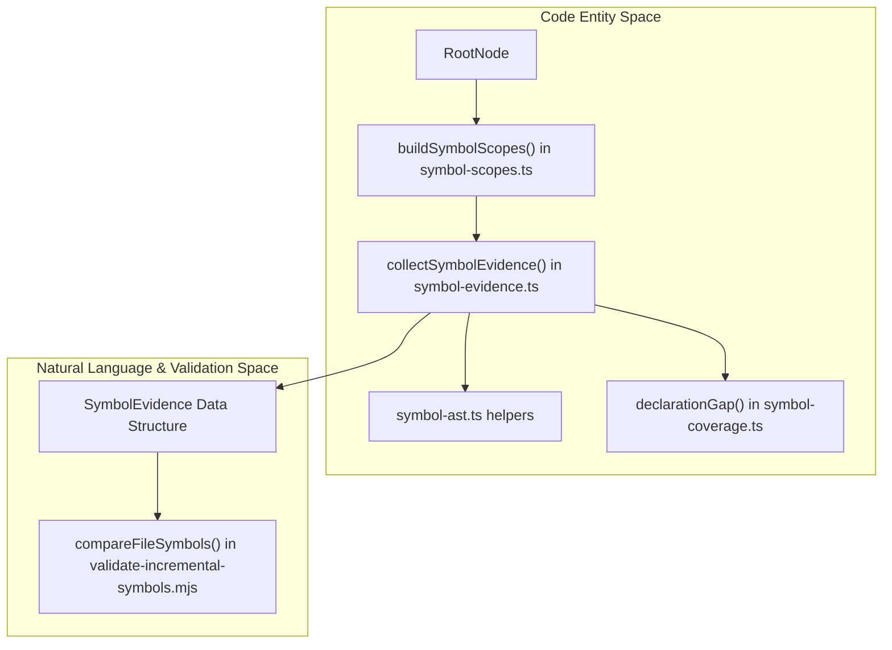
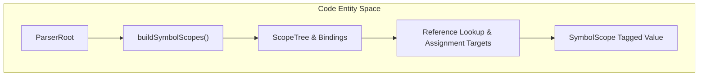
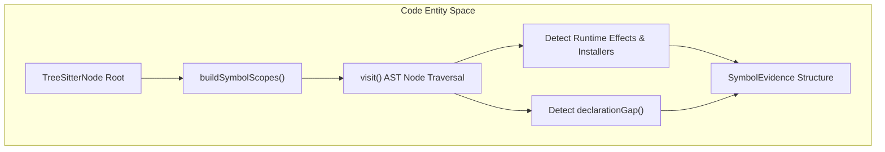

<!-- source: DeepWiki mcp.deepwiki.com · repo Egonex-AI/Understand-Anything · extra page Symbol Evidence & Coverage Analysis · fetched 2026-10-30 -->

# Symbol Evidence & Coverage Analysis

<details>
<summary>Relevant source files</summary>

The following files were used as context for generating this wiki page:

- [docs/incremental/source-evidence-audit.md](docs/incremental/source-evidence-audit.md)
- [docs/incremental/symbol-loss-validation.md](docs/incremental/symbol-loss-validation.md)
- [tests/skill/understand/test_symbol_evidence_matrix.test.mjs](tests/skill/understand/test_symbol_evidence_matrix.test.mjs)
- [understand-anything-plugin/packages/core/src/plugins/symbol-ast.ts](understand-anything-plugin/packages/core/src/plugins/symbol-ast.ts)
- [understand-anything-plugin/packages/core/src/plugins/symbol-coverage.ts](understand-anything-plugin/packages/core/src/plugins/symbol-coverage.ts)
- [understand-anything-plugin/packages/core/src/plugins/symbol-evidence.ts](understand-anything-plugin/packages/core/src/plugins/symbol-evidence.ts)
- [understand-anything-plugin/packages/core/src/plugins/symbol-scopes.test.ts](understand-anything-plugin/packages/core/src/plugins/symbol-scopes.test.ts)
- [understand-anything-plugin/packages/core/src/plugins/symbol-scopes.ts](understand-anything-plugin/packages/core/src/plugins/symbol-scopes.ts)
- [understand-anything-plugin/packages/core/src/plugins/tree-sitter-plugin.test.ts](understand-anything-plugin/packages/core/src/plugins/tree-sitter-plugin.test.ts)
- [understand-anything-plugin/packages/core/src/plugins/tree-sitter-plugin.ts](understand-anything-plugin/packages/core/src/plugins/tree-sitter-plugin.ts)

</details>


This page covers the technical architecture and implementation details of the symbol-evidence subsystem within `@understand-anything/core`. The subsystem is responsible for collecting precise, scoped symbol declarations and runtime effects during strict code analysis, tracking lexical scopes and value regions, identifying declaration coverage gaps, and feeding the incremental symbol-loss validation gate (`docs/incremental/symbol-loss-validation.md`) to prevent silent deletion of existing code symbols.

Sources: [understand-anything-plugin/packages/core/src/plugins/symbol-evidence.ts:1-24](), [docs/incremental/symbol-loss-validation.md:1-51]()

---

## 1. Subsystem Architecture & Core Modules

The symbol evidence subsystem comprises four core TypeScript modules under `packages/core/src/plugins/`:
- `symbol-ast.ts`: Low-level AST node unwrapping, identifier extraction, literal parsing, and key resolution.
- `symbol-scopes.ts`: Lexical scope construction, block bindings, and value region tracking.
- `symbol-coverage.ts`: Declaration surface classification, identifying coverage gaps and opaque expansion constructs.
- `symbol-evidence.ts`: Main entry point (`collectSymbolEvidence`) uniting scopes, declarations, and runtime effects into a unified `SymbolEvidence` contract.



Sources: [understand-anything-plugin/packages/core/src/plugins/symbol-evidence.ts:1-70](), [understand-anything-plugin/packages/core/src/plugins/symbol-scopes.ts:35-42](), [understand-anything-plugin/packages/core/src/plugins/symbol-coverage.ts:21-37](), [understand-anything-plugin/packages/core/src/plugins/symbol-ast.ts:1-39]()

---

## 2. Lexical Scope & Value Regions (`symbol-scopes.ts`)

To prevent false absences and false preservations caused by file-wide text matching or flawed ancestry walks, `symbol-scopes.ts` constructs a shared lexical scope tree during a single AST traversal.

### Key Data Structures & Scopes
- **`SymbolScope`**: A tagged union representing positive separation knowledge:
  - `{ kind: "file" }`
  - `{ kind: "class"; name: string }`
  - `{ kind: "local"; id: number }`
  - `{ kind: "unknown" }`
- **`Scope`**: Internal hierarchical node structure tracking parent links, scope kind (`root`, `class`, `function`, `block`, `namespace`), receivers, and local bindings.

Values and declarations are indexed before references and assignment targets are resolved. This ensures declaration order cannot incorrectly invent an outer class identity, and class-expression internal names bind strictly inside that scope.



Sources: [understand-anything-plugin/packages/core/src/plugins/symbol-scopes.ts:5-42](), [docs/incremental/source-evidence-audit.md:40-42]()

---

## 3. Symbol Evidence Collection & Effects (`symbol-evidence.ts`)

The function `collectSymbolEvidence` orchestrates scope analysis, structural verification, and runtime effect gathering. It emits a `SymbolEvidence` object containing versioning, explicit effects, discovered functions/classes, and declaration coverage gaps.

```typescript
export interface SymbolEvidenceEntry {
  kind: "callable" | "class" | null;
  scope: SymbolScope;
  name: string | null;
  nameSuffix?: string;
  lineRange: [number, number];
  reason: string;
}
export interface SymbolEvidence {
  version: 2;
  effects: SymbolEvidenceEntry[];
  functions: Array<{ name: string; scope: SymbolScope; lineRange: [number, number] }>;
  classes: Array<{ name: string; scope: SymbolScope; lineRange: [number, number] }>;
  coverage: { profile: "structural-declarations-v1"; gaps: SymbolEvidenceEntry[] };
}
```

Runtime effect detection covers JavaScript/TypeScript property installers (`Object.defineProperty`, `Reflect.defineProperty`), Ruby method installers (`attr_reader`, `define_method`), and Python attribute setters (`setattr`), scoping them correctly to their respective owner classes or objects.



Sources: [understand-anything-plugin/packages/core/src/plugins/symbol-evidence.ts:9-69](), [tests/skill/understand/test_symbol_evidence_matrix.test.mjs:20-56]()

---

## 4. Declaration Coverage & Gaps (`symbol-coverage.ts`)

Not all code constructs are handled by default structural extraction plugins. `symbol-coverage.ts` defines handled declaration surfaces and flags unhandled name-exposing nodes as explicit coverage gaps.

- **Handled Names**: Standard classes, functions, variable declarators, methods, and field definitions.
- **Non-Declaration Names**: Import/export specifiers, parameters, type annotations, and qualifiers which do not declare new symbols.
- **Opaque Declarations**: Macro invocations or preprocessor calls (`macro_invocation`, `preproc_call`) which yield uncertain expansion results.

An unextracted callable or class is recorded as a coverage gap (`declarationGap`). Missing or malformed coverage evidence causes validation to fail closed.

Sources: [understand-anything-plugin/packages/core/src/plugins/symbol-coverage.ts:1-37](), [docs/incremental/symbol-loss-validation.md:43-45]()

---

## 5. Symbol-Loss Validation & Incremental Safety

The symbol evidence subsystem directly feeds incremental symbol-loss validation (`validate-incremental-symbols.mjs` and `docs/incremental/symbol-loss-validation.md`). 

When an incremental update runs:
1. **Preservation Rule**: A surviving old symbol omitted by the analyzer must not be published as a deletion unless verified.
2. **Identity Verification**: Source identities are defined as `(path, kind, owner, name)`.
3. **Comparator Logic**: The comparator consumes `SymbolEvidence` version 2 records without walking AST nodes. It verifies whether an omitted symbol has a corresponding coverage gap or runtime effect before classifying it as `deleted`, `still-present`, or `unknown`.
4. **Failure Handling**: Any unresolved entry blocks publication, triggering a targeted repair attempt or aborting graph write operations.

Sources: [docs/incremental/symbol-loss-validation.md:1-51](), [tests/skill/understand/test_symbol_evidence_matrix.test.mjs:3-39]()

---

