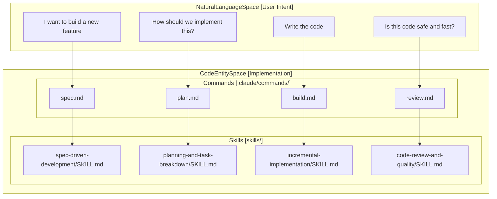
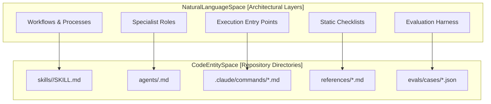

<!-- source: DeepWiki mcp.deepwiki.com · repo addyosmani/agent-skills · page 1 Overview · fetched 2026-10-30 -->

# Overview

Relevant source files

The following files were used as context for generating this wiki page:

- [.claude/rules/skills-contributing.md](.claude/rules/skills-contributing.md)
- [AGENTS.md](AGENTS.md)
- [CLAUDE.md](CLAUDE.md)
- [README.md](README.md)
- [docs/opencode-setup.md](docs/opencode-setup.md)
- [references/orchestration-patterns.md](references/orchestration-patterns.md)

The `agent-skills` repository is a collection of production-grade engineering workflows packaged for AI coding agents [README.md:1-5](). It encodes the quality gates, best practices, and systematic processes used by senior engineers into a format that AI agents can follow consistently across the entire software development lifecycle (SDLC) [README.md:5-14]().

Rather than providing vague advice, each "skill" in this repository is a structured process with explicit steps, verification requirements, and anti-rationalization tables to ensure agents do not skip critical engineering rigors [README.md:123-130]().

### Purpose and Scope

The purpose of this wiki page is to provide a high-level introduction to `agent-skills`, outlining its core philosophy, the six lifecycle phases, the five architectural layers, and how to navigate the rest of the documentation. 

For detailed onboarding and installation instructions, see [Getting Started & Installation](#1.1). For repository layout details, see [Repository Structure & Conventions](#1.2). For tool-specific setup guides, see [Tool Integrations & Per-Agent Setup](#1.3).

Sources: [README.md:1-10](), [CLAUDE.md:1-6]()

---

### The Six Lifecycle Phases

The repository organizes engineering work into six distinct phases, each mapped to specific slash commands and underlying skills [README.md:11-25]().

| Phase | Command | Primary Goal | Key Skill |
| :--- | :--- | :--- | :--- |
| **DEFINE** | `/spec` | Turn ideas into structured requirements | `spec-driven-development` |
| **PLAN** | `/plan` | Decompose specs into atomic, verifiable tasks | `planning-and-task-breakdown` |
| **BUILD** | `/build` | Implement changes in thin, vertical slices | `incremental-implementation` |
| **VERIFY** | `/test` | Prove correctness through TDD and runtime checks | `test-driven-development` |
| **REVIEW** | `/review` | Ensure code health, security, and performance | `code-review-and-quality` |
| **SHIP** | `/ship` | Deploy with confidence using automated pipelines | `shipping-and-launch` |

**Lifecycle Mapping to Code Entities**

The following diagram bridges natural language intent to the specific command definitions and skill directories found in the codebase.

Sources: [README.md:11-25](), [CLAUDE.md:16-23](), [AGENTS.md:32-44]()

---

### The Five Layers

The repository architecture is divided into five core layers that separate workflows, roles, automation, validation references, and testing harnesses [CLAUDE.md:7-17](), [AGENTS.md:70-82]():

1. **Skills (`skills/`)**: Modular markdown workflows (`SKILL.md`) defining how specific tasks are performed [CLAUDE.md:10]().
2. **Personas (`agents/`)**: Specialist agent prompts (e.g., `code-reviewer`, `test-engineer`, `security-auditor`, `web-performance-auditor`) [CLAUDE.md:11]().
3. **Commands (`.claude/commands/`, `commands/`, `.gemini/commands/`)**: User-facing execution entry points mirroring lifecycle steps [CLAUDE.md:13]().
4. **References (`references/`)**: Shared static checklists and patterns (e.g., `testing-patterns.md`, `security-checklist.md`) [CLAUDE.md:14]().
5. **Evals (`evals/`)**: Automated evaluation test cases and harness for routing and behavioral verification [CLAUDE.md:15]().

**Layer Mapping to Code Entities**

Sources: [CLAUDE.md:7-17](), [README.md:1-25]()

---

### How to Navigate the Wiki

This wiki is structured to follow the agent and developer journey from setup to advanced customization:

*   **[Getting Started & Installation](#1.1)** — Onboarding: installing via skills CLI or plugin marketplaces, choosing skills, minimal vs full-lifecycle configs, and pointers to per-tool setup guides.
*   **[Repository Structure & Conventions](#1.2)** — Top-level layout (`skills/`, `agents/`, `hooks/`, `commands/`, `.claude/`, `.gemini/`, `references/`, `docs/`, `scripts/`, `evals/`), `SKILL.md` format, frontmatter and naming conventions.
*   **[Tool Integrations & Per-Agent Setup](#1.3)** — Setup guides for Claude Code, Codex, Antigravity, Gemini CLI, Command Code, Copilot, Cursor, Windsurf, OpenCode, and plugin manifests.
*   **The Development Lifecycle (Section 2)** — Detailed deep dive into Define, Plan, Build, Verify, Review, and Ship phases.
*   **Agent Personas & Orchestration (Section 3)** — Specialist personas and multi-persona orchestration patterns.
*   **Slash Commands & Hooks (Section 4)** — Automation commands and session lifecycle hooks.
*   **References (Section 5)** — Shared reference guides and checklists.
*   **Contributing & Extending Skills (Section 6)** — Guidelines for adding/modifying skills, anatomy specs, and evals.
*   **Glossary (Section 7)** — Definitions of domain-specific terminology.

Sources: [README.md:44-164](), [CLAUDE.md:1-44]()

---

