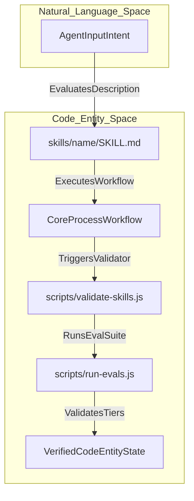

<!-- source: DeepWiki mcp.deepwiki.com · repo addyosmani/agent-skills · page 1.2 Repository Structure & Conventions · fetched 2026-10-30 -->

# Repository Structure & Conventions

<details>
<summary>Relevant source files</summary>

The following files were used as context for generating this wiki page:

- [.gitignore](.gitignore)
- [CLAUDE.md](CLAUDE.md)
- [LICENSE](LICENSE)
- [README.md](README.md)
- [docs/copilot-cli-setup.md](docs/copilot-cli-setup.md)
- [docs/copilot-setup.md](docs/copilot-setup.md)
- [docs/cursor-setup.md](docs/cursor-setup.md)
- [docs/skill-anatomy.md](docs/skill-anatomy.md)
- [docs/windsurf-setup.md](docs/windsurf-setup.md)
- [hooks/SDD-CACHE.md](hooks/SDD-CACHE.md)
- [hooks/sdd-cache-post.sh](hooks/sdd-cache-post.sh)
- [hooks/sdd-cache-pre.sh](hooks/sdd-cache-pre.sh)

</details>


This page provides a technical breakdown of the `agent-skills` repository organization, the structural requirements for defining skills, and the conventions that ensure agents can discover, route, and execute these skills effectively.

## Purpose & Scope

The scope of this page covers the global architectural layout of the repository (`skills/`, `agents/`, `hooks/`, `commands/`, `.claude/`, `.gemini/`, `references/`, `docs/`, `scripts/`, `evals/`), the specification for `SKILL.md` files (`docs/skill-anatomy.md`), frontmatter requirements, naming conventions, and the core development principles enforced by the validation and evaluation harness.

Sources: [CLAUDE.md:1-17](), [docs/skill-anatomy.md:1-16]()

---

## Top-Level Directory Layout

The repository is organized into functional directories that separate core agent logic, specialist agent personas, session lifecycle automation, cross-tool command definitions, validation scripts, and evaluation suites.

| Directory | Purpose | Key Contents |
|:---|:---|:---|
| `skills/` | Core logic and workflows. | Subdirectories per skill containing `SKILL.md` and optional `scripts/` or `references/`. |
| `agents/` | Reusable agent personas. | `code-reviewer`, `test-engineer`, `security-auditor`, `web-performance-auditor`. |
| `hooks/` | Session lifecycle automation. | Scripts and configs for session entry/exit events (e.g., `sdd-cache-pre.sh`, `sdd-cache-post.sh`). |
| `commands/` | Cross-tool command definitions. | TOML command wrappers mirrored for multi-platform execution. |
| `.claude/` | Claude Code configuration. | Slash command definitions (`.claude/commands/`) and runtime settings/cache. |
| `.gemini/` | Gemini CLI configuration. | Slash command definitions (`.gemini/commands/`). |
| `references/` | Global checklists and patterns. | `testing-patterns.md`, `security-checklist.md`, `orchestration-patterns.md`, `definition-of-done.md`. |
| `docs/` | Meta-documentation. | Setup guides, integration instructions, and `skill-anatomy.md`. |
| `scripts/` | Node validation and eval harnesses. | Lint scripts, version checkers, test runners (`run-evals.js`). |
| `evals/` | Skill evaluation suite. | `evals/cases/` (positive/negative routing prompts) and behavioral test fixtures. |

Sources: [CLAUDE.md:7-17](), [docs/skill-anatomy.md:7-16]()

### Visualizing the Repository Architecture

The following diagram bridges Natural Language Space to Code Entity Space, illustrating how user natural language prompts map to command wrappers and underlying core skill directories within the repository layout.

Title: Natural Language to Code Entity Mapping
```mermaid
graph TD
    User["UserPrompt(\"/code-simplify\")"] -- "Invokes" --> Cmd[".claude/commands/code-simplify.md"]
    Cmd -- "References" --> SkillDir["skills/code-simplification/"]
    SkillDir -- "Contains" --> SkillFile["SKILL.md"]
    SkillFile -- "Consults" --> Ref["references/performance-checklist.md"]
    
    subgraph "Natural_Language_Space"
    User
    end

    subgraph "Code_Entity_Space"
    Cmd
    SkillDir
    SkillFile
    Ref
    end
```

Sources: [CLAUDE.md:7-17](), [docs/skill-anatomy.md:7-16]()

---

## The SKILL.md Format & Frontmatter Conventions

Every skill must adhere to a strict structural specification defined in `docs/skill-anatomy.md`. This consistency allows agents to parse skills predictably under context constraints.

### 1. File Location & Naming
- **Directory:** `skills/<skill-name>/` (lowercase, hyphen-separated, must match frontmatter `name`) [docs/skill-anatomy.md:7-11](), [docs/skill-anatomy.md:26-32]()
- **Primary File:** `SKILL.md` (always uppercase) [docs/skill-anatomy.md:12-12](), [CLAUDE.md:30-30]()
- **Supporting Files:** Created only if content exceeds 100 lines; stored within the skill's own `references/` or `scripts/` subdirectory [docs/skill-anatomy.md:13-18](), [docs/skill-anatomy.md:107-114]()

### 2. YAML Frontmatter
The frontmatter is the primary discovery mechanism for agents. It must contain:
- `name`: Lowercase, hyphen-separated. Must match the directory name [docs/skill-anatomy.md:26-32](), [CLAUDE.md:30-31]()
- `description`: Starts with a third-person verb describing what the skill does, followed by "Use when..." trigger conditions. Maximum 1024 characters [docs/skill-anatomy.md:27-33](), [CLAUDE.md:32-32]()
- Top-level keys are strictly limited to Agent Skills specification fields (`name`, `description`, `license`, `compatibility`, `metadata`, `allowed-tools`). Vendor-specific fields go under `metadata` [docs/skill-anatomy.md:34-34]().

Sources: [docs/skill-anatomy.md:21-35](), [CLAUDE.md:30-32]()

### 3. Standard Markdown Sections
A valid `SKILL.md` implements standard sections to ensure the agent follows an actionable process rather than absorbing passive knowledge.

| Section | Purpose | Requirement |
|:---|:---|:---|
| **Overview** | Elevator pitch explaining what the skill does and why it matters. | [docs/skill-anatomy.md:51-53]() |
| **When to Use** | Positive triggering conditions and explicit negative exclusions. | [docs/skill-anatomy.md:54-56]() |
| **Core Process** | Step-by-step, actionable numbered workflow. | [docs/skill-anatomy.md:58-61]() |
| **Common Rationalizations** | A comparison table of excuses agents use vs. reality. | [docs/skill-anatomy.md:67-70]() |
| **Red Flags** | Observable behavioral warning signs indicating skill violation. | [docs/skill-anatomy.md:72-74]() |
| **Verification** | Exit criteria checklist requiring concrete evidence. | [docs/skill-anatomy.md:76-79]() |

Sources: [docs/skill-anatomy.md:44-80](), [CLAUDE.md:33-33]()

---

## Skill Discovery, Routing & Execution Flow

When an agent interacts with the repository, it uses frontmatter descriptions injected into the system prompt to route intents to specific skill definitions, execute workflows, and validate artifacts through automated test harnesses.

Title: Skill Execution and Validation Pipeline


Sources: [docs/skill-anatomy.md:128-135](), [CLAUDE.md:44-45]()

---

## Core Development & Architectural Conventions

### Process over Knowledge
Skills are designed as **workflows**, not reference manuals. The repository strictly rejects vague advice. Every instruction must be actionable, instructing the agent to run concrete commands or follow precise algorithmic paths [docs/skill-anatomy.md:90-95](), [CLAUDE.md:59-60]().

Sources: [docs/skill-anatomy.md:90-95](), [CLAUDE.md:59-60]()

### Anti-Rationalization Tables
A unique convention across all skills is the **Common Rationalizations** table. This is specifically engineered to counter LLM tendencies to bypass quality gates (e.g., claiming "this change is too trivial for tests" or "skipping spec phase saves time") [docs/skill-anatomy.md:96-100]().

Sources: [docs/skill-anatomy.md:96-100]()

### Non-Duplication Rule & Shared References
To keep context windows efficient and prevent synchronization drift, content is never duplicated across skills [CLAUDE.md:60-60](). Shared checklists (testing, security, performance, accessibility, definition-of-done) live in root `references/` because multiple skills point to them. Self-contained data used by a single skill resides locally within that skill's directory [docs/skill-anatomy.md:118-127](), [CLAUDE.md:34-34]().

Sources: [docs/skill-anatomy.md:118-127](), [CLAUDE.md:34-60]()

### Context Efficiency & Progressive Disclosure
`SKILL.md` files are maintained under 500 lines [docs/skill-anatomy.md:132-132](). Detailed reference materials or helpers are loaded on demand via progressive disclosure, and helper scripts are preferred over inline code blocks to preserve agent attention budget [docs/skill-anatomy.md:130-135]().

Sources: [docs/skill-anatomy.md:128-135]()

---

