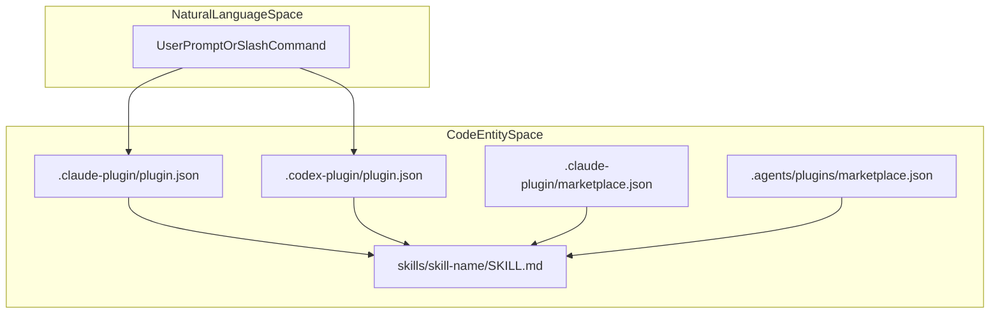
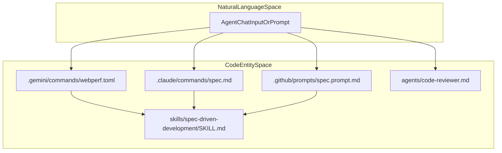

<!-- source: DeepWiki mcp.deepwiki.com · repo addyosmani/agent-skills · page 1.3 Tool Integrations & Per-Agent Setup · fetched 2026-10-30 -->

# Tool Integrations & Per-Agent Setup

Relevant source files

The following files were used as context for generating this wiki page:

- [.agents/plugins/marketplace.json](.agents/plugins/marketplace.json)
- [.claude-plugin/marketplace.json](.claude-plugin/marketplace.json)
- [.claude-plugin/plugin.json](.claude-plugin/plugin.json)
- [.codex-plugin/plugin.json](.codex-plugin/plugin.json)
- [.gemini/commands/webperf.toml](.gemini/commands/webperf.toml)
- [docs/adoption-guide.md](docs/adoption-guide.md)
- [docs/advanced-per-agent-configuration.md](docs/advanced-per-agent-configuration.md)
- [docs/antigravity-setup.md](docs/antigravity-setup.md)
- [docs/codex-setup.md](docs/codex-setup.md)
- [docs/commandcode-setup.md](docs/commandcode-setup.md)
- [docs/comparison.md](docs/comparison.md)
- [docs/copilot-cli-setup.md](docs/copilot-cli-setup.md)
- [docs/copilot-setup.md](docs/copilot-setup.md)
- [docs/cursor-setup.md](docs/cursor-setup.md)
- [docs/gemini-cli-setup.md](docs/gemini-cli-setup.md)
- [docs/getting-started.md](docs/getting-started.md)
- [docs/skill-anatomy.md](docs/skill-anatomy.md)
- [docs/windsurf-setup.md](docs/windsurf-setup.md)
- [hooks/session-start.sh](hooks/session-start.sh)
- [plugin.json](plugin.json)

This page details the technical architecture of tool integrations, multi-platform plugin manifests, runtime setup guides for supported AI coding agents (Claude Code, Codex, Antigravity, Gemini CLI, Command Code, Copilot IDE and CLI, Cursor, Windsurf, OpenCode), advanced per-agent configuration strategies, adoption pathways across greenfield and brownfield codebases, and ecosystem comparisons.

Sources: `docs/getting-started.md:1-160`, `docs/skill-anatomy.md:1-135`, `docs/adoption-guide.md:1-90`

---

## 1. Plugin & Marketplace Manifest Architecture

The `agent-skills` repository uses vendor-neutral Markdown files (`SKILL.md`) paired with platform-specific manifests that expose skills, personas, and slash commands without duplicating underlying content.

### Manifest File Layout
- `.claude-plugin/plugin.json`: Defines the Claude Code package configuration, pointing to `./.claude/commands`, `./commands`, and `./skills` `[.claude-plugin/plugin.json:1-13]`.
- `.codex-plugin/plugin.json`: Configures the OpenAI Codex plugin, mounting `./skills/` and supplying interface metadata `[.codex-plugin/plugin.json:1-29]`.
- `.claude-plugin/marketplace.json` & `.agents/plugins/marketplace.json`: Supply marketplace registry records for automated distribution and local/remote discovery `[.claude-plugin/marketplace.json:1-23]`, `[.agents/plugins/marketplace.json:1-22]`.
- `plugin.json`: Serves as a minimal root fallback manifest `[plugin.json:1-5]`.

### Diagram: Plugin Manifest Routing Architecture

Sources: `[.claude-plugin/plugin.json:1-13]`, `[.codex-plugin/plugin.json:1-29]`, `[.claude-plugin/marketplace.json:1-23]`, `[.agents/plugins/marketplace.json:1-22]`, `[plugin.json:1-5]`

---

## 2. Per-Agent Runtime Setup & Integration Guides

Different agent runtimes consume the shared `skills/` directory using native registration mechanisms. Below are the technical setup specifications for each supported environment.

### Claude Code
Claude Code consumes `.claude/commands/*.md` for slash commands, `agents/*.md` for specialist personas, and discovers skills dynamically via frontmatter descriptions inside `skills/*/SKILL.md` `[docs/getting-started.md:126-140]`.

### Codex
Codex consumes the root-level `skills/` directory natively via its plugin architecture `[docs/codex-setup.md:1-3]`. Installation registers the repository marketplace and enables the plugin `[docs/codex-setup.md:7-10]`. Because slash commands in `.claude/commands/` are specific to Claude Code, Codex users invoke underlying skills directly via `@` syntax or natural language discovery `[docs/codex-setup.md:33]`.

### Gemini CLI
Gemini CLI auto-discovers `SKILL.md` files placed in `.gemini/skills/` or `.agents/skills/` `[docs/gemini-cli-setup.md:5-7]`. Alternatively, persistent context can be injected via `GEMINI.md` `[docs/gemini-cli-setup.md:38-40]`. Gemini CLI maps legacy command TOMLs under `.gemini/commands/` (such as `[/.gemini/commands/webperf.toml:1-1]`) to corresponding agent routines `[docs/gemini-cli-setup.md:110-111]`.

### Antigravity CLI (`agy`)
Antigravity installs `agent-skills` as a native plugin into `~/.gemini/config/plugins/agent-skills/` `[docs/antigravity-setup.md:14-30]`. Workspace-level enforcement is established by placing or linking `AGENTS.md` at the root `[docs/antigravity-setup.md:108-110]`.

### GitHub Copilot (IDE + CLI)
Copilot in VS Code discovers skills placed under `.github/skills/`, `.claude/skills/`, or `.agents/skills/` `[docs/copilot-setup.md:9-11]`. Agent personas require the `.agent.md` suffix (e.g., `.github/agents/code-reviewer.agent.md`) to be recognized by Copilot `[docs/copilot-setup.md:29-39]`. Prompt files (`.github/prompts/*.prompt.md`) provide short slash command aliases `[docs/copilot-setup.md:111-113]`.

### Cursor, Windsurf, Command Code & OpenCode
- **Cursor**: Consumes `.cursorrules` for always-on project context and reads `skills/*/SKILL.md` when referenced or discovered via custom workspace instructions.
- **Windsurf**: Reads `.windsurfrules` and utilizes global/project skill directories matching standard Markdown agent paths.
- **Command Code & OpenCode**: Consume shared Markdown definitions and execute via standard runtime prompt injection or plugin wrappers.

### Diagram: Multi-Agent Runtime Skill Dispatch

Sources: `[docs/codex-setup.md:1-34]`, `[docs/gemini-cli-setup.md:1-133]`, `[docs/antigravity-setup.md:1-127]`, `[docs/copilot-setup.md:1-137]`, `[/.gemini/commands/webperf.toml:1-1]`

### Runtime Feature Matrix

| Tool / Runtime | Skill Discovery Path | Agent Definition Path | Command Mapping |
|---|---|---|---|
| **Claude Code** | `skills/*/SKILL.md` | `agents/*.md` | `.claude/commands/*.md` |
| **Codex** | `skills/*/SKILL.md` | N/A | Direct Skill (@) |
| **Gemini CLI** | `.gemini/skills/` | `.agents/agents/` | `.gemini/commands/*.toml` |
| **Antigravity** | `skills/` (plugin) | `agents/*.md` | Native Plugin Registry |
| **GitHub Copilot** | `.github/skills/` | `.github/agents/*.agent.md` | `.github/prompts/*.prompt.md` |
| **Cursor / Windsurf** | Project rules / rules files | System prompts | Natural language / Rules |

Sources: `[docs/antigravity-setup.md:1-127]`, `[docs/copilot-setup.md:1-137]`, `[docs/gemini-cli-setup.md:1-133]`

---

## 3. Advanced Per-Agent Configuration

To maintain portability across diverse runtimes, all shared `SKILL.md` files keep top-level frontmatter restricted to fields recognized by the Agent Skills specification (`name`, `description`, `license`, `compatibility`, `metadata`, and `allowed-tools`) `[docs/skill-anatomy.md:34]`, `[docs/advanced-per-agent-configuration.md:1-7]`. Vendor-specific execution controls reside under the `metadata` key or in separate per-agent adapter configurations `[docs/skill-anatomy.md:34]`.

### Execution Controls
- **`context: fork`**: Executes a command or skill in an isolated subagent context rather than polluting the active session `[docs/advanced-per-agent-configuration.md:28]`.
- **`allowed-tools`**: Pre-approves specified tools for a single turn without stripping other capabilities `[docs/advanced-per-agent-configuration.md:29]`.
- **`disallowed-tools`**: Removes tools from the available execution pool during passive review or audit stages `[docs/advanced-per-agent-configuration.md:30]`.

Sources: `[docs/skill-anatomy.md:34]`, `[docs/advanced-per-agent-configuration.md:1-71]`

---

## 4. Adoption Pathways & Ecosystem Comparison

### Project Lifecycle Adoption
- **Greenfield Projects**: Adopt the full lifecycle (`/spec` $\rightarrow$ `/plan` $\rightarrow$ `/build` $\rightarrow$ `/review` $\rightarrow$ `/ship`) immediately from day zero `[docs/adoption-guide.md:24-44]`.
- **Brownfield Codebases**: Prioritize read-only context engineering (`context-engineering`), code reviews (`code-review-and-quality`), and debugging triage (`debugging-and-error-recovery`) before modifying existing code `[docs/adoption-guide.md:73-85]`.

### Ecosystem Comparison
`agent-skills` organizes the entire product lifecycle across 25 skills with testable evaluation harnesses, contrasting with alternative frameworks focused exclusively on inner-loop build tasks or autonomous execution pipelines `[docs/comparison.md:1-51]`.

Sources: `[docs/adoption-guide.md:1-90]`, `[docs/comparison.md:1-51]`

---

