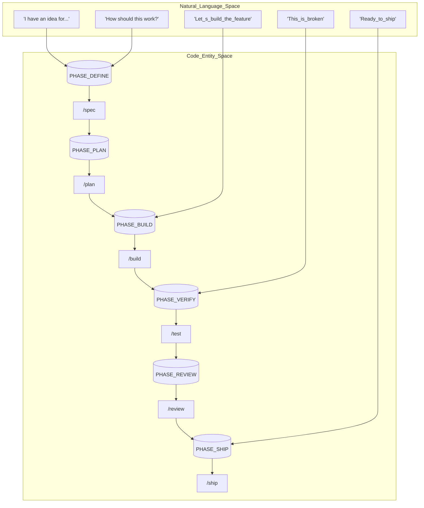
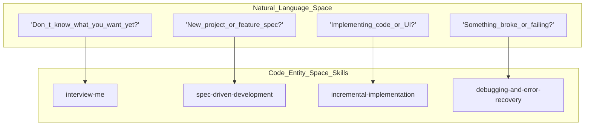
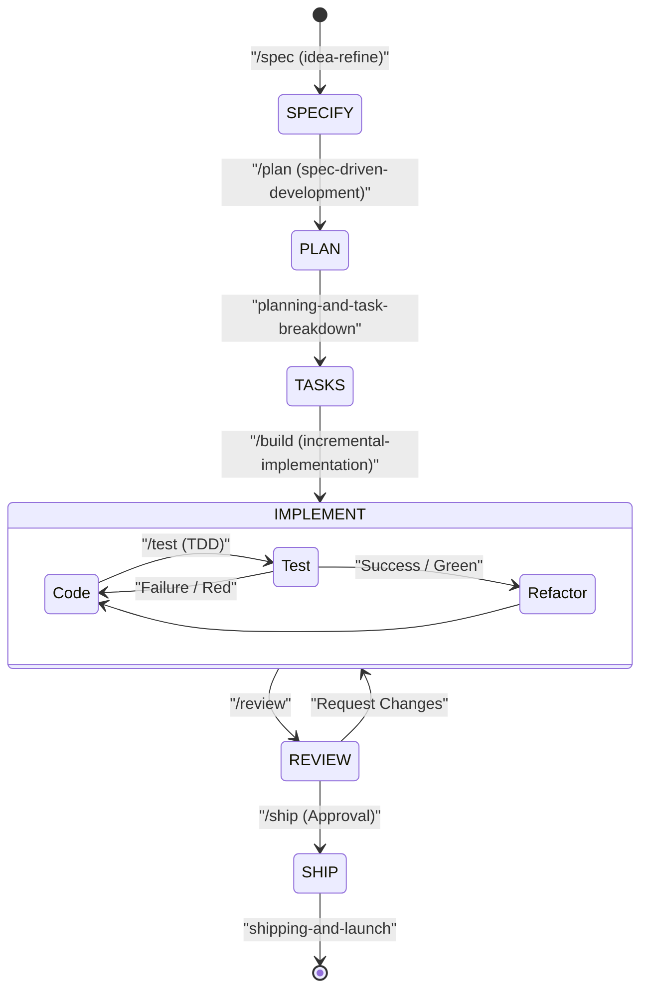

<!-- source: DeepWiki mcp.deepwiki.com · repo addyosmani/agent-skills · page 2 The Development Lifecycle · fetched 2026-10-30 -->

# The Development Lifecycle

Relevant source files

The following files were used as context for generating this wiki page:

- [CLAUDE.md](CLAUDE.md)
- [README.md](README.md)
- [skills/doubt-driven-development/SKILL.md](skills/doubt-driven-development/SKILL.md)
- [skills/interview-me/SKILL.md](skills/interview-me/SKILL.md)
- [skills/source-driven-development/SKILL.md](skills/source-driven-development/SKILL.md)
- [skills/using-agent-skills/SKILL.md](skills/using-agent-skills/SKILL.md)

The `agent-skills` repository enforces a production-grade software development lifecycle (SDLC) through a phase-based routing model [README.md:3-5](). This workflow ensures that AI agents do not just write arbitrary code, but instead follow the same rigorous quality gates, architectural planning, and verification steps used by senior engineers [README.md:3-5]().

### Phase-Based Skill Routing

The lifecycle is divided into six primary phases: Define, Plan, Build, Verify, Review, and Ship [README.md:11-18](). Each phase is mapped to specific slash commands and underlying skills that dictate the agent's behavior, tool invocations, and quality constraints [README.md:13-23](), [skills/using-agent-skills/SKILL.md:14-39](), [CLAUDE.md:20-27]().

#### Lifecycle Overview Diagram
This diagram maps developer intent in natural language space to execution commands and phase transitions in code entity space.

Sources: [README.md:15-23](), [skills/using-agent-skills/SKILL.md:16-39](), [CLAUDE.md:20-27]()

---

### The `using-agent-skills` Meta-Skill Routing Model

The `using-agent-skills` meta-skill acts as the central router for agent discovery [skills/using-agent-skills/SKILL.md:2-3](). When a task is received, the agent evaluates the prompt characteristics and routes execution to the appropriate specialized skill.

#### Skill Discovery Routing Diagram
This diagram maps natural language queries directly to internal skill module identifiers within code entity space.

Sources: [skills/using-agent-skills/SKILL.md:17-43]()

---

### 2.1 Define Phase: Interviewing, Idea Refinement & Spec-Driven Development

The lifecycle begins by converting vague concepts into structured requirements. This phase uses the `interview-me` skill to extract user intent [skills/using-agent-skills/SKILL.md:146](), the `idea-refine` skill for divergent and convergent thinking [skills/using-agent-skills/SKILL.md:147](), and the `spec-driven-development` skill to establish a rigorous "Spec-First" architecture [skills/using-agent-skills/SKILL.md:148](). Agents are required to surface assumptions and define success criteria before writing application code [skills/using-agent-skills/SKILL.md:49-61]().

For details, see [Define Phase: Interviewing, Idea Refinement & Spec-Driven Development](#2.1) (Child Page).

Sources: [skills/using-agent-skills/SKILL.md:49-61](), [skills/using-agent-skills/SKILL.md:146-148]()

---

### 2.2 Plan Phase: Task Breakdown & Incremental Implementation

Once a specification is validated, the `planning-and-task-breakdown` skill decomposes the work into atomic, verifiable tasks with strict acceptance criteria and dependency ordering [skills/using-agent-skills/SKILL.md:149](). The core constraint is maintaining task sizing discipline to ensure high reasoning accuracy and prevent context flooding [skills/using-agent-skills/SKILL.md:97-108]().

For details, see [Plan Phase: Task Breakdown & Incremental Implementation](#2.2) (Child Page).

Sources: [skills/using-agent-skills/SKILL.md:97-108](), [skills/using-agent-skills/SKILL.md:149]()

---

### 2.3 Build Phase: Implementation Skills

The Build phase executes the implementation plan using thin vertical slices via `incremental-implementation` [skills/using-agent-skills/SKILL.md:24](). It integrates specialized sub-skills for distinct domains, including frontend UI engineering, API design, source-driven development, context engineering, and doubt-driven development [skills/using-agent-skills/SKILL.md:25-29](), [skills/source-driven-development/SKILL.md:8-10]().

For details, see [Build Phase: Implementation Skills](#2.3) (Child Page).

Sources: [skills/using-agent-skills/SKILL.md:24-29](), [skills/source-driven-development/SKILL.md:8-10]()

---

### 2.4 Verify Phase: Testing & Debugging

Verification is non-negotiable across all workflows. The `test-driven-development` skill enforces the Red-Green-Refactor cycle [skills/using-agent-skills/SKILL.md:30](). Runtime inspection is supported by `browser-testing-with-devtools`, while regression triage is handled by `debugging-and-error-recovery` [skills/using-agent-skills/SKILL.md:31-32]().

For details, see [Verify Phase: Testing & Debugging](#2.4) (Child Page).

Sources: [skills/using-agent-skills/SKILL.md:30-32]()

---

### 2.5 Review Phase: Quality, Security & Performance

Before merging, changes undergo multi-axis code reviews through `code-review-and-quality` [skills/using-agent-skills/SKILL.md:33](). This phase encompasses `code-simplification`, `security-and-hardening` (OWASP alignment), and `performance-optimization` [skills/using-agent-skills/SKILL.md:34-36]().

For details, see [Review Phase: Quality, Security & Performance](#2.5) (Child Page).

Sources: [skills/using-agent-skills/SKILL.md:33-36]()

---

### 2.6 Ship Phase: Git, CI/CD, Observability & Launch

The final phase governs safe delivery and deployment. It leverages `git-workflow-and-versioning` for clean commit practices, `ci-cd-and-automation` for automated quality gates, `observability-and-instrumentation`, and `shipping-and-launch` [skills/using-agent-skills/SKILL.md:37-42]().

For details, see [Ship Phase: Git, CI/CD, Observability & Launch](#2.6) (Child Page).

Sources: [skills/using-agent-skills/SKILL.md:37-42]()

---

### The Integrated State Machine

The following state transition diagram details the lifecycle mechanics governed by command executions and skill modules.

Sources: [README.md:15-23](), [skills/using-agent-skills/SKILL.md:137-153]()

---

