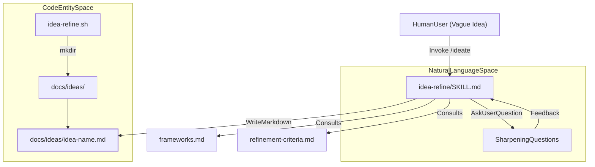
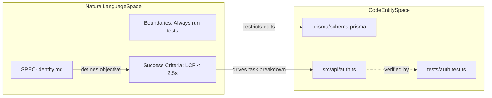

<!-- source: DeepWiki mcp.deepwiki.com · repo addyosmani/agent-skills · page 2.1 Define Phase: Interviewing, Idea Refinement & Spec-Driven Development · fetched 2026-10-30 -->

# Define Phase: Interviewing, Idea Refinement & Spec-Driven Development

Relevant source files

The following files were used as context for generating this wiki page:

- [.claude/commands/constraints.md](.claude/commands/constraints.md)
- [.gemini/commands/constraints.toml](.gemini/commands/constraints.toml)
- [.github/workflows/test-plugin-install.yml](.github/workflows/test-plugin-install.yml)
- [commands/constraints.toml](commands/constraints.toml)
- [commands/spec.toml](commands/spec.toml)
- [evals/cases/constraint-driven-development.json](evals/cases/constraint-driven-development.json)
- [evals/cases/spec-driven-development.json](evals/cases/spec-driven-development.json)
- [evals/fixtures/spec-driven-development-decomposition/portal-brief.md](evals/fixtures/spec-driven-development-decomposition/portal-brief.md)
- [scripts/floor-guard-reference-test.js](scripts/floor-guard-reference-test.js)
- [skills/constraint-driven-development/SKILL.md](skills/constraint-driven-development/SKILL.md)
- [skills/constraint-driven-development/references/floor-guard.md](skills/constraint-driven-development/references/floor-guard.md)
- [skills/doubt-driven-development/SKILL.md](skills/doubt-driven-development/SKILL.md)
- [skills/interview-me/SKILL.md](skills/interview-me/SKILL.md)
- [skills/planning-and-task-breakdown/SKILL.md](skills/planning-and-task-breakdown/SKILL.md)
- [skills/source-driven-development/SKILL.md](skills/source-driven-development/SKILL.md)
- [skills/spec-driven-development/SKILL.md](skills/spec-driven-development/SKILL.md)
- [skills/using-agent-skills/SKILL.md](skills/using-agent-skills/SKILL.md)

## Purpose & Scope

The **Define Phase** is the foundational stage of the agent-skills development lifecycle (`agent-skills`). It systematically bridges the gap between the **Natural Language Space** (vague human intentions, requirements, and unstructured ideas) and the **Code Entity Space** (structured technical specifications, capability maps, concrete file targets, and mechanical quality constraints). This phase is governed by four core skills: `interview-me`, `idea-refine`, `spec-driven-development`, and `constraint-driven-development` [skills/using-agent-skills/SKILL.md:143-148]().

---

## 1. Intent Extraction (`interview-me`)

Before any ideation, planning, or code generation occurs, the underlying intent must be elicited. The `interview-me` skill extracts what the user actually wants rather than what they pattern-match or assume they should want [skills/interview-me/SKILL.md:2-3]().

### 1.1 The Interview Protocol & Hypothesis Generation
The skill operates via a strict one-question-at-a-time dialogue loop to prevent cognitive overload and maintain high confidence [skills/interview-me/SKILL.md:64-70](). 

1. **Hypothesize with Confidence:** The agent writes a one-sentence hypothesis of user intent paired with an explicit confidence score (0–100%) [skills/interview-me/SKILL.md:41-43](). If confidence is below ~70%, the agent appends reasons detailing missing attributes [skills/interview-me/SKILL.md:50-51]().
2. **Interactive Guessing:** Every question is paired with a concrete guess (`Q: <question>` and `GUESS: <hypothesis>`), forcing the agent to expose its internal assumptions [skills/interview-me/SKILL.md:55-60]().
3. **Intent Restatement:** Once confidence reaches ~95%, the agent summarizes the intent into structured fields: Outcome, User, Why Now, Success, Constraint, and **Out of Scope** [skills/interview-me/SKILL.md:94-111]().

Sources: [skills/interview-me/SKILL.md:1-132]()

---

## 2. Idea Refinement (`idea-refine`)

The `idea-refine` skill takes raw or extracted concepts and sharpens them into actionable items through structured divergent and convergent cognitive phases [skills/using-agent-skills/SKILL.md:147]().

### 2.1 The Three-Phase Refinement Pipeline

| Phase | Core Goal | Key Operations & Supporting Artifacts |
| :--- | :--- | :--- |
| **1. Understand & Expand** | Divergent Thinking | Restate ideas into "How Might We" statements, ask sharpening questions, and generate variations using lenses like Inversion or Simplification [skills/using-agent-skills/SKILL.md:147](). |
| **2. Evaluate & Converge** | Critical Analysis | Cluster resonance into 2–3 directions, stress-test against value, feasibility, and differentiation, and surface hidden assumptions [skills/using-agent-skills/SKILL.md:147](). |
| **3. Sharpen & Ship** | Documentation | Produce a markdown one-pager saved to `docs/ideas/[idea-name].md` upon user confirmation, containing MVP scope and a strict "Not Doing" list [skills/using-agent-skills/SKILL.md:147](). |

### 2.2 Initialization & Supporting Scripts
* **Script Automation:** Supporting shell utilities check for and initialize the `docs/ideas` storage directory [skills/using-agent-skills/SKILL.md:147]().
* **Ideation Frameworks:** Agents selectively draw from framework definitions (e.g., SCAMPER, First Principles) rather than running every model mechanically [skills/using-agent-skills/SKILL.md:147]().

**Diagram: Idea Refinement Data Flow (Natural Language to Artifact)**

Sources: [skills/using-agent-skills/SKILL.md:143-150]()

---

## 3. Spec-Driven Development (`spec-driven-development`)

Once an idea is validated, the `spec-driven-development` skill enforces structured specification before code is written [skills/spec-driven-development/SKILL.md:6-10]().

### 3.1 Phase 0: Scope Check & Capability Maps
When a single requirement bundles several independently testable capabilities, Phase 0 activates to decompose the domain into a capability map before any spec is written [skills/spec-driven-development/SKILL.md:34-44]().
* **Stable Module IDs:** Kebab-case identifiers (`identity`, `billing`) chosen once and used across specs and commands [skills/spec-driven-development/SKILL.md:59]().
* **Dependency Direction:** Unidirectional graphs without circular dependencies [skills/spec-driven-development/SKILL.md:60]().
* **Recursive Scoping:** Each module runs through Specify → Plan → Tasks → Implement, saving specs as `SPEC-[module-id].md` [skills/spec-driven-development/SKILL.md:65]().

### 3.2 The Gated Workflow State Machine
The core execution proceeds through a gated state machine where human validation is mandatory between phases [skills/spec-driven-development/SKILL.md:22-32]().

### 3.3 The Spec Template & Boundaries
A valid specification covers six core sections: **Objective**, **Commands**, **Project Structure**, **Code Style**, **Testing Strategy**, and **Boundaries** (Always do, Ask first, Never do) [skills/spec-driven-development/SKILL.md:84-114]().

**Diagram: Natural Language Space to Code Entity Space (Spec Mapping)**

Sources: [skills/spec-driven-development/SKILL.md:1-157]()

---

## 4. Constraint-Driven Development (`constraint-driven-development`)

While specifications define *what* to build, `constraint-driven-development` records the project's **quality bar with numbers** into a persistent file (`CONSTRAINTS.md`) that outlives agent sessions [skills/spec-driven-development/SKILL.md:16](), [skills/constraint-driven-development/SKILL.md:7-14]().

### 4.1 The Interview & CONSTRAINTS.md Structure
The skill uses a 4-question intake protocol with sane defaults to build a repository-root `CONSTRAINTS.md` [skills/constraint-driven-development/SKILL.md:57-93](). The file contains:
* **The Floor:** Unconditional rules (no new suppressions like `@ts-ignore`, no unimplemented stubs, no deleted tests) [skills/constraint-driven-development/SKILL.md:102-108]().
* **Enforced Dimensions:** Rules mapped directly to executable commands (`tsc --noEmit`, `vitest run --coverage`, `gitleaks detect`) and execution points [skills/constraint-driven-development/SKILL.md:110-125]().

### 4.2 The Floor Guard Reference Implementation (`floor-guard.mjs`)
To prevent agents from quietly lowering the quality bar, the reference script `skills/constraint-driven-development/references/floor-guard.mjs` executes a diff-scoped check against added and removed lines [skills/constraint-driven-development/references/floor-guard.md:1-11]().

* **Input & Detection:** Inspects `git diff` against a base (e.g., `origin/main`) plus untracked files to detect silenced checkers (`SUPPRESSIONS`), unfinished work (`STUBS`), added test skips (`SKIPS`), removed test assertions, and weakened threshold numbers in `CONSTRAINTS.md` [skills/constraint-driven-development/references/floor-guard.md:20-86]().
* **Exit Codes:** Returns `0` for clean diffs, `1` for floor violations (blocking the change), and `2` if the environment lacks a merge base [skills/constraint-driven-development/references/floor-guard.md:10-11]().

Sources: [skills/constraint-driven-development/SKILL.md:1-128](), [skills/constraint-driven-development/references/floor-guard.md:1-99]()

---

## 5. Planning and Task Breakdown (`planning-and-task-breakdown`)

Once a spec is approved, `planning-and-task-breakdown` bridges specs to implementation by slicing work into verifiable, atomic tasks [skills/planning-and-task-breakdown/SKILL.md:10-11]().
* **Vertical Slicing:** Building complete feature paths (Schema → API → UI) rather than isolated horizontal tiers [skills/planning-and-task-breakdown/SKILL.md:59-77]().
* **Task Sizing:** Limiting task scope to 1–5 files (XS to M sizing) to maintain agent execution reliability [skills/planning-and-task-breakdown/SKILL.md:125-135]().
* **Output Files:** Generating implementation plans at `tasks/plan.md` and task tracking lists at `tasks/todo.md` [skills/planning-and-task-breakdown/SKILL.md:143-146]().

Sources: [skills/planning-and-task-breakdown/SKILL.md:1-163]()

---

