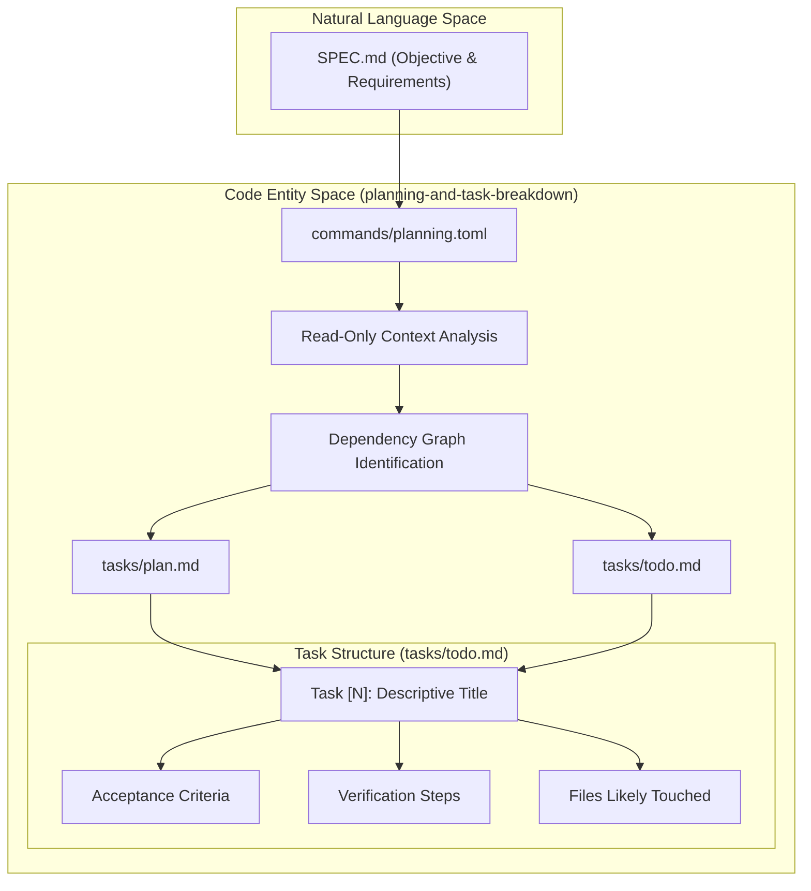
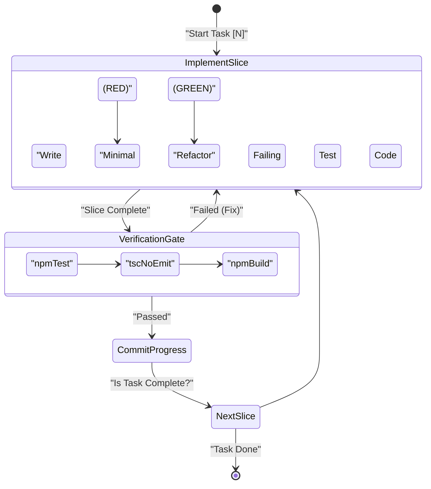

<!-- source: DeepWiki mcp.deepwiki.com · repo addyosmani/agent-skills · page 2.2 Plan Phase: Task Breakdown & Incremental Implementation · fetched 2026-10-30 -->

# Plan Phase: Task Breakdown & Incremental Implementation

Relevant source files

The following files were used as context for generating this wiki page:

- [evals/cases/incremental-implementation.json](evals/cases/incremental-implementation.json)
- [skills/incremental-implementation/SKILL.md](skills/incremental-implementation/SKILL.md)
- [skills/planning-and-task-breakdown/SKILL.md](skills/planning-and-task-breakdown/SKILL.md)
- [skills/spec-driven-development/SKILL.md](skills/spec-driven-development/SKILL.md)
- [skills/test-driven-development/SKILL.md](skills/test-driven-development/SKILL.md)

This page covers the **Plan Phase** of the agent-skills development lifecycle [skills/planning-and-task-breakdown/SKILL.md:24-156](), detailing how abstract specifications are decomposed into atomic, verifiable tasks via `skills/planning-and-task-breakdown` and executed through strict vertical slicing via `skills/incremental-implementation` [skills/incremental-implementation/SKILL.md:8-10]().

Sources: [skills/planning-and-task-breakdown/SKILL.md:24-156](), [skills/incremental-implementation/SKILL.md:8-10]()

---

## 1. Planning & Task Breakdown

Decomposing a specification into a structured plan ensures that the agent operates within its optimal context window and follows a logical dependency graph. The process produces two core artifacts: an implementation plan document at `tasks/plan.md` and a task list target at `tasks/todo.md` (or an external issue tracker) [skills/planning-and-task-breakdown/SKILL.md:143-162]().

### The Planning Workflow
Before any implementation code is written, the agent enters a read-only plan mode [skills/planning-and-task-breakdown/SKILL.md:24-33]():
1. **Read-Only Analysis**: Read the specification and codebase sections to identify patterns, conventions, and risks [skills/planning-and-task-breakdown/SKILL.md:26-31]().
2. **Dependency Mapping**: Map out bottom-up requirements (e.g., database schema → API models → API endpoints → frontend client) [skills/planning-and-task-breakdown/SKILL.md:35-55]().
3. **Vertical Slicing**: Group work by complete feature paths rather than horizontal technology layers [skills/planning-and-task-breakdown/SKILL.md:57-77]().
4. **Task Authoring**: Structure each task with explicit acceptance criteria, verification commands, file targets, and sizing bounds [skills/planning-and-task-breakdown/SKILL.md:79-104]().
5. **Conflict Protection**: Check whether `tasks/plan.md` or `tasks/todo.md` already exists. Never silently overwrite an incomplete plan containing unchecked tasks for different work [skills/planning-and-task-breakdown/SKILL.md:150-155]().

### Task Sizing & Guidelines
To prevent agents from getting overwhelmed or generating bloated pull requests, tasks are strictly sized [skills/planning-and-task-breakdown/SKILL.md:125-141]():

| Size | Files | Scope | Example |
| :--- | :--- | :--- | :--- |
| **XS** | 1 | Single function or config change | Add a validation rule |
| **S** | 1-2 | One component or endpoint | Add a new API endpoint |
| **M** | 3-5 | One feature slice | User registration flow |
| **L** | 5-8 | Multi-component feature | Search with filtering and pagination |
| **XL** | 8+ | **Too large — break it down further** | — |

### Data Flow: From Spec to Plan Artifacts
The following diagram illustrates how natural language requirements flow into structured code entity tracking via `skills/planning-and-task-breakdown` and `commands/planning.toml`.

Sources: [skills/planning-and-task-breakdown/SKILL.md:24-162]()

---

## 2. Incremental Implementation & Slice Discipline

Incremental implementation is the execution discipline enforced by `skills/incremental-implementation`. It dictates that work must be delivered in thin vertical slices rather than monolithic passes [skills/incremental-implementation/SKILL.md:8-10]().

### The Increment Cycle
Each task is executed through a tight loop of implementation, testing, and verification [skills/incremental-implementation/SKILL.md:21-43]():
1. **Implement**: Build the smallest complete piece of functionality [skills/incremental-implementation/SKILL.md:38]().
2. **Test**: Run the test suite or write a failing test first [skills/incremental-implementation/SKILL.md:39](), [skills/test-driven-development/SKILL.md:24-33]().
3. **Verify**: Confirm compilation, linting, and type-checking [skills/incremental-implementation/SKILL.md:40]().
4. **Commit**: Save progress with an atomic commit before proceeding to the next slice [skills/incremental-implementation/SKILL.md:41]().

### Slicing Strategies
- **Vertical Slices (Preferred)**: Complete a full path through the stack (DB + API + UI) per slice so the system remains functional [skills/incremental-implementation/SKILL.md:46-64]().
- **Contract-First Slicing**: Define contracts and types first (`openapi.yaml`, TypeScript interfaces) so frontend and backend can progress in parallel [skills/incremental-implementation/SKILL.md:66-75]().
- **Risk-First Slicing**: Tackle the highest-risk architectural uncertainty (e.g., WebSockets or encryption modules) first to fail fast [skills/incremental-implementation/SKILL.md:77-87]().

### Core Implementation Rules
- **Rule 0 (Simplicity First)**: Implement the naive, obviously-correct version before introducing abstractions or design patterns [skills/incremental-implementation/SKILL.md:91-113]().
- **Rule 0.5 (Scope Discipline)**: Touch only what the task requires. Do not refactor adjacent files or "clean up" unused imports outside the task boundary [skills/incremental-implementation/SKILL.md:115-133]().
- **Rule 2 (Keep It Compilable)**: The project must build and existing tests must pass after every single increment [skills/incremental-implementation/SKILL.md:143-146]().
- **Rule 3 (Feature Flags)**: Wrap work-in-progress code in feature flags (`process.env.FEATURE_*`) to enable safe merging of incomplete features [skills/incremental-implementation/SKILL.md:148-161]().
- **Rule 4 & 5 (Safe Defaults & Rollback-Friendly)**: Default new features to conservative behavior and keep changes independently revertable [skills/incremental-implementation/SKILL.md:164-182]().

### Incremental Implementation State Machine
The following diagram links slice execution states to code entity validation routines in `skills/incremental-implementation` and `skills/test-driven-development`.

Sources: [skills/incremental-implementation/SKILL.md:21-43](), [skills/test-driven-development/SKILL.md:24-47]()

---

## 3. Verification Gates & Checkpoints

To ensure the plan is successfully executed without regressions, verification occurs at two distinct granularities:

### Increment-Level Verification
After every code increment, the agent must confirm:
- Only one logical concern has been modified [skills/incremental-implementation/SKILL.md:135-141]().
- The test suite (`npm test` or repo equivalent) passes successfully [skills/incremental-implementation/SKILL.md:39]().
- Type checking (`tsc --noEmit`) and project builds complete without errors [skills/incremental-implementation/SKILL.md:143-146]().

### Task-Level Checkpoints
Every 2–3 tasks, the plan introduces explicit checkpoints in `tasks/todo.md` [skills/planning-and-task-breakdown/SKILL.md:115-124]():
- All task-specific acceptance criteria are validated [skills/planning-and-task-breakdown/SKILL.md:88-95]().
- End-to-end functionality is checked against the module's specification [skills/planning-and-task-breakdown/SKILL.md:118-123]().
- The human engineer reviews the accumulated work before subsequent slices begin [skills/planning-and-task-breakdown/SKILL.md:122]().

Sources: [skills/planning-and-task-breakdown/SKILL.md:115-124](), [skills/incremental-implementation/SKILL.md:36-43]()

---

