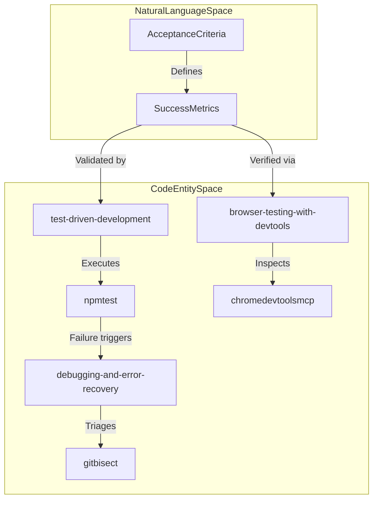
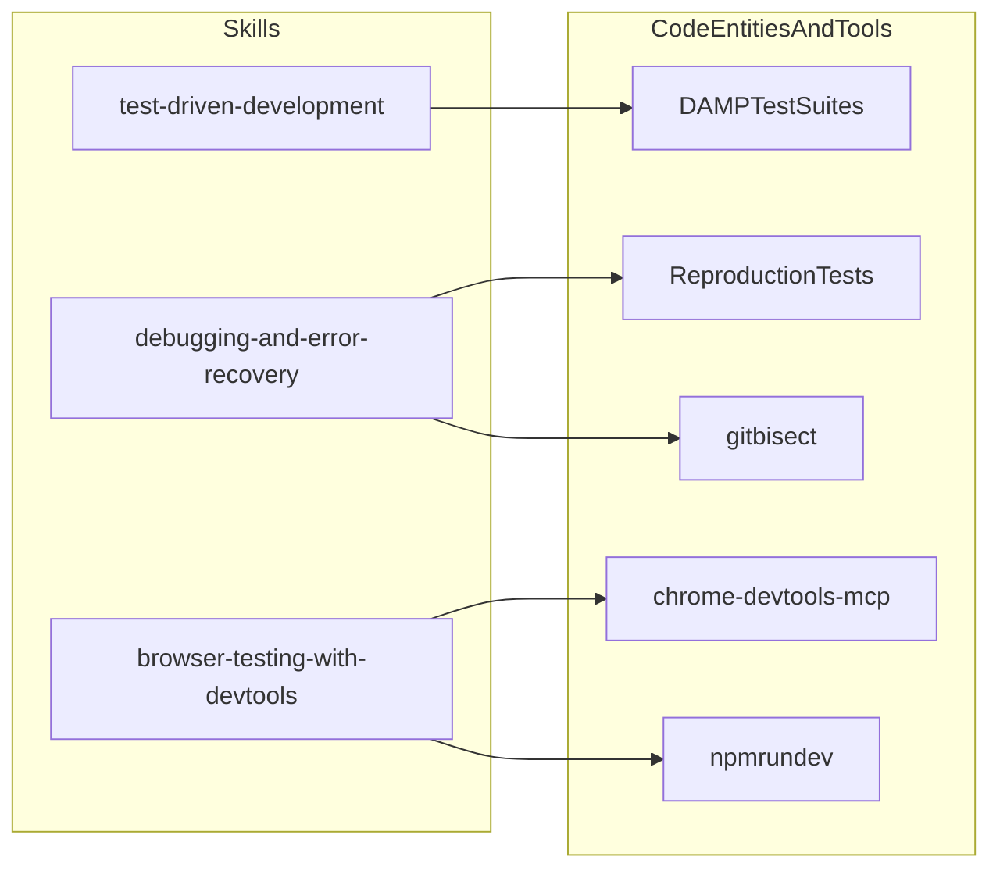

<!-- source: DeepWiki mcp.deepwiki.com · repo addyosmani/agent-skills · page 2.4 Verify Phase: Testing & Debugging · fetched 2026-10-30 -->

# Verify Phase: Testing & Debugging

Relevant source files

The following files were used as context for generating this wiki page:

- [evals/cases/git-workflow-and-versioning.json](evals/cases/git-workflow-and-versioning.json)
- [skills/debugging-and-error-recovery/SKILL.md](skills/debugging-and-error-recovery/SKILL.md)
- [skills/git-workflow-and-versioning/SKILL.md](skills/git-workflow-and-versioning/SKILL.md)
- [skills/incremental-implementation/SKILL.md](skills/incremental-implementation/SKILL.md)
- [skills/test-driven-development/SKILL.md](skills/test-driven-development/SKILL.md)

The **Verify Phase** ensures that implementation matches the technical specification and remains free of regressions. This phase shifts the focus from "building" to "proving," utilizing a combination of automated testing, runtime inspection, and systematic debugging. In the `agent-skills` lifecycle, verification is triggered when an agent must validate code health before moving to the Review Phase.

## Overview of Verification Skills

The Verify phase is comprised of three primary disciplines that allow an agent to move from "it seems to work" to "it is proven to work."

### Test-Driven Development (TDD)
TDD is the foundational skill for all behavioral changes. It enforces a **Red-Green-Refactor** cycle [skills/test-driven-development/SKILL.md:38-47](), ensuring that every piece of logic is covered by a test that has been seen to fail. This skill also introduces the **Prove-It Pattern** for bug fixes, where a reproduction test must be written before any fix is attempted [skills/test-driven-development/SKILL.md:96-117]().

For details, see [Test-Driven Development](#2.4.1).

### Browser Testing with DevTools
For frontend and UI engineering, static tests are often insufficient. This skill utilizes the **Chrome DevTools MCP** to provide the agent with live runtime data. It allows for DOM inspection, network trace analysis, and performance profiling to verify that the application behaves correctly in a real browser environment. It also defines security boundaries for handling untrusted browser content.

For details, see [Browser Testing with DevTools](#2.4.2).

### Debugging & Error Recovery
When tests fail or unexpected behavior occurs, the agent employs a systematic triage process rather than guessing. This skill centers on the **Stop-the-Line Rule** [skills/debugging-and-error-recovery/SKILL.md:21-32](), which halts feature development to focus entirely on root-cause analysis through a six-step pipeline: Reproduce, Localize, Reduce, Fix, Guard, and Verify [skills/debugging-and-error-recovery/SKILL.md:36-171]().

For details, see [Debugging & Error Recovery](#2.4.3).

Sources: [skills/test-driven-development/SKILL.md:8-11](), [skills/debugging-and-error-recovery/SKILL.md:10-32]()

## The Verification Workflow

The following diagram illustrates how the Verify phase bridges the gap between high-level requirements (Natural Language Space) and the actual execution of the code (Code Entity Space).

### Verification State Machine

Sources: [skills/test-driven-development/SKILL.md:24-34](), [skills/debugging-and-error-recovery/SKILL.md:101-110]()

## Resource Allocation: The Test Pyramid

Verification is optimized by distributing effort across different test sizes. The `agent-skills` framework adopts an **80/15/5** distribution to ensure fast feedback loops while maintaining high confidence [skills/test-driven-development/SKILL.md:144-159]().

| Size | Entity Type | Scope | Target % |
| :--- | :--- | :--- | :--- |
| **Small** | Unit Tests | Pure logic, no I/O, single process [skills/test-driven-development/SKILL.md:167-169]() | 80% |
| **Medium** | Integration Tests | API boundaries, Database, Localhost [skills/test-driven-development/SKILL.md:170-170]() | 15% |
| **Large** | E2E Tests | Full user flows, real browser (DevTools) [skills/test-driven-development/SKILL.md:171-171]() | 5% |

Sources: [skills/test-driven-development/SKILL.md:144-174]()

### Mapping Skills to Code Entities
This diagram maps the verification skills to the specific tools and commands used within the codebase to enforce quality.

Sources: [skills/test-driven-development/SKILL.md:38-65](), [skills/debugging-and-error-recovery/SKILL.md:40-110]()

## Key Principles of Verification

*   **The Beyonce Rule:** "If you liked it, you should have put a test on it." No feature is considered "done" without automated proof of its correctness [skills/test-driven-development/SKILL.md:160-162]().
*   **Stop-the-Line:** Never push past a failing test. A bug in the current step makes all subsequent steps invalid [skills/debugging-and-error-recovery/SKILL.md:21-34]().
*   **Root Cause over Symptom:** Fix the underlying logic (e.g., a SQL join) rather than patching the manifestation (e.g., UI deduplication) [skills/debugging-and-error-recovery/SKILL.md:121-136]().
*   **Incremental Verification:** Implement a thin slice, test it, verify it, then expand. Never write more than ~100 lines before testing [skills/incremental-implementation/SKILL.md:10-17]().

Sources: [skills/test-driven-development/SKILL.md:160-162](), [skills/debugging-and-error-recovery/SKILL.md:21-34](), [skills/incremental-implementation/SKILL.md:10-17]()

---
Sources:
- [skills/test-driven-development/SKILL.md:1-180]()
- [skills/debugging-and-error-recovery/SKILL.md:1-180]()
- [skills/incremental-implementation/SKILL.md:1-50]()

---

