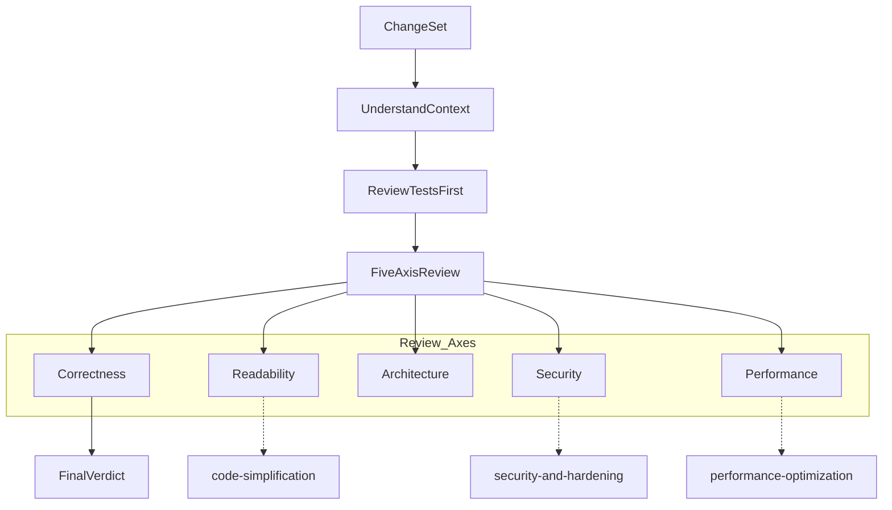
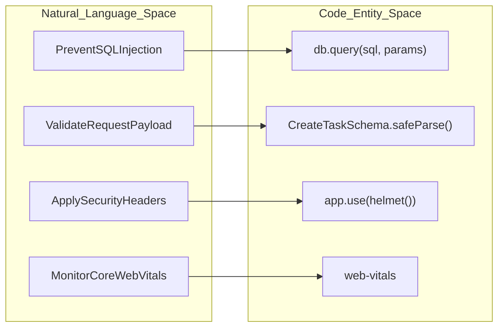

<!-- source: DeepWiki mcp.deepwiki.com · repo addyosmani/agent-skills · page 2.5 Review Phase: Quality, Security & Performance · fetched 2026-10-30 -->

# Review Phase: Quality, Security & Performance

Relevant source files

The following files were used as context for generating this wiki page:

- [evals/cases/code-review-and-quality.json](evals/cases/code-review-and-quality.json)
- [references/security-checklist.md](references/security-checklist.md)
- [skills/code-review-and-quality/SKILL.md](skills/code-review-and-quality/SKILL.md)
- [skills/security-and-hardening/SKILL.md](skills/security-and-hardening/SKILL.md)
- [skills/security-and-hardening/references/hardening-patterns.md](skills/security-and-hardening/references/hardening-patterns.md)

The Review Phase is the final validation gate in the development lifecycle before code is prepared for shipping. It ensures that implementations not only satisfy the functional requirements defined in the [Define Phase: Interviewing, Idea Refinement & Spec-Driven Development](#2.1) but also adhere to strict engineering standards for maintainability, safety, and efficiency. This phase transitions the focus from raw feature delivery to overall system health.

## Multi-Axis Review System

The core evaluation framework assesses every change across five distinct axes to maintain comprehensive code quality [skills/code-review-and-quality/SKILL.md:8-12]():

1. **Correctness**: Verification against specifications, boundary conditions, and error paths [skills/code-review-and-quality/SKILL.md:26-35]().
2. **Readability & Simplicity**: Enforcing clear naming conventions, straightforward control flow, and eliminating unnecessary complexity [skills/code-review-and-quality/SKILL.md:36-48]().
3. **Architecture**: Maintaining clean module boundaries, correct dependency direction, and appropriate abstraction levels [skills/code-review-and-quality/SKILL.md:49-58]().
4. **Security**: Identifying vulnerabilities, sanitizing untrusted inputs, and safeguarding credentials [skills/code-review-and-quality/SKILL.md:59-71]().
5. **Performance**: Detecting anti-patterns such as `N+1` queries, unconstrained loops, and excessive UI re-renders [skills/code-review-and-quality/SKILL.md:72-82]().

For details on review severity taxonomies, change sizing, and multi-model review patterns, see [Code Review & Quality](#2.5.1).

Sources: [skills/code-review-and-quality/SKILL.md:8-82]()

## Structural Integrity & Code Simplification

To prevent complexity creep, the review phase incorporates the `code-simplification` skill. This process relies on **Chesterton's Fence**—ensuring an existing abstraction is fully understood before removal—and follows a structured pipeline of comprehension, signal identification, refactoring, and behavior preservation gates [skills/code-review-and-quality/SKILL.md:88-101]().

For deep dives into structural signals, language-specific refactoring patterns, and `/code-simplify` command integration, see [Code Simplification](#2.5.2).

Sources: [skills/code-review-and-quality/SKILL.md:88-101]()

## Security & Hardening

Security is treated as a continuous constraint enforced through the `security-and-hardening` skill. Threat modeling via STRIDE is applied to all trust boundaries, backed by the **Three-Tier Boundary System** [skills/security-and-hardening/SKILL.md:21-53]():

| Tier | Requirements | Examples |
| :--- | :--- | :--- |
| **Always Do** | Mandatory security baselines | Input validation schemas, parameterized SQL queries, security headers [skills/security-and-hardening/SKILL.md:44-54]() |
| **Ask First** | Requires human approval | Modifying authentication flows, CORS settings, or handling PII [skills/security-and-hardening/SKILL.md:55-64]() |
| **Never Do** | Hard programmatic blockers | Committing plaintext secrets, executing `eval()`, logging credentials [skills/security-and-hardening/SKILL.md:65-74]() |

For implementation patterns, OWASP prevention guidelines, and path containment rules, see [Security & Hardening](#2.5.3).

Sources: [skills/security-and-hardening/SKILL.md:21-74](), [references/security-checklist.md:68-95]()

## Performance Optimization

Performance governance follows a strict **MEASURE → IDENTIFY → FIX → VERIFY → GUARD** lifecycle. Optimization efforts target Core Web Vitals thresholds and eliminate backend database inefficiencies like `N+1` query execution paths [skills/security-and-hardening/SKILL.md:1-10]() (referencing performance requirements).

For profiling tools, connection pool management, caching strategies, and the `/webperf` command flow, see [Performance Optimization](#2.5.4).

Sources: [skills/security-and-hardening/SKILL.md:1-10]()

## Review Phase Logic Flow

The following diagram maps the transition of code changes through the verification and review subsystems, linking high-level review stages to specific execution handlers.

### Diagram: Review Phase Logic Flow

Sources: [skills/code-review-and-quality/SKILL.md:22-82](), [skills/security-and-hardening/SKILL.md:21-53]()

## Natural Language to Code Entity Mapping

This diagram bridges natural language quality requirements to precise code entities and middleware functions enforced during review.

### Diagram: Natural Language to Code Entity Mapping

Sources: [skills/security-and-hardening/references/hardening-patterns.md:15-22](), [skills/security-and-hardening/references/hardening-patterns.md:158-166](), [skills/security-and-hardening/references/hardening-patterns.md:85-87]()

---

## Child Pages
- **[Code Review & Quality](#2.5.1)** — Five-axis review system, change sizing, feedback taxonomy, and dispute resolution.
- **[Code Simplification](#2.5.2)** — Chesterton's Fence, behavior preservation gates, structural signals, and the `/code-simplify` command.
- **[Security & Hardening](#2.5.3)** — STRIDE threat modeling, Three-Tier Boundary System, OWASP Top 10, path containment, and dependency checks.
- **[Performance Optimization](#2.5.4)** — Core Web Vitals, MEASURE→IDENTIFY→FIX→VERIFY→GUARD lifecycle, `N+1` query fixes, and the `/webperf` command.

---

