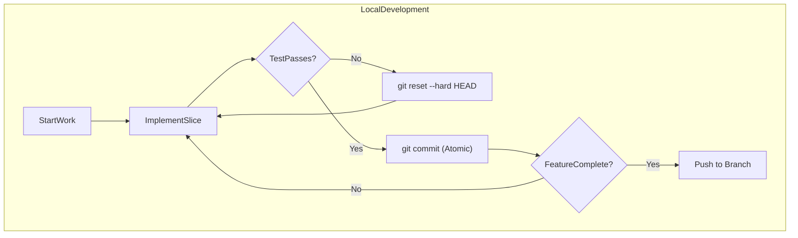
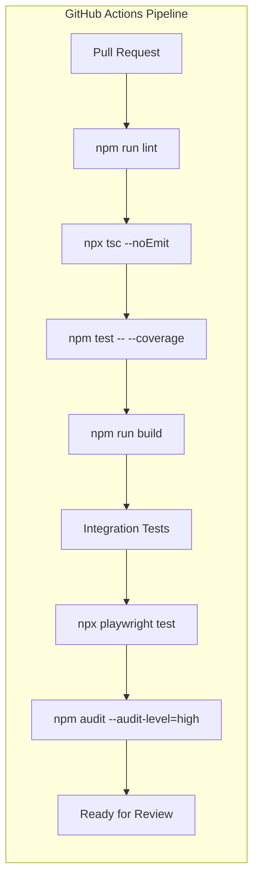
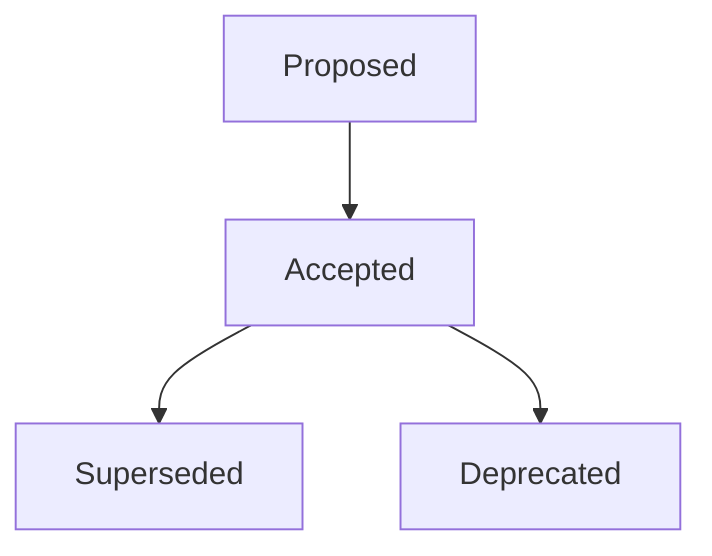
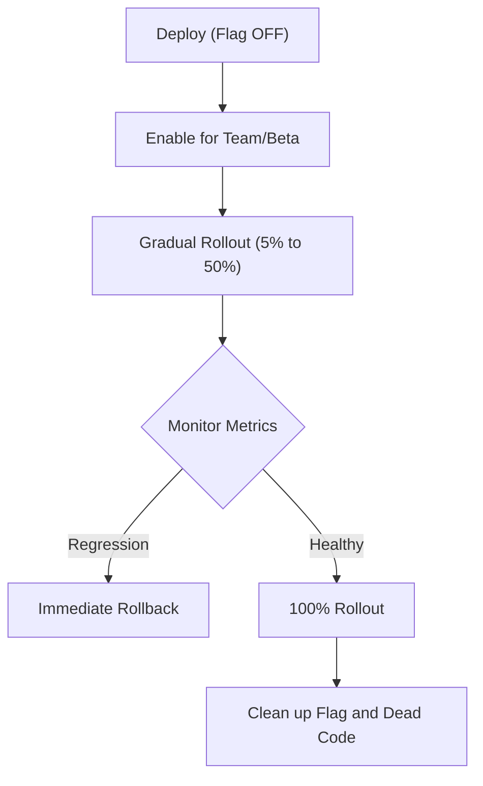
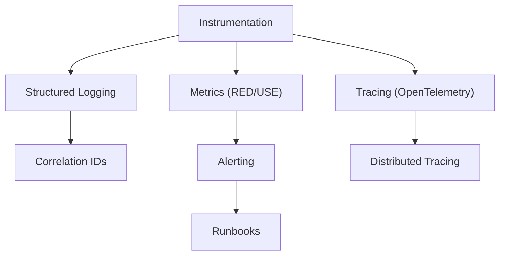

<!-- source: DeepWiki mcp.deepwiki.com · repo addyosmani/agent-skills · page 2.6 Ship Phase: Git, CI/CD, Observability & Launch · fetched 2026-10-30 -->

# Ship Phase: Git, CI/CD, Observability & Launch

Relevant source files

The following files were used as context for generating this wiki page:

- [evals/fixtures/test-driven-development-ecosystem/README.md](evals/fixtures/test-driven-development-ecosystem/README.md)
- [evals/fixtures/test-driven-development-ecosystem/ledger.py](evals/fixtures/test-driven-development-ecosystem/ledger.py)
- [evals/fixtures/test-driven-development-ecosystem/test_ledger.py](evals/fixtures/test-driven-development-ecosystem/test_ledger.py)
- [references/accessibility-checklist.md](references/accessibility-checklist.md)
- [references/testing-patterns.md](references/testing-patterns.md)
- [skills/ci-cd-and-automation/SKILL.md](skills/ci-cd-and-automation/SKILL.md)
- [skills/shipping-and-launch/SKILL.md](skills/shipping-and-launch/SKILL.md)

The **Ship Phase** represents the final stage of the agent-led development lifecycle. It focuses on the disciplined movement of code from local environments to production through automated verification, version control hygiene, and structured rollout strategies. This phase ensures that the high-velocity output of AI agents remains stable, reversible, and observable.

The Ship Phase is governed by core skills that transform a completed implementation into a live, monitored feature. The `/ship` slash command automates this phase by orchestrating a parallel fan-out of specialist personas to verify the change before synthesis into a go/no-go decision [.claude/commands/ship.md:5-18]().

## Git Workflow & Versioning

Git serves as the primary safety net for agentic workflows. By treating commits as granular "save points," agents can explore complex implementations while maintaining the ability to revert to a known-good state instantly [skills/git-workflow-and-versioning/SKILL.md:9-11](). This skill enforces **Trunk-Based Development**, favoring short-lived feature branches over long-lived integration branches to minimize merge debt [skills/git-workflow-and-versioning/SKILL.md:18-26]().

Agents are instructed to use atomic commits and descriptive messages that explain the *why* behind a change [skills/git-workflow-and-versioning/SKILL.md:48-71](). For parallel work, the use of `git worktree` is recommended to allow multiple agents to operate on different branches simultaneously without interference [skills/git-workflow-and-versioning/SKILL.md:147-161]().

Title: "Git Save Point Cycle"

Sources: [skills/git-workflow-and-versioning/SKILL.md:34-46](), [skills/git-workflow-and-versioning/SKILL.md:173-189]()

For details, see [Git Workflow & Versioning](#2.6.1).

## CI/CD & Automation

CI/CD is the ultimate enforcement mechanism for all other skills in the repository. It defines a **Quality Gate Pipeline** that every Pull Request must pass before being considered for merge [skills/ci-cd-and-automation/SKILL.md:10-12](). This automation provides a critical feedback loop for agents: if a gate fails, the agent consumes the CI error logs, applies a fix, and re-verifies locally before pushing again [skills/ci-cd-and-automation/SKILL.md:164-191]().

Title: "Quality Gate Pipeline Execution"

Sources: [skills/ci-cd-and-automation/SKILL.md:24-52](), [skills/ci-cd-and-automation/SKILL.md:58-98](), [skills/ci-cd-and-automation/SKILL.md:141-162]()

For details, see [CI/CD & Automation](#2.6.2).

## Documentation, ADRs & Deprecation

As features ship, the codebase's living documentation must be updated to prevent context drift. This includes recording **Architecture Decision Records (ADRs)** to capture the reasoning, context, and consequences of significant technical choices [skills/documentation-and-adrs/SKILL.md:10-11]().

This skill also manages the sunsetting of old code through safe deprecation patterns—treating code as a liability that must be removed when it no longer earns its keep. It ensures that the `README.md` and API documentation remain current as the system evolves.

Title: "ADR Lifecycle"

Sources: [skills/documentation-and-adrs/SKILL.md:95-101]()

For details, see [Documentation, ADRs & Deprecation](#2.6.3).

## Shipping & Launch

The final act of shipping requires a structured rollout and monitoring window. This skill utilizes **Feature Flags** to decouple the deployment of code from the release of features to users [skills/shipping-and-launch/SKILL.md:77-79](). It mandates a comprehensive pre-launch checklist covering code quality, security, and performance [skills/shipping-and-launch/SKILL.md:20-59]().

The `/ship` command enforces this by running specialist personas in parallel to identify blockers before a mandatory rollback plan is generated [.claude/commands/ship.md:11-17](), [.claude/commands/ship.md:55-59]().

Title: "Feature Flag Lifecycle"

Sources: [skills/shipping-and-launch/SKILL.md:81-102](), [skills/shipping-and-launch/SKILL.md:142-161](), [.claude/commands/ship.md:39-64]()

For details, see [Shipping & Launch](#2.6.4).

## Observability & Instrumentation

Effective shipping relies heavily on robust observability. This skill focuses on instrumenting the codebase to provide insights into its behavior in production. Key aspects include structured JSON logs, correlation IDs for tracing requests, and defining RED (Rate, Errors, Duration) and USE (Utilization, Saturation, Errors) metrics. It also covers OpenTelemetry tracing and establishing symptom-based alerting with runbooks.

Title: "Observability Pillars"

Sources: [skills/shipping-and-launch/SKILL.md:162-186]()

For details, see [Observability & Instrumentation](#2.6.5).

---
**Sources:**
- [.claude/commands/ship.md:1-72]()
- [skills/ci-cd-and-automation/SKILL.md:1-250]()
- [skills/documentation-and-adrs/SKILL.md:1-288]()
- [skills/git-workflow-and-versioning/SKILL.md:1-355]()
- [skills/shipping-and-launch/SKILL.md:1-330]()

---

