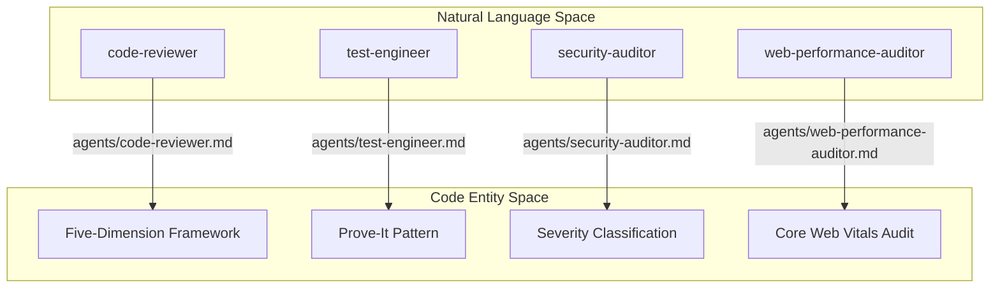
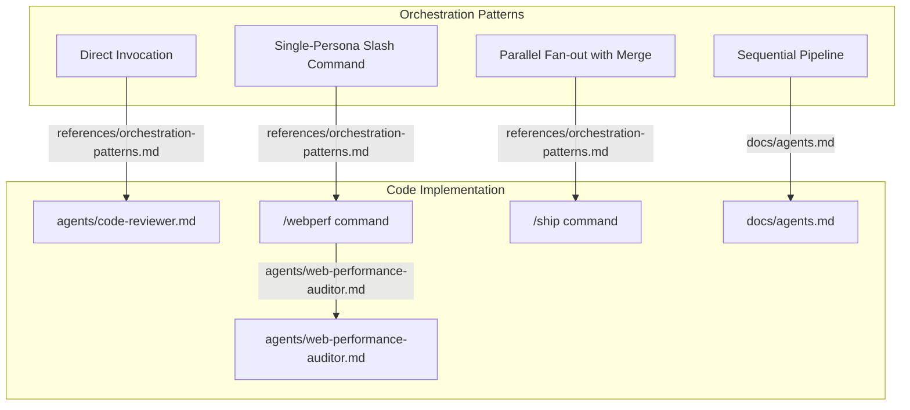

<!-- source: DeepWiki mcp.deepwiki.com · repo addyosmani/agent-skills · page 3 Agent Personas & Orchestration · fetched 2026-10-30 -->

# Agent Personas & Orchestration

Relevant source files

The following files were used as context for generating this wiki page:

- [.claude/rules/skills-contributing.md](.claude/rules/skills-contributing.md)
- [AGENTS.md](AGENTS.md)
- [agents/code-reviewer.md](agents/code-reviewer.md)
- [agents/security-auditor.md](agents/security-auditor.md)
- [agents/test-engineer.md](agents/test-engineer.md)
- [docs/agents.md](docs/agents.md)
- [docs/opencode-setup.md](docs/opencode-setup.md)
- [references/orchestration-patterns.md](references/orchestration-patterns.md)

The `agent-skills` framework provides four specialized agent personas located in the `agents/` directory [docs/agents.md:1-11](). These personas combine specific sets of skills and mental models to handle high-stakes development phases: code review, quality assurance, security auditing, and web performance auditing [docs/agents.md:1-11]().

This page provides a high-level overview of the relationship between **Skills** (the *how*), **Personas** (the *who*), and **Orchestration** (the *when*) [docs/agents.md:12-21](). For deep technical details, refer to the child pages linked throughout.

## Persona Overview

Each persona is defined by a markdown file in `agents/` that specifies its name, description, and operational rules [docs/agents.md:1-3]().

| Persona | File Path | Primary Role | Composition Role |
|:---|:---|:---|:---|
| **Code Reviewer** | [agents/code-reviewer.md:1-4]() | Senior Staff Engineer | The *who* — adopts a viewpoint, produces a report [docs/agents.md:19]() |
| **Test Engineer** | [agents/test-engineer.md:1-4]() | QA Engineer | The *who* — adopts a viewpoint, produces a report [docs/agents.md:19]() |
| **Security Auditor** | [agents/security-auditor.md:1-4]() | Security Engineer | The *who* — adopts a viewpoint, produces a report [docs/agents.md:19]() |
| **Web Performance Auditor** | [agents/web-performance-auditor.md:1-10]() | Web Performance Engineer | The *who* — adopts a viewpoint, produces a report [docs/agents.md:19]() |

### Persona-to-Code Mapping

The following diagram bridges the natural language personas defined in `agents/` to their corresponding execution frameworks in the codebase.

Title: Persona Execution Flow

Sources: [agents/code-reviewer.md:10-46](), [agents/test-engineer.md:30-36](), [agents/security-auditor.md:49-56](), [agents/web-performance-auditor.md:57-96]()

---

## Code Reviewer Persona

The **Code Reviewer** (`agents/code-reviewer.md`) acts as a Senior Staff Engineer, evaluating changes across a five-dimension framework covering Correctness, Readability, Architecture, Security, and Performance [agents/code-reviewer.md:6-46](). Findings are categorized into Critical, Required, Optional, and Nit tiers [agents/code-reviewer.md:49-58]().

For details on the review rules, severity definitions, and output templates, see [Code Reviewer Persona](#3.1).

Sources: [agents/code-reviewer.md:1-92]()

---

## Test Engineer, Security Auditor & Web Performance Auditor Personas

These three specialist personas handle test strategy, threat modeling, and web performance metrics:

- **Test Engineer** (`agents/test-engineer.md`): Focuses on test coverage, test level selection (unit, integration, E2E), and the Prove-It pattern for bug verification [agents/test-engineer.md:6-36]().
- **Security Auditor** (`agents/security-auditor.md`): Focuses on STRIDE-based threat modeling, OWASP Top 10 / LLM Top 10 vulnerabilities, input handling, and authorization [agents/security-auditor.md:6-55]().
- **Web Performance Auditor** (`agents/web-performance-auditor.md`): Focuses on Core Web Vitals (LCP, CLS, INP), loading optimizations, and rendering efficiency via `/webperf` [docs/agents.md:5-11]().

For deep dives into each persona's operational rules and output formats, see [Test Engineer, Security Auditor & Web Performance Auditor Personas](#3.2).

Sources: [agents/test-engineer.md:1-90](), [agents/security-auditor.md:1-96](), [agents/web-performance-auditor.md:1-96]()

---

## Orchestration Patterns

Orchestration governs how these personas interact. The governing rule is that **the user (or a slash command) is the orchestrator; personas do not invoke other personas** [docs/agents.md:21](), [agents/code-reviewer.md:102](), [agents/security-auditor.md:112](), [agents/test-engineer.md:95]().

### Endorsed Patterns
1. **Direct Invocation:** Single persona, single perspective for localized tasks [docs/agents.md:27-31]().
2. **Single-Persona Slash Command:** Commands like `/review` or `/webperf` that wrap a persona with project skills [docs/agents.md:34-39]().
3. **Parallel Fan-out with Merge:** Multiple independent personas execute concurrently (e.g. `/ship`), with a final synthesis step [docs/agents.md:42-46]().
4. **Sequential Pipeline:** User-driven command sequencing (`/spec` → `/plan` → `/build` → `/test` → `/review`) [docs/agents.md:55]().
5. **Research Isolation:** Spawning isolated sub-agents to read large corpora without polluting main context [docs/agents.md:110-111]().

### Orchestration Architecture Mapping

Title: Orchestration Pattern Mapping

Sources: [docs/agents.md:27-68](), [.claude/commands/webperf.md:20-27](), [agents/web-performance-auditor.md:1-4]()

For details on platform-specific Claude Code interop (Subagents vs. Agent Teams) and anti-patterns, see [Orchestration Patterns](#3.3).

Sources: [docs/agents.md:21-113](), [references/orchestration-patterns.md:1-138]()

---

