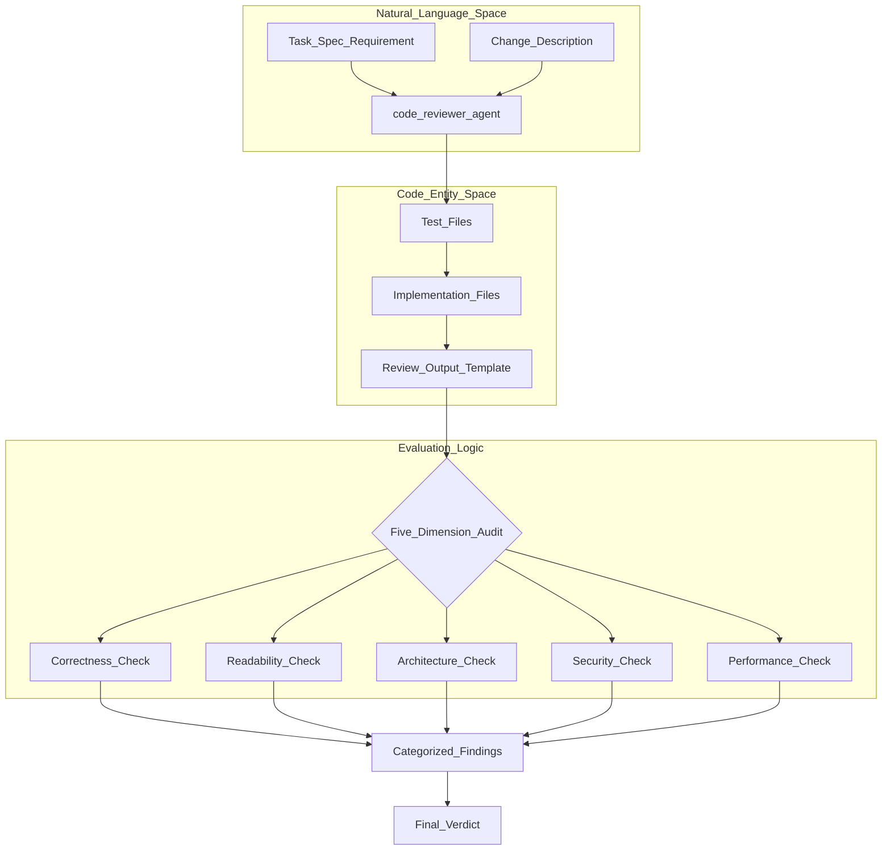
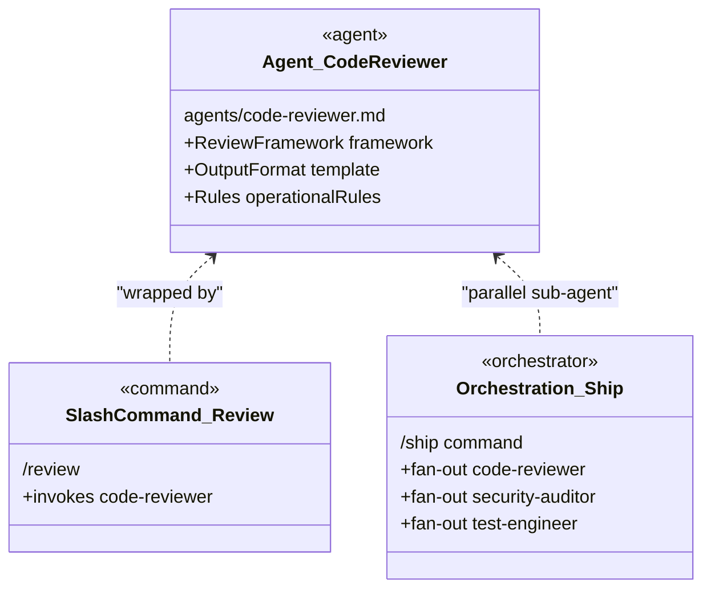

<!-- source: DeepWiki mcp.deepwiki.com · repo addyosmani/agent-skills · page 3.1 Code Reviewer Persona · fetched 2026-10-30 -->

# Code Reviewer Persona

<details>
<summary>Relevant source files</summary>

The following files were used as context for generating this wiki page:

- [agents/code-reviewer.md](agents/code-reviewer.md)
- [agents/security-auditor.md](agents/security-auditor.md)
- [agents/test-engineer.md](agents/test-engineer.md)
- [docs/agents.md](docs/agents.md)
- [evals/cases/code-review-and-quality.json](evals/cases/code-review-and-quality.json)
- [skills/code-review-and-quality/SKILL.md](skills/code-review-and-quality/SKILL.md)

</details>


The **Code Reviewer Persona** (`agents/code-reviewer.md`) is a specialized agent configuration designed to act as an experienced Staff Engineer. It enforces quality standards by evaluating code changes against a rigorous five-dimension framework (`agents/code-reviewer.md:10-46`). The agent is invoked directly via harness tools or orchestrated via multi-agent pipelines like `/ship` (`agents/code-reviewer.md:99-102`).

## Purpose and Scope

The primary goal of the `code-reviewer` agent is to ensure that every change improves overall codebase health (`skills/code-review-and-quality/SKILL.md:10-12`). It serves as a quality gate balancing technical excellence with pragmatic progress, adhering to continuous improvement rather than demanding unattainable perfection (`skills/code-review-and-quality/SKILL.md:12-12`).

### Core Responsibilities
*   **Contextual Analysis**: Reading the specification or task description before inspecting code to understand intent (`agents/code-reviewer.md:91-92`).
*   **Test-First Evaluation**: Reviewing tests before implementation to verify intent and coverage (`agents/code-reviewer.md:90-90`).
*   **Multi-Axis Assessment**: Auditing code across Correctness, Readability, Architecture, Security, and Performance (`agents/code-reviewer.md:10-46`).
*   **Actionable Feedback**: Delivering structured reviews with explicit severity labels and specific fix recommendations (`agents/code-reviewer.md:49-57`, `agents/code-reviewer.md:93-93`).

Sources: [agents/code-reviewer.md:1-9](), [skills/code-review-and-quality/SKILL.md:10-13]()

---

## Five-Dimension Review Framework

The agent evaluates every change across five distinct axes as defined in `agents/code-reviewer.md:10-46` and `skills/code-review-and-quality/SKILL.md:22-87`.

| Axis | Focus Area | Key Evaluation Criteria |
| :--- | :--- | :--- |
| **Correctness** | Logic & Requirements | Verifies spec adherence, handling of edge cases (null, empty, boundary values), error path handling, test validity, and absence of race conditions or state inconsistencies (`agents/code-reviewer.md:14-19`). |
| **Readability** | Maintainability & Simplicity | Assesses descriptive naming, control flow complexity, module organization, elimination of dead code, and avoidance of unnecessary abstractions (`agents/code-reviewer.md:20-25`, `skills/code-review-and-quality/SKILL.md:38-50`). |
| **Architecture** | System Design | Evaluates adherence to existing patterns, module boundary maintenance, circular dependency avoidance, and appropriate abstraction levels (`agents/code-reviewer.md:26-32`, `skills/code-review-and-quality/SKILL.md:51-63`). |
| **Security** | Vulnerability Prevention | Checks input validation at boundaries, secret management, authorization checks, query parameterization, output encoding, and dependency vulnerabilities (`agents/code-reviewer.md:33-39`, `skills/code-review-and-quality/SKILL.md:64-76`). |
| **Performance** | Efficiency | Detects N+1 query patterns, unbounded loops, unconstrained fetching, synchronous blocking operations, unnecessary UI re-renders, and missing pagination (`agents/code-reviewer.md:40-46`, `skills/code-review-and-quality/SKILL.md:77-87`). |

### The Review Data Flow

Title: Code Reviewer Execution Pipeline

Sources: [agents/code-reviewer.md:10-55](), [agents/code-reviewer.md:90-91]()

---

## Output Format & Severity Taxonomy

Findings are categorized using a strict severity taxonomy mirroring `skills/code-review-and-quality/SKILL.md` to distinguish blockers from optional improvements (`agents/code-reviewer.md:49-57`).

### Severity Levels
1. **Critical**: Blocks merge. Reserved for security vulnerabilities, data loss risks, or broken functionality (`agents/code-reviewer.md:51-51`).
2. **Required**: Must address before merge. Includes missing tests, incorrect abstractions, or poor error handling (`agents/code-reviewer.md:53-53`).
3. **Optional**: Worth considering but not required. Covers simpler designs or useful refactors (`agents/code-reviewer.md:55-55`).
4. **Nit**: Minor and optional; author may ignore. Covers formatting, naming, or style preferences (`agents/code-reviewer.md:57-57`).

### Review Output Template
All reviews follow the exact Markdown template defined in `agents/code-reviewer.md:59-87`.

Title: Review Output Template Structure
```markdown
## Review Summary

**Verdict:** APPROVE | REQUEST CHANGES

**Overview:** [1-2 sentences summarizing the change and overall assessment]

### Critical Issues
- [File:line] [Description and recommended fix]

### Required Changes
- [File:line] [Description and recommended fix]

### Optional
- [File:line] [Description]

### Nits
- [File:line] [Description]

### What's Done Well
- [Positive observation — always include at least one]

### Verification Story
- Tests reviewed: [yes/no, observations]
- Build verified: [yes/no]
- Security checked: [yes/no, observations]
```
Sources: [agents/code-reviewer.md:59-87]()

---

## Implementation Rules & Orchestration

The `agents/code-reviewer.md` persona operates under strict execution rules and composition limits (`agents/code-reviewer.md:89-102`):

*   **Test-First Inspection**: Review tests before implementation code to understand author intent (`agents/code-reviewer.md:90-90`).
*   **Spec Alignment**: Read the spec or task description before executing the review (`agents/code-reviewer.md:91-91`).
*   **Mandatory Fixes**: Every `Critical` and `Required` finding must include a specific fix recommendation (`agents/code-reviewer.md:92-92`).
*   **Blocker Enforcement**: Never approve code containing unresolved `Critical` issues (`agents/code-reviewer.md:93-93`).
*   **Positive Reinforcement**: Acknowledge successful patterns and clean implementations (`agents/code-reviewer.md:94-94`).
*   **Uncertainty Handling**: Surface uncertainties as investigation recommendations rather than guessing (`agents/code-reviewer.md:95-95`).
*   **Orchestration Boundary**: Personas do not invoke other personas. Multi-agent fan-out is reserved for commands like `/ship` (`agents/code-reviewer.md:99-102`, `docs/agents.md:99-102`).

### Persona Association Diagram

Title: Persona to Code Mapping

Sources: [agents/code-reviewer.md:1-6](), [agents/code-reviewer.md:99-102](), [docs/agents.md:57-68]()

---

