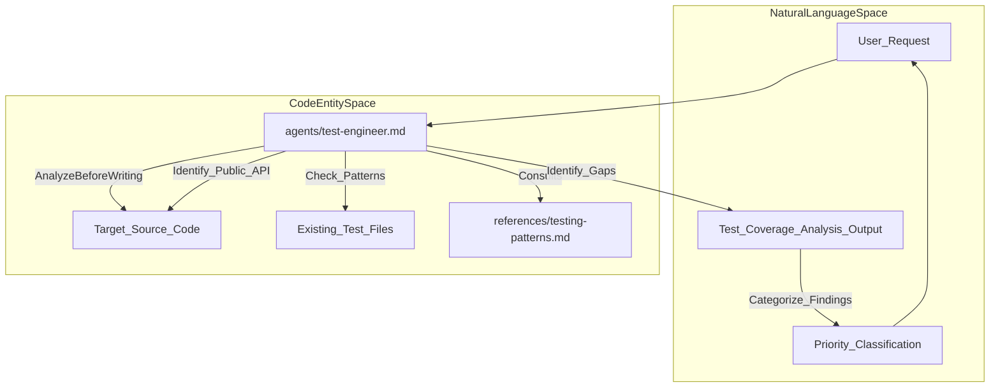
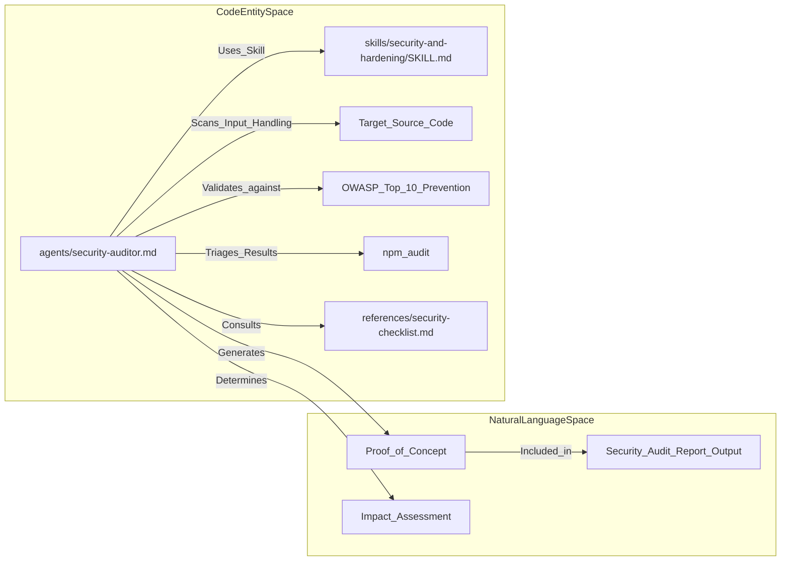
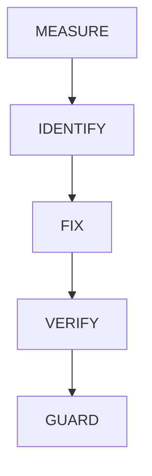
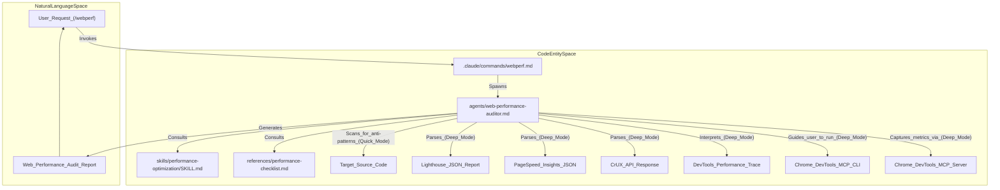

<!-- source: DeepWiki mcp.deepwiki.com · repo addyosmani/agent-skills · page 3.2 Test Engineer, Security Auditor & Web Performance Auditor Personas · fetched 2026-10-30 -->

# Test Engineer, Security Auditor & Web Performance Auditor Personas

Relevant source files

The following files were used as context for generating this wiki page:

- [.claude/commands/webperf.md](.claude/commands/webperf.md)
- [agents/code-reviewer.md](agents/code-reviewer.md)
- [agents/security-auditor.md](agents/security-auditor.md)
- [agents/test-engineer.md](agents/test-engineer.md)
- [agents/web-performance-auditor.md](agents/web-performance-auditor.md)
- [docs/agents.md](docs/agents.md)

This page details the specialized agent personas used for quality assurance, security verification, and performance optimization within the `agent-skills` framework. While the **Code Reviewer** provides a general five-axis evaluation [agents/code-reviewer.md:10-46](), the **Test Engineer**, **Security Auditor**, and **Web Performance Auditor** agents offer deep-dive technical analysis into test suite architecture, vulnerability research, and web performance characteristics.

## Test Engineer Persona

The `test-engineer` agent is a QA specialist focused on test strategy, implementation, and coverage analysis [agents/test-engineer.md:1-8](). It is designed to ensure that code changes are not only functional but also resilient against regressions and edge cases.

### Core Testing Strategy
The agent follows a hierarchical approach to selecting the appropriate test level to ensure a fast, reliable feedback loop [agents/test-engineer.md:20-28]():

| Logic Type | Test Level | Rationale |
| :--- | :--- | :--- |
| **Pure logic, no I/O** | `Unit test` | Fast execution, isolated verification. |
| **Crosses a boundary** | `Integration test` | Verifies contract between modules/services. |
| **Critical user flow** | `E2E test` | Verifies the entire system from the user's perspective. |

### The Prove-It Pattern
For bug fixes, the `test-engineer` enforces a strict "Test-First" protocol known as the **Prove-It Pattern** [agents/test-engineer.md:30-36]():
1.  **Reproduce**: Write a test that demonstrates the bug (must fail with current code) [agents/test-engineer.md:33]().
2.  **Fail**: Confirm the test fails [agents/test-engineer.md:34]().
3.  **Handoff**: Report that the test is ready for the fix implementation [agents/test-engineer.md:35]().

### Test Engineer Data Flow
The following diagram illustrates how the `test-engineer` processes a codebase to generate a **Test Coverage Analysis**.

**Test Analysis & Generation Workflow**

Sources: [agents/test-engineer.md:12-19](), [agents/test-engineer.md:59-79](), [agents/test-engineer.md:94]()

### Implementation Rules
- **Behavior over Implementation**: Tests must verify what the code does, not how it does it [agents/test-engineer.md:83]().
- **Independence**: No shared mutable state between tests [agents/test-engineer.md:85]().
- **Boundary Mocking**: Mocks are applied at system boundaries (database, network), never between internal functions [agents/test-engineer.md:87]().
- **Scenario Coverage**: Every component must be tested against Happy Path, Empty Input, Boundary Values, Error Paths, and Concurrency [agents/test-engineer.md:49-58]().

Sources: [agents/test-engineer.md:1-90]()

---

## Security Auditor Persona

The `security-auditor` agent is a security engineer focused on vulnerability detection, threat modeling, and secure coding practices [agents/security-auditor.md:1-8](). It moves beyond general correctness to identify practical, exploitable risks.

### Audit Scope
The auditor evaluates the codebase across six primary domains [agents/security-auditor.md:10-54]():
1.  **Input Handling**: Validation at boundaries, injection prevention (SQL/NoSQL/OS), and XSS encoding [agents/security-auditor.md:12-18]().
2.  **AuthN & AuthZ**: Password hashing (Argon2/Bcrypt), secure session management (HttpOnly/Secure cookies), and IDOR prevention [agents/security-auditor.md:19-26]().
3.  **Data Protection**: Secret management (Env vars), PII handling, and encryption at rest/transit [agents/security-auditor.md:27-33]().
4.  **Infrastructure**: Security headers (CSP, HSTS, X-Frame-Options), CORS policy, and dependency vulnerability auditing [agents/security-auditor.md:34-40]().
5.  **Third-Party Integrations**: Webhook signature validation and OAuth PKCE flows [agents/security-auditor.md:41-46]().
6.  **AI / LLM Features**: Prompt injection, excessive agency, and unbounded consumption [agents/security-auditor.md:48-54]().

### Severity Classification
Findings are ranked by exploitability and impact to determine the required response [agents/security-auditor.md:57-66]():

| Severity | Criteria | Action |
| :--- | :--- | :--- |
| **Critical** | Remotely exploitable, leads to data breach or full compromise. | Fix immediately; block release. |
| **High** | Exploitable with some conditions, significant data exposure. | Fix before release. |
| **Medium** | Limited impact or requires authenticated access to exploit. | Fix in current sprint. |
| **Low** | Theoretical risk or defense-in-depth improvement. | Schedule for next sprint. |
| **Info** | Best practice recommendation, no current risk. | Consider adopting. |

### Security Audit Data Flow
This diagram shows how the `security-auditor` maps source code vulnerabilities to the **Security Audit Report**.

**Security Audit Pipeline**

Sources: [agents/security-auditor.md:57-85](), [agents/security-auditor.md:89-94](), [skills/security-and-hardening/SKILL.md:54-165](), [skills/security-and-hardening/SKILL.md:216]()

### Audit Rules
- **Practicality First**: Focus on exploitable vulnerabilities rather than theoretical risks [agents/security-auditor.md:89]().
- **Actionable Fixes**: Every finding must include a specific, actionable recommendation [agents/security-auditor.md:90]().
- **Evidence-Based**: Provide proof of concept or exploitation scenarios for Critical/High findings [agents/security-auditor.md:91]().
- **No Degradation**: Never suggest disabling security controls (e.g., bypassing CORS) as a "fix" [agents/security-auditor.md:95]().

Sources: [agents/security-auditor.md:1-96](), [skills/security-and-hardening/SKILL.md:1-10]()

---

## Web Performance Auditor Persona

The `web-performance-auditor` agent is a specialist in web performance engineering, focusing on Core Web Vitals, loading, rendering, and network optimization [agents/web-performance-auditor.md:1-8](). This persona is invoked via the `/webperf` command [.claude/commands/webperf.md:1-4]().

### Operating Modes

The `web-performance-auditor` operates in two distinct modes based on the availability of performance data:

#### Quick Mode
This is the default mode when no tool artifacts are provided [agents/web-performance-auditor.md:11-15](). In this mode, the agent:
- Scans source code directly for structural anti-patterns.
- Tags every finding as `potential impact`.
- Marks the scorecard as `not measured` and leaves it empty.

#### Deep Mode
Activated when tool artifacts or live measurements are available [agents/web-performance-auditor.md:17-27](). The agent interprets data from various sources:
- **Lighthouse JSON report**: Parses `lighthouseResult` for lab metrics, opportunities, and diagnostics [agents/web-performance-auditor.md:20-21]().
- **PageSpeed Insights JSON**: Parses both `lighthouseResult` (lab data) and `loadingExperience` (CrUX field data) [agents/web-performance-auditor.md:22-23]().
- **CrUX API response**: Provides field data (p75 over the last 28 days) [agents/web-performance-auditor.md:24]().
- **DevTools performance trace (Perfetto JSON)**: Defers complex interpretation to Chrome DevTools MCP (`performance_analyze_insight`) [agents/web-performance-auditor.md:25-26]().
- **Live capture via Chrome DevTools MCP server**: Captures metrics directly using `lighthouse_audit`, `performance_start_trace`, `performance_stop_trace`, and `performance_analyze_insight` [agents/web-performance-auditor.md:27]().
- **Chrome DevTools MCP CLI**: Guides the user to invoke CLI commands like `chrome-devtools lighthouse_audit` to provide JSON output [agents/web-performance-auditor.md:28-30]().

The scorecard is populated only with values backed by these sources, with unmeasured fields marked as `not measured` [agents/web-performance-auditor.md:31-32]().

### Metric-Honesty Rule

A critical rule for this persona is **never to fabricate metrics** [agents/web-performance-auditor.md:42]().
- If no tool data is provided, it returns a source-level findings report, marks the scorecard as `not measured`, and labels findings as `potential impact` [agents/web-performance-auditor.md:44-47]().
- When data is provided, each scorecard value is labeled with its source (e.g., `Field (CrUX)`, `Lab (Lighthouse)`, `Trace (DevTools)`) [agents/web-performance-auditor.md:48-49]().

### Core Web Vitals Targets

The persona uses the following targets for Core Web Vitals [skills/performance-optimization/SKILL.md:23-29]():

| Metric | Good | Needs Improvement | Poor |
|---|---|---|---|
| **LCP** (Largest Contentful Paint) | ≤ 2.5s | ≤ 4.0s | > 4.0s |
| **INP** (Interaction to Next Paint) | ≤ 200ms | ≤ 500ms | > 500ms |
| **CLS** (Cumulative Layout Shift) | ≤ 0.1 | ≤ 0.25 | > 0.25 |

### Web Performance Audit Flow

The `web-performance-auditor` follows a structured workflow to identify and address performance bottlenecks, as outlined in the `performance-optimization` skill [skills/performance-optimization/SKILL.md:31-38]():

**Performance Optimization Workflow**

Sources: [skills/performance-optimization/SKILL.md:31-38]()

### Web Performance Auditor Data Flow

The following diagram illustrates the data flow for the `web-performance-auditor` persona, showing how it consumes various inputs and produces an audit report.

**Web Performance Audit Pipeline**

Sources: [agents/web-performance-auditor.md:1-39](), [agents/web-performance-auditor.md:42-51](), [skills/performance-optimization/SKILL.md:1-267](), [references/performance-checklist.md:1-236](), [.claude/commands/webperf.md:1-32]()

### Review Scope

The auditor identifies the framework and rendering model (e.g., React, Vue, Next.js) to apply framework-specific checks [agents/web-performance-auditor.md:55-57](). The review scope covers:
1.  **Core Web Vitals**: LCP element loading, image optimization (`fetchpriority`, lazy loading), CLS causes (images, embeds, fonts), INP blockers (long tasks, event handlers), `scheduler.yield()`, soft navigation, and Long Animation Frames (LoAF) [agents/web-performance-auditor.md:59-68]().
2.  **Loading**: TTFB, `preconnect`/`dns-prefetch`, `fetchpriority` for critical resources, Speculation Rules API, font optimization (self-hosting, `font-display`, subsetting), image formats, bundle size, code splitting, and blocking scripts [agents/web-performance-auditor.md:70-82]().
3.  **Rendering / JavaScript**: Unnecessary re-renders, list virtualization, GPU-accelerated animations, layout thrashing, `content-visibility: auto`, View Transitions API, bfcache preservation, and AI-generated anti-patterns like state duplication or overuse of memoization hooks [agents/web-performance-auditor.md:84-96]().

Sources: [agents/web-performance-auditor.md:55-96]()

---

