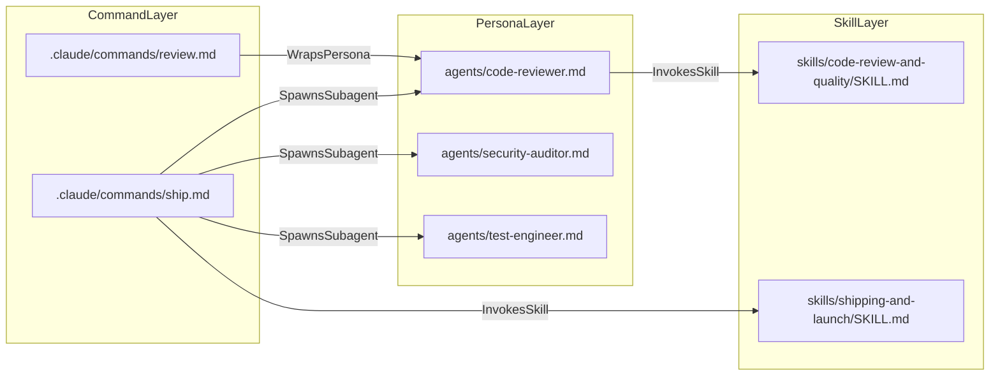
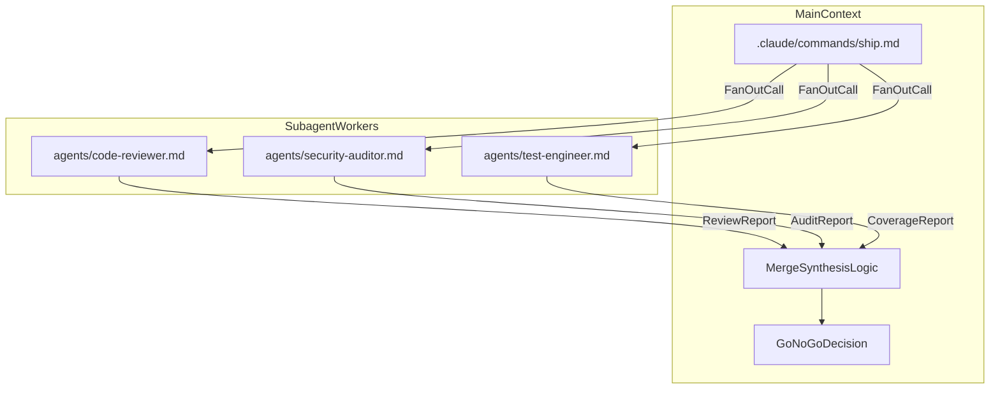

<!-- source: DeepWiki mcp.deepwiki.com · repo addyosmani/agent-skills · page 3.3 Orchestration Patterns · fetched 2026-10-30 -->

# Orchestration Patterns

Relevant source files

The following files were used as context for generating this wiki page:

- [.claude/rules/skills-contributing.md](.claude/rules/skills-contributing.md)
- [AGENTS.md](AGENTS.md)
- [agents/code-reviewer.md](agents/code-reviewer.md)
- [agents/security-auditor.md](agents/security-auditor.md)
- [agents/test-engineer.md](agents/test-engineer.md)
- [docs/agents.md](docs/agents.md)
- [docs/opencode-setup.md](docs/opencode-setup.md)
- [references/orchestration-patterns.md](references/orchestration-patterns.md)

This page documents the endorsed multi-agent orchestration patterns used to coordinate specialist personas, skills, and user-facing commands within the `agent-skills` ecosystem. The governing principle is that **the user (or a slash command) is the orchestrator**; personas are specialized workers that do not invoke other personas [references/orchestration-patterns.md:5-6]().

## Purpose and Scope

Section 3.3 outlines how multi-agent workflows are structured to maintain system predictability, prevent token waste, and enforce strict boundaries between orchestration layers. It serves as the reference implementation guide for coordinating `agents/code-reviewer.md`, `agents/security-auditor.md`, and `agents/test-engineer.md` across different execution models [AGENTS.md:70-85]().

Sources: [references/orchestration-patterns.md:1-6](), [AGENTS.md:70-85]()

---

## Core Orchestration Principles & Layering

To maintain system predictability, agent workflows are divided into three composable layers with distinct responsibilities:

1.  **Skills** (`skills/<name>/SKILL.md`): The *how*. Workflows containing discrete steps and explicit exit criteria [AGENTS.md:74]().
2.  **Personas** (`agents/<role>.md`): The *who*. Specialist roles that adopt a specific perspective and output format [AGENTS.md:75]().
3.  **Slash Commands** (`.claude/commands/*.md` or `commands/*.toml`): The *when*. The orchestration layer and user-facing entry points [AGENTS.md:76]().

### The User-as-Orchestrator Rule

Composition rules dictate that **the user or a slash command is the orchestrator; personas do not invoke other personas** [references/orchestration-patterns.md:5-6](). A persona may invoke skills, but if a workflow requires multiple perspectives, coordination must occur at the command layer or via direct user intervention [AGENTS.md:78](). This prevents intermediate "router" or "meta-orchestrator" agents from introducing paraphrasing hops, which cause information loss and double token costs [docs/agents.md:79-98]().

Sources: [AGENTS.md:70-83](), [references/orchestration-patterns.md:1-6](), [docs/agents.md:12-23]()

---

## Endorsed Orchestration Patterns

### 1. Direct Invocation

The simplest pattern where a single persona is called directly for a single artifact, representing the baseline cost and round-trip metric.

*   **Data Flow:** `user → code-reviewer → report → user` [references/orchestration-patterns.md:16]()
*   **Use Case:** One perspective on one artifact (e.g., calling `agents/code-reviewer.md` to review a specific PR) [references/orchestration-patterns.md:19-24]().

### 2. Single-Persona Slash Command

A user-facing command that wraps a single persona with project skills, saving the user from re-explaining workflows repeatedly [references/orchestration-patterns.md:30-36]().

*   **Data Flow:** `/review → code-reviewer (with code-review-and-quality skill) → report` [references/orchestration-patterns.md:35]()
*   **Examples:** `/review`, `/test`, `/code-simplify` [references/orchestration-patterns.md:40]().

### 3. Parallel Fan-out with Merge

Multiple personas operate concurrently on the same input, each producing an independent report, followed by a synthesis step in the main agent's context [references/orchestration-patterns.md:48-56]().

*   **Data Flow:** Main agent spawns `agents/code-reviewer.md`, `agents/security-auditor.md`, and `agents/test-engineer.md` concurrently, waiting for all outputs before executing merge logic [references/orchestration-patterns.md:53-56]().
*   **Canonical Example:** The `/ship` command [references/orchestration-patterns.md:64]().

### 4. Sequential Pipeline as User-Driven Slash Commands

A sequence of user-driven slash commands where context or commit history is carried between discrete steps, maintaining human-in-the-loop checkpoints [references/orchestration-patterns.md:78-86]().

*   **Data Flow:** `user runs: /spec → /plan → /build → /test → /review → /ship` [references/orchestration-patterns.md:83]()
*   **Rationale:** Avoids the summarization loss and context degradation of automated lifecycle orchestrators [references/orchestration-patterns.md:90-92]().

### 5. Research Isolation

Spawning an isolated sub-agent to process large amounts of data (such as reading dozens of files) and return only a compact digest, preventing context pollution in the main session [references/orchestration-patterns.md:96-102]().

*   **Data Flow:** `main agent → research sub-agent (reads 50 files) → digest → main agent continues` [references/orchestration-patterns.md:101]()
*   **Platform Note:** On Claude Code, the built-in `Explore` subagent should be used rather than defining a custom research persona [references/orchestration-patterns.md:113]().

Sources: [references/orchestration-patterns.md:9-115]()

---

## Natural Language Space to Code Entity Mapping

To bridge natural language intent to code entities, the following diagram illustrates how user-invoked commands map directly to underlying persona files and skill directories.

Title: "Orchestration Entity Mapping"

Sources: [docs/agents.md:12-22](), [references/orchestration-patterns.md:30-64]()

---

## Parallel Fan-out Implementation (`/ship`)

The parallel fan-out pattern used in `/ship` leverages distinct subagent execution to evaluate changes across multiple specialist dimensions simultaneously.

Title: "Parallel Fan-out Execution Flow"

Sources: [references/orchestration-patterns.md:48-67](), [docs/agents.md:60-71]()

---

## Anti-Patterns

The following patterns are strictly prohibited to avoid architectural complexity, excessive token consumption, and debugging dead-ends:

| Anti-Pattern | Description | Why it Fails |
| :--- | :--- | :--- |
| **Router Persona** | A persona whose sole job is to decide which other persona to call [references/orchestration-patterns.md:44](). | Adds an unnecessary middle-man hop with no domain value; duplicates intent mapping already handled by slash commands [docs/agents.md:79-97](). |
| **Paraphrasing Orchestrator** | An agent that receives output from a specialist and paraphrases it back to the user [references/orchestration-patterns.md:92](). | Induces information loss, increases latency, and doubles token expenditure [references/orchestration-patterns.md:92-93](). |
| **Nested Teams / Subagents** | Subagents attempting to spawn their own downstream subagents [references/orchestration-patterns.md:21-22](). | Violates hard platform constraints (e.g., Claude Code restrictions where subagents cannot spawn subagents) [AGENTS.md:84](). |

Sources: [references/orchestration-patterns.md:44-93](), [docs/agents.md:79-98](), [AGENTS.md:84]()

---

## Subagents vs. Agent Teams

In harness implementations such as Claude Code, multi-agent coordination takes two distinct forms: standard subagents and experimental Agent Teams [references/orchestration-patterns.md:125-135]().

| Feature | Subagents (Pattern 3) | Agent Teams (Experimental) |
| :--- | :--- | :--- |
| **Coordination Model** | Main agent fans out; sub-agents report strictly back to the caller [references/orchestration-patterns.md:131](). | Teammates message each other directly and share a common task list [references/orchestration-patterns.md:131](). |
| **Context Boundaries** | Independent, isolated context window per subagent [references/orchestration-patterns.md:132](). | Independent context window per teammate instance [references/orchestration-patterns.md:132](). |
| **Primary Use Case** | Independent concurrent tasks producing isolated reports [references/orchestration-patterns.md:133](). | Collaborative engineering work requiring back-and-forth discussion [references/orchestration-patterns.md:133](). |
| **Platform Status** | Stable and generally available [references/orchestration-patterns.md:134](). | Experimental — requires `CLAUDE_CODE_EXPERIMENTAL_AGENT_TEAMS=1` [references/orchestration-patterns.md:134](). |
| **Token Cost** | Lower [references/orchestration-patterns.md:135](). | Higher — each teammate operates as a separate Claude instance [references/orchestration-patterns.md:135](). |

The core personas (`agents/code-reviewer.md`, `agents/security-auditor.md`, `agents/test-engineer.md`) are engineered to function identically in both modes. When spawned as subagents, they return structured markdown reports; when instantiated within Agent Teams, their instruction blocks append cleanly to team-coordination system prompts [docs/agents.md:106-114]().

Sources: [references/orchestration-patterns.md:125-138](), [docs/agents.md:106-114]()

---

