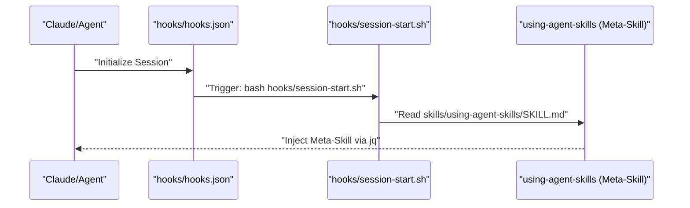

<!-- source: DeepWiki mcp.deepwiki.com · repo addyosmani/agent-skills · page 4 Slash Commands & Hooks · fetched 2026-10-30 -->

# Slash Commands & Hooks

Relevant source files

The following files were used as context for generating this wiki page:

- [.claude/commands/review.md](.claude/commands/review.md)
- [.claude/commands/ship.md](.claude/commands/ship.md)
- [hooks/SIMPLIFY-IGNORE.md](hooks/SIMPLIFY-IGNORE.md)
- [hooks/sdd-cache-test.sh](hooks/sdd-cache-test.sh)
- [hooks/simplify-ignore-test.sh](hooks/simplify-ignore-test.sh)
- [hooks/simplify-ignore.sh](hooks/simplify-ignore.sh)

The automation layer of `agent-skills` provides a streamlined interface for interacting with the engineering lifecycle. It consists of two primary mechanisms: **Slash Commands**, which allow users to explicitly trigger specific skill pipelines, and **Session Hooks**, which automate background tasks and maintain agent state across sessions.

### System Architecture: Automation Layer

The following diagram illustrates how the automation layer bridges natural language commands to the underlying code entities (skills and scripts).

```mermaid
graph TD
    subgraph "Natural_Language_Space"
        User["User Input (e.g., '/spec', '/plan', '/ship')"]
        Annotate["Code Annotations (e.g., 'simplify-ignore-start')"]
    end

    subgraph "Code_Entity_Space_Automation"
        direction TB
        ClaudeCommandsDir[".claude/commands/"]
        TomlCommandsDir["commands/"]
        GeminiCommandsDir[".gemini/commands/"]
        HooksDir["hooks/"]
        HooksJSON["hooks/hooks.json"]
        SessionStart["hooks/session-start.sh"]
        SpecClaudeCmd[".claude/commands/spec.md"]
        TestClaudeCmd[".claude/commands/test.md"]
        TestTomlCmd["commands/test.toml"]
        BuildTomlCmd["commands/build.toml"]
        ReviewTomlCmd["commands/review.toml"]
        PluginConfig[".claude-plugin/plugin.json"]
    end

    subgraph "Code_Entity_Space_Skills"
        SpecSkill["skills/spec-driven-development/SKILL.md"]
        TestSkill["skills/test-driven-development/SKILL.md"]
        IncrementalImplSkill["skills/incremental-implementation/SKILL.md"]
        CodeReviewSkill["skills/code-review-and-quality/SKILL.md"]
        MetaSkill["skills/using-agent-skills/SKILL.md"]
        BrowserTestSkill["skills/browser-testing-with-devtools/SKILL.md"]
        DebugSkill["skills/debugging-and-error-recovery/SKILL.md"]
        PlanningSkill["skills/planning-and-task-breakdown/SKILL.md"]
        SecuritySkill["skills/security-and-hardening/SKILL.md"]
        PerfSkill["skills/performance-optimization/SKILL.md"]
    end

    User -->|"Triggers"| ClaudeCommandsDir
    User -->|"Triggers"| TomlCommandsDir
    User -->|"Triggers"| GeminiCommandsDir

    PluginConfig -->|"Points to Commands"| ClaudeCommandsDir
    
    SpecClaudeCmd -->|"Invokes"| SpecSkill
    TestClaudeCmd -->|"Invokes"| TestSkill
    TestClaudeCmd -->|"Invokes"| BrowserTestSkill
    TestTomlCmd -->|"Invokes"| TestSkill
    TestTomlCmd -->|"Invokes"| BrowserTestSkill
    BuildTomlCmd -->|"Invokes"| IncrementalImplSkill
    BuildTomlCmd -->|"Invokes"| TestSkill
    BuildTomlCmd -->|"Invokes"| PlanningSkill
    BuildTomlCmd -->|"Invokes"| DebugSkill
    ReviewTomlCmd -->|"Invokes"| CodeReviewSkill
    ReviewTomlCmd -->|"Invokes"| SecuritySkill
    ReviewTomlCmd -->|"Invokes"| PerfSkill

    HooksJSON -->|"Configures SessionStart"| SessionStart
    SessionStart -->|"Injects"| MetaSkill
```

Sources: [.claude-plugin/plugin.json:10-13](), [hooks/hooks.json:1-14](), [hooks/session-start.sh:1-28](), [.claude/commands/spec.md:5-5](), [.claude/commands/test.md:5-5](), [.claude/commands/test.md:19-19](), [commands/test.toml:4-4](), [commands/test.toml:18-18](), [commands/build.toml:4-4](), [commands/build.toml:32-32](), [commands/build.toml:36-36](), [commands/review.toml:4-4](), [commands/review.toml:13-14]()

---

## Slash Commands

Slash commands are defined across three directories to support different agent environments: `.claude/commands/` (Markdown), `commands/` (TOML), and `.gemini/commands/` (TOML). These commands act as entry points that encapsulate complex multi-step instructions and reference specific skills from the `skills/` directory.

The system supports several core commands corresponding to the SDLC phases, including advanced orchestration patterns. For detailed execution pipelines, command definitions, and cross-tool parity rules, see [Slash Commands](#4.1).

| Command | Primary Skill Invoked | Execution Pattern | Claude Command File | TOML Command File |
| :--- | :--- | :--- | :--- | :--- |
| `/spec` | `spec-driven-development` | Sequential pipeline | [.claude/commands/spec.md]() | (N/A) |
| `/plan` | `planning-and-task-breakdown` | Sequential pipeline | (N/A) | (N/A) |
| `/build` | `incremental-implementation` | Implementation loop | (N/A) | [commands/build.toml]() |
| `/test` | `test-driven-development` | Verification loop | [.claude/commands/test.md]() | [commands/test.toml]() |
| `/constraints` | `constraint-driven-development` | Quality gate | (N/A) | (N/A) |
| `/review` | `code-review-and-quality` | Quality gate | [.claude/commands/review.md]() | [commands/review.toml]() |
| `/webperf` | `performance-optimization` | Audit and optimize | (N/A) | (N/A) |
| `/code-simplify` | `code-simplification` | Structural refactoring | (N/A) | (N/A) |
| `/ship` | `shipping-and-launch` | **Parallel Fan-out** | [.claude/commands/ship.md]() | (N/A) |

### Cross-Tool Parity

The commands are mirrored across different formats to ensure broad compatibility. For example, the `/test` command is available as a Markdown file for Claude Code [[.claude/commands/test.md:1-20]]() and as a TOML file for other agents [[commands/test.toml:1-19]](). The content and invoked skills are largely consistent, providing a unified experience regardless of the underlying agent.

### Orchestration in Commands
Commands like `/build auto` demonstrate the complexity of the automation layer. This mode allows the agent to generate a plan, get a single approval, and then implement every task without stopping between them, while still ensuring each task earns a passing test and its own commit [[commands/build.toml:8-12]](). It also integrates with other skills like `planning-and-task-breakdown` if no plan exists [[commands/build.toml:32-32]]() and `debugging-and-error-recovery` if a test fails or the build breaks [[commands/build.toml:36-36]](). Additionally, commands such as `/ship` utilize parallel fan-out across multiple specialist personas [[.claude/commands/ship.md:7-18]]().

Sources: [.claude/commands/spec.md:1-17](), [.claude/commands/test.md:1-19](), [commands/test.toml:1-19](), [commands/build.toml:1-43](), [.claude/commands/review.md:1-16](), [.claude/commands/ship.md:1-28]()

---

## Session Hooks

The hooks system allows the agent to execute logic automatically based on lifecycle events. This is configured via `hooks/hooks.json` [[hooks/hooks.json:1-14]]().

### Lifecycle Events

The primary event utilized is `SessionStart`. When a new session begins, the system triggers the `SessionStart` hook, which executes a shell script to prepare the environment [[hooks/hooks.json:3-12]]().

Sources: [hooks/hooks.json:1-14](), [hooks/session-start.sh:1-28]()

### Automation Features
*   **Session Initialization:** The `SessionStart` hook runs `session-start.sh` to auto-inject the `using-agent-skills` meta-skill [[hooks/session-start.sh:3-7]](). This ensures the agent is aware of the repository's engineering standards from the first prompt by outputting a JSON message with `hookSpecificOutput` [[hooks/session-start.sh:22-25]](). It also checks for `jq` and handles cases where the meta-skill is not found [[hooks/session-start.sh:13-15]](), [[hooks/session-start.sh:27-28]]().
*   **Protection Hooks:** Specialized hooks like `simplify-ignore` provide block-level protection during `/code-simplify` operations via `PreToolUse`, `PostToolUse`, and `Stop` events, preventing the model from modifying or viewing sensitive blocks [hooks/simplify-ignore.sh:2-14](), [hooks/SIMPLIFY-IGNORE.md:51-60]().
*   **Source Driven Development Cache:** The `sdd-cache` hooks provide a revalidation cache for the `source-driven-development` skill, optimizing external documentation fetching [hooks/sdd-cache-test.sh:1-12]().

For detailed configuration parameters, hook regression test suites, and known limitations, see [Session Hooks](#4.2).

Sources: [hooks/hooks.json:1-14](), [hooks/session-start.sh:1-28](), [hooks/simplify-ignore.sh:2-14](), [hooks/SIMPLIFY-IGNORE.md:51-60](), [hooks/sdd-cache-test.sh:1-12]()

---

