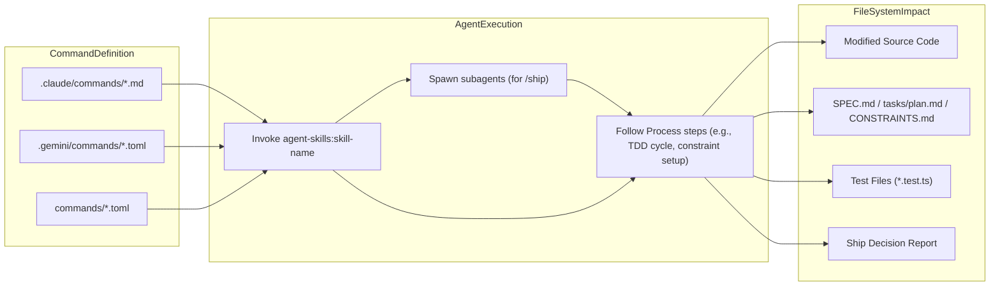

<!-- source: DeepWiki mcp.deepwiki.com · repo addyosmani/agent-skills · page 4.1 Slash Commands · fetched 2026-10-30 -->

# Slash Commands

Relevant source files

The following files were used as context for generating this wiki page:

- [.claude/commands/build.md](.claude/commands/build.md)
- [.claude/commands/plan.md](.claude/commands/plan.md)
- [.claude/commands/review.md](.claude/commands/review.md)
- [.claude/commands/ship.md](.claude/commands/ship.md)
- [.claude/commands/spec.md](.claude/commands/spec.md)
- [.claude/commands/test.md](.claude/commands/test.md)
- [.gemini/commands/build.toml](.gemini/commands/build.toml)
- [.gemini/commands/code-simplify.toml](.gemini/commands/code-simplify.toml)
- [.gemini/commands/planning.toml](.gemini/commands/planning.toml)
- [.gemini/commands/review.toml](.gemini/commands/review.toml)
- [.gemini/commands/ship.toml](.gemini/commands/ship.toml)
- [.gemini/commands/spec.toml](.gemini/commands/spec.toml)
- [.gemini/commands/test.toml](.gemini/commands/test.toml)
- [commands/build.toml](commands/build.toml)
- [commands/code-simplify.toml](commands/code-simplify.toml)
- [commands/planning.toml](commands/planning.toml)
- [commands/review.toml](commands/review.toml)
- [commands/ship.toml](commands/ship.toml)
- [commands/test.toml](commands/test.toml)
- [scripts/validate-commands-test.js](scripts/validate-commands-test.js)
- [scripts/validate-commands.js](scripts/validate-commands.js)

Slash commands provide a standardized interface for triggering high-level engineering workflows within the `agent-skills` framework. These commands are defined as Markdown files with YAML frontmatter in `.claude/commands/` for Claude Code, mirrored as TOML files in `.gemini/commands/` for Gemini CLI, and in `commands/` for Antigravity CLI [.claude/commands/build.md:1-3](), [.gemini/commands/build.toml:1-1](), [scripts/validate-commands.js:4-8]().

## Command Architecture

The system utilizes a "Command-to-Skill" mapping architecture. Each command acts as an orchestration layer that:
1. **Identifies the Context**: Determines which phase of the SDLC the user is targeting.
2. **Invokes the Skill**: Points the agent toward the specific `SKILL.md` file in the `skills/` directory [.claude/commands/spec.md:5-5](), [.claude/commands/constraints.md:5-5]().
3. **Sets the Execution Pipeline**: Provides a structured sequence of operations (e.g., Read → Write Test → Implement → Verify) [.gemini/commands/build.toml:6-15]().

### Natural Language to Code Entity Space Mapping

The following diagram illustrates how a user's intent (Natural Language Space) is translated into specific file-based instructions and skill invocations (Code Entity Space).

**Figure 1: Command Execution Flow**

```mermaid
graph TD
    subgraph "NaturalLanguageSpace"
        User["User types '/spec', '/plan', '/build', etc."]
    end

    subgraph "CommandDefinition"
        SpecMD[".claude/commands/spec.md"]
        PlanMD[".claude/commands/plan.md"]
        BuildMD[".claude/commands/build.md"]
        ConstraintsMD[".claude/commands/constraints.md"]
        ShipMD[".claude/commands/ship.md"]
        SpecTOML[".gemini/commands/spec.toml"]
        PlanningTOML[".gemini/commands/planning.toml"]
        BuildTOML[".gemini/commands/build.toml"]
        ConstraintsTOML[".gemini/commands/constraints.toml"]
        ShipTOML[".gemini/commands/ship.toml"]
    end

    subgraph "SkillLogic"
        SpecSkill["skills/spec-driven-development/SKILL.md"]
        PlanSkill["skills/planning-and-task-breakdown/SKILL.md"]
        BuildSkill["skills/incremental-implementation/SKILL.md"]
        TDD_Skill["skills/test-driven-development/SKILL.md"]
        ConstraintsSkill["skills/constraint-driven-development/SKILL.md"]
        ShipSkill["skills/shipping-and-launch/SKILL.md"]
    end

    subgraph "OutputArtifacts"
        SpecOut["SPEC.md"]
        PlanOut["tasks/plan.md"]
        TodoOut["tasks/todo.md"]
        ConstraintsOut["CONSTRAINTS.md"]
        ShipReport["Ship Decision: GO/NO-GO"]
        CodeChanges["Code Changes & Commits"]
    end

    User -->|Triggers| SpecMD
    User -->|Triggers| PlanMD
    User -->|Triggers| BuildMD
    User -->|Triggers| ConstraintsMD
    User -->|Triggers| ShipMD
    User -->|Triggers| SpecTOML
    User -->|Triggers| PlanningTOML
    User -->|Triggers| BuildTOML
    User -->|Triggers| ConstraintsTOML
    User -->|Triggers| ShipTOML
    
    SpecMD -->|Invokes| SpecSkill
    SpecTOML -->|Invokes| SpecSkill
    PlanMD -->|Invokes| PlanSkill
    PlanningTOML -->|Invokes| PlanSkill
    BuildMD -->|Invokes| BuildSkill
    BuildMD -->|Invokes| TDD_Skill
    BuildTOML -->|Invokes| BuildSkill
    BuildTOML -->|Invokes| TDD_Skill
    ConstraintsMD -->|Invokes| ConstraintsSkill
    ConstraintsTOML -->|Invokes| ConstraintsSkill
    ShipMD -->|Invokes| ShipSkill
    ShipTOML -->|Invokes| ShipSkill
    
    SpecSkill -->|Generates| SpecOut
    PlanSkill -->|Generates| PlanOut
    PlanSkill -->|Generates| TodoOut
    BuildSkill -->|Generates| CodeChanges
    TDD_Skill -->|Generates| CodeChanges
    ConstraintsSkill -->|Generates| ConstraintsOut
    ShipSkill -->|Synthesizes| ShipReport
```

Sources: [.claude/commands/spec.md:5-5](), [.claude/commands/constraints.md:5-5](), [.claude/commands/build.md:5-5](), [.claude/commands/plan.md:5-5](), [.claude/commands/ship.md:5-5](), [.gemini/commands/spec.toml:4-4](), [.gemini/commands/planning.toml:4-4](), [.gemini/commands/build.toml:4-4](), [.gemini/commands/constraints.toml:4-4](), [.gemini/commands/ship.toml:4-4](), [.gemini/commands/planning.toml:15-15](), [.claude/commands/ship.md:44-44]()

---

## Command Reference

### /spec (Define Phase)
**Skill Invoked**: `spec-driven-development` [.claude/commands/spec.md:5-5]()
**Purpose**: Initiates the project by creating a structured specification before any code is written.

*   **Pipeline**:
    1.  **Clarification**: Agent asks about objectives, features, tech stack, and boundaries [.claude/commands/spec.md:7-11]().
    2.  **Generation**: Agent generates a spec covering six core areas: objective, commands, project structure, code style, testing strategy, and boundaries [.claude/commands/spec.md:13-13]().
    3.  **Persistence**: Saves to `SPEC.md` in the project root [.claude/commands/spec.md:15-15]().

Sources: [.claude/commands/spec.md:1-16](), [.gemini/commands/spec.toml:1-17]()

### /plan (Plan Phase)
**Skill Invoked**: `planning-and-task-breakdown` [.claude/commands/plan.md:5-5]()
**Purpose**: Decomposes a specification into atomic, verifiable tasks. Note that for Gemini CLI and Antigravity CLI, the command file stem is mapped from `plan` to `planning` (`planning.toml`) to avoid name collisions [.gemini/commands/planning.toml:1-1](), [scripts/validate-commands.js:46-48]().

*   **Pipeline**:
    1.  **Read-Only Mode**: Agent analyzes `SPEC.md` and codebase without making changes [.gemini/commands/planning.toml:8-8]().
    2.  **Dependency Mapping**: Identifies the dependency graph between components [.gemini/commands/planning.toml:9-9]().
    3.  **Vertical Slicing**: Breaks work into complete paths rather than horizontal layers [.gemini/commands/planning.toml:10-10]().
    4.  **Artifact Creation**: Saves the detailed plan to `tasks/plan.md` and a checklist to `tasks/todo.md` [.gemini/commands/planning.toml:15-15]().

Sources: [.claude/commands/plan.md:1-18](), [.gemini/commands/planning.toml:1-18](), [scripts/validate-commands.js:46-48]()

### /build (Build Phase)
**Skill Invoked**: `incremental-implementation` & `test-driven-development` [.claude/commands/build.md:5-5]()
**Purpose**: Executes the next task in the plan using a strict Red-Green-Refactor cycle. It supports two modes: single-task (`/build`) and autonomous (`/build auto`) for implementing an entire plan after a single approval [.claude/commands/build.md:9-10]().

*   **Default Mode (`/build`)**:
    1.  **Task Selection**: Picks the next pending task from the plan [.claude/commands/build.md:16-16]().
    2.  **TDD Cycle**: Reads acceptance criteria, loads context, writes a failing test (RED), implements minimum code (GREEN), runs full test suite, verifies compilation, and commits [.claude/commands/build.md:18-24]().
    3.  **Completion**: Marks the task complete and stops [.claude/commands/build.md:25-25]().
*   **Autonomous Mode (`/build auto`)**:
    1.  **Pre-conditions**: Requires an existing `SPEC.md` and a clean Git status [.claude/commands/build.md:31-35]().
    2.  **Planning**: Generates `tasks/plan.md` if it doesn't exist [.claude/commands/build.md:36-36]().
    3.  **Single Checkpoint**: Presents the full plan for a single human approval before proceeding autonomously [.claude/commands/build.md:37-38]().
    4.  **Execution**: Executes every task in dependency order, following the TDD cycle for each, with one commit per task [.claude/commands/build.md:40-42]().
    5.  **Blockers**: Stops and asks the user if a test fails, the spec is ambiguous, or a task is high-risk (e.g., auth changes, destructive migrations) [.claude/commands/build.md:44](). In such cases, it invokes `debugging-and-error-recovery` or `doubt-driven-development` [.claude/commands/build.md:44]().
    6.  **Summary**: Provides a summary of completed tasks, tests, and commits at the end [.claude/commands/build.md:44]().

Sources: [.claude/commands/build.md:1-44](), [.gemini/commands/build.toml:1-43]()

### /test (Verify Phase)
**Skill Invoked**: `test-driven-development` [.claude/commands/test.md:5-5]()
**Purpose**: Runs the TDD workflow for new features or applies the "Prove-It" pattern for bugs.

*   **Pipeline (Bug Fixes)**:
    1.  **Reproduction**: Write a test that reproduces the bug (must fail) [.claude/commands/test.md:11-12]().
    2.  **Fix**: Implement the fix and confirm the test passes [.claude/commands/test.md:13-14]().
    3.  **Regression**: Run the full suite [.claude/commands/test.md:15-15]().
*   **Special Case**: For browser issues, invokes `browser-testing-with-devtools` [.claude/commands/test.md:19-19]().

Sources: [.claude/commands/test.md:1-19](), [.gemini/commands/test.toml:1-19]()

### /constraints (Define Phase)
**Skill Invoked**: `constraint-driven-development` [.claude/commands/constraints.md:5-5]()
**Purpose**: Defines and enforces the project's quality bar by setting up `CONSTRAINTS.md` and integrating relevant tools.

*   **Pipeline**:
    1.  **Detection**: Automatically detects existing project configurations (e.g., `package.json`, test runners, lint configs, CI workflows) [.claude/commands/constraints.md:11-12]().
    2.  **Interview**: Asks up to four questions to define quality dimensions, failure behavior (block/warn), target metrics, and acceptable check times [.claude/commands/constraints.md:14-17]().
    3.  **Documentation**: Writes `CONSTRAINTS.md` at the repo root, including a "Floor" section, enforced numbers, measured-only metrics, and an exceptions table [.claude/commands/constraints.md:19-19]().
    4.  **Tool Installation**: Installs and configures tools for each chosen dimension and records commands in `CONSTRAINTS.md` [.claude/commands/constraints.md:21-22]().
    5.  **Check Placement**: Places checks by cost: fast checks in the edit loop, related tests at task end, and others in review or CI [.claude/commands/constraints.md:24-25]().
    6.  **Agent Instruction**: Adds a line to `CLAUDE.md` (or `GEMINI.md`) instructing agents to adhere to `CONSTRAINTS.md` [.claude/commands/constraints.md:26-26]().
    7.  **Verification**: Runs the newly defined constraints against the current branch and fixes any disagreements [.claude/commands/constraints.md:28-28]().
*   **Sub-commands**:
    *   `/constraints check`: Runs current constraints and reports [.claude/commands/constraints.md:30-30]().
    *   `/constraints guard`: Inspects diff for weakened quality bars [.claude/commands/constraints.md:31-31]().
    *   `/constraints ratchet`: Records current measured values as the new floor [.claude/commands/constraints.md:32-32]().

Sources: [.claude/commands/constraints.md:1-32](), [.gemini/commands/constraints.toml:1-32](), [commands/constraints.toml:1-32]()

### /review (Review Phase)
**Skill Invoked**: `code-review-and-quality` [.claude/commands/review.md:5-5]()
**Purpose**: Conducts a multi-axis audit of recent changes.

*   **The Five Axes**:
    1.  **Correctness**: Match to spec and edge cases [.claude/commands/review.md:8-8]().
    2.  **Readability**: Naming and organization [.claude/commands/review.md:9-9]().
    3.  **Architecture**: Patterns and boundaries [.claude/commands/review.md:10-10]().
    4.  **Security**: Input validation and secrets (invokes `security-and-hardening`) [.claude/commands/review.md:11-11]().
    5.  **Performance**: N+1 queries and unbounded ops (invokes `performance-optimization`) [.claude/commands/review.md:12-12]().

Sources: [.claude/commands/review.md:1-16](), [.gemini/commands/review.toml:1-16](), [commands/review.toml:1-16]()

### /webperf (Review Phase)
**Skill Invoked**: `performance-optimization` (implicitly, as it's a specialist audit)
**Purpose**: Audits browser-facing applications for Core Web Vitals and performance issues. This command is a specialist audit, often invoked by other skills or directly by the user.

Sources: [docs/gemini-cli-setup.md:121-121]()

### /code-simplify (Review Phase)
**Skill Invoked**: `code-simplification` [.gemini/commands/code-simplify.toml:4-4]()
**Purpose**: Refactors code to reduce complexity while strictly preserving behavior.

*   **Pipeline**:
    1.  **Identification**: Scans for deep nesting, long functions, or nested ternaries [.gemini/commands/code-simplify.toml:11-17]().
    2.  **Incremental Application**: Applies changes one by one, running tests after every modification [.gemini/commands/code-simplify.toml:18-18]().
    3.  **Verification**: Reverts if tests fail [.gemini/commands/code-simplify.toml:21-21]().

Sources: [skills/code-simplification/SKILL.md:1-155](), [.gemini/commands/code-simplify.toml:1-22]()

### /ship (Ship Phase)
**Skill Invoked**: `shipping-and-launch` [.claude/commands/ship.md:5-5]()
**Purpose**: Executes a parallel fan-out to specialist personas to synthesize a go/no-go decision [.claude/commands/ship.md:2-3]().

*   **Execution Pipeline**:
    1.  **Phase A (Fan-out)**: Spawns `code-reviewer`, `security-auditor`, and `test-engineer` subagents concurrently. These subagents operate independently and return their reports to the main agent [.claude/commands/ship.md:9-17](). For Gemini CLI and Antigravity CLI, these are exposed as tools in `agents/` [.gemini/commands/ship.toml:10-10](), [commands/ship.toml:10-10]().
    2.  **Phase B (Merge)**: The main agent synthesizes reports covering Code Quality, Security, Performance, Accessibility, Infrastructure, and Documentation [.claude/commands/ship.md:28-37]().
    3.  **Phase C (Decision)**: Produces a `GO | NO-GO` verdict with blockers, recommended fixes, acknowledged risks, and a mandatory rollback plan [.claude/commands/ship.md:39-64]().
*   **Rules**:
    *   Phase A personas run in parallel and do not call each other [.claude/commands/ship.md:67-68]().
    *   A rollback plan is mandatory for any GO decision [.claude/commands/ship.md:69-69]().
    *   Critical findings from any persona result in a default NO-GO unless explicitly overridden by the user [.claude/commands/ship.md:70-70]().
    *   Fan-out is skipped only for very small, low-risk changes (2 files or fewer, under 50 lines, no auth/payments/data access/config changes) [.claude/commands/ship.md:71-72]().

Sources: [.claude/commands/ship.md:1-72](), [.gemini/commands/ship.toml:1-72](), [commands/ship.toml:1-72]()

---

## Technical Implementation Details & Cross-Tool Parity

Commands are stored as Markdown files for Claude Code (`.claude/commands/`) and TOML files for Gemini CLI (`.gemini/commands/`) and Antigravity CLI (`commands/`) [scripts/validate-commands.js:4-8]().

### Cross-Tool Parity & Validation (`validate-commands.js`)
To guard against silent drift across command directories, the validation script `scripts/validate-commands.js` enforces strict parity checks in CI [scripts/validate-commands.js:4-13]():
1. **Parity Check**: Every command present in one directory must exist in all three directories (accounting for the `plan` -> `planning` file stem mapping) [scripts/validate-commands.js:11-12](), [scripts/validate-commands.js:46-48]().
2. **Description Synchronization**: The `description` frontmatter field (or TOML description) must be identical across all tool-specific equivalents [scripts/validate-commands.js:12-12]().
3. **Frontmatter Validity**: Claude command Markdown frontmatter is checked for valid YAML to ensure Claude Code parses it correctly when loaded [scripts/validate-commands.js:13-13](), [scripts/validate-commands.js:29-30]().

**Figure 2: Data Flow from Command to Project State**

Sources: [.claude/commands/ship.md:9-11](), [.gemini/commands/build.toml:4-15](), [.claude/commands/spec.md:14-15](), [.claude/commands/constraints.md:19-19](), [.gemini/commands/ship.toml:43-63](), [scripts/validate-commands.js:4-13]()

### Platform Mirroring Table

| Command | Skill Reference | Claude Path | Gemini Path | Shared TOML Path |
| :--- | :--- | :--- | :--- | :--- |
| `/spec` | `spec-driven-development` | `.claude/commands/spec.md` | `.gemini/commands/spec.toml` | `commands/spec.toml` |
| `/plan` | `planning-and-task-breakdown` | `.claude/commands/plan.md` | `.gemini/commands/planning.toml` | `commands/planning.toml` |
| `/build` | `incremental-implementation` | `.claude/commands/build.md` | `.gemini/commands/build.toml` | `commands/build.toml` |
| `/test` | `test-driven-development` | `.claude/commands/test.md` | `.gemini/commands/test.toml` | `commands/test.toml` |
| `/constraints` | `constraint-driven-development` | `.claude/commands/constraints.md` | `.gemini/commands/constraints.toml` | `commands/constraints.toml` |
| `/review` | `code-review-and-quality` | `.claude/commands/review.md` | `.gemini/commands/review.toml` | `commands/review.toml` |
| `/webperf` | `performance-optimization` | (N/A) | (N/A) | (N/A) |
| `/code-simplify` | `code-simplification` | `.claude/commands/code-simplify.md` | `.gemini/commands/code-simplify.toml` | `commands/code-simplify.toml` |
| `/ship` | `shipping-and-launch` | `.claude/commands/ship.md` | `.gemini/commands/ship.toml` | `commands/ship.toml` |

Sources: [.claude/commands/spec.md:1-16](), [.gemini/commands/spec.toml:1-17](), [commands/spec.toml:1-17](), [.claude/commands/plan.md:1-18](), [.gemini/commands/planning.toml:1-18](), [commands/planning.toml:1-18](), [.claude/commands/build.md:1-44](), [.gemini/commands/build.toml:1-43](), [commands/build.toml:1-43](), [.claude/commands/test.md:1-19](), [.gemini/commands/test.toml:1-19](), [commands/test.toml:1-19](), [.claude/commands/constraints.md:1-32](), [.gemini/commands/constraints.toml:1-32](), [commands/constraints.toml:1-32](), [.claude/commands/review.md:1-16](), [.gemini/commands/review.toml:1-16](), [commands/review.toml:1-16](), [docs/gemini-cli-setup.md:121-121](), [.gemini/commands/code-simplify.toml:1-22](), [commands/code-simplify.toml:1-22](), [.claude/commands/ship.md:1-72](), [.gemini/commands/ship.toml:1-72](), [commands/ship.toml:1-72](), [scripts/validate-commands.js:46-48]()

---

