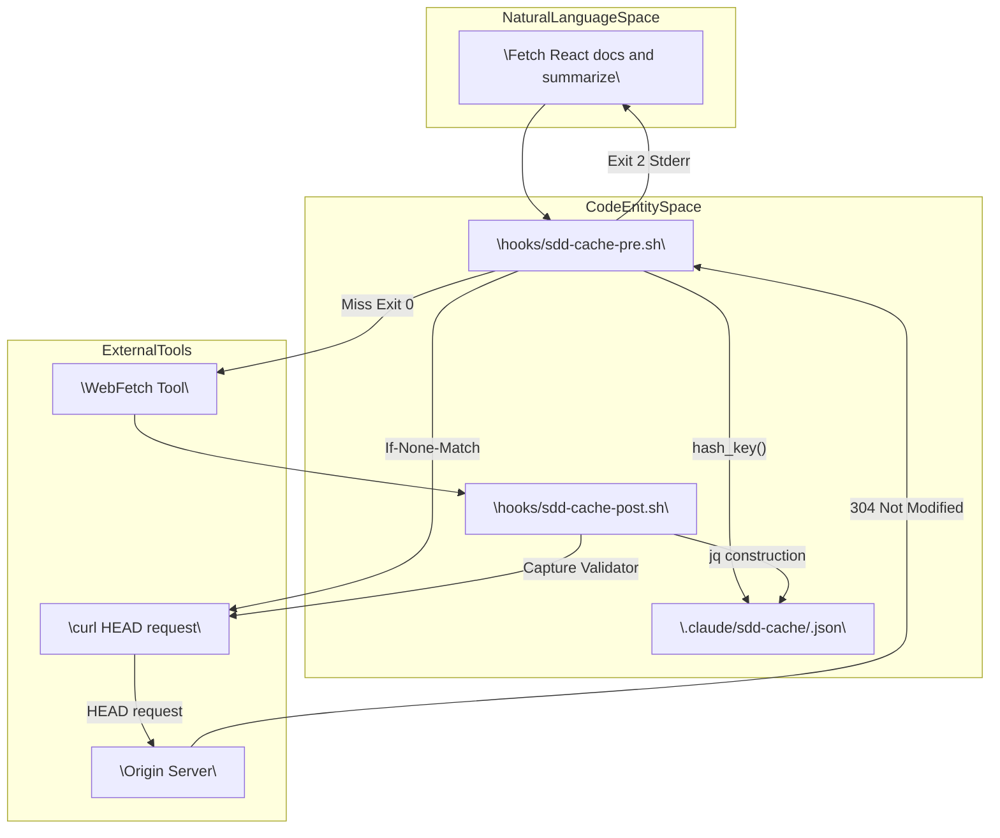

<!-- source: DeepWiki mcp.deepwiki.com · repo addyosmani/agent-skills · page 4.2 Session Hooks · fetched 2026-10-30 -->

# Session Hooks

<details>
<summary>Relevant source files</summary>

The following files were used as context for generating this wiki page:

- [.github/ISSUE_TEMPLATE/skill-gap.yml](.github/ISSUE_TEMPLATE/skill-gap.yml)
- [.gitignore](.gitignore)
- [CONTRIBUTING.md](CONTRIBUTING.md)
- [LICENSE](LICENSE)
- [docs/antigravity-setup.md](docs/antigravity-setup.md)
- [docs/developer-onboarding.md](docs/developer-onboarding.md)
- [docs/gemini-cli-setup.md](docs/gemini-cli-setup.md)
- [docs/other-hosts.md](docs/other-hosts.md)
- [evals/skill-impact.md](evals/skill-impact.md)
- [hooks/SDD-CACHE.md](hooks/SDD-CACHE.md)
- [hooks/SIMPLIFY-IGNORE.md](hooks/SIMPLIFY-IGNORE.md)
- [hooks/sdd-cache-post.sh](hooks/sdd-cache-post.sh)
- [hooks/sdd-cache-pre.sh](hooks/sdd-cache-pre.sh)
- [hooks/sdd-cache-test.sh](hooks/sdd-cache-test.sh)
- [hooks/session-start-test.sh](hooks/session-start-test.sh)
- [hooks/session-start.sh](hooks/session-start.sh)
- [hooks/simplify-ignore-test.sh](hooks/simplify-ignore-test.sh)
- [hooks/simplify-ignore.sh](hooks/simplify-ignore.sh)

</details>


This page details the session hooks system in `addyosmani/agent-skills`, which provides automated lifecycle management for agent interactions. It covers `hooks/hooks.json` configuration, the `SessionStart` hook injecting the `using-agent-skills` meta-skill (`hooks/session-start.sh`), the `simplify-ignore` hook (`hooks/simplify-ignore.sh`) for block-level code protection across `PreToolUse`, `PostToolUse`, and `Stop` events, the `sdd-cache` WebFetch revalidation cache (`hooks/sdd-cache-pre.sh` and `hooks/sdd-cache-post.sh`), regression test suites (`hooks/session-start-test.sh`, `hooks/sdd-cache-test.sh`, `hooks/simplify-ignore-test.sh`), and known technical limitations.

---

## Overview of the Hook System

Hooks are configured via `hooks/hooks.json` and tool-specific settings (such as `.claude/settings.json`) [hooks/SIMPLIFY-IGNORE.md:19-42](), [hooks/SDD-CACHE.md:15-45](). They execute automatically based on runtime lifecycle events including `SessionStart`, `PreToolUse`, `PostToolUse`, and `Stop` [hooks/simplify-ignore.sh:2-9](), [hooks/SDD-CACHE.md:63-67]().

### Hook Configuration and Event Mapping

| Event | Matcher | Script | Purpose |
| :--- | :--- | :--- | :--- |
| `SessionStart` | N/A | `session-start.sh` | Injects the `using-agent-skills` meta-skill into initialization context [hooks/session-start.sh:1-12](). |
| `PreToolUse` | `Read` | `simplify-ignore.sh` | Backs up files and filters out protected blocks with `BLOCK_<hash>` placeholders [hooks/simplify-ignore.sh:2-5](), [hooks/SIMPLIFY-IGNORE.md:55-55](). |
| `PreToolUse` | `WebFetch` | `sdd-cache-pre.sh` | Checks HTTP cache via `If-None-Match` / `If-Modified-Since` revalidation [hooks/SDD-CACHE.md:65-65](). |
| `PostToolUse` | `Edit\|Write` | `simplify-ignore.sh` | Expands placeholders, records changes, and re-filters the file [hooks/simplify-ignore.sh:2-6](), [hooks/SIMPLIFY-IGNORE.md:56-56](). |
| `PostToolUse` | `WebFetch` | `sdd-cache-post.sh` | Captures responses, issues `HEAD` requests for validators, and persists cache entries [hooks/SDD-CACHE.md:66-66](). |
| `Stop` | N/A | `simplify-ignore.sh` | Expands remaining placeholders on disk so edits survive session termination [hooks/simplify-ignore.sh:7-9](), [hooks/SIMPLIFY-IGNORE.md:57-57](). |

Sources: [hooks/session-start.sh:1-12](), [hooks/simplify-ignore.sh:2-9](), [hooks/SIMPLIFY-IGNORE.md:20-42](), [hooks/SDD-CACHE.md:15-45]()

---

## SessionStart: Meta-Skill Injection

The `SessionStart` hook ensures that agents initializing in supported hosts are immediately aware of the `agent-skills` framework by loading the `using-agent-skills` meta-skill [hooks/session-start.sh:1-12](). Note that Claude Code does not register this hook natively because it implements native skill routing; always-on injection would create redundant routers [CONTRIBUTING.md:91-94]().

### Implementation Details
The `session-start.sh` script operates through the following sequence:
1. Determines the script directory and resolves the path to `skills/using-agent-skills/SKILL.md` [hooks/session-start.sh:14-16]().
2. Verifies the presence of `jq` on `PATH`, emitting a fallback JSON warning envelope if missing [hooks/session-start.sh:18-21]().
3. Constructs a valid JSON envelope containing the meta-skill body within `additionalContext` using `jq -cn` [hooks/session-start.sh:23-30]().

Sources: [hooks/session-start.sh:1-33](), [CONTRIBUTING.md:91-94]()

---

## SDD-Cache: Documentation Revalidation

The `sdd-cache` hook acts as a cross-session citation cache for `source-driven-development` [hooks/SDD-CACHE.md:3-9](). It avoids redundant `WebFetch` invocations while upholding the skill's requirement to verify against current documentation by delegating freshness checks to origin servers via HTTP `ETag` and `Last-Modified` validators [hooks/SDD-CACHE.md:3-9]().

### Data Flow: Natural Language to Code Entity

"Documentation Cache Lifecycle"

Sources: [hooks/SDD-CACHE.md:53-79](), [CONTRIBUTING.md:91-94]()

### Implementation Mechanics
- **Keying**: Entries are keyed by `sha256(url)`, stored as JSON under `.claude/sdd-cache/<sha>.json` [hooks/SDD-CACHE.md:61-61]().
- **Validation**: `PreToolUse` issues a `HEAD` request via `curl` with conditional headers; cache hits occur solely upon receiving an HTTP `304 Not Modified` response [hooks/SDD-CACHE.md:65-65]().
- **Prompt Metadata**: Because `WebFetch` results are processed against caller prompts, the original prompt is retained as metadata and surfaced in cache hit messages [hooks/SDD-CACHE.md:57-57]().

Sources: [hooks/SDD-CACHE.md:1-150](), [CONTRIBUTING.md:91-94]()

---

## Simplify-Ignore: Block-Level Protection

The `simplify-ignore` hook hides sensitive or performance-critical blocks from agents during `/code-simplify` runs [hooks/SIMPLIFY-IGNORE.md:3-4](). Protected blocks are annotated with `simplify-ignore-start` and `simplify-ignore-end` markers [hooks/SIMPLIFY-IGNORE.md:69-69]().

### Data Flow and Lifecycle

"Logic Flow: simplify-ignore.sh"
```mermaid
graph TD
    subgraph AgentToolEvents
        READ["\"PreToolUse Read\""] --> FILTER["\"filter_file()\""]
        WRITE["\"PostToolUse Edit|Write\""] --> EXPAND["\"expand_file()\""]
        STOP["\"Stop Event\""] --> RESTORE["\"restore_all()\""]
    end

    subgraph CodeEntitySpace
        FID["\"file_id()\""]
        BHASH["\"block_hash()\""]
        CACHE["\".claude/.simplify-ignore-cache/\""]
    end

    subgraph FilesystemSpace
        FILTER -- "Backup Original" --> BAK["\".bak file\""]
        FILTER -- "Extract Block" --> BLK["\".block file\""]
        FILTER -- "Rewrite Disk" --> SRC["\"Source File (BLOCK_hash)\""]
        
        EXPAND -- "Merge Changes" --> BLK
        EXPAND -- "Update Backup" --> BAK
        
        RESTORE -- "Move" --> BAK
        BAK -- "Overwrite" --> SRC
    end
```
Sources: [hooks/simplify-ignore.sh:2-153](), [hooks/SIMPLIFY-IGNORE.md:51-60]()

### Key Functions and Lifecycle
- `filter_file()`: Scans source files, replaces matched blocks with `BLOCK_<hash>` placeholders, and writes block segments, prefixes, suffixes, and reasons to `.claude/.simplify-ignore-cache/` [hooks/simplify-ignore.sh:70-153]().
- `expand_file()`: Replaces `BLOCK_<hash>` placeholders back into raw block code during `PostToolUse` updates [hooks/simplify-ignore.sh:158-167]().

Sources: [hooks/simplify-ignore.sh:1-167](), [hooks/SIMPLIFY-IGNORE.md:51-60]()

---

## Hook Regression Tests and Known Limitations

### Regression Test Suites
The hook system includes dedicated test suites validating script logic:
- `hooks/session-start-test.sh`: Validates the `SessionStart` JSON envelope and `jq` fallback behaviors [hooks/session-start-test.sh:1-47]().
- `hooks/simplify-ignore-test.sh`: Exercises `filter_file()` across single-line blocks, multi-line blocks, multiple blocks, reason strings, newlines, unclosed blocks, and comment syntaxes [hooks/simplify-ignore-test.sh:1-217]().

Sources: [hooks/session-start-test.sh:1-47](), [hooks/simplify-ignore-test.sh:1-217](), [CONTRIBUTING.md:91-94]()

### Known Limitations

| System | Limitation | Technical Detail |
| :--- | :--- | :--- |
| **sdd-cache** | **Prompt Mismatch** | Cache hits return content processed under a previous prompt; the agent must verify if it matches current requirements [hooks/SDD-CACHE.md:57-57](). |
| **sdd-cache** | **No Validator** | Pages lacking `ETag` or `Last-Modified` headers are never cached to avoid relying on unverified memory [hooks/SDD-CACHE.md:68-71](). |
| **simplify-ignore** | **Single-line Blocks** | Single-line annotations hide the entire line from the model rather than targeted segments [hooks/SIMPLIFY-IGNORE.md:83-84](). |
| **simplify-ignore** | **File Renaming** | Shell file renaming leaves placeholders intact; original code is preserved in a `.recovered` file [hooks/SIMPLIFY-IGNORE.md:88-88](). |
| **simplify-ignore** | **Suffix Detection** | Comment suffix parsing supports `*/` and `-->` explicitly; non-standard template engine comments can cause unbalanced placeholders [hooks/SIMPLIFY-IGNORE.md:85-85](). |

Sources: [hooks/SDD-CACHE.md:57-71](), [hooks/SIMPLIFY-IGNORE.md:82-89]()

---

