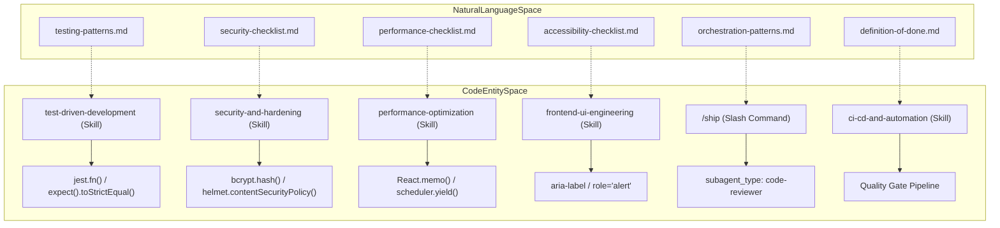
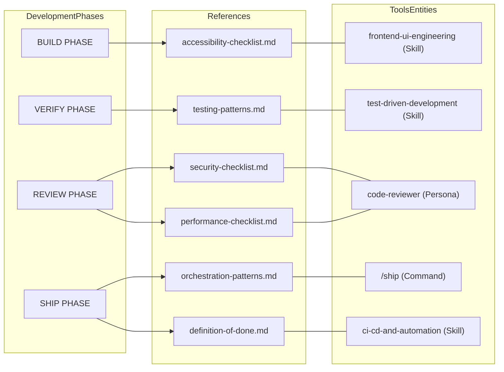

<!-- source: DeepWiki mcp.deepwiki.com · repo addyosmani/agent-skills · page 5 References · fetched 2026-10-30 -->

# References

Relevant source files

The following files were used as context for generating this wiki page:

- [evals/fixtures/test-driven-development-ecosystem/README.md](evals/fixtures/test-driven-development-ecosystem/README.md)
- [evals/fixtures/test-driven-development-ecosystem/ledger.py](evals/fixtures/test-driven-development-ecosystem/ledger.py)
- [evals/fixtures/test-driven-development-ecosystem/test_ledger.py](evals/fixtures/test-driven-development-ecosystem/test_ledger.py)
- [references/accessibility-checklist.md](references/accessibility-checklist.md)
- [references/definition-of-done.md](references/definition-of-done.md)
- [references/testing-patterns.md](references/testing-patterns.md)
- [skills/ci-cd-and-automation/SKILL.md](skills/ci-cd-and-automation/SKILL.md)

The `references/` directory contains supplementary checklists, pattern catalogs, and architectural guides designed to provide standardized criteria for high-stakes development activities. These references act as "exit criteria" for the agent's work, ensuring that implementation details like accessibility, performance, security, and observability are not overlooked during the automated development lifecycle.

## Testing Patterns Reference

The `testing-patterns.md` file serves as the primary technical guide for the `test-driven-development` skill [references/testing-patterns.md:1-4](). It provides standardized templates for writing maintainable tests across the entire stack, from unit tests to End-to-End (E2E) suites.

Key components include:
*   **Structural Standards**: Enforcement of the **Arrange-Act-Assert (AAA)** pattern [references/testing-patterns.md:16-31]().
*   **Naming Conventions**: A strict `[unit] [expected behavior] [condition]` pattern for test descriptions [references/testing-patterns.md:33-43]().
*   **Mocking Strategy**: Guidance on mocking at system boundaries (DB, HTTP) using `jest.fn()` while avoiding mocks for internal business logic or pure functions [references/testing-patterns.md:84-123]().
*   **Framework-Specific Patterns**: Concrete examples for React Component testing (using `render` and `screen` from `@testing-library/react`), API Integration (using `supertest`), and E2E (using Playwright) [references/testing-patterns.md:125-223]().

For details, see [Testing Patterns Reference](#5.1).

**Sources:** [references/testing-patterns.md:1-235]()

## Security, Performance, Accessibility & Observability Checklists

These checklists provide the "Definition of Done" for the `review-phase` and specialized implementation skills. They are structured as actionable lists that agents can use to audit their own output or the output of other agents.

### Security Checklist
Used alongside the `security-and-hardening` skill [references/security-checklist.md:3-3](), this reference covers the **OWASP Top 10** [references/security-checklist.md:121-135]() and practical implementation requirements like secret scanning, password hashing (bcrypt/argon2), and secure session cookie configuration (`httpOnly`, `secure`, `sameSite`) [references/security-checklist.md:24-32](). It also defines standard security headers (CSP, HSTS) and restrictive CORS configurations [references/security-checklist.md:54-79]().

### Performance Checklist
Paired with the `performance-optimization` skill [references/performance-checklist.md:3-3](), this document sets specific **Core Web Vitals** targets (LCP ≤ 2.5s, INP ≤ 200ms, CLS ≤ 0.1) [references/performance-checklist.md:13-20](). It provides a multi-tier audit for Frontend (images, JS bundle size), Backend (N+1 query prevention with eager loading, indexing), and Infrastructure [references/performance-checklist.md:30-106]().

### Accessibility Checklist
This reference supports the `frontend-ui-engineering` skill by providing a quick-look guide for **WCAG 2.1 AA** compliance [references/accessibility-checklist.md:1-3](). It includes essential checks for keyboard navigation, screen reader support (using `aria-live` and `role="status"`), and visual contrast requirements [references/accessibility-checklist.md:13-53]().

### Observability Checklist
Paired with the `observability-and-instrumentation` skill, this checklist ensures structured JSON logging, correlation IDs (`runLog`), RED/USE metrics, and proper cardinality rules are enforced before production deployment.

For details, see [Security, Performance, Accessibility & Observability Checklists](#5.2).

**Sources:** [references/security-checklist.md:1-135](), [references/performance-checklist.md:1-140](), [references/accessibility-checklist.md:1-160]()

## Orchestration Patterns Reference

The `orchestration-patterns.md` file defines how multiple agent personas interact. It establishes the governing rule that **the user (or a slash command) is the orchestrator**, and personas should not invoke other personas directly [references/orchestration-patterns.md:5-6]().

The reference catalogs five endorsed patterns:
1.  **Direct Invocation**: Single persona for a single perspective [references/orchestration-patterns.md:11-26]().
2.  **Single-Persona Slash Command**: Wrapping a persona with specific skills (e.g., `/review`, `/test`, `/code-simplify`) [references/orchestration-patterns.md:30-46]().
3.  **Parallel Fan-out with Merge**: Used by commands like `/ship` to run `code-reviewer`, `security-auditor`, and `test-engineer` concurrently [references/orchestration-patterns.md:48-74]().
4.  **Sequential Pipeline**: User-driven transitions between lifecycle phases (e.g., `/spec` → `/plan` → `/build`) [references/orchestration-patterns.md:78-94]().
5.  **Research Isolation**: Using sub-agents like the built-in `Explore` subagent to digest large amounts of data without polluting the main context [references/orchestration-patterns.md:96-113]().

For details, see [Orchestration Patterns Reference](#5.3).

**Sources:** [references/orchestration-patterns.md:1-145]()

## Definition of Done

The `references/definition-of-done.md` file establishes a project-wide completion bar for every change. Unlike acceptance criteria, which are task-specific, the Definition of Done (DoD) is a consistent checklist that ensures every increment meets a baseline quality standard before being considered "finished" [references/definition-of-done.md:1-5]().

The DoD checklist covers several key areas:
*   **Correctness**: Verifying that all acceptance criteria are met, code behaves as intended, new behavior is covered by tests, and no regressions are introduced [references/definition-of-done.md:21-26]().
*   **Quality**: Ensuring code clarity, no duplicated business logic, absence of dead code, and adherence to linting/formatting standards [references/definition-of-done.md:28-34]().
*   **Integration**: Confirming the change works within the broader system, accounting for migrations, config changes, and backward compatibility [references/definition-of-done.md:38-41]().
*   **Documentation**: Requiring updates to public interfaces, APIs, and architectural decisions [references/definition-of-done.md:43-46]().
*   **Ship-readiness**: Reviewing security implications, implementing observability, and ensuring a rollback path exists [references/definition-of-done.md:48-51]().

The DoD is enforced as a verification gate throughout the development lifecycle, particularly in `planning-and-task-breakdown`, `incremental-implementation`, and `shipping-and-launch` [references/definition-of-done.md:3-5]().

For details, see [Definition of Done](#5.4).

**Sources:** [references/definition-of-done.md:1-67]()

## Reference Mapping

The following diagrams illustrate how the reference files in `references/` bridge the gap between high-level natural language requirements and the specific code entities they govern.

### Reference-to-Code Mapping

**Sources:** [references/testing-patterns.md:1-4](), [references/security-checklist.md:1-3](), [references/performance-checklist.md:1-3](), [references/accessibility-checklist.md:1-3](), [references/orchestration-patterns.md:54-56](), [skills/security-and-hardening/SKILL.md:135-143](), [agents/README.md:107-108](), [references/definition-of-done.md:1-5](), [skills/ci-cd-and-automation/SKILL.md:24-26]()

### Integration with Development Phases

**Sources:** [references/accessibility-checklist.md:3-3](), [references/testing-patterns.md:3-3](), [references/security-checklist.md:3-3](), [references/performance-checklist.md:3-3](), [references/orchestration-patterns.md:64-64](), [skills/performance-optimization/SKILL.md:1-4](), [agents/README.md:15-19](), [references/definition-of-done.md:3-5](), [skills/ci-cd-and-automation/SKILL.md:10-11]()

---

