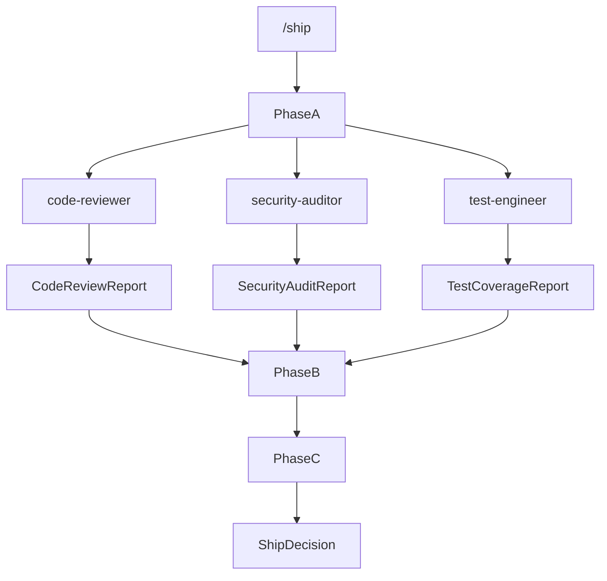
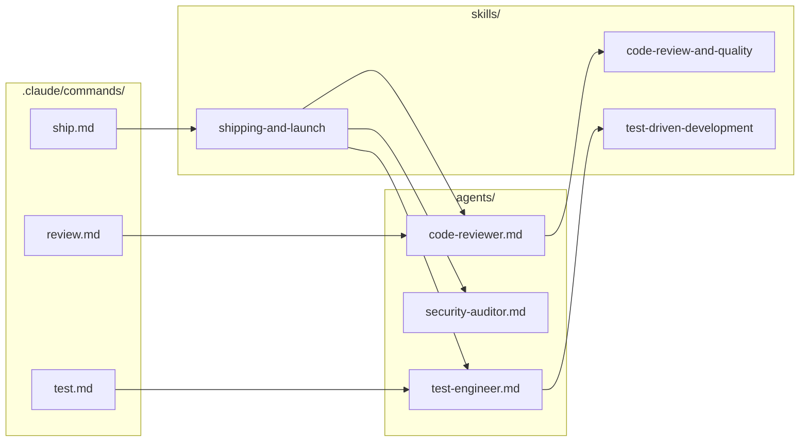

<!-- source: DeepWiki mcp.deepwiki.com · repo addyosmani/agent-skills · page 5.3 Orchestration Patterns Reference · fetched 2026-10-30 -->

# Orchestration Patterns Reference

Relevant source files

The following files were used as context for generating this wiki page:

- [.claude/rules/skills-contributing.md](.claude/rules/skills-contributing.md)
- [AGENTS.md](AGENTS.md)
- [docs/opencode-setup.md](docs/opencode-setup.md)
- [references/orchestration-patterns.md](references/orchestration-patterns.md)

The Orchestration Patterns Reference provides a catalog of endorsed multi-agent coordination strategies used within the `agent-skills` repository (`references/orchestration-patterns.md`). It defines the architectural boundaries between users, slash commands, personas, and skills to ensure predictable data flow, prevent agent loops, and minimize token waste.

The governing rule of this architecture is that **the user (or a slash command) is the orchestrator**. Personas are prohibited from invoking other personas to prevent information loss through paraphrasing and recursive context bloat [references/orchestration-patterns.md:5-6]().

Sources: [references/orchestration-patterns.md:1-6](), [AGENTS.md:70-84]()

## Core Orchestration Patterns

The following patterns are endorsed for coordinating work across the system without violating the core architectural rules.

### 1. Direct Invocation
The simplest pattern where a single persona is called to provide a specific perspective on an artifact. This serves as the cost and latency baseline [references/orchestration-patterns.md:11-26]().

**Data Flow:** `User → Persona → Report → User`

| Persona | Use Case Example |
| :--- | :--- |
| `code-reviewer` | "Review this PR" [references/orchestration-patterns.md:22]() |
| `security-auditor` | "Find security issues in auth.ts" [references/orchestration-patterns.md:23]() |
| `test-engineer` | "What tests are missing for the checkout flow?" [references/orchestration-patterns.md:24]() |

Sources: [references/orchestration-patterns.md:11-26]()

### 2. Single-Persona Slash Command
A slash command that wraps a specific persona and pre-configures it with relevant skills, saving the user from repeatedly specifying workflow parameters [references/orchestration-patterns.md:30-46]().

**Implementation:**
* `/review` invokes `code-reviewer` with the `code-review-and-quality` skill [references/orchestration-patterns.md:35-36]().
* `/test` executes single-persona testing workflows [references/orchestration-patterns.md:40]().
* `/code-simplify` executes single-persona refactoring workflows [references/orchestration-patterns.md:40]().

Sources: [references/orchestration-patterns.md:30-46]()

### 3. Parallel Fan-out with Merge
Multiple personas operate on the same input concurrently, each producing an independent report. A final merge step synthesizes them into a single go/no-go decision [references/orchestration-patterns.md:48-74]().

**Diagram: Parallel Fan-out Execution Flow for `/ship` Command**

Sources: [references/orchestration-patterns.md:52-56](), [.claude/commands/ship.md:9-64]()

### 4. Sequential Pipeline (User-Driven)
The full development lifecycle is managed as a sequence of independent steps where the user carries context between stages, eliminating the need for an LLM lifecycle orchestrator that risks dropping nuances [references/orchestration-patterns.md:78-94]().

**Workflow Sequence:**
`user runs: /spec → /plan → /build → /test → /review → /ship` [references/orchestration-patterns.md:83-83]().

Sources: [references/orchestration-patterns.md:78-94]()

### 5. Research Isolation
Spawns a sub-agent to ingest large volumes of files and return only a concise digest, protecting the main context window from flooding [references/orchestration-patterns.md:96-114]().

**Claude Code Mapping:**
Use the built-in `Explore` subagent running on Haiku for this pattern. Define a custom research persona only when domain-specific system prompts are mandatory [references/orchestration-patterns.md:113-114]().

Sources: [references/orchestration-patterns.md:96-114]()

## Code Entity Mapping: Personas, Commands, and Skills

This section bridges natural language intent to code entities by mapping user-facing commands to specific Markdown persona definitions and underlying skill directories.

**Diagram: Orchestration Composition Map**

Sources: [references/orchestration-patterns.md:35-36](), [.claude/commands/ship.md:5](), [AGENTS.md:70-84]()

## Subagents vs. Agent Teams

The repository personas support two distinct execution modes within Claude Code [references/orchestration-patterns.md:127-140]().

| Feature | Subagents | Agent Teams |
| :--- | :--- | :--- |
| **Coordination** | Main agent fans out, sub-agents report back [references/orchestration-patterns.md:131]() | Teammates message each other, share a task list [references/orchestration-patterns.md:131]() |
| **Context** | Dedicated context window per subagent [references/orchestration-patterns.md:132]() | Dedicated context window per teammate [references/orchestration-patterns.md:132]() |
| **When to use** | Independent tasks producing reports [references/orchestration-patterns.md:133]() | Collaborative work needing cross-discussion [references/orchestration-patterns.md:133]() |
| **Status** | Stable [references/orchestration-patterns.md:134]() | Experimental (`CLAUDE_CODE_EXPERIMENTAL_AGENT_TEAMS=1`) [references/orchestration-patterns.md:134]() |
| **Cost** | Lower token consumption [references/orchestration-patterns.md:135]() | Higher token consumption (separate instances) [references/orchestration-patterns.md:135]() |

Sources: [references/orchestration-patterns.md:127-140]()

## Composition Block Specification for Persona Files

Persona files located in `agents/` define specialized roles (`code-reviewer.md`, `security-auditor.md`, `test-engineer.md`, `web-performance-auditor.md`). Each persona specification follows a strict structure:

1. **Role Frontmatter & Identity:** Declares the agent's unique perspective and boundary constraints.
2. **Mandatory Skill Binding:** Links the persona to its required execution skills (e.g., `code-review-and-quality` for `code-reviewer`).
3. **Output Format Template:** Enforces a structured report schema so merging steps can parse findings deterministically.
4. **Platform Conformance Rule:** Explicitly states that the persona must never spawn other subagents or personas, complying with host environment rules [AGENTS.md:78-84]().

Sources: [AGENTS.md:70-84](), [references/orchestration-patterns.md:121-124]()

## Anti-Patterns to Avoid

The following patterns are prohibited to maintain system determinism and cost efficiency [references/orchestration-patterns.md:5-6]():

1. **Persona-calls-Persona:** Instructing an agent file to invoke another persona. Subagents cannot spawn other subagents under platform constraints [.claude/commands/ship.md:22]().
2. **The Router Persona:** Creating a meta-orchestrator whose sole responsibility is selecting another persona, adding unnecessary token overhead [references/orchestration-patterns.md:44-46]().
3. **Paraphrasing Orchestrators:** Having an intermediate agent summarize findings rather than passing raw structured reports to the user.
4. **Nested Teams:** Establishing team hierarchies within agent teams, leading to exponential context inflation.

Sources: [references/orchestration-patterns.md:5-6](), [references/orchestration-patterns.md:44-46](), [.claude/commands/ship.md:22]()

## Validation Checklist

Before adopting a new orchestration pattern or adding a composite command, verify it against the following criteria [references/orchestration-patterns.md:68-74]():

* [ ] **Independence:** Can all sub-agents execute simultaneously without ordering constraints? [references/orchestration-patterns.md:69]()
* [ ] **Distinct Perspective:** Does each persona contribute unique findings rather than overlapping commentary? [references/orchestration-patterns.md:70]()
* [ ] **Context Budget:** Does the synthesis/merge step fit securely within remaining context windows? [references/orchestration-patterns.md:71]()
* [ ] **Latency Justification:** Is the user's wait time significant enough that parallelism yields a net benefit? [references/orchestration-patterns.md:72]()

Sources: [references/orchestration-patterns.md:68-74]()

---

