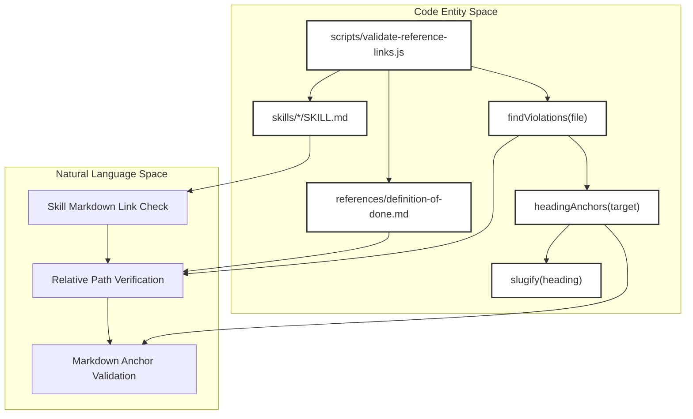
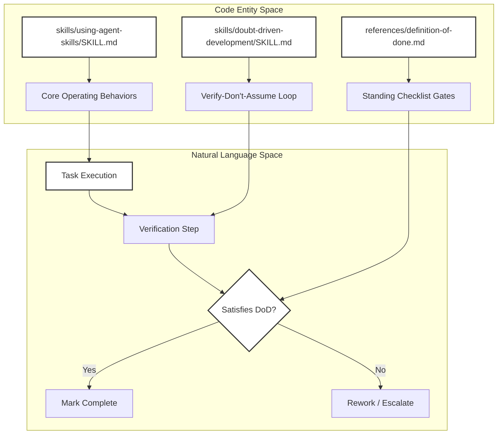

<!-- source: DeepWiki mcp.deepwiki.com · repo addyosmani/agent-skills · page 5.4 Definition of Done · fetched 2026-10-30 -->

# Definition of Done

Relevant source files

The following files were used as context for generating this wiki page:

- [references/definition-of-done.md](references/definition-of-done.md)
- [scripts/validate-reference-links-test.js](scripts/validate-reference-links-test.js)
- [scripts/validate-reference-links.js](scripts/validate-reference-links.js)

This page defines the project-wide "Definition of Done" (DoD), establishing a universal, standing quality bar that every change must clear before being declared complete [references/definition-of-done.md:1-3](). It covers the structural differences between task-specific acceptance criteria and the project-wide DoD, details the five core sections of the standing checklist, explains how programmatic validators in the codebase enforce reference integrity, and maps out how specific skills within the `agent-skills` repository utilize the DoD as a verification gate.

Sources: [references/definition-of-done.md:1-3]()

## Definition of Done vs. Acceptance Criteria

The Definition of Done is distinct from, yet complementary to, task-specific acceptance criteria [references/definition-of-done.md:3](). While acceptance criteria answer whether the specific feature or task requirement was built correctly ("Did we build this thing?"), the DoD answers whether the work meets the overarching quality and readiness standard ("Is it ready?") [references/definition-of-done.md:5-14]().

| Dimension | Acceptance Criteria | Definition of Done |
|---|---|---|
| Scope | Specific to one task or spec [references/definition-of-done.md:9]() | Applies to every increment [references/definition-of-done.md:9]() |
| Changes | Different for each item [references/definition-of-done.md:10]() | Fixed and reused [references/definition-of-done.md:10]() |
| Answers | "Did we build *this thing*?" [references/definition-of-done.md:11]() | "Is it *ready*?" [references/definition-of-done.md:11]() |
| Owner | Defined when planning the task [references/definition-of-done.md:12]() | Defined once for the project [references/definition-of-done.md:12]() |
| Example | "User can reset password via email link" [references/definition-of-done.md:13]() | "Tests pass, no regressions, docs updated" [references/definition-of-done.md:13]() |

A task is truly complete only when its specific acceptance criteria are met **and** the standing Definition of Done is fully satisfied [references/definition-of-done.md:15-16]().

Sources: [references/definition-of-done.md:5-16]()

## The Standing Checklist

The project-wide checklist defined in `references/definition-of-done.md` is divided into five core categories that must be validated before merging or shipping:

### Correctness
- All task-specific acceptance criteria are met [references/definition-of-done.md:22]().
- Code runs and behaves as intended, verified at runtime rather than relying solely on compilation or typechecking [references/definition-of-done.md:23]().
- New behavior is covered by tests that fail without the change and pass with it [references/definition-of-done.md:24]().
- Existing tests continue to pass with zero regressions introduced [references/definition-of-done.md:25]().
- Edge cases and error handling paths are addressed, not just the happy path [references/definition-of-done.md:26]().

### Quality
- Code clearly reveals intent through naming and structure, eliminating the need for redundant comments explaining *what* it does [references/definition-of-done.md:29]().
- No duplicated business logic exists [references/definition-of-done.md:30]().
- Zero dead code, debug statements, or commented-out blocks remain [references/definition-of-done.md:31]().
- Changes remain strictly scoped to the task without unrequested refactoring [references/definition-of-done.md:32]().
- All linters and formatters pass cleanly [references/definition-of-done.md:33]().

### Integration
- Changes operate seamlessly within the wider system architecture, not just in isolated unit testing [references/definition-of-done.md:38]().
- Database migrations, configuration adjustments, and feature flags are properly accounted for [references/definition-of-done.md:39]().
- Backward compatibility is preserved for any public interface or API contract modifications [references/definition-of-done.md:40]().

### Documentation
- Public interfaces, APIs, and user-facing behaviors are fully documented [references/definition-of-done.md:43]().
- Architectural decisions worth preserving are logged via `documentation-and-adrs` [references/definition-of-done.md:44]().
- Documentation describes current state in timeless language rather than change history logs [references/definition-of-done.md:45]().

### Ship-Readiness
- Security implications are reviewed for untrusted input, authentication, and data handling flows (`security-and-hardening`) [references/definition-of-done.md:48]().
- Observability and instrumentation (structured logs, metrics, traces) are provisioned for critical new paths (`observability-and-instrumentation`) [references/definition-of-done.md:49]().
- Rollback strategies exist for high-risk changes (`shipping-and-launch`) [references/definition-of-done.md:50]().
- Human review and approval are secured prior to merge or deployment [references/definition-of-done.md:51]().

Sources: [references/definition-of-done.md:17-52]()

## Programmatic Reference Enforcement

To ensure that skills and documentation correctly reference the Definition of Done and other core checklists without broken relative paths, the repository enforces validation checks via `scripts/validate-reference-links.js` [scripts/validate-reference-links.js:1-45](). 

### Diagram: Reference Validation Data Flow

Sources: [scripts/validate-reference-links.js:47-110](), [scripts/validate-reference-links-test.js:45-80]()

The validation script ensures that every `references/*.md` link inside skill definitions correctly resolves two levels up (`../../references/definition-of-done.md`) or three levels up from colocated reference files (`../../../references/definition-of-done.md`), preventing broken links during plugin cache installations [scripts/validate-reference-links.js:6-27]().

Sources: [scripts/validate-reference-links.js:1-45](), [scripts/validate-reference-links-test.js:45-124]()

## How Skills Enforce the Definition of Done

The `agent-skills` framework embeds verification gates into execution pipelines. The `using-agent-skills` meta-skill establishes the foundational rule that verification must occur before task completion [skills/using-agent-skills/SKILL.md:111-115]().

### Diagram: Skill Verification & DoD Pipeline

Sources: [skills/using-agent-skills/SKILL.md:111-115](), [references/definition-of-done.md:21-52](), [skills/doubt-driven-development/SKILL.md:10-12]()

### Skill-Specific Enforcement Mechanisms
- **`test-driven-development`**: Enforces test-first design, satisfying correctness and test coverage requirements [references/definition-of-done.md:24-25]().
- **`code-review-and-quality`**: Operates a five-axis review system to evaluate code quality, cleanliness, and intent [references/definition-of-done.md:29-36]().
- **`code-simplification`**: Reduces structural complexity without altering behavior [references/definition-of-done.md:35-36]().
- **`security-and-hardening`**: Validates input sanitization and threat boundaries for ship-readiness [references/definition-of-done.md:48]().
- **`observability-and-instrumentation`**: Implements metrics, logs, and trace requirements on new critical paths [references/definition-of-done.md:49]().
- **`shipping-and-launch`**: Manages pre-launch checklists, staged rollouts, and rollback procedures [references/definition-of-done.md:50]().

Sources: [references/definition-of-done.md:35-52](), [skills/using-agent-skills/SKILL.md:111-115]()

## Application and Red Flags

The Definition of Done is applied progressively:
- **Per task**: Validate Correctness and Quality criteria before checking off items [references/definition-of-done.md:55]().
- **Per feature**: Validate Integration and Documentation requirements [references/definition-of-done.md:56]().
- **Per release**: Use the complete standing checklist as the baseline floor, supplemented by `shipping-and-launch` gates [references/definition-of-done.md:57]().

### Anti-Patterns and Red Flags
- `"It's done, I just haven't run it yet"`: Unverified work is never considered complete [references/definition-of-done.md:63]().
- Treating passing unit tests as the sole indicator of done while ignoring documentation or runtime verification [references/definition-of-done.md:64]().
- Relaxing the standard due to deadline pressures [references/definition-of-done.md:65]().
- Treating task acceptance criteria as the entire quality bar without enforcing the standing baseline [references/definition-of-done.md:66]().
- Declaring work finished without human review on high-risk changes [references/definition-of-done.md:67]().

Sources: [references/definition-of-done.md:54-67]()

---

