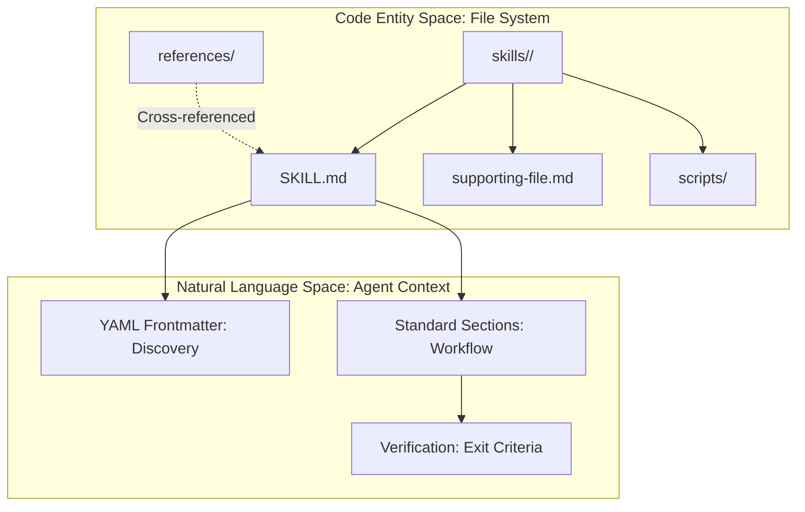
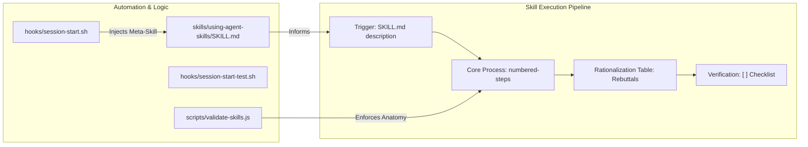

<!-- source: DeepWiki mcp.deepwiki.com · repo addyosmani/agent-skills · page 6 Contributing & Extending Skills · fetched 2026-10-30 -->

# Contributing & Extending Skills

Relevant source files

The following files were used as context for generating this wiki page:

- [.github/ISSUE_TEMPLATE/skill-gap.yml](.github/ISSUE_TEMPLATE/skill-gap.yml)
- [CONTRIBUTING.md](CONTRIBUTING.md)
- [docs/copilot-cli-setup.md](docs/copilot-cli-setup.md)
- [docs/copilot-setup.md](docs/copilot-setup.md)
- [docs/cursor-setup.md](docs/cursor-setup.md)
- [docs/developer-onboarding.md](docs/developer-onboarding.md)
- [docs/other-hosts.md](docs/other-hosts.md)
- [docs/skill-anatomy.md](docs/skill-anatomy.md)
- [docs/windsurf-setup.md](docs/windsurf-setup.md)
- [evals/skill-impact.md](evals/skill-impact.md)
- [hooks/session-start-test.sh](hooks/session-start-test.sh)

This page provides the technical requirements and philosophical principles for contributing to the `agent-skills` repository. The goal of this project is to provide **actionable processes** rather than vague advice, ensuring AI agents follow production-grade engineering workflows [CONTRIBUTING.md:1-3](), [docs/skill-anatomy.md:142-144](). 

As a parent page, this document outlines the high-level pre-flight workflow, anatomical expectations, core writing principles, and verification loop. For deep technical dives, refer to the child pages:
- [Skill Anatomy Specification](#6.1)
- [Idea Refine Skill & Scripts](#6.2)
- [Validation Scripts](#6.3)
- [Evaluation Harness (evals/)](#6.4)
- [CI Pipeline & Plugin Packaging](#6.5)

---

## Skill Anatomy & Structure

Every skill must follow a rigid structural specification to ensure it is discoverable by agents and provides verifiable outcomes. Skills are stored in the `skills/` directory, with each skill occupying its own sub-directory containing a mandatory `SKILL.md` file [CONTRIBUTING.md:23-24](), [docs/skill-anatomy.md:5-15]().

### The Discovery Mechanism: YAML Frontmatter
Agents discover skills by reading their descriptions, which are injected into the system prompt. The frontmatter must include a `name` (lowercase, hyphen-separated, matching the directory) and a `description` that explicitly states both **what** the skill does (in third person) and **when** to trigger it using "Use when" conditions [docs/skill-anatomy.md:21-35]().

**Skill File Structure Diagram**

Sources: [docs/skill-anatomy.md:5-15](), [docs/skill-anatomy.md:21-28](), [CONTRIBUTING.md:23-26]()

For a full reference on the required Markdown sections, frontmatter rules, and section purposes, see [Skill Anatomy Specification](#6.1).

---

## Core Writing Principles & Pre-Flight Checks

Before proposing a new skill or modifying an existing one, contributors must perform pre-flight checks to avoid duplication and ensure quality [CONTRIBUTING.md:9-17](). This includes searching the existing skill catalog, checking open PRs (`gh pr list --state open`), and reviewing the [skill-change rejection ledger](evals/skill-impact.md) to review eval evidence for previously rejected ideas [CONTRIBUTING.md:11-17]().

When extending the library, contributors must adhere to core principles designed to prevent "agent drift"—the tendency for LLMs to skip steps or rationalize poor behavior [docs/skill-anatomy.md:142-144]().

| Principle | Description | Code Reference |
| :--- | :--- | :--- |
| **Process over Knowledge** | Skills are workflows (steps), not facts or general advice. | [docs/skill-anatomy.md:144]() |
| **Specific over General** | Use concrete commands (e.g., `npm test`) over "verify tests". | [docs/skill-anatomy.md:86-87]() |
| **Evidence over Assumption** | Every verification step requires proof (logs, test output). | [docs/skill-anatomy.md:98]() |
| **Anti-Rationalization** | Anticipate excuses agents use to skip steps and provide rebuttals. | [docs/skill-anatomy.md:90-93]() |
| **Non-Duplication** | Reference existing skills instead of duplicating content. | [CONTRIBUTING.md:58](), [docs/skill-anatomy.md:109]() |
| **Token-Conscious** | Every section must justify its inclusion in the context window. | [docs/skill-anatomy.md:121-130]() |

Sources: [docs/skill-anatomy.md:142-144](), [CONTRIBUTING.md:28-36](), [CONTRIBUTING.md:58-60]()

---

## Technical Constraints & The Verification Loop

To maintain a clean repository and efficient agent context, technical constraints are enforced and validated via CI and local scripts:

1.  **Supporting Files:** Do not create supplementary files unless the reference material exceeds 100 lines [docs/skill-anatomy.md:102-107](), [CONTRIBUTING.md:60]().
2.  **References:** General checklists and cross-skill materials must be stored in the root `references/` directory [docs/skill-anatomy.md:111-119](), [CONTRIBUTING.md:62]().
3.  **Naming & Structure:** Use `lowercase-hyphen-separated` for directories and supporting files [docs/skill-anatomy.md:32]().
4.  **Automated Validation:** Every PR is checked by validation scripts (`scripts/validate-skills.js`, etc.) [docs/developer-onboarding.md:55-72](). For details, see [Validation Scripts](#6.3).
5.  **Evaluation Harness:** Changes are measured using the three-tier eval system (`scripts/run-evals.js`) and recorded in the skill-impact ledger (`evals/skill-impact.md`) [docs/developer-onboarding.md:74-80](), [evals/skill-impact.md:1-6](). For details, see [Evaluation Harness (evals/)](#6.4).

**Workflow Integration Diagram**

Sources: [docs/skill-anatomy.md:75-98](), [CONTRIBUTING.md:37-54](), [CONTRIBUTING.md:83-95]()

---

## Child Page Summary & Navigation

For comprehensive instructions and deep dives into specific contribution and maintenance workflows, explore the following child pages:

- **[Skill Anatomy Specification](#6.1)**: Detailed formatting rules, frontmatter fields, standard sections, and progressive disclosure guidelines (`docs/skill-anatomy.md`).
- **[Idea Refine Skill & Scripts](#6.2)**: Walkthrough of multi-file skills using `idea-refine` as the canonical implementation.
- **[Validation Scripts](#6.3)**: Reference for scripts under `scripts/` (`validate-skills.js`, `lib/skill-lint.js`, etc.) and their local test runners (`docs/developer-onboarding.md`).
- **[Evaluation Harness (evals/)](#6.4)**: Coverage of the three-tier eval architecture, TF-IDF lexical routing, collision thresholds, and the skill-impact rejection ledger (`evals/skill-impact.md`).
- **[CI Pipeline & Plugin Packaging](#6.5)**: Overview of GitHub Actions workflows (`.github/workflows/test-plugin-install.yml`), plugin manifests, and version synchronization (`CONTRIBUTING.md`, `docs/developer-onboarding.md`).

Sources: [CONTRIBUTING.md:5-6](), [docs/developer-onboarding.md:1-5]()

---

