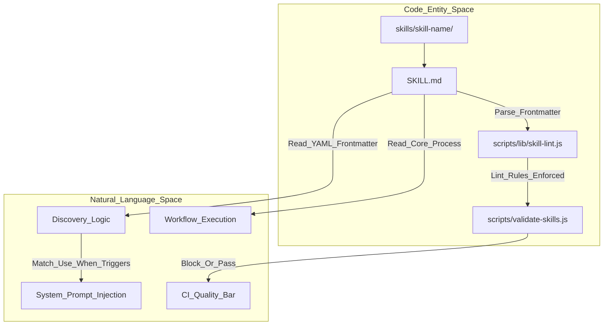
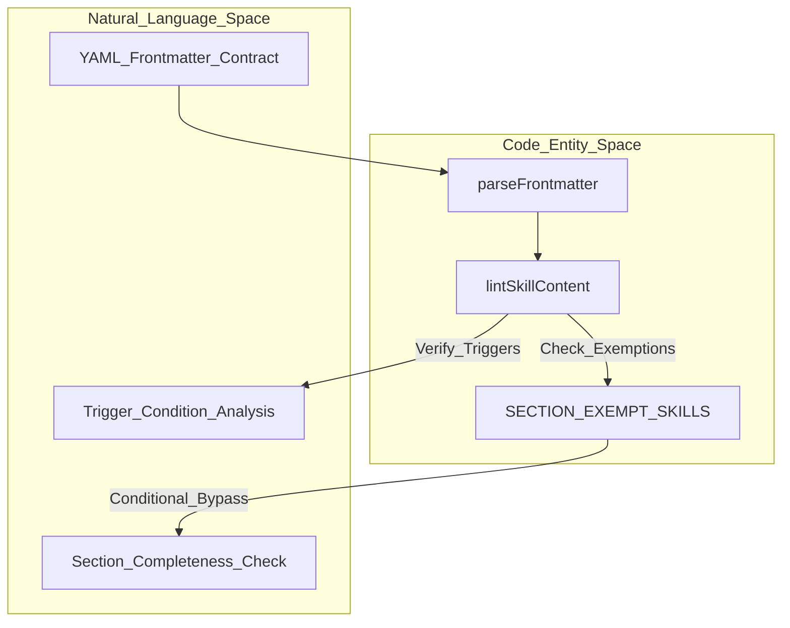

<!-- source: DeepWiki mcp.deepwiki.com · repo addyosmani/agent-skills · page 6.1 Skill Anatomy Specification · fetched 2026-10-30 -->

# Skill Anatomy Specification

Relevant source files

The following files were used as context for generating this wiki page:

- [docs/copilot-cli-setup.md](docs/copilot-cli-setup.md)
- [docs/copilot-setup.md](docs/copilot-setup.md)
- [docs/cursor-setup.md](docs/cursor-setup.md)
- [docs/skill-anatomy.md](docs/skill-anatomy.md)
- [docs/windsurf-setup.md](docs/windsurf-setup.md)
- [scripts/lib/skill-lint-test.js](scripts/lib/skill-lint-test.js)
- [scripts/lib/skill-lint.js](scripts/lib/skill-lint.js)
- [scripts/validate-skills.js](scripts/validate-skills.js)

## Purpose and Scope

The **Skill Anatomy Specification** defines the standardized structure, formatting, and behavioral expectations for every skill within the `agent-skills` repository. Adherence to this specification ensures that skills are discoverable by agents, token-efficient, and resistant to the "lazy agent" problem where steps are skipped or rationalized away `[docs/skill-anatomy.md:1-4]`, `[scripts/lib/skill-lint.js:1-10]`.

Sources: `[docs/skill-anatomy.md:1-4]`, `[scripts/lib/skill-lint.js:1-10]`

## Directory Structure and Naming

Every skill is encapsulated in its own directory under `skills/` to maintain modularity. Supporting materials that are too large for the main definition are stored alongside the primary file `[docs/skill-anatomy.md:7-15]`, `[scripts/lib/skill-lint.js:11-20]`.

| Entity | Convention | Example |
| :--- | :--- | :--- |
| **Skill Directory** | Lowercase, hyphen-separated (`KEBAB_CASE`) | `skills/test-driven-development/` `[scripts/lib/skill-lint.js:54-56]` |
| **Main Definition** | Always `SKILL.md` (Uppercase filename) | `skills/test-driven-development/SKILL.md` `[docs/skill-anatomy.md:10-12]` |
| **Scripts Directory** | `scripts/` (Only if runnable helpers exist) | `skills/idea-refine/scripts/` `[docs/skill-anatomy.md:13-13]` |
| **Supporting File** | Lowercase, hyphen-separated | `skills/idea-refine/refinement-criteria.md` `[docs/skill-anatomy.md:14-15]` |
| **Global Reference** | Stored in `references/` at repo root | `references/testing-patterns.md` `[docs/skill-anatomy.md:118-121]` |

Sources: `[docs/skill-anatomy.md:7-17]`, `[scripts/lib/skill-lint.js:11-20]`, `[scripts/lib/skill-lint.js:54-56]`

## The SKILL.md Format

### Frontmatter (Metadata)
Every `SKILL.md` must begin with a YAML frontmatter block parsed and validated by `[scripts/lib/skill-lint.js:39-52]()`. This block is critical for skill discovery, as the description is injected into the agent's system prompt to help it decide which skill to activate `[docs/skill-anatomy.md:21-28]`, `[docs/skill-anatomy.md:34-34]`.

*   **`name`**: Must match the directory name exactly and conform to lowercase hyphen-separated formatting `[docs/skill-anatomy.md:31-31]`, `[scripts/lib/skill-lint.js:13-14]`.
*   **`description`**: Maximum 1024 characters `[scripts/lib/skill-lint.js:31-31]`. It must start with a third-person statement of what the skill does, followed by specific "Use when" trigger conditions matched against `[scripts/lib/skill-lint.js:63-63]()`.
*   **Top-Level Keys**: Restricted strictly to `SPEC_FRONTMATTER_KEYS` (`name`, `description`, `license`, `compatibility`, `metadata`, `allowed-tools`) `[scripts/lib/skill-lint.js:45-52]`. Any unknown top-level key is rejected by the linter `[scripts/lib/skill-lint.js:39-44]`.

> **Constraint:** Do not include process steps in the description. If an agent sees the workflow in the description, it may attempt to follow that summary instead of reading the full `SKILL.md` `[docs/skill-anatomy.md:34-34]`.

Sources: `[docs/skill-anatomy.md:21-43]`, `[scripts/lib/skill-lint.js:31-70]`

### Standard Sections
While the frontmatter is a strict contract, the section layout is a recommended pattern to preserve intent and clarity `[docs/skill-anatomy.md:36-38]`. `[scripts/lib/skill-lint.js:75-81]` enforces that standard sections exist unless explicitly exempted in `SECTION_EXEMPT_SKILLS` `[scripts/lib/skill-lint.js:83-89]`.

1.  **Overview**: The "elevator pitch" explaining what the skill does and why it matters `[docs/skill-anatomy.md:43-44]`, `[docs/skill-anatomy.md:76-77]`.
2.  **When to Use**: A bulleted list of triggering conditions and explicit exclusions `[docs/skill-anatomy.md:46-48]`, `[docs/skill-anatomy.md:79-80]`.
3.  **Core Process**: The heart of the skill. A step-by-step actionable workflow `[docs/skill-anatomy.md:50-54]`, `[docs/skill-anatomy.md:82-87]`.
4.  **Common Rationalizations**: A table mapping common agent excuses to skip steps with factual rebuttals `[docs/skill-anatomy.md:59-62]`, `[docs/skill-anatomy.md:88-92]`.
5.  **Red Flags**: Observable behavioral patterns indicating the skill is being violated `[docs/skill-anatomy.md:64-66]`, `[docs/skill-anatomy.md:93-94]`.
6.  **Verification**: A checklist of exit criteria requiring verifiable evidence `[docs/skill-anatomy.md:68-71]`, `[docs/skill-anatomy.md:96-97]`.

Sources: `[docs/skill-anatomy.md:36-72]`, `[scripts/lib/skill-lint.js:75-89]`

## Data Flow and Skill Discovery

This diagram bridges Natural Language Space to Code Entity Space, linking linter rules and files to the agent's runtime discovery and execution path.

### Diagram: Skill Discovery and Validation Pipeline

Sources: `[docs/skill-anatomy.md:7-15]`, `[scripts/lib/skill-lint.js:10-24]`, `[scripts/validate-skills.js:27-56]`

## Validation and Linting Implementation

The linter implementation in `[scripts/lib/skill-lint.js:1-158]()` acts as the single source of truth for schema validation. The CLI wrapper `[scripts/validate-skills.js:1-83]()` walks `skills/` and `agents/` directories, executes `lintSkill` and `lintPersona`, and aggregates errors and warnings.

*   **Fenced Block Stripping**: `[scripts/lib/skill-lint.js:129-156]()` strips markdown code blocks prior to checking headings to prevent code examples from triggering false positives on section presence.
*   **Trigger Analysis**: Validates descriptions against `DESCRIPTION_TRIGGER` while ignoring negated forms via `DESCRIPTION_TRIGGER_NEGATE_ALL` `[scripts/lib/skill-lint.js:63-70]`.
*   **Line Count Warnings**: Warns if `SKILL.md` exceeds `MAX_SKILL_LINES` (500 lines) to preserve token context efficiency `[scripts/lib/skill-lint.js:33-37]`.

### Diagram: Frontmatter and Section Validation Flow

Sources: `[scripts/lib/skill-lint.js:39-93]`, `[scripts/lib/skill-lint-test.js:59-93]`, `[scripts/validate-skills.js:42-56]`

## Writing Principles

All skills must adhere to these core principles to ensure they function as engineering tools rather than passive documentation:

1.  **Process over knowledge**: Skills are workflows (steps), not reference facts `[docs/skill-anatomy.md:144-144]`.
2.  **Specific over general**: Use actionable commands like "Run `npm test`" `[docs/skill-anatomy.md:85-85]`.
3.  **Evidence over assumption**: Every verification step requires proof `[docs/skill-anatomy.md:97-97]`.
4.  **Anti-rationalization**: Block the agent's path to laziness using the rationalizations table `[docs/skill-anatomy.md:88-92]`.
5.  **Progressive disclosure**: Keep the main `SKILL.md` focused; move content exceeding 100 lines to supporting files `[docs/skill-anatomy.md:127-127]`.
6.  **Token-conscious**: Write specific descriptions to help the agent activate the skill at the right moment and skip it otherwise `[docs/skill-anatomy.md:126-126]`.

Sources: `[docs/skill-anatomy.md:125-144]`, `[scripts/lib/skill-lint.js:21-24]`

## Supporting Files and Scripts

To keep `SKILL.md` files concise and token-efficient, the specification mandates specific rules for external files:

*   **Supporting Files**: Only created when reference material exceeds 100 lines `[docs/skill-anatomy.md:109-114]`. Examples include `skills/idea-refine/refinement-criteria.md` and `skills/idea-refine/examples.md`.
*   **Scripts**: The `scripts/` directory should only exist if the skill includes runnable helpers `[docs/skill-anatomy.md:115-117]`.
*   **References**: Checklists or patterns used by multiple skills must live in the root `references/` directory, deliberately outside individual skill folders `[docs/skill-anatomy.md:118-126]`.

Sources: `[docs/skill-anatomy.md:107-127]`, `[scripts/lib/skill-lint.js:18-19]`

## Context Efficiency

Skills are loaded on demand, meaning only the skill name and description sit in context at startup. The full `SKILL.md` loads only when an agent decides the skill is relevant `[docs/skill-anatomy.md:130-131]`.

*   **Keep `SKILL.md` under 500 lines**: Enforced as a linter warning in `[scripts/lib/skill-lint.js:37-37]()`.
*   **Write specific descriptions**: Avoid listing processes in descriptions to save tokens and prevent premature execution `[docs/skill-anatomy.md:34-42]`, `[docs/skill-anatomy.md:133-133]`.
*   **Use progressive disclosure**: Reference supporting files read only when workflows require them `[docs/skill-anatomy.md:134-134]`.
*   **Prefer scripts over inline code**: Executing a script consumes zero context for its source code `[docs/skill-anatomy.md:135-135]`.

Sources: `[docs/skill-anatomy.md:128-135]`, `[scripts/lib/skill-lint.js:21-24]`, `[scripts/lib/skill-lint.js:33-38]`

## Cross-Skill Referencing

Skills must be modular and non-redundant. Explicit references between skills are parsed by regex patterns defined in `[scripts/lib/skill-lint.js:94-105]()`.

*   **Syntax**: Reference other skills using backticks and canonical names, such as "follow the `test-driven-development` skill" `[docs/skill-anatomy.md:58-58]`, `[scripts/lib/skill-lint.js:95-97]`.
*   **Validation**: The linter checks cross-skill references against known skills to catch dead references `[scripts/lib/skill-lint.js:21-22]`.

Sources: `[docs/skill-anatomy.md:58-58]`, `[scripts/lib/skill-lint.js:94-105]`

---

