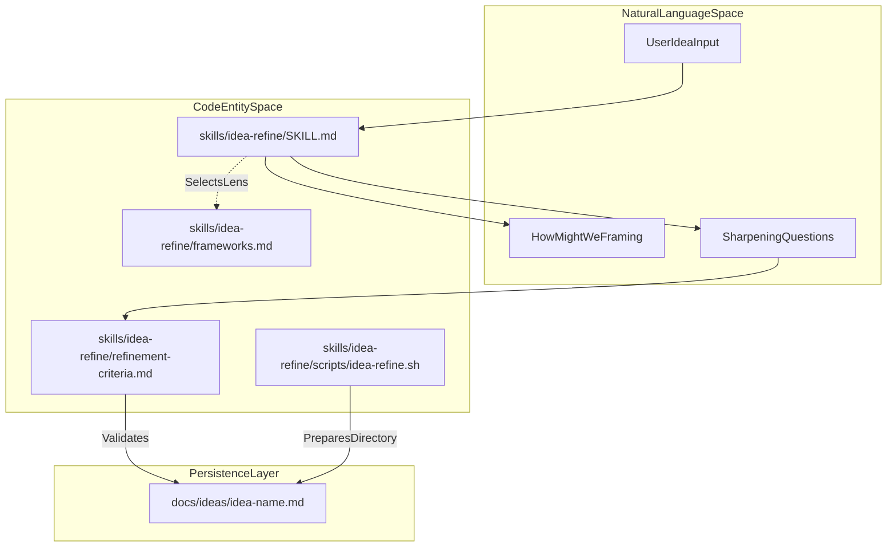
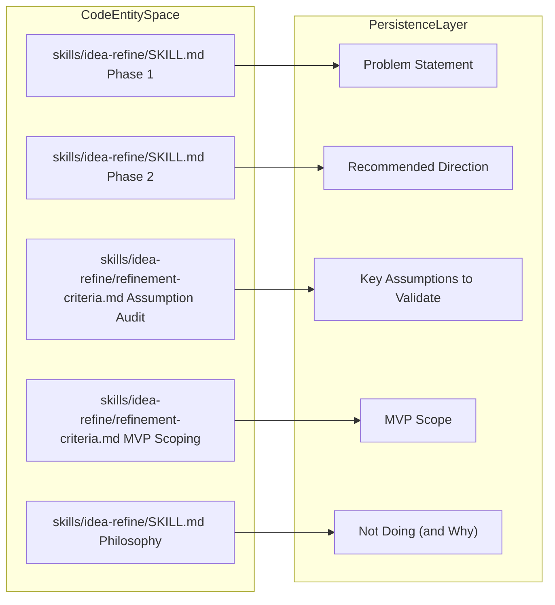

<!-- source: DeepWiki mcp.deepwiki.com · repo addyosmani/agent-skills · page 6.2 Idea Refine Skill & Scripts · fetched 2026-10-30 -->

# Idea Refine Skill & Scripts

<details>
<summary>Relevant source files</summary>

The following files were used as context for generating this wiki page:

- [skills/browser-testing-with-devtools/SKILL.md](skills/browser-testing-with-devtools/SKILL.md)
- [skills/idea-refine/SKILL.md](skills/idea-refine/SKILL.md)
- [skills/idea-refine/examples.md](skills/idea-refine/examples.md)
- [skills/idea-refine/frameworks.md](skills/idea-refine/frameworks.md)
- [skills/idea-refine/refinement-criteria.md](skills/idea-refine/refinement-criteria.md)
- [skills/idea-refine/scripts/idea-refine.sh](skills/idea-refine/scripts/idea-refine.sh)

</details>


The `idea-refine` skill serves as the canonical example of a multi-file skill within the repository, providing a structured framework for transforming vague, early-stage ideas into actionable technical specifications [skills/idea-refine/SKILL.md:1-178](). It employs a three-phase process—Understand & Expand, Evaluate & Converge, and Sharpen & Ship—supported by specialized modular files (`frameworks.md`, `refinement-criteria.md`, `examples.md`, and `idea-refine.sh`) to ensure development efforts are grounded in clear problem statements rather than reactive implementation [skills/idea-refine/SKILL.md:10-25](), [skills/idea-refine/frameworks.md:1-99](), [skills/idea-refine/refinement-criteria.md:1-113](), [skills/idea-refine/examples.md:1-238](), [skills/idea-refine/scripts/idea-refine.sh:1-15]().

---

## Implementation & Core Process

The skill is implemented as an interactive conversational dialogue directed by `skills/idea-refine/SKILL.md` [skills/idea-refine/SKILL.md:26-28](). It transitions dynamically from divergent thinking (generating possibilities) to convergent thinking (narrowing focus and stress-testing) [skills/idea-refine/SKILL.md:10-25]().

### The Three-Phase Pipeline

| Phase | Goal | Key Activities | Code / File Reference |
| :--- | :--- | :--- | :--- |
| **1. Understand & Expand** | Divergent thinking; opening up the problem space. | Restate as "How Might We" (HMW), ask 3-5 sharpening questions, generate 5-8 variations (Inversion, Simplification, etc.). | [skills/idea-refine/SKILL.md:61-89]() |
| **2. Evaluate & Converge** | Convergent thinking; identifying the strongest path. | Cluster ideas into directions, stress-test against User Value/Feasibility/Differentiation, and surface hidden assumptions. | [skills/idea-refine/SKILL.md:91-111]() |
| **3. Sharpen & Ship** | Artifact creation. | Produce a standardized Markdown one-pager and save to `docs/ideas/[idea-name].md`. | [skills/idea-refine/SKILL.md:113-145]() |

### Data Flow & Logic

The agent relies on its colocated supporting files to maintain execution quality:
1.  **Context Scanning:** If running within an active codebase, the agent uses `Glob`, `Grep`, and `Read` tools to scan architecture and prior art [skills/idea-refine/SKILL.md:87]().
2.  **Framework Application:** The agent selectively pulls mental models from `skills/idea-refine/frameworks.md` (e.g., SCAMPER, First Principles, JTBD) [skills/idea-refine/SKILL.md:89](), [skills/idea-refine/frameworks.md:1-99]().
3.  **Rubric Validation:** During Phase 2, the agent evaluates directions using the rubric in `skills/idea-refine/refinement-criteria.md` [skills/idea-refine/SKILL.md:102](), [skills/idea-refine/refinement-criteria.md:1-113]().
4.  **Interactive Feedback:** The skill invokes `AskUserQuestion` to gather constraints before finalizing output [skills/idea-refine/SKILL.md:74]().

Sources: [skills/idea-refine/SKILL.md:10-14](), [skills/idea-refine/SKILL.md:56-110]()

---

## Technical Components & Automation

### Initialization Script
The shell script `skills/idea-refine/scripts/idea-refine.sh` automates directory provisioning for the skill [skills/idea-refine/scripts/idea-refine.sh:4]().

```bash
# Usage via the agent or terminal
bash skills/idea-refine/scripts/idea-refine.sh
```

The script ensures that `docs/ideas/` exists, providing a stable persistence target for the "Sharpen & Ship" phase [skills/idea-refine/scripts/idea-refine.sh:6-13](). It returns a structured JSON payload upon completion [skills/idea-refine/scripts/idea-refine.sh:15]().

### Refinement Criteria (The Evaluation Matrix)
The skill uses a decision matrix defined in `skills/idea-refine/refinement-criteria.md` to prioritize idea directions [skills/idea-refine/refinement-criteria.md:94-104]():

| | High Feasibility | Low Feasibility |
| :--- | :--- | :--- |
| **High Value** | `Do this first` | `Worth the risk` |
| **Low Value** | `Only if trivial` | `Don't do this` |

Sources: [skills/idea-refine/scripts/idea-refine.sh:1-15](), [skills/idea-refine/refinement-criteria.md:94-104]()

---

## Architectural Mapping: Natural Language to Code Entity

The following diagrams bridge the user's natural language input space to the concrete code entities and file paths implemented in the codebase.

### Ideation State Machine
This diagram illustrates how raw user input transitions through the skill logic, accessing auxiliary files and yielding persisted artifacts.


Sources: [skills/idea-refine/SKILL.md:10-14](), [skills/idea-refine/scripts/idea-refine.sh:6-15](), [skills/idea-refine/frameworks.md:1-4]()

### Artifact Structure Mapping
This diagram maps sections of the generated Markdown output to specific validation rules and processing instructions defined within `skills/idea-refine/SKILL.md` and `skills/idea-refine/refinement-criteria.md`.


Sources: [skills/idea-refine/SKILL.md:112-141](), [skills/idea-refine/refinement-criteria.md:75-93](), [skills/idea-refine/refinement-criteria.md:105-113]()

---

## Supporting Frameworks, Criteria & Examples

### Ideation Frameworks (`frameworks.md`)
`skills/idea-refine/frameworks.md` provides optional lenses to prevent incremental thinking [skills/idea-refine/frameworks.md:1-99]():
*   **SCAMPER:** Substitute, Combine, Adapt, Modify, Put to other uses, Eliminate, Reverse [skills/idea-refine/frameworks.md:5-15]().
*   **Jobs to Be Done (JTBD):** Functional, emotional, and social dimensions of user motivation [skills/idea-refine/frameworks.md:50-61]().
*   **Pre-mortem:** Backward-looking failure analysis [skills/idea-refine/frameworks.md:77-87]().
*   **First Principles:** Grounding reasoning in fundamental physical or logical truths [skills/idea-refine/frameworks.md:39-49]().
*   **Constraint-Based Ideation:** Imposing artificial constraints (time, cost, scale) [skills/idea-refine/frameworks.md:64-75]().

### Evaluation Rubric (`refinement-criteria.md`)
`skills/idea-refine/refinement-criteria.md` evaluates options across three dimensions [skills/idea-refine/refinement-criteria.md:1-74]():
1.  **User Value:** Distinguishes between "Painkillers" and "Vitamins" [skills/idea-refine/refinement-criteria.md:7-25]().
2.  **Feasibility:** Technical, resource, and time-to-value assessment [skills/idea-refine/refinement-criteria.md:27-51]().
3.  **Differentiation:** New capability, 10x improvement, or new context [skills/idea-refine/refinement-criteria.md:52-74]().

### Assumption Audit & Examples
The skill mandates an **Assumption Audit** categorizing risks into *Must Be True*, *Should Be True*, and *Might Be True* [skills/idea-refine/refinement-criteria.md:75-93](). Additionally, `skills/idea-refine/examples.md` provides full interactive transcripts demonstrating proper conversational rhythm and rigor [skills/idea-refine/examples.md:1-238]().

Sources: [skills/idea-refine/frameworks.md:1-99](), [skills/idea-refine/refinement-criteria.md:1-113](), [skills/idea-refine/examples.md:1-238]()

---

