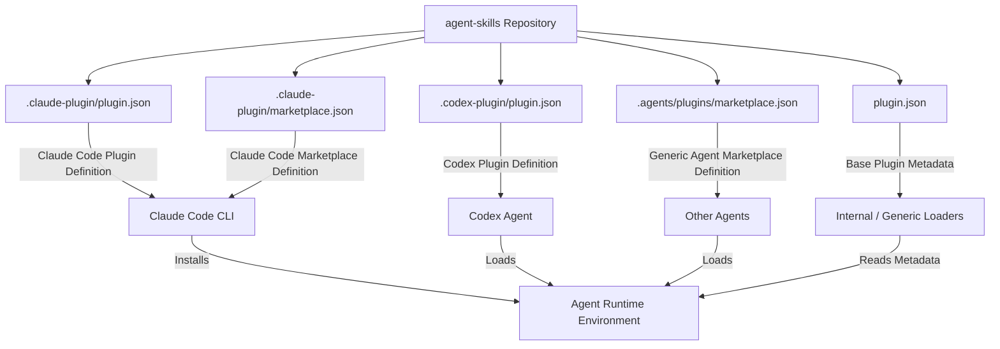

<!-- source: DeepWiki mcp.deepwiki.com · repo addyosmani/agent-skills · page 6.5 CI Pipeline & Plugin Packaging · fetched 2026-10-30 -->

# CI Pipeline & Plugin Packaging

<details>
<summary>Relevant source files</summary>

The following files were used as context for generating this wiki page:

- [.agents/plugins/marketplace.json](.agents/plugins/marketplace.json)
- [.claude-plugin/marketplace.json](.claude-plugin/marketplace.json)
- [.claude-plugin/plugin.json](.claude-plugin/plugin.json)
- [.codex-plugin/plugin.json](.codex-plugin/plugin.json)
- [.gitattributes](.gitattributes)
- [.github/workflows/test-plugin-install.yml](.github/workflows/test-plugin-install.yml)
- [plugin.json](plugin.json)
- [scripts/floor-guard-reference-test.js](scripts/floor-guard-reference-test.js)
- [scripts/validate-versions-test.js](scripts/validate-versions-test.js)
- [scripts/validate-versions.js](scripts/validate-versions.js)
- [skills/constraint-driven-development/references/floor-guard.md](skills/constraint-driven-development/references/floor-guard.md)

</details>


This page details the Continuous Integration (CI) pipeline defined in [.github/workflows/test-plugin-install.yml]() and the various plugin and marketplace manifests used to package and distribute the `agent-skills` codebase. It covers the validation jobs, the structure of different plugin manifests, how versions are synchronized across distribution channels, and hook regression tests.

## CI Pipeline (`.github/workflows/test-plugin-install.yml`)

The `test-plugin-install.yml` workflow orchestrates a comprehensive series of jobs to ensure the quality, cross-platform consistency, and installability of the `agent-skills` plugin. It runs on `push`, `pull_request`, and `workflow_dispatch` events [.github/workflows/test-plugin-install.yml:3-7]().

### Workflow Diagram

```mermaid
graph TD
    A["Trigger: push, pull_request, workflow_dispatch"] --> B["validate-skills"]
    A --> C["validate-commands"]
    A --> D["validate-platforms"]
    A --> E["test-hooks"]
    B --> F["validate"]
    C --> F
    D --> F
    F --> G["test-install"]

    subgraph validate-skills
        B1["setup-node (Node 24)"] --> B2["node scripts/validate-skills.js"]
        B2 --> B3["node --test scripts/lib/skill-lint-test.js"]
        B3 --> B4["node scripts/validate-versions.js"]
        B4 --> B5["node --test scripts/validate-versions-test.js"]
        B5 --> B6["node --test scripts/run-evals-test.js"]
        B6 --> B7["node scripts/run-evals.js --min-rank1 95"]
        B7 --> B8["node scripts/validate-reference-links.js"]
        B8 --> B9["node --test scripts/validate-reference-links-test.js"]
        B9 --> B10["node --test scripts/floor-guard-reference-test.js"]
        B10 --> B11["bash hooks/session-start-test.sh"]
    end

    subgraph validate-commands
        C1["setup-node (Node 24)"] --> C2["node scripts/validate-commands.js"]
        C2 --> C3["node --test scripts/validate-commands-test.js"]
        C3 --> C4["node scripts/validate-artifact-paths.js"]
        C4 --> C5["node --test scripts/validate-artifact-paths-test.js"]
    end

    subgraph validate-platforms
        D1["matrix: macos-latest, windows-latest"] --> D2["node --test test-suites"]
        D2 --> D3["node scripts/validate-skills.js"]
    end

    subgraph test-hooks
        E1["bash hooks/sdd-cache-test.sh"]
        E2["bash hooks/simplify-ignore-test.sh"]
    end

    subgraph validate
        F1["npm install -g @anthropic-ai/claude-code"] --> F2["claude plugin validate ."]
    end

    subgraph test-install
        G1["npm install -g @anthropic-ai/claude-code"] --> G2["git config --global url"]
        G2 --> G3["claude plugin marketplace add ./"]
        G3 --> G4["claude plugin marketplace list"]
        G4 --> G5["claude plugin install agent-skills@addy-agent-skills"]
    end
```


**Diagram: CI Workflow Overview**

Sources:
- [.github/workflows/test-plugin-install.yml:1-167]()

### `validate-skills` Job

This job runs on `ubuntu-latest` and executes structural, validation, and version integrity checks [.github/workflows/test-plugin-install.yml:9-51]().

*   **Setup**: Sets up Node.js version `24` [.github/workflows/test-plugin-install.yml:17-20]().
*   **Skill Validation**: Runs `node scripts/validate-skills.js` to parse and check all skills [.github/workflows/test-plugin-install.yml:22-23]().
*   **Lint Self-Tests**: Executes `node --test scripts/lib/skill-lint-test.js` [.github/workflows/test-plugin-install.yml:25-26]().
*   **Manifest Versions**: Validates package versions via `node scripts/validate-versions.js` and `node --test scripts/validate-versions-test.js` [.github/workflows/test-plugin-install.yml:28-33]().
*   **Eval Runner**: Tests and executes routing evaluations using `node --test scripts/run-evals-test.js` and `node scripts/run-evals.js --min-rank1 95` [.github/workflows/test-plugin-install.yml:34-39]().
*   **Reference Integrity**: Validates reference links via `node scripts/validate-reference-links.js` and its self-test [.github/workflows/test-plugin-install.yml:40-44]().
*   **Floor Guard & Hooks**: Runs contract tests for references like `scripts/floor-guard-reference-test.js` and `hooks/session-start-test.sh` [.github/workflows/test-plugin-install.yml:46-51]().

Sources:
- [.github/workflows/test-plugin-install.yml:9-51]()

### `validate-commands` Job

This job validates command parity across multiple agent configurations [.github/workflows/test-plugin-install.yml:52-74]().

*   **Command Validation**: Runs `node scripts/validate-commands.js` and `node --test scripts/validate-commands-test.js` [.github/workflows/test-plugin-install.yml:63-67]().
*   **Artifact Paths**: Validates path rules using `node scripts/validate-artifact-paths.js` and `node --test scripts/validate-artifact-paths-test.js` [.github/workflows/test-plugin-install.yml:69-73]().

Sources:
- [.github/workflows/test-plugin-install.yml:52-74]()

### `validate-platforms` Job

Ensures cross-platform compatibility by running tests and validators across a matrix of operating systems (`macos-latest` and `windows-latest`) [.github/workflows/test-plugin-install.yml:76-121]().

*   **Matrix Execution**: Runs test files and core script validators (`validate-skills.js`, `validate-versions.js`, `validate-reference-links.js`, `validate-commands.js`, `validate-artifact-paths.js`) on non-Linux platforms [.github/workflows/test-plugin-install.yml:79-121]().

Sources:
- [.github/workflows/test-plugin-install.yml:76-121]()

### `test-hooks` Job

Validates the hook implementations under isolated conditions [.github/workflows/test-plugin-install.yml:122-133]().

*   **SDD Cache Hook**: Runs `bash hooks/sdd-cache-test.sh` using stubbed `curl` inputs with zero external network dependencies [.github/workflows/test-plugin-install.yml:128-129]().
*   **Simplify Ignore Hook**: Executes `bash hooks/simplify-ignore-test.sh` [.github/workflows/test-plugin-install.yml:131-132]().

Sources:
- [.github/workflows/test-plugin-install.yml:122-133]()

### `validate` & `test-install` Jobs

These jobs depend on successful unit and platform checks to verify actual plugin CLI behaviors [.github/workflows/test-plugin-install.yml:134-167]().

*   **`validate`**: Installs global `@anthropic-ai/claude-code` and runs `claude plugin validate .` to verify local marketplace and plugin layout manifests [.github/workflows/test-plugin-install.yml:134-146]().
*   **`test-install`**: Adds the current directory as a local marketplace via `claude plugin marketplace add ./`, lists marketplaces, and installs `agent-skills@addy-agent-skills` under user scope [.github/workflows/test-plugin-install.yml:147-167]().

Sources:
- [.github/workflows/test-plugin-install.yml:134-167]()

---

## Plugin and Marketplace Manifests

The `agent-skills` project uses several manifest files to define its plugin structure and enable distribution across different AI agent platforms. All primary manifests are synchronized to version `0.6.13`.

### Manifest File Overview


**Diagram: Plugin Manifests and Their Consumers**

Sources:
- [.claude-plugin/plugin.json:1-16]()
- [.claude-plugin/marketplace.json:1-23]()
- [.codex-plugin/plugin.json:1-29]()
- [.agents/plugins/marketplace.json:1-22]()
- [plugin.json:1-5]()

### Core Manifest Metadata

| Manifest Path | Key Fields | Version | Purpose |
| :--- | :--- | :--- | :--- |
| `plugin.json` | `name`, `version`, `description` | `0.6.13` [plugin.json:1-5]() | Root minimal fallback metadata |
| `.claude-plugin/plugin.json` | `commands`, `skills`, `experimental.evals` | `0.6.13` [.claude-plugin/plugin.json:1-16]() | Claude Code plugin integration |
| `.claude-plugin/marketplace.json` | `plugins`, `owner`, `keywords` | `0.6.13` [.claude-plugin/marketplace.json:1-23]() | Claude Code marketplace source registry |
| `.codex-plugin/plugin.json` | `interface`, `capabilities`, `defaultPrompt` | `0.6.13` [.codex-plugin/plugin.json:1-29UI]() | Codex Agent UI description & controls |
| `.agents/plugins/marketplace.json` | `policy`, `source.path` (`./`) | `0.6.13` [.agents/plugins/marketplace.json:1-22]() | Local generic multi-agent marketplace entry |

Sources:
- [.claude-plugin/plugin.json:1-16]()
- [.claude-plugin/marketplace.json:1-23]()
- [.codex-plugin/plugin.json:1-29]()
- [.agents/plugins/marketplace.json:1-22]()
- [plugin.json:1-5]()

---

## Version Syncing

To prevent drift between packaging distribution channels, validation scripts ensure strict version alignment.

### `scripts/validate-versions.js` & `scripts/validate-versions-test.js`

The validation script `scripts/validate-versions.js` reads `plugin.json` as the source of truth for the expected version, and verifies that matching versions exist across all target files defined in `manifestPaths` [scripts/validate-versions.js:7-33]().

```javascript
const manifestPaths = [
  "plugin.json",
  ".codex-plugin/plugin.json",
  ".claude-plugin/plugin.json",
  ".claude-plugin/marketplace.json",
  ".agents/plugins/marketplace.json",
];
```

The test runner `scripts/validate-versions-test.js` asserts this consistency programmatically during `validate-skills` and platform validation jobs [scripts/validate-versions-test.js:1-31]().

Sources:
- [scripts/validate-versions.js:1-34]()
- [scripts/validate-versions-test.js:1-31]()

---

