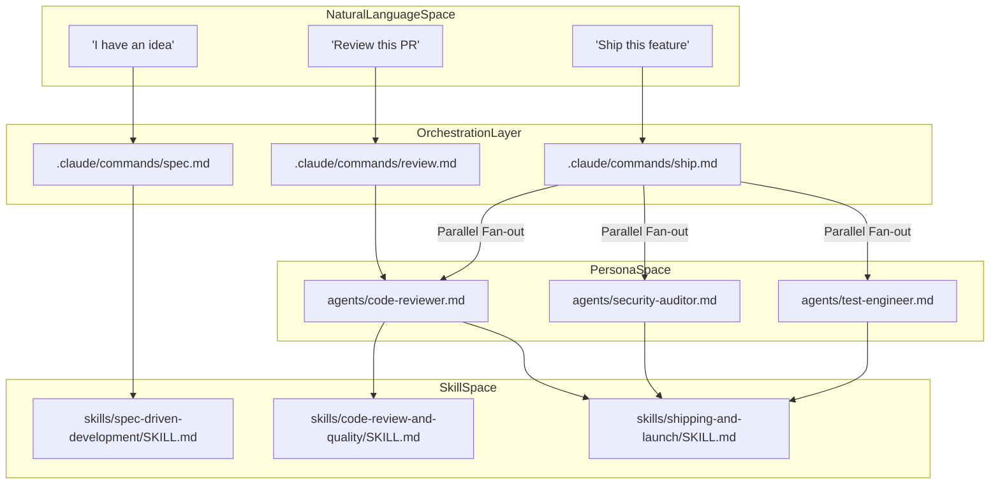
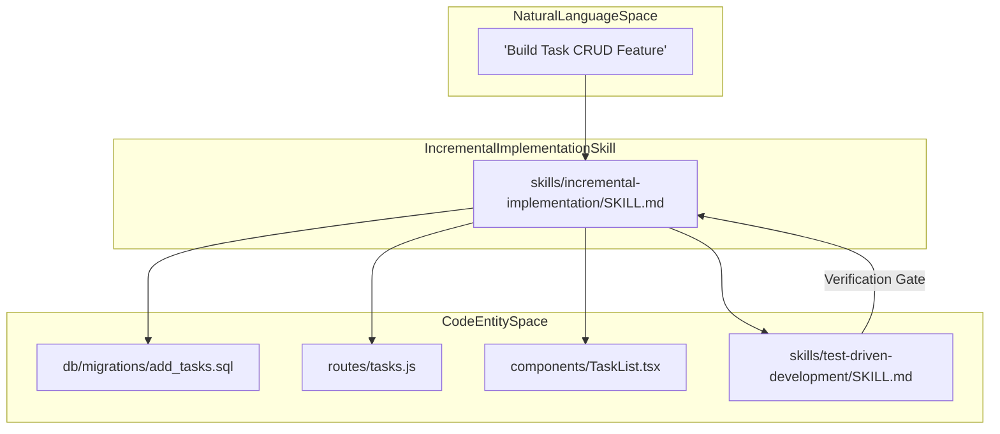

<!-- source: DeepWiki mcp.deepwiki.com · repo addyosmani/agent-skills · page 7 Glossary · fetched 2026-10-30 -->

# Glossary

Relevant source files

The following files were used as context for generating this wiki page:

- [.github/ISSUE_TEMPLATE/skill-gap.yml](.github/ISSUE_TEMPLATE/skill-gap.yml)
- [CLAUDE.md](CLAUDE.md)
- [CONTRIBUTING.md](CONTRIBUTING.md)
- [README.md](README.md)
- [docs/developer-onboarding.md](docs/developer-onboarding.md)
- [docs/other-hosts.md](docs/other-hosts.md)
- [evals/cases/idea-refine.json](evals/cases/idea-refine.json)
- [evals/cases/interview-me.json](evals/cases/interview-me.json)
- [evals/skill-impact.md](evals/skill-impact.md)
- [hooks/session-start-test.sh](hooks/session-start-test.sh)
- [scripts/run-evals-test.js](scripts/run-evals-test.js)
- [scripts/run-evals.js](scripts/run-evals.js)

This page provides definitions for codebase-specific terms, jargon, abbreviations, and domain concepts used within the `agent-skills` repository. It bridges the gap between high-level engineering concepts and their specific implementation as skills, commands, personas, and validation harnesses.

## Purpose and Scope

The glossary serves as the canonical reference for terminology across the `agent-skills` ecosystem. Whether encountering routing algorithms in evaluation scripts or verification rules in workflow specifications, this document maps high-level agentic patterns to concrete codebase entities and files.

Sources: [README.md:1-6](), [docs/developer-onboarding.md:1-20]()

---

## Core Concepts

### Skill
A structured, process-driven workflow encoded in Markdown that guides an AI agent through a specific engineering task. Unlike a simple prompt, a skill includes verification gates, anti-rationalization tables, and explicit red flags.
- **Implementation:** Every skill is defined in a `SKILL.md` file within its own directory under `skills/` [docs/skill-anatomy.md:7-14]().
- **Anatomy:** Standard sections include Overview, When to Use, Process, Common Rationalizations, Red Flags, and Verification [CONTRIBUTING.md:46-52](), [docs/skill-anatomy.md:38-73]().

### Slash Command
A shortcut used in agent interfaces (like Claude Code) to trigger a specific phase of the development lifecycle.
- **Mapping:** Commands like `/spec`, `/plan`, and `/build` map directly to development lifecycle phases [README.md:28-36]().
- **Configuration:** Definitions reside in `.claude/commands/`, `commands/` (TOML), and `.gemini/commands/` [CLAUDE.md:13-13]().

### Persona
A specialist role with a specific perspective and output format. Personas adopt a viewpoint (e.g., Security Auditor) to produce specialized reports.
- **Implementation:** Defined as Markdown files in `agents/` [CLAUDE.md:11-11]().
- **Composition Rule:** Personas do not invoke other personas; the user or a slash command acts as the orchestrator [docs/developer-onboarding.md:23-24]().

### Quality Gate
A mandatory verification step that must pass before a change can advance to the next phase or be merged.
- **Examples:** Core Web Vitals targets for performance [references/observability-checklist.md:38-38](), WCAG 2.1 AA standards for UI [skills/frontend-ui-engineering/SKILL.md:165-167](), and the verification checklist for implementation [skills/using-agent-skills/SKILL.md:111-114]().

Sources: [README.md:28-36](), [CLAUDE.md:11-13](), [docs/skill-anatomy.md:7-14](), [CONTRIBUTING.md:46-52](), [docs/developer-onboarding.md:23-24](), [skills/frontend-ui-engineering/SKILL.md:165-167](), [skills/using-agent-skills/SKILL.md:111-114](), [references/observability-checklist.md:38-38]().

---

## Technical Jargon & Abbreviations

| Term | Definition | Code Pointer |
|:---|:---|:---|
| **ADR** | Architecture Decision Record. A document capturing architectural decisions and their context. | [skills/using-agent-skills/SKILL.md:149-149]() |
| **DAMP** | Descriptive And Meaningful Phrases. Prioritizes readability in tests over strict DRYness. | [skills/test-driven-development/SKILL.md:197-201]() |
| **DRY** | Don't Repeat Yourself. A principle aimed at reducing repetition. | [skills/test-driven-development/SKILL.md:197-201]() |
| **Install-Script Gate** | A security measure auditing dependencies and installation scripts before release. | [skills/security-and-hardening/SKILL.md:53-53]() |
| **LCP/INP/CLS** | Core Web Vitals (Largest Contentful Paint, Interaction to Next Paint, Cumulative Layout Shift). | [skills/performance-optimization/SKILL.md:24-28]() |
| **MCP** | Model Context Protocol. A standard for connecting AI models to external tools like Chrome DevTools. | [README.md:151-151]() |
| **PRD** | Product Requirements Document. The primary output of the `spec-driven-development` skill. | [README.md:16-16]() |
| **Rank-1 Score** | A routing metric in `evals/` ensuring skill descriptions correctly route prompts to the top result. | [scripts/run-evals.js:17-18](), [CONTRIBUTING.md:70-70]() |
| **RED** | Rate, Errors, Duration. Metrics for request-driven services. | [skills/observability-and-instrumentation/SKILL.md:110-110](), [references/observability-checklist.md:38-38]() |
| **STRIDE** | Spoofing, Tampering, Repudiation, Information Disclosure, Denial of Service, Elevation of Privilege. Threat modeling framework. | [skills/security-and-hardening/SKILL.md:31-37](), [references/security-checklist.md:27-27]() |
| **TDD** | Test-Driven Development. The Red-Green-Refactor cycle of writing tests before implementation. | [skills/test-driven-development/SKILL.md:24-33]() |
| **Tier 1/2/3 Evals** | Three-tiered evaluation harness covering structural lints, lexical routing, and behavioral runs. | [scripts/run-evals.js:5-25](), [docs/developer-onboarding.md:55-72]() |
| **TTFB** | Time to First Byte. A measurement of server responsiveness. | [skills/performance-optimization/SKILL.md:81-81]() |
| **USE** | Utilization, Saturation, Errors. Metrics for resources (queues, pools, hosts). | [skills/observability-and-instrumentation/SKILL.md:110-110](), [references/observability-checklist.md:39-39]() |
| **WCAG 2.1 AA** | Web Content Accessibility Guidelines 2.1 Level AA. Accessibility standards for web content. | [skills/frontend-ui-engineering/SKILL.md:165-167]() |

Sources: [README.md:16-151](), [scripts/run-evals.js:5-25](), [CONTRIBUTING.md:70-70](), [docs/developer-onboarding.md:55-72](), [skills/test-driven-development/SKILL.md:24-201](), [skills/performance-optimization/SKILL.md:24-81](), [skills/security-and-hardening/SKILL.md:31-53](), [skills/observability-and-instrumentation/SKILL.md:110-110](), [skills/frontend-ui-engineering/SKILL.md:165-167](), [references/observability-checklist.md:38-39](), [references/security-checklist.md:27-27]().

---

## Domain Patterns

### Beyonce Rule
"If you liked it, you should have put a test on it." The philosophy that tests, not infrastructure, are responsible for catching logic regressions.
- **Source:** [skills/test-driven-development/SKILL.md:147-148]()

### Capability Map
A visual or structured representation of system functionalities, used in the `spec-driven-development` skill to define boundaries and architectural scope.
- **Source:** [skills/using-agent-skills/SKILL.md:12-16]()

### Chesterton's Fence
A principle stating that code or rules should not be removed until the reason for their existence is fully understood.
- **Source:** [skills/code-simplification/SKILL.md:1-1]()

### Definition of Done
The project-wide completion bar that applies to every change, regardless of active skill. It includes passing tests, zero regressions, runtime verification, and updated documentation.
- **Source:** [skills/using-agent-skills/SKILL.md:114-115]()

### Doubt Theater
The process of invoking a fresh-context reviewer with an adversarial prompt to find flaws in an artifact during `doubt-driven-development`.
- **Source:** [skills/doubt-driven-development/SKILL.md:86-104]()

### Floor Guard
A quality threshold mechanism (such as `--min-rank1` in eval runners) that prevents regressions below checked-in baselines.
- **Source:** [scripts/run-evals.js:17-18]()

### Hyrum's Law
"With a sufficient number of users of an API, all observable behaviors of your system will be depended on by somebody." Emphasizes rigorous API versioning and contracts.
- **Source:** [skills/api-and-interface-design/SKILL.md:1-1]()

### Meta-skill
A skill governing how other skills are discovered and invoked. The `using-agent-skills` skill is the primary meta-skill.
- **Source:** [skills/using-agent-skills/SKILL.md:3-3]()

### Prove-It Pattern
A debugging workflow where a developer or agent must first write a failing test reproducing a bug before attempting fixes.
- **Source:** [skills/test-driven-development/SKILL.md:82-104]()

### Stop-the-Line Rule
A practice where development halts immediately to fix a broken build or test failure before proceeding.
- **Source:** [skills/debugging-and-error-recovery/SKILL.md:1-1]()

Sources: [scripts/run-evals.js:17-18](), [skills/test-driven-development/SKILL.md:82-148](), [skills/using-agent-skills/SKILL.md:3-115](), [skills/doubt-driven-development/SKILL.md:86-104](), [skills/code-simplification/SKILL.md:1-1](), [skills/api-and-interface-design/SKILL.md:1-1](), [skills/debugging-and-error-recovery/SKILL.md:1-1]().

---

## Architectural Mapping

### Intent to Code Entity Space: Orchestration & Routing
This diagram maps natural language requests through slash commands and personas to concrete code execution pathways.

Sources: [README.md:28-36](), [CLAUDE.md:11-13](), [skills/using-agent-skills/SKILL.md:146-148](), [docs/developer-onboarding.md:23-24]().

### Vertical Slicing Mechanism: Incremental Implementation
This diagram bridges the natural language requirement to concrete code artifacts using the `incremental-implementation` skill and test framework.

Sources: [skills/using-agent-skills/SKILL.md:25-25](), [skills/frontend-ui-engineering/SKILL.md:27-34](), [skills/test-driven-development/SKILL.md:24-33]().

---

## System Boundaries

### Three-Tier Boundary System
A security and architectural framework used to categorize agent actions:
1.  **Always Do:** Mandatory safety and quality practices (e.g., input validation).
2.  **Ask First:** Actions requiring human confirmation (e.g., destructive operations).
3.  **Never Do:** Forbidden actions (e.g., bypassing security controls).

- **Implementation:** Defined within the `security-and-hardening` skill.
- **Source:** [skills/security-and-hardening/SKILL.md:43-74]()

Sources: [skills/security-and-hardening/SKILL.md:43-74]().