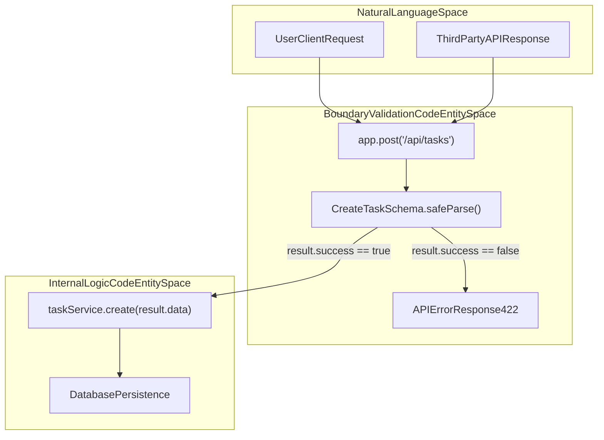
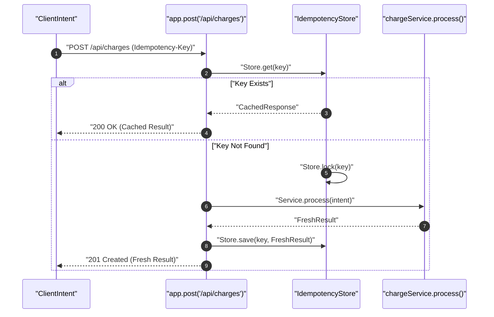
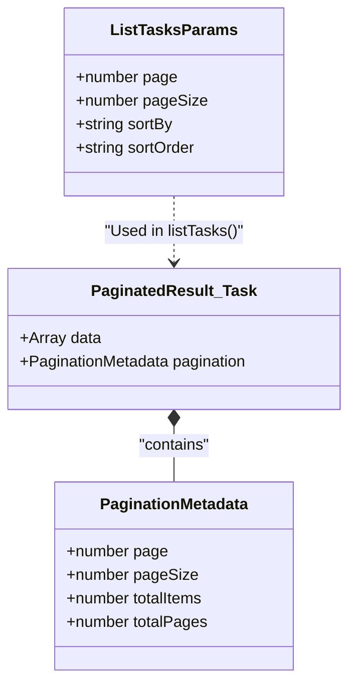

<!-- source: DeepWiki mcp.deepwiki.com · repo addyosmani/agent-skills · extra page API & Interface Design · fetched 2026-10-30 -->

# API & Interface Design

<details>
<summary>Relevant source files</summary>

The following files were used as context for generating this wiki page:

- [.claude/commands/code-simplify.md](.claude/commands/code-simplify.md)
- [evals/cases/api-and-interface-design.json](evals/cases/api-and-interface-design.json)
- [evals/cases/performance-optimization.json](evals/cases/performance-optimization.json)
- [skills/api-and-interface-design/SKILL.md](skills/api-and-interface-design/SKILL.md)
- [skills/code-simplification/SKILL.md](skills/code-simplification/SKILL.md)
- [skills/context-engineering/SKILL.md](skills/context-engineering/SKILL.md)

</details>


## Purpose and Scope

This page defines the contract-first API design standards, error handling patterns, boundary validation rules, idempotency requirements, pagination mechanics, and long-term evolution rules governed by the `api-and-interface-design` skill [skills/api-and-interface-design/SKILL.md:2-4](). It applies to REST endpoints, GraphQL schemas, module boundaries, component props, and any surface where one software module interacts with another [skills/api-and-interface-design/SKILL.md:10]().

**Sources:** [skills/api-and-interface-design/SKILL.md:2-10]()

---

## Core Design Philosophy

The repository enforces high-level principles to ensure long-term maintainability, consumer stability, and prevention of architectural drift.

### Hyrum's Law
Every public behavior of an API will eventually be depended upon by a consumer, regardless of what is promised in the formal contract [skills/api-and-interface-design/SKILL.md:22-24](). To mitigate undocumented dependencies:
*   **Intentional Exposure:** Only expose what is strictly necessary [skills/api-and-interface-design/SKILL.md:28]().
*   **Implementation Hiding:** Prevent implementation details from leaking into the interface [skills/api-and-interface-design/SKILL.md:29]().
*   **Observed Behavior:** Recognize that error message text, timing, ordering, and undocumented quirks become part of the *de facto* contract [skills/api-and-interface-design/SKILL.md:26-31]().
*   **Deprecation Planning:** Plan for the removal of features at design time using safety patterns [skills/api-and-interface-design/SKILL.md:30]().

### The One-Version Rule
The system avoids "diamond dependency" problems by ensuring only one version of an API or dependency exists at a time [skills/api-and-interface-design/SKILL.md:33-35](). The architecture favors extending existing interfaces rather than forking or versioning them in parallel [skills/api-and-interface-design/SKILL.md:33-35]().

**Sources:** [skills/api-and-interface-design/SKILL.md:22-35]()

---

## Contract-First Development

Before writing logic, a formal interface must be defined [skills/api-and-interface-design/SKILL.md:37-39](). The contract acts as the definitive specification for both the producer and consumer [skills/api-and-interface-design/SKILL.md:37-39]().

### TaskAPI Reference Interface
The `TaskAPI` contract standardizes resource-based service interfaces [skills/api-and-interface-design/SKILL.md:41-43]().

| Method | Input | Output | Description |
| :--- | :--- | :--- | :--- |
| `createTask` | `CreateTaskInput` | `Promise<Task>` | Creates a task and returns it with server-generated fields [skills/api-and-interface-design/SKILL.md:43-45](). |
| `listTasks` | `ListTasksParams` | `Promise<PaginatedResult<Task>>` | Returns paginated tasks matching filters [skills/api-and-interface-design/SKILL.md:47-48](). |
| `getTask` | `id: string` | `Promise<Task>` | Returns a single task or throws `NotFoundError` [skills/api-and-interface-design/SKILL.md:50-51](). |
| `updateTask` | `id: string, input: UpdateTaskInput` | `Promise<Task>` | Partial update — only provided fields change [skills/api-and-interface-design/SKILL.md:53-54](). |
| `deleteTask` | `id: string` | `Promise<void>` | Idempotent delete — succeeds even if already deleted [skills/api-and-interface-design/SKILL.md:56-57](). |

**Sources:** [skills/api-and-interface-design/SKILL.md:37-59]()

---

## Boundary Validation & Data Flow

Validation is enforced strictly at system edges [skills/api-and-interface-design/SKILL.md:88-90](). Internal functions trust the type system, while external inputs are treated as untrusted [skills/api-and-interface-design/SKILL.md:88-90]().

### The Validation Gate
The following diagram bridges natural language concepts to code entities to illustrate how external requests are sanitized using schemas via route handlers before reaching internal services.

Title: "Boundary Validation Data Flow"

**Sources:** [skills/api-and-interface-design/SKILL.md:88-110]()

### Validation Rules
*   **Where validation belongs:** API route handlers, form submission handlers, external service response parsing, and environment variable loading [skills/api-and-interface-design/SKILL.md:112-116]().
*   **Third-Party Data:** Always treat external service responses as untrusted data; validate their shape and content before using them in logic, rendering, or decision-making [skills/api-and-interface-design/SKILL.md:115-118]().
*   **Where validation does NOT belong:** Between internal functions that share type contracts, in utility functions called by already-validated code, or on data retrieved directly from the system's database [skills/api-and-interface-design/SKILL.md:120-124]().

**Sources:** [skills/api-and-interface-design/SKILL.md:88-124]()

---

## REST Conventions & Error Semantics

Consistency in naming and error structures allows consumers to predict API behavior without constant documentation lookups [skills/api-and-interface-design/SKILL.md:146]().

### Naming Standards
| Pattern | Convention | Example |
| :--- | :--- | :--- |
| **REST Endpoints** | Plural nouns, no verbs | `GET /api/tasks`, `POST /api/tasks` [skills/api-and-interface-design/SKILL.md:150]() |
| **Query Params** | camelCase | `?sortBy=createdAt&pageSize=20` [skills/api-and-interface-design/SKILL.md:151]() |
| **Response Fields** | camelCase | `{ createdAt, updatedAt, taskId }` [skills/api-and-interface-design/SKILL.md:152]() |
| **Boolean Fields** | is/has/can prefix | `isComplete`, `hasAttachments` [skills/api-and-interface-design/SKILL.md:153]() |
| **Enum Values** | UPPER_SNAKE | `"IN_PROGRESS"`, `"COMPLETED"` [skills/api-and-interface-design/SKILL.md:154]() |

**Sources:** [skills/api-and-interface-design/SKILL.md:148-155]()

### Unified Error Handling Shape
The system enforces a unified `APIError` structure to ensure programmatic handling across consumers [skills/api-and-interface-design/SKILL.md:63-74]().

```typescript
interface APIError {
  error: {
    code: string;        // Machine-readable: "VALIDATION_ERROR"
    message: string;     // Human-readable: "Email is required"
    details?: unknown;   // Additional context when helpful
  };
}
```

**Standard Status Code Mapping:**
*   **400:** Client sent invalid data [skills/api-and-interface-design/SKILL.md:77]().
*   **401:** Not authenticated [skills/api-and-interface-design/SKILL.md:78]().
*   **403:** Authenticated but not authorized [skills/api-and-interface-design/SKILL.md:79]().
*   **404:** Resource not found [skills/api-and-interface-design/SKILL.md:80]().
*   **409:** Conflict (duplicate, version mismatch) [skills/api-and-interface-design/SKILL.md:81]().
*   **422:** Validation failed (semantically invalid) [skills/api-and-interface-design/SKILL.md:82]().
*   **500:** Server error (never expose internal details) [skills/api-and-interface-design/SKILL.md:83]().

**Sources:** [skills/api-and-interface-design/SKILL.md:61-84]()

---

## Idempotency Keys & Retry Handling

Accepting an `Idempotency-Key` is a contract requirement; honoring it correctly prevents unintended side effects like duplicate charges [skills/api-and-interface-design/SKILL.md:157-158]().

### Key Derivation Rules
*   **Derive the key from the intent, not the attempt.** The key must be stable across retries of one intent and unique across distinct intents [skills/api-and-interface-design/SKILL.md:160-161]().
*   Clients generate the key once and reuse it across retries (`req.headers['idempotency-key']`) [skills/api-and-interface-design/SKILL.md:167]().

### Idempotency Resolution Flow
The following sequence diagram bridges natural language intent to code execution entities for idempotency key validation and deduplication.

Title: "Idempotency Key Resolution Flow"

**Sources:** [skills/api-and-interface-design/SKILL.md:157-167]()

---

## Pagination & Filtering Architecture

All list endpoints must support pagination to prevent performance degradation and memory exhaustion [skills/api-and-interface-design/SKILL.md:47-48]().

### Pagination Architecture Flow

Title: "Pagination Data Mapping"


**Sources:** [skills/api-and-interface-design/SKILL.md:47-48]()

---

## Evolution: Addition Over Modification

To maintain the One-Version Rule, interfaces are evolved by adding optional fields rather than modifying or removing existing contracts [skills/api-and-interface-design/SKILL.md:125-136]().

*   **Good:** Adding optional parameters or fields (`priority?: 'low' | 'medium' | 'high'`) [skills/api-and-interface-design/SKILL.md:130-136]().
*   **Bad:** Changing existing field types or removing required fields, which breaks existing consumers [skills/api-and-interface-design/SKILL.md:138-144]().

**Sources:** [skills/api-and-interface-design/SKILL.md:125-145]()

---

