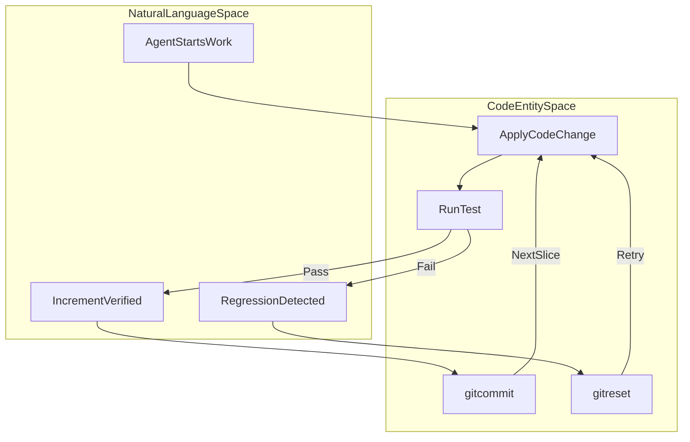
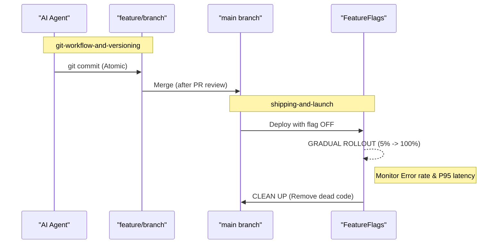

<!-- source: DeepWiki mcp.deepwiki.com · repo addyosmani/agent-skills · extra page Git Workflow & Versioning · fetched 2026-10-30 -->

# Git Workflow & Versioning

Relevant source files

The following files were used as context for generating this wiki page:

- [evals/cases/git-workflow-and-versioning.json](evals/cases/git-workflow-and-versioning.json)
- [evals/fixtures/git-workflow-and-versioning/app.js](evals/fixtures/git-workflow-and-versioning/app.js)
- [skills/debugging-and-error-recovery/SKILL.md](skills/debugging-and-error-recovery/SKILL.md)
- [skills/git-workflow-and-versioning/SKILL.md](skills/git-workflow-and-versioning/SKILL.md)

The `git-workflow-and-versioning` skill defines the structural practices for managing code changes, branching, and history [skills/git-workflow-and-versioning/SKILL.md:2-3](). In an environment where AI agents generate code at high velocity, disciplined version control acts as the primary mechanism for keeping changes manageable, reviewable, and reversible [skills/git-workflow-and-versioning/SKILL.md:8-10]().

## Core Principles

The workflow is built on five fundamental pillars designed to maintain a clean and stable repository:

1.  **Trunk-Based Development**: The `main` branch is kept in an "always deployable" state [skills/git-workflow-and-versioning/SKILL.md:18-20](). Short-lived feature branches (1-3 days) are used to integrate work quickly, reducing the hidden costs of long-lived branches that accumulate merge risk [skills/git-workflow-and-versioning/SKILL.md:23-32]().
2.  **Commit Early, Commit Often**: Each successful increment is treated as a "save point." Agents implement a slice, test it, verify it, and then commit before moving to the next slice [skills/git-workflow-and-versioning/SKILL.md:34-46]().
3.  **Atomic Commits**: Each commit must perform exactly one logical task [skills/git-workflow-and-versioning/SKILL.md:48-50](). Mixed concerns (e.g., combining a feature with a refactor) are prohibited to ensure easy reverts and clear history [skills/git-workflow-and-versioning/SKILL.md:53-63]().
4.  **Descriptive Messages**: Messages must explain the *why* (intent) rather than the *what* (diff) [skills/git-workflow-and-versioning/SKILL.md:65-67](). The convention uses a `<type>: <short description>` format [skills/git-workflow-and-versioning/SKILL.md:81-86]().
5.  **Size Constraints**: Changes are targeted at ~100 lines per commit/PR [skills/git-workflow-and-versioning/SKILL.md:111-112](). Any change exceeding ~1000 lines must be split into smaller units [skills/git-workflow-and-versioning/SKILL.md:113-119]().

### Commit Types
The workflow enforces specific types for commit categorization [skills/git-workflow-and-versioning/SKILL.md:88]():
*   `feat`: New feature [skills/git-workflow-and-versioning/SKILL.md:89]()
*   `fix`: Bug fix [skills/git-workflow-and-versioning/SKILL.md:90]()
*   `refactor`: Code change that neither fixes a bug nor adds a feature [skills/git-workflow-and-versioning/SKILL.md:91]()
*   `test`: Adding or updating tests [skills/git-workflow-and-versioning/SKILL.md:92]()
*   `docs`: Documentation only [skills/git-workflow-and-versioning/SKILL.md:93]()
*   `chore`: Tooling, dependencies, or configuration [skills/git-workflow-and-versioning/SKILL.md:94]()

Sources: [skills/git-workflow-and-versioning/SKILL.md:8-119]()

## Branching Strategy

The repository follows a simple feature-branching model where all work originates from and returns to `main` [skills/git-workflow-and-versioning/SKILL.md:121-131]().

| Branch Type | Naming Convention | Purpose |
| :--- | :--- | :--- |
| **Feature** | `feature/<short-description>` | New functionality [skills/git-workflow-and-versioning/SKILL.md:141]() |
| **Fix** | `fix/<short-description>` | Bug fixes [skills/git-workflow-and-versioning/SKILL.md:142]() |
| **Chore** | `chore/<short-description>` | Maintenance/Dependencies [skills/git-workflow-and-versioning/SKILL.md:143]() |
| **Refactor** | `refactor/<short-description>` | Code restructuring [skills/git-workflow-and-versioning/SKILL.md:144]() |

### Parallel Agent Work with Worktrees
To allow multiple AI agents to work on different features simultaneously without branch switching interference, the use of `git worktree` is recommended [skills/git-workflow-and-versioning/SKILL.md:147-149](). This allows agents to work in isolated directories (e.g., `../project-feature-a`) without interfering with each other [skills/git-workflow-and-versioning/SKILL.md:151-161]().

Sources: [skills/git-workflow-and-versioning/SKILL.md:121-165]()

## Implementation Flow: The Save Point Pattern

The "Save Point Pattern" is the operational loop agents follow to ensure progress is never lost [skills/git-workflow-and-versioning/SKILL.md:173-175](). It bridges the gap between high-level task planning and low-level git operations.

### Save Point Loop: Natural Language to Code Entity Mapping

Title: Save Point Pattern Mapping

Sources: [skills/git-workflow-and-versioning/SKILL.md:173-189]()

## Release and Launch Integration

The git workflow feeds directly into the shipping process. Before a merge is considered ready for a production launch, it must satisfy validation gates [skills/git-workflow-and-versioning/SKILL.md:186-188]().

### Shipping Pipeline: Feature Branch to Production

Title: Shipping Pipeline Flow

Sources: [skills/git-workflow-and-versioning/SKILL.md:23-26]()

## Version Management & Rollbacks

Successful version management relies on observability and reversible deployments. Thresholds are defined to trigger immediate rollbacks if production health degrades [skills/debugging-and-error-recovery/SKILL.md:10-32]().

## Red Flags & Anti-Patterns

*   **Large Commits**: Commits touching multiple unrelated files or exceeding line limits [skills/git-workflow-and-versioning/SKILL.md:60-63]().
*   **Vague Messages**: Messages like "update code" or "fix stuff" [skills/git-workflow-and-versioning/SKILL.md:77-79]().
*   **Diverged Branches**: Keeping a feature branch open for more than 3 days without merging [skills/git-workflow-and-versioning/SKILL.md:134]().
*   **Mixing Concerns**: Combining a `refactor` with a `feat` in the same commit [skills/git-workflow-and-versioning/SKILL.md:105-107]().

Sources: [skills/git-workflow-and-versioning/SKILL.md:1-188]()

---

