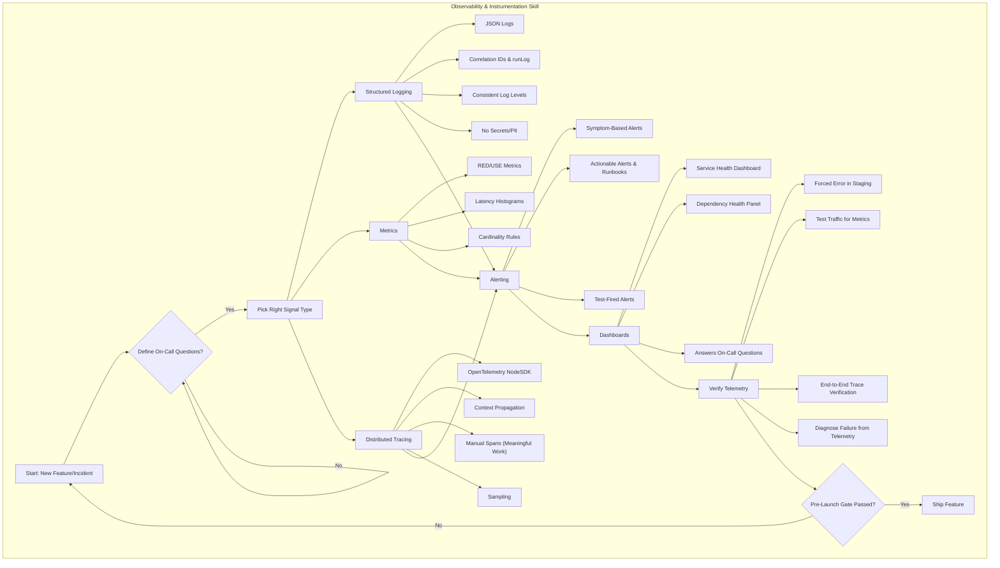
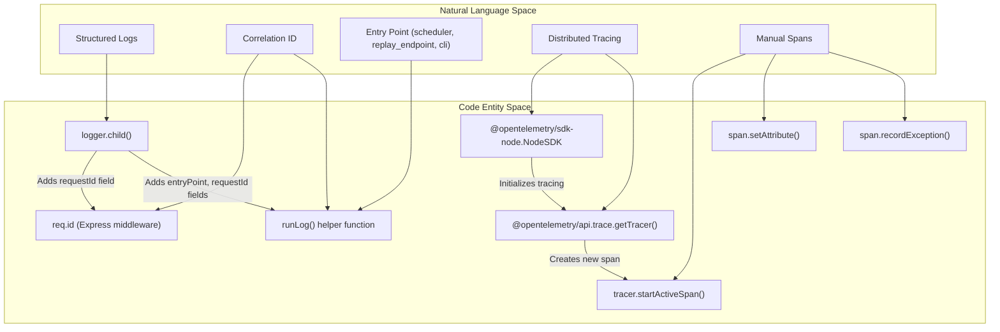
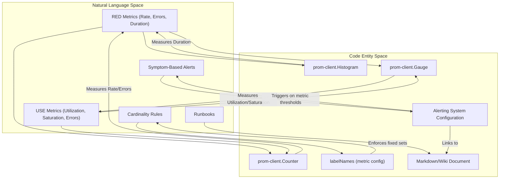

<!-- source: DeepWiki mcp.deepwiki.com · repo addyosmani/agent-skills · extra page Observability & Instrumentation · fetched 2026-10-30 -->

# Observability & Instrumentation

<details>
<summary>Relevant source files</summary>

The following files were used as context for generating this wiki page:

- [evals/cases/observability-and-instrumentation.json](evals/cases/observability-and-instrumentation.json)
- [references/observability-checklist.md](references/observability-checklist.md)
- [skills/frontend-ui-engineering/SKILL.md](skills/frontend-ui-engineering/SKILL.md)
- [skills/observability-and-instrumentation/SKILL.md](skills/observability-and-instrumentation/SKILL.md)

</details>


This page details the `observability-and-instrumentation` skill, which focuses on making production code visible and diagnosable. It covers the implementation of structured JSON logs, correlation IDs, the `runLog` helper, RED/USE metrics, cardinality rules, OpenTelemetry Node.js SDK tracing, symptom-based alerting with runbooks, and pre-launch gates to ensure robust telemetry before deployment.

Sources:
- [skills/observability-and-instrumentation/SKILL.md:1-4]()
- [references/observability-checklist.md:1-15]()

## Overview

Observability is the ability to understand "what is the system doing and why?" from external telemetry. Instrumentation is the process of adding this telemetry and should be done alongside feature development, not as an afterthought. Without proper instrumentation, diagnosing production issues becomes an archaeological exercise rather than a query.

Sources:
- [skills/observability-and-instrumentation/SKILL.md:9-10]()

### When to Use

The `observability-and-instrumentation` skill should be used when:
- Building any feature intended for production.
- Adding new services, endpoints, background jobs, or external integrations.
- Diagnosing production incidents that were difficult to resolve due to insufficient data.
- Setting up or reviewing alerting rules.
- Reviewing pull requests that involve I/O, retries, queues, or cross-service calls.

It is **not** for:
- Diagnosing an active failure (use `debugging-and-error-recovery`).
- Profiling performance issues (use `performance-optimization`).
- Launch-day monitoring checklists and rollback triggers (see `shipping-and-launch`).

Sources:
- [skills/observability-and-instrumentation/SKILL.md:12-24]()

## Process

The instrumentation process follows a structured approach, starting with defining what "working" means for a feature.

### 1. Define "working" before instrumenting

Before adding any instrumentation, it's crucial to define 2-4 questions an on-call engineer would ask about the feature. This ensures that telemetry is purposeful and not just noise. Each signal added should directly help answer one of these questions.

For example, for a "checkout payment retry" feature, on-call questions might include:
1. What fraction of payments succeed on the first attempt versus after retry?
2. When a payment fails permanently, what is the reason (provider error, timeout, validation)?
3. Is the payment provider slower than usual?

Sources:
- [skills/observability-and-instrumentation/SKILL.md:27-41]()
- [references/observability-checklist.md:16-22]()

### 2. Pick the right signal for each question

Different types of telemetry signals answer different kinds of questions:
- **Structured logs**: Answer "What happened in this specific case?" They are per-event and grow with traffic.
- **Metrics**: Answer "How often / how fast, in aggregate?" They have a fixed cost per series and are cheap to query.
- **Traces**: Answer "Where did time go across services?" They are per-request and usually sampled.

A good rule of thumb is: metrics tell you **that** something is wrong, traces tell you **where**, and logs tell you **why**.

Sources:
- [skills/observability-and-instrumentation/SKILL.md:43-51]()
- [references/observability-checklist.md:22]()

### 3. Structured Logging

Logs should be structured JSON objects with stable event names and machine-readable fields, rather than free-form strings. This makes them queryable and consistent.

```typescript
// GOOD: stable event name + structured fields
logger.warn({
  event: 'payment_failed',
  paymentId: id,
  provider: 'stripe',
  errorCode: err.code,
  attempt: n,
}, 'payment failed');
```

Sources:
- [skills/observability-and-instrumentation/SKILL.md:53-67]()
- [references/observability-checklist.md:26]()

#### Log Levels

Log levels must be used consistently:
- `error`: An invariant is broken; someone may need to act.
- `warn`: Degraded but handled (e.g., a retry succeeded, a fallback was used). Watch for trends.
- `info`: A significant business event occurred (e.g., an order placed, a job finished). No immediate action required.
- `debug`: Diagnostic detail, typically off in production.

Sources:
- [skills/observability-and-instrumentation/SKILL.md:69-78]()
- [references/observability-checklist.md:30]()

#### Correlation IDs and `runLog`

Correlation IDs are mandatory. A request ID should be generated or accepted at the system boundary and attached to every log line, span, and outbound call. This allows reconstructing a single request from interleaved logs.

```typescript
// Express: child logger per request, ID propagated downstream
app.use((req, res, next) => {
  req.id = req.headers['x-request-id'] ?? crypto.randomUUID();
  req.log = logger.child({ requestId: req.id });
  res.setHeader('x-request-id', req.id);
  next();
});
```

When multiple entry points write to the same log sink, the entry point must be named. The `runLog` helper function is used for this purpose, carrying both the `entryPoint` and `requestId` fields. This ensures proper attribution of log lines.

```typescript
export const runLog = (entryPoint: 'scheduler' | 'replay_endpoint' | 'cli', runId: string) =>
  logger.child({ entryPoint, requestId: runId });
```

Both `entryPoint` and `requestId` must be propagated across system boundaries (e.g., queue metadata, HTTP headers).

Sources:
- [skills/observability-and-instrumentation/SKILL.md:80-104]()
- [references/observability-checklist.md:27-29]()

#### Sensitive Data

Never log secrets, tokens, passwords, or full PII. This is a hard rule from the `security-and-hardening` skill, as telemetry pipelines are a common data-leak path. Fields should be allowlisted, and entire request bodies should not be logged.

Sources:
- [skills/observability-and-instrumentation/SKILL.md:106-107]()
- [references/observability-checklist.md:31-32]()

### 4. Metrics

For request-driven services, instrument **RED** metrics on every endpoint and external dependency:
- **R**ate (requests/sec)
- **E**rrors (failure rate)
- **D**uration (latency histogram, not average)

For resources (queues, pools, hosts), use **USE** metrics:
- **U**tilization
- **S**aturation
- **E**rrors

The OpenTelemetry metrics API is the vendor-neutral path. An example using Prometheus' `prom-client` for an HTTP request duration histogram:

```typescript
import { Histogram } from 'prom-client';

const httpDuration = new Histogram({
  name: 'http_request_duration_seconds',
  help: 'HTTP request duration',
  labelNames: ['method', 'route', 'status_class'],  // '2xx', not '200'
  buckets: [0.05, 0.1, 0.25, 0.5, 1, 2.5, 5],
});
```

Sources:
- [skills/observability-and-instrumentation/SKILL.md:109-123]()
- [references/observability-checklist.md:38-39]()

#### Cardinality Rules

Cardinality is a critical failure mode for metrics. Every unique label combination creates a separate time series. Labels must come from small, fixed sets (e.g., route template, status class, provider name). Never use unbounded values like user IDs, raw URLs, or error messages as labels; these belong in logs and traces.

```
OK as label:    route="/api/tasks/:id"   status_class="5xx"   provider="stripe"
BAD as label:   route="/api/tasks/12345" status_code="503"    error_message="DB connection failed"
```

Sources:
- [skills/observability-and-instrumentation/SKILL.md:125-128]()
- [references/observability-checklist.md:41-42]()

### 5. Distributed Tracing with OpenTelemetry Node.js SDK

Distributed tracing provides end-to-end visibility of requests across services. OpenTelemetry is the recommended standard.

#### Initialization and Auto-Instrumentation

The OpenTelemetry Node.js SDK should be initialized at service startup, before other imports. Auto-instrumentation should be enabled for common components like HTTP, gRPC, and database clients.

```typescript
// tracer.js (loaded via --require)
const { NodeSDK } = require('@opentelemetry/sdk-node');
const { ConsoleSpanExporter } = require('@opentelemetry/sdk-trace-node');
const { Resource } = require('@opentelemetry/resources');
const { SemanticResourceAttributes } = require('@opentelemetry/semantic-conventions');
const { HttpInstrumentation } = require('@opentelemetry/instrumentation-http');
const { ExpressInstrumentation } = require('@opentelemetry/instrumentation-express');
const { PgInstrumentation } = require('@opentelemetry/instrumentation-pg');

const sdk = new NodeSDK({
  resource: new Resource({
    [SemanticResourceAttributes.SERVICE_NAME]: 'my-service',
  }),
  traceExporter: new ConsoleSpanExporter(), // Replace with OTLP exporter for production
  instrumentations: [
    new HttpInstrumentation(),
    new ExpressInstrumentation(),
    new PgInstrumentation(),
  ],
});

sdk.start();
```

Sources:
- [skills/observability-and-instrumentation/SKILL.md:130-150]()
- [references/observability-checklist.md:47-48]()

#### Context Propagation

Trace context must be propagated on every outbound call (using W3C `traceparent`/`tracestate` headers) and extracted from every inbound request. This context must also survive async boundaries, such as queue messages.

Sources:
- [skills/observability-and-instrumentation/SKILL.md:152-153]()
- [references/observability-checklist.md:49-50]()

#### Manual Spans and Attributes

Manual spans should be used sparingly, only around meaningful internal units of work. These spans should include attributes that on-call engineers would use for filtering and analysis.

```typescript
import { trace } from '@opentelemetry/api';

const tracer = trace.getTracer('my-service-tracer');

async function processPayment(paymentId: string) {
  return tracer.startActiveSpan('processPayment', async (span) => {
    try {
      span.setAttribute('payment.id', paymentId);
      // ... business logic ...
      span.addEvent('payment processed successfully');
      return true;
    } catch (error) {
      span.recordException(error);
      span.setStatus({ code: SpanStatusCode.ERROR, message: error.message });
      throw error;
    } finally {
      span.end();
    }
  });
}
```

Sources:
- [skills/observability-and-instrumentation/SKILL.md:155-172]()
- [references/observability-checklist.md:51]()

#### Sampling

Head-based sampling should be configured at a low default rate. If tail sampling is available, 100% of error traces should be retained.

Sources:
- [skills/observability-and-instrumentation/SKILL.md:174]()
- [references/observability-checklist.md:54]()

### 6. Alerting

Alerts should be symptom-based, actionable, and linked to runbooks.

#### Symptom-Based Alerting

Alerts should focus on symptoms (e.g., error rate, p99 latency, queue age) rather than causes (e.g., CPU usage, disk space). Causes are better suited for dashboards.

Sources:
- [skills/observability-and-instrumentation/SKILL.md:176-177]()
- [references/observability-checklist.md:58]()

#### Actionable Alerts and Runbooks

Every alert must be actionable. Alerts that are frequently ignored should be deleted. Each alert needs a runbook, which should be at least three lines long, explaining:
1. What the alert means.
2. The first query to run.
3. The escalation path.

Thresholds and durations for alerts should be justified by an SLO or historical data, not guesses.

Sources:
- [skills/observability-and-instrumentation/SKILL.md:179-183]()
- [references/observability-checklist.md:59-61]()

#### Alert Severities

Only two severities should be used:
- **Page**: For user-facing issues requiring immediate action.
- **Ticket**: For degradation that can be addressed within the week.

Sources:
- [skills/observability-and-instrumentation/SKILL.md:185-186]()
- [references/observability-checklist.md:62]()

#### Testing Alerts

Each new alert should be test-fired once to ensure it reaches the correct channel and its runbook link works.

Sources:
- [skills/observability-and-instrumentation/SKILL.md:188]()
- [references/observability-checklist.md:63]()

### 7. Dashboards

Dashboards provide visual summaries of system health.

#### Essential Dashboards

A service health dashboard should exist, displaying:
- Error rate
- p99 latency
- Traffic
- Saturation

A dependency health panel should show per-service error rates and latency. Dashboards should directly answer the on-call questions defined earlier. The default time range should be sensible (e.g., 1h–6h).

Sources:
- [skills/observability-and-instrumentation/SKILL.md:190-193]()
- [references/observability-checklist.md:67-70]()

### 8. Verify the Telemetry

Instrumentation is code and can have bugs. It must be verified:
- Force an error in staging and confirm it appears in logs with a correlation ID.
- Send test traffic and verify metric series appear with expected labels and sane values.
- Trace a single request end-to-end in the tracing UI, ensuring no broken spans.
- Confirm that an induced failure can be diagnosed solely from telemetry, without needing to read source code.

Sources:
- [skills/observability-and-instrumentation/SKILL.md:195-200]()
- [references/observability-checklist.md:74-79]()

### 9. Pre-Launch Gate

Before a feature ships to production, the following must be true:
- Structured logs are flowing to the log aggregator.
- RED metrics are visible in dashboards for all new endpoints and dependencies.
- At least one symptom-based alert is configured with a runbook and has been test-fired.
- A request can be traced across every service it touches.
- On-call personnel know where the runbooks are located.

Sources:
- [skills/observability-and-instrumentation/SKILL.md:202-208]()
- [references/observability-checklist.md:83-91]()

## Observability Checklist

The `observability-checklist.md` provides a quick reference for instrumenting production code, mirroring the process outlined above. It serves as a verification gate for the `observability-and-instrumentation` skill.

Sources:
- [references/observability-checklist.md:1-92]()

### Observability Workflow

Diagram: Observability & Instrumentation Workflow
Sources:
- [skills/observability-and-instrumentation/SKILL.md:27-208]()
- [references/observability-checklist.md:16-91]()

### Code Entity Map: Logging and Tracing

Diagram: Code Entities for Logging and Tracing
Sources:
- [skills/observability-and-instrumentation/SKILL.md:60-67]()
- [skills/observability-and-instrumentation/SKILL.md:82-88]()
- [skills/observability-and-instrumentation/SKILL.md:95-97]()
- [skills/observability-and-instrumentation/SKILL.md:130-150]()
- [skills/observability-and-instrumentation/SKILL.md:159-172]()

### Code Entity Map: Metrics and Alerting

Diagram: Code Entities for Metrics and Alerting
Sources:
- [skills/observability-and-instrumentation/SKILL.md:115-122]()
- [skills/observability-and-instrumentation/SKILL.md:125-128]()
- [skills/observability-and-instrumentation/SKILL.md:176-183]()

---

