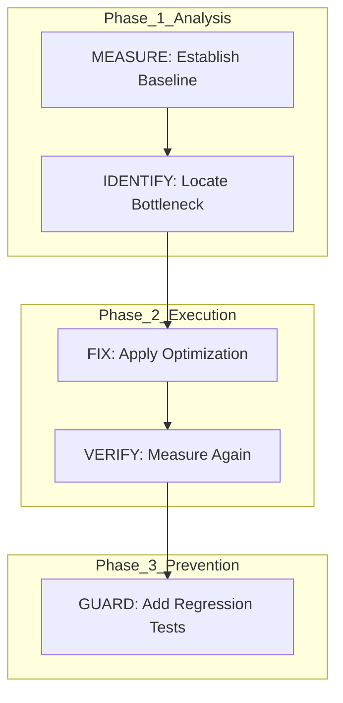
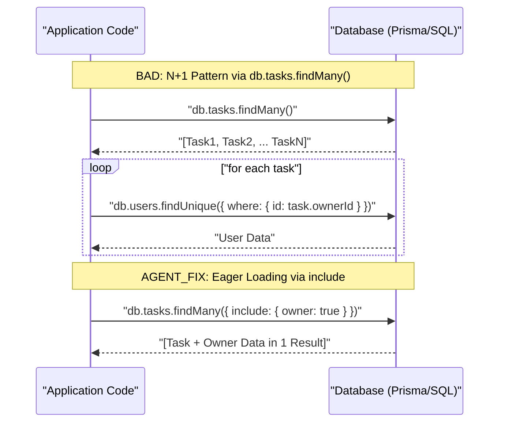
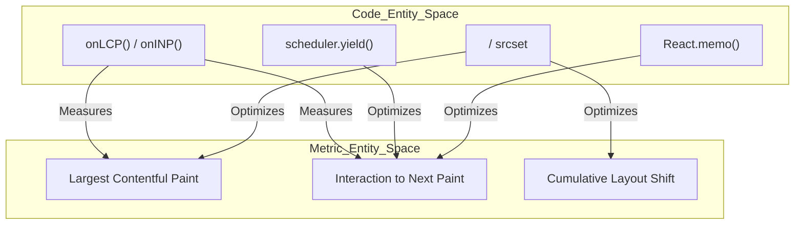
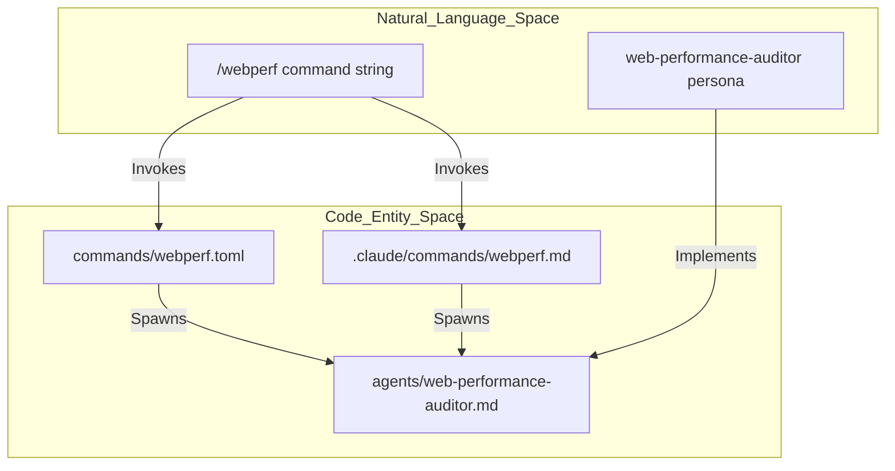

<!-- source: DeepWiki mcp.deepwiki.com · repo addyosmani/agent-skills · extra page Performance Optimization · fetched 2026-10-30 -->

# Performance Optimization

Relevant source files

The following files were used as context for generating this wiki page:

- [.claude/commands/webperf.md](.claude/commands/webperf.md)
- [agents/web-performance-auditor.md](agents/web-performance-auditor.md)
- [commands/webperf.toml](commands/webperf.toml)
- [references/performance-checklist.md](references/performance-checklist.md)
- [skills/performance-optimization/SKILL.md](skills/performance-optimization/SKILL.md)
- [skills/performance-optimization/references/optimization-patterns.md](skills/performance-optimization/references/optimization-patterns.md)

## Purpose and Scope

The `performance-optimization` skill provides a rigorous framework for measuring, identifying, fixing, verifying, and guarding performance across the frontend, backend, queries, and databases [skills/performance-optimization/SKILL.md:1-4](). It mandates evidence-based engineering over guesswork, targeting Core Web Vitals and resource utilization efficiency [skills/performance-optimization/SKILL.md:8-10]().

Sources: [skills/performance-optimization/SKILL.md:1-11]()

## Core Web Vitals Targets

The system enforces user-centric performance thresholds to evaluate application responsiveness, loading speed, and visual stability [skills/performance-optimization/SKILL.md:22-29]().

| Metric | Description | Good | Needs Improvement | Poor |
| :--- | :--- | :--- | :--- | :--- |
| **LCP** | Largest Contentful Paint (Loading) | ≤ 2.5s | ≤ 4.0s | > 4.0s |
| **INP** | Interaction to Next Paint (Responsiveness) | ≤ 200ms | ≤ 500ms | > 500ms |
| **CLS** | Cumulative Layout Shift (Stability) | ≤ 0.1 | ≤ 0.25 | > 0.25 |

Sources: [skills/performance-optimization/SKILL.md:22-29](), [references/performance-checklist.md:15-22]()

## The MEASURE→GUARD Lifecycle

Performance optimization adheres to a five-phase lifecycle designed to prevent premature optimization and guarantee measurable improvements [skills/performance-optimization/SKILL.md:30-38]().

Title: Performance Optimization Workflow

Sources: [skills/performance-optimization/SKILL.md:30-38]()

1. **MEASURE**: Establish baselines using synthetic tools (Lighthouse, DevTools Performance tab) and Real User Monitoring (RUM) via the `web-vitals` library [skills/performance-optimization/SKILL.md:40-59]().
2. **IDENTIFY**: Isolate root causes (e.g., slow TTFB, unindexed queries, heavy main-thread tasks) using metrics and waterfalls [skills/performance-optimization/SKILL.md:73-97](), [references/performance-checklist.md:22-29]().
3. **FIX**: Address specific bottlenecks using validated patterns [skills/performance-optimization/SKILL.md:121-124]().
4. **VERIFY**: Re-measure under identical conditions to confirm gains [skills/performance-optimization/SKILL.md:36-36]().
5. **GUARD**: Introduce CI checks, bundle budgets, or monitoring hooks to prevent regressions [skills/performance-optimization/SKILL.md:37-37](), [references/performance-checklist.md:41-41]().

Sources: [skills/performance-optimization/SKILL.md:30-71](), [references/performance-checklist.md:22-29]()

## Implementation Patterns

### Backend and Database Optimization
Backend performance bottlenecks often stem from unoptimized data access patterns. The skill targets N+1 queries, unbounded fetches, unindexed filters, and connection pool exhaustion [skills/performance-optimization/SKILL.md:125-128](), [skills/performance-optimization/references/optimization-patterns.md:71-87]().

Title: Data Flow: N+1 vs Optimized Fetching

Sources: [skills/performance-optimization/SKILL.md:127-127](), [skills/performance-optimization/references/optimization-patterns.md:9-20]()

### Frontend Rendering and Main-Thread Hygiene
To maintain high responsiveness and prevent layout thrashing, frontend implementations utilize explicit scheduling and resource management.

* **Main Thread Yielding**: Long tasks (> 50ms) are broken up using `scheduler.yield()` or `yieldToMain` patterns [references/performance-checklist.md:47-50]().
* **Memoization**: `React.memo()`, `useMemo()`, and `useCallback()` are applied selectively based on profiling data [references/performance-checklist.md:46-47]().
* **Asset Loading**: LCP images use `fetchpriority="high"` and explicit dimensions to eliminate layout shifts [references/performance-checklist.md:36-38]().

Title: Code Entity Space to Performance Metrics Mapping

Sources: [skills/performance-optimization/SKILL.md:54-58](), [references/performance-checklist.md:36-49](), [skills/performance-optimization/references/optimization-patterns.md:100-140]()

Sources: [skills/performance-optimization/SKILL.md:54-58](), [references/performance-checklist.md:36-50](), [skills/performance-optimization/references/optimization-patterns.md:100-140]()

## Performance Guarding Reference

Verification tools and measurement commands enforce performance targets across the pipeline:

| Tool | Purpose | Command / Code |
| :--- | :--- | :--- |
| `lighthouse` | Automated auditing | `npx lighthouse <url> --output json` [commands/webperf.toml:9]() |
| `bundlesize` | Enforce JS budgets | `npx bundlesize` [references/performance-checklist.md:41-41]() |
| `web-vitals` | RUM measurement | `import { onLCP, onINP, onCLS } from 'web-vitals'` [skills/performance-optimization/SKILL.md:54-58]() |
| `console.time` | Simple backend profiling | `console.time('db-query')` [skills/performance-optimization/SKILL.md:67-70]() |

Sources: [commands/webperf.toml:9](), [skills/performance-optimization/SKILL.md:54-70](), [references/performance-checklist.md:41-41]()

## The `/webperf` Command and `web-performance-auditor` Agent

The `/webperf` command [commands/webperf.toml:1-32]() delegates execution to the `web-performance-auditor` agent [agents/web-performance-auditor.md:1-184](). It runs in two distinct modes:

* **Deep mode**: Activated when artifact data (Lighthouse JSON, PageSpeed Insights, CrUX API responses, or DevTools traces) is present [commands/webperf.toml:7-15](), [agents/web-performance-auditor.md:16-25]().
* **Quick mode**: Default fallback when no artifacts exist, performing source-code scanning for structural anti-patterns and labelling findings as `potential impact` [commands/webperf.toml:16-16](), [agents/web-performance-auditor.md:12-15]().

Title: Natural Language Space to Code Entity Space: /webperf Routing

Sources: [commands/webperf.toml:1-32](), [.claude/commands/webperf.md:1-32](), [agents/web-performance-auditor.md:1-25]()

Sources: [commands/webperf.toml:1-32](), [.claude/commands/webperf.md:1-32](), [agents/web-performance-auditor.md:1-184]()

---

