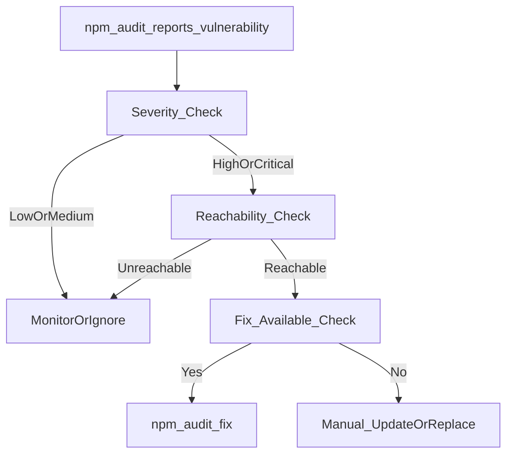
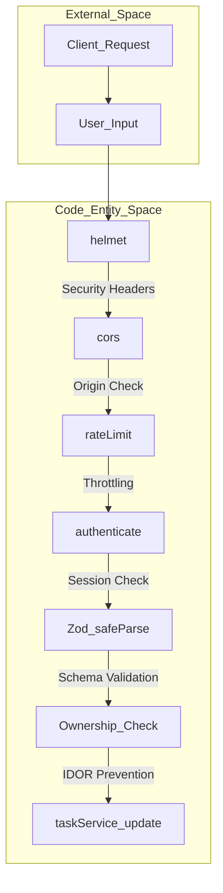

<!-- source: DeepWiki mcp.deepwiki.com · repo addyosmani/agent-skills · extra page Security & Hardening · fetched 2026-10-30 -->

# Security & Hardening

Relevant source files

The following files were used as context for generating this wiki page:

- [evals/fixtures/security-and-hardening/webhook.js](evals/fixtures/security-and-hardening/webhook.js)
- [references/security-checklist.md](references/security-checklist.md)
- [skills/security-and-hardening/SKILL.md](skills/security-and-hardening/SKILL.md)
- [skills/security-and-hardening/references/hardening-patterns.md](skills/security-and-hardening/references/hardening-patterns.md)

The `security-and-hardening` skill provides a rigorous framework for building resilient web applications by treating security as a continuous constraint rather than an afterthought phase [skills/security-and-hardening/SKILL.md:8-10](). It enforces a "Security-First" mindset where every external input is treated as hostile, every secret is protected, and every authorization check is mandatory [skills/security-and-hardening/SKILL.md:10-10]().

Sources: [skills/security-and-hardening/SKILL.md:8-10]()

## Threat Model First: STRIDE and Trust Boundaries

Controls bolted on without a threat model are mere guesses. Before hardening any feature, agents and developers spend five minutes mapping trust boundaries and running the STRIDE methodology [skills/security-and-hardening/SKILL.md:21-27]().

1. **Map the trust boundaries**: Identify where untrusted data crosses into the system, including HTTP requests, form fields, file uploads, webhooks, third-party APIs, message queues, **LLM output**, and local values supplied by the environment or command line [skills/security-and-hardening/SKILL.md:25-25](). Trust follows who *wrote* a value, not which channel delivered it [skills/security-and-hardening/SKILL.md:25-25]().
2. **Name the assets**: Define what is worth protecting, such as credentials, PII, payment data, admin actions, and money movement [skills/security-and-hardening/SKILL.md:26-26]().
3. **Run STRIDE over each boundary**: Evaluate Spoofing, Tampering, Repudiation, Information disclosure, Denial of service, and Elevation of privilege [skills/security-and-hardening/SKILL.md:27-36]().
4. **Write abuse cases**: For each feature, formulate misuse scenarios ("how would I misuse this?") and turn them into initial test cases [skills/security-and-hardening/SKILL.md:38-38](). Failing to name trust boundaries leads directly to OWASP **A04: Insecure Design** [skills/security-and-hardening/SKILL.md:40-40]().

Sources: [skills/security-and-hardening/SKILL.md:21-40](), [references/security-checklist.md:21-29]()

## The Three-Tier Boundary System

The codebase operates under a strict three-tier boundary system that categorizes security actions based on risk and mandatory oversight [skills/security-and-hardening/SKILL.md:43-43]().

| Tier | Description | Key Actions |
| :--- | :--- | :--- |
| **Always Do** | Non-negotiable standards for every feature. | Validate input at boundaries, parameterize queries, encode output, use HTTPS, hash passwords (`bcrypt`/`scrypt`/`argon2`), set security headers, use `httpOnly`/`secure`/`sameSite` cookies, and run native package manager audits [skills/security-and-hardening/SKILL.md:44-53](). |
| **Ask First** | Requires human approval/architectural review. | Adding/changing auth flows, storing PII or sensitive data categories, adding external service integrations, modifying CORS, adding file uploads, modifying rate limits, and granting elevated permissions [skills/security-and-hardening/SKILL.md:55-64](). |
| **Never Do** | Prohibited practices that trigger immediate rejection. | Committing secrets, logging sensitive data, trusting client-side validation, disabling security headers, using `eval()` or `innerHTML` with user data, storing sessions in client-accessible storage, and exposing stack traces [skills/security-and-hardening/SKILL.md:66-74](). |

Sources: [skills/security-and-hardening/SKILL.md:43-74]()

## OWASP Top 10 and LLM Top 10 Prevention

The system enforces prevention patterns for the OWASP Top 10 and addresses emerging vectors via the OWASP Top 10 for LLMs [skills/security-and-hardening/SKILL.md:76-76](), [references/security-checklist.md:18-19]().

### Core Web Vulnerabilities
- **Injection**: Parameterize every query (SQL, NoSQL, shell commands); never build queries via string concatenation [skills/security-and-hardening/SKILL.md:81-81](), [skills/skills/security-and-hardening/references/hardening-patterns.md:13-22]().
- **Cross-Site Scripting (XSS)**: Rely on framework auto-escaping; sanitize raw HTML via DOMPurify allowlists if rendering is unavoidable [skills/security-and-hardening/SKILL.md:82-82](), [skills/security-and-hardening/references/hardening-patterns.md:48-60]().
- **Broken Access Control**: Verify resource ownership on every request to prevent Insecure Direct Object Reference (IDOR) [skills/security-and-hardening/SKILL.md:83-83](), [skills/security-and-hardening/references/hardening-patterns.md:62-80]().
- **Server-Side Request Forgery (SSRF)**: When fetching user-influenced URLs, enforce allowlists, reject non-HTTPS protocols, resolve DNS records to block private/reserved IP ranges (including loopback and cloud metadata `169.254.169.254`), and disable redirects [skills/security-and-hardening/references/hardening-patterns.md:121-150]().

Sources: [skills/security-and-hardening/SKILL.md:79-86](), [skills/security-and-hardening/references/hardening-patterns.md:7-153](), [references/security-checklist.md:18-19]()

## Input Validation & Path Containment

Validation occurs at system boundaries (API routes, form handlers) using strict schemas (e.g., `zod`) to constrain strings, numbers, enums, and formats [skills/security-and-hardening/SKILL.md:104-104](), [skills/security-and-hardening/references/hardening-patterns.md:156-184]().

### Path Containment for Destructive Operations
When performing destructive path operations (delete, move, overwrite), symlinks must be resolved *before* checks, and paths must be verified against an allowlist of roots with strict depth constraints and ownership evidence [references/security-checklist.md:66-67]().

### Logic Flow: Destructive Path Operation Containment
"This diagram illustrates the process for safely handling destructive path operations, ensuring path containment and ownership verification."

```mermaid
graph TD
    A["CandidatePath"] --> B["realpath_resolve_candidate"];
    B -- "ResolvedTarget" --> C["IsTargetWithinAllowedRoots"];
    C -- "No" --> D["ErrorOutsideAllowedRoots"];
    C -- "Yes" --> E["IsTargetDepthValid"];
    E -- "No" --> F["ErrorTargetTooShallow"];
    E -- "Yes" --> G["ReadOwnerFile"];
    G -- "OwnerFound" --> H["DoesOwnerMatchExpected"];
    G -- "NoOwner" --> I["ErrorUnprovenOwner"];
    H -- "No" --> I;
    H -- "Yes" --> J["ReturnVerifiedTargetPath"];
```

Sources: [references/security-checklist.md:66-94]()

## Supply-Chain, Dependencies & Install-Script Gate

Security hardening extends to dependency management and installation boundaries.

- **Installation Boundary Localization**: Locate the parent workspace declaration or nearest project root owning both manifest and dependency graph [references/security-checklist.md:147-148]().
- **Native Audits**: Run the detected package manager's native audit against the committed lockfile prior to release [skills/security-and-hardening/SKILL.md:53-53]().

### Triage Logic: Vulnerability Assessment
"Mapping the decision process for handling vulnerability audit findings."

Sources: [skills/security-and-hardening/SKILL.md:53-53](), [references/security-checklist.md:145-148]()

## Rate Limiting, PII Handling & Session Security

### Authentication and Sessions
- Passwords must be hashed using `bcrypt` (≥12 rounds), `scrypt`, or `argon2` [skills/security-and-hardening/SKILL.md:89-89](), [skills/security-and-hardening/references/hardening-patterns.md:28-32]().
- Session cookies must enforce `httpOnly`, `secure`, and `sameSite: 'lax'` (or `'strict'`) with bounded `maxAge` [skills/security-and-hardening/SKILL.md:90-90](), [skills/security-and-hardening/references/hardening-patterns.md:39-44]().
- Sensitive authentication endpoints must feature rate limiting (e.g., ≤10 attempts per 15 minutes) [references/security-checklist.md:41-41]().

### PII Handling and Privacy Compliance
- Personal data must be classified, collected against a stated purpose, and minimized [references/security-checklist.md:141-141]().
- Retention limits and working deletion paths (including backups, caches, and indexes) must be established [references/security-checklist.md:142-142]().
- Data-subject export/delete requests must be supported, and third-party data sharing requires explicit consent and data-processing agreements [references/security-checklist.md:143-143]().

Sources: [skills/security-and-hardening/SKILL.md:89-90](), [skills/security-and-hardening/references/hardening-patterns.md:28-44](), [references/security-checklist.md:41-41](), [references/security-checklist.md:141-143]()

## Security Hardening Implementation & Request Pipeline

The following diagram bridges natural language security requirements to the code entities and middleware enforcing them across application boundaries.

### Logic Flow: Request Hardening Pipeline
"This diagram illustrates how an incoming request is processed through security layers and middleware code entities."

Sources: [skills/security-and-hardening/SKILL.md:153-165](), [skills/security-and-hardening/SKILL.md:173-189](), [skills/security-and-hardening/SKILL.md:203-215](), [skills/security-and-hardening/references/hardening-patterns.md:84-104]()

## Security Checklist Reference

The `security-checklist.md` acts as the final verification gate during the **Review Phase** [references/security-checklist.md:1-3](). It covers threat modeling checks, pre-commit secret scans (`git diff --cached`) [references/security-checklist.md:31-32](), authentication rules, secure headers (`CSP`, `HSTS`, `X-Content-Type-Options`) [references/security-checklist.md:107-117](), CORS configurations [references/security-checklist.md:119-132](), and data protection guidelines [references/security-checklist.md:134-143]().

Sources: [references/security-checklist.md:1-143]()

---

