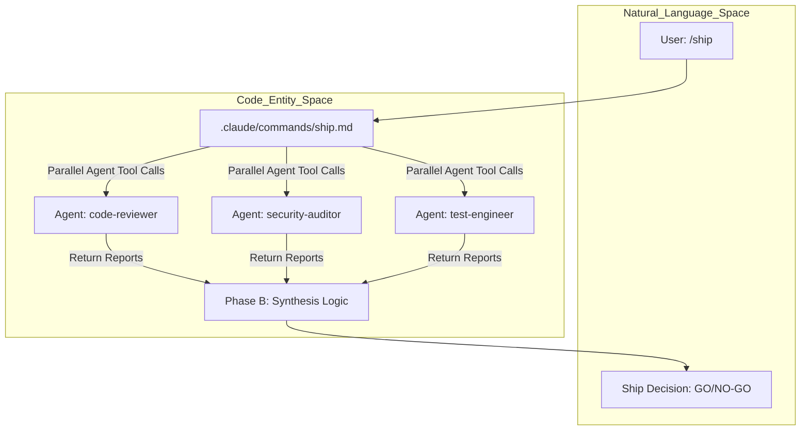
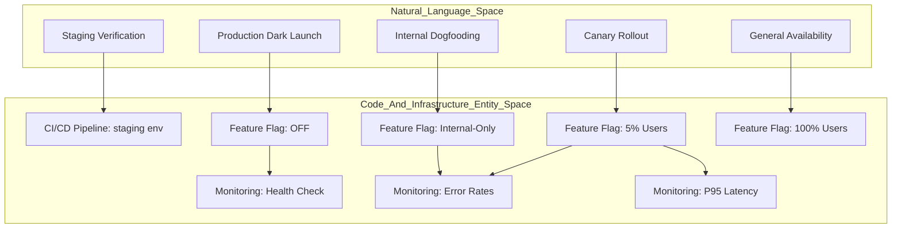
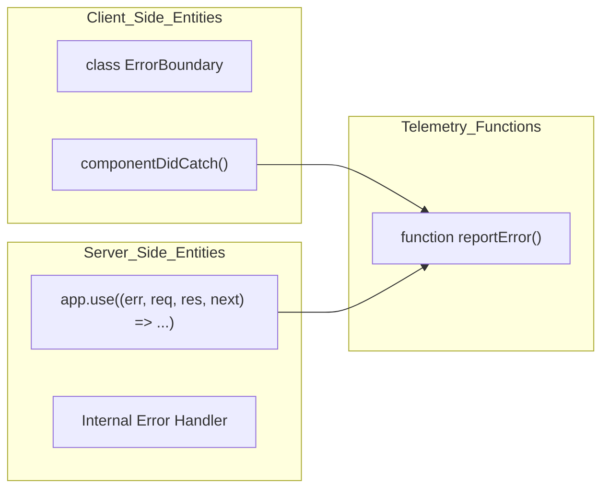

<!-- source: DeepWiki mcp.deepwiki.com · repo addyosmani/agent-skills · extra page Shipping & Launch · fetched 2026-10-30 -->

# Shipping & Launch

<details>
<summary>Relevant source files</summary>

The following files were used as context for generating this wiki page:

- [evals/cases/shipping-and-launch.json](evals/cases/shipping-and-launch.json)
- [skills/shipping-and-launch/SKILL.md](skills/shipping-and-launch/SKILL.md)

</details>


The `shipping-and-launch` skill provides a structured framework for moving code from a verified state to production. It focuses on safety, observability, and reversibility through pre-launch checklists, feature flagging, and staged rollout strategies.

## Overview

Shipping is defined not merely as the act of deployment, but as a controlled process of making changes available to users while minimizing risk. The core philosophy is that every launch must be **reversible**, **observable**, and **incremental** [skills/shipping-and-launch/SKILL.md:10-10]().

### Scope and Applicability
This skill is invoked during the final stage of the development lifecycle, specifically when:
*   Deploying a feature to production for the first time [skills/shipping-and-launch/SKILL.md:14-14]().
*   Releasing a significant change to users or migrating data/infrastructure [skills/shipping-and-launch/SKILL.md:15-16]().
*   Opening a beta or early access program [skills/shipping-and-launch/SKILL.md:17-17]().
*   Any deployment that carries risk [skills/shipping-and-launch/SKILL.md:18-18]().

Sources: [skills/shipping-and-launch/SKILL.md:1-19]()

---

## The `/ship` Command & Orchestration

The `.claude/commands/ship.md` file defines the automation for this phase. It acts as a **fan-out orchestrator**, spawning multiple specialist subagents to verify the readiness of a change [.claude/commands/ship.md:7-7]().

### Parallel Verification Pipeline
When `/ship` is invoked, it triggers a three-phase execution model:

1.  **Phase A: Parallel Fan-out:** The main agent calls three specialist personas simultaneously [.claude/commands/ship.md:9-11](). These subagents are issued in a single assistant turn to ensure parallel execution [.claude/commands/ship.md:11-11]():
    *   `code-reviewer`: Executes a five-axis review (Correctness, Readability, Architecture, Security, Performance) [.claude/commands/ship.md:15-15]().
    *   `security-auditor`: Checks for OWASP Top 10, secrets, and dependency CVEs [.claude/commands/ship.md:16-16]().
    *   `test-engineer`: Analyzes coverage gaps and edge cases [.claude/commands/ship.md:17-17]().
2.  **Phase B: Merge:** The main agent synthesizes reports, resolves duplicates, and verifies infrastructure/documentation readiness [.claude/commands/ship.md:28-37]().
3.  **Phase C: Decision:** A final `GO | NO-GO` verdict is issued along with a mandatory rollback plan [.claude/commands/ship.md:39-44]().

### Orchestration Data Flow
This diagram illustrates how the natural language request to "ship" maps to the parallel subagent execution in the code.



The `/ship` command is an example of the "Parallel fan-out with merge" orchestration pattern, as described in `references/orchestration-patterns.md` [references/orchestration-patterns.md:48-63](). This pattern is used when sub-tasks are genuinely independent, each sub-agent benefits from its own context window, and the merge step is small enough to stay in the main context [references/orchestration-patterns.md:59-62]().

Sources: [.claude/commands/ship.md:1-72](), [references/orchestration-patterns.md:48-63]()

---

## The Pre-Launch Checklist

Before any code is deployed, it must pass a multi-dimensional verification process covering quality, security, performance, accessibility, and infrastructure.

| Category | Key Verification Requirements |
| :--- | :--- |
| **Code Quality** | All tests (unit, integration, e2e) pass; build succeeds without warnings; lint/type checks pass; code reviewed; no `console.log` or TODOs [skills/shipping-and-launch/SKILL.md:24-30](). |
| **Security** | No secrets in VCS; `npm audit` clean; input validation on all user-facing endpoints; security headers (CSP, HSTS) configured; rate limiting on auth [skills/shipping-and-launch/SKILL.md:34-40](). |
| **Performance** | Core Web Vitals in "Good" range; no N+1 queries; bundle size within budget; DB indexes applied; caching configured [skills/shipping-and-launch/SKILL.md:44-49](). |
| **Accessibility** | Keyboard navigation; screen reader support; WCAG 2.1 AA contrast; focus management; descriptive error messages; no `axe-core` warnings [skills/shipping-and-launch/SKILL.md:53-58](). |
| **Infrastructure** | Env variables set; migrations ready; DNS/SSL/CDN configured; Logging/reporting active; Health check endpoint responding [skills/shipping-and-launch/SKILL.md:62-67](). |
| **Documentation** | README updated; API docs current; ADRs written; Changelog updated [skills/shipping-and-launch/SKILL.md:71-75](). |

Sources: [skills/shipping-and-launch/SKILL.md:20-76]()

---

## Feature Flag Architecture

The system utilizes feature flags to decouple deployment (moving code to production) from release (making code active for users) [skills/shipping-and-launch/SKILL.md:79-79]().

### Implementation Pattern
The standard implementation involves checking flags at the component or service level:

```typescript
// Feature flag check
const flags = await getFeatureFlags(userId);

if (flags.taskSharing) {
  // New feature: task sharing
  return <TaskSharingPanel task={task} />;
}

// Default: existing behavior
return null;
```

### Flag Lifecycle
1.  **DEPLOY:** Flag is `OFF` in production. Code is present but inactive [skills/shipping-and-launch/SKILL.md:97-97]().
2.  **ENABLE:** Activate for team/beta users for internal testing in the production environment [skills/shipping-and-launch/SKILL.md:98-98]().
3.  **GRADUAL ROLLOUT:** Increase exposure (5% → 25% → 50% → 100% of users) [skills/shipping-and-launch/SKILL.md:99-99]().
4.  **MONITOR:** Watch error rates and performance at each stage [skills/shipping-and-launch/SKILL.md:100-100]().
5.  **CLEAN UP:** Remove flag and dead code paths within 2 weeks of full rollout [skills/shipping-and-launch/SKILL.md:101-106]().

Sources: [skills/shipping-and-launch/SKILL.md:77-109]()

---

## Staged Rollout & Decision Gates

The rollout process follows a strict sequence with predefined thresholds for advancement or rollback.

### Rollout Sequence Diagram
This diagram maps the natural language rollout phases to the operational state of the system and specific monitoring gates.



### Rollout Decision Thresholds
Decisions to advance are based on comparisons against the baseline metrics [skills/shipping-and-launch/SKILL.md:146-152]().

| Metric | Advance (Green) | Hold (Yellow) | Rollback (Red) |
| :--- | :--- | :--- | :--- |
| **Error Rate** | Within 10% of baseline | 10-100% above baseline | >2x baseline |
| **P95 Latency** | Within 20% of baseline | 20-50% above baseline | >50% above baseline |
| **Client JS Errors** | No new error types | New errors <0.1% sessions | New errors >0.1% sessions |
| **Business Metrics** | Neutral or positive | Decline <5% | Decline >5% |

Sources: [skills/shipping-and-launch/SKILL.md:112-161]()

---

## Monitoring and Observability

A successful launch requires instrumentation at three levels: Application, Infrastructure, and Client [skills/shipping-and-launch/SKILL.md:167-186]().

### Error Reporting Implementation
The codebase mandates centralized error reporting to ensure visibility into failures post-launch.



*   **Client-side:** The `ErrorBoundary` class captures component stacks, user context, and current page path [skills/shipping-and-launch/SKILL.md:192-200]().
*   **Server-side:** Express middleware captures request methods, URLs, and user IDs while sanitizing responses to avoid exposing internals via `INTERNAL_ERROR` codes [skills/shipping-and-launch/SKILL.md:211-220]().

Sources: [skills/shipping-and-launch/SKILL.md:162-220]()

---

## Git & Save Point Discipline
The shipping process relies on disciplined version control. Trunk-based development is recommended to keep `main` always deployable [skills/git-workflow-and-versioning/SKILL.md:18-20]().

### Save Point Pattern
Before a final ship decision, the history should reflect a series of "save points" where each increment was verified [skills/git-workflow-and-versioning/SKILL.md:173-187](). This ensures that if the `/ship` decision results in a `NO-GO`, the system can revert to the last known-good state instantly [skills/git-workflow-and-versioning/SKILL.md:44-46]().

Sources: [skills/git-workflow-and-versioning/SKILL.md:1-190]()

---

