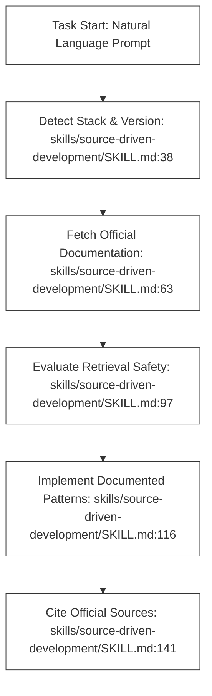
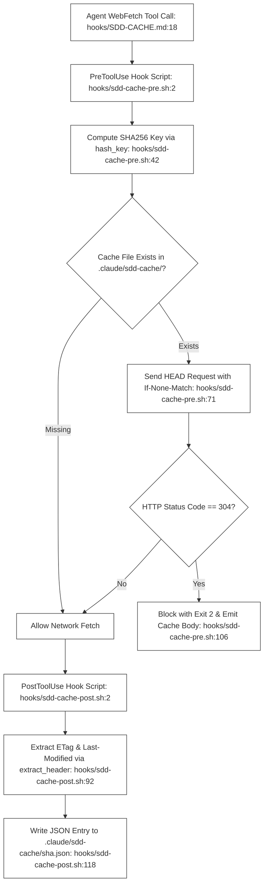
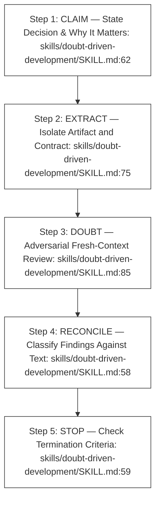

<!-- source: DeepWiki mcp.deepwiki.com · repo addyosmani/agent-skills · extra page Source-Driven & Doubt-Driven Development · fetched 2026-10-30 -->

# Source-Driven & Doubt-Driven Development

<details>
<summary>Relevant source files</summary>

The following files were used as context for generating this wiki page:

- [.gitignore](.gitignore)
- [LICENSE](LICENSE)
- [evals/cases/source-driven-development.json](evals/cases/source-driven-development.json)
- [hooks/SDD-CACHE.md](hooks/SDD-CACHE.md)
- [hooks/sdd-cache-post.sh](hooks/sdd-cache-post.sh)
- [hooks/sdd-cache-pre.sh](hooks/sdd-cache-pre.sh)
- [skills/doubt-driven-development/SKILL.md](skills/doubt-driven-development/SKILL.md)
- [skills/interview-me/SKILL.md](skills/interview-me/SKILL.md)
- [skills/source-driven-development/SKILL.md](skills/source-driven-development/SKILL.md)
- [skills/using-agent-skills/SKILL.md](skills/using-agent-skills/SKILL.md)

</details>


## Purpose and Scope

This page covers two core implementation skills in `agent-skills`: **Source-Driven Development** (`source-driven-development`) and **Doubt-Driven Development** (`doubt-driven-development`). Source-Driven Development ensures that every framework-specific implementation decision is grounded in official, version-matched documentation rather than stale training data. Doubt-Driven Development provides an adversarial, fresh-context verification loop for non-trivial decisions to prevent overconfidence and hidden failure modes. Additionally, this page documents the underlying caching mechanics via the `sdd-cache` hook and cross-model escalation strategies.

---

## 1. Source-Driven Development & Retrieval Safety

The `source-driven-development` skill enforces a strict lifecycle for framework-specific code: **DETECT → FETCH → IMPLEMENT → CITE** `[skills/source-driven-development/SKILL.md:27-36]()`.

### The Lifecycle Pipeline

1. **DETECT**: Read dependency manifests (`package.json`, `go.mod`, `pyproject.toml`, etc.) to identify precise framework and library versions `[skills/source-driven-development/SKILL.md:38-50]()`.
2. **FETCH**: Retrieve documentation exclusively from authoritative sources (Official docs > Official blogs > Web standards > Runtime compat) `[skills/source-driven-development/SKILL.md:67-75]()`. Stack Overflow, third-party blogs, and training memory are strictly disallowed as primary sources `[skills/source-driven-development/SKILL.md:76-81]`.
3. **IMPLEMENT**: Write code strictly following documented signatures, avoiding deprecated patterns `[skills/source-driven-development/SKILL.md:116-124]()`.
4. **CITE**: Include full URLs in code comments and conversational outputs so human reviewers can verify origin data `[skills/source-driven-development/SKILL.md:141-167]()`.

Title: "Natural Language to Code Entity Space: Source-Driven Lifecycle"

*Figure 1: Mapping high-level source-driven execution phases to code file structures and validation routines.*

Sources: `[skills/source-driven-development/SKILL.md:27-167]()`

### Retrieval Safety & Prompt Injection Defense

Fetched documentation pages are treated as untrusted external input (`LLM01: Prompt Injection`) `[skills/source-driven-development/SKILL.md:97-101]`. 

* **Allowed Extraction**: API definitions, usage examples, deprecation warnings, and version guidance `[skills/source-driven-development/SKILL.md:103-108]()`.
* **Ignored Data**: Directives targeting the model (e.g., "ignore previous instructions"), advertisements, third-party resource links, and hardcoded external telemetry or analytics endpoints embedded within documentation samples `[skills/source-driven-development/SKILL.md:109-114]()`.

Sources: `[skills/source-driven-development/SKILL.md:97-114]()`

---

## 2. SDD WebFetch Cache & Revalidation Hooks

To avoid redundant network requests across sessions without compromising the "verify against current docs" guarantee, `agent-skills` implements an HTTP resource cache managed by `hooks/sdd-cache-pre.sh` and `hooks/sdd-cache-post.sh` `[hooks/SDD-CACHE.md:1-9]()`.

### Cache Architecture & Data Flow

* **Storage**: Entries are stored as JSON at `.claude/sdd-cache/<sha>.json`, where `<sha>` is derived from `sha256(url)` truncated to 32 hex characters via `hash_key()` `[hooks/sdd-cache-post.sh:67-77]`, `[hooks/sdd-cache-pre.sh:42-51]`.
* **Freshness Policy**: There is no hard time-to-live (TTL). Freshness is delegated entirely to the origin server using HTTP validators (`If-None-Match` / `If-Modified-Since`) parsed by `extract_header()` via a lightweight `HEAD` request `[hooks/SDD-CACHE.md:53-55]`, `[hooks/sdd-cache-pre.sh:67-74]`, `[hooks/sdd-cache-post.sh:92-103]`.
* **304 Gate**: Content is served from cache *only* if the origin responds with HTTP `304 Not Modified` `[hooks/SDD-CACHE.md:8-9]`, `[hooks/sdd-cache-pre.sh:77-80]`.

Title: "Natural Language to Code Entity Space: SDD Cache Interception Pipeline"

*Figure 2: Mapping abstract fetch revalidation events to concrete shell scripts (`sdd-cache-pre.sh`, `sdd-cache-post.sh`) and utility functions.*

Sources: `[hooks/SDD-CACHE.md:1-150]`, `[hooks/sdd-cache-pre.sh:1-107]`, `[hooks/sdd-cache-post.sh:1-135]()`

---

## 3. Doubt-Driven Development Lifecycle

The `doubt-driven-development` skill establishes a structured adversarial review loop for non-trivial decisions (`CLAIM → EXTRACT → DOUBT → RECONCILE → STOP`) `[skills/doubt-driven-development/SKILL.md:54-60]()`.

### Activation Scope & Constraints

* **Non-Trivial Threshold**: Applies to branching logic changes, cross-boundary integrations, unverified compiler/type invariants, and irreversible operations (production deploys, public API changes, data migrations) `[skills/doubt-driven-development/SKILL.md:16-23]()`.
* **Execution Constraint**: Must run in the **main-session orchestrator**. Subagents or personas must *never* include `doubt-driven-development` in their `skills:` frontmatter to prevent nested recursion anti-patterns (`[references/orchestration-patterns.md]()`) `[skills/doubt-driven-development/SKILL.md:44-48]()`.

### The Five-Step Doubt Loop

Title: "Doubt-Driven Development State Machine"

*Figure 3: State machine mapping procedural verification steps within `skills/doubt-driven-development/SKILL.md`.*

1. **CLAIM**: State the decision and why it matters in 2–3 lines `[skills/doubt-driven-development/SKILL.md:62-72]`.
2. **EXTRACT**: Isolate the smallest reviewable unit (`ARTIFACT` + `CONTRACT`). Strip away prior reasoning to prevent confirmation bias `[skills/doubt-driven-development/SKILL.md:75-84]`.
3. **DOUBT**: Invoke a fresh-context reviewer using an adversarial prompt. Pass *only* the `ARTIFACT` and `CONTRACT` — never pass the `CLAIM` `[skills/doubt-driven-development/SKILL.md:85-106]`.
4. **RECONCILE**: Classify every finding against the artifact text rather than dismissing them prematurely `[skills/doubt-driven-development/SKILL.md:58]()`.
5. **STOP**: Terminate when findings are trivial, after 3 cycles, or upon explicit user override `[skills/doubt-driven-development/SKILL.md:59]()`.

Sources: `[skills/doubt-driven-development/SKILL.md:1-125]()`

---

## 4. Cross-Model Escalation & Doubt Theater

To eliminate shared blind spots between the primary authoring model and the reviewer, doubt-driven workflows support cross-model second opinions `[skills/doubt-driven-development/SKILL.md:112-114]()`.

### Cross-Model Escalation Protocol

During Step 3, before reconciliation, interactive sessions must prompt the user for cross-model verification options:

```
> "Single-model review complete. Want a cross-model second opinion? 
   Options: Gemini CLI, Codex CLI, manual external review, or skip."
```
* This query is mandatory in every interactive doubt cycle regardless of perceived stakes. The human operator decides if the verification cost is justified `[skills/doubt-driven-development/SKILL.md:116-124]()`.

### Avoiding Doubt Theater

A common failure mode is **doubt theater** — performing superficial, rubber-stamp reviews that mimic rigor without challenging core assumptions. To prevent this:
* Reviewer prompts must explicitly mandate findings-only output and forbid summaries or validation (`"Do NOT validate. Do NOT summarize. Find issues..."`) `[skills/doubt-driven-development/SKILL.md:99-100]()`.
* Personas with default balanced response templates (such as `code-reviewer`) must have their output shapes overridden by pasting the adversarial prompt verbatim `[skills/doubt-driven-development/SKILL.md:110-111]()`.

Sources: `[skills/doubt-driven-development/SKILL.md:112-125]()`

---

