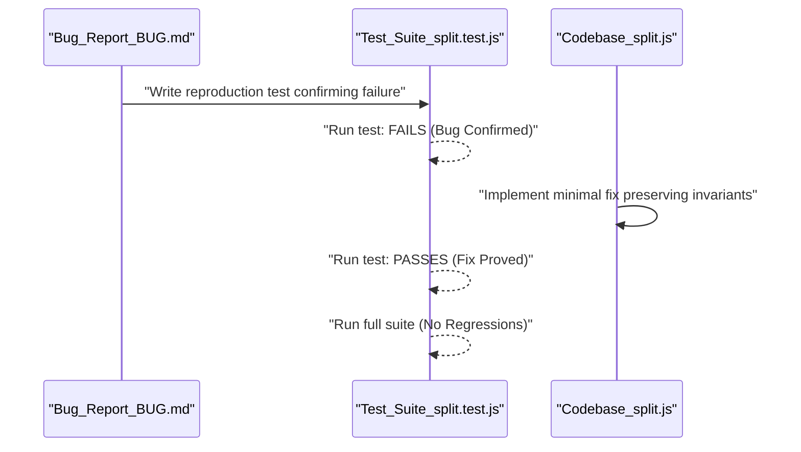

<!-- source: DeepWiki mcp.deepwiki.com · repo addyosmani/agent-skills · extra page Test-Driven Development · fetched 2026-10-30 -->

# Test-Driven Development

<details>
<summary>Relevant source files</summary>

The following files were used as context for generating this wiki page:

- [evals/cases/test-driven-development.json](evals/cases/test-driven-development.json)
- [evals/fixtures/test-driven-development/BUG.md](evals/fixtures/test-driven-development/BUG.md)
- [evals/fixtures/test-driven-development/README.md](evals/fixtures/test-driven-development/README.md)
- [evals/fixtures/test-driven-development/package.json](evals/fixtures/test-driven-development/package.json)
- [evals/fixtures/test-driven-development/src/split.js](evals/fixtures/test-driven-development/src/split.js)
- [evals/fixtures/test-driven-development/test/split.test.js](evals/fixtures/test-driven-development/test/split.test.js)
- [skills/incremental-implementation/SKILL.md](skills/incremental-implementation/SKILL.md)
- [skills/test-driven-development/SKILL.md](skills/test-driven-development/SKILL.md)

</details>


## Purpose and Scope

This page defines the **Test-Driven Development (TDD)** skill (`test-driven-development`) within the `agent-skills` framework [skills/test-driven-development/SKILL.md:2-3](). TDD is a core verification mechanism that mandates writing a failing test before writing any production implementation code [skills/test-driven-development/SKILL.md:10-10](). In this ecosystem, tests serve as executable proof—"seems right" is never accepted as completion [skills/test-driven-development/SKILL.md:10-10](). 

The scope of this page includes:
- The **Red-Green-Refactor** development loop [skills/test-driven-development/SKILL.md:38-47]()
- Stack discovery protocols before testing [skills/test-driven-development/SKILL.md:24-36]()
- The **Prove-It Pattern** for bug fixes [skills/test-driven-development/SKILL.md:96-118]()
- The **Test Pyramid** distribution and **Test Sizes** resource model [skills/test-driven-development/SKILL.md:144-174]()
- Testing philosophy principles (**DAMP over DRY** and the **Beyonce Rule**) [skills/test-driven-development/SKILL.md:161-161]()
- Practical implementation patterns drawn from the testing patterns reference [evals/fixtures/test-driven-development/test/split.test.js:1-13]()

Sources: [skills/test-driven-development/SKILL.md:2-10](), [evals/fixtures/test-driven-development/test/split.test.js:1-13]()

---

## The Red-Green-Refactor Cycle

The TDD workflow follows a strict three-phase sequence designed to ensure minimal code complexity and strict behavioral correctness [skills/test-driven-development/SKILL.md:38-47]().

### TDD Cycle Flow
```mermaid
graph TD
    subgraph "RED_Phase"
        ["write_failing_test"] --> ["confirm_test_failure"]
    end
    subgraph "GREEN_Phase"
        ["confirm_test_failure"] --> ["write_minimal_code"]
        ["write_minimal_code"] --> ["confirm_test_pass"]
    end
    subgraph "REFACTOR_Phase"
        ["confirm_test_pass"] --> ["clean_up_implementation"]
        ["clean_up_implementation"] --> ["verify_tests_still_pass"]
    end
    ["verify_tests_still_pass"] --> ["write_failing_test"]
```
Sources: [skills/test-driven-development/SKILL.md:38-47]()

1. **RED**: Write a test for a feature or behavior that does not yet exist. The test **must fail** to prove it actually tests the new code rather than passing immediately [skills/test-driven-development/SKILL.md:49-52]().
2. **GREEN**: Write the absolute minimum code required to make the test pass. Avoid speculative over-engineering or premature abstraction [skills/test-driven-development/SKILL.md:67-69]().
3. **REFACTOR**: Improve code quality, naming, and structure while ensuring the test suite remains green [skills/test-driven-development/SKILL.md:85-94]().

Sources: [skills/test-driven-development/SKILL.md:38-94]()

---

## Discover the Stack First

Before executing any TDD cycle, agents must inspect the repository to identify the correct testing stack and commands [skills/test-driven-development/SKILL.md:24-26](). Never assume generic commands like `npm test` apply universally [skills/test-driven-development/SKILL.md:34-34]().

- **Language and Build System**: Identify files such as `package.json`, `pom.xml`, `build.gradle`, `pyproject.toml`, `go.mod`, `Cargo.toml`, `Gemfile`, or `Makefile` [skills/test-driven-development/SKILL.md:28-28]().
- **Checked-in Wrappers**: Prefer local wrappers like `./gradlew`, `./mvnw`, `make test`, or repository scripts over globally installed binaries [skills/test-driven-development/SKILL.md:29-29]().
- **Test Frameworks**: Determine how the runner executes a single focused test versus the full suite [skills/test-driven-development/SKILL.md:30-30]() during RED and GREEN phases [skills/test-driven-development/SKILL.md:34-34]().

Sources: [skills/test-driven-development/SKILL.md:24-36]()

---

## The Prove-It Pattern (Bug Fixes)

When a bug report arrives, agents are strictly prohibited from writing fixes blindly. They must apply the **Prove-It Pattern** [skills/test-driven-development/SKILL.md:96-98]().

### Bug Fix Lifecycle

Sources: [skills/test-driven-development/SKILL.md:96-117](), [evals/fixtures/test-driven-development/BUG.md:1-10]()

1. **Write Reproduction Test**: Create a test case that demonstrates the reported bug [skills/test-driven-development/SKILL.md:98-104]().
2. **Confirm Failure**: Execute the test and verify it fails, confirming the bug is isolated [skills/test-driven-development/SKILL.md:106-107]().
3. **Implement Fix**: Write the minimal code necessary to address the root cause [skills/test-driven-development/SKILL.md:109-110]().
4. **Prove Success**: Verify the test passes and run the full test suite to guarantee zero regressions [skills/test-driven-development/SKILL.md:112-117]().

Sources: [skills/test-driven-development/SKILL.md:96-118]()

---

## The Test Pyramid & Test Sizes

TDD distribution follows the classic Test Pyramid to optimize execution speed, isolation, and confidence [skills/test-driven-development/SKILL.md:144-146]().

```
          ╱╲
         ╱  ╲         E2E Tests (~5%)
        ╱    ╲        Full user flows, real browser
       ╱──────╲
      ╱        ╲      Integration Tests (~15%)
     ╱          ╲     Component interactions, API boundaries
    ╱────────────╲
   ╱              ╲   Unit Tests (~80%)
  ╱                ╲  Pure logic, isolated, milliseconds each
 ╱──────────────────╲
```

### Test Sizes Resource Model
In addition to pyramid levels, tests are categorized by resource constraints [skills/test-driven-development/SKILL.md:163-165]():

| Size | Constraints | Speed | Example |
| :--- | :--- | :--- | :--- |
| **Small** | Single process, no I/O, no network, no DB | Milliseconds | Pure function tests, data transforms [skills/test-driven-development/SKILL.md:169-169]() |
| **Medium** | Multi-process OK, localhost only, test DB | Seconds | API tests with test DB, component tests [skills/test-driven-development/SKILL.md:170-170]() |
| **Large** | Multi-machine, external services allowed | Minutes | E2E Playwright tests, performance benchmarks [skills/test-driven-development/SKILL.md:171-171]() |

Sources: [skills/test-driven-development/SKILL.md:144-174]()

---

## Testing Philosophy: DAMP over DRY & The Beyonce Rule

- **DAMP over DRY**: While production code prioritizes *Don't Repeat Yourself*, tests prioritize *Descriptive And Meaningful Phrases*. Self-contained setup in tests is preferred over opaque shared helper abstractions so failures can be debugged immediately.
- **The Beyonce Rule**: *"If you liked it, you should have put a test on it."* Infrastructure shifts, refactoring, and migrations do not excuse missing test coverage. If a regression occurs without an accompanying test, the change violates verification gates [skills/test-driven-development/SKILL.md:161-161]().

Sources: [skills/test-driven-development/SKILL.md:161-161]()

---

## Natural Language Space to Code Entity Space Mapping (Part 1: Bug Fixing & Unit Testing)

This diagram bridges natural language bug reports and testing intents to specific code entities within the test fixtures.

```mermaid
graph LR
    subgraph "Natural_Language_Space"
        ["NL_Reproduce_reconciliation_bug"]
        ["NL_Write_failing_unit_test"]
    end

    subgraph "Code_Entity_Space"
        ["NL_Reproduce_reconciliation_bug"] --> ["CE_test_split_cents_exactness"]
        ["NL_Write_failing_unit_test"] --> ["CE_splitCents_src_split_js"]
    end

    ["CE_test_split_cents_exactness"] --- ["F_evals_fixtures_test_driven_development_test_split_test_js"]
    ["CE_splitCents_src_split_js"] --- ["F_evals_fixtures_test_driven_development_src_split_js"]
```
Sources: [evals/cases/test-driven-development.json:37-51](), [evals/fixtures/test-driven-development/src/split.js:1-8]()

---

## Natural Language Space to Code Entity Space Mapping (Part 2: Test Execution & Invariant Verification)

This diagram maps natural language test execution instructions to concrete test runner commands and implementation verification routines.

```mermaid
graph LR
    subgraph "Natural_Language_Space"
        ["NL_Run_repository_test_suite"]
        ["NL_Verify_fairness_invariant"]
    end

    subgraph "Code_Entity_Space"
        ["NL_Run_repository_test_suite"] --> ["CE_scripts_test_package_json"]
        ["NL_Verify_fairness_invariant"] --> ["CE_test_split_test_js"]
    end

    ["CE_scripts_test_package_json"] --- ["F_evals_fixtures_test_driven_development_package_json"]
    ["CE_test_split_test_js"] --- ["F_evals_fixtures_test_driven_development_test_split_test_js"]
```
Sources: [evals/fixtures/test-driven-development/package.json:1-9](), [evals/fixtures/test-driven-development/test/split.test.js:1-13]()

---

