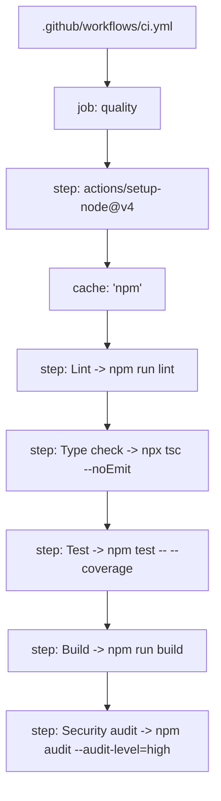
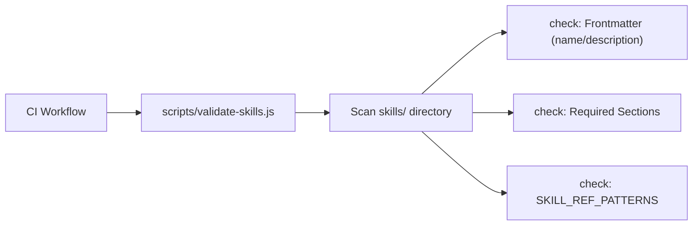
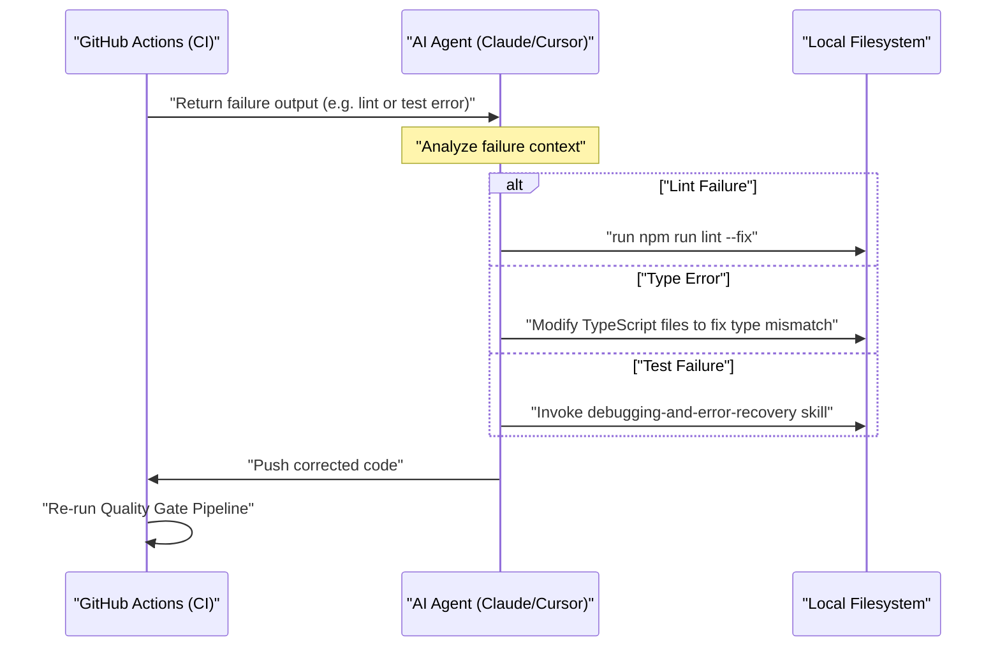

<!-- source: DeepWiki mcp.deepwiki.com · repo addyosmani/agent-skills · extra page CI/CD & Automation · fetched 2026-10-30 -->

# CI/CD & Automation

<details>
<summary>Relevant source files</summary>

The following files were used as context for generating this wiki page:

- [evals/fixtures/ci-cd-and-automation/package.json](evals/fixtures/ci-cd-and-automation/package.json)
- [evals/fixtures/test-driven-development-ecosystem/README.md](evals/fixtures/test-driven-development-ecosystem/README.md)
- [evals/fixtures/test-driven-development-ecosystem/ledger.py](evals/fixtures/test-driven-development-ecosystem/ledger.py)
- [evals/fixtures/test-driven-development-ecosystem/test_ledger.py](evals/fixtures/test-driven-development-ecosystem/test_ledger.py)
- [references/accessibility-checklist.md](references/accessibility-checklist.md)
- [references/testing-patterns.md](references/testing-patterns.md)
- [skills/ci-cd-and-automation/SKILL.md](skills/ci-cd-and-automation/SKILL.md)

</details>


The **CI/CD & Automation** skill focuses on the creation and maintenance of automated quality gates that ensure no change reaches production without passing a rigorous battery of tests and checks [skills/ci-cd-and-automation/SKILL.md:8-10](). By shifting verification "left" (earlier in the lifecycle), the system catches regressions during the development phase rather than after deployment [skills/ci-cd-and-automation/SKILL.md:12-12]().

Sources: [skills/ci-cd-and-automation/SKILL.md:8-15]()

---

## The Quality Gate Pipeline

The core of the automation strategy is a non-skippable pipeline. Every Pull Request must traverse these gates in sequence. If a gate fails, the pipeline halts, requiring the agent or developer to resolve the specific issue before proceeding [skills/ci-cd-and-automation/SKILL.md:24-54]().

### Pipeline Execution Flow

| Order | Gate | Tooling Example | Purpose |
| :--- | :--- | :--- | :--- |
| 1 | **Lint Check** | `eslint`, `prettier` | Static code style and syntax consistency [skills/ci-cd-and-automation/SKILL.md:33-33](). |
| 2 | **Type Check** | `tsc --noEmit` | Static analysis of type safety [skills/ci-cd-and-automation/SKILL.md:35-35](). |
| 3 | **Unit Tests** | `jest`, `vitest` | Verification of individual functions/components [skills/ci-cd-and-automation/SKILL.md:37-37](). |
| 4 | **Build** | `npm run build` | Verification that the project compiles/bundles [skills/ci-cd-and-automation/SKILL.md:39-39](). |
| 5 | **Integration** | API/DB tests | Verification of interactions between modules [skills/ci-cd-and-automation/SKILL.md:41-41](). |
| 6 | **E2E** | `Playwright` | Full user-flow verification in a browser [skills/ci-cd-and-automation/SKILL.md:43-43](). |
| 7 | **Security** | `npm audit` | Checking for known vulnerabilities in dependencies [skills/ci-cd-and-automation/SKILL.md:45-45](). |
| 8 | **Bundle Size** | `bundlesize` | Ensuring performance budgets are met [skills/ci-cd-and-automation/SKILL.md:47-47](). |

Sources: [skills/ci-cd-and-automation/SKILL.md:24-54]()

---

## GitHub Actions Configuration

The repository utilizes GitHub Actions to codify these gates. The configuration is split into jobs that handle environment setup, dependency caching, and execution of the quality gates [skills/ci-cd-and-automation/SKILL.md:56-98]().

### CI Logic to Code Entity Mapping

The following diagram bridges the conceptual pipeline to the specific GitHub Actions entities and execution commands defined in code.

Pipeline to Workflow Mapping

Sources: [skills/ci-cd-and-automation/SKILL.md:60-98]()

### Integration & Service Containers
For integration tests requiring a database, the workflow defines `services` to spin up ephemeral instances (e.g., PostgreSQL) [skills/ci-cd-and-automation/SKILL.md:103-119]().

*   **Database URL:** Managed via `DATABASE_URL` environment variables [skills/ci-cd-and-automation/SKILL.md:130-130]().
*   **Migrations:** Executed via `npx prisma migrate deploy` before tests run [skills/ci-cd-and-automation/SKILL.md:128-128]().
*   **Secrets:** Credentials must be stored in GitHub Secrets rather than hardcoded, even for CI-only databases [skills/ci-cd-and-automation/SKILL.md:137-137]().

### Plugin & Skill Validation
Specialized workflows validate repository-specific integrity. The validation pipeline ensures that the agent plugin structure is valid and that all skill files adhere to the defined specification.

Skill Validation Process


The validation script enforces the `SKILL.md` format, checking for required sections like `## Overview`, `## When to Use`, and verification routines [skills/ci-cd-and-automation/SKILL.md:1-5](). It also checks for dead cross-references across the repository.

Sources: [skills/ci-cd-and-automation/SKILL.md:100-137](), [evals/fixtures/ci-cd-and-automation/package.json:1-8]()

---

## Automated Feedback Loop for Agents

A critical component of the `agent-skills` framework is the feedback loop between CI failures and the AI agent. When a pipeline fails, the output is fed back to the agent to trigger automated recovery [skills/ci-cd-and-automation/SKILL.md:164-182]().

Agent Recovery Workflow

Sources: [skills/ci-cd-and-automation/SKILL.md:164-192]()

---

## Deployment & Rollback Lifecycle

The deployment strategy emphasizes safety through staged rollouts and the ability to reverse changes instantly [skills/ci-cd-and-automation/SKILL.md:229-250]().

### Staged Rollout Process
1.  **Preview Deployments:** Every PR generates a unique preview URL (e.g., Vercel/Netlify) for manual verification [skills/ci-cd-and-automation/SKILL.md:195-208]().
2.  **Staging:** Auto-deployed upon merge to `main` [skills/ci-cd-and-automation/SKILL.md:235-235]().
3.  **Production:** Triggered manually or automatically after staging verification [skills/ci-cd-and-automation/SKILL.md:238-238]().
4.  **Monitoring Window:** A 15-minute window follows production deployment. If errors are detected, a rollback is initiated [skills/ci-cd-and-automation/SKILL.md:241-244]().

### Feature Flags
Feature flags are used to decouple code deployment from feature release. This allows for:
*   **Canarying:** Enabling features for a small percentage of users (1% → 10% → 100%) [skills/ci-cd-and-automation/SKILL.md:216-216]().
*   **Instant Rollback:** Disabling a flag instead of reverting a commit [skills/ci-cd-and-automation/SKILL.md:215-215]().

**Code Implementation Pattern:**
```typescript
if (featureFlags.isEnabled('new-checkout-flow', { userId })) {
  return renderNewCheckout();
}
return renderLegacyCheckout();
```
[skills/ci-cd-and-automation/SKILL.md:219-225]()

Sources: [skills/ci-cd-and-automation/SKILL.md:193-245]()

---

## Pipeline Optimization Strategies

To maintain high velocity, the CI/CD pipeline must remain performant. Key strategies include:

*   **Caching:** Using `actions/setup-node` with `cache: 'npm'` to avoid redundant dependency downloads [skills/ci-cd-and-automation/SKILL.md:76-79]().
*   **Parallelization:** Running independent jobs (like Lint and Unit Tests) in parallel rather than sequentially where possible.
*   **Build Cop Role:** A rotating responsibility to monitor pipeline health. The Build Cop's priority is fixing the "broken build" immediately, following the "Stop-the-Line" rule [skills/ci-cd-and-automation/SKILL.md:10-14]().

Sources: [skills/ci-cd-and-automation/SKILL.md:10-15](), [skills/ci-cd-and-automation/SKILL.md:76-79]()

---

