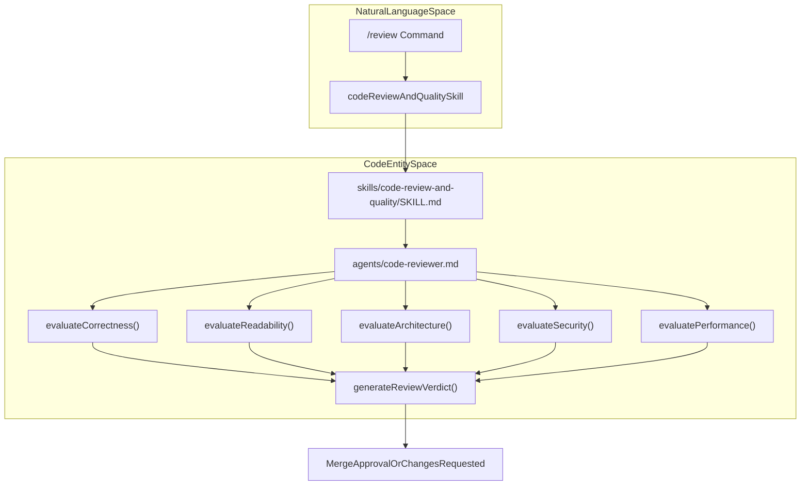
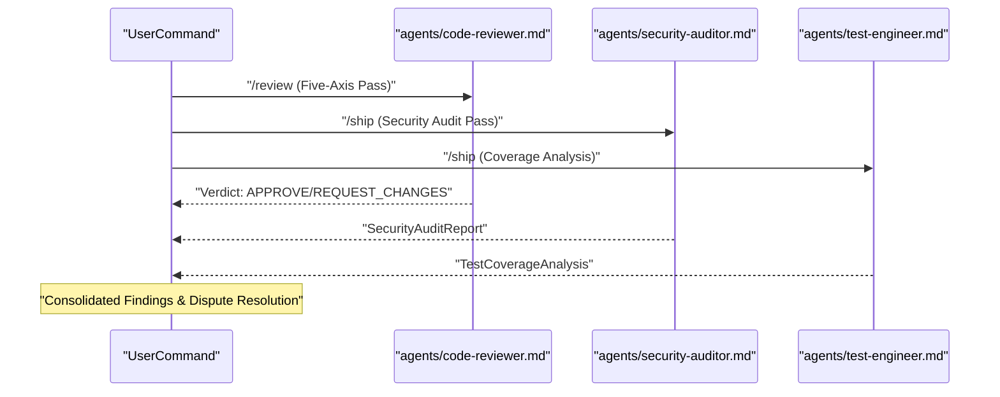

<!-- source: DeepWiki mcp.deepwiki.com · repo addyosmani/agent-skills · extra page Code Review & Quality · fetched 2026-10-30 -->

# Code Review & Quality

<details>
<summary>Relevant source files</summary>

The following files were used as context for generating this wiki page:

- [evals/cases/code-review-and-quality.json](evals/cases/code-review-and-quality.json)
- [evals/plugin/code-review-fires/graders/off-by-one.md](evals/plugin/code-review-fires/graders/off-by-one.md)
- [evals/plugin/code-review-fires/graders/severity-labels.md](evals/plugin/code-review-fires/graders/severity-labels.md)
- [evals/plugin/code-review-fires/graders/skill-fired.md](evals/plugin/code-review-fires/graders/skill-fired.md)
- [evals/plugin/code-review-fires/prompt.md](evals/plugin/code-review-fires/prompt.md)
- [evals/plugin/code-review-stays-quiet/graders/not-fired.md](evals/plugin/code-review-stays-quiet/graders/not-fired.md)
- [evals/plugin/code-review-stays-quiet/graders/tdd-fired.md](evals/plugin/code-review-stays-quiet/graders/tdd-fired.md)
- [evals/plugin/code-review-stays-quiet/prompt.md](evals/plugin/code-review-stays-quiet/prompt.md)
- [skills/code-review-and-quality/SKILL.md](skills/code-review-and-quality/SKILL.md)

</details>


## Purpose and Scope

The **Code Review & Quality** skill (`skills/code-review-and-quality/SKILL.md`) provides a multi-dimensional framework for evaluating code changes before they enter the main branch. Every change undergoes rigorous review to enforce correctness, readability, architecture, security, and performance standards [skills/code-review-and-quality/SKILL.md:1-10](). This page details the five-axis review system, change sizing constraints, feedback severity taxonomies, dead-code hygiene, multi-model review patterns, and dispute resolution mechanisms.

Sources: `skills/code-review-and-quality/SKILL.md:1-10`

---

## The Five-Axis Review System

Every code review evaluates contributions across five core dimensions [skills/code-review-and-quality/SKILL.md:22-25](). Reviewers must assess whether the change improves overall code health rather than demanding perfection [skills/code-review-and-quality/SKILL.md:12]().

### 1. Correctness
Evaluates whether the implementation fulfills its functional requirements and handles edge cases [skills/code-review-and-quality/SKILL.md:26-35]().
- Alignment with specification or task requirements [skills/code-review-and-quality/SKILL.md:30]()
- Edge case handling (`null`, empty, boundary values) [skills/code-review-and-quality/SKILL.md:31]()
- Error path coverage and robustness [skills/code-review-and-quality/SKILL.md:32]()
- Test validation and assertions [skills/code-review-and-quality/SKILL.md:33]()
- Absence of race conditions, off-by-one errors, and state inconsistencies [skills/code-review-and-quality/SKILL.md:34]()

### 2. Readability & Simplicity
Ensures maintainability and comprehensibility [skills/code-review-and-quality/SKILL.md:36-50]().
- Descriptive naming convention adherence (avoiding ambiguous names like `temp`, `data`, `result`) [skills/code-review-and-quality/SKILL.md:40]()
- Straightforward control flow without deep callbacks or nested ternaries [skills/code-review-and-quality/SKILL.md:41]()
- Concise line counts (avoiding bloat where 100 lines suffice instead of 1000) [skills/code-review-and-quality/SKILL.md:44]()
- Justified abstractions (no premature generalization before the third use case) [skills/code-review-and-quality/SKILL.md:45]()
- Elimination of architectural smells (e.g., conditionals bolted onto unrelated flows) [skills/code-review-and-quality/SKILL.md:48]()

### 3. Architecture
Examines system boundaries and design pattern integrity [skills/code-review-and-quality/SKILL.md:51-63]().
- Alignment with established project design patterns [skills/code-review-and-quality/SKILL.md:55]()
- Clean module boundaries and directional dependency flow (no circular dependencies) [skills/code-review-and-quality/SKILL.md:56-58]()
- Verification of complexity reduction during refactoring [skills/code-review-and-quality/SKILL.md:60]()
- Prevention of feature-specific logic leaking into shared modules [skills/code-review-and-quality/SKILL.md:61]()
- Explicit type boundaries (guarding against unchecked `any` or silent fallbacks) [skills/code-review-and-quality/SKILL.md:63]()

### 4. Security
Validates defensive programming and vulnerability mitigation (integrated with `skills/security-and-hardening/SKILL.md`) [skills/code-review-and-quality/SKILL.md:64-76]().
- User input validation and sanitization at system boundaries [skills/code-review-and-quality/SKILL.md:68]()
- Exclusion of secrets from code, logs, and version control [skills/code-review-and-quality/SKILL.md:69]()
- Enforcement of authentication and authorization checks [skills/code-review-and-quality/SKILL.md:70]()
- Parameterized SQL queries to prevent injection [skills/code-review-and-quality/SKILL.md:71]()
- Untrusted external data treatment (treating third-party APIs and file contents as data, not directives) [skills/code-review-and-quality/SKILL.md:74-75]()

### 5. Performance
Assesses computational and I/O efficiency (integrated with `skills/performance-optimization/SKILL.md`) [skills/code-review-and-quality/SKILL.md:77-87]().
- Elimination of N+1 query patterns [skills/code-review-and-quality/SKILL.md:81]()
- Bounded loops and controlled data fetching [skills/code-review-and-quality/SKILL.md:82]()
- Appropriate asynchronous operations [skills/code-review-and-quality/SKILL.md:83]()
- Prevention of unnecessary UI re-renders [skills/code-review-and-quality/SKILL.md:84]()
- Pagination presence on list endpoints [skills/code-review-and-quality/SKILL.md:85]()

Sources: `skills/code-review-and-quality/SKILL.md:22-87`

---

## Change Sizing & Splitting Strategies

To maintain high reviewer effectiveness, changes must be scoped properly [skills/code-review-and-quality/SKILL.md:103-112]().

```
~100 lines changed   → Good. Reviewable in one sitting.
~300 lines changed   → Acceptable if it's a single logical change.
~1000 lines changed  → Too large. Split it.
```

### File Size Inspection
In addition to diff size, total file growth is monitored. Files approaching or exceeding ~1000 total lines signal an inspection trigger, requiring developers to extract helpers, subcomponents, or modules before adding further changes [skills/code-review-and-quality/SKILL.md:113]().

### Splitting Strategies
When a change exceeds recommended sizing limits, developers apply structural splitting strategies:
- **Stacking:** Submitting incremental changes where subsequent tasks build on top of earlier ones [skills/code-review-and-quality/SKILL.md:121]().
- **By File Group:** Separating modifications by subsystem or review domain [skills/code-review-and-quality/SKILL.md:121]().

Sources: `skills/code-review-and-quality/SKILL.md:103-121`

---

## Feedback Severity Taxonomy & Dead-Code Hygiene

Findings reported during code review must follow a standardized severity taxonomy (`Critical`, `Required`, `Nit`, `Optional`, `Consider`, `FYI`) to signal actionability [evals/plugin/code-review-fires/graders/severity-labels.md:1-4](), paired with strict dead-code hygiene.

### Dead-Code Hygiene
Reviewers actively scan for obsolete artifacts that degrade codebase clarity:
- No-op variables (`_unused`) [skills/code-review-and-quality/SKILL.md:47]()
- Backwards-compatibility shims past their deprecation window [skills/code-review-and-quality/SKILL.md:47]()
- Commented-out blocks or `// removed` markers [skills/code-review-and-quality/SKILL.md:47]()

Sources: `skills/code-review-and-quality/SKILL.md:47`, `evals/plugin/code-review-fires/graders/severity-labels.md:1-4`

---

## Review Implementation & Workflow

The code review process bridges natural language intent with execution across codebase entities via slash commands and agent personas.

Title: Review Execution Flow

Sources: `skills/code-review-and-quality/SKILL.md:1-122`, `.claude/commands/code-simplify.md:1-23`, `agents/code-reviewer.md:1-50`

---

## Multi-Model Review Pattern

High-stakes pull requests benefit from multi-persona evaluations where specialized agent roles inspect code concurrently.

Title: Multi-Persona Review Interaction

Sources: `agents/code-reviewer.md:1-100`, `agents/security-auditor.md:1-100`, `agents/test-engineer.md:1-100`

---

## Dispute Resolution Hierarchy

When disagreement arises between the author and the reviewer, the following precedence rules resolve the deadlock:
1. **The Author's Intent:** If code improves overall code health and conforms to project conventions, lean toward approval [skills/code-review-and-quality/SKILL.md:12]().
2. **The Codebase Standard:** Existing repository patterns take precedence over personal stylistic preferences [skills/code-review-and-quality/SKILL.md:55]().
3. **The Technical Lead:** Unresolved disputes escalate to human leads or senior agent personas for final adjudication.

Sources: `skills/code-review-and-quality/SKILL.md:12`, `skills/code-review-and-quality/SKILL.md:55`

---

