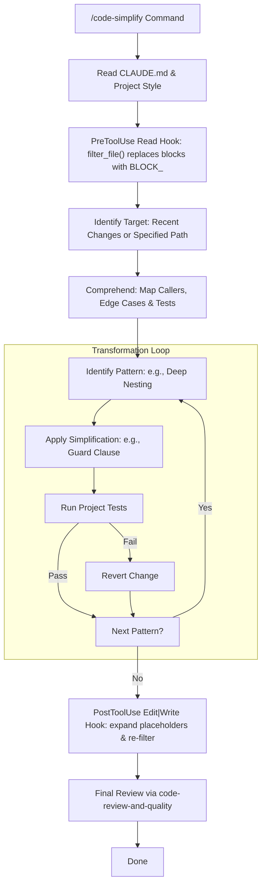
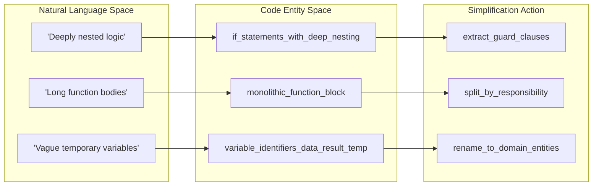
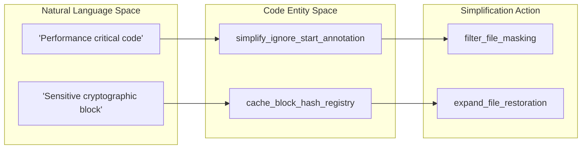

<!-- source: DeepWiki mcp.deepwiki.com · repo addyosmani/agent-skills · extra page Code Simplification · fetched 2026-10-30 -->

# Code Simplification

<details>
<summary>Relevant source files</summary>

The following files were used as context for generating this wiki page:

- [.claude/commands/code-simplify.md](.claude/commands/code-simplify.md)
- [commands/build.toml](commands/build.toml)
- [commands/code-simplify.toml](commands/code-simplify.toml)
- [commands/planning.toml](commands/planning.toml)
- [commands/test.toml](commands/test.toml)
- [hooks/SIMPLIFY-IGNORE.md](hooks/SIMPLIFY-IGNORE.md)
- [hooks/sdd-cache-test.sh](hooks/sdd-cache-test.sh)
- [hooks/simplify-ignore-test.sh](hooks/simplify-ignore-test.sh)
- [hooks/simplify-ignore.sh](hooks/simplify-ignore.sh)
- [skills/api-and-interface-design/SKILL.md](skills/api-and-interface-design/SKILL.md)
- [skills/code-simplification/SKILL.md](skills/code-simplification/SKILL.md)
- [skills/context-engineering/SKILL.md](skills/context-engineering/SKILL.md)

</details>


The **Code Simplification** wiki page covers the `code-simplification` skill, its core principles, behavior preservation gates, structural signals, the four-step pipeline, language-specific patterns, and the integration between the `/code-simplify` command and the `simplify-ignore` hook system (`hooks/simplify-ignore.sh`) [skills/code-simplification/SKILL.md:6-12](), [hooks/simplify-ignore.sh:1-15](), [commands/code-simplify.toml:1-21]().

Sources: [skills/code-simplification/SKILL.md:6-12](), [hooks/simplify-ignore.sh:1-15](), [commands/code-simplify.toml:1-21]()

## Purpose and Scope

The code-simplification skill provides a model-agnostic, process-driven framework for reducing code complexity without altering runtime behavior [skills/code-simplification/SKILL.md:6-12](). It focuses on cognitive load reduction, ensuring that code readability and maintainability are systematically improved following feature implementation or review [skills/code-simplification/SKILL.md:12-22]().

Sources: [skills/code-simplification/SKILL.md:6-22]()

## Core Principles & Behavioral Preservation Gates

Simplification is governed by five core principles designed to prevent unnecessary code churn, regressions, and over-simplification traps [skills/code-simplification/SKILL.md:30-103]().

1. **Preserve Behavior Exactly**: All inputs, outputs, side effects, error behavior, and edge cases must remain identical [skills/code-simplification/SKILL.md:32-34]().
2. **Follow Project Conventions**: Align with `CLAUDE.md` and neighboring code patterns regarding module systems, import ordering, naming, and error handling [skills/code-simplification/SKILL.md:46-59]().
3. **Prefer Clarity Over Cleverness**: Explicit code is preferred over dense compact code that requires mental parsing [skills/code-simplification/SKILL.md:61-90]().
4. **Maintain Balance**: Avoid over-simplification traps such as aggressive inlining or removing abstractions required for extensibility or testability [skills/code-simplification/SKILL.md:92-99]().
5. **Scope to What Changed**: Default to simplifying recently modified code to minimize diff noise and unintended side effects [skills/code-simplification/SKILL.md:101-103]().

Sources: [skills/code-simplification/SKILL.md:30-103]()

## The Four-Step Pipeline

The execution pipeline for code simplification transitions code through four structured phases:

1. **Comprehend (Chesterton's Fence)**: Understand the code's responsibility, callers, callees, edge cases, error paths, and existing test coverage before modifying anything [skills/code-simplification/SKILL.md:107-121]().
2. **Identify**: Scan for concrete structural signals, generic naming issues, and redundant logic [skills/code-simplification/SKILL.md:123-151]().
3. **Apply**: Implement incremental transformations while executing test suites after each change [commands/code-simplify.toml:18-18]().
4. **Verify**: Ensure all tests pass, the build compiles successfully, the diff is clean, and invoke `code-review-and-quality` for review [commands/code-simplify.toml:19-21]().

Sources: [skills/code-simplification/SKILL.md:105-151](), [commands/code-simplify.toml:8-21]()

## Structural Signals and Language-Specific Patterns

The skill targets specific structural smells, naming issues, and redundant patterns:

| Category | Signal | Simplification Action |
| :--- | :--- | :--- |
| **Structural** | Deep nesting (3+ levels) | Extract guard clauses or helper functions [skills/code-simplification/SKILL.md:131-131]() |
| **Structural** | Long functions (50+ lines) | Split into focused functions by responsibility [skills/code-simplification/SKILL.md:132-132]() |
| **Structural** | Nested ternaries | Replace with `if/else` chains, `switch` statements, or lookup objects [skills/code-simplification/SKILL.md:133-133]() |
| **Naming** | Generic names (`data`, `result`, `temp`) | Rename to domain-descriptive identifiers (`userProfile`, `validationErrors`) [skills/code-simplification/SKILL.md:141-141]() |
| **Redundancy** | Duplicated logic | Extract shared code into a common helper function [skills/code-simplification/SKILL.md:150-151]() |

- **TS/JS & React**: Converting nested ternaries into early returns or lookup maps [skills/code-simplification/SKILL.md:65-76](); replacing complex `reduce` chains with named intermediate collections and loops [skills/code-simplification/SKILL.md:78-90]().
- **Python**: Leveraging list comprehensions and flattening nested `if` blocks with guard clauses (`return` or `continue`).

Sources: [skills/code-simplification/SKILL.md:65-90](), [skills/code-simplification/SKILL.md:127-151]()

## Hook Architecture (`simplify-ignore.sh`) & `/code-simplify` Integration

To protect performance-critical or sensitive code blocks from modification during automated simplification, the `simplify-ignore` hook system (`hooks/simplify-ignore.sh`) integrates with Claude Code tool events (`PreToolUse`, `PostToolUse`, and `Stop`) [hooks/SIMPLIFY-IGNORE.md:1-43](), [hooks/simplify-ignore.sh:2-15]().

### Hook Lifecycle and Data Flow

- **`PreToolUse Read`**: Backs up target files to `.claude/.simplify-ignore-cache/` and replaces annotated blocks with `BLOCK_<hash>` placeholders in-place on disk via `filter_file()` [hooks/SIMPLIFY-IGNORE.md:55-55](), [hooks/simplify-ignore.sh:70-153](). The AI agent reasons about the surrounding logic without viewing the protected implementation [hooks/SIMPLIFY-IGNORE.md:45-45]().
- **`PostToolUse Edit|Write`**: Expands placeholders back to real code using `expand_file()`, merges model changes, and re-filters the file so protected blocks remain hidden on disk [hooks/SIMPLIFY-IGNORE.md:56-56](), [hooks/simplify-ignore.sh:155-167]().
- **`Stop`**: Restores placeholders left on disk to ensure changes survive across sessions, falling back to cached backups when necessary [hooks/SIMPLIFY-IGNORE.md:57-57]().

### Annotation Syntax and Crash Recovery

Annotate protected blocks using any comment syntax (`//`, `/*`, `#`, `<!--`) with optional reasons [hooks/SIMPLIFY-IGNORE.md:61-70]():
```javascript
/* simplify-ignore-start: perf-critical */
result[0] = buf[0] ^ key[0];
/* simplify-ignore-end */
```
Content-hashed blocks (using 8 hex characters via `shasum` or `sha1sum`) ensure unambiguous round-trip expansions [hooks/SIMPLIFY-IGNORE.md:59-59](). If crashes occur leaving placeholders on disk, manual recovery is executed via [hooks/SIMPLIFY-IGNORE.md:71-77]():
```bash
echo '{}' | bash hooks/simplify-ignore.sh
```

Sources: [hooks/simplify-ignore.sh:1-167](), [hooks/SIMPLIFY-IGNORE.md:1-92](), [commands/code-simplify.toml:1-21]()

## Diagrams

### Simplification Execution Flow and Hook Interaction

Sources: [skills/code-simplification/SKILL.md:105-155](), [commands/code-simplify.toml:8-21](), [hooks/simplify-ignore.sh:70-153]()

### Natural Language to Code Entity Space: Structural & Naming Refactoring

Sources: [skills/code-simplification/SKILL.md:127-146](), [commands/code-simplify.toml:11-17]()

### Natural Language to Code Entity Space: Hook Protection Routing

Sources: [hooks/SIMPLIFY-IGNORE.md:1-48](), [hooks/simplify-ignore.sh:70-167]()

---

