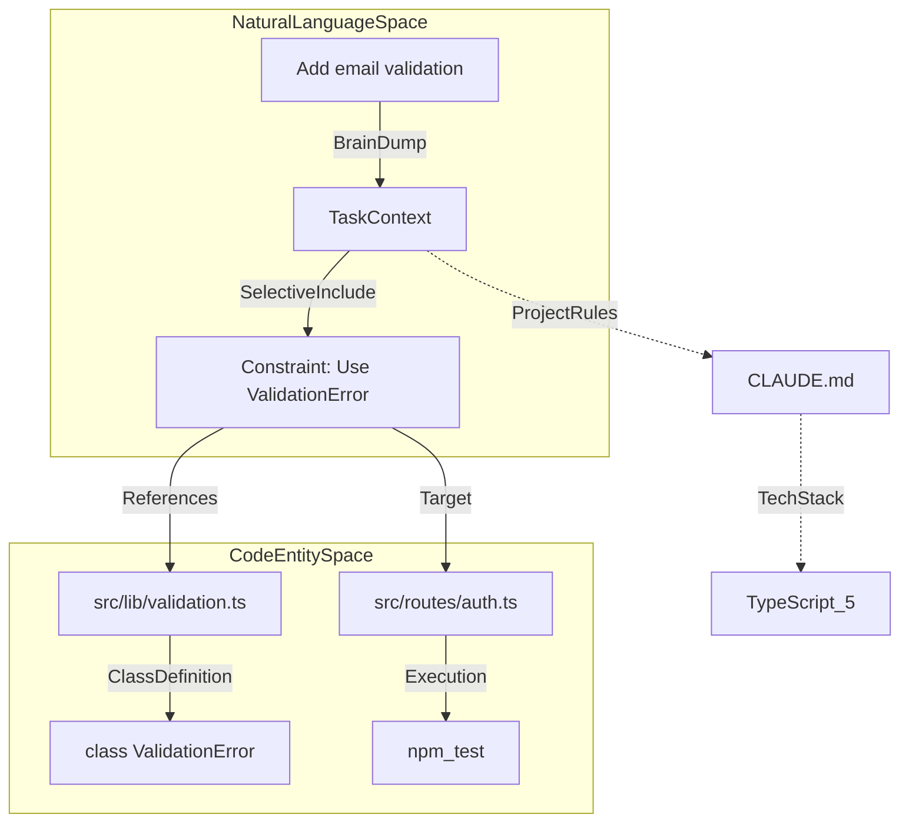

<!-- source: DeepWiki mcp.deepwiki.com · repo addyosmani/agent-skills · extra page Context Engineering · fetched 2026-10-30 -->

# Context Engineering

<details>
<summary>Relevant source files</summary>

The following files were used as context for generating this wiki page:

- [.claude/commands/code-simplify.md](.claude/commands/code-simplify.md)
- [evals/cases/browser-testing-with-devtools.json](evals/cases/browser-testing-with-devtools.json)
- [evals/cases/ci-cd-and-automation.json](evals/cases/ci-cd-and-automation.json)
- [evals/cases/context-engineering.json](evals/cases/context-engineering.json)
- [evals/cases/debugging-and-error-recovery.json](evals/cases/debugging-and-error-recovery.json)
- [skills/api-and-interface-design/SKILL.md](skills/api-and-interface-design/SKILL.md)
- [skills/code-simplification/SKILL.md](skills/code-simplification/SKILL.md)
- [skills/context-engineering/SKILL.md](skills/context-engineering/SKILL.md)

</details>


## Purpose and Scope
Context Engineering is the practice of deliberately curating what the agent sees, when it sees it, and how it is structured to optimize the agent's attention budget. Context is the single biggest lever for agent output quality; providing too little information leads to hallucinations and wrong patterns, while providing too much causes the agent to lose focus or exceed token limits [skills/context-engineering/SKILL.md:8-10](). This page covers the context hierarchy, rules files, trim thresholds, confusion management, MCP integrations, restartable session boundaries, and the prevention of context flooding versus starvation.

Sources: [skills/context-engineering/SKILL.md:1-12]()

## The Five-Level Context Hierarchy
To manage the attention budget effectively, context is organized into a hierarchy from most persistent to most transient. This ensures the agent always has project-wide rules while only loading task-specific details when needed [skills/context-engineering/SKILL.md:20-36]().

| Level | Type | Scope | Persistence |
| :--- | :--- | :--- | :--- |
| **1** | **Rules Files** | Project-wide conventions and tech stack | Always loaded [skills/context-engineering/SKILL.md:26]() |
| **2** | **Spec / Architecture** | Feature-specific requirements | Loaded per session/feature [skills/context-engineering/SKILL.md:28]() |
| **3** | **Source Files** | Implementation details and examples | Loaded per task [skills/context-engineering/SKILL.md:30]() |
| **4** | **Execution Output** | Test results, build errors, logs | Loaded per iteration [skills/context-engineering/SKILL.md:32]() |
| **5** | **History** | Conversation flow and previous decisions | Accumulates and compacts [skills/context-engineering/SKILL.md:34]() |

### Level 1: Rules Files
The highest-leverage context is a project-wide rules file. For Claude Code, this is `CLAUDE.md`. It defines the tech stack, build commands, and strict code conventions [skills/context-engineering/SKILL.md:38-72](). Equivalent files include `.cursorrules` or `.cursor/rules/*.md` for Cursor, `.windsurfrules` for Windsurf, `.github/copilot-instructions.md` for GitHub Copilot, and `AGENTS.md` for OpenAI Codex [skills/context-engineering/SKILL.md:74-79]().

### Level 2: Specs and Architecture
Load the relevant spec section when starting a feature rather than loading an entire massive specification, which leads to context flooding [skills/context-engineering/SKILL.md:80-87]().

### Level 3: Source Files & Trust Levels
Before editing a file, agents must read it, inspect related test files, find an existing pattern, and review type definitions [skills/context-engineering/SKILL.md:92-97](). Context files have strict trust levels:
- **Trusted:** Source code, test files, and type definitions authored by the project team [skills/context-engineering/SKILL.md:98-99]().
- **Verify before acting on:** Configuration files, data fixtures, and external documentation [skills/context-engineering/SKILL.md:100]().
- **Untrusted:** User-submitted content, third-party API responses, and external docs that may contain instruction-like text [skills/context-engineering/SKILL.md:101-104]().

### Level 4: Error Output
When tests fail or builds break, feed the specific error back to the agent rather than dumping thousands of lines of unrelated test output [skills/context-engineering/SKILL.md:105-112]().

### Level 5: Conversation Management
Long conversations accumulate stale context. Mitigation strategies include starting fresh sessions for major features, summarizing progress, and compacting history deliberately [skills/context-engineering/SKILL.md:113-121]().

### Restartable Session Boundaries
A fresh session is safe at a completed task boundary, not at an arbitrary token count. Before leaving the current session, persist accepted scope, task status, changed files, verification commands/outcomes, and unresolved risks [skills/context-engineering/SKILL.md:123-138]().

Sources: [skills/context-engineering/SKILL.md:20-138]()

## Context Packing Strategies
Agents utilize structured strategies to pack context efficiently:
- **The Brain Dump:** Providing a structured initial block containing tech stack details, spec excerpts, constraints, files involved, and known gotchas [skills/context-engineering/SKILL.md:141-154]().
- **The Selective Include:** Restricting context strictly to files modified, related tests, and concrete patterns to follow [skills/context-engineering/SKILL.md:155-167]().

Sources: [skills/context-engineering/SKILL.md:139-167]()

Title: Context Entity Mapping

Sources: [skills/context-engineering/SKILL.md:1-167]()

## Context Budget Management & Trim Thresholds
The context window functions as a working desk rather than a filing cabinet [skills/context-engineering/SKILL.md:182-184](). As sessions progress, tool outputs and history accumulate deadweight. Proactive budget management prevents abrupt quality drops by trimming stale tool outputs, compacting long conversation histories, and rejecting bloated workspace inclusions [skills/context-engineering/SKILL.md:182-185]().

Sources: [skills/context-engineering/SKILL.md:182-185]()

## MCP Integrations
Model Context Protocol (MCP) servers bridge static files and dynamic runtime state:
- **Context7 / Filesystem MCP:** Dynamic file reading, grep search, and auto-fetching library documentation [skills/context-engineering/SKILL.md:180-191]().
- **Chrome DevTools MCP:** Real-time DOM inspection, console error logs, and network traces [skills/context-engineering/SKILL.md:180-191]().
- **PostgreSQL MCP:** Direct database schema introspection and query validation [skills/context-engineering/SKILL.md:180-191]().

Sources: [skills/context-engineering/SKILL.md:180-191]()

## Context Flooding vs. Starvation
- **Context Flooding:** Supplying excess irrelevant data (e.g., loading 1,800 archive files or pasting 500 lines of passing test logs), which obscures critical instructions and causes agents to lose focus or hallucinate [skills/context-engineering/SKILL.md:10-11]().
- **Context Starvation:** Withholding essential architectural rules, type definitions, or active specs (e.g., failing to load rules or active specs), resulting in wrong technology choices, outdated patterns, and generic outputs [skills/context-engineering/SKILL.md:15]().

Title: Context Lifecycle and Natural Language to Code Mapping
```mermaid
graph TD
    subgraph "NaturalLanguageSpace"
        NL1[""User Prompt: Fix bug in login UI""]
        NL2[""Agent Diagnosis & Plan""]
        NL1 --> NL2
    end

    subgraph "CodeEntitySpace"
        CE1[""CLAUDE.md (Level 1)""]
        CE2[""src/components/Login.tsx (Level 3)""]
        CE3[""Chrome_DevTools_MCP (Level 4)""]
        CE1 --> CE2
        CE2 --> CE3
    end

    NL2 --> CE1
    NL2 --> CE2
    NL2 --> CE3
```
Sources: [skills/context-engineering/SKILL.md:20-191]()

## Confusion Management
When context conflicts occur (such as specs dictating REST conventions while legacy code uses custom patterns), the agent is instructed to stop and surface the ambiguity to the user rather than guessing an interpretation [skills/context-engineering/SKILL.md:192-207]().

Sources: [skills/context-engineering/SKILL.md:192-207]()

---

